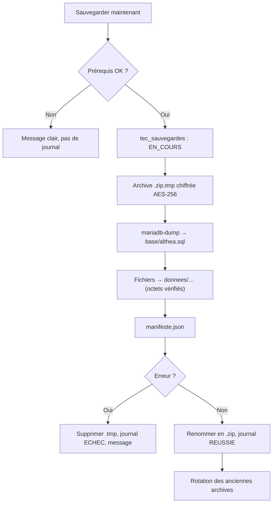
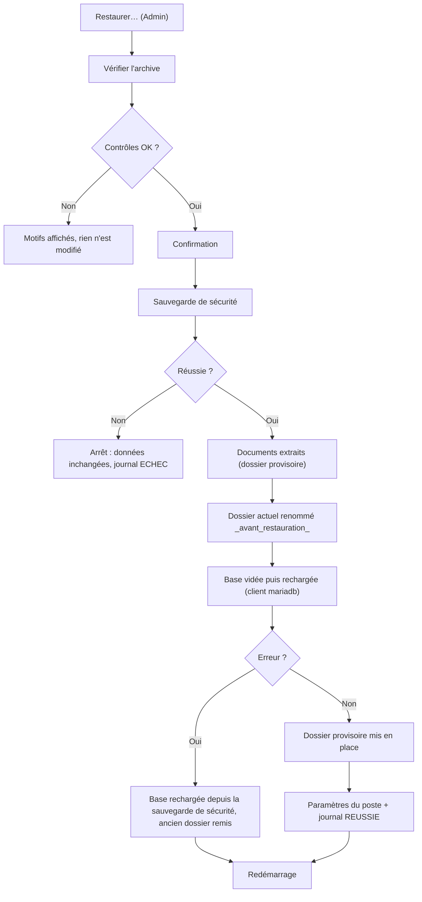
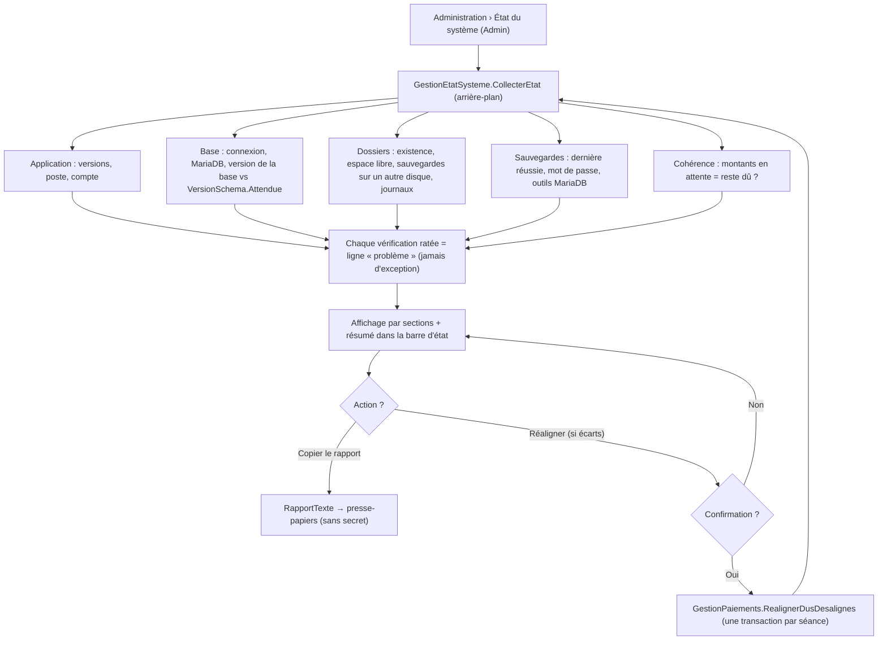
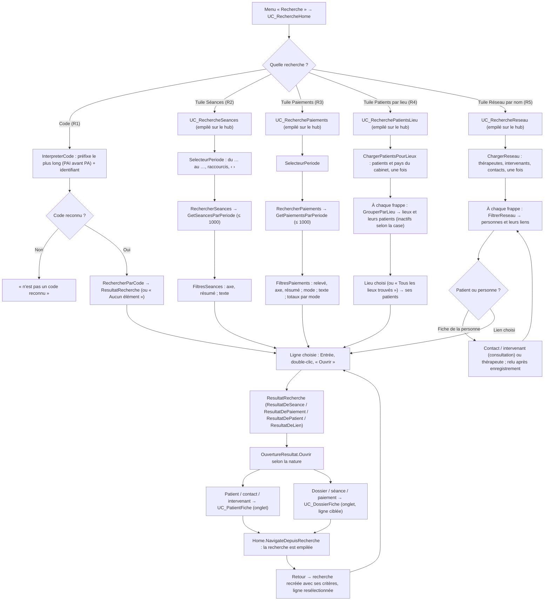

# Processus Althéa — Administration et recherche

> Partie des [processus d'Althéa](../Process_Althea.md) : sommaire et historique.
> Dernière mise à jour : 25/10/2026 — document scindé en trois parties (décision de Joëlle)

Sauvegarde, restauration, état du système, recherche transversale.

---

# Processus 21 – Sauvegarde complète chiffrée

**Statut : Implémenté** — lot 30, étape P2 (v2.38.0, ADR-37) ; restauration : processus 22

**Traçabilité mainteneur (VB) :**
- [`UI/Controls/Administration/UC_Sauvegardes.vb`](../../../UI/Controls/Administration/UC_Sauvegardes.vb)
- [`Metier/Sauvegardes/GestionSauvegardes.vb`](../../../Metier/Sauvegardes/GestionSauvegardes.vb)
- [`Core/Configuration/MotDePasseSauvegarde.vb`](../../../Core/Configuration/MotDePasseSauvegarde.vb)
- [`Core/Database/Queries/QuerySauvegardes.vb`](../../../Core/Database/Queries/QuerySauvegardes.vb)

## Objectif

Produire en un clic une archive **complète, cohérente et protégée** de tout ce qu'il faut pour remettre Althéa en service : la base et le dossier de données.

## Contenu de l'archive

`Althea_AAAAMMJJ_HHMMSS.zip`, chiffrée WinZip AES-256 (s'ouvre aussi avec 7-Zip ou WinRAR) :

| Entrée | Contenu |
|---|---|
| `base/althea.sql` | Dump complet `mariadb-dump` (tables, séquences, vues, déclencheurs, routines) |
| `donnees/…` | Tout le dossier de données (`PATH_GENERAL` : Documents, Cabinet, Utilisateurs), sans les verrous Office `~$…` |
| `manifeste.json` | Date, versions de l'application et du schéma, base, machine, compte, volumes |

## Étapes

1. **Prérequis** (aucune ligne de journal si l'un manque) : rôle SuperUser ou Admin, dossier des sauvegardes choisi et accessible (hors dossier de données), mot de passe défini sur le poste, `mariadb-dump` trouvé (Program Files ou `SAUVEGARDE_DOSSIER_MARIADB`), racine des données accessible, configuration de connexion valide.
2. **Journal** : ligne `EN_COURS` dans `tec_sauvegardes`.
3. **Archive provisoire** `….zip.tmp` :
   - dump de la base copié **directement** dans l'entrée chiffrée (jamais en clair sur le disque ; mot de passe de la base passé par un fichier d'options temporaire supprimé aussitôt) ;
   - copie des fichiers en lecture partagée ; **octets lus comparés à la taille** — un fichier illisible (document ouvert dans Word) fait échouer la sauvegarde avec un message qui le nomme ;
   - manifeste.
4. **Renommage** en `.zip`, journal `REUSSIE` (taille, nombre de fichiers).
5. **Rotation** : seules les `SAUVEGARDE_NB_CONSERVEES` archives les plus récentes au motif exact `Althea_AAAAMMJJ_HHMMSS.zip` sont gardées ; les `.tmp` abandonnés de plus de 24 h sont supprimés.
6. **Échec** : `.tmp` supprimé, journal `ECHEC` avec le détail, message clair. Une ligne restée `EN_COURS` (fermeture forcée) s'affiche « Interrompue ».

## Écran et sécurité

- L'opération tourne en arrière-plan (`Task.Run` + `IProgress`) ; l'écran bloque navigation et fermeture pendant ce temps (`IUnsavedChangesAware`).
- Mot de passe des archives : propre au cabinet (pas un mot de passe de connexion), défini par l'**Admin** (12 caractères dont majuscule, minuscule, chiffre), chiffré DPAPI dans `%APPDATA%\Althea\althea.sauvegarde.json`, jamais journalisé ni stocké en base ; à noter sur papier.
- Rappel à l'ouverture (`Home_Shown`) pour SuperUser et Admin : aucune sauvegarde réussie, ou dernière plus ancienne que `SAUVEGARDE_RAPPEL_JOURS`.

## Flowchart – Processus 21 (Sauvegarde)



---

# Processus 22 – Restauration d'une sauvegarde

**Statut : Implémenté** — lot 30, étape P3 (v2.39.0, ADR-38) ; validé le 13/10/2026, remise en état automatique non encore testée

**Traçabilité mainteneur (VB) :**
- [`UI/Forms/Sauvegardes/DialogRestauration.vb`](../../../UI/Forms/Sauvegardes/DialogRestauration.vb)
- [`Metier/Sauvegardes/GestionRestaurations.vb`](../../../Metier/Sauvegardes/GestionRestaurations.vb)
- [`Metier/Sauvegardes/OutilsMariaDB.vb`](../../../Metier/Sauvegardes/OutilsMariaDB.vb)
- [`Core/Database/Queries/QueryRestaurations.vb`](../../../Core/Database/Queries/QueryRestaurations.vb)
- Guide : [`Docs/Guide/Guide_Utilisateur_Sauvegardes.md`](../../Guide/Guide_Utilisateur_Sauvegardes.md)

## Objectif

Remettre Althéa dans l'état d'une archive (base **et** dossier de données) depuis l'écran, sans jamais laisser l'application sans base, et en gardant une trace de chaque tentative.

## Étapes

1. **Choix** (Admin, `UC_Sauvegardes` › « Restaurer… ») : archive du dossier des sauvegardes ou « Parcourir… » ; mot de passe du poste ou saisi ; compte MariaDB d'administration (`root` proposé), jamais enregistré.
2. **Vérification, sans rien modifier** (`VerifierArchive` = `LireArchive` + `ControlerRestauration` ; un mot de passe faux est un résultat, pas une exception) :
   - archive lisible avec le mot de passe, manifeste et dump présents, format pris en charge ;
   - **même version du schéma** que la base ;
   - client `mariadb.exe` trouvé (Program Files ou `SAUVEGARDE_DOSSIER_MARIADB`) ;
   - racine des données accessible et archive hors de ce dossier ;
   - espace disque ;
   - mot de passe des sauvegardes défini (sauvegarde de sécurité) ;
   - compte d'administration accepté et doté des droits utiles (`SHOW GRANTS` : SELECT, INSERT, UPDATE, DELETE, CREATE, DROP, ALTER, INDEX, et ceux des vues / déclencheurs / routines s'il y en a).
   - Toute modification d'un choix annule la vérification.
3. **Confirmation** avec le récapitulatif de l'archive.
4. **Sauvegarde de sécurité** de l'état actuel (`GestionSauvegardes.Sauvegarder`, sans rotation). Échec → arrêt, rien n'est modifié.
5. **Extraction** des entrées `donnees/…` dans `<racine>_restauration_<horodatage>` : chemins contrôlés, taille de chaque fichier et nombre total comparés à l'archive et au manifeste.
6. **Mise de côté** du dossier actuel : renommé `<racine>_avant_restauration_<horodatage>` (refus si un fichier y est ouvert → arrêt, rien n'est modifié).
7. **Base** : tous les objets de la base configurée supprimés (tables, vues, séquences, routines ; clés étrangères désactivées pour la session), puis dump envoyé au client `mariadb` depuis l'entrée chiffrée (jamais écrit en clair).
8. **Mise en place** du dossier provisoire à la place de la racine.
9. **Finalisation** :
   - paramètres propres au poste réécrits (`PATH_GENERAL`, `SAUVEGARDE_DOSSIER`, `SAUVEGARDE_DOSSIER_MARIADB`) ;
   - ligne `REUSSIE` dans `tec_restaurations` (base restaurée) ;
   - journal des sauvegardes remis d'aplomb (la ligne de l'archive restaurée, restée « en cours » dans son propre dump, est clôturée ; la sauvegarde de sécurité est réinscrite) ;
   - journal Security.
10. **Redémarrage** de l'application (`Application.Restart`) : retour à la connexion, avec les comptes de l'archive.

## Échecs

| Moment | Remise en état | Journal |
|---|---|---|
| Avant l'étape 7 | Dossier provisoire supprimé, ancien dossier remis s'il avait été déplacé. Données inchangées. | `ECHEC` dans la base actuelle |
| Étape 7 ou 8 | Base vidée puis rechargée depuis la sauvegarde de sécurité ; ancien dossier remis ; redémarrage. | `ECHEC` dans la base remise en état |
| Remise en état impossible | Message d'alerte : base incomplète, restauration manuelle de la sauvegarde de sécurité (guide, chapitre 6). | Fichier journal seulement |

Les messages du client `mariadb` recopient la requête fautive (donc des données de patients) : seuls le code d'erreur et la ligne sont repris (`MessageSansDonnees`).

## Flowchart – Processus 22 (Restauration)



---

# Processus 23 – État du système

**Statut : Implémenté et validé** — 13/10/2026 (Administration, Admin seulement)

**Traçabilité mainteneur (VB) :**
- [`UI/Controls/Administration/UC_EtatSysteme.vb`](../../../UI/Controls/Administration/UC_EtatSysteme.vb)
- [`Metier/Systeme/GestionEtatSysteme.vb`](../../../Metier/Systeme/GestionEtatSysteme.vb)
- [`Core/Database/VersionSchema.vb`](../../../Core/Database/VersionSchema.vb)
- [`Core/Database/Queries/QueryEtatSysteme.vb`](../../../Core/Database/Queries/QueryEtatSysteme.vb)

## Objectif

Voir d'un coup d'œil si le poste et l'application sont en ordre, et pouvoir transmettre cet état en une fois pour un diagnostic, sans jamais exposer de secret.

## Contenu

| Section | Lignes (appréciation) |
|---|---|
| Application | Version d'Althéa, .NET, système, poste, compte Windows, dossier du programme (information). |
| Cohérence des données (22/10/2026) | **Montants en attente des séances** : chaque séance doit avoir un montant en attente égal à son reste dû (règle unique, ADR-26) ; sinon « n séance(s)… », à vérifier, et le bouton **Réaligner les montants en attente** (Admin, après confirmation) les recalcule par `GestionPaiements.RealignerDusDesalignes` — une transaction par séance, même dans un dossier clôturé ou archivé ou sur une séance reportée (donnée dérivée : ni la séance ni un encaissement ne changent), identifiants seulement au journal. |
| Base de données | Serveur, base, compte de l'application (sans mot de passe) ; connexion (OK / problème) ; version de MariaDB ; **version de la base comparée à `VersionSchema.Attendue`** : égale = OK, plus ancienne = migration(s) à appliquer, plus récente = application à mettre à jour (problème). |
| Dossiers et espace disque | Dossier de données, dossier des sauvegardes, dossier des journaux, configuration du poste : existence et espace libre (à vérifier sous 1 Go) ; **sauvegardes sur un autre disque que les données** (à vérifier sinon) ; journaux conservés (jours, volume). |
| Sauvegardes | Dernière sauvegarde réussie (à vérifier au-delà de `SAUVEGARDE_RAPPEL_JOURS`), mot de passe des archives sur ce poste, outils `mariadb-dump` et `mariadb`. |

## Fonctionnement

1. Collecte en arrière-plan (`GestionEtatSysteme.CollecterEtat`), qui **ne lève jamais d'exception** : chaque vérification ratée devient une ligne « problème », le détail part dans les journaux.
2. Affichage par sections (titre en gras), appréciation en couleur ; résumé dans la barre d'état (« n problème(s), n point(s) à vérifier »).
3. « Copier le rapport » : texte complet dans le presse-papiers (`RapportTexte`), sans mot de passe ni chaîne de connexion.
4. « Réaligner les montants en attente » (actif seulement s'il y a des écarts) : seule action qui modifie quelque chose depuis cet écran ; l'état est relu ensuite.

## Règle de maintenance

À chaque migration, `VersionSchema.Attendue` passe à la version de la migration, dans le même commit (Rules.md § 6). Elle est contrôlée **au démarrage** depuis le 20/10/2026 (`AppStartupManager.VerifierVersionBase`, processus 01) : base en retard → message et fermeture ; base plus récente ou version illisible → avertissement.

## Flowchart – Processus 23 (État du système)



---

# Processus 24 – Recherche transversale

**Statut : En cours** — R1 recherche par code, R2 séances et R3 paiements d'un jour ou d'une période (23/10/2026, ADR-52) ; R4 patients par lieu et R5 réseau par nom (24/10/2026).

**Traçabilité mainteneur (VB) :**
- [`UI/Controls/Recherche/UC_RechercheHome.vb`](../../../UI/Controls/Recherche/UC_RechercheHome.vb)
- [`UI/Controls/Recherche/UC_RechercheSeances.vb`](../../../UI/Controls/Recherche/UC_RechercheSeances.vb)
- [`UI/Controls/Recherche/UC_RecherchePaiements.vb`](../../../UI/Controls/Recherche/UC_RecherchePaiements.vb)
- [`UI/Controls/Recherche/UC_RecherchePatientsLieu.vb`](../../../UI/Controls/Recherche/UC_RecherchePatientsLieu.vb)
- [`Metier/Recherche/LieuPatients.vb`](../../../Metier/Recherche/LieuPatients.vb)
- [`UI/Controls/Recherche/UC_RechercheReseau.vb`](../../../UI/Controls/Recherche/UC_RechercheReseau.vb)
- [`Metier/Recherche/PersonneReseau.vb`](../../../Metier/Recherche/PersonneReseau.vb)
- [`UI/Controls/Recherche/SelecteurPeriode.vb`](../../../UI/Controls/Recherche/SelecteurPeriode.vb)
- [`UI/Controls/Communs/FiltresPaiements.vb`](../../../UI/Controls/Communs/FiltresPaiements.vb)
- [`UI/Controls/Recherche/OuvertureResultat.vb`](../../../UI/Controls/Recherche/OuvertureResultat.vb)
- [`UI/Controls/Communs/FiltresSeances.vb`](../../../UI/Controls/Communs/FiltresSeances.vb)
- [`Metier/Recherche/GestionRecherche.vb`](../../../Metier/Recherche/GestionRecherche.vb)
- [`Core/Database/Queries/QueryRecherche.vb`](../../../Core/Database/Queries/QueryRecherche.vb)

## Objectif

Retrouver un élément (patient, dossier, séance, paiement, contact, intervenant) sans passer par son patient, savoir ce que c'est et de quel patient, et y aller d'un geste ; retrouver les patients d'un lieu, et ceux d'un thérapeute, d'un intervenant ou d'un contact.

## Fonctionnement

```
Menu « Recherche » → UC_RechercheHome
├── Recherche rapide par code : saisie (« se83 », « PA000005 »…) → Entrée
│   ├── GestionRecherche.InterpreterCode    → nature + identifiant (préfixe le plus long d'abord)
│   ├── GestionRecherche.RechercherParCode  → ResultatRecherche (description, patient, dossier…)
│   └── ligne sélectionnée → Entrée / double-clic / « Ouvrir » ; « Ouvrir le patient »
├── Tuile « Séances » → UC_RechercheSeances (empilé sur le hub)
│   ├── période : SelecteurPeriode (du … au …, AltheaDate.CorrigerBornes ; Aujourd'hui / Cette semaine / Ce mois, ‹ ›)
│   ├── GestionRecherche.RechercherSeances → GestionSeances.GetSeancesParPeriode (≤ 1000 séances)
│   ├── FiltresSeances : axe du filtre, résumé cliquable (comme l'onglet Séances du dossier) ; texte
│   └── séance → GestionRecherche.ResultatDeSeance → OuvertureResultat (contexte « Recherche > Séances »)
├── Tuile « Paiements » → UC_RecherchePaiements (empilé sur le hub)
│   ├── période : SelecteurPeriode
│   ├── GestionRecherche.RechercherPaiements → GestionPaiements.GetPaiementsParPeriode (≤ 1000 lignes ; date de
│   │   mouvement : encaissement, ou séance d'un paiement attendu)
│   ├── FiltresPaiements : relevé (sans les dus clos), axe du filtre, résumé ; mode ; texte
│   ├── GestionRecherche.TotauxEncaissesParMode → « Encaissé par mode … — total » (règlement par avoir hors total)
│   └── ligne → GestionRecherche.ResultatDePaiement → OuvertureResultat (contexte « Recherche > Paiements »)
├── Tuile « Patients par lieu » → UC_RecherchePatientsLieu (empilé sur le hub)
│   ├── GestionRecherche.ChargerPatientsPourLieux → GestionPatients.GetPatients (une fois) + pays du cabinet
│   ├── à chaque frappe : GestionRecherche.GrouperParLieu (mots en chiffres = début du code postal, autres =
│   │   partie de la localité, accents et majuscules ignorés : UtilsCodePostal) → LieuPatients (+ « Tous », « Sans adresse »)
│   ├── inactifs masqués sauf case « Afficher les inactifs »
│   └── patient → GestionRecherche.ResultatDePatient → OuvertureResultat.OuvrirPatient (« Recherche > Patients par lieu »)
├── Tuile « Réseau par nom » → UC_RechercheReseau (empilé sur le hub)
│   ├── GestionRecherche.ChargerReseau (une fois) : thérapeutes, intervenants, contacts → PersonneReseau (une ligne par
│   │   personne ; intervenant lié à un thérapeute sous ce thérapeute ; même nom = même personne) et ses LienReseau
│   ├── à chaque frappe : GestionRecherche.FiltrerReseau (chaque mot = début d'un mot du nom ou du prénom, UtilsTexte)
│   ├── lien → GestionRecherche.ResultatDeLien → OuvertureResultat (fiche patient, onglet Famille / Intervenants)
│   └── « Fiche de la personne » → ContactEdition / IntervenantEdition (consultation) ou TherapeuteEdition ; relu après enregistrement
├── Autres tuiles (au fil des besoins)
└── OuvertureResultat.Ouvrir (selon la nature)
    ├── patient / contact / intervenant → UC_PatientFiche (onglet Identité / Famille / Intervenants)
    ├── thérapeute (TH…) → UC_RechercheReseau sur ce thérapeute (ses patients, sa fiche)
    ├── dossier → UC_DossierFiche (Fiche)
    ├── séance  → UC_DossierFiche.CiblerAuChargement(Séances, idSeance) → page + ligne sélectionnée
    └── paiement → UC_DossierFiche.CiblerAuChargement(Paiements, idPaiement)
    Home.NavigateDepuisRecherche : la recherche est empilée ; Retour la recrée et la relance
```

## Règles importantes

- Lecture seule ; requêtes paramétrées.
- Le journal ne reçoit jamais ce qui a été cherché (type de recherche et nombre de résultats seulement).
- Les droits sont ceux des écrans ouverts (fiche patient, dossier).
- Un paiement est rattaché au dossier de sa première séance affectée ; sans séance, il n'a rien à ouvrir.
- Listes plafonnées (`GestionRecherche.LIMITE_RESULTATS`, 1000) : au-delà, l'écran demande de réduire la période.
- Réseau par nom : une ligne par personne (décision de Joëlle) ; suivis terminés inclus et signalés ; patients inactifs comme l'écran Patients.
- Patients par lieu : deux écritures d'une même localité (accents, majuscules, traits d'union) forment un seul lieu ; une adresse sans pays est du pays du cabinet, qui n'est pas répété dans les libellés.
- Retour depuis un élément ouvert recrée la recherche d'où il a été ouvert, avec ses critères (et la ligne resélectionnée pour les séances, les paiements, les patients d'un lieu et les liens d'une personne).

## Flowchart – Processus 24 (Recherche transversale)



---

[TOC]
