# Processus Althéa — Métier : patients, dossiers, séances et paiements

> Partie des [processus d'Althéa](../Process_Althea.md) : sommaire et historique.
> Dernière mise à jour : 25/10/2026 — document scindé en trois parties (décision de Joëlle)

Référentiels, patients, contacts, thérapeutes, suivi, domaines (tarifs et quotas), dossier, séance, encaissement.

---

# Processus 10 – Gestion des référentiels

**Statut : Implémenté (Lot 0 complet)**

**Traçabilité mainteneur (VB) :**
- [`UI/Controls/Referentiels/UC_ReferentielBase.vb`](../../../UI/Controls/Referentiels/UC_ReferentielBase.vb)
- [`UI/Controls/Referentiels/UC_ReferentielHome.vb`](../../../UI/Controls/Referentiels/UC_ReferentielHome.vb)
- [`UI/Controls/Referentiels/UC_Organismes.vb`](../../../UI/Controls/Referentiels/UC_Organismes.vb)
- [`UI/Controls/Referentiels/UC_LiensPatient.vb`](../../../UI/Controls/Referentiels/UC_LiensPatient.vb)
- [`UI/Controls/Referentiels/UC_RolesIntervenant.vb`](../../../UI/Controls/Referentiels/UC_RolesIntervenant.vb)
- [`UI/Controls/Referentiels/UC_SituationsFamiliales.vb`](../../../UI/Controls/Referentiels/UC_SituationsFamiliales.vb)
- [`UI/Controls/Referentiels/UC_StatutsDossier.vb`](../../../UI/Controls/Referentiels/UC_StatutsDossier.vb)
- [`UI/Controls/Referentiels/UC_StatutsSeance.vb`](../../../UI/Controls/Referentiels/UC_StatutsSeance.vb)
- [`UI/Controls/Referentiels/UC_TypesDocuments.vb`](../../../UI/Controls/Referentiels/UC_TypesDocuments.vb)
- [`UI/Controls/Referentiels/UC_TypesRendezVous.vb`](../../../UI/Controls/Referentiels/UC_TypesRendezVous.vb)
- [`UI/Controls/Referentiels/UC_NaturesSeance.vb`](../../../UI/Controls/Referentiels/UC_NaturesSeance.vb), [`UC_PrixSeance.vb`](../../../UI/Controls/Referentiels/UC_PrixSeance.vb), [`UC_ModesPaiement.vb`](../../../UI/Controls/Referentiels/UC_ModesPaiement.vb)
- [`Metier/Referentiels/`](../../../Metier/Referentiels/) — modèles + services
- [`Core/Database/Queries/Query*.vb`](../../../Core/Database/Queries/) — SQL référentiels

## Objectif

utilisées dans toute l'application : organismes, natures, prix, statuts, situations, rôles, types de documents… Les domaines-conventions sont paramétrés dans `UC_DomainesHome` (processus 16).

Ces données conditionnent les listes déroulantes, filtres et catégorisations dans les modules Dossier, Séance, Documents et Agenda. Leur gestion doit être sécurisée (accès restreint), fiable (pas de suppression si en cours d'usage) et cohérente (unicité code + libellé).

---

## Architecture

```
Home (NavigateToReferentielView)
    └── UC_ReferentielHome (hub des tuiles)
            ├── UC_Organismes (lignes système protégées)
            ├── UC_LiensPatient
            ├── UC_RolesIntervenant
            ├── UC_RoleLegal
            ├── UC_SituationsFamiliales
            ├── UC_StatutsDossier
            ├── UC_StatutsSeance
            ├── UC_TypesDocuments
            ├── UC_TypesRendezVous
            ├── UC_NaturesSeance / UC_PrixSeance / UC_ModesPaiement
            └── UC_Therapeutes (entité riche, hors socle)

Home (btnDomaines) → UC_DomainesHome (paramétrage complet d'un domaine-convention, processus 16)

Chaque UC de référentiel simple hérite de UC_ReferentielBase
    └── Query<X>.vb → Gestion<X>.vb → <X>.vb (modèle) → UC_<X>.vb
```

---

## Vue d'ensemble du flow principal

1. L'utilisateur navigue vers **Référentiels** (menu Admin de `Home`)
2. `Home.NavigateToReferentielView()` charge `UC_ReferentielHome`
3. `UC_ReferentielHome` affiche 9 tuiles et applique les droits
4. L'utilisateur clique sur une tuile → `Home.NavigateToReferentielView(ucConcret)`
5. L'UC référentiel concret se charge ; `UC_ReferentielBase.LoadControl()` s'exécute :
   - Injections contexte + droits
   - Appel `ConfigurerChampSupplementaire()` (hooks)
   - Chargement de la liste via `ChargerElements()`
6. Mode Consultation (lecture seule par défaut)
7. L'administrateur sélectionne un élément → Mode Modification
8. Ou clique « Nouveau » → Mode Création
9. Saisie, validation (unicité code, libellé, longueur, champ sup.) → Enregistrement
10. Si suppression demandée : vérification d'usage → soft-delete si utilisé, hard-delete sinon
11. Retour automatique au mode Consultation après chaque opération

---

## Étapes détaillées

### 1. Navigation vers le hub

```vb
' Depuis Home ou UC_AdminHome
Home.NavigateToReferentielView()
```

### 2. Sélection d'un référentiel

```vb
' UC_ReferentielHome – exemple tuile Organismes
Private Sub btnOrganismes_Click(...)
    Home.NavigateToReferentielView(New UC_Organismes())
End Sub
```

### 3. Chargement d'un UC référentiel (UC_ReferentielBase)

```
LoadControl()
├── InjecterContexte()
├── AppliquerDroits()
├── ConfigurerChampSupplementaire()   ← hook (vide par défaut)
└── ChargerEtAfficherListe()
        └── ChargerElements(afficherInactifs) ← Overridable
```

### 4. Modes d'édition

| Mode | Déclencheur | État des contrôles |
|---|---|---|
| Consultation | Par défaut / après enregistrement | Liste active, formulaire verrouillé |
| Création | Bouton **Nouveau** | Formulaire vide, éditable |
| Modification | Sélection d'un élément | Formulaire pré-rempli, éditable |

### 5. Validation avant enregistrement

```
SaisieValide()
├── Code non vide + longueur ≤ LongueurMaxCode
├── Libellé non vide
├── CodeExisteDeja(code, idExclu)       ← Overridable
├── LibelleExisteDeja(libelle, idExclu) ← Overridable
└── ValiderChampSupplementaire()        ← hook (True par défaut)
```

### 6. Enregistrement

```
btnEnregistrer_Click()
├── SaisieValide() → True ?
├── Mode = Création  → InsererElement(...)   ← Overridable
│                       + AfficherChampSupplementaire si hook actif
├── Mode = Modif    → MettreAJourElement(...) ← Overridable
└── ChargerEtAfficherListe() + BasculerModeConsultation()
```

### 7. Activation / Désactivation

```
btnActiver_Click()
└── DefinirActivation(id, actif) ← Overridable
        └── <X>EstUtilise() → si utilisé : soft-delete uniquement
                            → sinon : hard-delete proposé
```

### 8. Cas spécial : champs supplémentaires (UC_NaturesSeance, UC_PrixSeance)

```
ConfigurerChampSupplementaire()
└── Crée les contrôles propres au référentiel (montant, drapeaux de comportement…)
    └── Ajoutés dynamiquement dans pnlEdition

AfficherChampSupplementaire(ligne) / ValiderChampSupplementaire()
└── Affichent et contrôlent les attributs propres

InsererElement / MettreAJourElement
└── Transmettent les attributs à Gestion<X> → Query<X>
```

> L'ancien `UC_TypesSeance` (`tarif_defaut`) a été remplacé par natures, tarifs et liaisons de domaine. La gestion complète d'un domaine (organisme, catégories et règles de quota) se fait dans `UC_DomainesHome` (Processus 16).

---

## Droits d'accès

| Rôle | Accès Référentiels |
|---|---|
| Lecteur | ❌ Accès refusé |
| Utilisateur | ❌ Accès refusé |
| Admin | ✅ Consultation + modification |
| SuperUser | ✅ Consultation + modification + suppression physique |

> La vérification de droit est centralisée dans `UC_ReferentielBase.AppliquerDroits()` et pilotée par la propriété `RoleMinimum` de chaque UC concret.

---

## Règles importantes

- **Soft-delete prioritaire** : si un référentiel est utilisé dans les données métier, il ne peut être que désactivé (jamais supprimé physiquement).
- **Unicité code + libellé** : vérifiée côté service (`CodeExisteDeja` / `LibelleExisteDeja`) ET côté base de données (contraintes UNIQUE).
- **Aucun accès DB dans l'UC** : tout passe par `Gestion<X>`.
- **Hooks champ supplémentaire** : no-op par défaut, seulement surchargés si la table a un champ additionnel.
- **ReferentielLigne** : modèle de présentation générique — l'UC de base ne connaît pas les modèles métier (`TypeSeance`, `Domaine`…).

---

## Flowchart – Processus 10 (Gestion Référentiels)

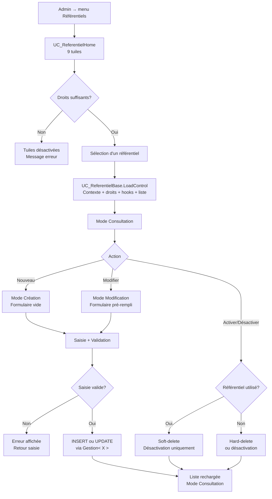

---

# Processus 11 – Gestion des patients (liste + fiche)

**Statut : Implémenté**

**Traçabilité mainteneur (VB) :**
- [`UI/Controls/Patients/UC_PatientHome.vb`](../../../UI/Controls/Patients/UC_PatientHome.vb)
- [`UI/Controls/Patients/UC_PatientFiche.vb`](../../../UI/Controls/Patients/UC_PatientFiche.vb)
- [`Metier/Patients/GestionPatients.vb`](../../../Metier/Patients/GestionPatients.vb)
- [`Metier/Patients/Patient.vb`](../../../Metier/Patients/Patient.vb)
- [`Utils/Helpers/CheminsPatientHelper.vb`](../../../Utils/Helpers/CheminsPatientHelper.vb)

## Objectif

Permettre la **recherche, la consultation, la création et la modification** d'un patient, en respectant :

- la **séparation UI / métier** (aucun accès DB dans les UserControls),
- l'**activation progressive** des onglets de la fiche dépendant de l'`id_patient` (D-Q14),
- la **conservation du filtre de recherche** au retour depuis la fiche (mini-pile de navigation D-Q15).

## Vue d'ensemble du flow

1. L'utilisateur navigue vers **Patients** → `UC_PatientHome` se charge.
2. `ChargerPatients()` alimente la grille (tri par date de modification décroissante) ; par défaut (entrée « Tous »), tous les patients sont affichés.
3. L'utilisateur filtre en mémoire (`AppliquerFiltres`) : texte multi-critères et/ou un axe unique via `cboFiltreSuivi` (état du dernier dossier : Actif / En pause / Clôturé / Archivé / Sans dossier) et `is_actif` (Patient actif / Patient inactif).
4. Action **Nouveau / Modifier / Ouvrir** → `UC_PatientFiche` se charge dans le mode correspondant.
5. La fiche affiche le bandeau identité (photo + alerte) et l'onglet Identité ; les autres onglets restent **désactivés** tant qu'aucun `id_patient` n'est obtenu.
6. En création, `ValiderSaisie()` fait juger la fiche par `GestionPatients.ValiderPatient` (champs requis, téléphone et code postal selon le pays, e-mail, NISS et son unicité, CT1/CT2 ; erreurs sur leurs champs et dans une fenêtre récapitulative — audit C.2, 23/10/2026),
   - puis la détection de doublon (confirmation),
   - puis `Enregistrer()` via `GestionPatients`, qui applique les mêmes règles et enregistre le NISS normalisé ;
   - l'`id_patient` obtenu **active progressivement** les onglets Famille/Contacts, Intervenants et Dossiers.
7. Le bouton **Fermer** revient à `UC_PatientHome` en **restaurant le filtre** précédent (D-Q15).

## Étapes détaillées

### 1. Liste et recherche (`UC_PatientHome`)

```
UC_PatientHome_Load()
├── ChargerPatients()                 → GestionPatients (List(Of PatientListeItem))
├── InitialiserFiltres()             → remplit cboFiltreSuivi (défaut « Suivi en cours »)
├── AppliquerFiltreInitial()          → restaure le filtre mémorisé (D-Q15)
└── AppliquerFiltres()                → filtrage en mémoire (texte + statut de suivi)
```

### 2. Ouverture de la fiche

| Action     | Mode fiche    | Méthode                          |
|------------|---------------|----------------------------------|
| Nouveau    | Création      | `InitialiserPourCreation()`      |
| Modifier   | Modification  | `InitialiserPourPatient()`       |
| Ouvrir     | Consultation  | `InitialiserPourPatient()`       |

### 3. Modes et activation progressive (`UC_PatientFiche`)

```
AppliquerMode(Consultation | Creation | Modification)
└── DefinirEtatChampsIdentite()
tabFiche_Selecting()                  → bloque les onglets dépendants sans id_patient
Enregistrer()                         → id_patient obtenu → onglets activés (D-Q14)
```

### 4. Validation et persistance

```
ValiderSaisie()
├── Champs requis (nom, prénom, ...)
├── Unicité NISS
└── ConfirmerDoublonEventuel()        → détection de doublon (nom + date naissance)
Enregistrer() → AlimenterPatientDepuisChamps() → GestionPatients (INSERT/UPDATE)
```

### 5. Retour à la liste

```
btnFermer_Click() → RetournerListe()  → UC_PatientHome (filtre restauré, D-Q15)
```

## Règles importantes

- Un patient peut avoir plusieurs dossiers, y compris dans un même domaine selon le besoin de suivi.
- Le domaine dominant de la liste Patients est calculé ; il n’est pas saisi ni stocké indépendamment (vue `v_dossier_dominant` : dossier vivant d’abord, puis séance la plus proche d’aujourd’hui, ADR-48).
- L’état de suivi du patient est dérivé de ses dossiers ; l’activation manuelle reste distincte.

## Flowchart – Processus 11 (Gestion des patients)

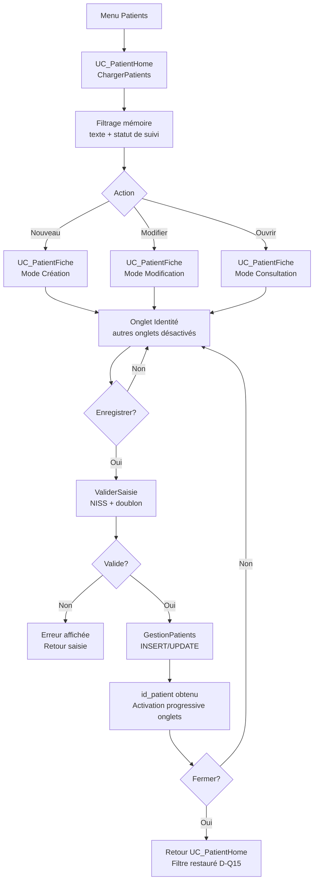

---

# Processus 12 – Gestion des contacts famille

**Statut : Implémenté**

**Traçabilité mainteneur (VB) :**
- [`UI/Controls/Patients/UC_PatientFiche.vb`](../../../UI/Controls/Patients/UC_PatientFiche.vb)
- [`UI/Forms/Patients/ContactEdition.vb`](../../../UI/Forms/Patients/ContactEdition.vb)
- [`Metier/Patients/GestionFamilleContacts.vb`](../../../Metier/Patients/GestionFamilleContacts.vb)
- [`Metier/Patients/FamilleContact.vb`](../../../Metier/Patients/FamilleContact.vb)
- [`Metier/Referentiels/GestionLiensPatient.vb`](../../../Metier/Referentiels/GestionLiensPatient.vb)
- [`Metier/Referentiels/GestionRoleLegal.vb`](../../../Metier/Referentiels/GestionRoleLegal.vb)

## Objectif

Gérer l'**entourage d'un patient** (table `famille_contacts`) depuis l'onglet « Famille / Contacts » de la fiche patient :

- saisir un contact avec son **lien** (`ref_liens_patient`) et son **rôle légal** (`ref_role_legal`),
- valider les coordonnées **country-aware** (téléphone / e-mail selon le pays),
- proposer l'ajout d'un lien ou d'un rôle manquant **sans quitter la saisie** (bouton `[+]`).

## Vue d'ensemble du flow

1. Depuis `UC_PatientFiche`, l'onglet **Famille / Contacts** charge la grille (`ChargerContacts` → `GestionFamilleContacts`).
2. L'utilisateur recherche/filtre les contacts en mémoire (`AppliquerFiltresContacts`).
3. Ouverture modale `ContactEdition` (`OuvrirEditionContact`) selon l'action : **double-clic** → **consultation** (lecture seule, `ouvrirEnConsultation:=True`) ; **Ajouter** → création ; **Modifier** → édition directe. En consultation, le bouton **Modifier** du dialogue bascule en édition.
4. Le formulaire alimente les combos Lien et Rôle légal ; les boutons `[+]` ouvrent le référentiel correspondant en modal (`Home.OuvrirReferentielModal`) avec **auto-sélection** au retour.
5. `ValiderSaisie()` contrôle les champs requis et le téléphone/e-mail selon le pays.
6. `Enregistrer()` persiste via `GestionFamilleContacts` ; retour `DialogResult.OK`.
7. La fiche **recharge** la grille des contacts.

## Étapes détaillées

### 1. Chargement et filtrage (onglet Famille)

```
tabFiche_Selected(Famille)
├── ChargerContacts()                 → GestionFamilleContacts (List(Of FamilleContact))
├── AppliquerFiltresContacts()        → filtrage mémoire (CorrespondRechercheContact)
└── RafraichirEtatBoutonsContacts()   → activation selon sélection
```

### 2. Édition d'un contact (`ContactEdition`)

```
New(...) → InitialiserCombos()
├── ChargerLiens()                    → cboLien (ref_liens_patient)
├── ChargerRolesLegaux()              → cboRoleLegal (ref_role_legal)
├── SelectionnerLienParDefaut() / SelectionnerRoleParDefaut()
└── RemplirChamps() (modification)
```

### 3. Ajout d'un référentiel via `[+]`

```
btnAjouterLien_Click()  → Home.OuvrirReferentielModal(UC_LiensPatient) → recharge + auto-sélection
btnAjouterRole_Click()  → Home.OuvrirReferentielModal(UC_RoleLegal)    → recharge + auto-sélection
```

### 4. Validation et persistance

```
ValiderSaisie()
├── AlimenterContactDepuisChamps()    → FamilleContact (ce qui sera écrit)
├── GestionFamilleContacts.ValiderContact()   (lien, rôle légal, nom, prénom, téléphone / code postal selon le pays, e-mail)
└── AffichageErreursSaisie.Signaler() (icône par champ — sur le [+] pour lien et rôle —, fenêtre récapitulative, focus)
txtTelephone_Leave() / txtCodePostal_Leave() / txtEmail_Leave() → signal immédiat d'un format douteux (Utils*)
Enregistrer() → GestionFamilleContacts (applique ValiderContact, puis INSERT/UPDATE) → DialogResult.OK
              refus du métier (InvalidOperationException) → fenêtre « Enregistrement impossible »
```

## Règles importantes

- Le patient doit être **déjà enregistré** (`idPatient > 0`) — garanti par l'activation progressive de la fiche.
- **Country-aware** : téléphone et code postal validés selon le pays sélectionné, e-mail au bon format — règles de `GestionFamilleContacts.ValiderContact` (audit C.2).
- Les boutons `[+]` réutilisent le pipeline référentiel (droits + élévation) via `Home.OuvrirReferentielModal`.
- **Aucun accès DB** dans l'UI : tout passe par `GestionFamilleContacts`.
- `btnCopierAdressePatient` recopie l'adresse du patient pour accélérer la saisie.
- **Consultation d'abord** (ADR-10) : le double-clic ouvre le contact en lecture seule ; champs et boutons annexes (`[+]`, copie d'adresse) sont verrouillés jusqu'au clic sur **Modifier**. Sortie via **Fermer** (consultation) ou **Annuler** (édition).

## Flowchart – Processus 12 (Contacts famille)

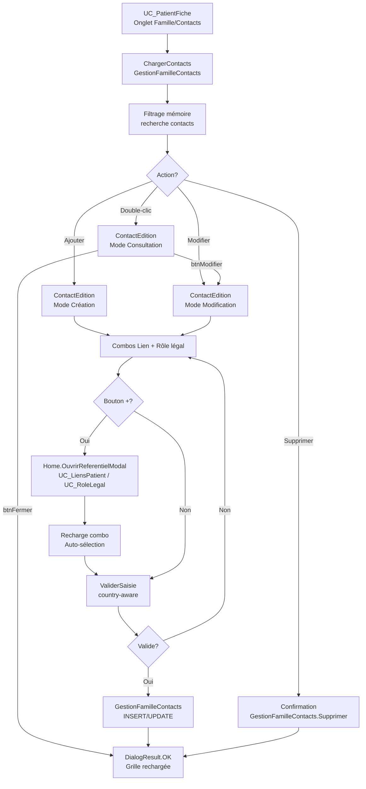

---

# Processus 13 – Référentiel des thérapeutes

**Statut : Implémenté**

**Traçabilité mainteneur (VB) :**
- [`UI/Controls/Referentiels/UC_Therapeutes.vb`](../../../UI/Controls/Referentiels/UC_Therapeutes.vb)
- [`UI/Forms/Therapeute/TherapeuteEdition.vb`](../../../UI/Forms/Patients/TherapeuteEdition.vb)
- [`Metier/Referentiels/GestionTherapeutes.vb`](../../../Metier/Referentiels/GestionTherapeutes.vb)
- [`Metier/Referentiels/Therapeute.vb`](../../../Metier/Referentiels/Therapeute.vb)

## Objectif

Gérer le **référentiel entité riche** des thérapeutes du réseau de soins.

Contrairement aux référentiels simples (`code` / `libellé` héritant de `UC_ReferentielBase`), un thérapeute porte une **identité complète**, des **coordonnées country-aware** et un **commentaire**, ce qui justifie un écran de liste dédié (`UC_Therapeutes`) et une Form d'édition propre (`TherapeuteEdition`).

Ce référentiel **alimente** le combo Thérapeute du Processus 13.

## Vue d'ensemble du flow

1. Depuis le hub `UC_ReferentielHome`, la tuile **Thérapeutes** charge `UC_Therapeutes`.
2. `ChargerTherapeutes()` alimente la grille ; recherche et filtre « inactifs » appliqués en mémoire.
3. Action **Nouveau / Modifier** → ouverture modale `TherapeuteEdition` (`OuvrirEdition`).
4. `ValiderSaisie()` impose le nom et contrôle le téléphone/e-mail selon le pays.
5. `Enregistrer()` persiste via `GestionTherapeutes` ; la liste est rechargée.
6. **Activer/Désactiver** applique le soft-delete ; **Supprimer** n'est possible que si le thérapeute n'est référencé par aucun suivi.

## Étapes détaillées

### 1. Liste et recherche (`UC_Therapeutes`)

```
UC_Therapeutes_Load()
├── ChargerTherapeutes()              → GestionTherapeutes (List(Of Therapeute))
├── AppliquerFiltres()                → recherche + chkAfficherInactifs
└── MettreAJourEtatBoutons()          → activation selon sélection
```

### 2. Édition d'un thérapeute (`TherapeuteEdition`)

```
New(...) → InitialiserFenetre()
├── RemplirChamps() (modification)
├── UtilsSaisieReferentiels.ChargerPays / ChargerCivilites / ChargerSpecialites (ref_specialites, v2.55.0)
└── txtTelephone_Leave() + cboPays    → UtilsTelephone (code ISO du pays)
btnAjouterSpecialite_Click() → Home.OuvrirReferentielModal(UC_Specialites) → recharge + auto-sélection
                               (bouton grisé si la fenêtre n'a pas reçu Home)
ValiderSaisie()   → GestionTherapeutes.ValiderTherapeute() + AffichageErreursSaisie.Signaler()
Enregistrer()
├── ConfirmerHomonymeEventuel()       → TherapeuteExiste : « Homonyme » — Oui enregistre, Non laisse la fenêtre ouverte
│                                       (création, ou modification qui change le nom / prénom)
└── GestionTherapeutes (droit SuperUser, applique ValiderTherapeute, puis INSERT/UPDATE)
```

### 3. Soft-delete et suppression

```
btnActiverDesactiver_Click() → GestionTherapeutes (soft-delete : Actif = False/True)
btnSupprimer_Click()         → suppression physique uniquement si non référencé
```

## Règles importantes

- `UC_Therapeutes` est une **entité riche**, pas un référentiel `code/libellé` : il **n'hérite pas** de `UC_ReferentielBase`.
- **Soft-delete prioritaire** : un thérapeute référencé par `autres_suivis_patient` ne peut être que désactivé ; suppression physique seulement si non utilisé.
- **Country-aware** : téléphone et code postal validés selon le pays sélectionné, e-mail au bon format — règles de `GestionTherapeutes.ValiderTherapeute` (audit C.2).
- **Homonyme** (mêmes nom et prénom) : signalé et confirmé, pas refusé (décision de Joëlle, 23/10/2026).
- **Aucun accès DB** dans l'UI : tout passe par `GestionTherapeutes`.
- Accessible depuis le hub Référentiels **et** depuis le bouton `[+]` d'`IntervenantEdition`.

## Flowchart – Processus 13 (Référentiel des thérapeutes)

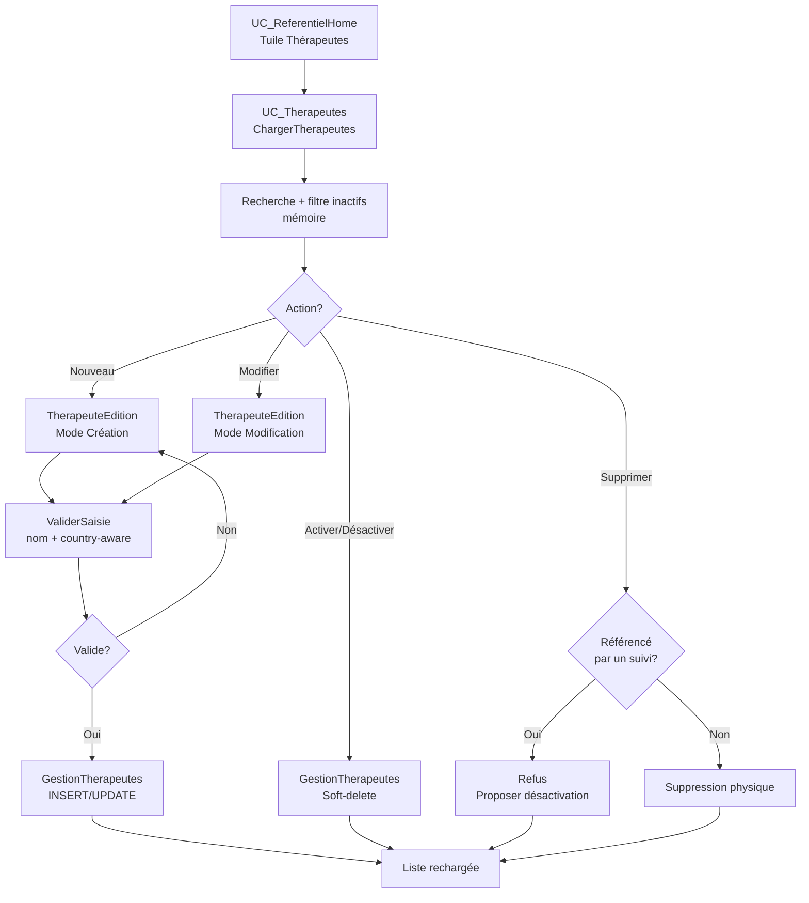

---

# Processus 15 – Vue générale de gestion du suivi

**Statut : Implémenté pour le cœur métier ; recette transversale à poursuivre**

## Objectif

Présenter l’enchaînement complet : le paramétrage des domaines prépare les choix disponibles, le patient porte les dossiers, le dossier porte les séances et chaque séance porte un tarif figé ainsi que ses paiements éventuels.

## Principes d’enchaînement

1. Les administrateurs paramètrent les domaines, natures, tarifs, liaisons et quotas.
2. Un patient peut recevoir un ou plusieurs dossiers, chacun associé à un domaine.
3. Un dossier modifiable permet de créer des séances avec une nature autorisée par son domaine.
4. À la création ou modification d’une séance, le tarif est résolu à la date de la séance puis figé ; le quota est contrôlé lorsque le domaine y est soumis.
5. Les paiements sont saisis contre les séances non soldées ; le reste dû est recalculé à partir des seuls encaissements.
6. Les changements futurs de référentiels ne modifient ni le tarif historique d’une séance, ni les paiements déjà enregistrés.

## Flowchart – Processus 15 (Vue complète)

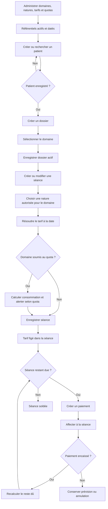

## Références

- Les définitions et règles fonctionnelles sont dans [Concepts_Metier_Althea.md](../Concepts_Metier_Althea.md).
- L’administration des données paramétrables est décrite dans [Parametres_Referentiels.md](../../Architecture/Parametres_Referentiels.md).
- Les décisions structurantes sont consignées dans [ADR-24 à ADR-28](../../Rules/ARCHITECTURE_DECISIONS.md) (ADR-27 : domaine = convention).

---

# Processus 16 – Paramétrage des domaines, tarifs et quotas

**Statut : Implémenté (refonte Domaine = convention, 30/09–01/10/2026 ; écran en étapes et règles de quota corrigeables, UI-6, 14/10/2026 — ADR-40)**

**Écran :** `UC_DomainesHome` (menu Home « Domaines »). Guide utilisateur : `Docs/Guide/Guide_Utilisateur_Domaines.md`.

## Objectif

Préparer les règles variables nécessaires au suivi sans modifier le code. Un domaine représente une **convention** : organisme de remboursement (facultatif), tarifs datés, natures autorisées, catégories de quota et règles de quota datées.

## Étapes détaillées

Les étapes (`AltheaEtapes`) guident l’ordre suivant ; chacune indique son état (fait, à compléter, non nécessaire), calculé par `GestionDomaines.CalculerManques` (règles de complétude du métier, audit C.2).

- Après la création, l’écran ouvre la première étape à compléter.
- L’étape 1 se modifie par Modifier / Enregistrer ; les étapes 2 à 4 action par action (enregistrement immédiat), et ne sont pas accessibles pendant Modifier.

1. **Général** : code, libellé, organisme (ajout rapide « Nouveau… » via `UC_Organismes`), comportements `tarif_convention`, `no_show_facturable`, `soumis_quota`.
2. **Tarifs** : liaisons domaine–tarif avec périodes de validité (`UC_LiaisonsPrixDomaines`).
3. **Catégories & quotas** (si soumis au quota) : catégories du domaine (`CategoriesQuotaEditor`), puis règle datée, saisie guidée et récapitulée : plafond par catégorie, durée de période, seuil d’alerte, validité (`ref_quotas` + `ref_quotas_plafonds`). Les périodes sans règle sont signalées et proposées à la saisie.
4. **Natures** : natures autorisées et, pour chacune, la catégorie de quota consommée (portée par la liaison `lia_natures_seance_domaines`).
5. **Synthèse** : contrôle des manques (pas de tarif, pas de nature, pas de règle de quota, catégorie sans plafond…).

Les services métier ne retiennent que les données actives et valides à la date de l’événement.

## Modifier ou supprimer — règle par étape

| Étape | Modification | Retrait |
|---|---|---|
| Général | Libellé, organisme, comportements, ordre. | Désactivation (soft-delete). |
| Tarifs | Jamais en place : clôturer la période puis rattacher un nouveau tarif. | Retirer / supprimer une ligne créée par erreur. |
| Catégories | Aucune (code/libellé figés). | Désactivation si utilisée, suppression sinon. |
| Règles de quota | Règle **qui n'a pas servi** (aucune séance du domaine dans sa période) : correction possible (« Modifier la règle »). Règle qui a servi : aucune modification ; ajouter une nouvelle règle clôture automatiquement la précédente la veille de sa date de début (date passée admise). | Clôturer, désactiver ; supprimer seulement une règle qui n'a pas servi — la règle précédente qu'elle avait clôturée est alors rouverte (même transaction). |
| Natures | Changement de catégorie de quota sur la liaison. | Retirer / rétablir ; supprimer si jamais utilisée. |

## Règles importantes

- Un code de domaine, montant ou plafond ne doit jamais servir de pivot de règle dans le code.
- Une évolution de prix ou de quota ouvre une nouvelle période ; elle ne modifie pas le passé. Seule exception : corriger une règle de quota qui n'a encore servi à aucune séance (ADR-40).
- Les comportements du domaine sont indépendants.
- En cas de référentiel incomplet, le repli doit être explicite et journalisé.

## Flowchart – Processus 16 (Paramétrage métier)

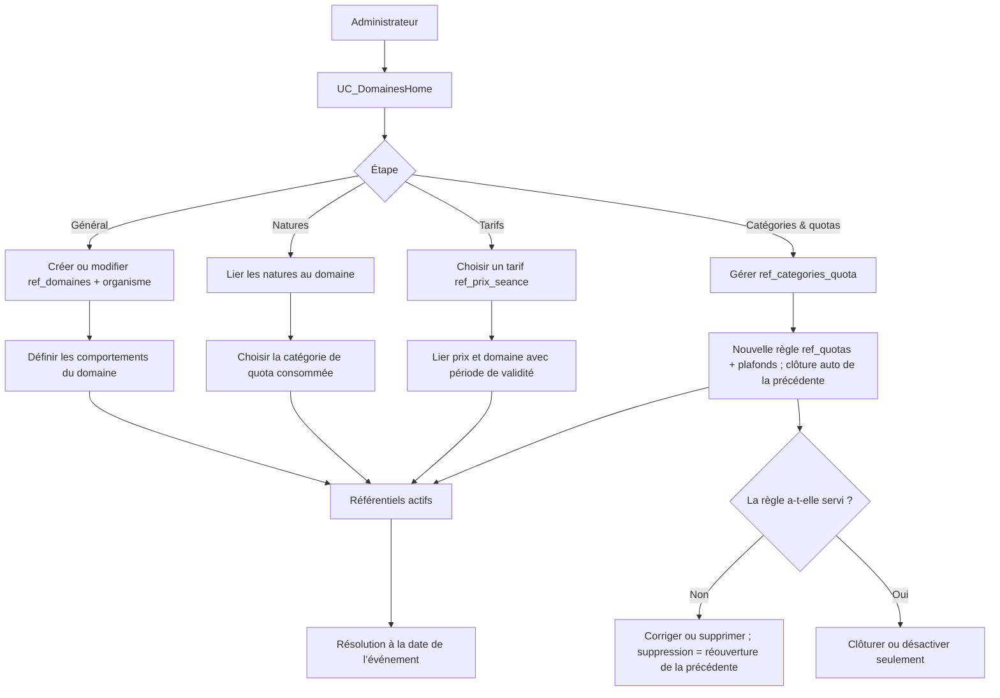

---

# Processus 17 – Gestion du patient et ouverture d’un dossier

**Statut : Implémenté**

## Objectif

Créer ou retrouver un patient, maintenir ses informations et son réseau, puis ouvrir un dossier de suivi dans un domaine configuré. Les processus de contacts familiaux et d’intervenants sont documentés dans les processus 12 et 13.

## Étapes détaillées

1. L’utilisateur recherche le patient dans `UC_PatientHome` afin de limiter les doublons.
2. Il crée ou modifie la fiche ; la couche métier contrôle les données obligatoires, le NISS et l’unicité.
3. La fiche permet de maintenir contacts et intervenants après l’enregistrement initial du patient.
4. L’utilisateur ouvre un nouveau dossier, choisit un domaine actif et renseigne les informations de suivi.
5. `GestionDossiers` valide puis crée le dossier avec un statut initial actif ; la fiche dossier devient le point d’entrée du suivi.

## Règles importantes

- Un patient peut avoir plusieurs dossiers, y compris dans un même domaine selon le besoin de suivi.
- Le domaine dominant de la liste Patients est calculé ; il n’est pas saisi ni stocké indépendamment (vue `v_dossier_dominant` : dossier vivant d’abord, puis séance la plus proche d’aujourd’hui, ADR-48).
- L’état de suivi du patient est dérivé de ses dossiers ; l’activation manuelle reste distincte.

## Flowchart – Processus 17 (Patient et dossier)

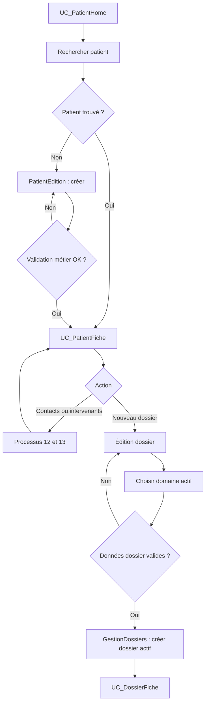

---

# Processus 18 – Cycle de vie du dossier

**Statut : Implémenté**

## Objectif

Gérer le contexte de suivi d’un patient : identité du dossier, zones cliniques, séances, paiements et transitions d’état, en empêchant toute modification non autorisée.

## Étapes détaillées

1. `UC_DossierFiche` charge les données du dossier et son statut courant.
2. Tant que le dossier est modifiable, l’utilisateur peut compléter les zones cliniques et gérer les séances ainsi que les paiements.
3. Une demande de changement d’état passe par `DossierStatutEditor` puis par `GestionDossiers`, qui contrôle la transition.
   - `ChangerStatutDossier` relit le statut en base et valide la transition sur lui (21/10/2026) : s’il diffère de celui que l’écran affichait (dossier modifié depuis une autre fenêtre ou un autre poste), le changement est refusé et l’utilisatrice invitée à rouvrir le dossier ;
   - l’écriture n’a lieu que si le statut n’a pas changé entre-temps.
4. **Clôture** : avant toute confirmation, `GestionDossiers.ControlerCloture` examine les séances du dossier.
   - Une séance due encore à venir (payée d’avance ou non) **bloque** la clôture : le message cite les séances et invite à les annuler.
   - Des séances passées restant à régler sont **signalées** dans la confirmation (encadré, bouton « Clôturer quand même »).
   - `ChangerStatutDossier` refait le contrôle bloquant (défense en profondeur, `InvalidOperationException` dont le message s’adresse à l’utilisatrice).
5. Un dossier clôturé a ses séances et paiements figés ; il peut être rouvert selon la transition autorisée. Le bandeau du dossier l’indique (pastille gris foncé, bandeau « consultation » sous l’en-tête).
6. Un dossier archivé est terminal : il reste consultable, mais aucun ajout, modification ou réouverture n’est permise. L’archivage conserve la date de clôture.

## Règles importantes

- Les statuts proviennent de `ref_statuts_dossier`, mais la couche métier contrôle les transitions effectives.
- Les zones cliniques ont leur propre historique de modification.
- Dossier, séances et paiements restent liés : un paiement est toujours saisi dans le contexte du dossier et de sa séance.

## Flowchart – Processus 18 (Cycle de vie du dossier)

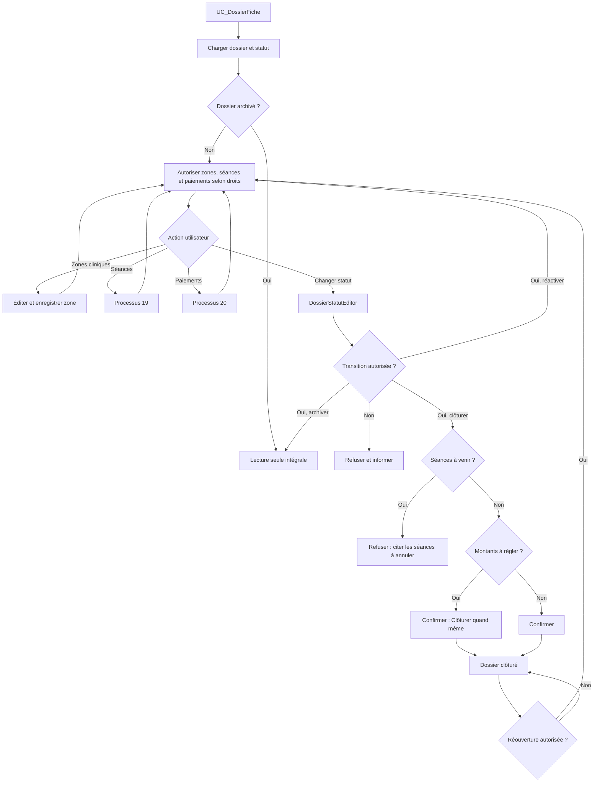

---

# Processus 19 – Gestion d’une séance : nature, tarif et quota

**Statut : Implémenté**

## Objectif

Planifier ou enregistrer une séance sur un dossier modifiable, en n’autorisant que les natures compatibles avec son domaine, en empêchant les chevauchements et en figeant le tarif applicable à la date de séance.

## Étapes détaillées

1. L’utilisateur ouvre `SeanceEditor` depuis l’onglet Séances d’un dossier non archivé.
2. L’éditeur charge les natures autorisées par le domaine et le planning du jour comme aide de lecture.
3. La couche métier bloque tout chevauchement avec une autre séance du thérapeute unique (`GestionSeances.ChercherChevauchement` : la fenêtre l'appelle pour son message, `EnregistrerSeance` et `ReporterSeance` le relisent dans leur transaction et refusent — audit C.2).
   - Une séance dont le statut est coché « Non tenue, libère le créneau » (`ref_statuts_seance.est_non_tenue`, v2.57.0, ADR-54) n'occupe pas son horaire : pas de contrôle pour elle, et elle ne bloque pas les autres ; une absence non excusée garde son créneau.
   - Les statuts proposés sont ceux du métier (`StatutsProposes`) : en création les statuts cochés « Proposé à la création » (Planifiée et Réalisée au départ, v2.57.0), en modification tout sauf Reportée ;
   - `EnregistrerSeance` refuse les autres.
4. `GestionTarification` résout le tarif : séance non due, no-show non facturable, tarif conventionné du domaine, tarif patient du dossier, puis repli documenté.
5. Lorsque le domaine est soumis au quota, `GestionQuotasInami` calcule la consommation glissante et le seuil d’alerte ; les no-shows sont exclus du décompte.
6. Après validation, le tarif résolu est enregistré dans `seances.tarif_seance` et ne varie plus avec les référentiels ultérieurs.
7. Toute création, modification ou changement de statut appelle la règle unique `GestionPaiements.ResynchroniserDuSeance` : la ligne « en attente » de la séance est réalignée sur le reste dû réel (tarif − encaissés PAYE), annulée si la séance n’est plus due ou est soldée.
8. L’enregistrement depuis `SeanceEditor` est d’un seul tenant (`GestionSeances.EnregistrerSeance`, 21/10/2026) :
   - identité, notes et évolution, statut et dû dans une transaction ;
   - un échec n’enregistre rien et s’affiche dans une fenêtre, qui reste ouverte avec la saisie.
   - Si un encaissement devient un avoir, son utilisation est proposée ensuite (choix de l’utilisatrice, `DialogUtilisationAvoir`).

### Contrôles à l’enregistrement (26/09/2026)

L’ordre des contrôles de `SeanceEditor.ValiderSaisie` est : verrou séance soldée → champs obligatoires → **cohérence montant / tarif** → date passée → chevauchement → **dépassement de quota**. Tant qu’un contrôle échoue ou est refusé, la fenêtre reste ouverte et rien n’est enregistré.

| Contrôle | Déclencheur | Comportement |
|---|---|---|
| Cohérence montant / tarif | Cadenas fermé et montant ≠ tarif attendu (tarif sélectionné ajusté par `GestionTarification`) | **Bloquant**. Utilisateur simple : « faire appel à un SuperUser » (le cadenas lui est grisé). SuperUser/Admin : « utiliser le cadenas » (ouvert = saisie manuelle ; refermer = montant du tarif appliqué automatiquement). **Exception** (22/10/2026, décision de Joëlle) : en modification, un montant enregistré laissé tel quel sur le même tarif est accepté — prix d'ami déjà fixé, ou montant figé d'un tarif modifié depuis ; il n'est plus réaligné au changement de statut. Le métier applique la même règle (`EnregistrerSeance`). |
| Tarif modifié sur séance déjà encaissée | Modification, ancien tarif ≠ nouveau, encaissé PAYE > 0 | **Confirmation**. Le message annonce la conséquence : avoir (encaissé > nouveau tarif), reste dû (encaissé < nouveau tarif) ou séance soldée. L’encaissement n’est jamais modifié. |
au-delà d’un plafond (d’une catégorie du domaine ou total)

> ℹ️ En modification, changer le tarif dans la liste **ne réaligne pas** le montant : toute modification de montant passe volontairement par le cadenas (décision du 26/09/2026). En création, le montant suit le tarif sélectionné tant que le cadenas est fermé.

### Report d’une séance

- Seule une séance **Planifiée** peut être reportée, uniquement via le bouton « Reporter une séance » (le statut Reportée n’est pas proposable dans l’éditeur).
- La séance d’origine passe à Reportée (lecture seule, non supprimable, créneau libéré) ; son dû en attente est annulé.
- La nouvelle séance recopie nature, tarif (id_prix_seance) et **montant** de l’origine : les tarifs dépendent du patient, pas de la date, le report ne recalcule donc rien.
- Le report est d’un seul tenant (origine, nouvelle séance et leurs dûs ; 21/10/2026). Si l’origine portait un encaissement, il y devient un avoir, dont l’utilisation pour la nouvelle séance est proposée (processus 20).
- La nouvelle séance est refusée si son créneau chevauche une autre séance (22/10/2026, audit C.2 ; le report n’en contrôlait aucun) : rien n’est reporté, l’utilisatrice choisit un autre horaire.
- Les boutons Reporter, Supprimer et Encaisser lisent les règles du métier (`SeanceListeItem.EstReportable`, `EstSupprimable`, `EstEncaissable`), celles que `ReporterSeance`, `DeleteSeance` et `CreatePaiement` appliquent.

## Règles importantes

- Le planning du jour est une aide ; le contrôle de chevauchement métier est bloquant.
- Une séance annulée ou non due reçoit le montant prévu par les règles, potentiellement zéro.
- Une modification de référentiel affecte les séances futures, jamais le tarif historique figé.
- Le quota est paramétré ; il ne se déduit pas du nom ou du code d’un domaine.
- Le montant d’une séance ne se modifie qu’avec le cadenas, réservé aux SuperUser/Admin ; le métier le vérifie aussi (audit C.1).
- Une séance réalisée et encaissée ne se modifie qu’après déverrouillage SuperUser ; le métier le vérifie aussi.
- Dossier clôturé : séances et paiements refusés ; dossier archivé : tout est refusé, fiche et zones comprises. Le métier relit le statut en base dans la transaction de l’écriture.
- Les conséquences de chaque action selon le statut et la situation financière sont tenues dans le [Guide séances et paiements](../../Guide/Guide_Seances_Paiements.md) (partie 2, § 9).

## Flowchart – Processus 19 (Séance, tarif et quota)

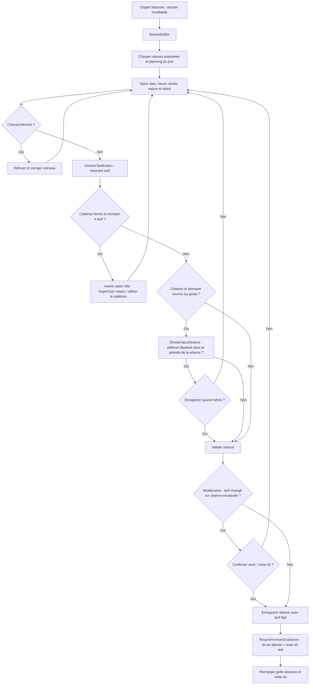

---

# Processus 20 – Encaissement et suivi des paiements

**Statut : Implémenté**

## Objectif

Enregistrer un encaissement, une prévision ou une annulation dans le contexte d’une séance, autoriser les règlements partiels et afficher un solde fiable sans confondre le statut du paiement avec le reste dû de la séance.

## Étapes détaillées

1. Dans l’onglet Séances, l’utilisatrice **sélectionne** la séance (aucune n’est prise d’office, `UtilsDataGrid.ElementSelectionne`) et clique « Encaisser séance » ;
   - un double-clic sur une ligne de l’onglet Paiements fait de même pour la séance de la ligne.
   - L’onglet Paiements n’a plus de bouton « Nouveau paiement » (22/10/2026, décision de Joëlle : il encaissait la séance sélectionnée dans l’autre onglet, sans proposer l’avoir).
2. `PaiementEditor` reçoit la séance de l’appelant (obligatoire) et initialise le montant avec son reste dû.
3. L’utilisateur renseigne le statut, le montant, le mode et les informations de référence nécessaires.
4. Le paiement est créé ou modifié puis lié à une seule séance (l'utilisation d'un avoir peut ensuite diminuer cette liaison ; des réaffectations d'avant le 21/10/2026 ont pu la répartir).
5. Le reste dû est recalculé à partir du tarif figé moins les seuls montants affectés encaissés ; les paiements en attente et annulés ne diminuent pas ce solde.
6. La grille (relevé chronologique) montre pour chaque ligne la séance concernée (« Pour »), le montant affecté à cette séance et une pastille « État » : En attente, À régler, Reste dû, Soldée, Payée d'avance, Avoir, Avoir utilisé, Annulé.
   - Les dus en attente que l'application clôt elle-même (séance réglée, non due, reportée) ne sont pas affichés : ce ne sont pas des annulations (visibles, statut « Clos », dans le détail des paiements d'une séance).
7. La colonne « Mouvement » dit l'opération (encaissement, paiement partiel, d'avance, prévu, annulé, reporté) ; l'infobulle donne la phrase complète, avec auteur et motif d'une annulation et la provenance ou la destination d'un crédit reporté.
8. Après tout encaissement, annulation ou utilisation d'avoir, `ResynchroniserDuSeance` réaligne la ligne « en attente » sur le reste dû réel, dans la transaction de l’opération (pour l’encaissement : depuis le 22/10/2026, audit C.2 ; il était fait après coup et un échec n’était que journalisé).

### Encaissement restreint

- Le bouton **Encaisser** n’est actif que sur une séance due, non reportée et non soldée (`SeanceListeItem.EstEncaissable`).
- La saisie est jugée par `GestionPaiements.ValiderEncaissement` : séance choisie et encore à encaisser, montant strictement positif et au plus égal au reste dû (anti trop-perçu), mode de paiement choisi.
  - `PaiementEditor` l’appelle pour son message ;
  - `CreatePaiement` l’applique sur le reste dû relu dans sa transaction et refuse (`ErreurValidationException`, audit C.2 — il acceptait tout montant sur toute séance).

### Annulation d’un encaissement (jamais de suppression)

- Aucun paiement n’est supprimé physiquement depuis l’application.
- Le bouton d’annulation n’est actif que sur un paiement **encaissé**, pour un **SuperUser/Admin**, dossier non archivé.
- `DialogMotifAnnulation` (form Designer) exige un **motif** : champ vide = champ signalé en rouge, message explicite, la fenêtre reste ouverte.
- `GestionPaiements.AnnulerPaiementEncaisse` passe le statut à ANNULE et enregistre la date, l’utilisateur (identifiant) et le motif dans leurs colonnes (v2.51.0 ; avant, une mention `[Annulé le jj/mm/aaaa par Prénom Nom : motif]` était ajoutée au commentaire) ;
  - date, montant et mode d’origine restent visibles ;
  - contrôles, annulation et dû de la séance dans une seule transaction ;
  - journal par identifiants (paiement, utilisateur).
- La séance redevient due du montant annulé (dû en attente recréé/réactivé par `ResynchroniserDuSeance`).
- Refus si une partie de l’encaissement a déjà servi d’avoir (`GestionPaiements.GetMontantUtiliseEnAvoir` > 0, 21/10/2026) : la séance réglée par cet avoir resterait payée avec un montant qui n’existe plus. L’écran l’annonce avant de demander le motif.
- Un encaissement annulé n’est **jamais** remis en attente automatiquement.

### Affichage des paiements (26/09/2026)

- **Relevé chronologique** (depuis le 17/10/2026, remplace la grille groupée par séance du 26/09) : un paiement par ligne et par séance servie, le plus récent en haut ;
  - colonnes Date, Mouvement, Pour (séance), Mode, Montant (affecté à la séance), **État** en pastille (Soldée, Payée d'avance, Reste dû, À régler, En attente, Avoir · X €, Avoir utilisé, Annulé).
  - Tri par en-tête possible ; un filtre remet l'ordre de l'écran.
  - Lecture détaillée : [Guide séances et paiements](../../Guide/Guide_Seances_Paiements.md), § 3.
- **Résumé cliquable** au-dessus de la grille : Encaissé, En attente, Avoir disponible, Reste à régler (avoir et reste calculés sur les séances, comme l'onglet Séances) ; chaque pastille choisit le filtre.
- **Filtres** : Tous, Encaissés, En attente, Annulés, Séances soldées, Séances restant dues, **Avoirs**, **Séances reportées**, **À régler**.
- Un encaissement laissé sur une séance reportée (avoir gardé) est **conservé en avoir** : il figure dans le filtre Avoirs, comme dans l'avoir du dossier.
- **Détail des paiements d’une séance** : bouton dédié à côté d’« Encaisser » (le double-clic reste réservé à l’ouverture de la séance). Ouvre `DialogPaiementsSeance` (lecture seule) : synthèse tarif / réglé / reste dû / avoir et tous les mouvements, lignes annulées grisées et barrées.

### Crédit encaissé d'une séance devenue non due (report, annulation, maladie)

Depuis le 21/10/2026 (audit B.2, décision de Joëlle), l'encaissement **reste sur sa séance**, où il devient un avoir ; on propose de l'utiliser. La réaffectation (liaisons du paiement réécrites, excédent réparti automatiquement) est supprimée : un seul mécanisme, l'avoir, dont l'historique est conservé.

1. Le report crée une nouvelle séance qui référence son origine via `seances.id_seance_origine`. Les grilles rappellent cette provenance (« report de SE000036 » à côté du statut, dans la colonne « Pour » des paiements).
2. Une fois le statut non dû enregistré, `DialogUtilisationAvoir.ProposerApresChangementStatut` (onglet Séances après un report, fenêtre Séance après un changement de statut) propose d'utiliser **l'avoir de cette séance** pour une séance **due non soldée du même dossier** (`EstDue`), la séance de remplacement présélectionnée.
3. **Utiliser l'avoir** : `GestionPaiements.UtiliserAvoirDeSeance` (une transaction)
   - diminue la liaison source,
   - crée un paiement `PAYE` au mode « Avoir » sur la séance choisie,
   - enregistre le lien source ↔ règlement dans `lia_paiements_avoirs` (v2.52.0 ; avant, une mention « Avoir … utilisé le … pour S… » dans le commentaire),
   - réaligne son dû.
   - Pas de répartition : le surplus reste en avoir sur l'origine. Un message dit ce qui a été réglé et ce qui reste.
4. **Garder l'avoir**, ou **aucune séance due** (message) : l'avoir reste disponible, proposé au prochain encaissement d'une séance du patient.
5. Les réaffectations faites avant le 21/10/2026 restent valables (paiement réparti, une liaison par séance) et s'affichent comme avant.

### Avoir (crédit du dossier)

L’avoir est **calculé, jamais stocké**. Il naît dans trois situations :

1. un encaissement reste sur une séance devenue non due (annulée, maladie, **reportée**) — toujours, depuis le 21/10/2026 : son utilisation est proposée aussitôt ;
2. une utilisation d'avoir laisse un surplus (il reste sur la séance d'origine) ;
3. le montant d'une séance déjà encaissée est baissé sous l'encaissé (confirmation préalable) : la part en trop.

Une seule définition (tout l'encaissé d'une séance non due ; la part encaissée au-delà du montant d'une séance due) sert

- au bandeau du dossier,
- aux grilles Séances (« Avoir · 60 € ») et Paiements (« Avoir · X € », filtre Avoirs),
- à la grille Patients (« Avoir (xx €) »)
- et aux avoirs proposés à la réutilisation.

Seules les lignes **PAYE** entrent dans les calculs de réglé, reste dû et avoir.

> ℹ️ Réutilisation d’un avoir (v2.20.0) — **démarche volontaire de l’utilisatrice**, jamais automatique : aucune proposition à la création d’une séance ni au passage en Réalisée.
> À l’encaissement d’une séance précise (due et non soldée), l’application propose d’utiliser l’avoir du patient, tous dossiers confondus ;
> la liaison source est diminuée et un paiement au mode « Avoir » règle la séance (guide, § 5.5 et § 9.12).

## Règles importantes

- Une séance peut recevoir plusieurs paiements ; un paiement saisi ne concerne qu’une séance dans la V1 (seules des réaffectations d'avant le 21/10/2026 en ont réparti) ; tout montant affiché ou totalisé part de `montant_affecte`.
- Le montant restant est calculé, jamais stocké.
- Un paiement `En attente` n’est pas un encaissement ; un paiement `Annulé` ne régularise pas automatiquement la séance.
- Un paiement encaissé ne se supprime jamais : il s’annule avec motif, auteur et date (SuperUser/Admin).
- Une séance ne se supprime pas si elle est Reportée, porte un encaissement (même annulé) ou est à l’origine d’un report ; sinon suppression atomique avec ses seuls dus jamais encaissés.
- Un dossier archivé est en lecture seule, donc aucun paiement ne peut y être créé ou modifié.
- L'avoir d'une séance devenue non due ne règle, depuis la proposition qui suit, que des séances `EstDue` du même dossier ; à défaut, il reste en avoir sur la séance d’origine.
- La provenance d’une séance issue d’un report est tracée par une FK (`id_seance_origine`), jamais par un simple texte libre.

## Flowchart – Processus 20 (Paiement)

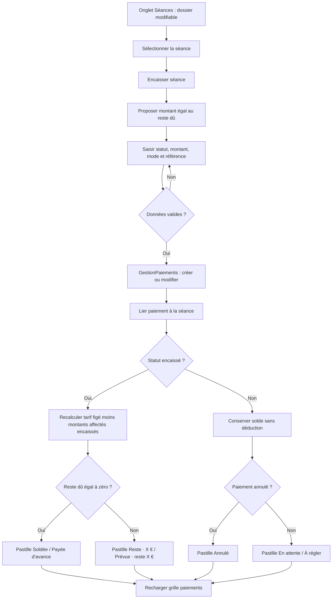

## Flowchart – Processus 20b (Crédit encaissé d'une séance devenue non due → avoir)

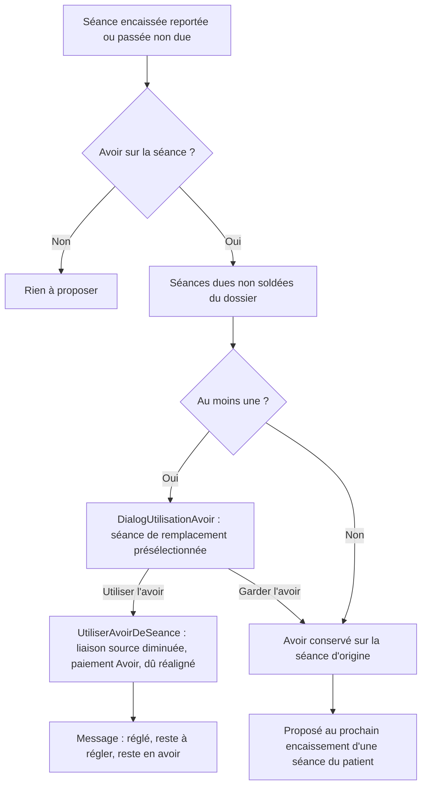

---

[TOC]
