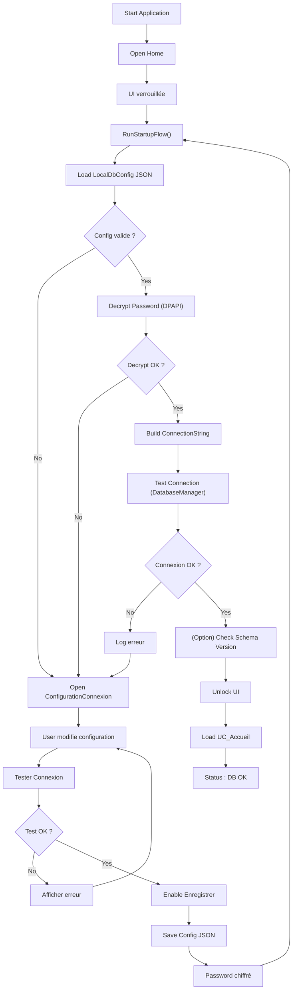
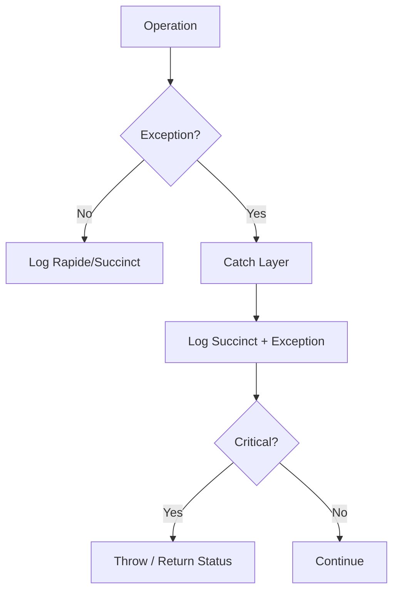
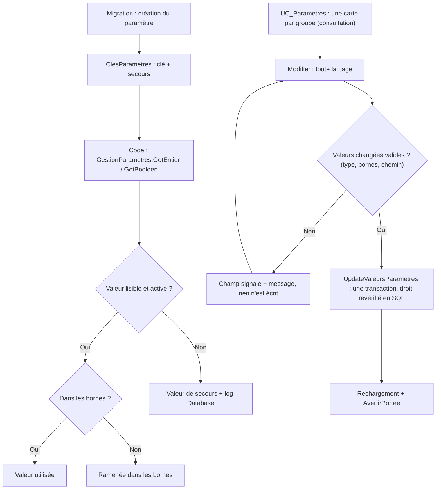
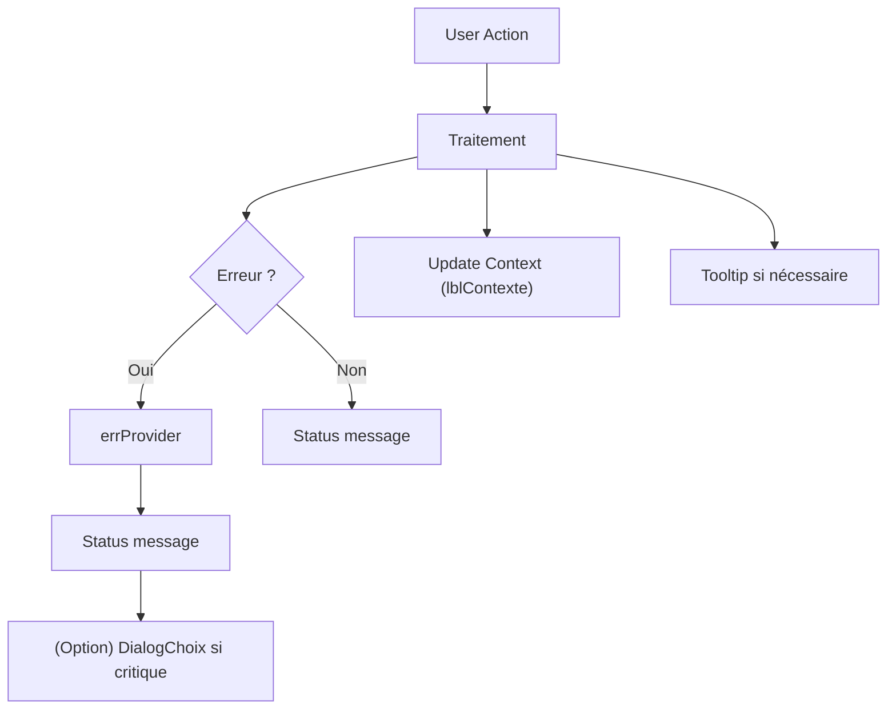
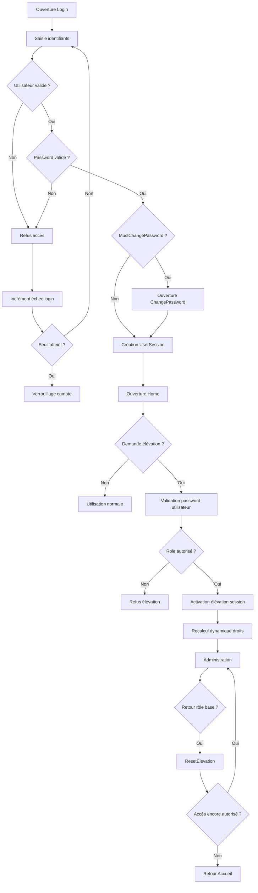
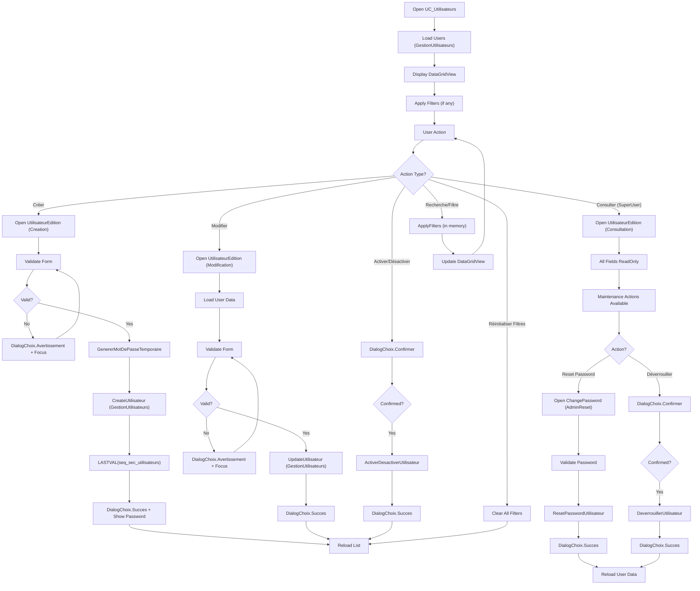
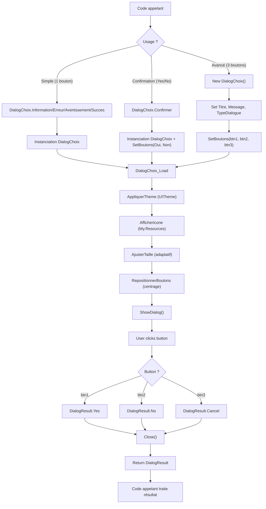
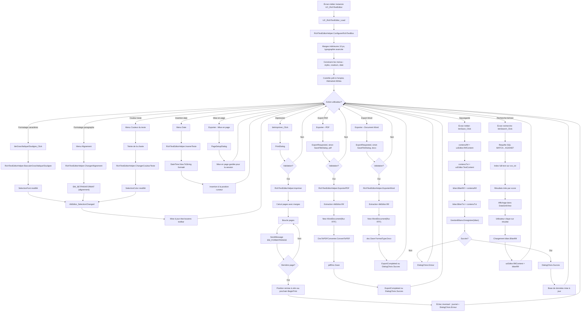

# Processus Althéa — Socle technique

> Partie des [processus d'Althéa](../Process_Althea.md) : sommaire et historique.
> Dernière mise à jour : 25/10/2026 — document scindé en trois parties (décision de Joëlle)

Démarrage et connexion, erreurs et journaux, paramètres, interface globale, sécurité et rôles, utilisateurs, dialogue standard, éditeur de texte riche.

---

# Processus 01 – Démarrage & Connexion MariaDB

**Statut : Implémenté**

**Traçabilité mainteneur (VB) :**
- [`Program.vb`](../../../Program.vb)
- [`Core/Startup/GestionErreursGlobales.vb`](../../../Core/Startup/GestionErreursGlobales.vb)
- [`Core/Startup/AppStartupManager.vb`](../../../Core/Startup/AppStartupManager.vb)
- [`Core/Database/VersionSchema.vb`](../../../Core/Database/VersionSchema.vb), `GestionEtatSysteme.LireVersionSchemaBase`
- [`Core/Database/DatabaseManager.vb`](../../../Core/Database/DatabaseManager.vb)
- [`Core/Configuration/ConfigManager.vb`](../../../Core/Configuration/ConfigManager.vb)
- [`UI/Forms/Database/ConfigurationConnexion.vb`](../../../UI/Forms/Database/ConfigurationConnexion.vb)
- [`UI/Forms/Home.vb`](../../../UI/Forms/Home.vb)

## Objectif

Garantir qu'Althéa ne démarre jamais sans :

- Une configuration locale valide
- Une connexion MariaDB opérationnelle

**Principe** : Le démarrage est **bloquant par conception** - sans connexion valide, l'application ne peut pas fonctionner.

Ce choix est volontaire pour :

- éviter toute incohérence de données
- garantir la fiabilité du système dès l'ouverture
- simplifier le diagnostic en cas de problème

---

## Vue d'ensemble du flow

*(Mis à jour le 20/10/2026 ; la description détaillée ci-dessous date d'une version où la Home portait le démarrage.)*

1. `Program.Main` installe d'abord le **filet des erreurs non interceptées** (`GestionErreursGlobales.Installer`) : toute erreur imprévue est journalisée et l'utilisateur reçoit un message clair, sans détail technique ; erreur de l'interface → l'application continue, erreur hors interface → fermeture annoncée.
2. `AppStartupManager.Run` : licence Syncfusion du poste, puis configuration locale et test de connexion.
3. Connexion impossible ou configuration absente → `ConfigurationConnexion` ; annulation → fermeture.
4. Connexion établie → **contrôle de la version de la base** (`VerifierVersionBase`, plus haute migration de `tec_meta_schema` comparée à `VersionSchema.Attendue`) :
   - base **en retard** : message (quelle version, quoi faire), puis **fermeture** — un écran pourrait chercher une colonne ou une table absente (décision de Joëlle, 20/10/2026) ;
   - base **plus récente** ou version **illisible** : avertissement, puis démarrage.
5. Paramètres de démarrage (rétention des journaux), puis `Home`.

**Principe** : Ce fonctionnement garantit que **toute l'application repose sur une base saine**

---

## Étapes détaillées

### 1. Lecture configuration locale

- Fichier : `%APPDATA%\Althea\althea.local.json`
- Rôle : **source de vérité au démarrage**

Contient :

- Host
- Port
- DatabaseName
- UserName
- EncryptedPassword
- AdditionalOptions

Le mot de passe est :

- chiffré via **DPAPI (lié à l'utilisateur Windows)**
- jamais stocké en clair

#### Important pour le repreneur

- Si ce fichier est supprimé → l'application demandera une nouvelle configuration
- Si le fichier est corrompu → même comportement

---

### 2. Test connexion MariaDB

- La connexion est :

  - construite uniquement via `DatabaseManager`
  - jamais directement ailleurs dans le code

  Processus :

  1. Déchiffrement du mot de passe
  2. Construction de la connection string
  3. Test de connexion

  #### Important

  - Si la connexion échoue :
	- ce n'est pas bloquant techniquement
	- mais c'est bloquant fonctionnellement (par choix)

---

### 3. Vérification version schéma

- Cette étape permet de vérifier que :

  - la structure de la base correspond à l'application

  **Note** : Dans Althéa :

  - le mécanisme est prévu
  - mais peut être activé plus tard

  #### Important pour le futur

  - toute modification structurelle devra incrémenter une version

---

### 4. Correction via UI

- Si une erreur est détectée :

  - ouverture de la Form `ConfigurationConnexion`

  Cette Form permet :

  - modifier les paramètres
  - tester la connexion
  - sauvegarder la configuration

  #### Règles importantes

  - impossible d'enregistrer sans test valide
  - le mot de passe :
	- n'est jamais affiché en clair
	- peut être modifié explicitement
  - la sauvegarde est sécurisée automatiquement

  #### Comportement utilisateur

  L'utilisateur reste dans cette boucle :

  ```
  Modifier → Tester → Corriger → Tester → ...
  ```

  jusqu'à obtenir une connexion valide.

---

### 5. Déverrouillage

- Quand tout est valide :

  - la navigation est activée
  - le menu devient utilisable
  - le premier écran (`UC_Accueil`) est chargé

  Le StatusStrip affiche :

  ```
  Connexion DB OK
  ```

---

## Principes fondamentaux

- Ces règles sont essentielles pour comprendre le fonctionnement global :

  - `Home` :
	- gère uniquement l'interface
  - `AppStartupManager` :
	- orchestre le démarrage
  - `DatabaseManager` :
	- est le seul point d'accès à la base
  - `GestionLog` :
	- centralise tous les logs

  **Règle** : Aucun autre code ne doit contourner ces composants

---

## Cas critiques

### Abandon utilisateur

  - fermeture volontaire de l'application
  - état contrôlé (pas de demi-démarrage)

  ## Message au repreneur (important)

  **Important** : Cette procédure est **le cœur du démarrage de l'application**

  Si elle est modifiée :

  - il faut conserver :
	- le blocage tant que la DB n'est pas valide
	- la centralisation via `DatabaseManager`
	- la sécurisation du mot de passe

  **Attention** : Toute déviation peut entraîner :

  - des erreurs difficiles à diagnostiquer
  - des incohérences de données

---

## Flowchart – Processus 01 (Startup)



---
---

# Processus 02 – Gestion des erreurs & Logs

**Statut : Implémenté**

**Traçabilité mainteneur (VB) :**
- [`Core/Logging/GestionLog.vb`](../../../Core/Logging/GestionLog.vb)
- [`Core/Startup/AppStartupManager.vb`](../../../Core/Startup/AppStartupManager.vb)
- [`Core/Database/DatabaseManager.vb`](../../../Core/Database/DatabaseManager.vb)
- [`UI/Forms/Home.vb`](../../../UI/Forms/Home.vb)

## Objectif

Garantir :

- Traçabilité complète
- Aucune fuite de secret
- Diagnostic possible en production
- Séparation claire responsabilités / UI

---

## Architecture du logging

Module central : `GestionLog`

- Fichier journalier :
  `%APPDATA%\Althea\Logs\Althea_YYYY-MM-DD.log`
- Purge automatique des fichiers plus anciens que `LOG_RETENTION_JOURS` (7 par défaut, 1 – 90) : appliquée une fois par session par `AppStartupManager` → `GestionLog.AppliquerRetention`, **après** la connexion à la base (le paramètre y est lu) ; les journaux restent dans `%APPDATA%` car ils servent avant la connexion
- Header session au premier log
- Thread-safe (SyncLock)

---

## Niveaux de log

| Niveau     | Usage |
|------------|--------|
| Rapide     | Étapes majeures |
| Succinct   | Erreurs / informations importantes |
| Complet    | Détails techniques (stack, inner) |

**Note** : Pas de filtre global.  
Le niveau est un marqueur de profondeur, pas un mécanisme de réduction.

---

## Catégories

- General
- Startup
- Database
- UI
- Process
- Security

Permet lecture ciblée des logs.

---

## Flow de gestion d'erreur

### 1. Couche basse (Crypto, IO)

- Throw exception explicite
- Aucun log direct

### 2. Couche intermédiaire (DatabaseManager)

- Catch technique
- Log Succinct + ex
- Throw si critique

### 3. Orchestrateur (AppStartupManager)

- Catch métier
- Log structuré
- Retourne un statut

### 4. UI

- Affiche message seulement si blocage
- Ne masque jamais une erreur critique

---

## Protection des secrets

- Masquage automatique `Password=` / `Pwd=`, et de la valeur citée par MariaDB dans une erreur de doublon (`Duplicate entry '***'`, 13/10/2026)
- Aucune donnée personnelle : identifiants seulement, jamais nom, prénom, NISS, coordonnées ni contenu clinique (revue du 13/10/2026, ADR-39)
- Aucune connection string complète logguée
- Mot de passe jamais affiché sauf action volontaire

---

## Consultation (13/10/2026)

L'écran **Journaux** (Administration › Journaux, Admin seulement, `UC_Journaux`) lit les fichiers par `LecteurJournaux` :

- choix du jour,
- filtres niveau / catégorie / texte / erreurs seulement,
- entrées les plus récentes en premier,
- détail (exception, piles d'appels remises sur plusieurs lignes).

Lecture seule, en lecture partagée pendant que l'application écrit. Le format d'une ligne est défini une seule fois dans `GestionLog` (constantes `FormatHorodatageLigne`, `SeparateurException`…).

## Principes clés

- Une erreur non logguée est un bug
- Un secret loggué est une faute grave
- Une MsgBox n'est jamais un mécanisme de gestion d'erreur
- Les exceptions doivent être explicites et enrichies

---

## Flowchart – Processus 02 (Erreur & Log)



------

------

# Processus 03 – Gestion des paramètres applicatifs

**Statut : Implémenté** — revu au lot 30, étape P1 (v2.37.0, ADR-35 et ADR-36) ; écran sur une page et groupes en base le 16/10/2026 (v2.40.0, UI-7)

**Traçabilité mainteneur (VB) :**
- [`UI/Controls/Administration/UC_Parametres.vb`](../../../UI/Controls/Administration/UC_Parametres.vb)
- [`Metier/Parametres/GestionParametres.vb`](../../../Metier/Parametres/GestionParametres.vb)
- [`Metier/Parametres/ClesParametres.vb`](../../../Metier/Parametres/ClesParametres.vb)
- [`Metier/Parametres/ParametreApplication.vb`](../../../Metier/Parametres/ParametreApplication.vb)
- [`Core/Database/Queries/QueryParametres.vb`](../../../Core/Database/Queries/QueryParametres.vb)
- [`Utils/Helpers/ArborescenceDonnees.vb`](../../../Utils/Helpers/ArborescenceDonnees.vb)

## Objectif

Adapter le comportement d'Althéa (durée des séances, sécurité, journaux, chemins, sauvegardes…) sans modifier le code, avec des valeurs **typées, bornées et toujours utilisables** par le code.

Référence détaillée des clés : [Parametres_Referentiels.md](../Parametres_Referentiels.md).

------

## Cycle de vie d'un paramètre

1. **Naissance par migration** : clé, libellé, groupe (existant dans `tec_groupes_parametres`), type, bornes (`valeur_min` / `valeur_max`), description, activation, ouverture au SuperUser. Ajout simultané dans `ClesParametres` (clé + valeur de secours) et dans `Docs/Database/Maintenance/reinit_tec_parametres.sql`.
2. **Lecture par le code** : toujours par la clé de `ClesParametres`, via `GestionParametres.GetEntier` / `GetBooleen` (ou la lecture d'un chemin pour le type PATH).
3. **Modification de la valeur seulement** dans `UC_Parametres` (Admin : tous ; SuperUser : paramètres ouverts ; droit revérifié dans la requête).
4. **Jamais de suppression** par l'application ; un paramètre devenu inutile est désactivé ou retiré par une migration documentée.

Un paramètre n'a **qu'une valeur** (pas de dates de validité) : la nouvelle valeur s'applique aux prochaines opérations, les données déjà enregistrées ne changent pas (ADR-36).

------

## Lecture par le code

| Situation | Résultat |
|---|---|
| Valeur correcte | Valeur de la base |
| Valeur hors bornes | Ramenée dans les bornes |
| Base injoignable, paramètre absent, inactif ou valeur invalide | Valeur de secours de `ClesParametres`, **journalisée** (catégorie Database) |
| Chemin obligatoire sans valeur (`PATH_GENERAL`) | Pas de secours : l'opération concernée s'arrête avec un message clair |

**Principe** : un écran ne doit jamais devenir inutilisable parce qu'un paramètre manque ; mais l'écart doit se voir dans le journal.

------

## Écran `UC_Parametres`

V2.0.0 du 16/10/2026 (UI-7) : une seule page, une carte par groupe.

1. Les paramètres sont chargés avec le titre et l'ordre de leur groupe (`tec_groupes_parametres`, v2.40.0) ; **une carte par groupe**, une ligne par paramètre (libellé, valeur, bornes, description en aide sous la valeur).
2. La page s'ouvre **en consultation** (champs lisibles, fond teinté). « Modifier » ouvre **tous les champs de la page**, avec un contrôle adapté au type :

| Type | Contrôle | Contrôles de saisie |
|---|---|---|
| BOOL | Case du kit | — |
| INT / DECIMAL | NumericUpDown | Bornes `valeur_min` / `valeur_max` (molette sans effet) |
| DATE | Champ de date du kit | — |
| STRING | TextBox | — |
| PATH | TextBox + petit bouton dossier (Parcourir) | Chemin complet, création proposée s'il n'existe pas ; `PATH_GENERAL` obligatoire ; `SAUVEGARDE_DOSSIER` refusé dans le dossier de données |

3. « Enregistrer » : les valeurs **changées** sont validées une à une (au premier refus, le champ est signalé et rien n'est écrit), puis écrites **en une transaction** (`GestionParametres.UpdateValeursParametres`, droit du SuperUser revérifié en SQL ; un refus annule tout).
4. Quitter l'écran avec des valeurs non enregistrées : confirmation (`IUnsavedChangesAware`). « Afficher les paramètres désactivés » est indisponible pendant la modification.
5. Après enregistrement : rechargement en consultation, rappel de la portée (`AvertirPortee`, description de chaque paramètre modifié).

------

## Principes fondamentaux

- La clé technique est unique et immuable ; elle n'est jamais écrite en dur ailleurs que dans `ClesParametres`.
- Seule la racine `PATH_GENERAL` du dossier de données est un paramètre ; les sous-dossiers sont fixes (`ArborescenceDonnees`, ADR-35).
- Les bornes se règlent par SQL, pas dans l'écran.
- Tout nouveau paramètre lu par le code = migration **et** script de réinitialisation **et** documentation.

------

## Flowchart – Processus 03 (Paramètres)



------

# Processus 04 – Gestion UI globale (Tooltip, Status, Errors, Contexte)

**Statut : Implémenté**

**Traçabilité mainteneur (VB) :**
- [`UI/Context/UserControlContext.vb`](../../../UI/Context/UserControlContext.vb)
- [`UI/Forms/Home.vb`](../../../UI/Forms/Home.vb)
- [`UI/Navigation/NavigationManager.vb`](../../../UI/Navigation/NavigationManager.vb)
- [`UI/Navigation/IContextAwareUserControl.vb`](../../../UI/Navigation/IContextAwareUserControl.vb)
- [`UI/Navigation/IContextAwareForm.vb`](../../../UI/Navigation/IContextAwareForm.vb)

## Objectif

Garantir une **communication utilisateur cohérente, non intrusive et centralisée**.

Les composants concernés :

- `ttMain` → Tooltip
- `stsStatus` → StatusStrip
- `errProvider` → erreurs champ
- `lblContexte` → contexte global

**Principe** : Ensemble, ils remplacent les DialogChoix/MessageBox non critiques.

------

## Architecture

Composant central :

**`UserControlContext`**

Rôle :

- injecté dans chaque UserControl
- fournit des méthodes unifiées :
  - `SetStatus()`
  - `SetHeader()`
  - `SetError()`
  - `ClearError()`

**Règle** : Aucun UC ne manipule directement les contrôles UI globaux

------

## Rôle de chaque élément

### 1. StatusStrip (`stsStatus`)

- messages courts
- retour utilisateur immédiat

Exemples :

- "Paramètre enregistré"
- "Chargement terminé"

------

### 2. Tooltip (`ttMain`)

- aide contextuelle
- information non bloquante

Exemples :

- description d'un champ
- explication d'un bouton

------

### 3. ErrorProvider (`errProvider`)

- validation champ par champ
- visuel immédiat

Exemples :

- clé manquante
- valeur invalide

------

### 4. Contexte (`lblContexte`)

- localisation dans l'application

Exemple :

```
Administration > Paramètres > PATHS (Mode Admin)
```

**Principe** : Permet de comprendre où l'on se trouve

------

## Flow de gestion UI

1. Action utilisateur
2. Traitement métier
3. Mise à jour UI via UserControlContext :

- erreurs → `errProvider`
- info → `StatusStrip`
- contexte → `lblContexte`

**Règle** : Pas de DialogChoix/MessageBox sauf blocage

------

## Règles importantes

- Une erreur :
  - doit être visible localement
  - doit être compréhensible
- Une action réussie :
  - ne doit pas interrompre l'utilisateur
- Un message critique :
  - doit utiliser DialogChoix

------

## Gestion des rôles

Le contexte UI intègre :

- rôle courant (User / SuperUser / Admin)
- adaptation des actions disponibles
- affichage du mode dans `lblContexte`

**Exemple** :

```
Administration > Utilisateurs > Consultation (SuperUser)
```

------

## Message au repreneur

**Important** : Ce système est essentiel pour :

- éviter la surcharge de DialogChoix/MessageBox
- uniformiser le comportement UI
- faciliter la maintenance

**Règle** : Toute nouvelle fonctionnalité doit :

- utiliser `UserControlContext`
- respecter la hiérarchie des messages

------

## Flowchart – Processus 04 (UI globale)


------
# Processus 05 – Sécurité applicative & gestion des rôles

**Statut : Implémenté**

**Traçabilité mainteneur (VB) :**
- [`Core/Security/AppRole.vb`](../../../Core/Security/AppRole.vb)
- [`Core/Security/UserSession.vb`](../../../Core/Security/UserSession.vb)
- [`Metier/Security/UtilisateurApplication.vb`](../../../Metier/Security/UtilisateurApplication.vb)
- [`Metier/Security/AuthenticationResult.vb`](../../../Metier/Security/AuthenticationResult.vb)
- [`Metier/Security/GestionAuthentification.vb`](../../../Metier/Security/GestionAuthentification.vb)
- [`UI/Forms/Login/Login.vb`](../../../UI/Forms/Login/Login.vb)
- [`UI/Forms/Login/ElevationAcces.vb`](../../../UI/Forms/Login/ElevationAcces.vb)
- [`UI/Forms/Login/ChangePassword.vb`](../../../UI/Forms/Login/ChangePassword.vb)
- [`UI/Controls/Administration/UC_AdminHome.vb`](../../../UI/Controls/Administration/UC_AdminHome.vb)

## Objectifs

Le système de sécurité Althéa vise à :

- sécuriser l'accès à l'application
- gérer les rôles utilisateurs
- permettre une élévation temporaire contrôlée
- assurer la traçabilité des actions sensibles
- protéger les données patients
- empêcher les élévations permanentes non contrôlées

---

## Architecture sécurité

Le système repose sur :

### AppRole

Enum des rôles applicatifs :

- User (0)
- SuperUser (1)
- Admin (2)

---

### UtilisateurApplication

Contient :
- identité utilisateur
- password hash (PBKDF2-SHA256)
- password salt
- rôle de base
- rôle maximal autorisé
- état actif/verrouillé
- flag `must_change_password`

---

### UserSession

Contient :
- utilisateur connecté
- rôle courant
- état d'élévation
- session active

Important :
- le rôle courant peut différer du rôle de base
- uniquement pendant la session

---

### AuthenticationResult

Résultat normalisé d'authentification :
- succès
- erreur
- changement password requis
- compte verrouillé

---

## Authentification

Validation :
- utilisateur actif
- compte non verrouillé
- password correct (PBKDF2-SHA256)
- règles sécurité respectées

Gestion :
- incrément échecs login
- verrouillage automatique après seuil
- logs sécurité

---

## Élévation temporaire

Principe :

Un utilisateur peut temporairement élever son rôle :
- uniquement pendant la session
- uniquement avec son propre mot de passe
- uniquement dans les limites autorisées

L'élévation elle-même n'est pas enregistrée en base.

**Depuis le 20/10/2026 (audit A.5, décisions de Joëlle)** :
- un mot de passe faux compte dans le même compteur que la connexion (`SECURITE_MAX_ECHECS_LOGIN`) ; au seuil, le **compte est verrouillé** (la session en cours continue au rôle de base ; un administrateur déverrouille) ; une réussite remet le compteur à zéro ; le compte est relu en base à chaque demande ;
- l'élévation **prend fin après une inactivité** de `SECURITE_ELEVATION_MINUTES` minutes (15 par défaut) :
  - touches, clics et molette, notés sur toute l'application (`SuiviActivite`), contrôlés toutes les 30 s par la Home ;
  - message, puis retour à l'accueil si un écran d'administration ou des référentiels est ouvert ;
  - jamais pendant qu'une fenêtre est ouverte par-dessus la Home.

---

## RoleMaxElevation

Chaque utilisateur possède :

- RoleUtilisateur (rôle de base)
- RoleMaxElevation (rôle maximal autorisé)

**Exemples** :

`User` (rôle de base)
	→ peut devenir `SuperUser` (si RoleMaxElevation = SuperUser)

`SuperUser` (rôle de base)
	→ peut devenir `Admin` (si RoleMaxElevation = Admin)

## Retour rôle de base

Méthode :

```vb
ResetElevation()
```

Comportement :

- restauration rôle naturel
- recalcul dynamique droits
- mise à jour labels
- retour Accueil si accès insuffisant

## Navigation sécurisée

Les écrans sensibles :

- vérifient le rôle courant
- recalculent les droits dynamiquement

Le contexte UI est synchronisé via :

```vb
SetContext()
```

## UX sécurité

Ajouts :

- labels rôle courant
- indicateur élévation active
- boutons Voir password temporaires

Les passwords ne sont jamais affichés par défaut.

------

## Logs sécurité

Logs générés pour :

- login (succès/échec)
- verrouillage compte
- élévation
- retour rôle base
- changement de mot de passe

------

## Flowchart sécurité



------

# Processus 06 – Gestion des utilisateurs

**Statut : Implémenté**

**Traçabilité mainteneur (VB) :**
- [`UI/Controls/Administration/UC_Utilisateurs.vb`](../../../UI/Controls/Administration/UC_Utilisateurs.vb)
- [`UI/Forms/Utilisateur/UtilisateurEdition.vb`](../../../UI/Forms/Utilisateur/UtilisateurEdition.vb)
- [`Metier/Security/GestionUtilisateurs.vb`](../../../Metier/Security/GestionUtilisateurs.vb)
- [`Core/Database/Queries/QueryUtilisateurs.vb`](../../../Core/Database/Queries/QueryUtilisateurs.vb)

## Objectif

Structurer le processus complet de gestion des utilisateurs applicatifs avec :

- Création avec mot de passe temporaire
- Modification selon les droits
- Consultation pour SuperUser
- Actions de maintenance (reset password, déverrouillage, activation/désactivation)
- Recherche et filtrage multi-critères
- Journalisation exhaustive des actions de sécurité

---

## Architecture

Le système repose sur :

### UC_Utilisateurs

UserControl principal de gestion :
- Liste des utilisateurs (DataGridView)
- Recherche multi-critères (texte, rôle, date, comptes verrouillés)
- Bouton de réinitialisation des filtres
- Actions : Créer, Modifier, Activer/Désactiver
- Accès différencié Admin / SuperUser

### UtilisateurEdition

Form modale d'édition avec 3 modes :

- **Creation** : génération mot de passe temporaire, copie presse-papiers
- **Modification** : modification des champs (login en lecture seule)
- **Consultation** : lecture seule + actions de maintenance limitées (SuperUser)

### GestionUtilisateurs

Couche métier centralisée :
- `CreateUtilisateur()` : création avec hash PBKDF2
- `UpdateUtilisateur()` : modification avec vérification droits
- `GenererMotDePasseTemporaire()` : génération sécurisée (12 caractères)
- `ResetPasswordUtilisateur()` : reset avec mot de passe auto-généré
- `ResetPasswordUtilisateurWithCustomPassword()` : reset avec mot de passe personnalisé
- `DeverrouillerUtilisateur()` : déverrouillage de compte
- `ActiverDesactiverUtilisateur()` : activation/désactivation
- `GetUtilisateurPourEdition()` : récupération pour édition/consultation
- `GetUtilisateursPourListe()` : récupération pour affichage liste

---

## Étapes détaillées

### 1. Chargement de la liste

1. Ouverture de `UC_Utilisateurs`
2. Chargement via `GestionUtilisateurs.GetUtilisateursPourListe()`
3. Affichage dans DataGridView avec :
   - Icône d'état (Verrouillé → Lock, Actif → OK, Inactif → OFF)
   - Code, Login, Nom, Rôle, Max Élévation
   - Actif, Verrouillé, Dernier login
4. Adaptation des boutons selon le rôle connecté :
   - **Admin** : tous les boutons visibles
   - **SuperUser** : boutons création/modification masqués

---

### 2. Recherche et filtrage

Critères disponibles :
- **Texte** : recherche dans login, nom affichage, code utilisateur
- **Rôle** : filtre par User, SuperUser, Admin
- **Date dernier login** : filtre par date exacte
- **Comptes verrouillés uniquement** : affichage des comptes bloqués

Filtrage en mémoire sur `_utilisateurs` (performance optimisée).

Bouton **Réinitialiser filtres** : remise à zéro de tous les critères (activé uniquement si filtres actifs).

---

### 3. Création d'un utilisateur (Admin uniquement)

1. Clic sur **Créer**
2. Ouverture de `UtilisateurEdition` en mode `Creation`
3. Saisie des champs :
   - Login (unique, obligatoire)
   - Nom affichage (obligatoire)
   - Rôle utilisateur (User, SuperUser, Admin)
   - Rôle max élévation (User, SuperUser, Admin)
   - Actif (Oui/Non)
4. Validation du formulaire :
   - Champs obligatoires
   - Cohérence rôles (RoleUtilisateur ≤ RoleMaxElevation)
5. Génération automatique du mot de passe temporaire (12 caractères)
6. Appel `GestionUtilisateurs.CreateUtilisateur()`
7. Récupération ID via `LASTVAL(seq_sec_utilisateurs)` (MariaDB)
8. Affichage du mot de passe temporaire + copie dans presse-papiers
9. Flag `must_change_password = True` automatique
10. Rechargement de la liste

---

### 4. Modification d'un utilisateur (Admin)

1. Double-clic sur ligne ou clic sur **Modifier**
2. Ouverture de `UtilisateurEdition` en mode `Modification`
3. Chargement des données via `GestionUtilisateurs.GetUtilisateurPourEdition()`
4. Affichage avec :
   - Login en **lecture seule** (non modifiable)
   - Autres champs modifiables
   - États de sécurité visibles (verrouillage, nb échecs, dates)
5. Validation du formulaire (même logique que création)
6. Appel `GestionUtilisateurs.UpdateUtilisateur()`
7. Rechargement de la liste

---

### 5. Consultation (SuperUser)

1. Double-clic sur ligne
2. Ouverture de `UtilisateurEdition` en mode `Consultation`
3. Tous les champs en **lecture seule**
4. Bouton **Enregistrer** masqué
5. Actions de maintenance accessibles :
   - **Réinitialiser mot de passe** (via `ChangePassword` en mode `AdminReset`)
   - **Déverrouiller compte** (si verrouillé)

---

### 6. Actions de maintenance

#### Reset mot de passe (Admin ou SuperUser)

1. Clic sur **Réinitialiser mot de passe** (dans UtilisateurEdition)
2. Ouverture de `ChangePassword` en mode `AdminReset`
3. Saisie du nouveau mot de passe (double saisie pour confirmation)
4. Validation de la complexité
5. Appel `GestionUtilisateurs.ResetPasswordUtilisateurWithCustomPassword()`
6. Flag `must_change_password = True` automatique
7. Rechargement des données

#### Déverrouillage de compte (Admin ou SuperUser)

1. Clic sur **Déverrouiller** (bouton actif uniquement si compte verrouillé)
2. Confirmation via `DialogChoix.Confirmer()`
3. Appel `GestionUtilisateurs.DeverrouillerUtilisateur()`
4. Remise à zéro des échecs de login
5. Suppression de la date de verrouillage
6. Rechargement des données

#### Activation/Désactivation (Admin uniquement)

1. Sélection d'un utilisateur dans la liste
2. Clic sur **Activer** ou **Désactiver** (texte dynamique)
3. Confirmation via `DialogChoix.Confirmer()`
4. Appel `GestionUtilisateurs.ActiverDesactiverUtilisateur()`
5. Rechargement de la liste

---

## Validation du formulaire

Validations appliquées :

1. **Login** : obligatoire, non vide
2. **Nom affichage** : obligatoire, non vide
3. **Rôle utilisateur** : obligatoire, sélection valide
4. **Rôle max élévation** : obligatoire, sélection valide
5. **Cohérence rôles** : RoleUtilisateur ≤ RoleMaxElevation

En cas d'erreur :
- Affichage via `DialogChoix.Avertissement()`
- Focus sur le champ en erreur

---

## Journalisation

Toutes les actions de sécurité sont loggées avec :
- Catégorie : `Security`
- Niveau : `Succinct` ou `Complet` selon l'action
- Informations tracées :
  - Utilisateur exécutant l'action
  - Utilisateur cible
  - Type d'action (création, modification, reset password, déverrouillage, activation/désactivation)
  - Résultat (succès/échec)

**Attention** : Les mots de passe ne sont jamais loggués.

---

## Gestion des droits

| Action | User | SuperUser | Admin |
|--------|------|-----------|-------|
| Voir liste | Non | Oui (lecture seule) | Oui |
| Créer | Non | Non | Oui |
| Modifier | Non | Non | Oui |
| Consulter | Non | Oui | Oui |
| Reset password | Non | Oui | Oui |
| Déverrouiller | Non | Oui | Oui |
| Activer/Désactiver | Non | Non | Oui |

---

## Principes fondamentaux

- **Login immuable** : le login ne peut jamais être modifié après création
- **Mot de passe temporaire** : généré automatiquement à la création, copié dans le presse-papiers
- **Flag must_change_password** : forcé à True lors de la création et du reset password
- **Verrouillage automatique** : après N échecs de login (configurable)
- **Aucune suppression physique** : les utilisateurs sont désactivés, jamais supprimés
- **PBKDF2-SHA256** : algorithme de hachage obligatoire pour les mots de passe
- **MariaDB séquences** : utilisation de `LASTVAL(seq_sec_utilisateurs)` pour récupérer l'ID généré

---

## Message au repreneur

**Important** : Ce module illustre :

- La gestion complète CRUD avec contrôle d'accès
- L'utilisation des interfaces `IContextAwareUserControl` et `IContextAwareForm`
- La séparation stricte UI / Métier / Database
- L'usage de `DialogChoix` pour les confirmations et messages
- La centralisation des icônes via `UtilsIcons`
- La journalisation détaillée des actions de sécurité

**Règle** : Toute évolution doit respecter :

- La validation exhaustive des formulaires
- La centralisation via `GestionUtilisateurs`
- La traçabilité des actions de sécurité
- La cohérence avec les autres modules (Paramètres, etc.)

---

## Flowchart – Processus 06 (Gestion Utilisateurs)



------

# Processus 07 – DialogChoix - Système de dialogue personnalisé

**Statut : Implémenté**

**Traçabilité mainteneur (VB) :**
- [`UI/Forms/Communs/DialogChoix.vb`](../../../UI/Forms/Communs/DialogChoix.vb)
- [`UI/Forms/Communs/DialogChoix.Designer.vb`](../../../UI/Forms/Communs/DialogChoix.Designer.vb)

## Objectif

Fournir un **système de dialogue personnalisé** remplaçant les `MessageBox` standards de Windows Forms pour :

- Garantir une cohérence visuelle avec la charte graphique Althéa
- Supporter des icônes GIF animées
- Permettre une configuration flexible (1 à 3 boutons)
- Appliquer le thème via `UITheme`
- Adapter la taille automatiquement au contenu

---

## Architecture

### Enum TypeDialogue

Définit les types de dialogue disponibles :

- `Information` : messages informatifs généraux
- `Warning` : avertissements
- `Error` : erreurs
- `Question` : questions (déprécié, utiliser `Confirmer`)
- `Success` : confirmations de succès
- `Loading` : opérations en cours (icône animée)
- `Processing` : opérations en cours (icône animée)

### Propriétés publiques

- `Titre` : titre affiché dans la barre de titre
- `Message` : message principal affiché
- `TypeDialogue` : type de dialogue (détermine l'icône)

### Configuration des boutons

Méthodes `SetBoutons()` surchargées :

```vb
' 1 bouton
SetBoutons(bouton1 As String)

' 2 boutons
SetBoutons(bouton1 As String, bouton2 As String)

' 3 boutons
SetBoutons(bouton1 As String, bouton2 As String, bouton3 As String)
```

**Mapping DialogResult** :
- Bouton 1 → `DialogResult.Yes`
- Bouton 2 → `DialogResult.No`
- Bouton 3 → `DialogResult.Cancel`

---

## Méthodes statiques simplifiées

Pour les cas d'usage courants :

```vb
' Information
DialogChoix.Information(message As String, Optional titre As String = "Information")

' Avertissement
DialogChoix.Avertissement(message As String, Optional titre As String = "Attention")

' Erreur
DialogChoix.Erreur(message As String, Optional titre As String = "Erreur")

' Succès
DialogChoix.Succes(message As String, Optional titre As String = "Succès")

' Confirmation Yes/No
DialogChoix.Confirmer(message As String, Optional titre As String = "Confirmation") As DialogResult

' Question personnalisée
DialogChoix.Question(message As String, Optional titre As String = "Question") As DialogResult
```

---

## Étapes détaillées

### 1. Initialisation

Au chargement de la Form (`DialogChoix_Load`) :

1. Application du thème via `AppliquerTheme()`
   - Fond : `UITheme.ColorBeigeClair`
   - Texte : `UITheme.DynamicTextFore`
2. Affichage de l'icône via `AfficherIcone()`
   - Chargement depuis `My.Resources` selon `TypeDialogue`
   - Support GIF animés
3. Ajustement de la taille via `AjusterTaille()`
   - Calcul de la hauteur nécessaire selon le message
   - Min : 200px, Max : 600px
4. Repositionnement des boutons via `RepositionnerBoutons()`
   - Centrage horizontal des boutons visibles
   - Espacement uniforme

---

### 2. Configuration des boutons

Via `SetBoutons()` :

1. Définition du texte de chaque bouton
2. Masquage des boutons non utilisés
3. Application du style via `UtilsButtons.InitStandardButton()`

---

### 3. Gestion des clics

Événements `btn1_Click`, `btn2_Click`, `btn3_Click` :

1. Définition du `DialogResult` correspondant
2. Fermeture de la Form (`Close()`)

---

### 4. Affichage modal

Depuis le code appelant :

```vb
' Utilisation simple
DialogChoix.Information("Opération terminée")

' Utilisation avec résultat
If DialogChoix.Confirmer("Continuer ?") = DialogResult.Yes Then
	' action
End If

' Configuration avancée
Dim dlg As New DialogChoix()
dlg.Titre = "Suppression"
dlg.Message = "Confirmer la suppression définitive ?"
dlg.TypeDialogue = TypeDialogue.Warning
dlg.SetBoutons("Supprimer", "Annuler", "Aide")
Select Case dlg.ShowDialog()
	Case DialogResult.Yes
		' Supprimer
	Case DialogResult.No
		' Annuler
	Case DialogResult.Cancel
		' Aide
End Select
```

---

## Principes fondamentaux

- **Cohérence visuelle** : thématisation complète via `UITheme`
- **Icônes personnalisées** : chargement depuis `My.Resources`, support GIF animés
- **Taille adaptative** : calcul automatique selon le contenu
- **Configuration flexible** : de 1 à 3 boutons
- **Mapping DialogResult** : fixe et cohérent (Yes/No/Cancel)
- **Centrage parent** : `StartPosition = CenterParent`
- **Form modale** : `ShowDialog()` obligatoire

---

## Remplacement systématique de MessageBox

**Règle** : Tous les `MessageBox.Show` de l'application UI ont été remplacés par `DialogChoix`.

**Modules concernés** (34 occurrences au total) :
- `UC_AdminHome.vb` : 3 remplacements
- `UC_Parametres.vb` : 3 remplacements
- `Home.vb` : 4 remplacements
- `ElevationAcces.vb` : 1 remplacement
- `UC_Utilisateurs.vb` : 4 remplacements
- `UtilisateurEdition.vb` : 19 remplacements

**Exception** : `MessageBox` toléré uniquement pour les erreurs critiques système (démarrage, avant chargement des ressources).

---

## Message au repreneur

**Important** : Ce composant est central pour l'UX Althéa.

Il garantit :
- Une expérience utilisateur cohérente
- Une charte graphique respectée
- Une maintenance facilitée (un seul point de modification)

**Règle** : Toute évolution doit respecter :
- Le thème `UITheme`
- Le mapping DialogResult fixe
- La taille adaptative
- Le support des icônes animées

---

## Flowchart – Processus 07 (DialogChoix)



---

# Processus 08 – UC_RichTextEditor - Édition de texte riche avec impression et exports

**Statut : Implémenté**

**Traçabilité mainteneur (VB) :**
- [`UI/Controls/Communs/UC_RichTextEditor.vb`](../../../UI/Controls/Communs/UC_RichTextEditor.vb)
- [`UI/Controls/Communs/UC_RichTextEditor.Designer.vb`](../../../UI/Controls/Communs/UC_RichTextEditor.Designer.vb)
- [`Utils/Helpers/RichTextEditorHelper.vb`](../../../Utils/Helpers/RichTextEditorHelper.vb)
- [`UI/Controls/Theme/AltheaRenduBarre.vb`](../../../UI/Controls/Theme/AltheaRenduBarre.vb)
- [`UI/Forms/Test/TestRichTextEditor.vb`](../../../UI/Forms/Test/TestRichTextEditor.vb)

**Documentation associée :**
- [`Docs/UC_RichTextEditor_Documentation.md`](../../Guide/UC_RichTextEditor_Documentation.md)
- [`Docs/Historique_Implementation_RichTextEditor.md`](../../Conception/Historique_Implementation_RichTextEditor.md)
- [`Docs/Tests/PLAN_TESTS_UC_RICHTEXTEDITOR.md`](../../Tests/PLAN_TESTS_UC_RICHTEXTEDITOR.md)
- [`Docs/Rules/Rules.md`](../../Rules/Rules.md) §21
- [`Docs/Rules/ARCHITECTURE_DECISIONS.md`](../../Rules/ARCHITECTURE_DECISIONS.md) ADR-15, ADR-21, ADR-42

## Objectif

Fournir un composant standard et réutilisable pour l'édition de documents formatés dans le cadre professionnel psychologique et graphothérapeutique (anamnèses, bilans, comptes-rendus, plans d'accompagnement, correspondances).

Le composant doit offrir :
- **Édition formatée** en deux profils (ADR-42) : **Complet** (styles de paragraphe, caractères, listes, alignements, date et horodatage signé, recherche et remplacement, aperçu, impression, export) et **Compact** (notes et commentaires : historique, G / I / S, couleurs, puces, date)
- **Impression fidèle** : API Win32 native préservant 100% du formatage RTF
- **Export PDF** : pour archivage et envoi (via Syncfusion)
- **Export Word/DOCX** : pour collaboration et modification (via Syncfusion)
- **Sauvegarde double format** : RTF (formatage) + TXT (recherche full-text SQL)
- **Intégration architecture** : `IContextAwareUserControl`, thématisation Althéa

**Principe** : Toute note formatée dans l'application utilise `UC_RichTextEditor` et respecte la **règle stricte de sauvegarde double format** (RTF + TXT en base de données).

---

## Vue d'ensemble du flow

### Flow d'édition

1. L'écran métier instancie `UC_RichTextEditor`
2. Le contrôle charge le contenu RTF depuis la base
3. L'utilisateur édite avec la toolbar (formatage, insertion, etc.)
4. L'utilisateur déclenche la sauvegarde
5. Le contrôle expose deux propriétés :
   - `RtfContent` : formatage complet préservé
   - `TextContent` : texte brut pour recherche
6. L'écran métier sauvegarde les deux formats en base
7. Index full-text SQL permet recherche performante sur le champ TXT

### Flow d'impression

1. L'utilisateur clique sur "Mise en page" (📄)
2. Dialogue `PageSetupDialog` : format papier, marges, orientation
3. L'utilisateur clique sur "Imprimer" (🖨)
4. Dialogue `PrintDialog` : sélection imprimante, copies, plages
5. Impression via API Win32 `EM_FORMATRANGE` :
   - Calcul automatique des pages avec marges
   - Formatage RTF préservé intégralement
   - Envoi page par page à l'imprimante

### Flow export PDF

1. L'utilisateur clique sur "Export PDF" (📑)
2. Dialogue `SaveFileDialog` : choix nom et emplacement
3. Conversion RTF → WordDocument → PDF via Syncfusion
4. Sauvegarde fichier PDF (formatage préservé)
5. Message succès avec option ouvrir le fichier

### Flow export Word

1. L'utilisateur clique sur "Export Word" (📝)
2. Dialogue `SaveFileDialog` : choix nom et emplacement
3. Conversion RTF → WordDocument → DOCX via Syncfusion
4. Sauvegarde fichier DOCX éditable
5. Message succès avec option ouvrir le fichier
6. (Futur) Intégration POC documentaire : stockage local + sync Google Drive

---

## Architecture technique

### Séparation UI / Logique métier

**UserControl `UC_RichTextEditor`** (UI, V2.0.0 du 19/10/2026) :
- Barre `ToolStrip` dessinée par `AltheaRenduBarre`, éléments montrés selon le profil et le mode (`DefinirPresences`) ; bande de recherche ; menu du clic droit ; ligne d'état
- Gestionnaires qui délèguent au helper via `ExecuterMiseEnForme` (refus en consultation, `ContentChanged`, rafraîchissement de la barre)
- Raccourcis traités par `ProcessCmdKey` (avant le `RichTextBox` et la fenêtre)
- Messages à l'utilisateur par `DialogChoix`
- Membres publics : `Profil`, `RtfContent`, `TextContent`, `ReadOnlyMode`, `ShowToolbar`, `TitreDocument`, `NomAuteur`, `ChargerContenu`, `MarquerEnregistre`, `SetContext` ; événements `ContentChanged`, `ExportRequested`, `ExportCompleted`

**Module `RichTextEditorHelper`** (technique, V2.0.0) :
- Configuration (marges, typographie avancée pour le justifié) — appels Win32 regroupés ici
- Caractères, styles de paragraphe (`DefinitionStyle`, `AppliquerStyleParagraphe`, `DetecterStyleParagraphe`), alignements (justifié compris), listes à puces et numérotées, retraits
- Presse-papiers (dont collage sans mise en forme), recherche et remplacement
- Impression et aperçu (`EM_FORMATRANGE`, mise en page de la session, état propre à chaque document)
- Exports PDF et Word (Syncfusion)
- Aucun dialogue : journalise (sans contenu ni chemin) et renvoie un résultat

**Principe** : le contrôle porte l'interface, le module les opérations ; aucune règle métier dans l'un ni dans l'autre (l'export contextuel appartient au conteneur, ADR-21).

### Sauvegarde double format (règle stricte)

Toute table contenant des notes doit avoir **deux champs obligatoires** :

```sql
CREATE TABLE xxx_bilans (
    id_bilan INT PRIMARY KEY,
    -- autres champs métier
    bilan_rtf MEDIUMTEXT,        -- Formatage complet préservé
    bilan_txt MEDIUMTEXT,        -- Texte brut pour recherche full-text
    -- ...
);

-- Index full-text obligatoire pour recherche performante
CREATE FULLTEXT INDEX idx_bilan_txt ON xxx_bilans(bilan_txt);
```

Code sauvegarde :
```vb
bilan.BilanRtf = ucEditor.RtfContent  ' Formatage
bilan.BilanTxt = ucEditor.TextContent ' Recherche
GestionBilans.Enregistrer(bilan)
```

Code chargement :
```vb
ucEditor.RtfContent = bilan.BilanRtf  ' RTF uniquement
```

### Impression Win32 native

Utilisation API Windows `EM_FORMATRANGE` via interop pour préserver 100% du formatage RTF :

```vb
<DllImport("user32.dll", CharSet:=CharSet.Auto)>
Private Function SendMessage(hWnd As IntPtr, msg As Integer, 
                             wParam As IntPtr, lParam As IntPtr) As IntPtr
End Function
```

Avantages :
- Formatage RTF préservé intégralement (gras, couleurs, alignement, puces, polices, retraits)
- Pagination automatique avec respect marges configurées
- Compatible avec toute imprimante Windows

### Exports Syncfusion

**Packages requis** :
```xml
<PackageReference Include="Syncfusion.DocIO.WinForms" Version="33.2.10" />
<PackageReference Include="Syncfusion.DocToPDFConverter.WinForms" Version="33.2.10" />
<PackageReference Include="Syncfusion.Licensing" Version="33.2.10" />
```

**Licence Community gratuite** (< 1M USD revenus/an) enregistrée dans `Program.vb` :
```vb
SyncfusionLicenseProvider.RegisterLicense("VOTRE-CLE-SYNCFUSION")
```

**Export PDF** :
```vb
Dim doc As New WordDocument()
doc.AddSection()
doc.LastSection.AddParagraph().AppendRTF(rtfContent)
Dim converter As New DocToPDFConverter()
Dim pdfDoc As PdfDocument = converter.ConvertToPDF(doc)
pdfDoc.Save(cheminFichier)
```

**Export Word/DOCX** :
```vb
Dim doc As New WordDocument()
doc.AddSection()
doc.LastSection.AddParagraph().AppendRTF(rtfContent)
doc.Save(cheminFichier, FormatType.Docx)
```

---

## Étapes détaillées

### 1. Initialisation du contrôle

**Où :** constructeur et `UC_RichTextEditor_Load`

1. Rendu `AltheaRenduBarre` sur la barre et le menu contextuel
2. Menus construits par le code : styles de paragraphe (chacun dans son rendu), couleurs du texte et surligneurs (pastilles des teintes de la charte), date
3. Présence de chaque élément selon le mode (`DefinirPresences`), puis `AppliquerPresentation` (profil, consultation, `ShowToolbar`)
4. Au chargement : `RichTextEditorHelper.ConfigurerRichTextBox(rtbEditor, 10)` (marges intérieures, typographie avancée)

**Résultat :** barre du profil choisi, texte Calibri 11 sur fond beige clair

### 2. Mise en forme

**Où :** boutons et menus de la barre → `ExecuterMiseEnForme` → `RichTextEditorHelper`

- **Caractères** : gras, italique, souligné, barré (bascule de `SelectionFont`) ; couleur et surligneur choisis dans la palette de la charte
- **Styles de paragraphe** : Titre, Sous-titre, Normal, Citation, Petit, appliqués au paragraphe entier (tailles relatives à la police de l'éditeur)
- **Paragraphes** : listes à puces et numérotées et alignements (gauche, centre, droite, justifié) par `EM_SETPARAFORMAT` ; retraits ± 20 px
- **Effacer la mise en forme** : retour au texte normal (police, couleur, sans surlignage, sans liste, sans retrait, aligné à gauche)

Chaque action lève `ContentChanged` (le `RichTextBox` ne signale que le texte). `rtbEditor_SelectionChanged` reflète la sélection dans la barre (boutons cochés, style, liste, alignement, Annuler / Rétablir) sans rien réappliquer.

### 3. Presse-papiers, annulation, raccourcis

- Couper / copier / coller : raccourcis et menu du clic droit ; **coller sans mise en forme** (Ctrl+Maj+V)
- Annuler / Rétablir : boutons et Ctrl+Z / Ctrl+Y
- `ProcessCmdKey` : Ctrl+G / Ctrl+B, Ctrl+I, Ctrl+U, Ctrl+L / E / R / J, Ctrl+Maj+V, Ctrl+F, Ctrl+H, F3, Échap, Entrée (recherche), Ctrl+P ; en consultation, aucune touche ne modifie le texte

### 4. Insertion

Menu **Date** : date du jour, date et heure, **horodatage signé** « — 19/10/2026 14:32 · P. N. » (italique gris, sur sa propre ligne ; proposé seulement si l'auteur est connu : `NomAuteur` ou utilisateur du contexte).

### 5. Recherche et remplacement (profil Complet)

Bande ouverte par Ctrl+F / Ctrl+H : recherche au fil de la frappe (`TrouverOccurrences`, `SelectionnerOccurrence`), « 2 sur 5 », occurrence suivante / précédente en boucle, respect de la casse ; Remplacer et Tout remplacer (positions relevées une fois, remplacées de la dernière à la première). Échap ferme la bande sans fermer la fenêtre.

### 6. Mise en page, aperçu, impression

1. **Exporter › Mise en page…** : `PageSetupDialog` (millimètres) ; la mise en page est gardée pour la session
2. **Aperçu** : `PrintPreviewDialog` sur un document qui reprend cette mise en page
3. **Imprimer** (Ctrl+P) : `PrintDialog`, puis pagination `EM_FORMATRANGE` ; la position est remise à zéro à chaque début d'impression (`BeginPrint`), garde-fou si rien ne tient sur une page
4. Document vide : message ; échec : journal + `DialogChoix.Erreur`

### 7. Export PDF / Word

**Où :** **Exporter ›** PDF ou Document Word → `DemanderExport`

1. `ExportRequested` : le conteneur peut fournir le chemin (export contextuel, ex. dossier du patient — ADR-21)
2. Sans chemin : `SaveFileDialog` (nom tiré de `TitreDocument`)
3. `RichTextEditorHelper.ExporterPDF` / `ExporterWord` : RTF → `WordDocument` Syncfusion → PDF ou DOCX
4. Export contextuel : `ExportCompleted` (le conteneur trace, ouvre et annonce) ; sinon message de réussite avec le nom du fichier
5. Échec : journal sans chemin (le code patient y figure) + message « fermez le fichier s'il est ouvert »

**Usage métier :** PDF pour l'archivage et l'envoi, Word pour la collaboration.

### 8. Consultation

`ReadOnlyMode = True` : profil Complet → barre de consultation (« Lecture seule », rechercher, copier, aperçu, imprimer, exporter) ; profil Compact → barre masquée. `ShowToolbar = False` masque la barre dans tous les cas.

### 9. Sauvegarde en base de données

**Où :** Écran métier appelant

1. Récupération contenu :
   ```vb
   Dim contenuRtf As String = ucEditor.RtfContent
   Dim contenuTxt As String = ucEditor.TextContent
   ```
2. Affectation objet métier :
   ```vb
   bilan.BilanRtf = contenuRtf  ' Formatage
   bilan.BilanTxt = contenuTxt  ' Texte brut pour recherche
   ```
3. Sauvegarde via classe métier :
   ```vb
   GestionBilans.Enregistrer(bilan)
   ```

**⚠️ Règle stricte** : Vérifier avant intégration que la table possède bien les deux champs `xxx_rtf` + `xxx_txt` avec index full-text sur `xxx_txt`.

### 10. Recherche full-text

**Où :** Écran recherche Dossier/Patient

Exemple recherche dans tous les bilans d'un patient :
```sql
SELECT b.id_bilan, b.date_bilan, 
       MATCH(b.bilan_txt) AGAINST ('graphomotricité' IN NATURAL LANGUAGE MODE) AS score
FROM xxx_bilans b
INNER JOIN xxx_dossiers d ON b.id_dossier = d.id_dossier
WHERE d.id_patient = @idPatient
  AND MATCH(b.bilan_txt) AGAINST ('graphomotricité' IN NATURAL LANGUAGE MODE)
ORDER BY score DESC, b.date_bilan DESC;
```

**Performances** : Index full-text MariaDB permet recherche quasi-instantanée même sur milliers de documents.

---

## Diagramme Mermaid - Flow complet UC_RichTextEditor



------

## Points de vigilance pour le mainteneur

### Règles strictes de sauvegarde

1. **Interdiction de stocker uniquement RTF** : sans TXT, pas de recherche full-text possible
2. **Interdiction de stocker uniquement TXT** : perte du formatage professionnel
3. **Vérification création tables** : avant d'ajouter un `UC_RichTextEditor` dans un nouvel écran, vérifier que la table possède les deux champs `xxx_rtf` + `xxx_txt`
4. **Cohérence noms champs** : même préfixe (ex. : `anamnese_rtf` / `anamnese_txt`, pas `anamnese_rtf` / `notes_txt`)
5. **Types de champs** : `TEXT` (64KB max) ou `MEDIUMTEXT` (16MB max), **jamais VARCHAR**
6. **Index full-text obligatoire** : créer index full-text sur champ `xxx_txt` pour performances recherche

### Maintenance API Win32

L'impression via `EM_FORMATRANGE` utilise interop Windows :
- Le `RichTextBox` ne doit pas être modifié pendant l'impression
- La variable `checkPrint` **doit être remise à 0** après chaque impression (évite pages blanches)
- Les calculs de marges utilisent des **twips** (1440 twips = 1 pouce)
- Tester l'impression après toute modification du `RichTextBox` ou du helper

### Dépendance Syncfusion

- **Licence Community gratuite** : si revenus > 1M USD/an, migration vers licence commerciale nécessaire
- **Enregistrement obligatoire** : `SyncfusionLicenseProvider.RegisterLicense()` dans `Program.vb` avant tout usage
- **Packages versions** : maintenir versions synchronisées (actuellement 33.2.10)
- **Guide licence** : voir [`Docs/Guide_Licence_Syncfusion.md`](../../Conception/Guide_Licence_Syncfusion.md)

### Séparation UI / Logique

- **Toute logique métier doit rester dans `RichTextEditorHelper`**
- Le UserControl ne contient que la structure UI et les handlers déléguant au helper
- Ne pas dupliquer la logique de formatage/impression/export dans les écrans métier
- Toujours passer par les méthodes publiques du helper

### Intégration contexte UI

- Le contrôle implémente `IContextAwareUserControl`
- Accès au `StatusBar`, `ToolTip`, `ErrorProvider` via `Context`
- Les messages de succès/erreur utilisent `DialogChoix` (jamais `MessageBox`)
- La thématisation respecte `UITheme` (couleurs toolbar/boutons/fond)

### Modules métier cibles (à venir)

Lors de l'implémentation de ces modules, vérifier la structure base de données **avant** d'intégrer `UC_RichTextEditor` :

- **Patients** : notes générales patient (`notes_patient_rtf` / `notes_patient_txt`)
- **Dossiers** : synthèse dossier (`synthese_rtf` / `synthese_txt`)
- **Anamnèses** : historique patient (`anamnese_rtf` / `anamnese_txt`)
- **Bilans** : comptes-rendus bilans (`bilan_rtf` / `bilan_txt`)
- **Séances** : notes consultation (`notes_seance_rtf` / `notes_seance_txt`)
- **Correspondances** : courriers professionnels (`courrier_rtf` / `courrier_txt`)
- **Plans d'accompagnement** : documents évolutifs (`plan_rtf` / `plan_txt`)

---

# Processus 09 – Éditeur de texte riche, profil Compact

**Statut : Fusionné dans le processus 08 (19/10/2026, ADR-42)**

`UC_RichTextEditorSimple` est supprimé : les notes et commentaires (alerte de la fiche patient, notes et évolution de séance, commentaires des contacts, intervenants et thérapeutes) utilisent `UC_RichTextEditor` avec `Profil = Compact`.

- **Barre compacte** : Annuler / Rétablir · G / I / S, couleur, surligneur, effacer · puces · date (horodatage signé compris) ; pas de recherche, d'impression ni d'export ; pas de ligne d'état.
- **Consultation** : barre masquée.
- **Intégration, chargement, enregistrement** : identiques au processus 08 (`ChargerContenu`, `RtfContent` + `TextContent`, `ContentChanged`, `SetContext` pour l'auteur de l'horodatage).
- **Règle inchangée** : double format `_rtf` / `_txt` obligatoire (Rules § 21).

---

[TOC]
