# 📘 **Documentation technique UI — Administration et sécurité**

> Partie de la [documentation technique de l'interface](../Documentation_technique_UI_Althea.md) : sommaire, trame commune des fiches, vue d'ensemble et historique.
> Dernière mise à jour : 25/10/2026 — document scindé par domaine (décision de Joëlle)

Hub Administration et ses écrans (paramètres, cabinet, utilisateurs, sauvegardes, journaux, état du système), connexion, mot de passe, élévation d'accès et configuration de la base.

---

## **Écrans**

### **UserControl : UC_AdminHome**

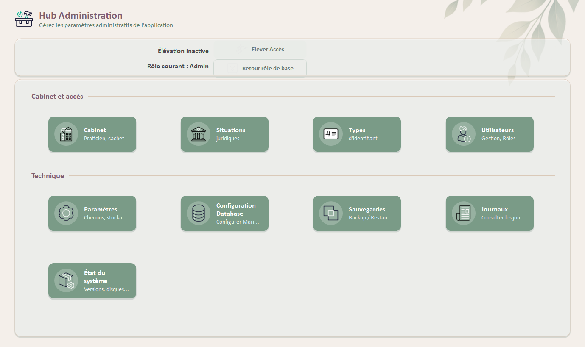

|                        Vue SuperUser                         |                           Vue User                           |
| :----------------------------------------------------------: | :----------------------------------------------------------: |
| 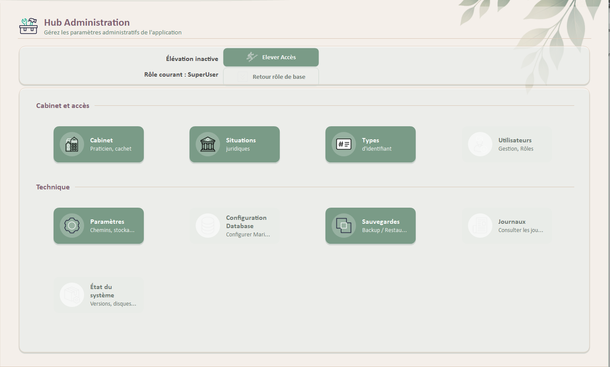 | 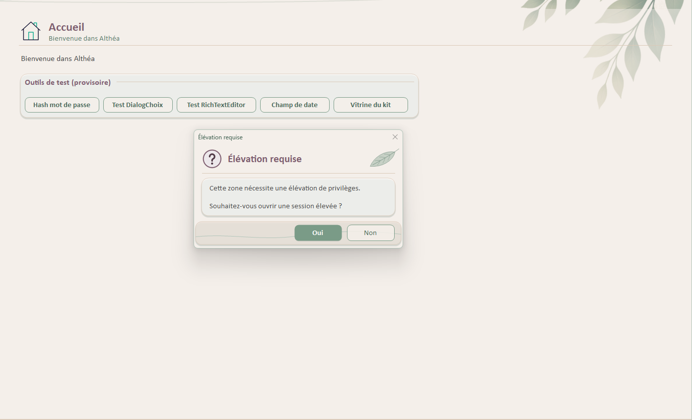 |

> Fichier : `UI/Controls/Administration/UC_AdminHome.vb` — hérite de `UserControl` — implémente `IContextAwareUserControl`.

#### Rôle général

UserControl représentant l'écran d'administration principal de l'application Althéa.

#### Responsabilités

- Afficher l'interface d'accueil de la section Administration
- Gérer l'affichage et l'état des boutons selon le rôle utilisateur (Admin, SuperUser)
- Proposer l'accès aux outils d'administration : Paramètres, Utilisateurs, Journaux, État du système, Sauvegardes, Connexion DB
- Gérer l'élévation temporaire des droits d'accès (bouton "Élever accès")
- Gérer le retour au rôle de base après élévation (bouton "Retour rôle de base")
- Afficher le rôle courant et l'état de l'élévation (lblRoleCourant, lblElevation)
- Ouvrir des Forms ponctuelles avec contexte temporaire (ConfigurationConnexion, ElevationAcces)
- Naviguer vers d'autres UserControls par la fenêtre principale (`Ouvrir`, `IFenetrePrincipale.NavigateToAdminView`, ADR-55)

#### Dépendances

| Élément | Type | Rôle |
| --- | --- | --- |
| `UserSession` | Classe | session utilisateur avec élévation |
| `UtilisateurApplication` | Classe | utilisateur connecté avec RoleMaxElevation |
| `UserControlContext` | Classe | contexte UI injecté par Home |
| `IFenetrePrincipale` | Interface | Fenêtre principale lue dans le contexte : navigation (`Ouvrir`), fil d'Ariane, bandeau, élévation (`DemanderElevation`) — ADR-55 |
| `ConfigurationConnexion` | Form | Form configuration DB |
| `ElevationAcces` | Form | Form élévation d'accès |
| `UC_Parametres` | UserControl | UserControl paramètres |
| `UtilsButtons` | Module utilitaire | thématisation des boutons |
| `GestionLog` | Module métier | journalisation |
| `IContextAwareUserControl` | Interface | Pour injection du contexte UI partagé |
| `AppRole` | Enum | — |
| `DialogChoix` | Form | — |
| `UC_Utilisateurs` | UserControl | Ouvert depuis ce composant. |

#### Variables privées

| Variable | Type | Rôle |
| --- | --- | --- |
| `_context` | `UserControlContext` | Injecté par Home via SetContext() (implémentation IContextAwareUserControl) |
| `_userSession` | `UserSession` | Fourni au constructeur, contient CurrentRole et IsElevated |
| `_utilisateur` | `UtilisateurApplication` | Fourni au constructeur, contient RoleMaxElevation |

#### Contrôles principaux

| Contrôle | Type | Rôle |
| --- | --- | --- |
| `pnlForm` | Panel | — |
| `enTete` | AltheaEnTete | En-tête d'écran : titre « Hub Administration », sous-titre « Gérez les paramètres administratifs de l'application » ; icône dans les ressources (`enTete.Icone`). |
| `Label2` | Label | — |
| `btnVersionBase` | Button | — |
| `pnlCenter` | Panel | — |
| `tblMenu` | TableLayoutPanel | — |
| `btnParametres` | Button | Ouvrir les paramètres de l'application. |
| `btnUtilisateurs` | Button | Gérer les utilisateurs et leur rôle (quatrième tuile de « Cabinet et accès » depuis le 20/10/2026). |
| `btnTypesIdentifiant` | AltheaTuile | Ouvre `UC_TypesIdentifiantPro` (SuperUser et Admin, mêmes droits que la fiche Cabinet) ; icône `typeIdentifiant` (20/10/2026). |
| `btnLogs` | AltheaTuile | Tuile « Journaux » (libellé renommé le 14/10/2026, nom du contrôle inchangé) : ouvre `UC_Journaux` (Admin) ; icône `journaux`. |
| `btnEtatSysteme` | AltheaTuile | Ouvre `UC_EtatSysteme` (Admin) ; groupe Technique, sous Paramètres icône `etatSystem` (14/10/2026). |
| `btnSauvegardes` | Button | Ouvre `UC_Sauvegardes` (SuperUser et Admin depuis le 12/10/2026). |
| `btnConnexionDatabase` | Button | Configurer la connexion à la base de données. |
| `pnlTop` | Panel | — |
| `pnlRoleCourant` | Panel | — |
| `btnEleverAcces` | Button | Élever les droits de l'utilisateur. |
| `lblRoleCourant` | Label | Libellé : « Rôle courant » |
| `btnRetourRoleBase` | Button | Retourner au rôle de base. |
| `lblElevation` | Label | Libellé : « Elevation » |

#### Méthodes principales

| Membre | Nature | Rôle |
| --- | --- | --- |
| `New` | Public Sub | — |
| `SetContext` | Public Sub | Injecte le contexte UI partagé fourni par Home (implémentation IContextAwareUserControl). |
| `SetStatus` | Private Sub | Met à jour le message de la barre d'état via le contexte partagé. |
| `AppliquerDroitsUtilisateur` | Private Sub | Configure l'affichage et l'état des boutons selon le rôle utilisateur courant et l'état d'élévation. |
| `ActiverTousLesBoutonsAdmin` | Private Sub | Active tous les boutons d'administration (Paramètres, Utilisateurs, Journaux, État du système, Sauvegardes, Connexion DB). |
| `InitialiserToolTips` | Private Sub | — |
| `DesactiverTousLesBoutonsAdmin` | Private Sub | Désactive tous les boutons d'administration (Paramètres, Utilisateurs, Journaux, État du système, Sauvegardes, Connexion DB). |
| `UC_AdminHome_Load` | Private Sub | Initialise l'affichage du UserControl au chargement. |
| `btnParametres_Click` | Private Sub | Ouvre la vue de paramètres généraux de l'application (UserControl UC_Parametres). |
| `btnUtilisateurs_Click` | Private Sub | Ouvre l'écran d'administration des utilisateurs. |
| `btnSauvegardes_Click` | Private Sub | Ouvre l'écran des sauvegardes (`UC_Sauvegardes`). |
| `btnConnexionDatabase_Click` | Private Sub | Ouvre la Form de configuration de connexion à la base de données (ConfigurationConnexion). |
| `btnRetourRoleBase_Click_1` | Private Sub | Gestionnaire d'événement Click de `btnRetourRoleBase`. |
| `btnEleverAcces_Click_1` | Private Sub | Demande l'élévation à la fenêtre principale (`IFenetrePrincipale.DemanderElevation`, V2.0.0, 25/10/2026 : le bloc recopié est réuni dans `Home`), puis réapplique les droits de l'écran. |

#### Gestion des icônes

- `btnConnexionDatabase.Image` (Designer / ressources)
- `btnEleverAcces.Image` (Designer / ressources)
- `btnEtatSysteme.Image` (Designer / ressources)
- `btnLogs.Image` (Designer / ressources)
- `btnParametres.Image` (Designer / ressources)
- `btnRetourRoleBase.Image` (Designer / ressources)
- `btnSauvegardes.Image` (Designer / ressources)
- `btnUtilisateurs.Image` (Designer / ressources)
- `enTete.Icone` (Designer / ressources)
- `pnlForm.BackgroundImage` (Designer / ressources)

#### Gestion des droits

- Rôles testés : `AppRole.Admin`, `AppRole.SuperUser`.
- SuperUser : Paramètres, Cabinet, Situations juridiques et **Sauvegardes** (12/10/2026) ; Utilisateurs, Journaux, État du système, Connexion DB réservés à l'Admin.
- Méthodes concernées : `AppliquerDroitsUtilisateur`, `btnRetourRoleBase_Click_1`, `btnEleverAcces_Click_1`.

#### Règles en vigueur

- Chargé dynamiquement dans le panneau central de Home via le mécanisme de navigation
- Implémente IContextAwareUserControl pour injection du contexte UI partagé
- Aucune logique métier ni accès direct à la base de données (tout passe par les couches inférieures)
- Point d'entrée vers les fonctionnalités techniques et de maintenance de l'application
- Le retour au rôle de base peut déclencher un retour automatique à l'Accueil si le rôle < SuperUser

#### Points d'attention

- Aucun point particulier identifié à ce jour.

#### Message au repreneur

> UC_AdminHome (816 lignes). Point d'entrée : `SetContext`, `InitialiserToolTips`, `UC_AdminHome_Load`. Toute modification visuelle passe par le Designer (.Designer.vb / .resx).

---

### **UserControl : UC_Parametres**

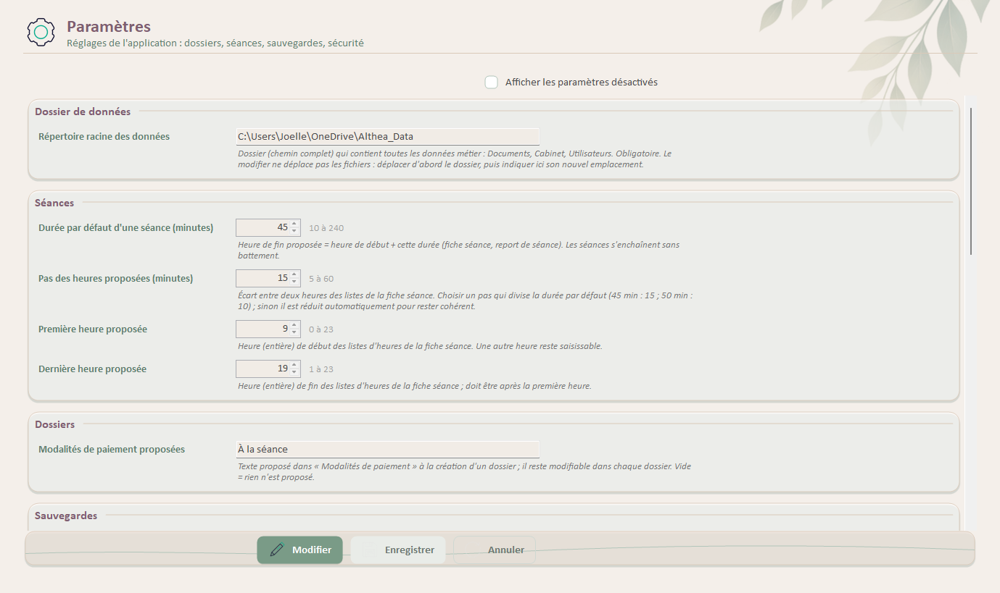

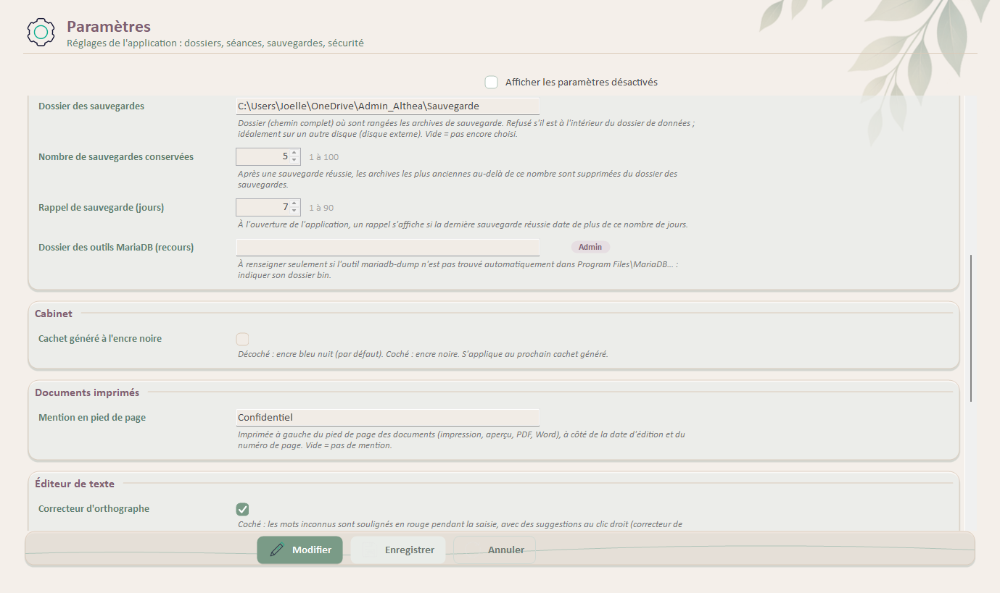

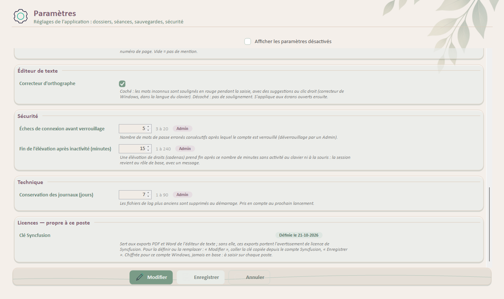

> Fichier : `UI/Controls/Administration/UC_Parametres.vb` (V2.1.0, 18/10/2026) — hérite de `UserControl` — implémente `IContextAwareUserControl` et `IUnsavedChangesAware`.

#### Rôle général

Écran des paramètres applicatifs (`tec_parametres`) : **une seule page**, une carte par groupe de paramètres, chaque paramètre sur une ligne — libellé, valeur, bornes, puis sa description en aide sous la valeur. Ouvert depuis l'Administration en mode Admin (tous les paramètres) ou SuperUser (paramètres ouverts).

**Carte « Licences — propre à ce poste »** (Admin seulement, V2.1.0, 18/10/2026, ADR-41) : dernière carte de la page, une ligne « Clé Syncfusion » construite comme les autres (même placement, lecture seule en consultation, ouverte par **Modifier**), mais hors de la liste des paramètres : l'écriture en base ne la voit jamais.

Le champ (masqué, vide) n'apparaît qu'en modification ; la clé n'est jamais réaffichée, une pastille donne l'état :

- « Définie le … »
- « Absente »
- « Illisible » (clé chiffrée par un autre compte Windows).

À **Enregistrer**, la clé est vérifiée avec les autres valeurs avant toute écriture, puis enregistrée sur le poste (`GestionLicences.DefinirCleSyncfusion`) après les paramètres, et seulement s'ils ont été acceptés.

La V2 (UI-7) remplace les onglets par groupe avec grille et panneau de détail de la V1 : lourds pour une douzaine de paramètres, et la notion de « paramètre sélectionné » avait causé le bug du 12/10/2026 (valeur écrite sur un autre paramètre).

------

#### Responsabilités

- Charger les paramètres par `GestionParametres.GetParametres(mode, afficherInactifs)` ; le filtrage SuperUser est fait par la couche métier
- Construire une carte par groupe, dans l'ordre des groupes (`tec_groupes_parametres`, v2.40.0), et une ligne par paramètre, dans l'ordre d'affichage
- Choisir le champ selon `type_valeur` ; montrer les bornes des nombres et la description
- Consultation lisible par défaut ; « Modifier » ouvre **toute la page** ; « Enregistrer » écrit les valeurs changées **en une transaction** ; « Annuler » recharge la page
- Valider avant d'enregistrer (type, chemins) et rappeler la portée des nouvelles valeurs
- Afficher en option les paramètres désactivés
- Demander confirmation avant de quitter l'écran avec des modifications non enregistrées

------

#### Dépendances

| Élément | Type | Rôle |
| --- | --- | --- |
| `GestionParametres` | Module métier | Lecture (`GetParametres`) et enregistrement groupé en transaction (`UpdateValeursParametres`). |
| `ParametreApplication` | Classe | Paramètre chargé, avec le titre et l'ordre de son groupe (`LibelleGroupe`, `OrdreGroupe`). |
| `ModeAccesParametres` | Enum | Admin, SuperUser. |
| `ClesParametres` | Module | Clés de `PATH_GENERAL` et `SAUVEGARDE_DOSSIER` (règles propres aux chemins). |
| `GestionSauvegardes` | Module métier | `ValiderDossierSauvegarde` : dossier des sauvegardes refusé dans le dossier de données. |
| `UtilsValidation` | Module utilitaire | `IsValidValueForType` (type de valeur, forme des chemins). |
| `UtilsControls` | Module utilitaire | `DefinirLectureSeule` : bascule consultation / modification de toute la page. |
| `UtilsAffichage` | Module utilitaire | Gel de la page pendant sa construction. |
| `UtilsButtons` | Module utilitaire | Icônes des boutons d'action ; icône `dossier_24_normal` du bouton Parcourir. |
| `UITheme` | Module utilitaire | Couleurs. |
| Kit | Contrôles | `AltheaCarte`, `AltheaCase`, `AltheaDate`, `AltheaPastille`, `AltheaBouton` (Outil). |
| `UserControlContext` | Classe | Fil d'Ariane, barre d'état, infobulles, erreurs de saisie. |
| `DialogChoix`, `GestionLog` | Form, module | Messages et journal. |
| `IContextAwareUserControl`, `IUnsavedChangesAware` | Interfaces | Contexte injecté ; confirmation avant de quitter (`PeutQuitter`). |

#### Variables privées

| Variable | Type | Rôle |
| --- | --- | --- |
| `_context` | `UserControlContext` | Contexte UI de Home. |
| `_modeAcces` | `ModeAccesParametres` | Admin ou SuperUser (constructeur). |
| `_parametres` | `List(Of ParametreApplication)` | Paramètres chargés (valeurs enregistrées). |
| `_cartes` | `List(Of CarteGroupe)` | Cartes de la page et leurs lignes (`LigneParametre` : paramètre, libellé, champ, bouton Parcourir, bornes, pastilles, aide). |
| `_enModification` | `Boolean` | Page ouverte à la modification. |
| `_isDirty` | `Boolean` | Au moins une valeur changée depuis « Modifier ». |
| `_chargementEnCours` | `Boolean` | Construction en cours : les valeurs posées ne comptent pas comme modifications. |
| `_xChamp` | `Integer` | Colonne des champs, commune à toutes les cartes (après le libellé le plus long). |
| `_largeurMiseEnPage` | `Integer` | Largeur de la dernière mise en page (évite de replacer pour rien). |

#### Contrôles principaux

| Contrôle | Type | Rôle |
| --- | --- | --- |
| `pnlForm` | Panel | Fond feuille coupée. |
| `enTete` | AltheaEnTete | « Paramètres » — « Réglages de l'application : dossiers, séances, sauvegardes, sécurité ». |
| `pnlTop` / `chkAfficherInactifs` | Panel / AltheaCase | Afficher aussi les paramètres désactivés (indisponible pendant la modification). |
| `pnlPage` | Panel | Page défilante qui reçoit les cartes construites par le code. |
| `pnlActions` | AltheaBarreActions | `btnModifier`, `btnEnregistrer`, `btnAnnuler`. |

#### Une ligne de paramètre

| Élément | Contenu |
| --- | --- |
| Libellé | `libelle_parametre`, Calibri 10,5 gras sauge, à x = 14. En mode Admin, infobulle « Clé technique : … ». |
| Champ | Selon `type_valeur` (tableau ci-dessous), à la colonne commune `_xChamp`. |
| Bouton Parcourir | Type PATH : `AltheaBouton` Outil 30 × 30, icône dossier, visible en modification seulement (sa place reste réservée). |
| Bornes | Nombres : « 10 à 240 », « 5 minimum » ou « 90 maximum » (`valeur_min` / `valeur_max`), en gris. |
| Pastilles | « Admin » (mode Admin, paramètre fermé au SuperUser) ; « Désactivé » (paramètre inactif). |
| Aide | `description_parametre` en italique gris sous le champ, repliée sur la largeur disponible (640 px au plus). |

| Type | Champ |
| --- | --- |
| BOOL | `AltheaCase` |
| INT / DECIMAL | `NumericUpDown` borné (0 / 2 décimales) ; la molette ne change pas la valeur |
| DATE | `AltheaDate` facultative (aucun paramètre de ce type aujourd'hui) |
| PATH | `TextBox` 420 px + bouton Parcourir |
| STRING et autres | `TextBox` 420 px |

#### Méthodes principales

| Membre | Nature | Rôle |
| --- | --- | --- |
| `New(modeAcces)` | Public Sub | Constructeur utilisé par `UC_AdminHome` (le constructeur sans argument sert au Designer). |
| `SetContext` | Public Sub | Reçoit le contexte UI de Home. |
| `PeutQuitter` | Public Function | Avant de quitter avec des valeurs non enregistrées : Enregistrer / Quitter sans enregistrer / Rester (`DialogChoix.DemanderAvantDepart`, 19/10/2026) ; Annuler : Abandonner / Continuer la saisie (`ConfirmerAbandon`). |
| `UC_Parametres_Load` | Private Sub | Boutons, infobulles, premier chargement. |
| `ChargerParametres` | Private Sub | Lit les paramètres et reconstruit la page en consultation (aussi après Enregistrer et Annuler). |
| `ConstruirePage` | Private Sub | Une carte par groupe, une ligne par paramètre ; page gelée pendant la construction. |
| `CreerLigne` / `CreerChamp` / `CreerBoutonParcourir` / `CreerPastille` | Private | Contrôles d'une ligne. |
| `CalculerColonneChamps` | Private Function | Colonne des champs d'après le libellé le plus long (les libellés viennent de la base). |
| `MettreEnPage` / `PlacerLigne` | Private | Placement des cartes et des lignes ; relancé quand la largeur change. |
| `AppliquerMode` | Private Sub | Consultation ↔ modification de toute la page (`DefinirLectureSeule`), boutons Parcourir, case des inactifs. |
| `btnEnregistrer_Click` | Private Sub | Valeurs changées → validation → `UpdateValeursParametres` (tout ou rien) → rechargement → avis de portée. |
| `LireValeur` | Private Function | Valeur au format de stockage (1 / 0, nombre arrondi aux décimales du champ avec point décimal, aaaa-mm-jj, texte sans espaces autour). |
| `ValiderValeur` / `VerifierDossierChemin` | Private Function | Type de valeur ; racine des données obligatoire, dossier des sauvegardes valable. |
| `CreerDossierPropose` | Private Function | Dossier absent : création proposée, une fois toute la page validée. |
| `SignalerRefus` / `MontrerLigne` | Private Sub | Champ refusé : erreur sur le champ, ligne amenée à l'écran, message avec le nom du paramètre. |
| `AvertirPortee` | Private Sub | Après enregistrement : valeurs appliquées aux prochaines opérations, description de chaque paramètre modifié. |
| `TexteDesBornes`, `AppliquerBornes`, `CopieAvecValeur` | Private Shared | Utilitaires. |

#### Enregistrement

- Seuls les paramètres dont la valeur a **changé** sont écrits : la comparaison se fait avec ce que le champ affichait au chargement (`LigneParametre.ValeurInitiale`), si bien qu'un paramètre non touché n'est jamais réécrit, même stocké dans un autre format.
- Toutes les valeurs changées sont d'abord validées ; au premier refus, rien n'est écrit.
- Les dossiers absents ne sont proposés à la création qu'**après** la validation de toute la page (`CreerDossierPropose`) : jamais de dossier créé pour une page refusée.
- `GestionParametres.UpdateValeursParametres` écrit dans **une transaction** : si un paramètre est refusé (fermé au SuperUser, droit revérifié dans la requête) ou introuvable, ou si la base renvoie une erreur, **aucune** valeur n'est enregistrée.
- Après l'enregistrement : rechargement de la page en consultation, puis avis de portée.
- Journal : clés des paramètres seulement, jamais les valeurs (un chemin peut contenir un nom de personne).

#### Gestion des droits

- **Admin** : voit et modifie tous les paramètres ; pastille « Admin » sur ceux que le SuperUser ne voit pas ; clé technique en infobulle du libellé.
- **SuperUser** : ne reçoit que les paramètres ouverts (`modifiable_utilisateur = 1`) ; droit revérifié à l'écriture.
- **User** : pas d'accès (Administration).
- Aucun rôle ne modifie la définition d'un paramètre depuis l'écran (ADR-36) : elle vient de sa migration, comme les groupes.

#### Points d'attention

- **Défilement** : la page est redessinée entière à chaque défilement (`pnlPage_Scroll`, `pnlPage_MouseWheel`, `Champ_Enter` pour la tabulation, molette au-dessus d'un nombre qui fait défiler la page) ; sans cela, Windows recopie des morceaux des cartes translucides au mauvais endroit.
- Un nombre enregistré hors bornes s'affiche ramené dans les bornes (comme à la lecture par `GestionParametres`) ; il n'est réécrit que si l'utilisateur change ce champ.
- `ViderPage` retire les infobulles des contrôles et libère l'icône des boutons Parcourir avant de les détruire (l'infobulle partagée de Home garderait sinon une référence à chaque rechargement).
- Les paramètres désactivés restent modifiables (valeur prête pour une réactivation par migration) ; l'application utilise leur valeur de secours tant qu'ils sont inactifs.
- Ne pas réintroduire de « paramètre sélectionné » ni d'écriture paramètre par paramètre : la page s'enregistre d'un bloc.

#### Message au repreneur

Ajouter un paramètre ne demande **aucune modification de cet écran** :

- une migration crée la ligne (avec son groupe, son type, ses bornes et sa description)
- `ClesParametres` reçoit la clé et la valeur de secours
- `reinit_tec_parametres.sql` est complété (Rules § 14).

Un nouveau groupe s'ajoute de même dans `tec_groupes_parametres`. Un nouveau **type** de valeur, lui, demande une branche dans `CreerChamp` et `LireValeur`, et sa validation dans `UtilsValidation`.

---

### **UserControl : UC_Cabinet**

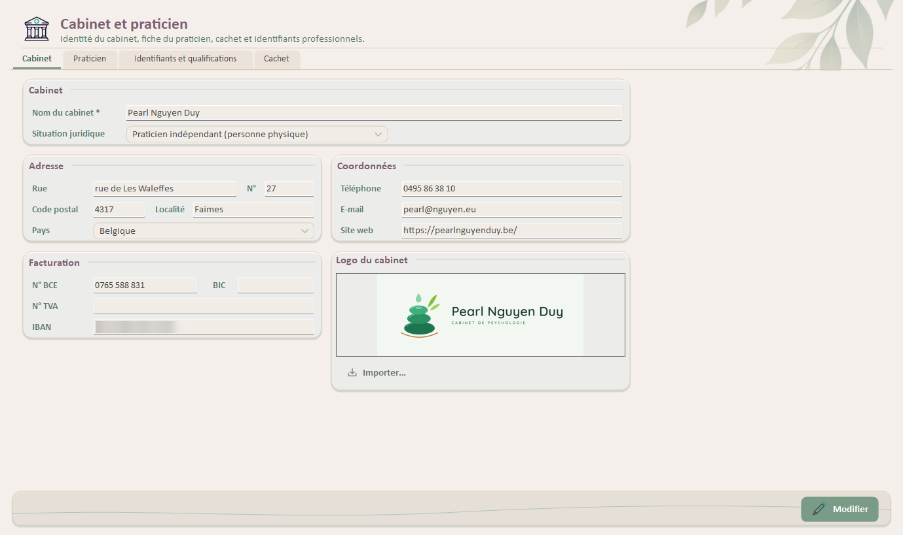

complété en v2.31.0 (situation juridique), le 07/10/2026 (mode consultation / Modifier) et en v2.32.0 (lot 28 : compte de travail du praticien).

##### Rôle général

Fiche d'administration de l'**identité du cabinet et de son praticien** :

- raison sociale, situation juridique, adresse, coordonnées, numéros légaux (BCE, TVA), coordonnées bancaires (IBAN, BIC), logo
- identité du praticien, photo, signature
- identifiants professionnels (INAMI, COMPY, BCE…), qualifications
- cachet généré ou importé.

Ces données alimentent les documents produits par l'application (attestations, factures, cachet).

Modèle de données : `cab_cabinet` (1 ligne active), `cab_praticiens`, `cab_praticien_identifiants`, `cab_praticien_qualifications`, référentiels `ref_types_identifiant_pro` et `ref_situations_juridiques`.

**V1 : un cabinet = un praticien** ; le schéma reste multi-praticiens (`cab_praticiens.id_cabinet`) mais l'écran ne charge que le premier praticien.

Les images sont des **fichiers** (dossier géré par `CheminsCabinetHelper`) ; la base ne stocke que des chemins relatifs, jamais de BLOB.

##### Responsabilités

- Charger le cabinet actif et son praticien, ses identifiants, ses qualifications et ses images (`Charger`).
- Gérer deux états d'écran, **consultation** et **édition**, avec bascule par le bouton Modifier (`AppliquerMode`), et un état initial de **première saisie** quand aucun cabinet n'existe.
- Suivre les modifications (`_isDirty`) sur tous les champs et grilles, activer Enregistrer / Annuler en conséquence et protéger la navigation (`PeutQuitter`).
- Valider les saisies (champs obligatoires, code postal, téléphone, e-mail, BCE, TVA, IBAN, BIC, identifiants) et garantir l'**unicité d'emplacement du BCE** selon la situation juridique (`ValiderPorteurBce`).
- Importer les images (logo, photo, signature, cachet) et générer le cachet depuis les données enregistrées.
- Persister via `GestionCabinet` (cabinet, praticien, identifiants avec suppressions différées, qualifications).
- Attacher au praticien son **compte de travail** (SuperUser) : création, liaison d'un compte existant, déliaison — via `DialogComptePraticien`, hors cycle Enregistrer (lot 28).

##### Dépendances

| Élément | Type | Rôle |
| --- | --- | --- |
| `UserControlContext` | Classe | statut, info-bulles, fil d'Ariane |
| `IUnsavedChangesAware` | Interface | confirmation avant navigation si modifications en cours |
| `GestionCabinet` | Module métier | `GetCabinetActif`, `GetPraticiens`, `GetIdentifiants`, `GetQualifications`, `EnregistrerFiche` (cabinet, praticien, identifiants, qualifications en une transaction, 20/10/2026), `EnregistrerImages`, `GetUtilisateursLiables` (types d'identifiant : `GestionTypesIdentifiantPro.GetTypesIdentifiant`, 20/10/2026), `LierUtilisateur`, `CreerCompteSuperUser` |
| `GestionSituationsJuridiques` | Module métier | liste des situations (actives + courante) |
| `Cabinet`, `Praticien`, `PraticienIdentifiant`, `PraticienQualification`, `TypeIdentifiantPro`, `SituationJuridique` | Classes | modèles métier |
| `CheminsCabinetHelper` | Classe utilitaire | dossiers de stockage, `ImporterImage`, noms fixes (`NomLogo`, photo, signature, cachet) |
| `GenerateurCachet` | Classe utilitaire | rendu du cachet à partir du praticien, de ses identifiants et qualifications marqués « Cachet » |
| `UtilsIdentifiantBelge` | Module | BCE / TVA / INAMI (mod 97), IBAN, BIC, `CodeBce` |
| `UtilsCodePostal`, `UtilsTelephone` | Modules | contrôles par pays |
| `UtilsButtons`, `UtilsDataGrid` | Modules | boutons standard (normal/hover/disabled par `Tag`), style des grilles |
| `DialogChoix` | Form | confirmations (abandon, déplacement du BCE, déliaison), succès (mot de passe temporaire) |
| `DialogComptePraticien` | Form (Designer) | création ou liaison d'un compte SuperUser au praticien (`UI/Forms/Cabinet/`) ; UI-7 (15/10/2026) : carte « Compte de travail » (explication, login et nom d'affichage en création, liste du kit des comptes en liaison, erreur aux couleurs de la charte) sur le fond `AltheaFondFenetre` ; erreur inattendue : message général, détail au journal. Compte et lien au praticien créés dans une seule transaction, message d'échec « rien n'a été enregistré » (V1.2.1, 21/10/2026, audit B.2) ; login et nom d'affichage jugés par `GestionUtilisateurs.ValiderCompte` (login d'au moins 3 caractères et unique), tous les points dans la zone d'erreur (V1.4.0, 23/10/2026, audit C.2 étape 4) |

##### Variables privées

| Variable | Type | Rôle |
| --- | --- | --- |
| `_context` | UserControlContext | contexte de navigation |
| `_cabinet` | Cabinet | cabinet chargé (ou neuf si aucun) |
| `_praticien` | Praticien | premier praticien du cabinet (ou neuf) |
| `_typesIdentifiant` | List(Of TypeIdentifiantPro) | source de la colonne Type de `dgvIdentifiants` |
| `_situationsJuridiques` | List(Of SituationJuridique) | source de `cboCabSituation` |
| `_identifiantsSupprimes`, `_qualificationsSupprimees` | List(Of ULong) | ids à supprimer à l'enregistrement (suppressions différées) |
| `_isDirty` | Boolean | modifications non enregistrées |
| `_chargementEnCours` | Boolean | neutralise le suivi des modifications pendant `Charger` |
| `_enEdition` | Boolean | état courant : `False` = consultation, `True` = édition |

##### Contrôles principaux

Structure : `enTete` (`AltheaEnTete` : icône, titre, sous-titre), `tabCabinet` (`AltheaOnglets`, 4 onglets), `barreActions` (`AltheaBarreActions`) contenant `pnlBas` (FlowLayoutPanel aligné à droite : `btnModifier`, `btnEnregistrer`, `btnAnnuler`, boutons du kit).

**Onglet Cabinet** (`tpCabinet` : cartes `carteCabIdentite`, `carteCabAdresse`, `carteCabCoordonnees`, `carteCabFacturation` + `grpLogo`) — UI-7 (15/10/2026) :

- la grande carte et son `TableLayoutPanel` laissent la place à quatre cartes thématiques et à la carte du logo
- libellés en gras 10,5, champs en 11
- consultation lisible (`DefinirLectureSeule` dans `AppliquerMode`)

 

| Contrôle | Type | Rôle |
| --- | --- | --- |
| `carteCabIdentite` | AltheaCarte | « Cabinet » : nom du cabinet (pleine largeur), situation juridique |
| `carteCabAdresse` | AltheaCarte | « Adresse » : rue, n°, code postal, localité, pays |
| `carteCabCoordonnees` | AltheaCarte | « Coordonnées » : téléphone, e-mail, site web |
| `carteCabFacturation` | AltheaCarte | « Facturation » : n° BCE et BIC, n° TVA, IBAN |
| `txtNomCabinet` | TextBox | raison sociale — **seul champ obligatoire** |
| `cboCabSituation` | AltheaListe | situation juridique ; pilote le porteur du BCE |
| `txtCabRue`, `txtCabNumero`, `txtCabCp`, `txtCabLocalite` | TextBox | adresse ; CP contrôlé selon le pays ; adresse belge : code existant, localité proposée et suggérée depuis le code, code trouvé depuis la localité (choix « Liège · 4020 »), avertissement puis confirmation si elle ne correspond pas (`SaisieLocaliteBelge`, 24/10/2026) |
| `cboCabPays` | AltheaListe | pays du cabinet (`ref_pays`) ; c'est aussi le pays proposé par défaut dans les autres fiches (R2, 12/10/2026) |
| `txtCabTelephone`, `txtCabEmail`, `txtCabSite` | TextBox | coordonnées |
| `txtCabBce` | TextBox | n° BCE ; désactivé en saisie si la situation désigne le praticien comme porteur (lisible en consultation) |
| `txtCabTva` | TextBox | n° TVA ; cohérence avec le BCE vérifiée |
| `txtCabIban`, `txtCabBic` | TextBox | coordonnées bancaires |
| `grpLogo` › `picLogo`, `btnLogoImporter` | AltheaCarte, PictureBox, AltheaBouton (OutilPrincipal) | logo du cabinet ; icône `importer_24_normal` du Designer, sans `UtilsButtons` |

**Onglet Praticien** (`tpPraticien` : cartes `carteIdentite`, `carteCoordonnees`, `carteAdresse` + `pnlImages`) — UI-7 (15/10/2026) : le `TableLayoutPanel` laisse la place à trois cartes ; libellés en gras 10,5, champs en 11 ; consultation lisible (`UtilsControls.DefinirLectureSeule` sur les trois cartes dans `AppliquerMode`)

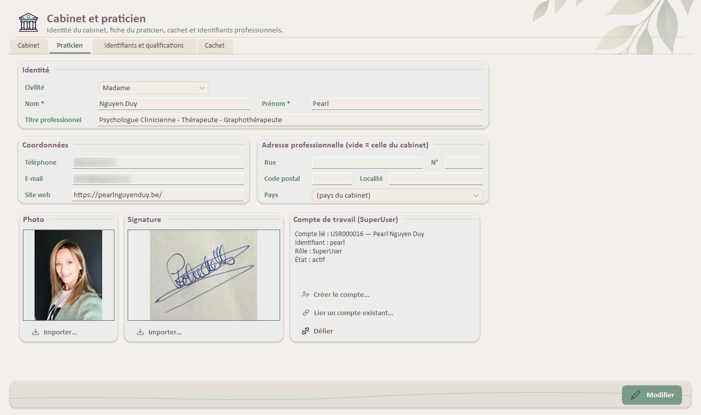 

| Contrôle | Type | Rôle |
| --- | --- | --- |
| `carteIdentite` | AltheaCarte | « Identité » : civilité, nom, prénom, titre professionnel |
| `carteCoordonnees` | AltheaCarte | « Coordonnées » : téléphone, e-mail, site web |
| `carteAdresse` | AltheaCarte | « Adresse professionnelle (vide = celle du cabinet) » : rue, n°, code postal, localité, pays (le titre remplace l'ancienne ligne `lblPraAdresseInfo`) |
| `cboPraCivilite` | AltheaListe | civilité (`ref_civilites`, entrée « — » = aucune ; liste codée en dur supprimée le 12/10/2026) |
| `txtPraNom`, `txtPraPrenom` | TextBox | identité — obligatoires dès qu'un praticien est saisi |
| `txtPraTitre` | TextBox | titre professionnel (ex. Logopède) |
| `cboPraPays` | AltheaListe | pays propre du praticien ; entrée « (pays du cabinet) » = aucun : les contrôles du CP et du téléphone utilisent alors le pays du cabinet |
| `txtPraRue` … `txtPraLocalite`, `txtPraTelephone`, `txtPraEmail`, `txtPraSite` | TextBox | adresse et coordonnées propres (vide = adresse du cabinet, rappelé par le titre de la carte) ; adresse belge : code existant, localité proposée et suggérée depuis le code, code trouvé depuis la localité (choix « Liège · 4020 »), avertissement puis confirmation si elle ne correspond pas (`SaisieLocaliteBelge`, 24/10/2026) |
| `grpPhoto` › `picPhoto`, `btnPhotoImporter` | AltheaCarte, PictureBox, AltheaBouton (OutilPrincipal) | photo ; icône `importer_24_normal` du Designer, sans `UtilsButtons` (comme `btnSignatureImporter`) |
| `grpSignature` › `picSignature`, `btnSignatureImporter` | AltheaCarte, PictureBox, AltheaBouton (OutilPrincipal) | signature |
| `grpCompte` › `lblCompteEtat`, `btnCompteCreer`, `btnCompteLier`, `btnCompteDelier` | AltheaCarte, Label, AltheaBouton (Outil / Outil / OutilDanger, empilés) | compte de travail lié (code et nom — « Compte lié : USR000002 — … », login, rôle, état) et actions Créer / Lier / Délier ; icônes `compte_24_normal`, `lier_24_normal`, `delier_24_normal` (15/10/2026 : les anciennes, fines et claires, étaient presque invisibles) |

**Onglet Identifiants** (`tpIdentifiants`) — deux cartes titrées (UI-7, 16/10/2026), chacune avec une consigne (`lblAideIdentifiants`, `lblAideQualifications` : Calibri 10 italique Sauge foncé, Dock Top) au-dessus de sa grille (Dock Fill) :

- `carteIdentifiants` « Identifiants professionnels » (hauteur fixe)
- et `carteQualifications` « Diplômes et qualifications » (ancrée sur les quatre bords).

Le `SplitContainer` d'avant a été retiré.

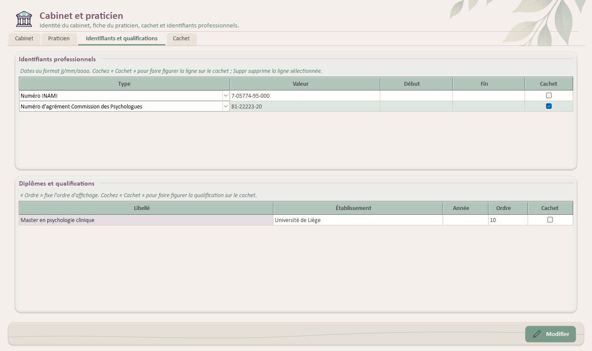 

| Grille | Colonnes | Rôle |
| --- | --- | --- |
| `dgvIdentifiants` | `colIdIdent` (masquée), `colType` (ComboBox sur `ref_types_identifiant_pro`), `colValeur`, `colDebut`, `colFin`, `colCachetIdent` (case) | identifiants professionnels avec période de validité et affichage sur le cachet |
| `dgvQualifications` | `colIdQualif` (masquée), `colLibelle`, `colEtablissement`, `colAnnee`, `colOrdre`, `colCachetQualif` (case) | diplômes / qualifications |

**Onglet Cachet** (`tpCachet`)

 

| Contrôle | Type | Rôle |
| --- | --- | --- |
| `carteCachet` › `pnlCachetActions` (`AltheaBarreOutils`) › `btnCachetGenerer`, `btnCachetImporter` | AltheaBouton (OutilPrincipal / Outil) | génération depuis les données **enregistrées** / import d'une image externe ; icônes du Designer `cachet_24_normal` (tampon) et `importer_24_normal`, sans `UtilsButtons` (16/10/2026) |
| `carteCachet` › `lblCachetInfo` | Label | consigne (Calibri 10 italique Sauge foncé), sous la barre d'outils |
| `carteCachet` › `picCachet` | PictureBox | aperçu du cachet courant, sur fond « papier » blanc |

##### États de l'écran et transitions

| État | Conditions d'entrée | Champs / grilles | Boutons bas | Imports d'images |
| --- | --- | --- | --- | --- |
| **Première saisie** | `Charger` ne trouve aucun cabinet (`IdCabinet = 0`) | éditables | Enregistrer (grisé tant que rien n'est saisi), Annuler | désactivés (pas de dossier de stockage sans id) ; onglet Praticien désactivé |
| **Consultation** | ouverture avec cabinet existant ; après Enregistrer ou Annuler | TextBox `ReadOnly`, ComboBox désactivées, grilles `ReadOnly` sans ligne d'ajout ni suppression | Modifier seul | désactivés |
| **Édition** | clic sur Modifier | éditables | Enregistrer (activé par `_isDirty`), Annuler (toujours actif : sans modification, retour direct en consultation) | activés **si** l'entité concernée est enregistrée (`IdCabinet` pour le logo, `IdPraticien` pour photo/signature/cachet) |

Les boutons du compte de travail (`grpCompte`) ne dépendent **pas** du mode : ils sont actifs dès que le praticien est enregistré (Créer / Lier si aucun compte lié, Délier sinon). Ce sont des opérations immédiates et journalisées, sans effet sur la saisie en cours.

`AppliquerMode(edition)` applique l'état à tous les contrôles descendants de `tabCabinet` (`TousLesControles`), aux deux grilles et à la visibilité des trois boutons, puis appelle `MettreAJourEtat()` (dépendances aux ids) et, en édition, `AppliquerPorteurBce()`.

`Charger()` termine toujours par `AppliquerMode(_cabinet.IdCabinet = 0UL)` : édition si première saisie, consultation sinon.

##### Méthodes principales

| Membre | Nature | Rôle |
| --- | --- | --- |
| `SetContext` | Public Sub (IContextAwareUserControl) | reçoit le contexte |
| `UC_Cabinet_Load` | Handler | boutons standard, grilles, thème, abonnement au suivi des modifications, `Charger()` |
| `AppliquerTheme` | Private Sub | style des deux `DataGridView` uniquement (le reste est dans le Designer) |
| `AbonnerSuiviModifications` / `Champ_Modifie` / `Grille_*` | Private | tout changement → `DefinirModifie(True)` sauf pendant le chargement |
| `DefinirModifie(valeur)` | Private Sub | `_isDirty`, `btnEnregistrer.Enabled` |
| `PeutQuitter` | Public Function (IUnsavedChangesAware) | Enregistrer / Quitter sans enregistrer / Rester (`DialogChoix.DemanderAvantDepart`, 19/10/2026) ; « Enregistrer » passe par le bouton. |
| `Charger` | Private Sub | lecture complète, affichage, `AppliquerMode` |
| `ChargerSituationsJuridiques` / `SituationSelectionnee` / `AppliquerPorteurBce` | Private | liste des situations (actives + courante), (dés)activation de `txtCabBce` avec info-bulle explicative |
| `ValiderPorteurBce` | Private Function | voir § Règles : propose le déplacement du BCE vers l'emplacement légitime |
| `AppliquerMode(edition)` / `MettreAJourEtat` | Private Sub | états de l'écran (tableau ci-dessus) |
| `btnModifier_Click` | Handler | `AppliquerMode(True)` |
| `btnEnregistrer_Click` | Handler | contrôles obligatoires → `ValiderChamps` → lecture des grilles → `ValiderPorteurBce` → `LireCabinet` / `LirePraticien` → `GestionCabinet.*` → `Charger()` |
| `btnAnnuler_Click` | Handler | Si `_isDirty` : Abandonner / Continuer la saisie (`DialogChoix.ConfirmerAbandon`, 19/10/2026), puis `Charger()` |
| `ValiderChamps` / `Signaler(onglet, ctrl, message)` | Private Function | validations ; `Signaler` sélectionne l'onglet fautif, affiche le message et donne le focus |
| `LireCabinet` / `LirePraticien` / `LireIdentifiants` / `LireQualifications` / `LireDateCellule` | Private | lecture des contrôles vers les modèles, avec messages d'erreur ciblés |
| `dgv*_UserDeletingRow` | Handlers | mémorise l'id dans `_identifiantsSupprimes` / `_qualificationsSupprimees` |
| `ChoisirImage(titre, nomExistant, libelle)` | Private Function | Import d'image unifié : `UtilsImages.ChoisirFichierImage` (dialogue et contrôle communs) puis confirmation si une image existe déjà |
| `btnLogoImporter_Click` / `ImporterImagePraticien` / `btn*Importer_Click` | Handlers | copie du fichier via `CheminsCabinetHelper.ImporterImage`, **enregistrement immédiat** du chemin, `AfficherImages()` |
| `btnCachetGenerer_Click` | Handler | `GenerateurCachet` sur les données en base ; remplace le fichier cachet (après confirmation s'il en existe un) |
| `AfficherImages` | Private | chargement tolérant (fichier absent → aperçu vide) ; affichage par `UtilsImages.RemplacerImage` (libère l'image précédente) |
| `AfficherCompte` | Private Sub | libellé du compte lié (ou consignes si aucun / praticien non enregistré) |
| `btnCompteCreer_Click` / `btnCompteLier_Click` / `btnCompteDelier_Click` | Handlers | ouvrent `DialogComptePraticien` (Creation / Liaison) ou confirment la déliaison (`LierUtilisateur(prat, 0)`) ; mot de passe temporaire affiché une fois et copié dans le presse-papiers |
| `RafraichirCompte` | Private Sub | recharge le praticien pour récupérer les colonnes jointes de `sec_utilisateurs`, puis `AfficherCompte` + `MettreAJourEtat` |

##### Gestion des droits

- Écran accessible uniquement via `UC_AdminHome` (SuperUser). Aucune règle de rôle supplémentaire dans l'écran.
- Le mode consultation n'est pas une règle de droit mais une **protection contre les modifications accidentelles**, identique à `UC_PatientFiche`.

##### Règles en vigueur

- **Un seul emplacement pour le BCE**, désigné par `ref_situations_juridiques.porteur_bce` :
  - porteur **Cabinet** : saisie dans `txtCabBce` ; une ligne BCE présente dans `dgvIdentifiants` est proposée au déplacement vers le cabinet (ou à la suppression si le cabinet a déjà son BCE) ;
  - porteur **Praticien** : `txtCabBce` désactivé ; un BCE saisi côté cabinet est proposé au déplacement vers une ligne d'identifiant BCE du praticien ; à défaut, l'enregistrement est refusé tant qu'aucune ligne BCE n'existe.
  - Rien n'est déplacé ni effacé sans confirmation (`DialogChoix`). Un changement de situation est réversible tant qu'on n'enregistre pas.
- Validations : nom du cabinet obligatoire ; nom + prénom du praticien obligatoires dès que l'un des deux est saisi ; CP selon pays (BE/FR/LU), téléphone, e-mail ; BCE (mod 97), TVA cohérente avec le BCE ; IBAN (mod 97, BE = 16 caractères) ; BIC 8 ou 11 caractères ; INAMI (clé) sur les identifiants ; dates de validité des identifiants.
- Les imports d'images s'enregistrent **au moment du choix du fichier** (le fichier est déjà copié) : Annuler ne les défait pas. Ils ne sont possibles qu'en édition et pour une entité déjà enregistrée.
- Le cachet généré reflète les **données enregistrées**, pas la saisie en cours : enregistrer avant de générer.
- Suppressions de lignes différées jusqu'à Enregistrer ; Annuler les abandonne.
- **Habillage entièrement dans le Designer** (couleurs, polices, icônes, `Tag` des boutons) ; seul le style des grilles est appliqué par code.
- **Compte de travail (lot 28, v2.32.0)** : `cab_praticiens.id_utilisateur` (nullable, unique, `ON DELETE SET NULL`).
  - Le compte **Admin technique n'est jamais proposé, lié ni modifié**.
  - Seuls des SuperUser actifs non liés sont liables ; un compte créé depuis la fiche est `SuperUser` avec `role_max_elevation = Admin` (élévation par le cadenas) et `must_change_password = 1`.
  - Délier ne supprime ni ne désactive le compte.
  - V1 : un seul praticien lié ; schéma prêt pour le multi-praticiens.

##### Points d'attention

- `grpLogo.Enabled` (carte depuis UI-5) doit rester `True` dans le Designer : un conteneur désactivé masque l'état réel de `btnLogoImporter` (bug corrigé le 07/10/2026).
- `MettreAJourEtat()` dépend des ids (`IdCabinet`, `IdPraticien`) renseignés par `GestionCabinet` après `LAST_INSERT_ID` : ne pas court-circuiter `Charger()` après un enregistrement.
- `ValiderPorteurBce` lit la grille (`colType`, `colValeur`), pas le modèle : appeler `dgvIdentifiants.EndEdit()` avant (fait dans `btnEnregistrer_Click`).
- Retirer `grpLogo`, `grpPhoto`, `grpSignature` de la liste des contrôles parcourus par `AppliquerMode` n'est pas nécessaire : seuls TextBox et ComboBox sont touchés ; les boutons d'import sont gérés par `MettreAJourEtat`.
- Lot 28 réalisé (v2.32.0) ; ne pas lier dossier / séance / paiement au praticien avant la conception V2/V3. Reste du lot utilisateurs (photo, préférences) à traiter dans `UC_Utilisateurs`.
- Évolutions prévues : civilité et pays par référentiel (listes limitées à la Belgique et pays limitrophes), helper d'import d'images partagé avec `UC_PatientFiche` et les logos de domaine.

##### Message au repreneur

> **Attention (relevé du 16/10/2026, ToDo)** :
>
> - les boutons d'image (logo, photo, signature, cachet généré ou importé) enregistrent **immédiatement** le fichier et la fiche, hors du couple Modifier / Enregistrer — Annuler ne les défait pas et le bouton Enregistrer n'apparaît pas pour autant
> - le cachet est généré depuis les données **en base**, pas depuis la saisie en cours
> - `btnEnregistrer_Click` écrit cabinet, praticien, identifiants et qualifications sans transaction.
>
> Les messages d'erreur ne promettent donc pas que « rien n'a été modifié ».

> UC_Cabinet (≈ 1 000 lignes) est la fiche de référence « administration ».
>
> Depuis le 20/10/2026, images et cachet sont **en attente** jusqu'à Enregistrer (`_imagesEnAttente`, `EnregistrerImagesEnAttente`), le cachet est généré depuis la saisie en cours, et la fiche s'écrit en une transaction (`GestionCabinet.EnregistrerFiche`).
>
> Même modèle d'états que `UC_PatientFiche`, mais sans mode Création séparé (la première saisie est détectée par `IdCabinet = 0`).
>
> Toute règle métier (porteur du BCE, validations, génération du cachet) doit évoluer dans `GestionCabinet`, `UtilsIdentifiantBelge` ou `GenerateurCachet`, pas dans l'écran.
>
> Tests : `Docs/Tests/PLAN_TESTS_UC_CABINET.md`. Référentiel associé : `UC_SituationsJuridiques` (§ 1.2.1).

---

### **UserControl : UC_Utilisateurs**

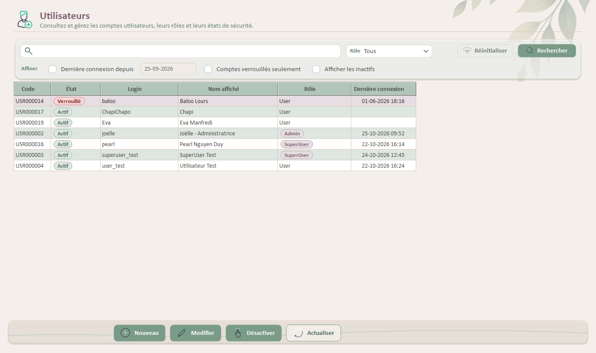

> Fichier : `UI/Controls/Administration/UC_Utilisateurs.vb` — hérite de `UserControl` — implémente `IContextAwareUserControl`.

#### Rôle général

`UC_Utilisateurs` est le UserControl d'administration permettant de gérer les utilisateurs applicatifs d'Althéa.

Il est chargé dynamiquement dans `Home` via `NavigationManager` lorsque l'utilisateur navigue vers l'administration.

#### Responsabilités

- Lister tous les utilisateurs applicatifs.
- Permettre la recherche et le filtrage (par nom, login, rôle, état, date).
- Ouvrir `UtilisateurEdition` en mode Création, Modification ou Consultation.
- Permettre l'activation/désactivation des comptes.
- Afficher l'état du compte (Actif, Verrouillé, Désactivé) et le rôle Admin / SuperUser en pastilles ; compte désactivé atténué ; tri par en-tête (V1.6.0, 18/10/2026, UI-9.3).
- Gérer les droits d'accès selon le rôle de l'utilisateur connecté (Admin/SuperUser).
- Journaliser toutes les actions via `GestionLog`.
- Utiliser le contexte UI partagé fourni par `Home`.

#### Dépendances

| Élément | Type | Rôle |
| --- | --- | --- |
| `GestionUtilisateurs` | Module métier | Couche métier : chargement liste, activation/désactivation, etc. |
| `UserControlContext` | Classe | Contexte UI injecté par `Home`. |
| `UtilsButtons` | Module utilitaire | Initialisation des boutons standards. |
| `UtilsDataGrid` | Module utilitaire | Configuration visuelle, tri par en-tête, pastilles. |
| `GestionLog` | Module métier | Journalisation des actions. |
| `UITheme` | Module utilitaire | Thème visuel (ligne atténuée). |
| `UtilsPastilles` | Module utilitaire | Couleurs des pastilles (état du compte, ton « rôle »). |
| `UtilisateurEdition` | Form | Form modale de création/modification/consultation. |
| `AppRole` | Enum | Rôles applicatifs. |
| `PasswordSecurityHelper` | Module utilitaire | — |
| `IContextAwareUserControl` | Interface | injection du contexte UI partagé |
| `NavigationManager` | Classe | — |
| `DialogChoix` | Form | Remplace MessageBox pour tous les messages. |

#### Variables privées

| Variable | Type | Rôle |
| --- | --- | --- |
| `_context` | `UserControlContext` | Contexte UI injecté par `Home` via `SetContext()`. |
| `_utilisateurs` | `List(Of UtilisateurApplication)` | Liste complète des utilisateurs chargée depuis la base, utilisée pour filtrage en mémoire. |

#### Contrôles principaux

| Contrôle | Type | Rôle |
| --- | --- | --- |
| `pnlForm` | Panel | Conteneur principal. |
| `enTete` | AltheaEnTete | En-tête d'écran : titre « Utilisateurs », sous-titre « Consultez et gérez les comptes utilisateurs, leurs rôles et leurs états de sécurité. » ; icône dans les ressources (`enTete.Icone`). |
| `pnlActions` | AltheaBarreActions | Zone des boutons d'action. |
| `btnNouveau` | AltheaBouton | Ouvre `UtilisateurEdition` en mode Création. |
| `btnModifier` | AltheaBouton | Ouvre `UtilisateurEdition` en mode Modification. |
| `Button2` | Button | — |
| `btnActiverDesactiver` | AltheaBouton | Active ou désactive le compte sélectionné. |
| `pnlCenter` | Panel | — |
| `pnlTop` | AltheaCarte | Bandeau de recherche (modèle « Complet ») : ligne principale + ligne « Affiner ». |
| `dgvUtilisateurs` | DataGridView | Liste des utilisateurs. |
| `txtRechercheUtilisateur` | AltheaRecherche | Texte d'aide « Login ou nom affiché… ». |
| `cboFiltreRole` | AltheaListe | Étiquette intégrée « Rôle ». |
| `lblAffiner` | Label | Intitulé « Affiner » de la seconde ligne du bandeau. |
| `dtpDernierLoginDepuis` | AltheaDate | Date du filtre « Dernière connexion depuis » : cette date et les suivantes (V1.7.0, 20/10/2026 ; audit B7). |
| `chkAfficherInactifs` | AltheaCase | « Afficher les inactifs » : utilisateurs désactivés inclus. |
| `chkCompteVerrouille` | AltheaCase | « Comptes verrouillés seulement ». |
| `chkFiltrerDate` | AltheaCase | « Dernière connexion depuis » : active le filtre par date de dernier login. |
| `btnRechercher` | AltheaBouton | Applique les filtres. |
| `btnReinitialiserFiltres` | AltheaBouton (Clair) | Réinitialise tous les filtres. |
| `btnActualiser` | AltheaBouton | Recharge la liste des utilisateurs. |

#### DataGridView : colonnes

##### DataGridView `dgvUtilisateurs` : colonnes

| Colonne | En-tête | Propriété liée | Visible | Rôle |
| --- | --- | --- | --- | --- |
| `colCodeUtilisateur` | Code | `CodeUtilisateur` | Oui | Code du compte (USR…), en tête de grille (code toujours visible, 24/10/2026). |
| `colEtat` | État | `LibelleEtatCompte` | Oui | Pastille d'état du compte (`EtatCompte`) : Actif (sauge), Verrouillé (rose, infobulle : nombre d'échecs, déverrouiller depuis la fiche), Désactivé (gris). Triable. |
| `colLoginUtilisateur` | Login | — | Oui | Login utilisateur. |
| `colNomAffichage` | Nom affiché | — | Oui | Nom d'affichage. |
| `colRoleUtilisateur` | Rôle | `RoleUtilisateur` | Oui | Rôle de base : Admin et SuperUser en pastille mauve, User en texte. |
| `colDernierLogin` | Dernière connexion | `DernierLogin` | Oui | Date du dernier login, centrée. |
| `colIdUtilisateur` | Id utilisateur | — | Non | — |
| `colRoleMaxElevation` | Rôle max élévation | — | Non | Rôle max élévation. |
| `colActif` | Actif | — | Non | État actif/inactif (masqué car redondant avec colEtat). |
| `colMustChangePassword` | Must change PW | — | Non | — |
| `colNbEchecsLogin` | Nb échecs | — | Non | — |
| `colCompteVerrouille` | Compte verrouillé | — | Non | Compte verrouillé oui/non. |
| `colDateVerrouillage` | Date verrouillage | — | Non | — |
| `colDateCreation` | Date création | — | Non | Date de création du compte. |
| `colDateModification` | Date modification | — | Non | — |

#### Méthodes principales

| Membre | Nature | Rôle |
| --- | --- | --- |
| `SetContext` | Public Sub | Implémentation de `IContextAwareUserControl` : reçoit le contexte UI. |
| `UC_Utilisateurs_Load` | Private Sub | Initialise le UserControl, charge les utilisateurs. |
| `InitialiserBoutons` | Private Sub | Initialise les boutons standards. |
| `InitialiserDataGridView` | Private Sub | Configure la grille utilisateurs. |
| `InitialiserToolTips` | Private Sub | Initialise les infobulles. |
| `InitialiserComboRole` | Private Sub | Remplit la ComboBox de filtre par rôle. |
| `InitialiserDatePicker` | Private Sub | Date par défaut du filtre (il y a un mois), champ inactif tant que la case n'est pas cochée. |
| `AppliquerFiltres` | Private Sub | Filtre la liste en mémoire selon les critères saisis. |
| `VerifierEtatFiltres` | Private Sub | Active/désactive le bouton Réinitialiser selon l'état des filtres. |
| `ChargerUtilisateurs` | Private Sub | Charge la liste complète des utilisateurs depuis la base. |
| `AppliquerDroitsUtilisateur` | Private Sub | Active/désactive les boutons selon le rôle **courant** de la session, élévation comprise (V2.0.0, 22/10/2026, test 20.2 : il lisait le rôle de base, un SuperUser élevé en Admin n'avait que la consultation). Le métier vérifie de toute façon (`Autorisation`). |
| `MettreAJourEtatBoutons` | Private Sub | Active ou désactive les boutons selon la sélection courante. Met à jour le texte du bouton Activer/Désactiver selon l'état de l'utilisateur sélectionné. |
| `GetUtilisateurSelectionne` | Private Function | Retourne l'utilisateur actuellement sélectionné dans le DataGridView. |
| `dgvUtilisateurs_SelectionChanged` | Private Sub | Met à jour l'état des boutons lorsque la sélection change. |
| `dgvUtilisateurs_CellFormatting` | Private Sub | Atténue la ligne d'un compte désactivé. |
| `dgvUtilisateurs_CellPainting` | Private Sub | Pastilles « État » et « Rôle » (Admin, SuperUser). |
| `dgvUtilisateurs_CellToolTipTextNeeded` | Private Sub | Infobulle de la pastille « Verrouillé ». |
| `btnReinitialiserFiltres_Click` | Private Sub | Réinitialise tous les filtres de recherche et recharge la liste complète. |
| `chkAfficherInactifs_CheckedChanged` | Private Sub | Réapplique les filtres pour afficher ou masquer les utilisateurs inactifs. |
| `btnRechercher_Click` | Private Sub | Déclenche l'application des filtres de recherche. |
| `chkFiltrerDate_CheckedChanged` | Private Sub | Active ou désactive le champ de date du filtre. |
| `btnActualiser_Click` | Private Sub | Recharge la liste des utilisateurs. |
| `btnNouveau_Click` | Private Sub | Ouvre `UtilisateurEdition` en mode Création. |
| `btnModifier_Click` | Private Sub | Ouvre `UtilisateurEdition` en mode Modification ou Consultation. |
| `btnActiverDesactiver_Click` | Private Sub | Active ou désactive le compte sélectionné. |
| `dgvUtilisateurs_CellDoubleClick` | Private Sub | Ouvre la fiche de l'utilisateur sélectionné lors d'un double-clic sur une ligne. |
| `OuvrirFicheConsultation` | Private Sub | Ouvre la fiche utilisateur en mode Consultation pour les SuperUser. |

#### État du compte (pastille)

Depuis la V1.6.0 (18/10/2026, UI-9.3, maquette « Grilles — états lisibles »), l'état est une pastille et non plus une icône PNG (`UtilsIcons.IconOK / IconOFF / IconLock`, retirées avec les PNG `Tech_Ico` le 18/10/2026, UI-9.4). La règle de priorité est portée par `UtilisateurApplication.EtatCompte` :

| État | Pastille | Priorité |
| --- | --- | --- |
| Verrouillé | Rose (ton « problème ») | **1** — même si le compte est actif ou désactivé |
| Actif | Sauge (ton « OK ») | 2 |
| Désactivé | Gris (ton « inactif ») ; ligne atténuée | 3 |

Tri par en-tête (`UtilsDataGrid.ActiverTriColonnes`) ; un filtre ou un rechargement remet l'ordre du chargement (`ReinitialiserTri`).
- `btnActiverDesactiver.Image` (Designer / ressources)
- `btnActualiser.Image` (Designer / ressources)
- `btnModifier.Image` (Designer / ressources)
- `btnNouveau.Image` (Designer / ressources)
- `btnRechercher.Image` (Designer / ressources)
- `btnReinitialiserFiltres.Image` (Designer / ressources)
- `enTete.Icone` (Designer / ressources)
- `pnlActions.BackgroundImage` (Designer / ressources)

#### Gestion des filtres et recherche

Le UserControl propose des filtres riches :

- **Recherche textuelle** : nom d'affichage, login (recherche partielle, insensible à la casse).
- **Filtre par rôle** : User, SuperUser, Admin, ou tous.
- **Filtre par état** : Actifs uniquement, Verrouillés uniquement.
- **Filtre par date** : Plage de dates pour le dernier login.

**Fonctionnement** :

1. Tous les utilisateurs sont chargés en mémoire dans `_utilisateurs`.
2. Les filtres sont appliqués en mémoire (LINQ) sans requête DB supplémentaire.
3. Le bouton Réinitialiser est activé uniquement si au moins un filtre est actif.

- Contrôles : `txtRechercheUtilisateur`, `cboFiltreRole`, `chkAfficherInactifs`, `chkCompteVerrouille`, `chkFiltrerDate`, `btnRechercher`, `btnReinitialiserFiltres`, `colCompteVerrouille`, `colDateVerrouillage`.
- Méthodes : `AppliquerFiltres`, `VerifierEtatFiltres`, `btnReinitialiserFiltres_Click`, `btnRechercher_Click`, `chkFiltrerDate_CheckedChanged`.
- Fonctionnement : filtrage en mémoire sur la liste chargée (pas de nouvel appel base), déclenché par les événements des contrôles ci-dessus ; la réinitialisation remet les critères par défaut puis réapplique le filtre.

#### Gestion des droits

Le comportement du UserControl dépend du rôle courant de l'utilisateur connecté, élévation comprise (22/10/2026) : un SuperUser élevé en Admin a l'accès Admin.

- Rôles testés : `AppRole.Admin`, `AppRole.SuperUser`.
- Méthodes concernées : `InitialiserComboRole`, `AppliquerDroitsUtilisateur`.

#### Admin

- Accès complet
- Création, modification, activation/désactivation
- Ouverture en mode Modification pour tous les utilisateurs

#### SuperUser

- Accès en lecture seule
- Peut consulter les utilisateurs (mode Consultation)
- Peut déverrouiller ou réinitialiser un mot de passe (actions de sécurité)
- **Ne peut pas** créer, modifier ou désactiver des comptes

#### User

- Accès interdit à `UC_Utilisateurs`

#### Règles en vigueur

| Situation                     | Effet UI                                           |
| ----------------------------- | -------------------------------------------------- |
| Aucun utilisateur sélectionné | Boutons Modifier et Activer/Désactiver désactivés. |
| Utilisateur sélectionné       | Boutons activés selon le rôle connecté.            |
| Rôle Admin                    | Bouton Modifier ouvre en mode Modification.        |
| Rôle SuperUser                | Bouton Modifier ouvre en mode Consultation.        |
| Compte actif sélectionné      | Bouton Activer/Désactiver affiche "Désactiver".    |
| Compte inactif sélectionné    | Bouton Activer/Désactiver affiche "Activer".       |
| Filtres actifs                | Bouton Réinitialiser activé.                       |
| Aucun filtre actif            | Bouton Réinitialiser désactivé.                    |

#### Points d'attention

- **Ne jamais** accéder directement à la base de données depuis le UserControl.
- Toujours passer par `GestionUtilisateurs` pour toute opération métier.
- Les données sensibles (`password_hash`, `password_salt`) ne sont **jamais** chargées dans ce UserControl.
- Utiliser `DialogChoix` pour **tous** les messages utilisateur.
- Les filtres sont appliqués en mémoire pour améliorer les performances.
- Les icônes d'état doivent respecter la priorité : verrouillé > actif > inactif.
- Implémente IContextAwareUserControl
- Aucun accès direct à la base de données
- Toute logique métier passe par GestionUtilisateurs
- Les données sensibles password_hash/password_salt ne sont jamais chargées ici

#### Message au repreneur

`UC_Utilisateurs` est le point d'entrée de la gestion des utilisateurs applicatifs.

Avant toute modification :

- Comprendre la séparation Admin/SuperUser et leurs droits respectifs.
- Vérifier l'impact sur `UtilisateurEdition` et `GestionUtilisateurs`.
- Tester les scénarios de recherche, filtrage, création, modification, activation/désactivation.
- S'assurer que les droits sont correctement appliqués selon le rôle connecté.
- Valider que les icônes d'état s'affichent correctement avec la bonne priorité.

---

### **UserControl : UC_Sauvegardes**

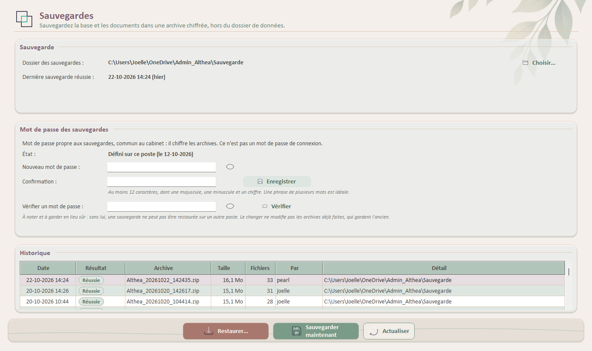

> Fichier : `UI/Controls/Administration/UC_Sauvegardes.vb` — hérite de `UserControl` — implémente `IContextAwareUserControl` et `IUnsavedChangesAware`. Ouvert par la tuile « Sauvegardes » de `UC_AdminHome` (lot 30, étape P2, 12/10/2026).

#### Rôle général

Sauvegarde complète de l'application — la base **et** le dossier de données — dans une archive ZIP chiffrée AES-256 (`Althea_AAAAMMJJ_HHMMSS.zip`), rangée dans un dossier hors du dossier de données. Toute la logique est dans `GestionSauvegardes` ; l'écran affiche, lance et rend compte.

#### Contrôles principaux

| Contrôle | Type | Rôle |
| --- | --- | --- |
| `enTete` | AltheaEnTete | « Sauvegardes » ; icône `Titre_Ico/sauvegarde.png` définie dans le Designer (ressource du .resx), comme les autres écrans. |
| `carteSauvegarde` | AltheaCarte | Dossier des archives (`lblDossier`, `btnChoisirDossier`), dernière sauvegarde réussie (`lblDerniere`), progression (`jaugeProgression` — `AltheaJauge` 0-100, visible pendant la sauvegarde — et `lblEtape`). |
| `carteMotDePasse` | AltheaCarte | « Mot de passe des sauvegardes » : explication (mot de passe **propre aux archives, commun au cabinet**, distinct des mots de passe de connexion), état (`lblEtatMotDePasse`) ; zone **Définir** (Admin) : `txtMotDePasse`, `txtConfirmation`, œil `btnVoirMotDePasse`, `btnDefinirMotDePasse` « Enregistrer », règles (`lblReglesMotDePasse`, texte de `GestionSauvegardes.DescriptionReglesMotDePasse`, construit depuis le 23/10/2026 sur la règle commune `PolitiqueMotDePasse` avec la longueur propre aux sauvegardes, `LongueurMinSauvegarde`, 12) ; zone **Vérifier** : `txtVerification`, œil `btnVoirVerification`, `btnVerifierMotDePasse` ; avertissement. |
| `carteHistorique` | AltheaCarte | `dgvHistorique` : journal `tec_sauvegardes` (date, résultat, archive, taille, fichiers, compte, détail) ; résultat en pastille — Réussie (sauge), Échec (rose), Interrompue (ocre) ; cellules typées pour un tri juste par en-tête, date centrée, taille et nombre à droite (V1.2.0, 18/10/2026, UI-9.3). |
| `pnlActions` | AltheaBarreActions | `btnRestaurer` (« Restaurer… », variante Terre, Admin), `btnSauvegarder` (« Sauvegarder maintenant »), `btnActualiser`. |

#### Méthodes principales

| Membre | Nature | Rôle |
| --- | --- | --- |
| `Rafraichir` | Private Sub | Relit dossier, dernière sauvegarde, état du mot de passe, historique ; met à jour les boutons. |
| `btnSauvegarder_Click` | Private Async Sub | Lance `GestionSauvegardes.Sauvegarder` en arrière-plan (`Task.Run`) ; `Progress(Of ProgressionSauvegarde)` alimente la jauge ; résultat en `DialogChoix`. |
| `btnRestaurer_Click` | Private Sub | Ouvre `DialogRestauration` ; si la base a été rechargée (`RedemarrageNecessaire`), redémarre l'application (`Application.Restart`). |
| `btnChoisirDossier_Click` | Private Sub | Choix du dossier (`FolderBrowserDialog`) → `GestionSauvegardes.DefinirDossierSauvegarde` (refus dans le dossier de données). |
| `btnDefinirMotDePasse_Click` | Private Sub | Définit / remplace le mot de passe (`GestionSauvegardes.DefinirMotDePasse`, Admin) ; confirmation si remplacement (les archives existantes gardent l'ancien). |
| `btnVerifierMotDePasse_Click` | Private Sub | Compare la saisie de `txtVerification` au mot de passe enregistré. |
| `btnVoirMotDePasse_*`, `btnVoirVerification_*` | Private Sub | Œil « maintenir pour voir » (comme à la connexion) : en clair tant que le bouton est enfoncé. |
| `PeutQuitter` | Public Function | `IUnsavedChangesAware` : refuse la navigation et la fermeture de l'application pendant une sauvegarde. |
| `MettreAJourEtatBoutons` | Private Sub | Active les commandes selon le rôle effectif et l'état (sauvegarde en cours). |

#### Gestion des droits

- Sauvegarder et choisir le dossier : **SuperUser et Admin** (rôle effectif, élévation comprise).
- Définir le mot de passe et restaurer : **Admin** ; vérifier : tout rôle ayant accès à l'écran.
- Droits revérifiés dans `GestionSauvegardes` (l'écran n'est pas la seule barrière).

#### Règles en vigueur

- Les zones de mot de passe sont vidées après chaque usage ; le mot de passe n'est jamais affiché ni journalisé.
- Pendant une sauvegarde : boutons désactivés, navigation et fermeture bloquées avec un message.
- Une ligne « Interrompue » (statut `EN_COURS` resté ouvert) signale une sauvegarde coupée par l'arrêt de l'application.

#### Message au repreneur

> L'écran ne sait rien du format de l'archive : voir `GestionSauvegardes` et l'ADR-37. La restauration est dans `DialogRestauration` / `GestionRestaurations` (ADR-38).

---

### **UserControl : UC_Journaux**

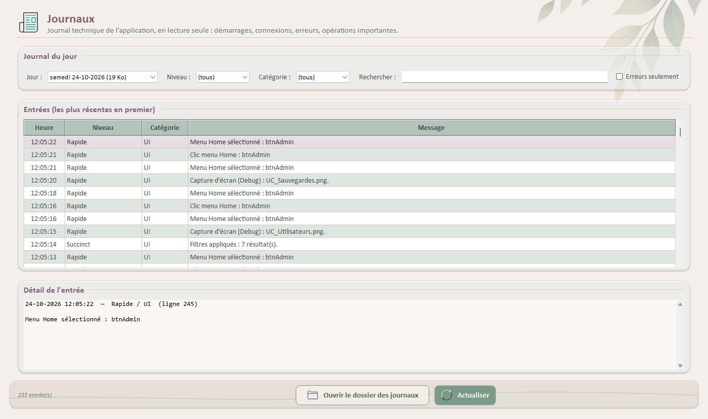

> Fichier : `UI/Controls/Administration/UC_Journaux.vb` — hérite de `UserControl` — implémente `IContextAwareUserControl`. Ouvert par la tuile « Journaux » de `UC_AdminHome` (Admin ; 13/10/2026).

#### Rôle général

Consultation des journaux techniques (`%APPDATA%\Althea\Logs`, un fichier par jour), en lecture seule. Lecture et découpage par `LecteurJournaux` (Core/Logging) ; processus 02.

#### Contrôles principaux

| Contrôle | Type | Rôle |
| --- | --- | --- |
| `enTete` | AltheaEnTete | « Journaux » (icône de titre à créer : `Titre_Ico`, à poser dans le Designer). |
| `carteFiltres` | AltheaCarte | `cboJour` (jours disponibles, le plus récent en premier, taille du fichier), `cboNiveau` et `cboCategorie` (remplis depuis les énumérations `GestionLog.LogLevel` / `LogCategory`), `txtRecherche` (message et exception), `chkErreursSeules`. |
| `carteJournal` | AltheaCarte | `dgvJournal` : heure, niveau, catégorie, message (première ligne, exception en abrégé) ; plus récentes en premier ; en-têtes de session en repères titrés « Session · heure · … » (`DessinerRepereSurLigne`, sélectionnables pour leur détail ; masqués dès qu'un filtre est actif) ; entrées avec exception : pastille « Erreur » dans la colonne Niveau, le niveau en mention ; heure centrée ; grille non triable (V1.1.0, 18/10/2026, UI-9.3). |
| `carteDetail` | AltheaCarte | `txtDetail` (lecture seule, police à chasse fixe) : date, niveau / catégorie, numéro de ligne, message complet, exception, piles d'appels et causes sur plusieurs lignes. |
| `pnlActions` | AltheaBarreActions | `lblCompteur` (« n entrée(s) affichée(s) sur N »), `btnOuvrirDossier` (explorateur), `btnActualiser`. |

#### Règles en vigueur

- Admin seulement (tuile ; contrôlé aussi au chargement : écran désactivé sinon).
- Aucune modification ni suppression de journal ; la purge reste celle de `GestionLog` (`LOG_RETENTION_JOURS`).
- Filtrer ne relit pas le fichier ; « Actualiser » relit la liste des jours et le jour affiché.

---

### **UserControl : UC_EtatSysteme**

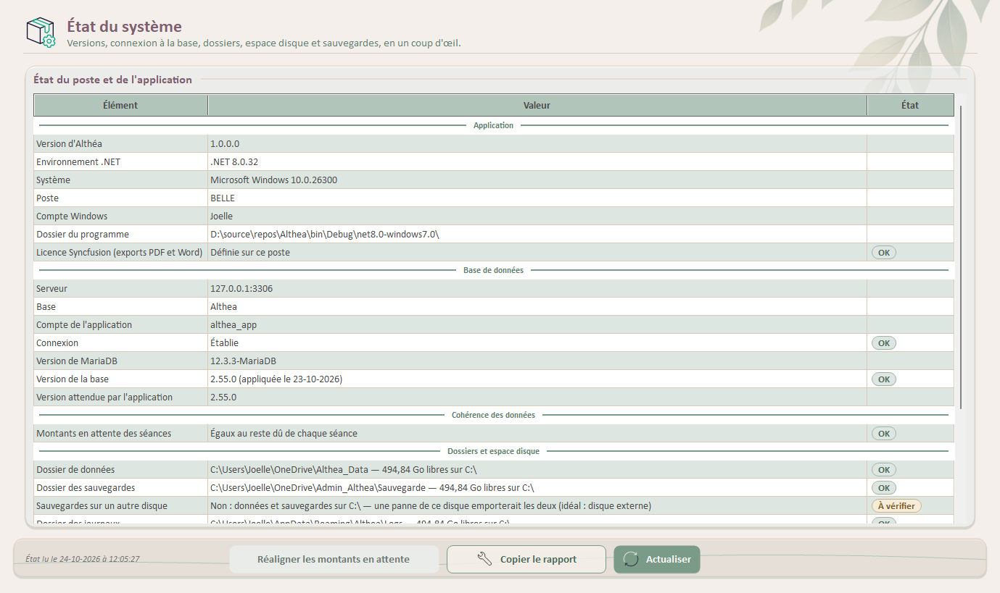

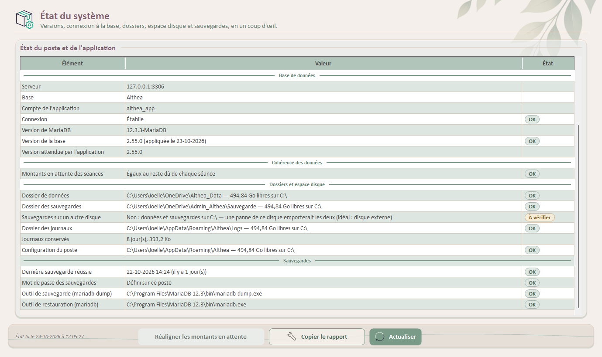

> Fichier : `UI/Controls/Administration/UC_EtatSysteme.vb` — hérite de `UserControl` — implémente `IContextAwareUserControl`. Ouvert par la tuile « État du système » de `UC_AdminHome` (Admin ; 13/10/2026).

#### Rôle général

État du poste et de l'application en un coup d'œil (processus 23) : collecte par `GestionEtatSysteme`, affichage par sections avec une appréciation par ligne.

- Section Application : ligne « Licence Syncfusion (exports PDF et Word) » — définie sur ce poste (OK) ou absente (à vérifier) (18/10/2026).
- Section **Cohérence des données** (22/10/2026) : nombre de séances dont le montant « En attente » ne correspond plus au reste dû (opérations d'avant le lot B).

#### Contrôles principaux

| Contrôle | Type | Rôle |
| --- | --- | --- |
| `enTete` | AltheaEnTete | « État du système » (icône de titre à créer). |
| `carteEtat` | AltheaCarte | `dgvEtat` : élément, valeur, état en pastille à trois tons — OK (sauge), À vérifier (ocre), Problème (rose) ; rien pour une simple information (`UtilsPastilles.Teinte(NiveauEtat)`) ; titre de section en repère titré sur une ligne réservée (`DessinerRepereSurLigne`) ; grille non triable (V1.1.0, 18/10/2026, UI-9.3). Le rapport copié garde ses symboles (« [✓ OK] »). |
| `pnlActions` | AltheaBarreActions | `lblHorodatage` (heure de lecture), `btnCopierRapport` (rapport texte dans le presse-papiers), `btnActualiser`, `btnRealignerDus` « Réaligner les montants en attente » (V1.2.0, 22/10/2026 : actif seulement si la section Cohérence en signale ; confirmation, puis `GestionPaiements.RealignerDusDesalignes` avec le `ContexteOperation`, journal par identifiants ; aucune séance ni aucun encaissement n'est modifié). |

#### Règles en vigueur

- Admin seulement ; lecture seule ; aucun secret affiché ni copié.
- Collecte en arrière-plan (`Task.Run`) ; `CollecterEtat` ne lève pas d'exception (chaque échec = une ligne « problème »).
- Résumé dans la barre d'état : nombre de problèmes et de points à vérifier.

---

## **Fenêtres**

### **Form : DialogRestauration**

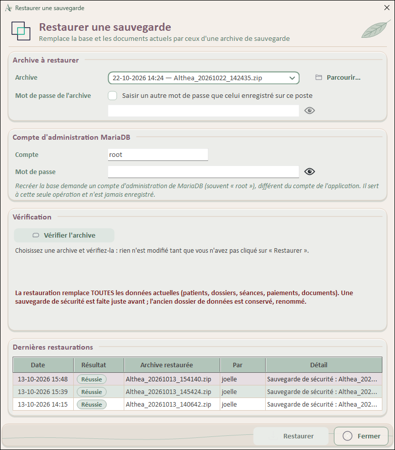

> Fichier : `UI/Forms/Sauvegardes/DialogRestauration.vb` (+ `.Designer.vb`, `.resx`) — hérite de `Form` (dialogue modal). Ouvert par `UC_Sauvegardes` › « Restaurer… » (Admin ; lot 30, étape P3, 13/10/2026).

#### Rôle général

Restaure une archive de sauvegarde : la base **et** le dossier de données sont remplacés par ceux de l'archive. Toute la logique est dans `GestionRestaurations` (processus 22, ADR-38) ; le dialogue choisit, vérifie, confirme, lance et rend compte. Guide utilisateur : `Docs/Guide/Guide_Utilisateur_Sauvegardes.md`.

#### Contrôles principaux

| Contrôle | Type | Rôle |
| --- | --- | --- |
| `enTete` | AltheaEnTete | « Restaurer une sauvegarde » ; icône `Titre_Ico/sauvegarde.png` (ressource du .resx). |
| `carteArchive`, `carteCompte`, `carteVerification`, `carteHistorique` | AltheaCarte | Cartes « Archive à restaurer », « Compte d'administration MariaDB », « Vérification », « Dernières restaurations » (UI-7, 15/10/2026 : remplacent le `TableLayoutPanel` ; fond `AltheaFondFenetre`). |
| `cboArchives`, `btnParcourir` | AltheaListe, AltheaBouton (Outil) | Archives du dossier des sauvegardes (« date — nom », la plus récente en premier) ; « Parcourir… » pour une archive ailleurs. |
| `chkAutreMotDePasse`, `txtMotDePasseArchive`, `btnVoirArchive` | AltheaCase, TextBox, AltheaBouton (Outil, œil icône seule) | Mot de passe de l'archive : celui du poste par défaut ; saisie libre si cochée (cochée et figée si aucun mot de passe n'est lisible sur ce poste). |
| `txtCompteAdmin`, `txtMotDePasseAdmin`, `btnVoirAdmin` | TextBox, AltheaBouton (Outil, œil icône seule) | Compte MariaDB d'administration (`root` proposé) et son mot de passe, jamais enregistrés. |
| `btnVerifier` | AltheaBouton | « Vérifier l'archive » : manifeste et contrôles, sans rien modifier. |
| `lblResume` | Label | Description de l'archive (date, poste, compte, version, volume) et résultat des contrôles (motifs de refus en liste). |
| `lblAvertissement` | Label | Rappel en couleur d'alerte : toutes les données actuelles seront remplacées ; sauvegarde de sécurité et ancien dossier conservé. |
| `jaugeProgression`, `lblEtape` | AltheaJauge, Label | Avancement pendant la restauration. |
| `lblVerdict` | Label | Verdict en gros, à droite de « Vérifier l'archive » : vert si possible, rouge sinon. |
| `dgvHistorique` | DataGridView | Dernières restaurations (`tec_restaurations`) ; résultat en pastille — Réussie (sauge), Échec (rose) ; date typée (tri juste) et centrée (V1.3.0, 18/10/2026, UI-9.3). |
| `pnlActions` | AltheaBarreActions | `btnRestaurer` (« Restaurer », variante Terre, actif seulement après une vérification réussie), `btnFermer`. |

#### Méthodes principales

| Membre | Nature | Rôle |
| --- | --- | --- |
| `btnVerifier_Click` | Private Async Sub | `GestionRestaurations.VerifierArchive` en arrière-plan (lecture + contrôles ; erreurs attendues rendues dans le résultat, pas par exception) ; affiche le verdict et mémorise l'archive vérifiée. |
| `AnnulerVerification` | Private Sub | Toute modification d'un choix (archive, mot de passe, compte) annule la vérification : on ne restaure jamais une archive non vérifiée telle quelle. |
| `btnRestaurer_Click` | Private Async Sub | Confirmation (`DialogChoix.Confirmer` avec le récapitulatif), `GestionRestaurations.Restaurer` en arrière-plan, compte rendu ; si la base a été rechargée, `RedemarrageNecessaire = True` et fermeture. |
| `DialogRestauration_FormClosing` | Private Sub | Refuse la fermeture pendant une opération ; efface les zones de mot de passe. |
| `MettreAJourEtat` | Private Sub | Active les commandes selon le rôle et l'état (opération en cours, archive vérifiée). |

#### Règles en vigueur

- Admin seulement (contrôlé aussi dans `GestionRestaurations`).
- Les mots de passe ne restent pas dans les zones après l'opération ou la fermeture.
- La fenêtre ne se ferme pas pendant une opération.

---

### **Form : Login**

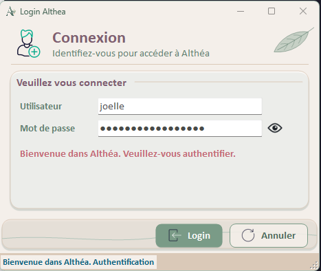

> Fichier : `UI/Forms/Login/Login.vb` — hérite de `Form`.

#### Rôle général

`Login` est le formulaire d’authentification applicative.

Il permet à l’utilisateur de s’identifier avant d’accéder à `Home`.

Il est responsable de l’entrée sécurisée dans l’application, mais ne doit pas gérer directement les requêtes SQL ni manipuler les mots de passe hors des méthodes métier prévues.

------

#### Responsabilités

- Saisir le login utilisateur.
- Saisir le mot de passe.
- Valider les identifiants via la couche métier sécurité.
- Afficher un message d’erreur contrôlé en cas d’échec.
- Déclencher le changement obligatoire de mot de passe si nécessaire.
- Retourner un résultat d’authentification exploitable par le démarrage applicatif.
- Protéger l’affichage du mot de passe.
- Journaliser les événements de connexion.

------

#### Dépendances

| Élément | Type | Rôle |
| --- | --- | --- |
| `GestionUtilisateurs` | Module métier | Authentification utilisateur et règles sécurité associées. |
| `AuthenticationResult` | Classe | Résultat structuré de l’authentification. |
| `UtilisateurApplication` | Classe | Utilisateur authentifié retourné par le processus login. |
| `UtilsButtons` | Module utilitaire | Initialisation des boutons standards. |
| `GestionLog` | Module métier | Logs de connexion, échecs et décisions sécurité. |
| `GestionAuthentification` | Module métier | — |
| `UserSession` | Classe | Session créée après authentification réussie. |

#### Variables privées

| Variable | Type | Rôle |
| --- | --- | --- |
| `_authenticatedUser` | `UtilisateurApplication` | Utilisateur authentifié si login réussi. |

#### Contrôles principaux

| Contrôle | Type | Rôle |
| --- | --- | --- |
| `enTete` | AltheaEnTete | En-tête d'écran : titre « Connexion », sous-titre « Identifiez-vous pour accéder à Althéa » ; icône dans les ressources (`enTete.Icone`). |
| `carteConnexion` | AltheaCarte | Carte « Veuillez vous connecter », ancrée sur les quatre bords ; regroupe les champs et le message. |
| `lblUserName` | Label | Libellé du login. |
| `txtUserName` | TextBox | Saisie du login utilisateur. |
| `lblPassword` | Label | Libellé du mot de passe. |
| `txtPassword` | TextBox | Saisie du mot de passe, masqué par défaut. |
| `btnVoirPassword` | AltheaBouton (Outil) | Affiche le mot de passe tant que le bouton est maintenu appuyé. |
| `lblMessage` | Label | Message d’erreur ou d’information sécurité. |
| `pnlActions` | AltheaBarreActions | Zone des boutons d’action. |
| `btnConnexion` | AltheaBouton | Lance la tentative de connexion. |
| `btnAnnuler` | AltheaBouton | Annule et ferme le formulaire. |
| `stsStatus` | StatusStrip | Barre de statut locale. |
| `stsLabelStatus` | ToolStripStatusLabel | Message d’état. |
| `ttMain` | ToolTip | Aide utilisateur. |
| `errProvider` | ErrorProvider | Signalement des erreurs de saisie. |

#### Autres composants à utilité dédiée

| Composant | Type | Utilité |
| --- | --- | --- |
| `ttMain` | ToolTip | Aide utilisateur. |
| `errProvider` | ErrorProvider | Signalement des erreurs de saisie. |

#### Méthodes principales

| Membre | Nature | Rôle |
| --- | --- | --- |
| `AuthenticatedUser` | Public ReadOnly Property | Retourne l'utilisateur authentifié après une connexion réussie. |
| `Authentifier` | Private Function | Appelle la couche métier sécurité. |
| `Login_Load` | Private Sub | Pose le fond et la barre de titre du kit, initialise les boutons et l’état de départ. |
| `PreRemplirIdentifiantsDev` | Private Sub | **Build Debug seulement** : pré-remplit login et mot de passe depuis les variables d'environnement du poste `ALTHEA_DEV_LOGIN` / `ALTHEA_DEV_PASSWORD` (rien si elles sont absentes ; Connexion reste à cliquer). À retirer en fin de développement. |
| `InitializeToolTips` | Private Sub | Initialise les aides contextuelles locales de la Form. |
| `btnConnexion_Click` | Private Sub | Lance l’authentification. |
| `btnAnnuler_Click` | Private Sub | Ferme le formulaire sans session. |
| `txtPassword_KeyDown` | Private Sub | Permet de valider la connexion en appuyant sur la touche Entrée dans le champ mot de passe. |
| `btnVoirPassword_MouseDown` | Private Sub | Affiche temporairement le mot de passe. |
| `btnVoirPassword_MouseUp` | Private Sub | Masque le mot de passe. |
| `btnVoirPassword_MouseLeave` | Private Sub | Masque le mot de passe par sécurité. |

#### Gestion des icônes

- `$this.Icon` (Designer / ressources)
- `btnAnnuler.Image` (Designer / ressources)
- `btnConnexion.Image` (Designer / ressources)
- `btnVoirPassword.Image` (Designer / ressources)
- Fond : `AltheaFondFenetre.Appliquer(Me)` au chargement (beige clair à la feuille, barre de titre du kit) ; plus d'image de fond (15/10/2026)
- Bouton « œil » : `AltheaBouton` Outil 30×30, icône seule tirée du Designer, sans `UtilsButtons` (règle des petits boutons du kit) ; icône `oeil_24_normal` (`Assets/Ico_divers`, 15/10/2026) : œil plein sombre, du même trait que le cadenas de `SeanceEditor` — l'ancienne, fine et grise, devenait invisible

#### Gestion du mot de passe

Le mot de passe :

- est masqué par défaut via `UseSystemPasswordChar`
- n’est jamais loggué
- n’est jamais stocké en clair
- n’est visible que pendant l’appui souris sur `btnVoirPassword`

Le bouton Voir doit toujours fonctionner en mode temporaire :

```
MouseDown → visible
MouseUp / MouseLeave → masqué
```

------

#### Gestion des erreurs

Les erreurs attendues doivent être affichées dans :

- `lblMessage`
- `stsLabelStatus`
- éventuellement `errProvider` pour champ vide

Les MessageBox doivent être limitées aux erreurs bloquantes ou inattendues.

------

#### Gestion des ToolTips

`Login` utilise son `ttMain` local.

Les ToolTips sont regroupés dans :

```vb
InitializeToolTips()
```
Cette Form ne reçoit pas UserControlContext, car elle est ouverte avant que Home ne soit disponible comme shell applicatif.

----

#### Règles en vigueur

| Situation          | Effet UI                                  |
| ------------------ | ----------------------------------------- |
| Login vide         | Connexion refusée / erreur champ.         |
| Password vide      | Connexion refusée / erreur champ.         |
| Mauvais password   | Message contrôlé, pas de détail excessif. |
| Compte verrouillé  | Message explicite de verrouillage.        |
| Login réussi       | `DialogResult.OK`.                        |
| Password à changer | Ouverture de `ChangePassword`.            |

------
- Point d'entrée de l'application après le Splash
- DialogResult.OK retourné en cas de succès, DialogResult.Cancel en cas d'annulation
- Aucun mot de passe n'est loggué pour des raisons de sécurité
- Les messages UI proviennent de la couche métier (AuthenticationResult.MessageUI)

#### Points d'attention

- Ne jamais indiquer techniquement quel élément est faux si cela peut aider une attaque.
- Ne jamais logguer le mot de passe.
- Ne jamais contourner `GestionUtilisateurs`.
- Ne pas créer `UserSession` avant authentification complète.
- Ne pas laisser le password visible après fermeture ou erreur.

------

#### Message au repreneur

`Login` est une Form sensible.
 Elle doit rester simple : saisie, appel métier, interprétation du résultat.

Toute modification de règles sécurité doit se faire dans `GestionUtilisateurs` ou les helpers sécurité, pas dans le Designer ni directement dans les événements boutons.

...

---

### **Form : ChangePassword**

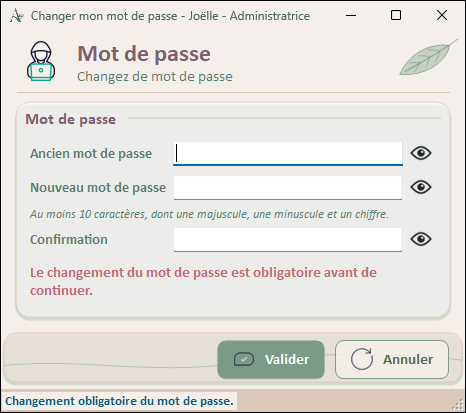

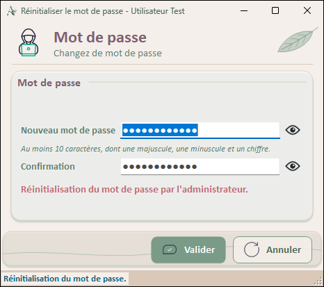

> Fichier : `UI/Forms/Login/ChangePassword.vb` — hérite de `Form`.

#### Rôle général

`ChangePassword` permet à un utilisateur de changer son mot de passe applicatif.

Elle est utilisée notamment :

- lors d’un changement obligatoire après création ou reset
- lors d’une demande explicite future de changement de mot de passe

Elle ne stocke jamais le mot de passe en clair et délègue les règles de sécurité à la couche métier.

------

#### Responsabilités

- Saisir l’ancien mot de passe.
- Saisir le nouveau mot de passe.
- Confirmer le nouveau mot de passe.
- Valider la cohérence des saisies.
- Vérifier le nouveau mot de passe selon la règle du métier (`PolitiqueMotDePasse`, audit C.2 étape 4, 23/10/2026) et afficher le texte de cette règle.
- Demander la modification via la couche métier, qui applique la même règle.
- Afficher les erreurs de validation.
- Masquer tous les champs sensibles par défaut.
- Fournir des boutons Voir temporaires.
- Initialiser ses ToolTips locaux via `InitializeToolTips()`.

> `ChangePassword` peut être ouvert depuis `Login`, donc avant `Home`.
> Il reste autonome et conserve ses composants UI locaux.

------

#### Dépendances

| Élément | Type | Rôle |
| --- | --- | --- |
| `UtilisateurApplication` | Classe | Utilisateur concerné par le changement. |
| `GestionUtilisateurs` | Module métier | Modification du mot de passe utilisateur (`ChangerMotDePasse`, `ResetPasswordUtilisateurWithCustomPassword`), qui applique `PolitiqueMotDePasse`. |
| `PolitiqueMotDePasse` | Module métier (`Metier/Security`) | Règle du mot de passe, définie une fois : `EstConforme`, `Description` (texte affiché) (23/10/2026). |
| `UtilsButtons` | Module utilitaire | Initialisation des boutons standards. |
| `GestionLog` | Module métier | Journalisation des changements et erreurs. |

#### Variables privées

| Variable | Type | Rôle |
| --- | --- | --- |
| `_utilisateur` | `UtilisateurApplication` | Utilisateur concerné par le changement de mot de passe. |
| `_mode` | `ModeChangePassword` | Mode de changement de mot de passe (UserChange ou AdminReset) |

#### Contrôles principaux

| Contrôle | Type | Rôle |
| --- | --- | --- |
| `enTete` | AltheaEnTete | En-tête d'écran : titre « Mot de passe », sous-titre « Changez de mot de passe » ; icône dans les ressources (`enTete.Icone`). |
| `carteMotDePasse` | AltheaCarte | Carte « Mot de passe », ancrée sur les quatre bords ; regroupe les trois champs, les règles et le message. |
| `lblOldPassword` | Label | Libellé ancien mot de passe (masqué en mode AdminReset). |
| `txtOldPassword` | TextBox | Ancien mot de passe (masqué en mode AdminReset). |
| `btnVoirOldPassword` | AltheaBouton (Outil) | Affichage temporaire de l’ancien mot de passe. |
| `lblNewPassword` | Label | Libellé nouveau mot de passe. |
| `txtNewPassword` | TextBox | Nouveau mot de passe. |
| `btnVoirNewPassword` | AltheaBouton (Outil) | Affichage temporaire du nouveau mot de passe. |
| `lblPasswordRules` | Label | Règle applicable au mot de passe (italique sauge) : texte de `PolitiqueMotDePasse.Description` (règle affichée = règle appliquée, 23/10/2026). |
| `lblConfirmation` | Label | Libellé confirmation. |
| `txtConfirmation` | TextBox | Confirmation du nouveau mot de passe. |
| `btnVoirConfirmation` | AltheaBouton (Outil) | Affichage temporaire de la confirmation. |
| `lblMessage` | Label | Message utilisateur / erreur. |
| `pnlActions` | AltheaBarreActions | Zone des boutons d’action. |
| `btnValider` | AltheaBouton | Valide le changement. |
| `btnAnnuler` | AltheaBouton | Annule l’opération. |
| `stsStatus` | StatusStrip | Barre de statut locale. |
| `stsLabelStatus` | ToolStripStatusLabel | Message d’état. |
| `errProvider` | ErrorProvider | Erreurs de validation. |
| `ttMain` | ToolTip | Aide utilisateur. |

#### Autres composants à utilité dédiée

| Composant | Type | Utilité |
| --- | --- | --- |
| `errProvider` | ErrorProvider | Erreurs de validation. |
| `ttMain` | ToolTip | Aide utilisateur. |

#### Méthodes principales

| Membre | Nature | Rôle |
| --- | --- | --- |
| `New` | Public Sub | — |
| `ValiderSaisies` | Private Function | Vérifie la validité de toutes les saisies utilisateur avant appel au module métier ; règle du mot de passe lue dans `PolitiqueMotDePasse.EstConforme` (V1.2.0, 23/10/2026). |
| `btnValider_Click` | Private Sub | Lance la validation et le changement ; un refus du métier (`InvalidOperationException` : règle du mot de passe, nouveau identique à l'ancien) s'affiche tel quel (V1.1.0, 23/10/2026). |
| `btnAnnuler_Click` | Private Sub | Annule ou refuse la fermeture selon contexte obligatoire. |
| `AfficherErreurValidation` | Private Sub | Affiche un message d'erreur de validation dans la Form et dans le StatusStrip. |
| `ChangePassword_Load` | Private Sub | Pose le fond et la barre de titre du kit, initialise les boutons et l’état UI. |
| `InitializeToolTips` | Private Sub | Initialise les aides contextuelles locales de la Form. |
| `SetPasswordVisible` | Private Sub | Affiche ou masque temporairement un champ mot de passe. |
| `btnVoirOldPassword_MouseDown` | Private Sub | Affiche temporairement l’ancien mot de passe. |
| `btnVoirOldPassword_MouseUp` | Private Sub | Masque à nouveau l'ancien mot de passe dès que le bouton est relâché. |
| `btnVoirOldPassword_MouseLeave` | Private Sub | Masque l'ancien mot de passe si la souris quitte le bouton pendant l'appui. |
| `btnVoirNewPassword_MouseDown` | Private Sub | Affiche temporairement le nouveau mot de passe. |
| `btnVoirNewPassword_MouseUp` | Private Sub | Masque à nouveau le nouveau mot de passe dès que le bouton est relâché. |
| `btnVoirNewPassword_MouseLeave` | Private Sub | Masque le nouveau mot de passe si la souris quitte le bouton pendant l'appui. |
| `btnVoirConfirmation_MouseDown` | Private Sub | Affiche temporairement la confirmation. |
| `btnVoirConfirmation_MouseUp` | Private Sub | — |
| `btnVoirConfirmation_MouseLeave` | Private Sub | — |

#### Gestion des icônes

- `$this.Icon` (Designer / ressources)
- `btnAnnuler.Image` (Designer / ressources)
- `btnValider.Image` (Designer / ressources)
- `btnVoirConfirmation.Image` (Designer / ressources)
- `btnVoirNewPassword.Image` (Designer / ressources)
- `btnVoirOldPassword.Image` (Designer / ressources)
- Fond : `AltheaFondFenetre.Appliquer(Me)` au chargement (beige clair à la feuille, barre de titre du kit) ; plus d'image de fond (15/10/2026)
- Boutons « œil » : `AltheaBouton` Outil 30×30, icône seule tirée du Designer, sans `UtilsButtons` (règle des petits boutons du kit) ; icône `oeil_24_normal` (`Assets/Ico_divers`, 15/10/2026) : œil plein sombre, du même trait que le cadenas de `SeanceEditor` — l'ancienne, fine et grise, devenait invisible

#### Gestion des boutons Voir

Chaque bouton Voir fonctionne uniquement pendant l’appui :

```
MouseDown → UseSystemPasswordChar = False
MouseUp → UseSystemPasswordChar = True
MouseLeave → UseSystemPasswordChar = True
```

Cette règle évite de laisser un mot de passe visible accidentellement.

#### Gestion des ToolTips

`ChangePassword` utilise son `ttMain` local.

Les ToolTips sont centralisés dans :

```vb
InitializeToolTips()
```
La Form ne dépend pas de UserControlContext, car elle peut être utilisée dans le flux de login avant ouverture de Home.

------

#### Validation sécurité

Validation minimale attendue :

- ancien mot de passe obligatoire
- nouveau mot de passe obligatoire
- confirmation obligatoire
- nouveau mot de passe = confirmation
- nouveau mot de passe conforme aux règles
- ancien mot de passe correct
- nouveau mot de passe différent de l’ancien (refusé aussi par le métier depuis le 23/10/2026)

La règle de complexité (au moins 10 caractères, une majuscule, une minuscule, un chiffre) est définie une seule fois dans `PolitiqueMotDePasse` (`Metier/Security`, 23/10/2026) :

- la fenêtre la vérifie et affiche son texte
- `ChangerMotDePasse` et la réinitialisation par l'administrateur l'appliquent aussi (avant, ils acceptaient tout mot de passe non vide).

------

#### Règles en vigueur

| Situation                     | Effet UI                               |
| ----------------------------- | -------------------------------------- |
| Champ vide                    | `errProvider` + status.                |
| Confirmation différente       | Validation refusée.                    |
| Password trop faible          | Validation refusée avec message clair. |
| Ancien password incorrect     | Refus changement.                      |
| Changement réussi             | `DialogResult.OK`.                     |
| Changement obligatoire annulé | Refus de poursuivre le login.          |

------
- Aucun accès SQL direct : toute logique sécurité passe par GestionUtilisateurs
- Aucun hash dans l'UI : les mots de passe sont transmis en clair au module métier
- Le mot de passe n'est visible que pendant l'appui sur le bouton "Voir"
- Affichage modal depuis le formulaire de connexion ou depuis l'interface principale

#### Points d'attention

- Ne jamais afficher les passwords automatiquement.
- Ne jamais logguer ancien ou nouveau password.
- Ne jamais faire le hash dans la Form si la couche sécurité le fait déjà.
- Ne pas dupliquer les règles de complexité dans l’UI.
- La Form doit rester un écran de saisie, pas un moteur sécurité.

#### Message au repreneur

`ChangePassword` est une Form de sécurité.
 Elle doit rester stricte, simple et prévisible.

Toute évolution des règles password doit se faire dans `PolitiqueMotDePasse` ou `GestionUtilisateurs`, pas dans le code UI.

...

---

### **Form : ElevationAcces**

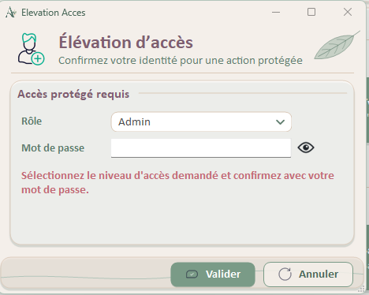

> Fichier : `UI/Forms/Login/ElevationAcces.vb` — hérite de `Form` — implémente `IContextAwareForm`.

#### Rôle général

`ElevationAcces` permet à un utilisateur connecté d’élever temporairement son rôle applicatif.

Cette élévation :

- ne modifie jamais le rôle stocké en base
- ne dure que pendant la session
- nécessite le mot de passe de l’utilisateur connecté
- respecte le rôle maximal autorisé

------

#### Responsabilités

- Afficher les rôles accessibles.
- Demander le mot de passe de l’utilisateur courant.
- Valider l’élévation via la couche métier.
- Appliquer le rôle temporaire dans `UserSession`.
- Refuser toute élévation non autorisée.
- Afficher un message sobre en cas d’échec, avec le nombre d'essais restants (message du métier, 20/10/2026).
- Fermer la fenêtre si le compte vient d'être verrouillé (seuil d'essais atteint).
- Journaliser la tentative et son résultat.

------

#### Dépendances

| Élément | Type | Rôle |
| --- | --- | --- |
| `UserSession` | Classe | Session courante, rôle actuel et état d’élévation. |
| `UtilisateurApplication` | Classe | Utilisateur connecté, rôle naturel et rôle maximal autorisé. |
| `UserControlContext` | Classe | contexte UI injecté par Home |
| `GestionUtilisateurs` | Module métier | Validation du password et des droits d’élévation. |
| `UtilsButtons` | Module utilitaire | Initialisation boutons standards. |
| `GestionLog` | Module métier | Logs sécurité liés aux élévations. |
| `AppRole` | Enum | Rôles applicatifs disponibles. |
| `IContextAwareForm` | Interface | Pour injection du contexte UI partagé |
| `DialogChoix` | Form | — |

#### Variables privées

| Variable | Type | Rôle |
| --- | --- | --- |
| `_userSession` | `UserSession` | Session dont le rôle courant sera modifié temporairement. |
| `_utilisateur` | `UtilisateurApplication` | Utilisateur demandant l’élévation. |
| `_context` | `UserControlContext` | Contexte UI partagé injecté par Home |

#### Contrôles principaux

| Contrôle | Type | Rôle |
| --- | --- | --- |
| `enTete` | AltheaEnTete | En-tête d'écran : titre « Élévation d’accès », sous-titre « Confirmez votre identité pour une action protégée » ; icône dans les ressources (`enTete.Icone`). |
| `carteElevation` | AltheaCarte | Carte « Accès protégé requis » (reprend l’ancien bandeau `lblTop`), ancrée sur les quatre bords. |
| `lblRole` | Label | Libellé du rôle demandé. |
| `cboRoleDemande` | AltheaListe | Liste des rôles accessibles (liste déroulante fermée). |
| `lblPassword` | Label | Libellé mot de passe. |
| `txtPassword` | TextBox | Mot de passe utilisateur, masqué par défaut. |
| `btnVoirPassword` | AltheaBouton (Outil) | Affichage temporaire du mot de passe. |
| `lblMessage` | Label | Message utilisateur ou refus. |
| `pnlActions` | AltheaBarreActions | Zone boutons. |
| `btnValider` | AltheaBouton | Valide la demande d’élévation. |
| `btnAnnuler` | AltheaBouton | Annule l’opération. |
| `errProvider` | ErrorProvider | Erreurs de saisie. |

#### Autres composants à utilité dédiée

| Composant | Type | Utilité |
| --- | --- | --- |
| `errProvider` | ErrorProvider | Erreurs de saisie. |

#### Méthodes principales

| Membre | Nature | Rôle |
| --- | --- | --- |
| `New` | Public Sub | — |
| `SetContext` | Public Sub | Injecte le contexte UI partagé fourni par la Form Home. |
| `SetStatus` | Private Sub | Met à jour le message de statut global via le contexte UI. |
| `InitializeToolTips` | Private Sub | Initialise les infobulles de tous les contrôles de la Form. |
| `ElevationAcces_Load` | Private Sub | Pose le fond et la barre de titre du kit, thématise les boutons (avant toute sortie anticipée) et charge les rôles disponibles. |
| `btnValider_Click` | Private Sub | Lance la validation d’élévation (`GestionUtilisateurs.VerifierElevationUtilisateur`) ; refus : message du métier (`MessageUI` : essais restants) sous le champ ; compte verrouillé (`IsLocked`) : `DialogChoix.Avertissement`, puis fermeture (V1.3.0, 20/10/2026, audit A.5). |
| `btnAnnuler_Click` | Private Sub | Ferme sans appliquer. |
| `btnVoirPassword_MouseDown` | Private Sub | Affiche temporairement le password. |
| `btnVoirPassword_MouseUp` | Private Sub | Masque le password. |
| `btnVoirPassword_MouseLeave` | Private Sub | Masque le password par sécurité. |

#### Gestion des icônes

- `$this.Icon` (Designer / ressources)
- `btnAnnuler.Image` (Designer / ressources)
- `btnValider.Image` (Designer / ressources)
- `btnVoirPassword.Image` (Designer / ressources)
- Fond : `AltheaFondFenetre.Appliquer(Me)` au chargement (beige clair à la feuille, barre de titre du kit) ; plus d'image de fond (15/10/2026)
- Bouton « œil » : `AltheaBouton` Outil 30×30, icône seule tirée du Designer, sans `UtilsButtons` (règle des petits boutons du kit) ; icône `oeil_24_normal` (`Assets/Ico_divers`, 15/10/2026) : œil plein sombre, du même trait que le cadenas de `SeanceEditor` — l'ancienne, fine et grise, devenait invisible

#### Gestion des droits

- Rôles testés : `AppRole.Admin`, `AppRole.SuperUser`.
- Méthodes concernées : `ElevationAcces_Load`.

#### Chargement des rôles disponibles

La ComboBox ne doit afficher que les rôles réellement atteignables.

Critères :

```
rôle demandé > rôle courant
rôle demandé <= RoleMaxElevation
```

Exemple :

| Situation            | Rôles proposés       |
| -------------------- | -------------------- |
| User, max SuperUser  | SuperUser            |
| User, max Admin      | SuperUser, Admin     |
| SuperUser, max Admin | Admin                |
| Admin                | Aucun rôle supérieur |

------

#### Validation sécurité

Validation métier attendue :

- utilisateur non null
- session non null
- compte actif
- compte non verrouillé
- password correct
- rôle demandé autorisé
- rôle demandé supérieur au rôle courant

**Essais comptés** (décision de Joëlle, 20/10/2026, audit A.5) : un mot de passe faux au cadenas compte comme à la connexion ; au seuil (`SECURITE_MAX_ECHECS_LOGIN`), le compte est verrouillé — la session en cours continue au rôle de base, un administrateur déverrouille.

Le compte est relu en base à chaque demande (verrouillé ou mot de passe changé entre-temps).

L'élévation obtenue prend fin après une période sans activité (voir `Home`, `SECURITE_ELEVATION_MINUTES`).

La validation doit passer par :

```
GestionUtilisateurs.VerifierElevationUtilisateur(...)
```

ou méthode métier équivalente.

------

#### Gestion du mot de passe

Même principe que `Login` :

- password masqué par défaut
- affichage temporaire uniquement
- jamais loggué
- jamais conservé après validation

------

#### Règles en vigueur

| Situation              | Effet UI                               |
| ---------------------- | -------------------------------------- |
| Aucun rôle disponible  | Form inutile ou validation impossible. |
| Aucun rôle sélectionné | Erreur via `errProvider`.              |
| Password vide          | Erreur via `errProvider`.              |
| Password incorrect     | Élévation refusée ; le message dit combien d'essais il reste. |
| Seuil d'essais atteint | Compte verrouillé : message, puis fermeture de la fenêtre (session au rôle de base). |
| Rôle non autorisé      | Élévation refusée.                     |
| Validation OK          | `DialogResult.OK`, session élevée.     |

------

#### Points d'attention

- Ne jamais utiliser un mot de passe Admin/SuperUser partagé.
- Ne jamais modifier `RoleUtilisateur` en base.
- Ne jamais proposer un rôle supérieur à `RoleMaxElevation`.
- Ne jamais afficher un message trop détaillé qui aide à contourner la sécurité.
- Toujours recalculer les droits après retour à l’appelant.
- Toujours mettre à jour l’affichage global de l’utilisateur connecté après élévation.

------
- Implémente IContextAwareForm pour l'injection du contexte UI partagé
- L'élévation est temporaire et dure le temps de la session
- Seuls les rôles supérieurs au rôle actuel et inférieurs ou égaux au RoleMaxElevation sont proposés
- Le mot de passe est vérifié côté métier via GestionUtilisateurs

#### Message au repreneur

`ElevationAcces` est un écran de sécurité temporaire, pas une gestion de rôles.

Il applique une règle fondamentale :

```
un utilisateur s’élève lui-même,
avec son propre mot de passe,
dans les limites prévues par son compte.
```

La gestion permanente des rôles appartient au futur `UC_Utilisateurs`.

---

### **Form : ConfigurationConnexion**

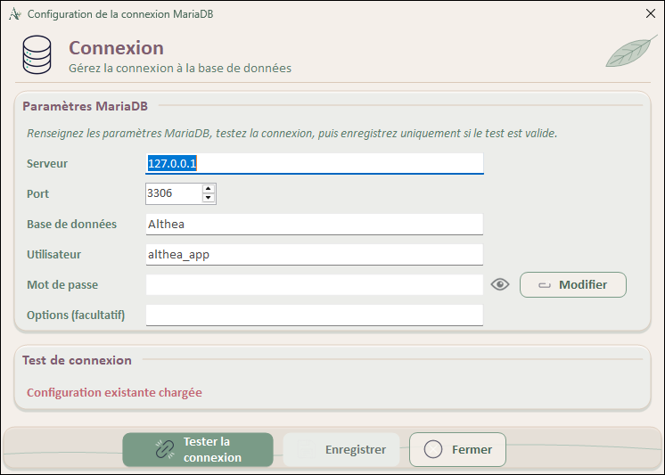

> Fichier : `UI/Forms/Database/ConfigurationConnexion.vb` — hérite de `Form` — implémente `IContextAwareForm`.

#### Rôle général

- ### Rôle général

  `ConfigurationConnexion` permet de créer, modifier, tester et enregistrer la configuration locale de connexion à MariaDB.

  Elle est utilisée lorsque :

  - aucune configuration locale n’existe
  - la configuration locale est invalide
  - la connexion échoue au démarrage
  - l’utilisateur veut modifier explicitement les paramètres de connexion

  ### Responsabilités

  - Charger une configuration existante.
  - Permettre la saisie des paramètres de connexion.
  - Tester la connexion avant toute sauvegarde.
  - Chiffrer le mot de passe via DPAPI.
  - Sauvegarder la configuration locale JSON.
  - Ne jamais afficher ni logguer le mot de passe.
  - Gérer proprement l’état des boutons selon les actions utilisateur.

  ### Dépendances

  | Élément              | Type           | Rôle                                                         |
  | -------------------- | -------------- | ------------------------------------------------------------ |
  | `LocalDbConfig`      | Classe         | Représente la configuration locale de connexion : host, port, database, user, options, mot de passe chiffré. |
  | `ConfigManager`      | Module         | Charge et sauvegarde le fichier JSON local.                  |
  | `CryptoManagerDPAPI` | Module         | Chiffre et déchiffre le mot de passe avec DPAPI.             |
  | `DatabaseManager`    | Module         | Initialise et teste la connexion MariaDB.                    |
  | `GestionLog`         | Module         | Journalise les étapes, erreurs et décisions utilisateur.     |
  | `UITheme`            | Module | Palette graphique centralisée : couleurs, chemins d’assets, constantes visuelles. |
  | `UtilsButtons`       | Module | Initialisation et comportement des boutons standards. |
  | `Home`               | Form appelante | Peut ouvrir `ConfigurationConnexion` au démarrage ou depuis les paramètres. |

  ### Variables internes

  | Variable                      | Type                | Rôle                                                         |
  | ----------------------------- | ------------------- | ------------------------------------------------------------ |
  | `_isConnectionTestSuccessful` | Boolean             | Indique si un test de connexion réussi a été effectué. Conditionne l’enregistrement. |
  | `_isFormDirty`                | Boolean             | Indique que la Form a été modifiée depuis le dernier test.   |
  | `_hasUnsavedChanges`          | Boolean             | Indique qu’il existe une modification à enregistrer.         |
  | `_hasStoredEncryptedPassword` | Boolean             | Indique qu’un mot de passe chiffré existe déjà dans la configuration. |
  | `_storedEncryptedPassword`    | String              | Contient le mot de passe chiffré existant, jamais le mot de passe en clair. |
  | `_passwordMode`               | Enum `PasswordMode` | Définit si l’on conserve le mot de passe existant ou si l’utilisateur en saisit un nouveau. |

  ### Enum interne

  | Valeur         | Rôle                                                         |
  | -------------- | ------------------------------------------------------------ |
  | `KeepExisting` | Utilise le mot de passe chiffré déjà stocké. Le champ mot de passe reste désactivé. |
  | `SetNew`       | L’utilisateur doit saisir un nouveau mot de passe. Celui-ci sera chiffré après test réussi. |

  ### Contrôles

  | Contrôle                  | Type                 | Rôle                                                         |
  | ------------------------- | -------------------- | ------------------------------------------------------------ |
  | `pnlForm`                 | Panel                | Conteneur principal avec fond graphique.                     |
  | `enTete` | AltheaEnTete | En-tête d'écran : titre « Connexion », sous-titre « Gérez la connexion à la base de données » ; icône dans les ressources (`enTete.Icone`). |
  | `pnlTop`                  | Panel                | Bandeau d’information supérieur.                             |
  | `pnlCenter`               | Panel                | Zone centrale contenant le formulaire de connexion et le message de résultat. |
  | `tlpConnexion`            | TableLayoutPanel     | Structure les champs de connexion. Important pour conserver un alignement stable. |
  | `lblHost`                 | Label                | Libellé du serveur MariaDB.                                  |
  | `txtHost`                 | TextBox              | Saisie du host. Valeur conseillée : `127.0.0.1`.             |
  | `lblPort`                 | Label                | Libellé du port.                                             |
  | `nudPort`                 | NumericUpDown        | Saisie du port MariaDB. Valeur habituelle : `3306`.          |
  | `lblDatabaseName`         | Label                | Libellé du nom de la base.                                   |
  | `txtDatabaseName`         | TextBox              | Nom de la base de données Althéa.                            |
  | `lblUserName`             | Label                | Libellé du compte MariaDB.                                   |
  | `txtUserName`             | TextBox              | Utilisateur MariaDB applicatif, par exemple `althea_app`.    |
  | `lblPassword`             | Label                | Libellé du mot de passe.                                     |
  | `txtPassword`             | TextBox              | Mot de passe saisi uniquement si l’utilisateur demande une modification. |
  | `btnVoirPassword`         | Button               | Affiche temporairement le mot de passe pendant l’appui souris. Ne fonctionne que si le champ password est actif. |
  | `btnModifierPassword`     | Button               | Passe la Form en mode `SetNew` pour permettre la saisie d’un nouveau mot de passe. |
  | `lblAdditionalOptions`    | Label                | Libellé des options additionnelles de connexion.             |
  | `txtAdditionalOptions`    | TextBox              | Options complémentaires MySqlConnector.                      |
  | `Panel1`                  | Panel                | Zone visuelle autour du résultat de connexion.               |
  | `lblConnectionResult`     | Label                | Message utilisateur : configuration chargée, test OK, erreur, test requis, etc. |
  | `pnlActions` | AltheaBarreActions | Zone basse des boutons d’action.                             |
  | `btnTesterConnexion` | AltheaBouton | Lance le test de connexion avec les valeurs saisies ou stockées. |
  | `btnEnregistrerConnexion` | AltheaBouton | Sauvegarde la configuration uniquement après un test réussi et si une modification est à enregistrer. |
  | `btnFermer` | AltheaBouton | Ferme la Form sans valider la configuration.                 |
  | `stsStatus`               | StatusStrip          | Barre de statut.                                             |
  | `stsLabelStatus`          | ToolStripStatusLabel | Message d’état technique ou utilisateur.                     |
  | `ttMain`                  | ToolTip              | Prévu pour l’aide utilisateur.                               |
  | `errProvider`             | ErrorProvider        | Prévu pour signaler visuellement les erreurs de saisie.      |

  ### Méthodes principales

  | Méthode                           | Rôle                                                         |
  | --------------------------------- | ------------------------------------------------------------ |
  | `ConfigurationConnexion_Load()`   | Initialise la Form, les valeurs par défaut, les boutons standards et charge la configuration existante. |
  | `LoadExistingConfiguration()`     | Charge le JSON local si présent et prépare le mode mot de passe. |
  | `OnFieldChanged()`                | Détecte toute modification utilisateur et invalide le test précédent. |
  | `AreRequiredFieldsValid()` / `ChampsManquants()` | Champs nécessaires au test ; les manquants sont nommés dans le message (V1.3.0). |
  | `BuildConfigFromForm()`           | Construit un objet `LocalDbConfig` depuis les champs de la Form, sans traiter le mot de passe. |
  | `btnModifierPassword_Click()`     | Active la saisie d’un nouveau mot de passe.                  |
  | `btnTesterConnexion_Click()`      | Teste les valeurs saisies sans toucher à la connexion de l'application (`DatabaseManager.TesterConfiguration`) ; message de réussite, ou cause de l'échec et quoi vérifier (`MessageEchec`) ; mot de passe stocké illisible sur ce poste signalé (V1.3.0, 20/10/2026). |
  | `btnEnregistrerConnexion_Click()` | Refusé sans test réussi (message) ; chiffre ou conserve le mot de passe selon le mode (audit B2), sauvegarde via `ConfigManager`, applique la configuration à l'application (`DatabaseManager.Initialize`), message de confirmation. |
  | `UpdateFormState()`               | Active/désactive les boutons selon l’état de la Form.        |
  | `btnVoirPassword_MouseDown()`     | Affiche temporairement le mot de passe.                      |
  | `btnVoirPassword_MouseUp()`       | Masque à nouveau le mot de passe.                            |
  | `btnVoirPassword_MouseLeave()`    | Masque le mot de passe si la souris quitte le bouton.        |
  | `btnFermer_Click()`               | Ferme la Form sans validation.                               |

  ### Gestion du mot de passe

  Le mot de passe n’est jamais affiché automatiquement.

  Deux cas existent :

  | Cas                                               | Comportement                                                 |
  | ------------------------------------------------- | ------------------------------------------------------------ |
  | Configuration existante avec mot de passe chiffré | `_passwordMode = KeepExisting`, `txtPassword.Enabled = False`, le mot de passe stocké est utilisé pour tester. |
  | Nouvelle configuration ou modification explicite  | `_passwordMode = SetNew`, `txtPassword.Enabled = True`, l’utilisateur doit saisir le mot de passe. |

  Le bouton `Modifier PW` est volontairement séparé : il évite d’effacer ou de remplacer accidentellement un mot de passe existant.

  ### Gestion des boutons

  Les boutons de cette Form sont des boutons standards.

  Ils doivent être initialisés via `UtilsButtons.InitStandardButton`.

  | Bouton                    | Tag attendu                   | Rôle                                    |
  | ------------------------- | ----------------------------- | --------------------------------------- |
  | `btnTesterConnexion`      | `testerConnexion_normal`      | Teste la connexion.                     |
  | `btnEnregistrerConnexion` | `enregistrer_normal`          | Sauvegarde la configuration.            |
  | `btnFermer`               | `fermer_normal`               | Ferme la Form.                          |
  | `btnModifierPassword`     | `modifier_normal`             | Active la modification du mot de passe. |
  | `btnVoirPassword`         | à préciser selon asset retenu | Affichage temporaire du mot de passe.   |

  Rappel important :

  - le `Tag` ne contient pas `.png`
  - l’image normale doit exister dans `Assets\Boutons_ico`
  - les variantes `_hover` et `_disabled` sont optionnelles

  ### Règles d’état

  | Situation                                  | Effet UI                                                     |
  | ------------------------------------------ | ------------------------------------------------------------ |
  | Champs obligatoires incomplets             | `btnTesterConnexion.Enabled = False`                         |
  | Test non réussi                            | `btnEnregistrerConnexion.Enabled = False`                    |
  | Test réussi + modifications à enregistrer  | `btnEnregistrerConnexion.Enabled = True`                     |
  | Mot de passe stocké existant               | `txtPassword.Enabled = False`, bouton Modifier actif         |
  | Demande de modification du mot de passe    | `txtPassword.Enabled = True`, test précédent invalidé        |
  | Connexion échouée avec mot de passe stocké | Demande à l’utilisateur de cliquer sur Modifier pour saisir un nouveau mot de passe |
  | Enregistrement réussi                      | Sauvegarde JSON, fermeture avec `DialogResult.OK`            |

#### Responsabilités

- Permettre la saisie/modification des paramètres de connexion (host, port, database, user, password, options)
- Tester la connexion à la base de données avant enregistrement
- Gérer le mot de passe de manière sécurisée (chiffrement DPAPI, masquage UI)
- Sauvegarder la configuration locale via ConfigManager
- Charger une configuration existante
- Créer le dossier et le fichier de configuration si nécessaires

#### Dépendances

| Élément | Type | Rôle |
| --- | --- | --- |
| `UserControlContext` | Classe | contexte UI injecté par Home |
| `LocalDbConfig` | Classe | modèle de configuration |
| `ConfigManager` | Classe | chargement/sauvegarde configuration |
| `DatabaseManager` | Classe | test de connexion |
| `CryptoManagerDPAPI` | Classe | chiffrement/déchiffrement mot de passe |
| `UtilsButtons` | Module utilitaire | thématisation des boutons |
| `GestionLog` | Module métier | journalisation |
| `IContextAwareForm` | Interface | Pour injection du contexte UI partagé |
| `DialogChoix` | Form | — |

#### Variables privées

| Variable | Type | Rôle |
| --- | --- | --- |
| `_context` | `UserControlContext` | Contexte UI partagé injecté par Home |
| `_isConnectionTestSuccessful` | `Boolean` | Indique si un test de connexion valide a été effectué |
| `_isFormDirty` | `Boolean` | Indique si le formulaire a été modifié depuis le dernier test |
| `_hasUnsavedChanges` | `Boolean` | Indique s'il y a des changements non enregistrés |
| `_hasStoredEncryptedPassword` | `Boolean` | Indique si une configuration existante contient déjà un mot de passe chiffré |
| `_storedEncryptedPassword` | `String` | Stocke le mot de passe chiffré déjà existant, si présent |
| `_passwordMode` | `PasswordMode` | Mode de gestion du mot de passe actuel |

#### Contrôles principaux

| Contrôle | Type | Rôle |
| --- | --- | --- |
| `enTete` | AltheaEnTete | En-tête d'écran : titre « Connexion », sous-titre « Gérez la connexion à la base de données ». |
| `carteParametres` | AltheaCarte | Carte « Paramètres MariaDB » : consigne et six champs de connexion. |
| `lblIntro` | Label | Consigne (italique sauge) : renseigner, tester, enregistrer seulement si le test est valide (ancien bandeau `lblTop1`). |
| `lblHost` | Label | Libellé : « Serveur » |
| `txtHost` | TextBox | Nom du serveur MariaDB ou adresse IP. |
| `lblPort` | Label | Libellé : « Port » |
| `nudPort` | NumericUpDown | Port TCP utilisé par MariaDB. |
| `lblDatabaseName` | Label | Libellé : « Base de données » |
| `txtDatabaseName` | TextBox | Nom de la base de données Althéa. |
| `lblUserName` | Label | Libellé : « Utilisateur » |
| `txtUserName` | TextBox | Utilisateur MariaDB utilisé par l’application. |
| `lblPassword` | Label | Libellé : « Mot de passe » |
| `txtPassword` | TextBox | Mot de passe du compte MariaDB (désactivé tant que le mot de passe enregistré n’est pas remplacé). |
| `btnVoirPassword` | AltheaBouton (Outil) | Afficher temporairement le mot de passe pendant l’appui. |
| `btnModifierPassword` | AltheaBouton (Clair) | « Modifier » : remplacer le mot de passe enregistré. |
| `lblAdditionalOptions` | Label | Libellé : « Options (facultatif) » |
| `txtAdditionalOptions` | TextBox | Options supplémentaires (optionnel). |
| `carteTest` | AltheaCarte | Carte « Test de connexion » : résultat du dernier test. |
| `lblConnectionResult` | Label | Résultat du test ou de l’enregistrement (« Aucun test effectué » au départ). |
| `pnlActions` | AltheaBarreActions | Zone des boutons d’action. |
| `btnTesterConnexion` | AltheaBouton | « Tester la connexion » : tester immédiatement la connexion MariaDB. |
| `btnEnregistrerConnexion` | AltheaBouton | Enregistrer les paramètres de connexion. |
| `btnFermer` | AltheaBouton | Fermer la fenêtre sans enregistrer. |
| `ttMain` | ToolTip | Aide utilisateur. |
| `errProvider` | ErrorProvider | Erreurs de saisie. |

#### Autres composants à utilité dédiée

| Composant | Type | Utilité |
| --- | --- | --- |
| `ttMain` | ToolTip | — |
| `errProvider` | ErrorProvider | — |

#### Méthodes principales

| Membre | Nature | Rôle |
| --- | --- | --- |
| `SetContext` | Public Sub | Injecte le contexte UI partagé fourni par la Form Home. |
| `SetStatus` | Private Sub | Met à jour le message de statut global via le contexte UI. |
| `SetHeader` | Private Sub | Met à jour le message d'en-tête global via le contexte UI. |
| `InitializeToolTips` | Private Sub | Initialise les infobulles de tous les contrôles de la Form. |
| `ConfigurationConnexion_Load` | Private Sub | Pose le fond et la barre de titre du kit, initialise l’état de la Form ; le chargement d'une configuration existante peut écraser les valeurs par défaut. |
| `ConfigurationConnexion_FormClosing` | Private Sub | Gère la fermeture de la Form en nettoyant le message de statut. |
| `OnFieldChanged` | Private Sub | Détecte toute modification utilisateur dans les champs de saisie et invalide le test précédent. |
| `txtPassword_Enter` | Private Sub | Vide le champ mot de passe si un mot de passe masqué "********" est affiché. |
| `btnModifierPassword_Click` | Private Sub | Permet à l'utilisateur de remplacer le mot de passe stocké dans la configuration locale. |
| `btnTesterConnexion_Click` | Private Sub | Teste la connexion à la base de données à partir des valeurs saisies ou stockées. |
| `btnEnregistrerConnexion_Click` | Private Sub | Sauvegarde la configuration de connexion de manière sécurisée. |
| `btnVoirPassword_MouseDown` | Private Sub | Affiche temporairement le mot de passe en clair tant que le bouton est maintenu appuyé. |
| `btnVoirPassword_MouseLeave` | Private Sub | Masque le mot de passe si la souris quitte le bouton pendant l'appui. |
| `btnVoirPassword_MouseUp` | Private Sub | Masque à nouveau le mot de passe dès que le bouton est relâché. |
| `btnFermer_Click` | Private Sub | Ferme la fenêtre de configuration sans valider ni enregistrer la connexion. |
| `AreRequiredFieldsValid` | Private Function | Vérifie si les champs obligatoires sont correctement renseignés. |
| `UpdateFormState` | Private Sub | Met à jour l'état des boutons et des messages de la Form en fonction de la situation. |
| `BuildConfigFromForm` | Private Function | Construit un objet LocalDbConfig à partir des valeurs saisies dans la Form. |
| `LoadExistingConfiguration` | Private Sub | Charge la configuration locale existante dans la Form si elle existe. |

#### Gestion des icônes

- `$this.Icon` (Designer / ressources)
- `btnEnregistrerConnexion.Image` (Designer / ressources)
- `btnFermer.Image` (Designer / ressources)
- `btnModifierPassword.Image` (Designer / ressources)
- `btnTesterConnexion.Image` (Designer / ressources)
- `btnVoirPassword.Image` (Designer / ressources)
- Fond : `AltheaFondFenetre.Appliquer(Me)` au chargement (beige clair à la feuille, barre de titre du kit) ; plus d'image de fond (15/10/2026)
- Bouton « œil » : `AltheaBouton` Outil 30×30, icône seule tirée du Designer, sans `UtilsButtons` (règle des petits boutons du kit) ; icône `oeil_24_normal` (`Assets/Ico_divers`, 15/10/2026) : œil plein sombre, du même trait que le cadenas de `SeanceEditor` — l'ancienne, fine et grise, devenait invisible

#### Règles en vigueur

- Tous les messages utilisateur passent par `DialogChoix` (jamais `MessageBox`).
- Aucun accès direct à la base : les lectures/écritures passent par la couche métier `Gestion*`.
- Les actions significatives sont journalisées via `GestionLog`.

#### Points d'attention

- Implémente IContextAwareForm pour l'injection du contexte UI partagé
- Le mot de passe n'est JAMAIS affiché en clair (sauf maintien du bouton "Voir")
- Le mot de passe existant n'est jamais déchiffré pour affichage
- L'enregistrement n'est possible qu'après un test de connexion réussi

#### Message au repreneur

> ConfigurationConnexion (1073 lignes). Point d'entrée : `SetContext`, `ConfigurationConnexion_Load`. Toute modification visuelle passe par le Designer (.Designer.vb / .resx).

---

### **Form : UtilisateurEdition**

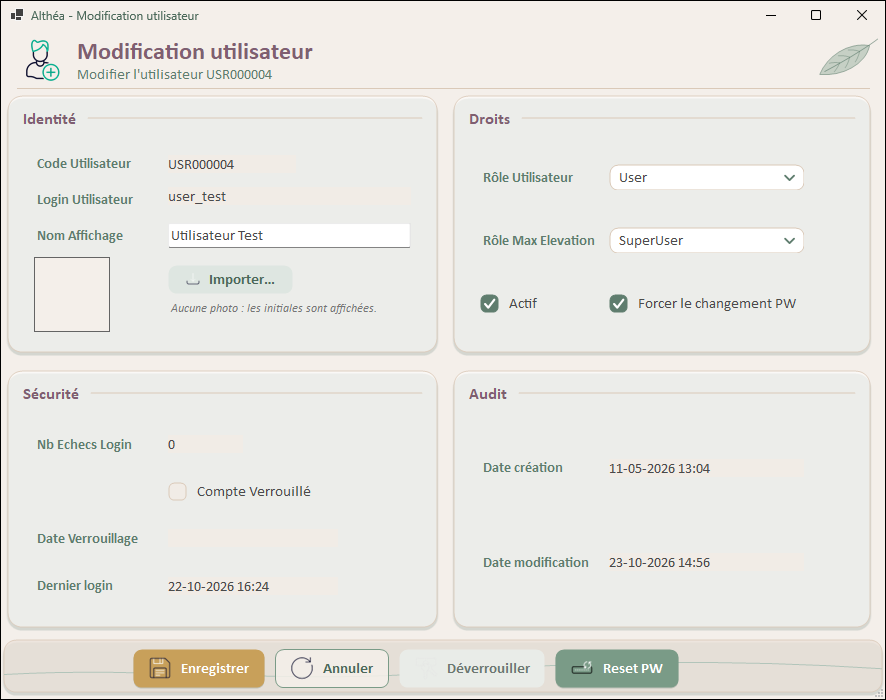

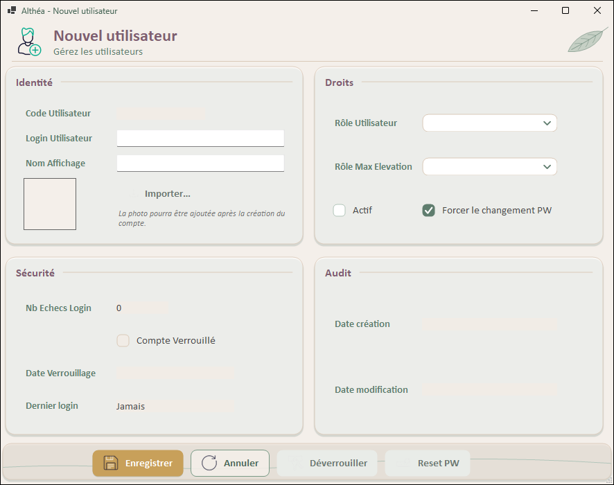

> Fichier : `UI/Forms/Utilisateur/UtilisateurEdition.vb` — hérite de `Form` — implémente `IContextAwareForm`.

#### Rôle général

`UtilisateurEdition` est une Form modale permettant la **création**, la **modification** et la **consultation** d'un utilisateur applicatif.

Elle centralise toutes les actions de gestion utilisateur :

- Création de nouveaux comptes
- Modification des informations utilisateur
- Consultation des détails utilisateur (notamment pour SuperUser)
- Réinitialisation de mot de passe
- Déverrouillage de compte
- Photo du compte (affichage, import pour un compte non lié à un praticien)

#### Responsabilités

- Afficher et éditer les informations d'un utilisateur.
- Gérer les trois modes : Création, Modification, Consultation.
- Faire juger la saisie du compte par le métier (`GestionUtilisateurs.ValiderCompte`, audit C.2 étape 4, 23/10/2026) et montrer les erreurs (`AffichageErreursSaisie`).
- Permettre les actions administratives (reset password, déverrouillage).
- Générer et afficher un mot de passe temporaire lors de la création.
- Utiliser `DialogChoix` pour tous les retours utilisateur.
- Journaliser toutes les actions sensibles via `GestionLog`.
- Implémenter `IContextAwareForm` pour recevoir le contexte UI.

#### Dépendances

| Élément | Type | Rôle |
| --- | --- | --- |
| `GestionUtilisateurs` | Module métier | Couche métier : CRUD utilisateurs, reset password, unlock, etc. |
| `GestionAuthentification` | Module métier | — |
| `UtilisateurApplication` | Classe | Objet métier représentant un utilisateur. |
| `UserControlContext` | Classe | Contexte UI injecté pour StatusStrip, ErrorProvider, ToolTip. |
| `UtilsControls` | Module utilitaire | — |
| `UtilsValidation` | Module utilitaire | Validation des champs de saisie. |
| `AffichageErreursSaisie` | Module utilitaire | Erreurs de `ValiderCompte` sur leurs champs (`errProvider` local), fenêtre récapitulative, focus (23/10/2026). |
| `GestionLog` | Module métier | Journalisation des actions sensibles. |
| `UITheme` | Module utilitaire | Thème visuel de l'application. |
| `PasswordSecurityHelper` | Module utilitaire | Génération de mots de passe temporaires, validation. |
| `UtilsButtons` | Module utilitaire | Initialisation des boutons standards. |
| `AppRole` | Enum | Rôles applicatifs (User, SuperUser, Admin). |
| `DialogChoix` | Form | Remplace MessageBox pour tous les messages utilisateur. |
| `ChangePassword` | Form | Utilisé pour le reset password en mode admin. |
| `UC_Utilisateurs` | UserControl | — |
| `PhotosUtilisateur` | Module métier | Règle d'affichage de la photo du compte et praticien lié. |
| `CheminsUtilisateurHelper` | Module utilitaire | Copie et chargement de la photo propre du compte. |
| `UtilsImages` | Module utilitaire | Dialogue de choix d'image, confirmation de remplacement, affichage. |

#### Variables privées

| Variable | Type | Rôle |
| --- | --- | --- |
| `_context` | `UserControlContext` | Contexte UI injecté depuis `UC_Utilisateurs`. |
| `_mode` | `ModeUtilisateurEdition` | Mode d'ouverture de la Form (Création, Modification, Consultation). |
| `_idUtilisateur` | `Long` | ID utilisateur en mode Modification/Consultation (0 en Création). |
| `_utilisateur` | `UtilisateurApplication` | Instance de l'utilisateur en cours d'édition. |

#### Contrôles principaux

> **UI-7 (14/10/2026)** :
>
> - panneau racine `pnlForm` supprimé (cartes, barre d'actions et en-tête posés sur la fenêtre), fond `AltheaFondFenetre.Appliquer(Me)` au chargement
> - listes `AltheaListe`, cases `AltheaCase`
> - `AppliquerFondsChamps` (après l'application du mode) donne aux zones en lecture seule le fond teinté et aux zones modifiables le fond blanc
> - texte en gris foncé.

| Contrôle | Type | Rôle |
| --- | --- | --- |
| `enTete` | AltheaEnTete | En-tête d'écran : titre « Utilisateurs », sous-titre « Gérez les utilisateurs » à la création, « Modifier / Consulter l'utilisateur USR… » sur un compte existant (`NommerParLeCode`, 24/10/2026) ; icône dans les ressources (`enTete.Icone`). |
| `pnlActions` | AltheaBarreActions | Zone des boutons d'action. |
| `btnResetPassword` | AltheaBouton | Réinitialise le mot de passe (mode Modification/Consultation). |
| `btnDeverrouiller` | AltheaBouton | Déverrouille le compte (mode Modification/Consultation). |
| `btnAnnuler` | AltheaBouton | Libellé : « Annuler » |
| `btnEnregistrer` | AltheaBouton | Enregistre les modifications ou crée l'utilisateur. |
| `carteIdentite` | AltheaCarte | Carte « Identité » (titre intégré) : code, login, nom d'affichage, photo. |
| `carteDroits` | AltheaCarte | Carte « Droits » : rôles, actif, changement de mot de passe obligatoire. |
| `carteSecurite` | AltheaCarte | Carte « Sécurité » : échecs, verrouillage, dernier login. |
| `carteAudit` | AltheaCarte | Carte « Audit » : dates de création et de modification. |
| `tblIdentite` | TableLayoutPanel | Grille de la carte Identité (3 lignes de 36 px + ligne photo). |
| `tblDroits` | TableLayoutPanel | Grille de la carte Droits. |
| `tblSecurite` | TableLayoutPanel | Grille de la carte Sécurité. |
| `tblAudit` | TableLayoutPanel | Grille de la carte Audit. |
| `picPhotoUtilisateur` | PictureBox | Photo affichée pour le compte (76 × 76, Zoom) ; vide = initiales dans le bandeau. |
| `pnlPhoto` | Panel | Conteneur du bouton d'import et du texte d'aide. |
| `btnPhotoImporter` | AltheaBouton | « Importer… » (variante OutilPrincipal) : photo propre du compte, enregistrée immédiatement. |
| `lblPhotoInfo` | Label | Aide contextuelle (compte lié, création, absence de photo). |
| `lblCodeUtilisateur` | Label | Libellé Code utilisateur. |
| `txtCodeUtilisateur` | TextBox | Code utilisateur (optionnel, auto-généré si vide). |
| `lblLoginUtilisateur` | Label | Libellé Login. |
| `lblNomAffichage` | Label | Libellé Nom d'affichage. |
| `txtLoginUtilisateur` | TextBox | Login utilisateur (non modifiable en mode Modification). |
| `txtNomAffichage` | TextBox | Nom affiché dans l'application. |
| `lblRoleUtilisateur` | Label | Libellé Rôle de base. |
| `lblRoleMaxElevation` | Label | Libellé Rôle max élévation. |
| `chkActif` | AltheaCase | Indique si le compte est actif. |
| `chkMustChangePassword` | AltheaCase | Indique si l'utilisateur doit changer son mot de passe. |
| `cboRoleUtilisateur` | AltheaListe | Rôle de base de l'utilisateur. |
| `cboRoleMaxElevation` | AltheaListe | Rôle maximum autorisé pour élévation temporaire. |
| `lblNbEchecsLogin` | Label | Nombre d'échecs de connexion. |
| `txtNbEchecsLogin` | TextBox | — |
| `chkCompteVerrouille` | AltheaCase | Libellé : « Compte Verrouillé » |
| `txtDateVerrouillage` | TextBox | — |
| `lblDateVerrouillage` | Label | Date de verrouillage (si applicable). |
| `Label1` | Label | — |
| `txtDernierLogin` | TextBox | — |
| `lblDernierLogin` | Label | Date du dernier login réussi. |
| `lblDateCreation` | Label | Libellé : « Date création » |
| `lblDateModification` | Label | Libellé : « Date modification » |
| `txtDateCreation` | TextBox | — |
| `txtDateModification` | TextBox | — |
| `ttMain` | ToolTip | Aides contextuelles. |
| `errProvider` | ErrorProvider | Signalement des erreurs de saisie. |

#### Autres composants à utilité dédiée

| Composant | Type | Utilité |
| --- | --- | --- |
| `ttMain` | ToolTip | Aides contextuelles. |
| `errProvider` | ErrorProvider | Signalement des erreurs de saisie. |

#### Méthodes principales

| Membre | Nature | Rôle |
| --- | --- | --- |
| `New` | Public Sub | Constructeur : initialise le mode et l'ID utilisateur. |
| `SetContext` | Public Sub | Implémentation de `IContextAwareForm` : reçoit le contexte UI. |
| `UtilisateurEdition_Load` | Private Sub | Initialise la Form, charge l'utilisateur si modification/consultation. Branche la garde des modifications non enregistrées (`GardeModifications.SurveillerFenetre`, 19/10/2026). |
| `InitialiserBoutons` | Private Sub | Initialise les boutons via `UtilsButtons`. |
| `InitialiserToolTips` | Private Sub | Initialise les infobulles. |
| `DefinirToolTip` | Private Sub | Définit une infobulle en privilégiant le contexte partagé de Home (_context) pour harmoniser le comportement ; repli sur le ToolTip local (ttMain) si aucun contexte n'est injecté. |
| `InitialiserCombos` | Private Sub | Initialise les ComboBox de sélection des rôles avec les valeurs de l'énumération AppRole. |
| `btnEnregistrer_Click` | Private Sub | Gère la création ou la modification utilisateur. |
| `btnAnnuler_Click` | Private Sub | Ferme la Form sans enregistrer. |
| `btnResetPassword_Click` | Private Sub | Ouvre `ChangePassword` en mode AdminReset. |
| `btnDeverrouiller_Click` | Private Sub | Déverrouille le compte utilisateur. |
| `InitialiserMode` | Private Sub | Initialise l'état de la Form selon le mode d'ouverture. |
| `AppliquerModeCreation` | Private Sub | Configure l'UI pour le mode Création. |
| `AppliquerModeModification` | Private Sub | Configure l'UI pour le mode Modification. |
| `AppliquerModeConsultation` | Private Sub | Configure l'UI pour le mode Consultation (lecture seule). |
| `ChargerUtilisateur` | Private Sub | Charge les données utilisateur depuis la base (mode Modification/Consultation). |
| `AlimenterControlesDepuisUtilisateur` | Private Sub | Alimente les contrôles de la Form depuis l'objet utilisateur chargé. |
| `NommerParLeCode` | Private Sub | Après le chargement : sous-titre « Modifier / Consulter l'utilisateur USR… » et barre d'état (24/10/2026). |
| `ValiderFormulaire` | Private Function | Exige le choix des deux rôles, puis fait juger le compte par `GestionUtilisateurs.ValiderCompte` (login jugé à la création seulement) ; toutes les erreurs d'un coup par `AffichageErreursSaisie.Signaler` (V2.0.0, 23/10/2026 : une fenêtre par erreur auparavant). |
| `ChampsDuCompte` / `RoleSaisi` | Private Function | Propriété du compte → contrôle (`txtLoginUtilisateur`, `txtNomAffichage`, `cboRoleMaxElevation`) ; rôle choisi dans une liste. |
| `AfficherPhoto` | Private Sub | Affiche la photo selon `PhotosUtilisateur`, active l'import (Modification et compte non lié) et renseigne l'aide. |
| `btnPhotoImporter_Click` | Private Sub | Choisit, confirme, copie la photo (`CheminsUtilisateurHelper`) puis enregistre son nom (`GestionUtilisateurs.UpdatePhotoUtilisateur`, Admin). |

#### Gestion des icônes

- `btnAnnuler.Image` (Designer / ressources)
- `btnDeverrouiller.Image` (Designer / ressources)
- `btnEnregistrer.Image` (Designer / ressources)
- `btnResetPassword.Image` (Designer / ressources)
- `btnPhotoImporter.Image` (Designer / ressources, icône d'import du kit, Tag `importer_normal`)
- `pnlActions.BackgroundImage` (Designer / ressources)

#### Gestion des filtres et recherche

- Contrôles : `btnDeverrouiller`, `chkCompteVerrouille`, `txtDateVerrouillage`.
- Fonctionnement : les critères sont transmis au rechargement des données.

#### Gestion des droits

- Rôles testés : `AppRole.Admin`, `AppRole.SuperUser`, `AppRole.User`.
- Méthodes concernées : `btnDeverrouiller_Click`, `AlimenterControlesDepuisUtilisateur`.

#### Enum interne

| Valeur         | Rôle                                                         |
| -------------- | ------------------------------------------------------------ |
| `Creation`     | Mode création d'un nouvel utilisateur. Login éditable, mot de passe auto-généré. |
| `Modification` | Mode modification d'un utilisateur existant. Login non éditable. |
| `Consultation` | Mode lecture seule (pour SuperUser). Tous les champs désactivés sauf actions admin. |

#### Mode Création

- Titre : "Création d'un utilisateur"
- Login éditable
- Génération automatique d'un mot de passe temporaire
- Affichage du mot de passe généré à l'administrateur
- `chkMustChangePassword` coché par défaut
- Boutons Reset Password et Déverrouiller désactivés

#### Mode Modification

- Titre : "Modification d'un utilisateur"
- Login **non éditable** (sécurité)
- Pas d'affichage du mot de passe
- Boutons Reset Password et Déverrouiller actifs selon l'état du compte
- Possibilité de modifier rôle, nom d'affichage, état actif

#### Mode Consultation

- Titre : "Consultation d'un utilisateur"
- Tous les champs en lecture seule
- Seuls les boutons Reset Password et Déverrouiller restent actifs (pour SuperUser)
- Pas de modification des informations utilisateur

#### Gestion du mot de passe temporaire

En mode **Création** uniquement :

1. Un mot de passe temporaire est généré automatiquement via `PasswordSecurityHelper.GenerateTemporaryPassword()`.
2. Le mot de passe est affiché en clair à l'administrateur dans `txtMotDePasseTemporaire`.
3. L'administrateur **doit** communiquer ce mot de passe à l'utilisateur par un canal sécurisé.
4. `chkMustChangePassword` est coché par défaut, forçant l'utilisateur à changer son mot de passe lors de sa première connexion.

**Sécurité** :

- Le mot de passe temporaire n'est **jamais** loggué.
- Il n'est visible que pendant l'affichage de la Form après création réussie.
- Une fois la Form fermée, le mot de passe n'est plus récupérable (l'admin devra faire un reset si nécessaire).

#### Validation

Les règles du compte sont dans le métier (`GestionUtilisateurs.ValiderCompte`, ADR-51, 23/10/2026), lues par la fiche et par la création du compte du praticien (`DialogComptePraticien`), appliquées par `CreateUtilisateur` :

- Login : au moins 3 caractères et unique — jugé **à la création seulement** (il ne change plus ensuite : un ancien login plus court reste valable). Avant le 23/10/2026, la fiche acceptait un login d'un caractère, et un login déjà pris n'était signalé que par « Erreur lors de la création… » : le message le dit maintenant.
- Nom d'affichage : obligatoire.
- Rôle de base au plus égal au rôle d'élévation maximale.
- Les deux rôles doivent être choisis (contrôle de la fenêtre, avant l'appel au métier).

Affichage des erreurs :

- `AffichageErreursSaisie` : icône `errProvider` sur chaque champ, fenêtre récapitulative, focus sur le premier
- `DialogChoix` pour les refus du métier (propre compte, dernier administrateur, droits)
- `stsLabelStatus` pour les messages d'état

#### Reset Password

- Disponible en modes Modification et Consultation
- Ouvre la Form `ChangePassword` en mode `AdminReset`
- L'administrateur saisit un nouveau mot de passe temporaire, qui doit respecter `PolitiqueMotDePasse` (appliquée aussi par le métier depuis le 23/10/2026)
- `MustChangePassword` est automatiquement coché après reset

#### Déverrouiller

- Disponible uniquement si le compte est verrouillé
- Réinitialise `CompteVerrouille` et `NbEchecsLogin`
- Affiche une confirmation via `DialogChoix.Succes()`

#### Photo du compte

Règle (décision du 12/10/2026, portée par `PhotosUtilisateur`) : un compte **lié à un praticien** affiche la photo de la fiche praticien ; sinon sa **photo propre** (`sec_utilisateurs.photo_fichier`) ; à défaut, ses **initiales** (bandeau de la Home).

- L'import n'est possible qu'en **Modification** (le compte doit exister) et pour un compte **non lié** ; un compte lié renvoie vers Administration › Cabinet.
- La photo est **enregistrée dès l'import**, indépendamment du bouton Enregistrer (comme les images du cabinet) : Annuler ne la retire pas.
- Le fichier est copié sous un nom fixe dans `Utilisateurs/Utilisateur_{id}/` du dossier de données ; un nouvel import remplace l'ancien après confirmation.
- `UC_Utilisateurs` rafraîchit la photo du bandeau à la fermeture de la fiche (cas où l'Admin modifie son propre compte).

#### Règles en vigueur

| Situation             | Effet UI                                                     |
| --------------------- | ------------------------------------------------------------ |
| Mode Création         | Login éditable, mot de passe généré affiché, Reset/Unlock désactivés. |
| Compte lié à un praticien | Photo du praticien affichée, import désactivé, aide « elle se modifie dans Administration › Cabinet ». |
| Création / Consultation | Import de photo désactivé. |
| Mode Modification     | Login non éditable, Reset/Unlock actifs selon état compte.   |
| Mode Consultation     | Tout en lecture seule sauf Reset/Unlock.                     |
| Compte verrouillé     | Bouton Déverrouiller activé.                                 |
| Compte non verrouillé | Bouton Déverrouiller désactivé.                              |
| Validation échouée    | Champs en erreur marqués par `errProvider` et fenêtre récapitulative (`AffichageErreursSaisie`). |
| Enregistrement réussi | Fermeture avec `DialogResult.OK`, rechargement de `UC_Utilisateurs`. |

#### Points d'attention

- **Écart connu (ToDo, section E, 23/10/2026)** : en Consultation, `btnResetPassword` est actif pour tout rôle, alors que le métier réserve la réinitialisation (et le déverrouillage) à l'Admin : un SuperUser reçoit le refus après coup. À aligner.
- **Ne jamais** modifier le login en mode Modification (contrainte d'intégrité).
- **Ne jamais** logguer les mots de passe (même temporaires).
- Toujours passer par `GestionUtilisateurs` pour toute opération DB.
- Utiliser `DialogChoix` pour **tous** les messages utilisateur.
- Implémenter correctement `IContextAwareForm` pour utiliser le contexte partagé.
- Le mot de passe temporaire doit être communiqué de manière sécurisée à l'utilisateur final.
- Ouverture modale via UC_Utilisateurs
- Retour DialogResult.OK après sauvegarde réussie
- En mode création, un mot de passe temporaire est généré et affiché à l'utilisateur
- En mode modif, le mot de passe temporaire est caché

#### Message au repreneur

`UtilisateurEdition` est une Form critique pour la sécurité applicative.

Avant toute modification :

- Comprendre les trois modes (Création, Modification, Consultation).
- Vérifier l'impact sur `UC_Utilisateurs` et `GestionUtilisateurs`.
- Tester les scénarios de création, modification, reset password, et déverrouillage.
- S'assurer que les mots de passe ne sont **jamais** loggués ou affichés de manière non sécurisée.

------

---

## **Dialogues**

### **Dialogue : DialogComptePraticien**

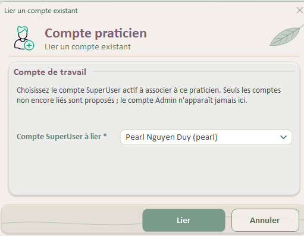

> Fichier : `UI/Forms/Cabinet/DialogComptePraticien.vb` (V1.4.0, 23/10/2026) — hérite de `Form`.

#### Rôle général

Fenêtre modale de `UC_Cabinet` pour attacher un compte de travail (SuperUser) au praticien du cabinet. Deux modes (`ModeDialog`) : **Creation** (login + nom d'affichage ; compte SuperUser, élévation Admin possible, mot de passe temporaire à changer à la première connexion) et **Liaison** (choix parmi les SuperUser actifs non encore liés).

#### Contrôles principaux

| Contrôle | Type | Rôle |
| --- | --- | --- |
| `enTete` | AltheaEnTete | Titre de la fenêtre. |
| `carteCompte` | AltheaCarte | « Compte de travail » (fond `AltheaFondFenetre`). |
| `lblInfo` | Label | Explication du mode. |
| `txtLogin` / `txtNomAffichage` | TextBox | Création : login proposé, nom d'affichage. |
| `cboCompte` | AltheaListe | Liaison : comptes candidats. |
| `lblErreur` | Label | Tous les points à corriger, sans détail technique. |
| `btnOk` / `btnAnnuler` | AltheaBouton | Valider / Annuler (barre `pnlActions`). |

#### Méthodes principales

| Membre | Nature | Rôle |
| --- | --- | --- |
| `New(mode, praticien, contexte)` | Public Sub | Reçoit le `ContexteOperation` de l'écran (utilisateur + rôle courant). |
| `MotDePasseTemporaire` | Public ReadOnly Property | Mot de passe temporaire du compte créé, à communiquer. |
| `btnOk_Click` | Event | Création : `GestionUtilisateurs.ValiderCompte` puis création d'un seul tenant (compte et lien) ; Liaison : lien. |

#### Règles en vigueur

- Le compte Admin technique n'est jamais proposé ni modifié ; opérations réservées à l'administrateur, vérifiées par le métier (`Autorisation`, audit A.3 / C.1).
- Création d'un seul tenant (audit B.2) : en cas d'échec, « rien n'a été enregistré ».
- Login et nom jugés par `GestionUtilisateurs.ValiderCompte` (login d'au moins 3 caractères et unique), la même règle que la fiche Utilisateur (audit C.2 étape 4).

---

[TOC]
