# 📘 **Documentation technique UI — Patients, dossiers, séances et paiements**

> Partie de la [documentation technique de l'interface](../Documentation_technique_UI_Althea.md) : sommaire, trame commune des fiches, vue d'ensemble et historique.
> Dernière mise à jour : 25/10/2026 — document scindé par domaine (décision de Joëlle)

Écran Patients et aperçu, fiche patient, fiche dossier, et leurs fenêtres : contact, intervenant, zones et statut du dossier, séance, paiement, planning du jour, dialogues d'annulation, de report et d'avoir.

---

## **Écrans**

### **UserControl : UC_PatientHome**

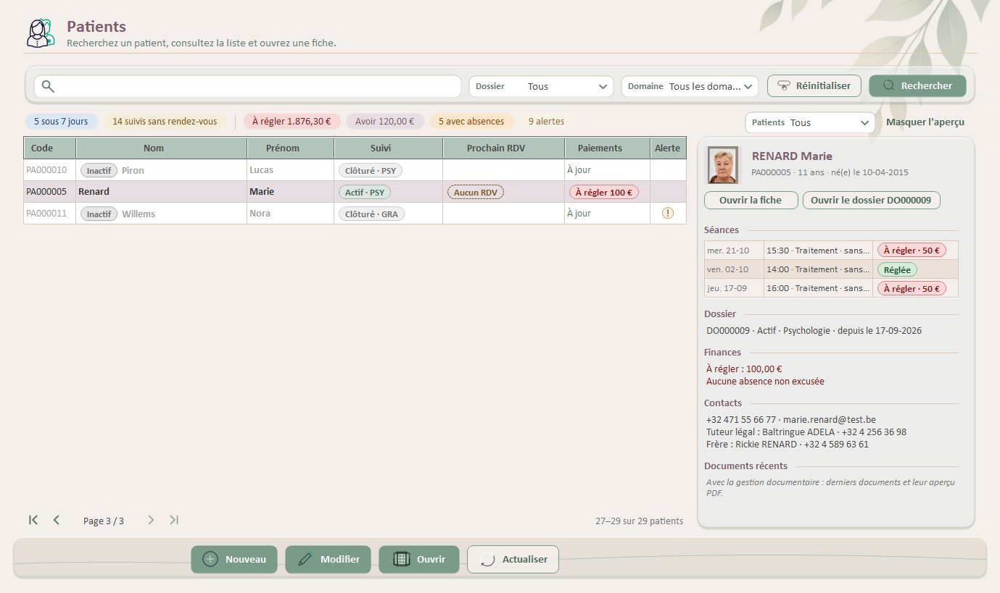

> Fichier : `UI/Controls/Patients/UC_PatientHome.vb` — hérite de `UserControl` — implémente `IContextAwareUserControl`.

#### Rôle général

`UC_PatientHome` est le UserControl d'accueil des patients : il liste les patients et permet la recherche multi-critères avant d'ouvrir une fiche.

Il est chargé dynamiquement dans `Home` via `NavigationManager` et constitue le point d'entrée vers `UC_PatientFiche` (création / modification / consultation).

#### Responsabilités

- Afficher la liste des patients comme **hub de la journée** (V1.2.0, 17/10/2026) : ordre « agenda » par défaut en trois groupes — attendus aujourd'hui (par heure), rendez-vous à venir (par date), sans rendez-vous à venir (par nom) —, séparés par une marge titrée ; un tri par en-tête remplace cet ordre.
- Permettre la recherche multi-critères en mémoire (nom, prénom, NISS, code, contact et domaine dominant).
- Filtrer les patients selon le statut du dossier dominant (« Dossier ») et le domaine ; patients actifs, inactifs seulement ou tous (liste « Patients », V1.7.0 ; actifs par défaut).
- Panneau d'aperçu à droite (`ucApercu`, `UC_ApercuPatient`, V1.5.0) :
  - ouvert par défaut, rempli au clic sur une ligne (après 200 ms, pour ne pas lire à chaque ligne parcourue au clavier)
  - bouton « Masquer / Afficher l'aperçu »
  - Âge, Dernière séance, Abs. et Téléphone masqués quand il est ouvert
  - ouverture de la fiche, du dossier (`OuvrirDossier`) ou d'une séance depuis le panneau.
- Résumé cliquable au-dessus de la grille (`ResumeFiltre`, V1.4.0) : aujourd'hui, sous 7 jours, suivis sans rendez-vous, à régler, avoir, absences, alertes — chaque pastille donne le nombre (ou le montant) et filtre la grille ; un nouveau clic revient à tous les patients.
- Préparer l'ouverture de la fiche patient (Nouveau / Modifier / Ouvrir).
- Conserver et restaurer le filtre de recherche au retour depuis la fiche (mini-pile D-Q15).
- Utiliser le contexte UI partagé fourni par `Home`.
- Journaliser les actions via `GestionLog`.

#### Dépendances

| Élément | Type | Rôle |
| --- | --- | --- |
| `GestionPatients` | Module métier | Couche métier : chargement de la liste des patients. |
| `PatientListeItem` | Classe | Objet de présentation allégé pour la grille. |
| `UserControlContext` | Classe | Contexte UI injecté par `Home`. |
| `UtilsButtons` | Module utilitaire | Initialisation des boutons standards. |
| `UtilsDataGrid` | Module utilitaire | Configuration visuelle des DataGridView. |
| `GestionLog` | Module métier | Journalisation des actions. |
| `IContextAwareUserControl` | Interface | injection du contexte UI partagé |
| `NavigationManager` | Classe | — |
| `GestionStatutsDossier` | Module métier | — |
| `GestionDomaines` | Module métier | — |
| `UtilsIcons` | Module utilitaire | — |
| `UtilsTelephone` | Module utilitaire | — |
| `UITheme` | Module utilitaire | — |
| `UC_PatientFiche` | UserControl | Écran cible (création / modification / consultation). |

#### Variables privées

| Variable | Type | Rôle |
| --- | --- | --- |
| `FiltreTous` | `Const Integer = 0` | — |
| `FiltreDossierActif` | `Const Integer = 1` | — |
| `FiltreDossierPause` | `Const Integer = 2` | — |
| `FiltreDossierCloture` | `Const Integer = 3` | — |
| `FiltreDossierArchive` | `Const Integer = 4` | — |
| `FiltreSansDossier` | `Const Integer = 5` | — |
| `FiltreDomaineTous` | `Const String = "Tous les domaines"` | — |
| `_context` | `UserControlContext` | Contexte UI injecté par `Home` via `SetContext()`. |
| `_patients` | `List(Of PatientListeItem)` | Liste complète chargée depuis la base, filtrée en mémoire. |
| `_filtreInitialTexte` | `String` | Filtre texte à restaurer au retour depuis la fiche (D-Q15). |
| `_filtreInitialSuivi` | `Integer` | Index du filtre de suivi (`cboFiltreSuivi`) à restaurer. |
| `Situation*` | `Const Integer` (0 à 7) | Situations du résumé cliquable : toutes, aujourd'hui, sous 7 jours (`NB_JOURS_PROCHAINS`), suivis sans rendez-vous, à régler, avoir, absences, alertes. |
| `_filtreSituation` / `_resume` | `Integer` / `ResumeFiltre` | Situation choisie et résumé cliquable. |
| `_filtreInitialSituation` / `_filtreInitialPatients` | `Integer` / `Integer` | Situation et filtre « Patients » à restaurer au retour de fiche (D-Q15). |
| `HAUTEUR_LIGNE_PASTILLES` / `HAUTEUR_SEPARATEUR_GROUPE` | `Const Integer` (30 / 24) | Lignes à pastilles et marge titrée entre deux groupes (mêmes valeurs que les grilles du dossier). |
| `LONGUEUR_MAX_ALERTE_INFOBULLE` | `Const Integer = 400` | Longueur maximale du texte de l'alerte dans l'infobulle. |
| `_titresSeparateurs` | `Dictionary(Of Integer, String)` | Titre de la marge sous chaque ligne qui termine un groupe (page affichée). |
| `_idPatientApercu` / `AUCUN_PATIENT_APERCU` | `Long?` / `Const Long = -1` | Patient affiché dans l'aperçu (V1.5.1, 19/10/2026) : l'aperçu n'est relu que si le patient sélectionné change (il se rechargeait en boucle et clignotait) ; remis à `Nothing` à chaque chargement de la liste et changement d'état de l'aperçu. |
| `PoliceSansDossier` / `IconeAlerte` | `Shared ReadOnly` | « Sans dossier » en italique ; icône d'avertissement du kit (`AltheaIconeEtat.CreerImage`). |

#### Contrôles principaux

| Contrôle | Type | Rôle |
| --- | --- | --- |
| `pnlForm` | Panel | Conteneur principal. |
| `enTete` | AltheaEnTete | En-tête d'écran : titre « Patients », sous-titre « Recherchez un patient, consultez la liste et ouvrez une fiche. » ; icône dans les ressources (`enTete.Icone`). |
| `pnlActions` | AltheaBarreActions | Zone des boutons d'action. |
| `btnNouveau` | AltheaBouton | Ouvre `UC_PatientFiche` en mode Création. |
| `btnModifier` | AltheaBouton | Ouvre `UC_PatientFiche` en mode Modification. |
| `btnOuvrir` | AltheaBouton | Ouvre `UC_PatientFiche` en consultation. |
| `btnActualiser` | AltheaBouton | Recharge la liste des patients. |
| `pnlCenter` | Panel | — |
| `pnlTop` | AltheaCarte | Bandeau de recherche (modèle « Moyen »), une ligne. |
| `dgvPatients` | DataGridView | Liste des patients. |
| `pagPatients` | UC_Pagination | Pagination de la liste (« 21–40 sur 87 patients ») ; `HauteurReservee` = place des deux marges titrées entre groupes. |
| `txtRecherchePatient` | AltheaRecherche | Recherche multi-critères ; texte d'aide « Nom, code, téléphone, NISS, domaine… ». |
| `cboFiltreSuivi` | AltheaListe (étiquette « Dossier », `DessinItemsPersonnalise`) | Statut du dossier dominant : Tous / Actif / En pause / Clôturé / Archivé / Sans dossier (V1.4.0 : activation, impayés et absences sont passés au résumé et à la case des inactifs). |
| `pnlBarreResume` › `pnlResumePatients` / `pnlFiltrePatients` › `cboFiltrePatients` | Panel › FlowLayoutPanel / Panel › AltheaListe | Résumé cliquable au-dessus de la grille ; à droite la liste « Patients : Actifs / Inactifs / Tous » (Actifs par défaut ; remplace la case « Afficher les inactifs » le 24/10/2026). |
| `cboFiltreDomaine` | AltheaListe | Étiquette « Domaine » ; filtre optionnel sur le domaine dominant calculé. |
| `btnRechercher` | AltheaBouton | Applique les filtres. |
| `btnReinitialiserFiltres` | AltheaBouton (Clair) | Réinitialise la recherche. |

#### DataGridView : colonnes

##### DataGridView `dgvPatients` : colonnes

| Colonne | En-tête | Propriété liée (tri) | Visible | Rôle |
| --- | --- | --- | --- | --- |
| `colCodePatient` | Code | `CodePatient` | Oui | Code patient. |
| `colNom` | Nom | `Nom` | Oui | Identité (gras) ; colonne élastique (`Fill`) ; patient inactif : pastille grise « Inactif » devant le nom (`UtilsDataGrid.DessinerPastilleAvantTexte`, 24/10/2026). |
| `colPrenom` | Prénom | `Prenom` | Oui | Identité (gras). |
| `colAge` | Âge | `Age` | Oui | « 42 ans » ; date de naissance en infobulle. |
| `colSuivi` | Suivi | `SuiviAffichage` | Oui | Pastille du dossier dominant « Actif · PSY » (sauge), « En pause · GRA » (ocre), « Clôturé / Archivé · … » (gris pâle) + mention « +1 » s'il y a d'autres dossiers ; « Sans dossier » en gris italique. |
| `colProchainRdv` | Prochain RDV | `RendezVousTri` | Oui | Pastille : « Aujourd'hui 14:00 » (bleu plein), « Aujourd'hui 09:00 · passée » (atténuée), « lun. 19/10 · 17:00 » (bleu pâle), « Aucun RDV » au trait ocre pour un suivi au statut Actif sans rendez-vous. |
| `colDerniereSeance` | Dernière séance | `DerniereSeanceTri` | Oui | Dernière séance où le patient est venu (absence non excusée exclue) : « 26/09 · il y a 3 sem. », en gris. |
| `colStatutPaiement` | Paiements | `MontantDu` | Oui | Pastille « À régler 60 € » (rose) ou « Avoir 30 € » (mauve), sinon « À jour » en sauge ; **tous dossiers**, détail en infobulle. |
| `colNbNoShow` | Abs. | `NbNoShow` | Oui | Nombre d'absences non excusées en pastille orange (vide si aucune). |
| `colAlerte` | Alerte | — | Oui | Icône d'avertissement du kit ; texte de l'alerte en infobulle. |
| `colTelephone` | Téléphone | `Telephone` | Oui | Mis en forme via `UtilsTelephone`. |
| `colIdPatient` | Id patient | `IdPatient` | Non | Identifiant technique (masqué). |

> Retirés de l'affichage le 17/10/2026 : Naissance, NISS, Email, Photo, Actif, Dossiers. NISS et email restent dans la recherche.

#### Méthodes principales

| Membre | Nature | Rôle |
| --- | --- | --- |
| `SetContext` | Public Sub | Implémentation de `IContextAwareUserControl`. |
| `UC_PatientHome_Load` | Private Sub | Initialise le UserControl et charge les patients. |
| `InitialiserBoutons` | Private Sub | Initialise les boutons standards. |
| `InitialiserDataGridView` | Private Sub | Configure la grille patients et active le tri par en-tête via `UtilsDataGrid.ActiverTriColonnes(dgvPatients)`. |
| `InitialiserFiltres` | Private Sub | Remplit `cboFiltreSuivi` (owner-draw : une icône d'état par entrée). |
| `LibelleStatutFiltre` | Private Function | — |
| `InitialiserFiltreDomaine` | Private Sub | Alimente la liste déroulante de filtrage par domaine à partir du référentiel ref_domaines. |
| `IconeFiltreSuivi` | Private Function | Retourne l'icône associée à chaque entrée du filtre. |
| `cboFiltreSuivi_DrawItem` | Private Sub | Rendu owner-draw : dessine l'icône + le libellé de l'entrée. |
| `InitialiserToolTips` | Private Sub | Initialise les infobulles. |
| `ChargerPatients` | Private Sub | Charge la liste complète depuis la base. |
| `AppliquerFiltres` | Private Sub | Filtre la liste en mémoire (recherche, dossier, domaine, inactifs), reconstruit le résumé, applique la situation choisie, puis range dans l'ordre « agenda » ; la barre d'état signale les inactifs masqués (V1.2.0). |
| `InitialiserResume` / `MettreAJourResume` / `CorrespondSituation` / `ChoisirSituation` | Private | Résumé cliquable : création, pastilles (nombre ou montant par situation), règle de chaque situation, choix. |
| `cboFiltrePatients_SelectedIndexChanged` | Private Sub | Patients actifs, inactifs ou tous : réapplique les filtres. |
| `InitialiserApercu` / `AppliquerEtatApercu` / `ChargerApercu` / `PatientPourApercu` | Private | Panneau d'aperçu : état ouvert / fermé et colonnes reprises, chargement (`GestionApercuPatient`) du patient sélectionné, erreurs dites dans le panneau. |
| `OuvrirDossier` / `SelectionnerPatient` | Private Sub | Hub du dossier depuis l'aperçu (retour avec les filtres) ; resélection du patient après un rechargement. |
| `CorrespondRecherche` | Private Function | Teste un patient face au texte recherché ; le NISS est comparé sous sa forme normalisée (celle de la base depuis v2.54.0) : « 85.07.30 » trouve le patient comme « 850730 » (V1.6.0, 23/10/2026). |
| `DomaineFiltreSelectionne` | Private Function | Retourne le code de domaine sélectionné dans le filtre, ou une chaîne vide si aucun n'est imposé. |
| `EstStatutDossier` | Private Function | Indique si le statut du dernier dossier (dominant) d'un patient correspond au code attendu. |
| `GetPatientSelectionne` | Private Function | Retourne le patient sélectionné dans la grille. |
| `btnRechercher_Click` | Private Sub | Applique les critères de recherche/filtrage sur la liste en mémoire. |
| `txtRecherchePatient_KeyDown` | Private Sub | Permet de déclencher la recherche par la touche Entrée. |
| `cboFiltreSuivi_SelectedIndexChanged` | Private Sub | Réapplique les filtres lorsque le statut de suivi sélectionné change. |
| `cboFiltreDomaine_SelectedIndexChanged` | Private Sub | Réapplique les filtres lorsque le domaine sélectionné change. |
| `btnReinitialiserFiltres_Click` | Private Sub | Réinitialise tous les critères de recherche et réaffiche la liste complète. |
| `btnActualiser_Click` | Private Sub | Recharge la liste des patients depuis la base de données. |
| `btnNouveau_Click` | Private Sub | Points d'entrée vers la fiche. |
| `btnModifier_Click` | Private Sub | Points d'entrée vers la fiche. |
| `btnOuvrir_Click` | Private Sub | Points d'entrée vers la fiche. |
| `dgvPatients_CellFormatting` | Private Sub | V2.0.0 : ligne du jour teintée (`LigneAujourdhuiBack`), patient inactif grisé, textes (âge, rendez-vous, dernière séance, « À jour »), icône d'alerte, téléphone. |
| `dgvPatients_CellPainting` | Private Sub | Pastilles Suivi, Prochain RDV, Paiements, Abs. (`UtilsDataGrid.DessinerPastilleCellule`, couleurs `UtilsPastilles`). |
| `dgvPatients_CellToolTipTextNeeded` | Private Sub | Infobulles : naissance, dossiers, rendez-vous, dernière séance, paiements, absences, alerte complète. |
| `dgvPatients_DataBindingComplete` / `dgvPatients_RowPostPaint` | Private Sub | Marges titrées entre les groupes (« À venir », « Sans rendez-vous à venir ») dans l'ordre par défaut. |
| `dgvPatients_CellDoubleClick` | Private Sub | Ouvre la fiche du patient sur double-clic ; sur « Prochain RDV » ou « Dernière séance », ouvre la séance désignée (V1.1.0, raccourci de prise de notes). |
| `OuvrirSeance` | Private Sub | Ouvre une séance (`RepereSeance`) dans `SeanceEditor` — consultation seulement si le dossier est clôturé ou archivé —, puis recharge la liste en gardant la page. |
| `OuvrirFichePatientSelectionne` | Private Sub | Ouvre `UC_PatientFiche` pour la ligne courante. |
| `CreerEcranCourant` | Private Function | Recrée l'écran pour la mini-pile de navigation (D-Q15). |
| `RestaurerFiltre` | Public Sub | Restaure le filtre au retour depuis la fiche. |
| `AppliquerFiltreInitial` | Private Sub | Restaure le filtre au retour depuis la fiche. |

#### Gestion des icônes

- `UtilsIcons.IconStatutDossierDominant` / `IconPatientSansDossier` (taille `TAILLE_ICONE_FILTRE` = 18) : icônes **dessinées** de la liste « Dossier » (`cboFiltreSuivi`), V1.4.1
- `AltheaIconeEtat.CreerImage(Avertissement)` : colonne Alerte (code)
- `btnActualiser.Image` (Designer / ressources)
- `btnModifier.Image` (Designer / ressources)
- `btnNouveau.Image` (Designer / ressources)
- `btnOuvrir.Image` (Designer / ressources)
- `btnRechercher.Image` (Designer / ressources)
- `btnReinitialiserFiltres.Image` (Designer / ressources)
- `enTete.Icone` (Designer / ressources)
- `pnlActions.BackgroundImage` (Designer / ressources)

#### Gestion des filtres et recherche

- Contrôles : `txtRecherchePatient`, `cboFiltreSuivi`, `cboFiltreDomaine`, `btnRechercher`, `btnReinitialiserFiltres`.
- Méthodes : `InitialiserFiltres`, `LibelleStatutFiltre`, `InitialiserFiltreDomaine`, `IconeFiltreSuivi`, `cboFiltreSuivi_DrawItem`, `AppliquerFiltres`, `CorrespondRecherche`, `DomaineFiltreSelectionne`, `btnRechercher_Click`, `txtRecherchePatient_KeyDown`, `cboFiltreSuivi_SelectedIndexChanged`, `cboFiltreDomaine_SelectedIndexChanged`, `btnReinitialiserFiltres_Click`, `RestaurerFiltre`, `AppliquerFiltreInitial`.
- Fonctionnement : filtrage en mémoire sur la liste chargée (pas de nouvel appel base), déclenché par les événements des contrôles ci-dessus ; la réinitialisation remet les critères par défaut puis réapplique le filtre.

#### Présentation de la grille et capture

- Maquette « Patients — proposition » (17/10/2026) : la grille dit la situation du patient (qui vient aujourd'hui, qui n'a plus de rendez-vous, qui doit quelque chose) plutôt que sa fiche d'identité.
- Lignes à pastilles de 30 px ; polices standard des grilles (Calibri 10, en-têtes 10 gras sur une ligne, depuis le 17/10/2026) ; nom et prénom en gras ; patient inactif en gris, pastilles atténuées.

#### Règles en vigueur

- Aucun accès direct à la base : les lectures/écritures passent par la couche métier `Gestion*`.
- Les actions significatives sont journalisées via `GestionLog`.

#### Points d'attention

- **Ne jamais** accéder directement à la base ; tout passe par `GestionPatients`.
- Les filtres sont appliqués en mémoire pour la réactivité.
- À l'ouverture, la liste affiche **tous** les patients (entrée « Tous ») ; le filtre `cboFiltreSuivi` permet de restreindre sur un état de dossier (Actif / En pause / Clôturé / Archivé / Sans dossier) ou sur l'activation manuelle (Patient actif / Patient inactif).
  - Le « suivi » est **dérivé à la volée** de l'état du dernier dossier (`PatientListeItem.CodeStatutDossierDominant`) ; l'activation est portée par `PatientListeItem.IsActif` (colonne `patients.is_actif`).
- Données des rendez-vous : `SelectPatientsListe` V2.4.0 (prochain rendez-vous, dernière séance où le patient est venu, séances du jour, dossiers au statut Actif) ; textes et familles dans `PatientListeItem` (`Groupe`, `OrdreAgenda`, `FamilleRendezVous`, `RendezVousAffichage`, `DerniereSeanceAffichage`, `SuiviAffichage`).
- Le filtre `cboFiltreSuivi` est **owner-draw** (`DrawMode = OwnerDrawFixed`) : chaque entrée de la liste déroulante affiche l'icône d'état correspondante à gauche du libellé, en cohérence visuelle avec la colonne de suivi de la grille.
- Le tri par clic sur les en-têtes de `dgvPatients` (ascendant / descendant) est fourni de façon générique par `UtilsDataGrid.ActiverTriColonnes` (tri sur `DataPropertyName` ; les colonnes non liées, comme l'icône de suivi, restent non triables).
- Le filtre courant est conservé et restauré au retour de la fiche (mini-pile D-Q15).
- Utiliser `DialogChoix` pour **tous** les messages utilisateur.
- Implémente IContextAwareUserControl
- Aucun accès direct à la base de données
- Toute logique métier passe par GestionPatients
- Les actions Nouveau / Modifier / Ouvrir sont des points d'entrée vers UC_PatientFiche
  (écran non encore implémenté : statut informatif en attendant)

#### Message au repreneur

> UC_PatientHome (1193 lignes). Point d'entrée : `SetContext`, `UC_PatientHome_Load`, `InitialiserBoutons`. Toute évolution de règle se fait d'abord dans `GestionPatients`, `GestionStatutsDossier`, `GestionDomaines`, pas dans l'écran. Toute modification visuelle passe par le Designer (.Designer.vb / .resx).

---

### **UserControl : UC_ApercuPatient**

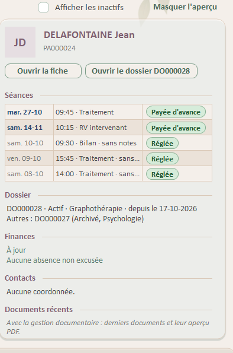

> Fichier : `UI/Controls/Patients/UC_ApercuPatient.vb` — hérite de `UserControl`. Hébergé par `UC_PatientHome` (`ucApercu`).

#### Rôle général

Panneau de droite de l'écran Patients (maquette « Aperçu patient », 17/10/2026) : l'essentiel du patient sélectionné sans ouvrir de fiche — demande du cahier des charges de Pearl.

#### Contenu (de haut en bas)

- Identité : photo (sinon initiales dessinées), nom, code, âge, date de naissance ; boutons « Ouvrir la fiche » et « Ouvrir le dossier DO… » (dossier dominant).
- Alerte en entier (teinte Avertissement), masquée sans alerte.
- Aujourd'hui (seulement s'il y a une séance du jour) : heure, code, nature, dossier ; bouton « Notes de la séance SE… » (la prochaine séance du jour, sinon la dernière passée).
- Séances : 2 prochaines puis 3 dernières séances dues, date (bleue à venir, grise passée), heure, nature, présence des notes (« notes ✓ » / « sans notes » — jamais leur texte), pastille de paiement ou « Absence » ; double-clic : ouvrir la séance.
- Dossier : code, statut, domaine, ouverture, quota INAMI, autres dossiers.
- Finances : à régler (rose) ou « À jour », avoir, absences non excusées.
- Contacts : téléphone et e-mail du patient, entourage (lien, nom, téléphone).
- Documents récents : place réservée à la gestion documentaire (aperçus PDF).

#### Membres publics

| Membre | Nature | Rôle |
| --- | --- | --- |
| `AfficherApercu(apercu)` | Public Sub | Remplit le panneau avec un `ApercuPatient`. |
| `Vider([message])` | Public Sub | Invite « Cliquez sur un patient… » ou message (erreur de chargement). |
| `OuvrirFicheDemandee` / `OuvrirDossierDemande(id, code)` / `OuvrirSeanceDemandee(RepereSeance)` | Events | Demandes d'ouverture traitées par l'écran hôte. |

#### Points d'attention

- Aucun accès base : l'écran hôte charge l'aperçu via `GestionApercuPatient.GetApercuPatient` (fiche, dossiers, séances de chaque dossier, quota, contacts — modules existants, aucune requête propre ; sommes à régler / avoir aux règles du bandeau du dossier).
- Sans changement de code de l'écran, l'aperçu suit depuis le 21-22/10/2026 les règles communes :
  - pastille « À confirmer » d'une séance planifiée passée (ADR-47)
  - quota de la période en cours par le calcul de l'onglet Séances (`GestionQuotaInami.GetQuotaDossier` → `CalculerQuota`, V3.0.0 : seule la première période était connue)
  - absences selon la case « Absence non excusée » du statut (v2.53.0)
  - dossier dominant désigné par la vue `v_dossier_dominant` (`GestionDossiers.ChoisirDossierDominant`, v2.49.0).
- Sections empilées dans un `FlowLayoutPanel` vertical qui défile ; `AjusterLargeurs` leur fait suivre la largeur du panneau.
- « Encaisser » depuis l'aperçu n'est pas proposé : l'encaissement passe par le dossier (avoirs), ouvert d'un clic.

---

### **UserControl : UC_PatientFiche**

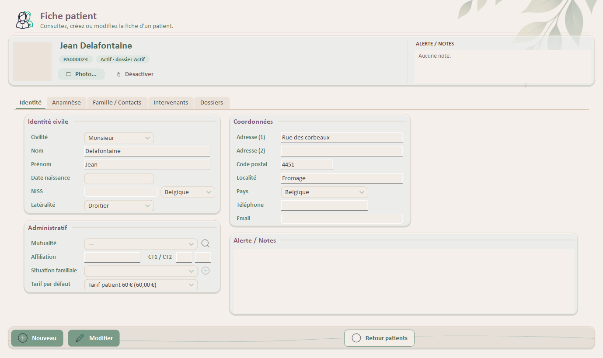

> Fichiers partiels par onglet (audit C.5, ADR-56, 25/10/2026) : `UC_PatientFiche.Famille.vb` (Famille / Contacts), `UC_PatientFiche.Intervenants.vb`, `UC_PatientFiche.Dossiers.vb` ; `UC_PatientFiche.vb` garde l'identité, l'anamnèse, le bandeau, les modes, la validation et la garde.

#### Rôle général

`UC_PatientFiche` est la fiche patient plein panneau : un bandeau identité persistant (photo + alerte) surmonte un onglet par domaine de saisie. Elle orchestre la consultation, la création et la modification d'un patient (D-Q11 à D-Q15).

*Grilles (V1.6.0, 18/10/2026, UI-9.2)* : **Dossiers** — statut en pastille, mêmes couleurs que la colonne « Suivi » de la grille Patients (`UtilsPastilles.TeinteSuiviListe`), dossier clôturé ou archivé atténué ; **Intervenants** — intervention terminée (« Jusqu'au » passé) atténuée ; dates centrées.

#### Responsabilités

- Afficher l'identité, les coordonnées et les données administratives d'un patient.
- Orchestrer les modes **Consultation / Création / Modification** (`ModeFiche`) et l'état des contrôles.
- Activer **progressivement** les onglets dépendant de l'`id_patient` (D-Q14).
- Faire juger la saisie par le métier (`GestionPatients.ValiderPatient`, audit C.2 étape 2a, 23/10/2026) et montrer les erreurs (`AffichageErreursSaisie`) ; demander confirmation d'un doublon potentiel.
- Enregistrer le patient via `GestionPatients`.
- S'ouvrir sur un onglet demandé (`SelectionnerOngletAuChargement`, retour du hub dossier et recherche transversale, 23/10/2026).
- Afficher le bandeau identité (photo via `CheminsPatientHelper`, nom complet, code, alerte) ainsi que le **statut du patient** (`lblStatutPatient` : activation `is_actif` + état dérivé du dernier dossier).
- Permettre la **bascule manuelle d'activation** du patient (`btnBasculeActif` → `GestionPatients.ChangerStatutActif`) et rafraîchir le fil d'Ariane.
- Gérer les sous-listes Famille/Contacts et Intervenants (recherche, filtrage, CRUD délégué).
- Permettre le retour vers l'écran précédent (mini-pile de navigation, D-Q15).

#### Dépendances

| Élément | Type | Rôle |
| --- | --- | --- |
| `GestionPatients` | Module métier | Couche métier patients (chargement, persistance). |
| `GestionSituationsFamiliales` | Module métier | Alimentation du combo situation familiale. |
| `Patient` | Classe | Modèle métier. |
| `CheminsPatientHelper` | Module utilitaire | Chemin déterministe de la photo. |
| `UtilsButtons` | Module utilitaire | Boutons, dialogues, journalisation. |
| `DialogChoix` | Form | Boutons, dialogues, journalisation. |
| `GestionLog` | Module métier | Boutons, dialogues, journalisation. |
| `IContextAwareUserControl` | Interface | injection du contexte UI partagé |
| `IUnsavedChangesAware` / `GardeModifications` | Interface / Classe | Avant de quitter la fiche : modifications non enregistrées (V1.7.0, 19/10/2026, ADR-43). |
| `UserControlContext` | Classe | — |
| `UtilsTelephone` | Module utilitaire | — |
| `GestionPrixSeance` | Module métier | — |
| `GestionDossiers` | Module métier | — |
| `RichTextEditorHelper` | Module utilitaire | — |
| `UtilsValidation` | Module utilitaire | — |
| `GestionDocuments` | Module métier | — |
| `UtilsDataGrid` | Module utilitaire | — |
| `GestionFamilleContacts` | Module métier | Chargement des contacts de l'onglet Famille. |
| `GestionSuivisIntervenants` | Module métier | Chargement du réseau d'intervenants. |
| `UC_SituationsFamiliales` | UserControl | Ouvert depuis ce composant. |
| `ContactEdition` | Form | Édition d'un contact famille. |
| `IntervenantEdition` | Form | Édition d'un intervenant du réseau. |
| `AffichageErreursSaisie` | Module utilitaire (`Utils/UI`) | Erreurs du valideur sur leurs champs (contexte de Home), fenêtre récapitulative, focus ; icône effacée dès la correction du champ (23/10/2026). |
| `UtilsNiss` | Module utilitaire | `Valider`, `Formater` (NISS affiché mis en forme, « 85.07.30-033.28 »), normalisation à l'enregistrement par le métier (23/10/2026). |
| `UC_DossierFiche` | UserControl | Ouvert depuis ce composant. |
| `UC_ReferentielBase` | UserControl | — |
| `UC_PatientHome` | UserControl | — |
| `UC_Parametres` | UserControl | — |

#### Variables privées

| Variable | Type | Rôle |
| --- | --- | --- |
| `_context` | `UserControlContext` | Injecté par Home via SetContext() (implémentation IContextAwareUserControl) |
| `_patient` | `Patient` | Patient actuellement chargé dans la fiche (Nothing tant qu'aucun patient n'est chargé en création) |
| `_mode` | `ModeFiche` | Mode courant de la fiche (consultation par défaut) |
| `_idPatient` | `Long` | Identifiant du patient en cours d'édition (0 = création, aucun id encore attribué) |
| `_chargementEnCours` | `Boolean` | Garde anti-réentrance lors du remplissage programmatique des contrôles |
| `_modeEditionAnamnese` | `Boolean` | L'anamnèse possède son propre cycle Modifier / Enregistrer / Annuler avec persistance ciblée. |
| `_anamneseModifiee` | `Boolean` | n'avertir l'utilisateur d'une perte potentielle que si le contenu a réellement été modifié. |
| `_gardeFiche` | `GardeModifications` | Photo des champs (onglets Identité et Anamnèse) en création ou en modification ; créée au `Load`, prise par `AppliquerMode` (V1.7.0, 19/10/2026). |
| `_ongletAuChargement` | `OngletPatient?` | Onglet à présélectionner au chargement (retour depuis le hub dossier, D-Q15 ; recherche transversale) ; remplace `_ongletDossiersAuChargement` (23/10/2026). |
| `_contacts` | `List(Of FamilleContact)` | Liste complète des contacts du patient courant (source mémoire pour la recherche rapide) |
| `_intervenants` | `List(Of SuiviIntervenant)` | Liste complète des intervenants du patient courant (source mémoire pour la recherche rapide) |

#### Contrôles principaux

| Contrôle | Type | Rôle |
| --- | --- | --- |
| `pnlForm` | Panel | — |
| `enTete` | AltheaEnTete | En-tête d'écran : titre « Fiche patient », sous-titre « Consultez, créez ou modifiez la fiche d'un patient. » ; icône dans les ressources (`enTete.Icone`). |
| `pnlBandeau` › `carteIdentite` | Panel › AltheaCarte | Bandeau identité en carte (UI-5, maquette « Fiche patient ») : identité à gauche, alerte à droite. |
| `picPhoto` | PictureBox | Photo du patient (fond beige sans photo). |
| `lblNomComplet` | Label | Nom complet (« Nouveau patient » en création), tronqué avec ellipse. |
| `lblCodePatient` | AltheaPastille | Code du patient. |
| `lblStatutPatient` | AltheaPastille | Statut synthétique (« Actif · dossier Actif ») ; Gris-vert clair si actif, Beige si inactif. |
| `lblNaissanceBandeau` | Label | « Né(e) le … · N ans » (vide sans date). Code, statut et naissance sont alignés par `PlacerPastillesBandeau`. |
| `btnUploadPhoto` | AltheaBouton (OutilPrincipal) | Sélection de la photo du patient. |
| `btnBasculeActif` | AltheaBouton | Bascule manuelle : « Désactiver » (OutilDanger) / « Activer » (Outil). |
| `pnlAlerteBandeau` › `lblAlerteBandeauTitre`, `pnlAlerteFond` › `rtbAlerte` | Panel / Label / Panel / RichTextBox | Bloc « ALERTE / NOTES » à droite, séparé par un filet (`pnlAlerteBandeau_Paint`) ; fond terre très léger s'il existe une note, beige clair sinon (« Aucune note. »). |
| `pnlCenter` | Panel | — |
| `tabFiche` | AltheaOnglets | Conteneur des 5 onglets. |
| `tabPageIdentite` | TabPage | Libellé : « Identité » |
| `tabPageAnamnese` | TabPage | Libellé : « Anamnèse » |
| `tabPageFamille` | TabPage | Libellé : « Famille / Contacts » |
| `tabPageIntervenants` | TabPage | Libellé : « Intervenants » |
| `tabPageDossiers` | TabPage | Libellé : « Dossiers » |
| `pnlActions` | AltheaBarreActions | — |
| `btnNouveau` | AltheaBouton | Barre d'actions de la fiche. |
| `btnModifier` | AltheaBouton | Barre d'actions de la fiche. |
| `btnEnregistrer` | AltheaBouton | Barre d'actions de la fiche. |
| `btnAnnuler` | AltheaBouton | Barre d'actions de la fiche. |
| `btnFermer` | AltheaBouton | Barre d'actions de la fiche. |

#### DataGridView : colonnes

Les grilles sont portées par les onglets (voir ci-dessous).

#### Méthodes principales

| Membre | Nature | Rôle |
| --- | --- | --- |
| `SetContext` | Public Sub | Initialisation et injection du contexte. |
| `InitialiserPourCreation` | Public Sub | Initialisation et injection du contexte. |
| `InitialiserPourPatient` | Public Sub | Initialisation et injection du contexte. |
| `SelectionnerOngletDossiers` | Public Sub | Demande la présélection de l'onglet Dossiers au prochain chargement de la fiche ; cas particulier de `SelectionnerOngletAuChargement` (V1.1.0, 23/10/2026). |
| `SelectionnerOngletAuChargement` | Public Sub | Demande la présélection d'un onglet (`OngletPatient` : Identite, Famille, Intervenants, Dossiers) au prochain chargement ; à appeler avant l'ajout du contrôle. Utilisée par la recherche transversale (contact → Famille / Contacts, intervenant → Intervenants) (23/10/2026). |
| `UC_PatientFiche_Load` | Private Sub | Chargement et configuration. |
| `InitialiserBoutons` | Private Sub | Chargement et configuration. |
| `InitialiserCombos` | Private Sub | Chargement et configuration. |
| `LierPrixSeancesDefaut` | Private Sub | Alimente la liste déroulante du tarif par défaut avec les tarifs séance actifs. |
| `ChargerSituationsFamilialesDepuisReferentiel` | Private Function | Charge les situations familiales actives depuis le référentiel et insère l'entrée vide en tête (Id = 0) pour permettre l'état « non renseigné » sur un combo lié par DataSource. |
| `LierSituationsFamiliales` | Private Sub | (Re)lie le combo Situation familiale à la liste fournie, puis sélectionne la situation demandée (ou l'entrée vide à défaut). |
| `InitialiserToolTips` | Private Sub | — |
| `MettreAJourToolTipBasculeActif` | Private Sub | Ajuste l'infobulle du bouton de bascule d'activation en fonction de l'état courant du patient, afin que l'utilisateur comprenne l'effet exact du clic (activer ou désactiver manuellement). |
| `DemarrerCreation` | Private Sub | Entrée en mode Création / Modification. |
| `ChargerPatient` | Private Sub | Entrée en mode Création / Modification. |
| `RemplirChamps` | Private Sub | Synchronisation modèle ⇄ UI. |
| `ViderChamps` | Private Sub | Synchronisation modèle ⇄ UI. |
| `CodePaysSaisi` | Private Function | Code ISO du pays choisi, transmis aux règles de `UtilsTelephone` / `UtilsCodePostal` (Nothing = pas de contrôle de format). Le chargement passe par `UtilsSaisieReferentiels.ChargerPays` (pays par défaut = pays du cabinet). |
| `ReinitialiserSituationFamiliale` | Private Sub | Vide réellement la sélection du combo Situation familiale (lié par DataSource). |
| `AfficherBandeau` | Private Sub | Bandeau identité + statut. |
| `AfficherStatutPatient` | Private Sub | Bandeau identité + statut. |
| `LibelleStatutDossierBandeau` | Private Function | Fournit un libellé court de l'état du dernier dossier du patient pour le bandeau. |
| `btnBasculeActif_Click` | Private Sub | Bascule d'activation et mise à jour du fil d'Ariane. |
| `AfficherAlerte` | Private Sub | Bandeau identité + statut. |
| `AfficherPhoto` | Private Sub | Bandeau identité + statut. |
| `AppliquerMode` | Private Sub | Bascule Consultation/Création/Modification. |
| `DefinirEtatChampsIdentite` | Private Sub | Bascule Consultation/Création/Modification : V2.0.0 (14/10/2026), `UtilsControls.DefinirLectureSeule` sur les cartes Identité, Coordonnées et Administratif (consultation lisible) ; la fiche de la mutualité reste consultable. |
| `tabFiche_Selecting` | Private Sub | Activation progressive et chargement paresseux des onglets. |
| `tabFiche_SelectedIndexChanged` | Private Sub | Met à jour le fil d'Ariane de navigation (lblContexte de Home) à chaque changement d'onglet, afin que l'utilisateur sache toujours où il se trouve (ex. « Patients > Dupont Jean > Anamnèse »). |
| `RafraichirContexteNavigation` | Private Sub | Bascule d'activation et mise à jour du fil d'Ariane. |
| `AppliquerVisibiliteActionsFiche` | Private Sub | Affiche les boutons d'action « niveau fiche » (Nouveau / Modifier / Enregistrer / Annuler) uniquement sur l'onglet Identité, qui est la fiche maître. Sur les autres onglets, seules les |
| `AppliquerModeAnamnese` | Private Sub | Applique l'état de l'onglet Anamnèse selon son cycle d'édition local (Modifier / Enregistrer / Annuler), indépendant du mode global de la fiche. L'éditeur passe en lecture seule ou éditable, |
| `dtpDateNaissance_ValeurChangee` | Private Sub | Recalcule l'âge affiché lorsque la date de naissance change ou est effacée. |
| `RafraichirAge` | Private Sub | Calcul de l'âge depuis la date de naissance. |
| `CalculerAge` | Private Function | Calcul de l'âge depuis la date de naissance. |
| `ValiderSaisie` | Private Function | Fait juger la fiche par `GestionPatients.ValiderPatient` (nom, prénom, téléphone et code postal selon le pays, e-mail, NISS selon son type puis unicité, CT1/CT2) ; erreurs montrées par `AffichageErreursSaisie.Signaler` (champs, fenêtre récapitulative, focus) et compteur dans la barre d'état (V2.0.0, 23/10/2026 : plus de copie des règles ici). |
| `ChampsDeLaFiche` | Private Function | Correspondance propriété du patient (`ErreurSaisie.Champ`) → contrôle de la fiche. |
| `ConfirmerDoublonEventuel` | Private Function | Mêmes nom et prénom, même date de naissance **ou date inconnue d'un côté ou de l'autre** (V1.1.0, 23/10/2026) : confirmation « Doublon potentiel ». |
| `Enregistrer` | Private Function | Valide, alimente le patient puis le crée ou le met à jour ; True si enregistré. Un refus du métier (`ErreurValidationException`…) s'affiche dans une fenêtre et la fiche reste en saisie (V1.2.0, 23/10/2026). |
| `AlimenterPatientDepuisChamps` | Private Sub | Synchronisation modèle ⇄ UI ; transmet aussi le type d'identifiant (`Patient.TypeIdentifiantNiss`, non enregistré). |
| `ControlerChampsPays` / `ControlerNiss` | Private Sub | Signalement immédiat, non bloquant, à la sortie du champ : téléphone et code postal selon le pays (code belge inexistant compris ; localité hors du code : avertissement, `SaisieLocaliteBelge`) ; NISS selon le type choisi, remis en forme s'il est valide (`UtilsNiss.Formater`, V1.1.0, 23/10/2026). |
| `SaisieDateNaissance` | Private Function | Retourne la date de naissance saisie (`dtpDateNaissance.Valeur`), ou Nothing si le champ facultatif est vide. |
| `SaisieSituationFamiliale` | Private Function | Retourne l'identifiant de situation familiale sélectionné, ou Nothing si aucune sélection. |
| `SaisiePrixSeanceDefaut` | Private Function | Récupère l'identifiant du tarif séance sélectionné dans le combo, ou Nothing si non renseigné. |
| `NormaliserTexte` | Private Function | Normalise une saisie texte : Nothing si vide après nettoyage, sinon la valeur nettoyée. |
| `txtTelephone_Leave` | Private Sub | Met en forme le numéro de téléphone à la sortie du champ, en déduisant le pays du combo Pays (brique réutilisable UtilsTelephone). Reformatage souple et non bloquant. |
| `cboPays_SelectedIndexChanged` | Private Sub | Reformate le numéro de téléphone lorsque le pays sélectionné change, afin de réappliquer l'indicatif et le groupement corrects du nouveau pays. |
| `btnNouveau_Click` | Private Sub | Bascule la fiche en création d'un nouveau patient. |
| `btnModifier_Click` | Private Sub | Passe la fiche du patient courant en mode modification. |
| `btnUploadPhoto_Click` | Private Sub | Import de la photo d'identité : `UtilsImages.ChoisirFichierImage`, confirmation si une photo existe, `CheminsPatientHelper.ImporterPhotoIdentite`, mise à jour en base et trace documentaire. |
| `rteAnamnese_ExportRequested` | Private Sub | Fournit (par délégation) le chemin de destination déterministe pour l'export de l'anamnèse : dossier du patient ({…}/Documents/{code_patient}) et nom horodaté |
| `rteAnamnese_ExportCompleted` | Private Sub | Ouvre automatiquement le fichier exporté (PDF/Word) après un export contextuel réussi, l'export étant déclenché parce que l'utilisateur en a un besoin immédiat. |
| `TracerAnamneseExportee` | Private Sub | Insère une trace dans la table documents pour l'export de l'anamnèse (niveau patient). |
| `TracerPhotoIdentite` | Private Sub | Insère (ou met à jour) une trace dans la table documents pour la photo d'identité du patient (niveau patient, type PHOTO_IDENTITE). |
| `rteAnamnese_ContentChanged` | Private Sub | Marque l'anamnèse comme modifiée pendant l'édition locale (dirty-tracking), afin de n'avertir l'utilisateur d'une perte éventuelle que si le contenu a réellement changé. |
| `btnModifierAnamnese_Click` | Private Sub | Active l'édition locale de l'anamnèse : l'éditeur devient saisissable (toolbar visible) et les boutons Enregistrer / Annuler remplacent Modifier, sans toucher au mode global de la fiche. |
| `btnEnregistrerAnamnese_Click` | Private Sub | Enregistre uniquement l'anamnèse du patient courant (persistance ciblée), met à jour le patient en mémoire, puis revient en consultation locale (éditeur en lecture seule, barre de consultation) ; `rteAnamnese.MarquerEnregistre()` efface « Modifié » de la ligne d'état (19/10/2026). |
| `EnregistrerAnamnese` / `AbandonnerAnamnese` | Private | Enregistrement ciblé de l'anamnèse (True si réussi) ; retour au contenu enregistré sans question (19/10/2026). |
| `PeutQuitter` | Public Function (IUnsavedChangesAware) | Avant de quitter la fiche (Retour, menu de Home, fermeture d'Althéa) : Enregistrer / Quitter sans enregistrer / Rester pour l'anamnèse en modification locale, puis pour la fiche en création ou en modification (V1.7.0). |
| `PeutQuitterAnamnese` | Private Function | Même question pour l'anamnèse seule, aussi au changement d'onglet (`tabFiche_Selecting`). |
| `btnAnnulerAnamnese_Click` | Private Sub | Annule l'édition locale de l'anamnèse : restaure le contenu d'origine (depuis le patient en mémoire) et revient en consultation locale (éditeur en lecture seule). |
| `btnAjouterSituationFamiliale_Click` | Private Sub | Ouvre le référentiel des situations familiales dans une fenêtre modale (via Home, qui gère droits et élévation), puis recharge le combo et sélectionne automatiquement la valeur |
| `btnEnregistrer_Click` | Private Sub | Déclenche l'enregistrement (création ou mise à jour) du patient. |
| `btnAnnuler_Click` | Private Sub | Annule la saisie en cours et revient à l'état consultation (ou retourne à la liste en création). ; en modification, Abandonner / Continuer la saisie s'il y a des modifications (19/10/2026). |
| `btnFermer_Click` | Private Sub | Revient à l'écran précédent (liste des patients) via la mini-pile de navigation. |
| `RetournerListe` | Private Sub | Retour vers `UC_PatientHome` (mini-pile D-Q15). |
| `InitialiserGrilleContacts` | Private Sub | Applique la mise en forme commune (brique réutilisable UtilsDataGrid) à la grille des contacts et fige ses propriétés de base, à l'identique de la liste patients (UC_PatientHome). |
| `tabFiche_Selected` | Private Sub | Activation progressive et chargement paresseux des onglets. |
| `ChargerContacts` | Private Sub | Sous-liste Famille/Contacts. |
| `dgvContacts_CellFormatting` | Private Sub | Met en forme l'affichage du téléphone du contact (masque international lisible) sans altérer la donnée sous-jacente (brique réutilisable UtilsTelephone). |
| `dgvContacts_SelectionChanged` | Private Sub | Met à jour l'état des boutons Modifier / Supprimer selon la sélection courante. |
| `dgvContacts_CellDoubleClick` | Private Sub | Ouvre le contact sélectionné en consultation (double-clic sur une ligne). |
| `AppliquerFiltresContacts` | Private Sub | Sous-liste Famille/Contacts. |
| `CorrespondRechercheContact` | Private Function | Indique si un contact correspond au texte de recherche (comparaison insensible à la casse). |
| `btnRechercherContact_Click` | Private Sub | Applique le filtre de recherche sur la liste mémoire des contacts. |
| `txtRechercheContact_KeyDown` | Private Sub | Permet de déclencher la recherche des contacts par la touche Entrée. |
| `btnReinitialiserContacts_Click` | Private Sub | Réinitialise le critère de recherche et réaffiche la liste complète des contacts. |
| `btnAjouterContact_Click` | Private Sub | Ouvre la fenêtre modale de création d'un nouveau contact pour le patient courant. |
| `btnModifierContact_Click` | Private Sub | Ouvre la fenêtre modale de modification du contact sélectionné. |
| `btnSupprimerContact_Click` | Private Sub | Supprime physiquement le contact sélectionné après confirmation explicite de l'utilisateur. |
| `OuvrirEditionContact` | Private Sub | Sous-liste Famille/Contacts. |
| `RafraichirEtatBoutonsContacts` | Private Sub | Active ou désactive les boutons d'action de l'onglet Famille / Contacts selon la présence d'un patient enregistré et d'une ligne sélectionnée. |
| `ContactSelectionne` | Private Function | Retourne le contact actuellement sélectionné dans la grille, ou Nothing si aucune ligne. |
| `InitialiserGrilleIntervenants` | Private Sub | Applique la mise en forme commune (brique réutilisable UtilsDataGrid) à la grille des intervenants et fige ses propriétés de base, à l'identique de la grille des contacts. |
| `ChargerIntervenants` | Private Sub | Sous-liste Intervenants. |
| `dgvIntervenants_CellFormatting` | Private Sub | Affiche les dates de période en format court et masque les valeurs nulles (suivi sans date), sans altérer la donnée sous-jacente ; atténue une intervention terminée selon le suivi (`SuiviIntervenant.EstTerminee`, V1.2.0, 23/10/2026). |
| `dgvIntervenants_SelectionChanged` | Private Sub | Met à jour l'état des boutons Modifier / Supprimer selon la sélection courante. |
| `dgvIntervenants_CellDoubleClick` | Private Sub | Ouvre l'intervenant sélectionné en consultation (double-clic sur une ligne). |
| `AppliquerFiltresIntervenants` | Private Sub | Sous-liste Intervenants. |
| `CorrespondRechercheIntervenant` | Private Function | Indique si un intervenant correspond au texte de recherche (comparaison insensible à la casse). |
| `btnRechercherIntervenant_Click` | Private Sub | Applique le filtre de recherche sur la liste mémoire des intervenants. |
| `txtRechercheIntervenant_KeyDown` | Private Sub | Permet de déclencher la recherche des intervenants par la touche Entrée. |
| `btnReinitialiserIntervenants_Click` | Private Sub | Réinitialise le critère de recherche et réaffiche la liste complète des intervenants. |
| `btnAjouterIntervenant_Click` | Private Sub | Ouvre la fenêtre modale de création d'un nouvel intervenant pour le patient courant. |
| `btnModifierIntervenant_Click` | Private Sub | Ouvre la fenêtre modale de modification de l'intervenant sélectionné. |
| `btnSupprimerIntervenant_Click` | Private Sub | Supprime physiquement l'intervenant sélectionné après confirmation explicite de l'utilisateur. |
| `OuvrirEditionIntervenant` | Private Sub | Sous-liste Intervenants. |
| `RafraichirEtatBoutonsIntervenants` | Private Sub | Active ou désactive les boutons d'action de l'onglet Intervenants selon la présence d'un patient enregistré et d'une ligne sélectionnée. |
| `IntervenantSelectionne` | Private Function | Retourne l'intervenant actuellement sélectionné dans la grille, ou Nothing si aucune ligne. |
| `InitialiserGrilleDossiers` | Private Sub | Applique la mise en forme commune (brique réutilisable UtilsDataGrid) à la grille des dossiers et fige ses propriétés de base, à l'identique de la grille des intervenants. |
| `ChargerDossiers` | Private Sub | Recharge la grille des dossiers du patient courant depuis la couche métier et met à jour l'état des boutons d'action. |
| `dgvDossiers_CellFormatting` | Private Sub | Affiche les dates d'ouverture / clôture en format court et masque les valeurs nulles (dossier non clôturé), sans altérer la donnée sous-jacente. |
| `dgvDossiers_SelectionChanged` | Private Sub | Met à jour l'état du bouton Ouvrir selon la sélection courante. |
| `dgvDossiers_CellDoubleClick` | Private Sub | Ouvre le dossier sélectionné dans son hub (double-clic sur une ligne). |
| `btnAjouterDossier_Click` | Private Sub | Ouvre le hub dossier (UC_DossierFiche) en création pour le patient courant. |
| `btnOuvrirDossier_Click` | Private Sub | Ouvre le dossier sélectionné dans son hub. |
| `OuvrirDossierSelectionne` | Private Sub | Ouvre le dossier actuellement sélectionné dans la grille dans son hub (UC_DossierFiche). |
| `OuvrirHubDossier` | Private Sub | Empile la fiche patient courante puis navigue vers le hub dossier (mini-pile D-Q15), afin de restaurer la fiche patient sur l'onglet Dossiers au retour. |
| `CreerFicheDossiers` | Private Function | Construit une fabrique recréant la fiche patient courante et la repositionnant sur l'onglet Dossiers au retour du hub dossier (mini-pile D-Q15). |
| `RafraichirEtatBoutonsDossiers` | Private Sub | Active ou désactive les boutons d'action de l'onglet Dossiers selon la présence d'un patient enregistré et d'une ligne sélectionnée. |
| `DossierSelectionne` | Private Function | Retourne le dossier actuellement sélectionné dans la grille, ou Nothing si aucune ligne. |

#### Gestion des icônes

- `btnAjouterContact.Image` (Designer / ressources)
- `btnAjouterDossier.Image` (Designer / ressources)
- `btnAjouterIntervenant.Image` (Designer / ressources)
- `btnAjouterSituationFamiliale.Image` (Designer / ressources)
- `btnAnnuler.Image` (Designer / ressources)
- `btnAnnulerAnamnese.Image` (Designer / ressources)
- `btnBasculeActif.Image` (Designer / ressources)
- `btnEnregistrer.Image` (Designer / ressources)
- `btnEnregistrerAnamnese.Image` (Designer / ressources)
- `btnFermer.Image` (Designer / ressources)
- `btnModifier.Image` (Designer / ressources)
- `btnModifierContact.Image` (Designer / ressources)
- `btnModifierIntervenant.Image` (Designer / ressources)
- `btnNouveau.Image` (Designer / ressources)
- `btnOuvrirDossier.Image` (Designer / ressources)
- `btnRechercherContact.Image` (Designer / ressources)
- `btnRechercherIntervenant.Image` (Designer / ressources)
- `btnReinitialiserContacts.Image` (Designer / ressources)
- `btnReinitialiserIntervenants.Image` (Designer / ressources)
- `btnSupprimerContact.Image` (Designer / ressources)
- `btnSupprimerIntervenant.Image` (Designer / ressources)
- `btnUploadPhoto.Image` (Designer / ressources)
- `enTete.Icone` (Designer / ressources)
- `pnlActions.BackgroundImage` (Designer / ressources)

#### Gestion des filtres et recherche

- Contrôles : `txtRechercheContact`, `btnRechercherContact`, `txtRechercheIntervenant`, `btnRechercherIntervenant`.
- Méthodes : `AppliquerFiltresContacts`, `CorrespondRechercheContact`, `btnRechercherContact_Click`, `txtRechercheContact_KeyDown`, `AppliquerFiltresIntervenants`, `CorrespondRechercheIntervenant`, `btnRechercherIntervenant_Click`, `txtRechercheIntervenant_KeyDown`.
- Fonctionnement : filtrage en mémoire sur la liste chargée (pas de nouvel appel base), déclenché par les événements des contrôles ci-dessus ; la réinitialisation remet les critères par défaut puis réapplique le filtre.

#### Les 5 onglets

| Onglet                | Contenu                                                       |
| --------------------- | ------------------------------------------------------------ |
| **Identité**          | Identité, coordonnées (country-aware) et données administratives + alerte. |
| **Anamnèse**          | Éditeur enrichi `UC_RichTextEditor` (RTF + export).          |
| **Famille / Contacts** | Grille des contacts (`dgvContacts`) + actions (ajout/modif/suppression) via `ContactEdition`. |
| **Intervenants**      | Grille du réseau de suivi (`dgvIntervenants`) + actions via `IntervenantEdition`. |
| **Dossiers**          | Grille des dossiers du patient + accès au hub `UC_DossierFiche` (création, statuts, transitions). |

#### Modes de la fiche (`ModeFiche`)

| Mode           | Déclencheur                       | État des contrôles                          |
| -------------- | --------------------------------- | ------------------------------------------- |
| Consultation   | Par défaut / après enregistrement | Champs verrouillés, actions de lecture.     |
| Création       | « Nouveau » depuis `UC_PatientHome` | Champs vides, identité éditable.          |
| Modification   | « Modifier » / double-clic        | Champs pré-remplis, éditables.              |

#### Onglets

Chaque onglet reprend la trame ci-dessus ; seuls les éléments propres à l'onglet sont détaillés.

##### Onglet « Identité » (`tabPageIdentite`)

**Contrôles**

| Contrôle | Type | Rôle |
| --- | --- | --- |
| `grpIdentite` | AltheaCarte | Carte « Identité civile » (UI-5 : remplace le GroupBox). |
| `lblNom` | Label | Libellé : « Nom » |
| `txtNom` | TextBox | — |
| `lblPrenom` | Label | Libellé : « Prénom » |
| `txtPrenom` | TextBox | — |
| `lblDateNaissance` | Label | Libellé : « Date naissance » |
| `dtpDateNaissance` | AltheaDate | Date de naissance, **facultative** (vide = inconnue, croix pour effacer) — UI-7, 14/10/2026. |
| `lblAge` | Label | — |
| `lblNiss` | Label | Libellé : « NISS » |
| `txtNiss` | TextBox | NISS, affiché mis en forme (« 85.07.30-033.28 ») ; enregistré normalisé par le métier (sans séparateurs, majuscules ; migration v2.54.0, 23/10/2026). |
| `cboTypeNiss` | AltheaListe | Type d'identifiant (Belgique, France, Luxembourg, Autre) : non enregistré, transmis au métier pour juger le NISS (`Patient.TypeIdentifiantNiss`). |
| `lblLateralite` | Label | Libellé : « Latéralité » |
| `cboLateralite` | AltheaListe | Latéralité, du référentiel `ref_lateralites` (`UtilsSaisieReferentiels.ChargerLateralites` ; « — » = aucune ; valeur désactivée gardée pour le patient qui l'a) — V1.8.0, 20/10/2026. |
| `lblCivilite` / `cboCivilite` | Label / AltheaListe | Civilité (`ref_civilites`, entrée « — » = aucune), première ligne de la carte Identité civile (R2, 12/10/2026). |
| `grpCoordonnees` | AltheaCarte | Carte « Coordonnées » (colonne de droite). |
| `lblAdresseLigne1` | Label | Libellé : « Adresse (1) » |
| `txtAdresseLigne1` | TextBox | — |
| `lblAdresseLigne2` | Label | Libellé : « Adresse (2) » |
| `txtAdresseLigne2` | TextBox | — |
| `lblCodePostal` | Label | Libellé : « Code postal » |
| `txtCodePostal` | TextBox | Adresse belge : code existant, localité proposée et suggérée depuis le code, code trouvé depuis la localité (choix « Liège · 4020 »), avertissement puis confirmation si elle ne correspond pas (`SaisieLocaliteBelge`, 24/10/2026). |
| `lblLocalite` | Label | Libellé : « Localité » |
| `txtLocalite` | TextBox | — |
| `lblPays` | Label | Libellé : « Pays » |
| `cboPays` | AltheaListe | Pays (`ref_pays`). |
| `lblTelephone` | Label | Libellé : « Téléphone » |
| `txtTelephone` | TextBox | Saisissez le numéro simplement (ex. 0475 12 34 56). |
| `lblEmail` | Label | Libellé : « Email » |
| `txtEmail` | TextBox | — |
| `grpAdministratif` | AltheaCarte | Carte « Administratif ». |
| `lblMutualite` | Label | Libellé : « Mutualité » |
| `cboMutualite` | AltheaListe | Mutualité du patient : organismes de type Mutualité (`UtilsSaisieReferentiels.ChargerMutualites`, entrée « — » = aucune) — R3, 12/10/2026. |
| `btnFicheMutualite` | AltheaBouton (Outil, icône seule) | Loupe : ouvre `UC_Organismes(TypeOrganisme.Mutualite, idCourant)` en fenêtre modale (via `Home.OuvrirReferentielModal`) — consultation de la fiche, ou ajout ; disponible aussi en consultation ; une mutualité ajoutée en saisie est sélectionnée. |
| `lblAffiliation` / `txtNumeroAffiliation` | Label / TextBox | Numéro d'affiliation (30 caractères). |
| `lblCodesTitulaire` / `txtCodeTitulaire1` / `txtCodeTitulaire2` | Label / TextBox | CT1 / CT2, 3 chiffres chacun (`UtilsIdentifiantBelge.ValiderCodeTitulaire`). |
| `lblSituationFamiliale` | Label | Libellé : « Situation familiale » |
| `cboSituationFamiliale` | AltheaListe | Situation familiale + ajout référentiel. |
| `btnAjouterSituationFamiliale` | AltheaBouton (Outil, icône seule) | Situation familiale + ajout référentiel. |
| `lblPrixSeanceDefaut` | Label | Libellé : « Tarif par défaut » |
| `cboPrixSeanceDefaut` | AltheaListe | Tarif par défaut du patient (liste des prix), dans la zone Administratif. |
| `grpAlerte` | AltheaCarte | Carte « Alerte / Notes », sous Coordonnées, ancrée sur les quatre côtés (elle grandit avec la fenêtre). |
| `rteAlerte` | UC_RichTextEditor (profil Compact) | Alerte enrichie. |

**Méthodes propres** : `DefinirEtatChampsIdentite`, `TracerPhotoIdentite`.

##### Onglet « Anamnèse » (`tabPageAnamnese`)

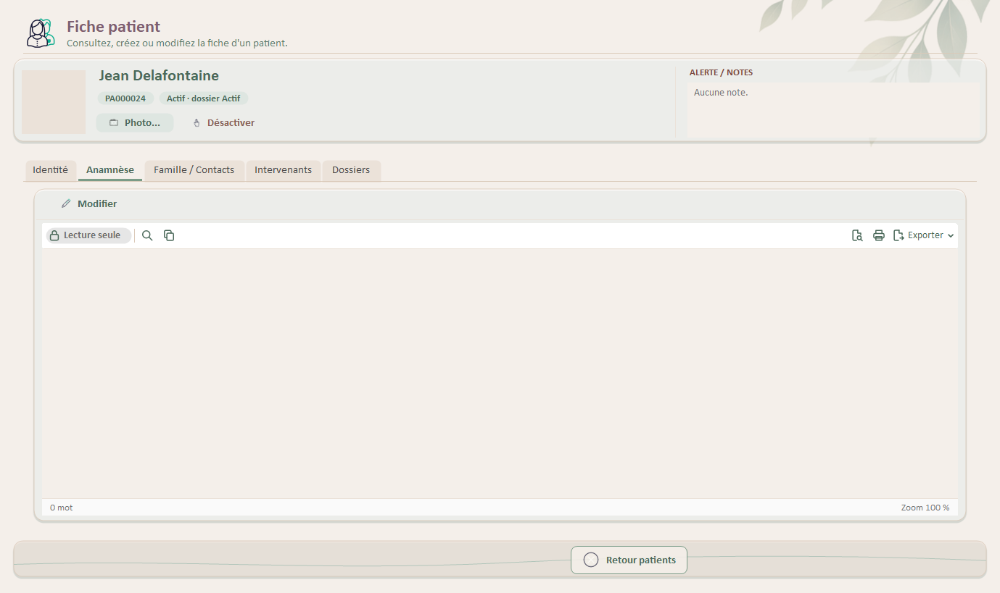

**Contrôles**

| Contrôle | Type | Rôle |
| --- | --- | --- |
| `pnlAnamnese` | Panel | Conteneur de l'éditeur dans la carte (ex-`grpAnamnese`, cadre redondant avec la carte et l'onglet). |
| `rteAnamnese` | UC_RichTextEditor (profil Complet) | Anamnèse enrichie (RTF + export) ; `TitreDocument` = « Anamnèse » ; `PatientDocument` posé dans `RemplirChamps` (en-tête des documents, 19/10/2026). |
| `carteAnamnese` | AltheaCarte | Carte qui regroupe la barre locale et le contenu qu'elle pilote (ADR-34). |
| `pnlAnamneseActions` | AltheaBarreOutils | Barre locale, en haut de la carte : boutons Outil / OutilPrincipal / OutilDanger. |
| `btnModifierAnamnese` | AltheaBouton | Modifier l'anamnèse du patient. |
| `btnEnregistrerAnamnese` | AltheaBouton | Enregistrer uniquement l'anamnèse. |
| `btnAnnulerAnamnese` | AltheaBouton | Annuler les modifications de l'anamnèse. |

**Méthodes propres** : `AppliquerModeAnamnese`, `rteAnamnese_ExportRequested`, `rteAnamnese_ExportCompleted`, `TracerAnamneseExportee`, `rteAnamnese_ContentChanged`, `btnModifierAnamnese_Click`, `btnEnregistrerAnamnese_Click`, `btnAnnulerAnamnese_Click`.

##### Onglet « Famille / Contacts » (`tabPageFamille`)

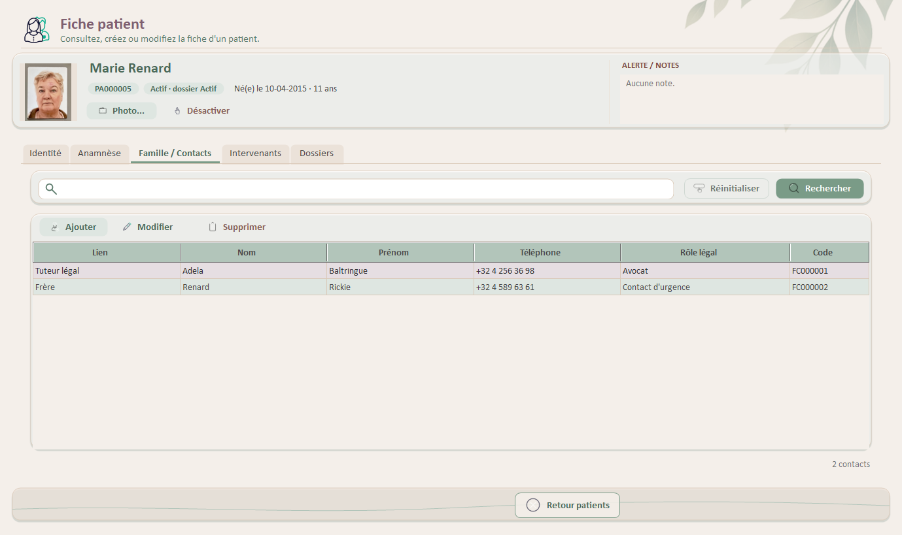

**Contrôles**

| Contrôle | Type | Rôle |
| --- | --- | --- |
| `dgvContacts` | DataGridView | Onglet Famille/Contacts. |
| `carteContacts` | AltheaCarte | Carte qui regroupe la barre locale et le contenu qu'elle pilote (ADR-34). |
| `pnlFamilleActions` | AltheaBarreOutils | Barre locale, en haut de la carte : boutons Outil / OutilPrincipal / OutilDanger. |
| `btnAjouterContact` | AltheaBouton | Rattacher un contact à ce patient. |
| `btnModifierContact` | AltheaBouton | Modifier le contact sélectionné. |
| `btnSupprimerContact` | AltheaBouton | Détacher le contact sélectionné du patient. |
| `pnlFamilleRecherche` › `carteRechercheContacts` | Panel › AltheaCarte | Bandeau de recherche (modèle UI-4). |
| `txtRechercheContact` | AltheaRecherche | Recherche contacts (texte d'aide « Nom, prénom, lien… »). |
| `btnReinitialiserContacts` | AltheaBouton (Clair) | Réinitialise la recherche. |
| `btnRechercherContact` | AltheaBouton | Applique la recherche. |

##### DataGridView `dgvContacts` : colonnes

| Colonne | En-tête | Propriété liée | Visible | Rôle |
| --- | --- | --- | --- | --- |
| `colContactLien` | Lien | LibelleLienPatient | Oui | — |
| `colContactNom` | Nom | Nom | Oui | — |
| `colContactPrenom` | Prénom | Prenom | Oui | — |
| `colContactTelephone` | Téléphone | Telephone | Oui | — |
| `colContactRole` | Rôle légal | LibelleRoleLegal | Oui | — |
| `colContactCode` | Code | CodeFamilleContact | Oui | FC… (24/10/2026). |

##### Onglet « Intervenants » (`tabPageIntervenants`)

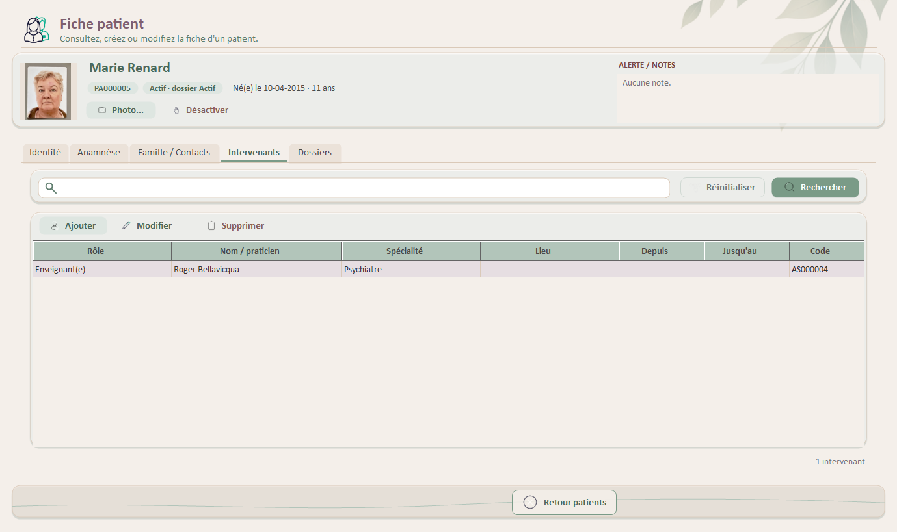

**Contrôles**

| Contrôle | Type | Rôle |
| --- | --- | --- |
| `dgvIntervenants` | DataGridView | Onglet Intervenants. |
| `carteIntervenants` | AltheaCarte | Carte qui regroupe la barre locale et le contenu qu'elle pilote (ADR-34). |
| `pnlIntervenantsActions` | AltheaBarreOutils | Barre locale, en haut de la carte : boutons Outil / OutilPrincipal / OutilDanger. |
| `btnAjouterIntervenant` | AltheaBouton | Rattacher un intervenant (médecin, thérapeute…) à ce patient. |
| `btnModifierIntervenant` | AltheaBouton | Modifier l'intervenant sélectionné dans la liste. |
| `btnSupprimerIntervenant` | AltheaBouton | Détacher l'intervenant sélectionné de ce patient (l'intervenant reste dans le référentiel). |
| `pnlIntervenantsRecherche` › `carteRechercheIntervenants` | Panel › AltheaCarte | Bandeau de recherche (modèle UI-4). |
| `txtRechercheIntervenant` | AltheaRecherche | Recherche intervenants (texte d'aide « Rôle, nom, spécialité… »). |
| `btnReinitialiserIntervenants` | AltheaBouton (Clair) | Réinitialise la recherche. |
| `btnRechercherIntervenant` | AltheaBouton | Applique la recherche. |

##### DataGridView `dgvIntervenants` : colonnes

| Colonne | En-tête | Propriété liée | Visible | Rôle |
| --- | --- | --- | --- | --- |
| `colIntervenantRole` | Rôle | LibelleRoleIntervenant | Oui | — |
| `colIntervenantNom` | Nom / praticien | NomProfessionnel | Oui | — |
| `colIntervenantSpecialite` | Spécialité | Specialite | Oui | — |
| `colIntervenantLieu` | Lieu | Lieu | Oui | — |
| `colIntervenantDateDebut` | Depuis | DateDebut | Oui | — |
| `colIntervenantDateFin` | Jusqu'au | DateFin | Oui | — |
| `colIntervenantCode` | Code | CodeAutreSuiviPatient | Oui | AS… (24/10/2026). |

**Méthodes propres** : `InitialiserGrilleIntervenants`, `ChargerIntervenants`, `dgvIntervenants_CellFormatting`, `dgvIntervenants_SelectionChanged`, `dgvIntervenants_CellDoubleClick`, `AppliquerFiltresIntervenants`, `CorrespondRechercheIntervenant`, `btnRechercherIntervenant_Click`, `txtRechercheIntervenant_KeyDown`, `btnReinitialiserIntervenants_Click`, `btnAjouterIntervenant_Click`, `btnModifierIntervenant_Click`, `btnSupprimerIntervenant_Click`, `OuvrirEditionIntervenant`, `RafraichirEtatBoutonsIntervenants`, `IntervenantSelectionne`.

**Filtres et recherche** : `AppliquerFiltresIntervenants`, `CorrespondRechercheIntervenant`, `btnRechercherIntervenant_Click`, `txtRechercheIntervenant_KeyDown`.

##### Onglet « Dossiers » (`tabPageDossiers`)

accès au hub `UC_DossierFiche` (création, statuts, transitions).

**Rôle**

> 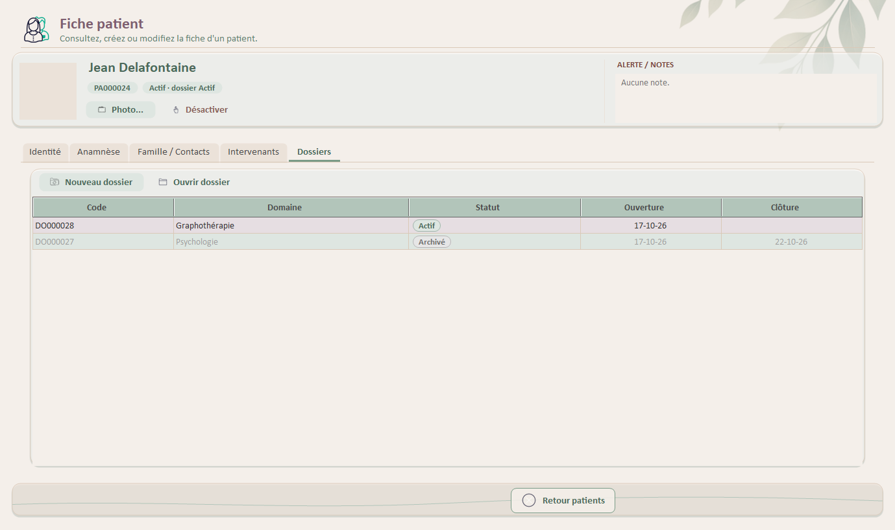

**Contrôles**

| Contrôle | Type | Rôle |
| --- | --- | --- |
| `dgvDossiers` | DataGridView | — |
| `carteDossiers` | AltheaCarte | Carte qui regroupe la barre locale et le contenu qu'elle pilote (ADR-34). |
| `pnlDossiersActions` | AltheaBarreOutils | Barre locale, en haut de la carte : boutons Outil / OutilPrincipal / OutilDanger. |
| `btnOuvrirDossier` | AltheaBouton | Ouvrir le dossier de suivi clinique sélectionné. |
| `btnAjouterDossier` | AltheaBouton | Créer un nouveau dossier de suivi clinique pour ce patient. |

##### DataGridView `dgvDossiers` : colonnes

| Colonne | En-tête | Propriété liée | Visible | Rôle |
| --- | --- | --- | --- | --- |
| `colDossierCode` | Code | CodeDossier | Oui | — |
| `colDossierDomaine` | Domaine | LibelleDomaine | Oui | — |
| `colDossierStatut` | Statut | LibelleStatutDossier | Oui | — |
| `colDossierDateOuverture` | Ouverture | DateOuverture | Oui | — |
| `colDossierDateCloture` | Clôture | DateCloture | Oui | — |

**Méthodes propres** : `SelectionnerOngletDossiers`, `SelectionnerOngletAuChargement`, `LibelleStatutDossierBandeau`, `InitialiserGrilleDossiers`, `ChargerDossiers`, `dgvDossiers_CellFormatting`, `dgvDossiers_SelectionChanged`, `dgvDossiers_CellDoubleClick`, `btnAjouterDossier_Click`, `btnOuvrirDossier_Click`, `OuvrirDossierSelectionne`, `OuvrirHubDossier`, `CreerFicheDossiers`, `RafraichirEtatBoutonsDossiers`, `DossierSelectionne`.

#### Règles en vigueur

- Tous les messages utilisateur passent par `DialogChoix` (jamais `MessageBox`).
- Aucun accès direct à la base : les lectures/écritures passent par la couche métier `Gestion*`.
- Les actions significatives sont journalisées via `GestionLog`.
- **Règles de la fiche dans le métier** (ADR-51, audit C.2 étape 2a, 23/10/2026) : `GestionPatients.ValiderPatient` est lue par la fiche et appliquée par `CreatePatient` / `UpdatePatient` ; toutes les erreurs s'affichent d'un coup, sur leurs champs et dans une fenêtre récapitulative.
- **NISS** : enregistré sous une seule forme (normalisée), affiché mis en forme ; un même NISS tapé avec ou sans séparateurs est reconnu comme le même (unicité). Un numéro français est accepté sans sa clé (vérifiée quand elle est donnée).
- Le doublon nom + prénom + date de naissance reste une **confirmation**, pas un refus.

#### Points d'attention

- **Activation progressive** : les onglets Famille/Contacts, Intervenants et Dossiers ne sont actifs qu'une fois l'`id_patient` obtenu (D-Q14).
- **Aucun accès DB** dans l'UC : tout passe par les couches `Gestion*`.
- Les sous-listes (contacts, intervenants) délèguent la persistance à `ContactEdition` / `IntervenantEdition` puis se rechargent.
- Le tri par clic sur les en-têtes est activé sur les trois grilles (`dgvContacts`, `dgvIntervenants`, `dgvDossiers`) via `UtilsDataGrid.ActiverTriColonnes`.
- L'onglet **Dossiers** liste les dossiers du patient et ouvre le hub `UC_DossierFiche` (création, changement de statut via `DossierStatutEditor`, édition de zones via `DossierZoneEditor`).
- Implémente IContextAwareUserControl (injection du contexte UI partagé par Home)
- Aucun accès direct à la base de données : tout passe par GestionPatients
- Pour cette première brique, seul l'onglet Identité est fonctionnel ; les onglets
  Famille/Contacts, Intervenants et Dossiers affichent un message « à venir » et restent
  désactivés tant qu'aucun id_patient n'est obtenu (activation progressive)

#### Message au repreneur

> UC_PatientFiche (4032 lignes). Point d'entrée : `SetContext`, `InitialiserPourCreation`, `InitialiserPourPatient`.
>
> Toute évolution de règle se fait d'abord dans `GestionPatients`, `GestionSituationsFamiliales`, `GestionPrixSeance`, `GestionDossiers`, `GestionDocuments`, `GestionFamilleContacts`, `GestionSuivisIntervenants`, pas dans l'écran.
>
> L'écran compte 5 onglets : vérifier l'état des boutons de chaque onglet après modification.
>
> Toute modification visuelle passe par le Designer (.Designer.vb / .resx).

---

### **UserControl : UC_DossierFiche**

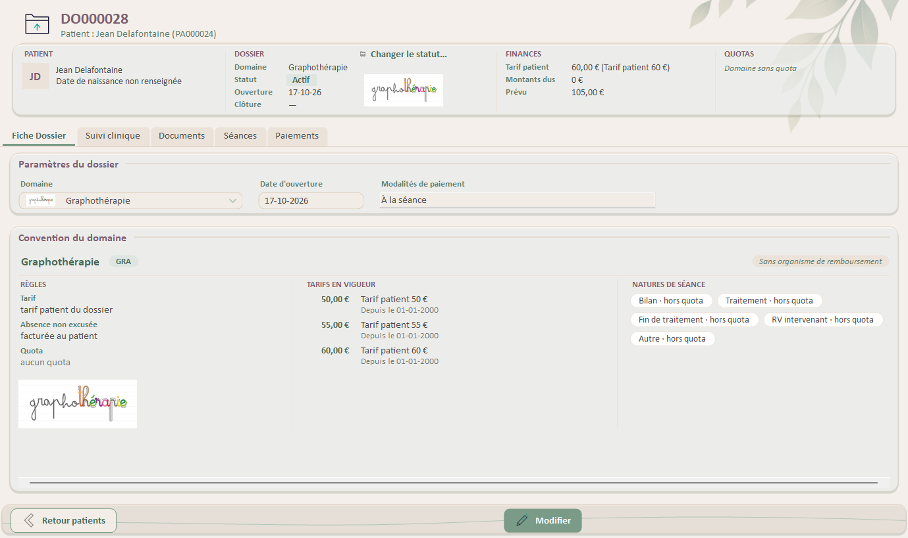

> Fichier : `UI/Controls/Dossiers/UC_DossierFiche.vb` — hérite de `UserControl` — implémente `IContextAwareUserControl`.
>
> Fichiers partiels par onglet (audit C.5, ADR-56, 25/10/2026) : `UC_DossierFiche.ZonesCliniques.vb` (Suivi clinique), `UC_DossierFiche.Seances.vb`, `UC_DossierFiche.Paiements.vb` ; le fichier principal garde le chargement, le bandeau, les modes, l'édition, le statut, la navigation et la garde.

#### Rôle général

`UC_DossierFiche` est le hub plein panneau d'un dossier patient, ouvert depuis l'onglet **Dossiers** de `UC_PatientFiche`. Il reprend le pattern Consultation / Création / Modification et centralise l'identité du dossier, le suivi clinique, les séances et les paiements.

#### Responsabilités

- Charger et afficher l'en-tête (code du dossier, patient) et le récapitulatif patient : photo, naissance, alerte, domaine, statut, dates, finances et quotas de l'organisme.
- Orchestrer les modes Consultation / Création / Modification du dossier.
- Créer et mettre à jour le dossier via `GestionDossiers`.
- Ouvrir les zones du suivi clinique et les rafraîchir après sauvegarde.
- Proposer uniquement les transitions de statut autorisées via `DossierStatutEditor`.
- Charger les séances d'un dossier, ouvrir leur modale et rafraîchir la grille après une action.
- Charger les paiements du dossier et encaisser une séance par `PaiementEditor`, toujours pour une séance donnée (« Encaisser séance » ou double-clic sur un paiement ; « Nouveau paiement » retiré le 22/10/2026).
- N'agir que sur une ligne choisie par l'utilisatrice (`UtilsDataGrid.ElementSelectionne`, 22/10/2026) ; les règles des actions (reporter, supprimer, encaisser) sont celles du métier (`SeanceListeItem`, audit C.2 étape 1).
- Proposer l'utilisation d'un avoir après le report d'une séance encaissée (`DialogUtilisationAvoir`, 21/10/2026).
- S'ouvrir sur un onglet et une ligne demandés (ouverture ciblée par la recherche transversale, `CiblerAuChargement`, 23/10/2026).
- Forcer la lecture seule si le statut du dossier est **Archivé** ; figer séances et paiements d'un dossier **Clôturé**.
- Rendre l'état du dossier visible : pastille de statut colorée (`UtilsPastilles.TeinteStatutDossier`) et bandeau « consultation » sous l'en-tête (`pnlDossierConsultation`) pour un dossier clôturé ou archivé.
- Contrôler la clôture avant de la confirmer (`GestionDossiers.ControlerCloture`) : refus si des séances sont à venir, avertissement si des montants restent à régler.

#### Dépendances

| Élément | Type | Rôle |
| --- | --- | --- |
| `GestionDossiers` | Module métier | Chargement, persistance, zones et cycle de vie. |
| `IFenetrePrincipale` | Interface | navigation retour (lue dans le contexte, ADR-55) |
| `UserControlContext` | Classe | Contexte UI partagé (statut, en-tête, session). |
| `GestionDomaines` | Module métier | — |
| `GestionLog` | Module métier | Grille, confirmations et journalisation. |
| `GestionPrixSeance` | Module métier | — |
| `GestionSeances` | Module métier | Liste, suppression et persistance indirecte des séances. |
| `GestionPatients` | Module métier | — |
| `UtilsButtons` | Module utilitaire | Style et états visuels uniformes des boutons. |
| `UITheme` | Module utilitaire | — |
| `RichTextEditorHelper` | Module utilitaire | — |
| `DialogChoix` | Form | Grille, confirmations et journalisation. |
| `UtilsDataGrid` | Module utilitaire | Grilles ; `ElementSelectionne` : élément de la ligne choisie par l'utilisatrice (22/10/2026). |
| `FiltresSeances` / `FiltresPaiements` | Modules UI (`UI/Controls/Communs`) | Axes des filtres (`AxeFiltreSeance`, `AxeFiltrePaiement`), filtrage, lignes du relevé et résumés cliquables, partagés avec la recherche transversale (23/10/2026). |
| `AltheaDate` | Contrôle du kit | `CorrigerBornes` : correction des bornes « du / au » des deux filtres de période (partagée, 23/10/2026). |
| `GestionQuotaInami` | Module métier | — |
| `GestionPaiements` | Module métier | — |
| `AppRole` | Enum | Rôles applicatifs utilisés pour les contrôles de droits. |
| `DossierZoneEditor` | Form | Édition d'une zone clinique. |
| `DossierStatutEditor` | Form | Sélection d'une transition de statut autorisée. |
| `DialogPaiementsSeance` | Form | Ouvert depuis ce composant. |
| `SeanceEditor` | Form | Création, modification ou consultation d'une séance. |
| `DialogReportSeance` | Form | Ouvert depuis ce composant. |
| `DialogUtilisationAvoir` | Form | Ouvert depuis ce composant (`ProposerApresChangementStatut`). |
| `PaiementEditor` | Form | Ouvert depuis ce composant. |
| `DialogMotifAnnulation` | Form | Ouvert depuis ce composant. |
| `UC_PatientFiche` | UserControl | — |
| `UC_PatientHome` | UserControl | — |

#### Variables privées

| Variable | Type | Rôle |
| --- | --- | --- |
| `_context` | `UserControlContext` | Injecté par Home via SetContext() (implémentation IContextAwareUserControl) |
| `_dossier` | `Dossier` | Dossier actuellement chargé dans le hub (Nothing tant qu'aucun dossier n'est chargé en création) |
| `_mode` | `ModeFiche` | Mode courant du hub (consultation par défaut) |
| `_idDossier` | `Long` | Identifiant du dossier en cours de consultation (0 = création, aucun id encore attribué) |
| `_idPatient` | `Long` | Identifiant du patient propriétaire du dossier (obligatoire, y compris en création) |
| `_lignesZones` | `Dictionary(Of ZoneDossier, AltheaLigne)` | Mapping zone → ligne cliquable (titre + aperçu), renseigné à la construction dynamique. |
| `APERCU_VIDE` / `HAUTEUR_LIGNE_ZONE` | `Const` | Texte d'une zone vide (« Vide ») / hauteur d'une ligne de zone (56). |
| `APERCU_LONGUEUR_MAX` | `Const Integer = 160` | — |
| `_apercuPopup` | `Form` | Fenêtre flottante d'aperçu (infobulle fabriquée) affichée au survol d'un bouton de zone. |
| `_apercuRtb` | `RichTextBox` | Éditeur riche en lecture seule contenu dans la fenêtre flottante d'aperçu. |
| `_seances` | `List(Of SeanceListeItem)` | Séances actuellement affichées dans la grille (source de données courante). |
| *(axes du filtre des séances)* | `AxeFiltreSeance` (`FiltresSeances`) | Remplace les constantes `FiltreSeance*` (23/10/2026) : Toutes, Aujourd'hui, À venir, À confirmer, Passées, Réalisées, Absences, Reportées, Non dues, Exigibles, Réglées, Avec avoir. |
| `SANS_SELECTION_SEANCE` / `SEANCE_NON_REPORTABLE` | `Const String` | Raisons des boutons inactifs : « Sélectionnez une séance dans la liste. » / « Seule une séance planifiée peut être reportée. » (22/10/2026). |
| `HAUTEUR_SEPARATEUR_JOUR` / `HAUTEUR_LIGNE_PASTILLES` | `Const Integer = 24 / 30` | Marge de la ligne « Aujourd'hui » ; hauteur des lignes des grilles à pastilles (séances, paiements). |
| `_resumeSeances` / `_resumePaiements` | `ResumeFiltre` (classe partagée, `UI/Controls/Communs`) | Résumés cliquables au-dessus des deux grilles (créés avec chaque grille). |
| `_grilleSeancesInitialisee` | `Boolean` | Garde-fou : la grille n'est initialisée (colonnes, styles) qu'une seule fois. |
| `_numerosPeriodesFiltre` | `List(Of Integer)` | Numéros de période correspondant aux items de cboFiltrePeriodeInami (0 = « Toutes les périodes »). |
| `_rechargementFiltrePeriodes` | `Boolean` | relancerait AppliquerFiltresSeances en pleine exécution. |
| `_paiements` | `List(Of PaiementListeItem)` | Paiements du dossier (liste complète, non filtrée) : source de la grille et de son résumé. |
| *(axes du filtre des paiements)* | `AxeFiltrePaiement` (`FiltresPaiements`) | Remplace les constantes `FiltrePaiement*` (23/10/2026) : Tous, Encaissés, En attente, Annulés, Séances soldées, Séances dues, Avoirs, Reports, À régler. |
| `PoliceMontantAnnule` | `Shared Font` | Montant barré d'un paiement annulé (police partagée). |
| `_grillePaiementsInitialisee` | `Boolean` | Garde-fou : la grille des paiements n'est initialisée (colonnes, styles) qu'une seule fois. |
| `_ongletCible` / `_idSeanceCible` / `_idPaiementCible` | `OngletDossier?` / `Long` / `Long` | Ouverture ciblée demandée par `CiblerAuChargement` (Nothing / 0 : aucune), oubliée après `AppliquerCible` (23/10/2026). |

#### Contrôles principaux

| Contrôle | Type | Rôle |
| --- | --- | --- |
| `pnlBandeau` | Panel | Zone haute du hub : en-tête puis récapitulatif patient (UI-5). |
| `pnlDossierConsultation` › `lblDossierConsultation` | Panel › Label | Bandeau d'information entre l'en-tête et le récapitulatif, visible seulement pour un dossier clôturé ou archivé (teinte Information de `AltheaIconeEtat`). |
| `enTete` | AltheaEnTete | En-tête d'écran : titre = code du dossier, sous-titre = « Patient : nom (code) », remplis par le code ; icône dans les ressources (`enTete.Icone`). |
| `carteRecap` › `tblRecap` | AltheaCarte › TableLayoutPanel | Récapitulatif patient, toujours visible : quatre blocs en colonnes (24 / 31 / 25 / 20 % depuis le 20/10/2026 ; avant 24 / 27 / 27 / 22) séparés par un filet (`tblRecap_CellPaint`). |
| `pnlRecapPatient` | Panel | Bloc **Patient** : `lblRecapTitrePatient`, `picRecapPhoto` (photo, sinon initiales dessinées), `lblRecapNaissance` (nom + « Né(e) le … · N ans »), `lblRecapAlerte` (note d'alerte sur deux lignes, texte complet en info-bulle ; masquée sans alerte). |
| `pnlRecapDossier` | Panel | Bloc **Dossier** : Domaine, Statut (pastille), Ouverture, Clôture (`lbl*Legende` / `lbl*Valeur`) et `btnChangerStatut` (AltheaBouton Outil, en haut à droite du bloc). |
| `pnlRecapFinances` | Panel | Bloc **Finances** : Tarif patient ; Montants dus du dossier (couleur « Dû » s'ils sont non nuls), suivis du total du patient s'il diffère (« 0 € ici · 68,00 € tous dossiers », 22/10/2026) ; **Prévu** (`lblPrevuLegende` / `lblPrevuValeur`, 22/10/2026) : reste à payer des séances dues à venir, qui n'est pas un dû, même présentation ; Avoir **du patient** (tous dossiers, affiché s'il existe, ligne suivante) avec la part du dossier (« (autre dossier) », « dont … ici ») ; détail par dossier en infobulle. |
| `pnlRecapQuotas` | Panel | Bloc **Quotas** : titre « QUOTAS — <ORGANISME> » pour un domaine soumis à quota, « QUOTAS » sinon ; compteurs (`lblQuotaSoutien*` : par catégorie, `lblQuotaTraitement*` : total / plafond), `jaugeQuota` (AltheaJauge), `lblQuotaPeriodeInami` ; `lblQuotaAucun` : « Domaine sans quota » ou « Aucune séance comptabilisée ». |
| `tabDossier` | AltheaOnglets | Conteneur des cinq onglets du hub : Fiche Dossier, Suivi clinique, Documents, Séances, Paiements. |
| `tabPageFicheDossier` | TabPage | Libellé : « Fiche Dossier » |
| `tabPageSuiviClinique` | TabPage | Libellé : « Suivi clinique » |
| `tabPageDocuments` | TabPage | Libellé : « Documents » |
| `tabPageSeances` | TabPage | Libellé : « Séances » |
| `tabPagePaiements` | TabPage | Libellé : « Paiements » |
| `pnlActions` | AltheaBarreActions | Zone des boutons d'action. |
| `btnFermer` | AltheaBouton | Revenir à la liste des patients. |
| `btnModifier` | AltheaBouton | Passer la fiche dossier en modification. |
| `btnEnregistrer` | AltheaBouton | Enregistrer les modifications de la fiche dossier. |
| `btnAnnuler` | AltheaBouton | Annuler les modifications en cours. |

#### DataGridView : colonnes

Les grilles sont portées par les onglets (voir ci-dessous).

#### Méthodes principales

| Membre | Nature | Rôle |
| --- | --- | --- |
| `SetContext` | Public Sub | Reçoit le contexte UI partagé injecté par Home. |
| `InitialiserPourDossier` | Public Sub | Prépare le hub pour la consultation d'un dossier existant. |
| `InitialiserPourNouveauDossier` | Public Sub | Prépare le hub pour la création d'un nouveau dossier rattaché à un patient. |
| `CiblerAuChargement` | Public Sub | Ouverture ciblée (23/10/2026) : onglet (`OngletDossier` : Fiche, Seances, Paiements) et séance ou paiement à sélectionner sur sa page. À appeler après `InitialiserPourDossier`, avant la navigation (recherche transversale, ADR-52). |
| `UC_DossierFiche_Load` | Private Sub | Charge le dossier (si consultation) et renseigne le bandeau à l'ouverture du hub ; applique ensuite l'ouverture ciblée (`AppliquerCible`, V1.2.0). |
| `AppliquerCible` | Private Sub | Affiche l'onglet demandé, réapplique la liste (page de la ligne) puis sélectionne la ligne (`SelectionnerLigne`) ; si les filtres de l'onglet la cachent, la barre d'état le dit. La cible est ensuite oubliée. |
| `SelectionnerLigne` | Private Shared Function | Sélectionne la première ligne affichée qui répond au critère ; False si aucune. |
| `InitialiserBoutons` | Private Sub | Applique le style standard aux boutons d'action et branche les info-bulles. |
| `ChargerDomaines` | Private Sub | Charge les domaines actifs dans la combo de la fiche dossier. |
| `ChargerDossier` | Private Sub | Charge le dossier depuis la couche métier (mode consultation) et met à jour le bandeau. |
| `RemplirBandeau` | Private Sub | Renseigne les libellés du bandeau d'identité à partir du dossier chargé (ou du mode création). |
| `AfficherEtatDossier` | Private Sub | Couleur de la pastille de statut selon l'état et bandeau « consultation » d'un dossier clôturé ou archivé ; ajuste la hauteur de `pnlBandeau` pour que le récapitulatif garde la sienne (V1.0.0, 17/10/2026). |
| `MessageConsultation` | Private Function | Texte du bandeau : « Dossier clôturé le … — séances et paiements en consultation seulement. Pour le rouvrir : « Changer le statut… » » / « Dossier archivé le … — consultation seulement (archivage définitif) ». |
| `ObtenirLibelleTarif` | Private Function | Récupère le libellé d'un tarif de séance par son identifiant. |
| `MontantIciEtPatient` / `MontantBandeau` / `DetailParDossier` | Private Shared Function | « 0 € ici · 68,00 € tous dossiers » (22/10/2026) ; format d'un montant du bandeau ; infobulle « DO… : x € » par dossier. |
| `ChargerTarifEtMontantsDus` | Private Sub | Tarif du patient, montants dus (dossier + total patient), prévu (`SoldeDossier.MontantPrevu`, V2.1.0, 22/10/2026) et avoir du patient, par `GestionSeances.CalculerSoldesPatient` (règles des grilles : séance due et passée) ; remplace `CalculerMontantsDus` (codes de statut en dur, retiré le 17/10/2026). |
| `AfficherQuotaInami` | Private Sub | Affiche, pour un dossier dont le domaine est soumis au quota, la consommation de chaque catégorie de quota du domaine et le total sur la période glissante en cours (durée définie par la règle). |
| `CouleurQuota` | Private Function | Détermine la couleur d'affichage d'un compteur (catégorie épuisée, total atteint, seuil d'alerte). |
| `RemplirFicheDossier` | Private Sub | Renseigne les contrôles de saisie de l'onglet « Fiche Dossier » à partir du dossier chargé, ou applique les valeurs par défaut en création. |
| `SelectionnerDomaine` | Private Sub | Sélectionne dans la combo le domaine correspondant à l'identifiant fourni. |
| `AppliquerMode` | Private Sub | Applique le mode courant (consultation / création / modification) : active ou non la saisie et ajuste la visibilité des boutons d'action. |
| `AfficherBoutonModifier` | Private Sub | « Modifier » (fiche du dossier) visible seulement en consultation et sur l'onglet Fiche Dossier ; en saisie, Enregistrer / Annuler restent visibles sur tous les onglets (15/10/2026). |
| `btnModifier_Click` | Private Sub | Passe la fiche dossier en mode modification. |
| `btnAnnuler_Click` | Private Sub | Annule la saisie en cours : recharge les valeurs d'origine (modification) ou revient à la fiche patient (création). ; en modification, Abandonner / Continuer la saisie s'il y a des modifications (19/10/2026). |
| `PeutQuitter` | Public Function (IUnsavedChangesAware) | Avant de quitter le hub (Retour, menu, fermeture) : fiche du dossier en saisie — Enregistrer / Quitter sans enregistrer / Rester (`GardeModifications` sur `carteParametres`, V1.10.0). |
| `btnEnregistrer_Click` | Private Sub | Valide la saisie puis crée (mode création) ou met à jour (mode modification) le dossier. |
| `ValiderSaisie` | Private Function | Vérifie que les champs obligatoires sont renseignés avant enregistrement. |
| `CreerDossier` | Private Sub | Crée un nouveau dossier à partir de la saisie ; le statut est forcé à Actif par la couche métier et le code est généré par la base. |
| `MettreAJourDossier` | Private Sub | Met à jour l'identité du dossier courant à partir de la saisie. |
| `ConstruireZonesCliniques` | Private Sub | Construit dynamiquement, dans le TableLayoutPanel de l'onglet Suivi clinique, une ligne par zone clinique : un bouton d'ouverture (colonne 0) et un label d'aperçu de texte (colonne 1). |
| `AjouterLigneZone` | Private Sub | Ajoute la ligne cliquable (`AltheaLigne` : icône, libellé, aperçu, « Ouvrir ») d'une zone clinique dans le TableLayoutPanel. |
| `RemplirApercusZones` | Private Sub | Renseigne le texte d'aperçu de chaque zone à partir du dossier chargé (texte brut tronqué). |
| `TexteZone` | Private Function | Retourne le texte brut d'une zone à partir du dossier chargé (pour l'aperçu rapide). |
| `RtfZone` | Private Function | Retourne le contenu RTF d'une zone à partir du dossier chargé (pour l'aperçu riche au survol). |
| `ConstruireApercu` | Private Function | Construit un aperçu court et sur une seule ligne à partir d'un texte brut de zone. |
| `ActiverBoutonsZones` | Private Sub | Active ou désactive les boutons d'ouverture des zones cliniques. |
| `ZoneBouton_MouseEnter` | Private Sub | Affiche, au survol d'un bouton de zone, une fenêtre flottante (infobulle fabriquée) présentant le contenu riche (RTF) de la zone, ou son texte brut à défaut. |
| `ZoneBouton_MouseLeave` | Private Sub | Masque la fenêtre flottante d'aperçu lorsque la souris quitte le bouton de zone. |
| `AfficherApercuPopup` | Private Sub | Construit (si besoin) et positionne la fenêtre flottante d'aperçu à droite du bouton survolé, puis y charge le contenu riche de la zone en lecture seule. |
| `MasquerApercuPopup` | Private Sub | Masque la fenêtre flottante d'aperçu si elle est visible. |
| `CreerApercuPopup` | Private Sub | Crée la fenêtre flottante d'aperçu (sans bordure, non focusable) et son RichTextBox lecture seule. |
| `ZoneBouton_Click` | Private Sub | Ouvre la modale d'édition (DossierZoneEditor) pour la zone associée au bouton cliqué, puis rafraîchit le dossier et les aperçus si un enregistrement a eu lieu. |
| `RafraichirZones` | Private Sub | Recharge le dossier depuis la couche métier et met à jour les aperçus des zones cliniques. |
| `btnChangerStatut_Click` | Private Sub | Ouvre la modale de changement de statut (cycle de vie, brique B6), applique la transition retenue via la couche métier, puis recharge le dossier pour rafraîchir le bandeau et les zones. V1.1.0 (17/10/2026) : vers Clôturé, `GestionDossiers.ControlerCloture` d'abord — séances à venir = refus (`DialogChoix.Information`, séances citées), montants à régler = confirmation avec encadré et bouton « Clôturer quand même » (Ocre) ; un refus métier (`InvalidOperationException`) est affiché tel quel. |
| `InitialiserGrilleSeances` | Private Sub | Fige les propriétés de base de la grille des séances (une seule fois). |
| `ChargerSeances` | Private Sub | Recharge la grille des séances du dossier courant depuis la couche métier et met à jour l'état des boutons d'action. |
| `InitialiserFiltresSeances` | Private Sub | Remplit le filtre de la grille des séances (`FiltresSeances.RemplirListe`, V2.1.0, 23/10/2026 : axes et couleurs partagés avec la recherche des séances). |
| `RemplirFiltrePeriodesInami` | Private Sub | Reconstruit la liste déroulante permettant de n'afficher que les séances d'une période annuelle de quota INAMI (P1, P2, P3...). |
| `NumeroPeriodeFiltre` | Private Function | Retourne le numéro de période sélectionné dans le filtre, ou 0 si aucune restriction n'est active. |
| `AppliquerFiltresSeances` | Private Sub | Applique période de quota, texte, période « du / au » et axe (`FiltresSeances.Filtrer`, V1.2.0, 23/10/2026) à la grille des séances ; s'ouvre sur la page de la séance ciblée si elle est listée (V1.1.0), sinon sur celle de la ligne « Aujourd'hui ». |
| `CorrespondRechercheSeance` | Private Function | Indique si une séance correspond au texte recherché (code, nature, statut, état de paiement ou date), en comparaison insensible à la casse. |
| `txtRechercheSeance_TextChanged` | Private Sub | Réapplique le filtrage des séances à chaque saisie dans la recherche. |
| `cboFiltreSeance_SelectedIndexChanged` | Private Sub | Réapplique le filtrage des séances au changement d'axe de filtre. |
| `cboFiltrePeriodeInami_SelectedIndexChanged` | Private Sub | Réapplique le filtrage au changement de période INAMI (ignoré pendant la reconstruction de la liste). |
| `dtpSeancePeriode_ValeurChangee` / `dtpPaiementPeriode_ValeurChangee` | Private Sub | Corrigent les bornes (`AltheaDate.CorrigerBornes`, 23/10/2026) puis réappliquent le filtre si la période est cochée. |
| `dgvSeances_CellFormatting` | Private Sub | Date avec le jour, réglé vide si rien, lignes non dues atténuées (colonne « Solde » retirée le 22/10/2026). |
| `dgvSeances_CellPainting` | Private Sub | Pastilles Statut (avec mention de report) et Paiement (`UtilsDataGrid.DessinerPastilleCellule`, couleurs `UtilsPastilles`). |
| `dgvSeances_DataBindingComplete` / `dgvSeances_RowPostPaint` | Private Sub | Ligne « Aujourd'hui » entre la dernière séance à venir et la première passée (ordre de l'écran seulement). |
| `dgvSeances_CellToolTipTextNeeded` | Private Sub | Infobulle : code, tarif, période et quota, mention de report. |
| `RenseignerDatesReport` | Private Sub | Date et code de la séance de remplacement pour chaque séance reportée (mention « → 31/10 · S000045 », 21/10/2026). |
| `MettreAJourResumeSeances` | Private Sub | Résumé cliquable au-dessus de la grille, construit par `FiltresSeances.MettreAJourResume` (V1.2.0, 23/10/2026). |
| `SeanceSelectionnee` | Private Function | Séance de la ligne choisie par l'utilisatrice, ou Nothing : la ligne courante posée d'office au chargement ne compte pas (`UtilsDataGrid.ElementSelectionne`, V1.1.0, 22/10/2026). |
| `EstDossierArchive` | Private Function | Indique si le dossier courant est figé, c'est-à-dire fermé à toute création ou modification de séance et de paiement. Sont concernés les dossiers archivés (D-Q10) et les dossiers clôturés : |
| `RafraichirEtatBoutonsSeances` | Private Sub | Disponibilité des boutons de séance selon le dossier et la sélection ; chaque bouton inactif dit pourquoi au survol (`AltheaBouton.DefinirDisponibilite`). Reporter, supprimer, encaisser suivent les règles du métier : `SeanceListeItem.EstReportable`, `EstSupprimable`, `EstEncaissable` (V1.2.0, 22/10/2026, audit C.2) ; sans ligne choisie : « Sélectionnez une séance dans la liste. » |
| `DefinirActionSeance` | Private Shared Sub | Montre au survol la première raison qui empêche l'action : dossier figé, pas de sélection, condition propre à l'action. |
| `RaisonDossierFige` | Private Function | Pourquoi le dossier n'accepte ni séance ni paiement (vide sinon) : texte du métier (`GestionDossiers.RaisonDossierFige`, qui applique la même règle à l'écriture, 22/10/2026). |
| `dgvSeances_SelectionChanged` | Private Sub | Met à jour l'état des boutons d'action selon la sélection courante. |
| `btnDetailPaiementsSeance_Click` | Private Sub | Ouvre le détail (lecture seule) de tous les mouvements de paiement de la séance sélectionnée. |
| `dgvSeances_CellDoubleClick` | Private Sub | Ouvre la séance sélectionnée en édition (double-clic sur une ligne). |
| `btnNouvelleSeance_Click` | Private Sub | Ouvre la modale de création d'une séance, puis recharge la liste si un enregistrement a eu lieu. |
| `btnModifierSeance_Click` | Private Sub | Ouvre la séance sélectionnée en édition (bouton Modifier). |
| `btnReporterSeance_Click` | Private Sub | Reporte la séance sélectionnée : après saisie de la nouvelle date, la séance d'origine est marquée « Reportée » (et son dû annulé) et une nouvelle séance planifiée est créée. |
| `OuvrirSeanceSelectionnee` | Private Sub | Ouvre la séance sélectionnée dans la modale d'édition (lecture seule si dossier archivé), puis recharge la liste après un enregistrement. |
| `btnSupprimerSeance_Click` | Private Sub | Supprime la séance sélectionnée après confirmation, puis recharge la liste. |
| `ProposerUtilisationAvoirApresReport` | Private Sub | Après le report d'une séance encaissée : l'encaissement reste sur la séance d'origine et devient un avoir ; propose de l'utiliser sur une séance due du dossier, la remplaçante présélectionnée (`DialogUtilisationAvoir.ProposerApresChangementStatut`, ContexteOperation transmis). Remplace `ProposerReaffectationPaiement` (21/10/2026, audit B.2). |
| `InitialiserGrillePaiements` | Private Sub | Fige les propriétés de base de la grille des paiements (une seule fois). |
| `ChargerPaiements` | Private Sub | Recharge la grille des paiements du dossier courant depuis la couche métier et met à jour l'état des boutons d'action. |
| `InitialiserFiltresPaiements` | Private Sub | Remplit le filtre de la grille des paiements (`FiltresPaiements.RemplirListe`, V1.3.0, 23/10/2026). |
| `AppliquerFiltresPaiements` | Private Sub | Lignes du relevé (`FiltresPaiements.LignesDuReleve` : dus en attente clos masqués), recherche, période et axe (`FiltresPaiements.Filtrer`), du plus récent au plus ancien ; page du paiement ciblé s'il est listé (V2.3.0 et V2.4.0, 23/10/2026). |
| `RenseignerEtatSeances` | Private Sub | Recopie sur chaque paiement l'état de sa séance chargée (séance passée, avoir de la séance). |
| `CorrespondRecherchePaiement` | Private Function | Indique si un paiement correspond au texte recherché (code, séance, nature, mode, référence, statut ou date), en comparaison insensible à la casse. |
| `dgvPaiements_CellFormatting` | Private Sub | Applique le code couleur financier à la grille des paiements et signale visuellement les lignes annulées, qui sont conservées à des fins de traçabilité mais ne valent plus rien. |
| `dgvPaiements_CellToolTipTextNeeded` | Private Sub | Infobulle d'une ligne : `PaiementListeItem.InfobulleLigne` (23/10/2026, partagée avec la recherche des paiements). |
| `txtRecherchePaiement_TextChanged` | Private Sub | Réapplique le filtrage des paiements à chaque saisie dans la recherche. |
| `cboFiltrePaiement_SelectedIndexChanged` | Private Sub | Réapplique le filtrage des paiements au changement d'axe de filtre. |
| `PaiementSelectionne` | Private Function | Paiement de la ligne choisie par l'utilisatrice, ou Nothing (`UtilsDataGrid.ElementSelectionne`, V1.2.0, 22/10/2026). |
| `RafraichirEtatBoutonsPaiements` | Private Sub | « Annuler l'encaissement » selon le dossier, la sélection (« Sélectionnez un encaissement dans la liste. »), le paiement (encaissé) et le rôle (SuperUser) ; raison au survol d'un bouton inactif. |
| `dgvPaiements_SelectionChanged` | Private Sub | Met à jour l'état des boutons d'action selon la sélection courante. |
| `dgvPaiements_CellDoubleClick` | Private Sub | Encaisse la séance de la ligne double-cliquée (`OuvrirPaiementPourSeance`) ; une séance absente de la liste chargée est reconstituée depuis le paiement, reste dû lu en base compris (V1.0.1, 21/10/2026). |
| `btnEncaisserSeance_Click` | Private Sub | Ouvre la modale de saisie d'un paiement pour la séance sélectionnée (pré-remplie du reste dû), puis recharge séances et paiements après un enregistrement. |
| `LibelleRappelSeance` | Private Function | Compose le rappel « jj/mm/aaaa (Nature) » affiché dans la modale de paiement. |
| `OuvrirPaiementPourSeance` | Private Sub | Ouvre la modale PaiementEditor pour une séance donnée (montant pré-rempli sur le reste dû), puis recharge séances et paiements si un enregistrement a eu lieu. Une séance non encaissable est refusée avec la raison du métier (`SeanceListeItem.RaisonNonEncaissable`, V1.1.0, 22/10/2026). |
| `ProposerUtilisationAvoir` | Private Function | Si le patient dispose d'un avoir (tous dossiers), propose de l'imputer sur le reste dû de la séance (`GestionPaiements.UtiliserAvoirPourSeance`). Seul le montant nécessaire est consommé ; le surplus reste en avoir. Un refus du métier est affiché tel quel, un échec sans détail technique (V1.1.0, 22/10/2026). |
| `btnSupprimerPaiement_Click` | Private Sub | Annule l'encaissement sélectionné (SuperUser/Admin, motif obligatoire ; jamais de suppression), puis recharge séances et paiements. |
| `btnFermer_Click` | Private Sub | Revient à la fiche patient via la mini-pile de navigation (D-Q15). |
| `RetournerFichePatient` | Private Sub | Demande à Home de revenir à l'écran précédent (la fiche patient) ; à défaut, recharge la liste des patients. |

#### Gestion des icônes

- `btnAnnuler.Image` (Designer / ressources)
- `btnChangerStatut.Image` (Designer / ressources)
- `btnEncaisserSeance.Image` (Designer / ressources)
- `btnEnregistrer.Image` (Designer / ressources)
- `btnFermer.Image` (Designer / ressources)
- `btnModifier.Image` (Designer / ressources)
- `btnModifierSeance.Image` (Designer / ressources)
- `btnNouvelleSeance.Image` (Designer / ressources)
- `btnReporterSeance.Image` (Designer / ressources)
- `btnSupprimerPaiement.Image` (Designer / ressources)
- `btnSupprimerSeance.Image` (Designer / ressources)
- `pnlActions.BackgroundImage` (Designer / ressources)

#### Gestion des filtres et recherche

- Contrôles : `txtRechercheSeance`, `cboFiltreSeance`, `cboFiltrePeriodeInami`, `txtRecherchePaiement`, `cboFiltrePaiement`.
- Méthodes : `InitialiserFiltresSeances`, `RemplirFiltrePeriodesInami`, `NumeroPeriodeFiltre`, `AppliquerFiltresSeances`, `CorrespondRechercheSeance`, `txtRechercheSeance_TextChanged`, `cboFiltreSeance_SelectedIndexChanged`, `cboFiltrePeriodeInami_SelectedIndexChanged`, `InitialiserFiltresPaiements`, `AppliquerFiltresPaiements`, `CorrespondRecherchePaiement`, `txtRecherchePaiement_TextChanged`, `cboFiltrePaiement_SelectedIndexChanged`.
- Fonctionnement : filtrage en mémoire sur la liste chargée (pas de nouvel appel base), déclenché par les événements des contrôles ci-dessus ; la réinitialisation remet les critères par défaut puis réapplique le filtre.
- Axes, filtrage par axe et résumés viennent de `FiltresSeances` et `FiltresPaiements` (23/10/2026) : la recherche transversale des séances et des paiements d'une période utilise les mêmes définitions.

#### Gestion des droits

- Rôles testés : `AppRole.SuperUser`.

#### Les 5 onglets

| Onglet | Contenu |
| --- | --- |
| **Fiche dossier** | Domaine, date d'ouverture et modalités de paiement ; création ou mise à jour de l'identité. Le bandeau expose code, domaine, statut, dates et informations de quota lorsque le domaine y est soumis. |
| **Suivi clinique** | Sept zones cliniques ouvertes dans la modale réutilisable `DossierZoneEditor`. |
| **Documents** | 🔴 Coquille « À venir » (implémentation prévue Lot 3). |
| **Séances** | Grille `dgvSeances` et actions Nouvelle / Modifier / Reporter / Supprimer / Encaisser / Détail paiements ; une séance est éditée dans `SeanceEditor`. |
| **Paiements** | Grille `dgvPaiements` (relevé), filtre de statut et de solde, action « Annuler l'encaissement » ; le double-clic sur une ligne encaisse sa séance. Chaque paiement est rattaché à une séance. |

Chaque onglet reprend la trame ci-dessus ; seuls les éléments propres à l'onglet sont détaillés.

##### Onglet « Fiche Dossier » (`tabPageFicheDossier`)

**Contrôles**

| Contrôle | Type | Rôle |
| --- | --- | --- |
| `carteParametres` | AltheaCarte | Carte « Paramètres du dossier » : les trois champs sur une ligne, libellés au-dessus. |
| `lblDomaineEditLegende` / `cboDomaine` | Label / AltheaListe | Domaine du dossier (ref_domaines actifs) ; modifiable en création/modification. Liste dessinée par l'écran (`cboDomaine_DrawItem`) : logo du domaine (cadre 56 × 18, `LogosDomaines`) devant chaque libellé, place gardée sans logo (V1.11.0, 20/10/2026). |
| `picLogoDomaine` | PictureBox | Bandeau, bloc Dossier : logo du domaine centré sous `btnChangerStatut`, sur les lignes Statut à Clôture, à sa taille réelle (cadre 120 × 52, `AfficherLogoBandeau`) ; masqué sans logo. Colonnes du récapitulatif 24 / 31 / 25 / 20 % (Dossier élargie pour le logo, 20/10/2026). |
| `lblDateOuvertureEditLegende` / `dtpDateOuverture` | Label / AltheaDate | Date d'ouverture du dossier (obligatoire) — UI-7, 14/10/2026. |
| `lblModalitesLegende` / `txtModalitesPaiement` | Label / TextBox | Modalités de paiement convenues (texte libre, « À la séance » par défaut). |
| `carteConvention` | AltheaCarte | Carte « Convention du domaine », ancrée sur les quatre côtés. |
| `ucSyntheseDomaine` | `UC_SyntheseDomaine` | Synthèse du domaine sélectionné (règles, tarifs en vigueur, natures, quota ; logo sous les règles), en trois colonnes, pour choisir le domaine en connaissance de cause. |

À chaque changement de `cboDomaine` (sélection manuelle, chargement du dossier, nouveau dossier), `cboDomaine_SelectedIndexChanged` appelle `ucSyntheseDomaine.AfficherDomaine(domaine, inclureCompletude:=False)`. Sans domaine sélectionné, l'encadré affiche un message d'invite.

Le bloc « Points d'attention » (complétude) est masqué ici : il relève du paramétrage (`UC_DomainesHome`), pas du dossier.

En consultation, `AppliquerMode` passe la carte Paramètres par `UtilsControls.DefinirLectureSeule` (règle « Consultation lisible ») : texte normal sur fond teinté, plus de champs grisés.

**Méthodes propres** : `RemplirFicheDossier`, `cboDomaine_SelectedIndexChanged`.

##### Onglet « Suivi clinique » (`tabPageSuiviClinique`)

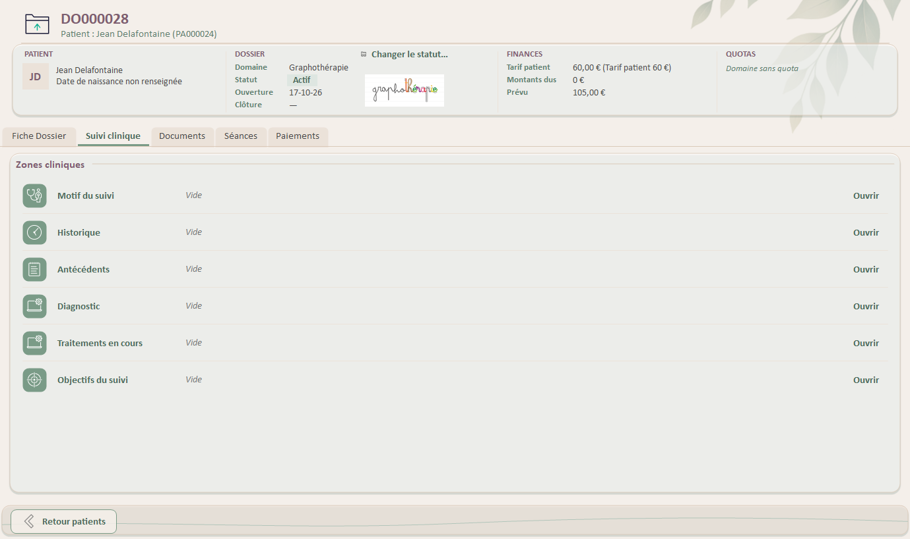

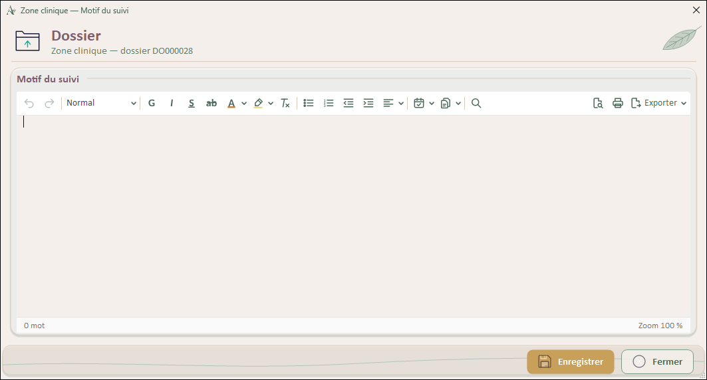

**Contrôles**

| Contrôle | Type | Rôle |
| --- | --- | --- |
| `carteZones` | AltheaCarte | Carte « Zones cliniques » (maquette « Suivi clinique A »). |
| `tlpZones` | TableLayoutPanel | Une ligne `AltheaLigne` par zone (construite par le code), plus une ligne de remplissage finale pour que la dernière zone ne s'étire pas. L'aperçu riche au survol s'ouvre sous la ligne. |

##### Onglet « Documents » (`tabPageDocuments`)

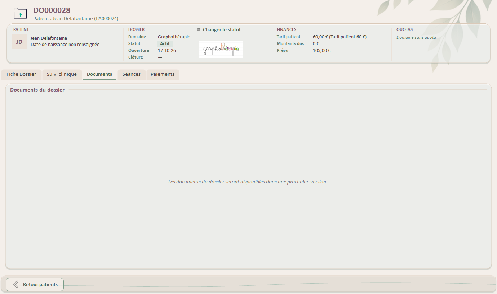

> [!WARNING]
>
> A implémenter

**Contrôles**

| Contrôle | Type | Rôle |
| --- | --- | --- |
| `carteDocuments` | AltheaCarte | Carte « Documents du dossier ». |
| `lblDocumentsAVenir` | Label | Message centré : « Les documents du dossier seront disponibles dans une prochaine version. » |

##### Onglet « Séances » (`tabPageSeances`)

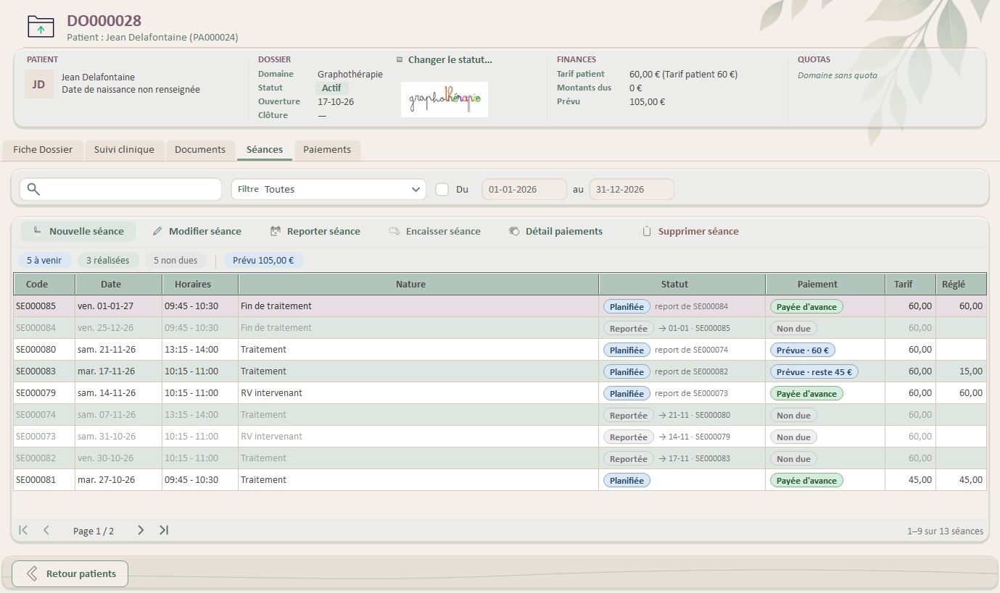

**Rôle**

**Contrôles**

| Contrôle | Type | Rôle |
| --- | --- | --- |
| `carteSeances` | AltheaCarte | Carte qui regroupe la barre locale et le contenu qu'elle pilote (ADR-34). |
| `pnlSeancesActions` | AltheaBarreOutils | Barre locale, en haut de la carte : boutons Outil / OutilPrincipal / OutilDanger. |
| `btnNouvelleSeance` | AltheaBouton | Actions sur les séances. |
| `btnModifierSeance` | AltheaBouton | Actions sur les séances. |
| `btnReporterSeance` | AltheaBouton | Reporter la séance sélectionnée à une autre date. |
| `btnSupprimerSeance` | AltheaBouton | Actions sur les séances. |
| `btnEncaisserSeance` | AltheaBouton | Encaisser la séance sélectionnée. |
| `btnDetailPaiementsSeance` | AltheaBouton | Libellé : « Détail paiements » |
| `dgvSeances` | DataGridView | Liste des séances : code, date, horaires (« de - à », vide si non renseignés), nature, statut et paiement en pastilles, tarif, réglé. |
| `pagSeances` | UC_Pagination | Pagination des séances (19/10/2026) : s'ouvre sur la page qui contient aujourd'hui (`PageDeIndex`) ; `HauteurReservee` = la ligne « Aujourd'hui » ; tri par en-tête fourni par la barre. |
| `pnlSeancesFiltres` › `carteFiltresSeances` | Panel › AltheaCarte | Bandeau de recherche et de filtres de l'onglet Séances (modèle UI-4). |
| `txtRechercheSeance` | AltheaRecherche | Recherche texte sur les séances (« Code, type, statut, date… »). |
| `cboFiltreSeance` | AltheaListe | Étiquette « Filtre » : axe de filtre, aux couleurs des pastilles (`FiltresSeances.RemplirListe`) — Toutes, Aujourd'hui, À venir, À confirmer, Passées, Réalisées, Absences sans prévenir, Reportées, Non dues, Exigibles, Réglées, Avec avoir ; aussi choisi par les pastilles du résumé. |
| `chkPeriodeSeance` / `dtpSeanceDu` / `lblSeanceAu` / `dtpSeanceAu` | AltheaCase / AltheaDate / Label / AltheaDate | Période « Du … au … » (dates actives quand la case est cochée). Une borne « du » postérieure à la borne « au » déplace l'autre borne (`AltheaDate.CorrigerBornes`, commun aux deux onglets et aux recherches, 23/10/2026). |
| `cboFiltrePeriodeInami` | AltheaListe | Étiquette « Période » : période de quota (« Toutes les périodes » par défaut) ; placée en dernier, visible seulement s'il existe plusieurs périodes. |

##### DataGridView `dgvSeances` : colonnes

| Colonne | En-tête | Propriété liée | Visible | Rôle |
| --- | --- | --- | --- | --- |
| `colSeanceCode` | Code | CodeSeance | Oui | Code de la séance (rétabli le 17/10/2026 : les dates seules ne suffisent pas à distinguer deux séances). |
| `colSeanceDate` | Date | DateSeance | Oui | Date avec le jour (« ven. 17/10/2026 », mise en forme). |
| `colSeanceHoraires` | Horaires | HorairesAffichage | Oui | Heure de début – heure de fin. |
| `colSeanceType` | Nature | LibelleNatureSeance | Oui | Nature de séance (colonne qui s'élargit). |
| `colSeancePeriodeInami` | Periode | LibellePeriodeInami | Domaine sous quota | Période de quota de rattachement. |
| `colSeanceQuotaInami` | Quota | LibelleQuotaInami | Domaine sous quota | Rang de la séance dans le quota de la période. |
| `colSeanceStatut` | Statut | LibelleStatutAffichage | Oui | **Pastille** colorée par famille (`FamilleStatut`) + mention de report (« → 31/10 · S000045 », « report de S… »). Une séance planifiée dont l'heure est passée s'affiche « À confirmer » (ocre, `SeanceListeItem.EstAConfirmer`, ADR-47, 21/10/2026) : elle n'est plus basculée en « Réalisée » à l'ouverture de l'onglet. |
| `colSeanceEtatPaiement` | Paiement | PaiementAffichage | Oui | **Pastille** colorée par famille (`FamillePaiement`) : Réglée, Payée d'avance, À régler · 60 €, Reste · 20 €, Prévue · 60 €, Avoir · 60 €, Non due. |
| `colSeanceTarif` | Tarif | TarifSeance | Oui | Montant de la séance figé à la création. |
| `colSeanceRegle` | Réglé | MontantRegle | Oui | Total encaissé (vide si rien). |

*Grille des séances V2 (17/10/2026, maquette « Grille des séances ») : 10 colonnes au lieu de 15 — code, origine, prévisionnel, exigible, reste dû et avoir retirés (code et quota en infobulle, prévu dans la pastille Paiement, exigible et avoir dans le solde).*

*Lignes non dues atténuées ; ligne « Aujourd'hui » (marge `DividerHeight` sous la dernière séance à venir, dessinée par `UtilsDataGrid.DessinerSeparateurSousLigne`, absente après un tri par en-tête).*

*Résumé cliquable `pnlResumeSeances` (pastilles `AltheaPastille` : à venir, à confirmer, réalisées, absences, non dues, à régler, prévu, avoir — calculé sur toutes les séances du dossier, chaque pastille choisit l'entrée correspondante de `cboFiltreSeance`).*

*Colonne « Solde » retirée le 22/10/2026 (décision de Joëlle) : elle répétait la pastille Paiement (« À régler », « Reste », « Avoir »).*

**Méthodes propres** : `InitialiserGrilleSeances`, `ChargerSeances`, `InitialiserFiltresSeances`, `AppliquerFiltresSeances`, `CorrespondRechercheSeance`, `txtRechercheSeance_TextChanged`, `cboFiltreSeance_SelectedIndexChanged`, `dgvSeances_CellFormatting`, `SeanceSelectionnee`, `RafraichirEtatBoutonsSeances`, `DefinirActionSeance`, `RaisonDossierFige`, `dgvSeances_SelectionChanged`, `btnDetailPaiementsSeance_Click`, `dgvSeances_CellDoubleClick`, `btnNouvelleSeance_Click`, `btnModifierSeance_Click`, `btnReporterSeance_Click`, `ProposerUtilisationAvoirApresReport`, `OuvrirSeanceSelectionnee`, `btnSupprimerSeance_Click`, `btnEncaisserSeance_Click`, `LibelleRappelSeance`, `OuvrirPaiementPourSeance`.

**Filtres et recherche** : `InitialiserFiltresSeances`, `AppliquerFiltresSeances`, `CorrespondRechercheSeance`, `txtRechercheSeance_TextChanged`, `cboFiltreSeance_SelectedIndexChanged`.

##### Onglet « Paiements » (`tabPagePaiements`)

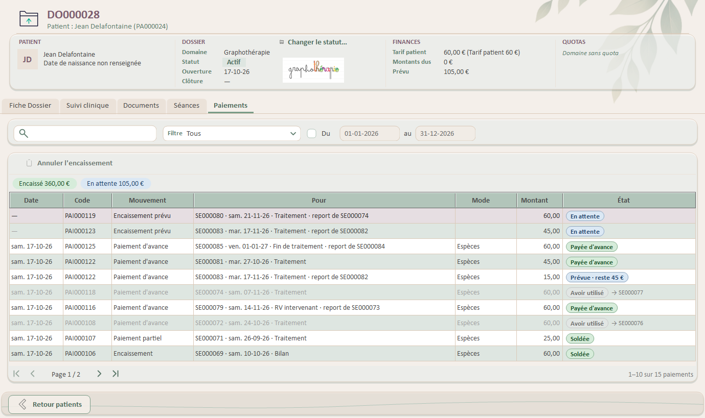

**Rôle**

La grille est un **relevé chronologique** (maquette « Paiements — A », 17/10/2026) : un paiement par ligne, le plus récent en haut ; la colonne « Pour » dit à quelle séance il s'applique, la pastille « État » ce qu'il est devenu. Un résumé cliquable au-dessus donne les totaux du dossier et sert de filtre rapide.

**Contrôles**

| Contrôle | Type | Rôle |
| --- | --- | --- |
| `cartePaiements` | AltheaCarte | Carte qui regroupe la barre locale et le contenu qu'elle pilote (ADR-34). |
| `pnlPaiementsActions` | AltheaBarreOutils | Barre locale, en haut de la carte : boutons Outil / OutilPrincipal / OutilDanger. |
| `btnSupprimerPaiement` | AltheaBouton | « Annuler l'encaissement » (17/10/2026, anciennement « Supprimer paiement ») : actif sur un paiement encaissé, pour un SuperUser/Admin. |
| `pnlResumePaiements` | FlowLayoutPanel | Résumé cliquable (pastilles `AltheaPastille`) : Encaissé, En attente, Avoir disponible, Reste à régler — chaque pastille choisit l'entrée de `cboFiltrePaiement`. |
| `dgvPaiements` | DataGridView | Relevé des paiements du dossier (pastille « État », tri par en-tête). |
| `pagPaiements` | UC_Pagination | Pagination du relevé (19/10/2026) ; tri par en-tête fourni par la barre. |
| `pnlPaiementsFiltres` › `carteFiltresPaiements` | Panel › AltheaCarte | Bandeau de recherche et de filtres de l'onglet Paiements (modèle UI-4). |
| `txtRecherchePaiement` | AltheaRecherche | Recherche texte sur les paiements (« Code, séance, mode, référence… »). |
| `cboFiltrePaiement` | AltheaListe | Étiquette « Filtre » : axe de filtre, aux couleurs des pastilles (`FiltresPaiements.RemplirListe`) — Tous, Encaissés, En attente, Annulés, Séances soldées, Séances restant dues, Avoirs, Séances reportées, À régler. |
| `chkPeriodePaiement` / `dtpPaiementDu` / `lblPaiementAu` / `dtpPaiementAu` | AltheaCase / AltheaDate / Label / AltheaDate | Période « Du … au … » (même fonctionnement que l'onglet Séances). |

##### DataGridView `dgvPaiements` : colonnes

| Colonne | En-tête | Propriété liée | Visible | Rôle |
| --- | --- | --- | --- | --- |
| `colPaiementDate` | Date | DateMouvement | Oui | Date d'encaissement avec le jour (« ven. 17/10/2026 ») ; « — » pour un paiement encore attendu (tri sur la date de la séance). |
| `colPaiementCode` | Code | CodePaiement | Oui | Code du paiement (PAI…) : rétabli le 23/10/2026 (relevé de Joëlle : il ne se voyait nulle part, et la recherche par code l'utilise). |
| `colPaiementMouvement` | Mouvement | MouvementCourt | Oui | Ce qui s'est passé : Encaissement, Paiement partiel, Paiement d'avance, Encaissement prévu, Encaissement annulé. Les dus en attente clos automatiquement (`EstAttenteClose`) ne sont pas affichés ; ils restent dans le détail des paiements d'une séance (statut « Clos »). |
| `colPaiementSeance` | Pour | PourAffichage | Oui | Séance concernée : « S000043 · ven. 10/10/2026 · Traitement » (+ « report de S… »). Colonne qui s'élargit. |
| `colPaiementMode` | Mode | ModePaiement | Oui | Mode de paiement (ref_modes_paiement, dont AVOIR). |
| `colPaiementMontant` | Montant | MontantLigne | Oui | Montant affecté à la séance de la ligne (un paiement réparti apparaît sur plusieurs lignes) ; montant d'origine, grisé, si l'affectation est à 0 (barré s'il est annulé). |
| `colPaiementEtat` | État | EtatAffichage | Oui | **Pastille** colorée par famille (`FamilleEtat`, mêmes couleurs que la pastille Paiement des séances) : Soldée, Payée d'avance, Reste · 20 € (encaissement partiel, séance passée), À régler, Prévue · reste 20 € (encaissement partiel, séance à venir), En attente, Avoir · 60 € (reste disponible), Avoir utilisé, Annulé (mêmes mots que la pastille Paiement des séances depuis le 22/10/2026) ; précision grise (`MentionEtat` : motif, « → S… », « avoir 10 € »). |

*Grille des paiements V2 (17/10/2026) : fin du regroupement par séance (lignes d'en-tête repliables) et retour du tri par en-tête ; colonnes Code, Statut, Reste dû et Référence retirées (code, référence, phrase complète du mouvement et mention d'annulation en infobulle) ; colonne Code rétablie le 23/10/2026.*

*L'infobulle d'une ligne est composée par `PaiementListeItem.InfobulleLigne` (23/10/2026). Ordre de l'écran : date du mouvement décroissante (rétabli à chaque filtre).*

*Ligne neutralisée (annulée, avoir entièrement utilisé) en gris, pastille atténuée ; montant barré s'il est annulé.*

*Le résumé est calculé sur tout le dossier : encaissé et en attente sur les montants affectés des paiements, avoir et reste à régler sur les séances (mêmes montants que l'onglet Séances).*

*Utilisation des deux onglets : [Guide séances et paiements](../../Guide/Guide_Seances_Paiements.md).*

**Méthodes propres** : `btnDetailPaiementsSeance_Click`, `InitialiserGrillePaiements`, `ChargerPaiements`, `RenseignerEtatSeances`, `InitialiserFiltresPaiements`, `AppliquerFiltresPaiements`, `CorrespondRecherchePaiement`, `dgvPaiements_CellFormatting`, `dgvPaiements_CellPainting`, `dgvPaiements_CellToolTipTextNeeded`, `txtRecherchePaiement_TextChanged`, `cboFiltrePaiement_SelectedIndexChanged`, `PaiementSelectionne`, `RafraichirEtatBoutonsPaiements`, `dgvPaiements_SelectionChanged`, `dgvPaiements_CellDoubleClick`, `OuvrirPaiementPourSeance`, `ProposerUtilisationAvoir`, `btnSupprimerPaiement_Click`.

**Résumés cliquables** (région commune aux deux onglets) : `MettreAJourResumeSeances`, `MettreAJourResumePaiements` (construits par `FiltresSeances.MettreAJourResume` et `FiltresPaiements.MettreAJourResume` depuis le 23/10/2026), `DefinirInfobulle` et la classe partagée `ResumeFiltre` (`UI/Controls/Communs`) :

- rangée de pastilles qui choisissent un index de la liste de filtre
- nouveau clic = « Tous »
- pastille du filtre en cours cerclée et en gras
- changement d'index différé par `BeginInvoke`, la pastille cliquée étant détruite par la reconstruction.

**Filtres et recherche** : `InitialiserFiltresPaiements`, `AppliquerFiltresPaiements`, `CorrespondRecherchePaiement`, `txtRecherchePaiement_TextChanged`, `cboFiltrePaiement_SelectedIndexChanged`.

#### Règles en vigueur

- Persistance complète : création (CreerDossier → GestionDossiers.CreateDossier), mise à jour
  d'identité (MettreAJourDossier → UpdateDossier) et cycle de vie (DossierStatutEditor → B6).
- Aucun accès base directe : délègue à GestionDossiers (couche métier).
- **Ligne choisie avant d'agir** (22/10/2026) : Modifier, Reporter, Supprimer, Encaisser, Détail paiements et Annuler l'encaissement exigent une ligne sélectionnée par l'utilisatrice ; la ligne courante posée d'office par la grille ne compte pas (`UtilsDataGrid.ElementSelectionne`). Sinon, les boutons restent grisés avec la raison au survol.
- **Règles des actions jugées par le métier** (audit C.2 étape 1, 22/10/2026) : reporter (seule une séance planifiée), supprimer, encaisser suivent `GestionSeances` via `SeanceListeItem.EstReportable`, `EstSupprimable`, `EstEncaissable` / `RaisonNonEncaissable` ; l'écran n'en garde aucune copie, l'écriture applique la même règle.
- **Encaisser** : toujours une séance donnée — « Encaisser séance » (onglet Séances) ou double-clic sur une ligne de l'onglet Paiements. Le bouton « Nouveau paiement » est retiré (22/10/2026) : il encaissait la séance sélectionnée dans l'onglet Séances, invisible depuis Paiements, sans proposer l'avoir.
- **À confirmer** (ADR-47, 21/10/2026) : une séance planifiée passée s'affiche « À confirmer » (grille, résumé, filtre) ; ouvrir l'onglet ne modifie plus la base. Elle reste due, n'est pas verrouillée même encaissée et peut encore être reportée ; le pointage se fait dans `SeanceEditor`.
- **Avoir après un report** (21/10/2026) : l'encaissement reste sur la séance reportée et devient un avoir ; `DialogUtilisationAvoir` propose de l'utiliser (plus de réaffectation).
- **Ouverture ciblée** (23/10/2026) : la recherche transversale appelle `CiblerAuChargement` ; le hub s'ouvre sur l'onglet Séances ou Paiements, la ligne sélectionnée sur sa page.

#### Points d'attention

- Aucun accès direct à la base de données : l'UC délègue aux modules `Gestion*`.
- Le dossier doit être créé avant que l'onglet **Séances** ne soit utilisable.
- Un dossier archivé est consultable, mais ses zones, séances et paiements restent en lecture seule.
- Le montant **Réglé** et la pastille **Paiement** de la grille des séances viennent de la vue `v_seances_solde` (une seule définition du reste dû, 21/10/2026) ; les paiements sont gérés dans l’onglet dédié.
- Les filtres et résumés des deux onglets sont partagés avec la recherche transversale (`FiltresSeances`, `FiltresPaiements`) : une modification d'axe change aussi les recherches.

#### Message au repreneur

> UC_DossierFiche (4254 lignes). Point d'entrée : `SetContext`, `InitialiserPourDossier`, `InitialiserPourNouveauDossier`.
>
> Toute évolution de règle se fait d'abord dans `GestionDossiers`, `GestionDomaines`, `GestionPrixSeance`, `GestionSeances`, `GestionPatients`, `GestionQuotaInami`, `GestionPaiements`, pas dans l'écran.
>
> L'écran compte 5 onglets : vérifier l'état des boutons de chaque onglet après modification.
>
> Toute modification visuelle passe par le Designer (.Designer.vb / .resx).

---

## **Fenêtres**

### **Form : ContactEdition**

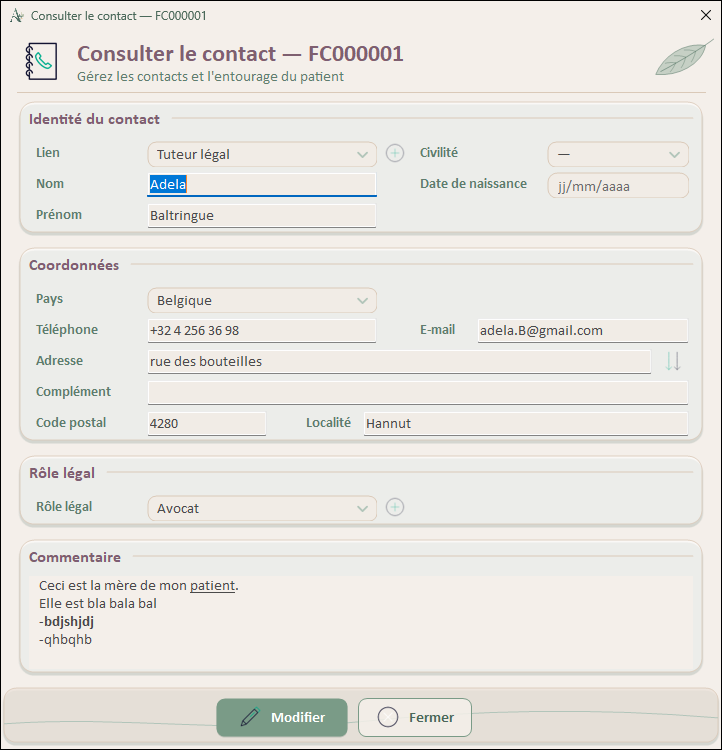

> Fichier : `UI/Forms/Patients/ContactEdition.vb` — hérite de `Form` — implémente `IContextAwareForm`.

#### Rôle général

`ContactEdition` est la Form modale de création / consultation / modification d'un contact de l'entourage d'un patient (table `famille_contacts`), ouverte depuis l'onglet « Famille / Contacts » de `UC_PatientFiche`.

Un contact existant s'ouvre en **consultation** (lecture seule) sur double-clic, et bascule en édition via le bouton **Modifier** (consultation d'abord — voir ADR-10).

#### Responsabilités

- Saisir le lien (référentiel `ref_liens_patient`), l'identité et les coordonnées du contact.
- Saisir le rôle légal (référentiel `ref_role_legal`) du contact.
- Saisir un commentaire enrichi (RTF + texte) via `UC_RichTextEditor`, profil Compact (D-Q7bis).
- Faire juger la saisie par le métier (`GestionFamilleContacts.ValiderContact` : lien et rôle légal choisis, nom et prénom, téléphone et code postal selon le pays, e-mail — audit C.2 étape 2b, 23/10/2026) et montrer les erreurs (`AffichageErreursSaisie`).
- Persister le contact via `GestionFamilleContacts` (création / mise à jour).
- Proposer l'ajout d'un lien ou d'un rôle manquant via les boutons [+] (référentiel en modal, auto-sélection).
- Copier rapidement l'adresse du patient vers le contact.

#### Dépendances

| Élément | Type | Rôle |
| --- | --- | --- |
| `UtilsTelephone` | Module utilitaire | Formatage/normalisation/validation du téléphone. |
| `UtilsValidation` | Module utilitaire | Validation e-mail. |
| `UC_LiensPatient` | UserControl | Référentiel des liens ouvert via [+]. |
| `IFenetrePrincipale` | Interface | Ouverture du référentiel en modal (droits + élévation), reçue en paramètre (ADR-55). |
| `GestionLog` | Module métier | Journalisation. |
| `GestionFamilleContacts` | Module métier | Persistance du contact ; `ValiderContact` (règles de la fiche, 23/10/2026). |
| `AffichageErreursSaisie` | Module utilitaire | Erreurs sur leurs champs (`errProvider` local), fenêtre récapitulative, focus (23/10/2026). |
| `GestionLiensPatient` | Module métier | Combo Lien (`ref_liens_patient`). |
| `UserControlContext` | Classe | — |
| `UtilsButtons` | Module utilitaire | — |
| `GestionRoleLegal` | Module métier | — |
| `DialogChoix` | Form | — |
| `Gestionnaires` | Module métier | — |
| `UC_RoleLegal` | UserControl | Référentiel des rôles légaux ouvert via [+]. |
| `UC_RichTextEditor` (profil Compact) | UserControl | Commentaire enrichi ; reçoit le contexte (horodatage signé). |
| `UC_PatientFiche` | UserControl | — |

#### Variables privées

| Variable | Type | Rôle |
| --- | --- | --- |
| `_context` | `UserControlContext` | Remarque : errProvider reste local (les icônes d'erreur doivent se positionner sur la modale). |
| `_idPatient` | `Long` | Identifiant du patient auquel le contact est rattaché. |
| `_patientCourant` | `Patient` | Patient courant (sert à la copie rapide de l'adresse vers le contact ; peut être Nothing). |
| `_fenetrePrincipale` | `IFenetrePrincipale` | Fenêtre principale (pour ouvrir le référentiel des liens via le bouton [+]) ; Nothing : [+] masqués (V1.9.0, ADR-55). |
| `_contact` | `FamilleContact` | Contact en cours d'édition (Nothing en création). |
| `_creation` | `Boolean` | Indique si l'on est en mode création (True) ou modification (False). |
| `_consultation` | `Boolean` | dès que l'utilisateur clique sur « Modifier » pour entrer en édition. |

> **V1.8.0 (24/10/2026, v2.57.0)** : les constantes `CodeLienParDefaut` (« MERE ») et `CodeRoleParDefaut` (« AUTORITE_PARENTALE ») sont retirées ; à la création, `SelectionnerLienParDefaut` / `SelectionnerRoleParDefaut` présélectionnent le lien et le rôle cochés « par défaut » dans leur référentiel (aucun coché : la liste reste sur sa première entrée).

> **UI-7 (14/10/2026)** : fond `AltheaFondFenetre.Appliquer(Me)` dans le constructeur (beige clair, petite feuille dessinée) ; cadres en `AltheaCarte`.

#### Contrôles principaux

| Contrôle | Type | Rôle |
| --- | --- | --- |
| `enTete` | AltheaEnTete | En-tête d'écran : titre « Contact », sous-titre « Gérez les contacts et l'entourage du patient » ; icône dans les ressources (`enTete.Icone`). |
| `grpIdentite` | AltheaCarte | Libellé : « Identité du contact » |
| `lblLien` | Label | Libellé : « Lien » |
| `cboLien` | AltheaListe | Lien + ajout au référentiel [+]. |
| `btnAjouterLien` | AltheaBouton (Outil, icône seule) | Lien + ajout au référentiel [+]. |
| `lblNom` | Label | Libellé : « Nom » |
| `txtNom` | TextBox | Identité. |
| `lblPrenom` | Label | Libellé : « Prénom » |
| `txtPrenom` | TextBox | Identité. |
| `lblDateNaissance` | Label | Libellé : « Date de naissance » |
| `dtpDateNaissance` | AltheaDate | Date de naissance, **facultative** (vide = inconnue, croix pour effacer) — UI-7, 14/10/2026. |
| `lblCivilite` / `cboCivilite` | Label / AltheaListe | Civilité (`ref_civilites`), à droite du lien (R2, 12/10/2026). |
| `grpCoordonnees` | AltheaCarte | Libellé : « Coordonnées » |
| `lblTelephone` | Label | Libellé : « Téléphone » |
| `txtTelephone` | TextBox | Coordonnées country-aware. |
| `lblEmail` | Label | Libellé : « E-mail » |
| `txtEmail` | TextBox | Coordonnées country-aware. |
| `lblPays` | Label | Libellé : « Pays » |
| `cboPays` | AltheaListe | Pays (`ref_pays`, liste fermée, `UtilsSaisieReferentiels`) ; son code ISO pilote les contrôles du téléphone et du code postal (v2.34.0, étape R2). |
| `lblAdresseLigne1` | Label | Libellé : « Adresse » |
| `txtAdresseLigne1` | TextBox | Adresse. |
| `btnCopierAdressePatient` | AltheaBouton (Outil, icône seule) | Copie l'adresse du patient. |
| `lblAdresseLigne2` | Label | Libellé : « Complément » |
| `txtAdresseLigne2` | TextBox | — |
| `lblCodePostal` | Label | Libellé : « Code postal » |
| `txtCodePostal` | TextBox | Adresse belge : code existant, localité proposée et suggérée depuis le code, code trouvé depuis la localité (choix « Liège · 4020 »), avertissement puis confirmation si elle ne correspond pas (`SaisieLocaliteBelge`, 24/10/2026). |
| `lblLocalite` | Label | Libellé : « Localité » |
| `txtLocalite` | TextBox | Adresse. |
| `grpRoles` | AltheaCarte | Libellé : « Rôle légal » |
| `lblRoleLegal` | Label | Libellé : « Rôle légal » |
| `cboRoleLegal` | AltheaListe | Rôle légal + ajout référentiel [+]. |
| `btnAjouterRole` | AltheaBouton (Outil, icône seule) | Rôle légal + ajout référentiel [+]. |
| `grpCommentaire` | AltheaCarte | Libellé : « Commentaire » |
| `rteCommentaire` | UC_RichTextEditor (profil Compact) | Commentaire enrichi. |
| `ttMain` | ToolTip | — |
| `errProvider` | ErrorProvider | — |
| `pnlAction` | AltheaBarreActions | — |
| `btnEnregistrer` | AltheaBouton | Validation / annulation (mode édition). |
| `btnAnnuler` | AltheaBouton | Validation / annulation (mode édition). |
| `btnModifier` | AltheaBouton | Passage en édition / fermeture (mode consultation). |
| `btnFermer` | AltheaBouton | Passage en édition / fermeture (mode consultation). |

#### Autres composants à utilité dédiée

| Composant | Type | Utilité |
| --- | --- | --- |
| `ttMain` | ToolTip | — |
| `errProvider` | ErrorProvider | — |

#### Méthodes principales

| Membre | Nature | Rôle |
| --- | --- | --- |
| `New` | Public Sub | Constructeur (mode Création, Consultation ou Modification). |
| `SetContext` | Public Sub | Reçoit le contexte UI partagé fourni par Home (barre de statut et infobulles communes). |
| `ContactEdition_Load` | Private Sub | Initialise les infobulles une fois le contexte injecté (les tooltips passent par _context lorsqu'il est disponible, sinon par le ToolTip local). Branche la garde des modifications non enregistrées (`GardeModifications.SurveillerFenetre`, 19/10/2026). |
| `InitialiserCombos` | Private Sub | Alimentation des combos. |
| `ChargerLiens` | Private Sub | Alimentation des combos. |
| `ChargerRolesLegaux` | Private Sub | Alimentation des combos. |
| `SelectionnerLienParDefaut` | Private Sub | Présélection. |
| `SelectionnerRoleParDefaut` | Private Sub | Présélection. |
| `InitialiserToolTips` | Private Sub | Initialise les aides contextuelles (infobulles) des boutons d'action du formulaire. |
| `DefinirToolTip` | Private Sub | Définit une infobulle en privilégiant le contexte partagé de Home (_context) pour harmoniser le comportement ; repli sur le ToolTip local (ttMain) si aucun contexte n'est injecté. |
| `InitialiserFenetre` | Private Sub | Applique le titre selon le mode et remplit les champs en modification. |
| `AppliquerMode` | Private Sub | Titre, visibilité des boutons et verrouillage des champs selon le mode. |
| `DefinirEtatChamps` | Private Sub | V2.0.0 (UI-7) : consultation lisible — `UtilsControls.DefinirLectureSeule` sur les cartes Identité, Coordonnées et Rôle légal ; mode lecture seule propre à l'éditeur du commentaire ; boutons [+] et copie d'adresse selon leur disponibilité. |
| `RemplirChamps` | Private Sub | Pré-remplissage en consultation/modification. |
| `CodePaysSaisi` | Private Function | Code ISO du pays choisi, pour les contrôles (pays et civilité chargés par `UtilsSaisieReferentiels`). |
| `ValiderSaisie` | Private Function | Fait juger la saisie par `GestionFamilleContacts.ValiderContact` ; erreurs montrées par `AffichageErreursSaisie.Signaler` (23/10/2026 : plus de copie des règles ici). |
| `ChampsDuContact` / `SupportIcone` | Private Function | Propriété du contact → contrôle ; l'icône d'erreur du lien et du rôle légal se pose sur leur bouton [+]. |
| `AlimenterContactDepuisChamps` | Private Sub | Recopie la saisie dans un contact (validation et enregistrement jugent la même chose, 23/10/2026). |
| `Enregistrer` | Private Sub | Valide puis crée ou met à jour ; un refus du métier (`ErreurValidationException`…) s'affiche dans une fenêtre, la saisie reste ouverte (V1.2.0, 23/10/2026). |
| `NormaliserTexte` | Private Function | Convertit une chaîne en valeur stockable : Nothing si vide/blanc, sinon la chaîne nettoyée. |
| `ControlerChampsPays` | Private Sub | Signal immédiat, non bloquant, du téléphone et du code postal selon le pays (sortie de champ) ; code belge inexistant compris, localité hors du code : avertissement (`SaisieLocaliteBelge`). |
| `btnEnregistrer_Click_1` | Private Sub | Gestionnaire d'événement Click de `btnEnregistrer`. |
| `btnAnnuler_Click` | Private Sub | Ferme la fenêtre sans enregistrer. |
| `btnModifier_Click` | Private Sub | Bascule en édition / fermeture de la consultation. |
| `btnFermer_Click` | Private Sub | Bascule en édition / fermeture de la consultation. |
| `txtTelephone_Leave` | Private Sub | Téléphone country-aware. |
| `cboPays_SelectedIndexChanged` | Private Sub | Téléphone country-aware. |
| `btnAjouterLien_Click` | Private Sub | Ouverture des référentiels via [+]. |
| `btnAjouterRole_Click` | Private Sub | Ouverture des référentiels via [+]. |
| `btnCopierAdressePatient_Click` | Private Sub | Copie de l'adresse du patient. |

#### Gestion des icônes

- `btnAjouterLien.Image` (Designer / ressources)
- `btnAjouterRole.Image` (Designer / ressources)
- `btnAnnuler.Image` (Designer / ressources)
- `btnCopierAdressePatient.Image` (Designer / ressources)
- `btnEnregistrer.Image` (Designer / ressources)
- `btnFermer.Image` (Designer / ressources)
- `btnModifier.Image` (Designer / ressources)
- `pnlAction.BackgroundImage` (Designer / ressources)

#### Gestion des droits

- Méthodes concernées : `ChargerRolesLegaux`, `SelectionnerRoleParDefaut`, `btnAjouterRole_Click`.

#### Règles en vigueur

- Tous les messages utilisateur passent par `DialogChoix` (jamais `MessageBox`).
- Aucun accès direct à la base : les lectures/écritures passent par la couche métier `Gestion*`.
- Les actions significatives sont journalisées via `GestionLog`.

#### Points d'attention

- Le patient doit être déjà enregistré (`idPatient > 0`) — garanti par l'activation progressive de la fiche.
- Téléphone et e-mail sont validés **selon le pays** sélectionné (`UtilsTelephone` / `UtilsValidation`).
- **Règles dans le métier** (ADR-51, 23/10/2026) : `GestionFamilleContacts.ValiderContact` est lue par la fenêtre et appliquée par `CreateContact` / `UpdateContact` ; toutes les erreurs s'affichent d'un coup (icône, fenêtre récapitulative).
- Les boutons [+] passent par `Home.OuvrirReferentielModal` (gestion des droits et élévation).
- **Harmonisation du contexte UI** : la Form implémente `IContextAwareForm` ; statut (`SetStatus`) et infobulles (`SetToolTip`) passent par le contexte partagé de `Home` (`_context`, avec repli local). L'`ErrorProvider` reste **local** (icônes positionnées sur la modale). Voir ADR-10 et `Rules.md` §15.
- **Consultation d'abord** : le double-clic ouvre le contact en lecture seule (champs et boutons annexes verrouillés) ; le bouton **Modifier** déverrouille tout. Le bouton **Ajouter** et le bouton **Modifier** de la grille ouvrent directement en édition.
- Retour `DialogResult.OK` après enregistrement réussi.
- Retour DialogResult.OK après enregistrement réussi
- Le patient doit être déjà enregistré (idPatient > 0) ; garanti par l'activation progressive
- Réutilise UtilsTelephone (téléphone/pays) et Home.OuvrirReferentielModal (droits + élévation)

#### Message au repreneur

> ContactEdition (996 lignes). Point d'entrée : `SetContext`, `ContactEdition_Load`, `InitialiserCombos`. Toute évolution de règle se fait d'abord dans `GestionFamilleContacts`, `GestionLiensPatient`, `GestionRoleLegal`, `Gestionnaires`, pas dans l'écran. Toute modification visuelle passe par le Designer (.Designer.vb / .resx).

---

### **Form : IntervenantEdition**

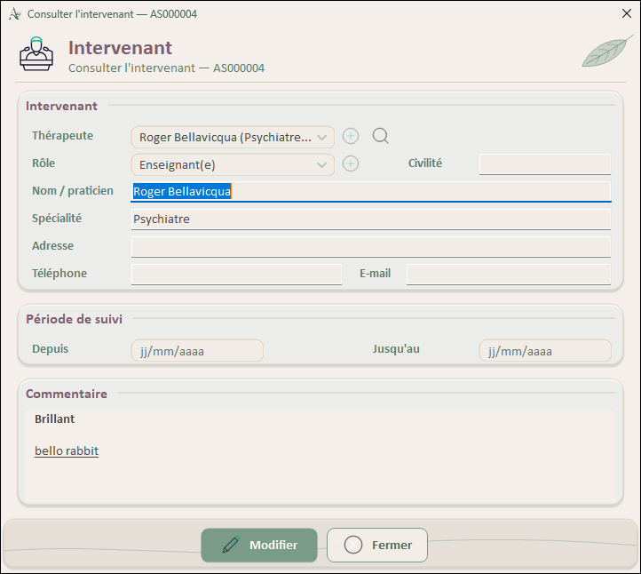

> Fichier : `UI/Forms/Patients/IntervenantEdition.vb` — hérite de `Form` — implémente `IContextAwareForm`.

#### Rôle général

`IntervenantEdition` est la Form modale de création / consultation / modification d'un intervenant du réseau de suivi d'un patient (table `autres_suivis_patient`, liaison N-N — D-Q1bis), ouverte depuis l'onglet « Intervenants » de `UC_PatientFiche`.

Un intervenant existant s'ouvre en **consultation** (lecture seule) sur double-clic, et bascule en édition via le bouton **Modifier** (consultation d'abord — voir ADR-10).

#### Responsabilités

- Sélectionner le **thérapeute** rattaché au suivi (référentiel `UC_Therapeutes`, obligatoire).
- Saisir le rôle de l'intervenant (référentiel `ref_roles_intervenant`, optionnel).
- Afficher la trace du thérapeute choisi (nom, spécialité, lieu figés avec le suivi) et ses coordonnées **actuelles** (téléphone, e-mail, adresse complète, lecture seule — e-mail et adresse ajoutés le 23/10/2026).
- Saisir la période de suivi (date de début, date de fin), toutes deux optionnelles.
- Saisir un commentaire enrichi (RTF + texte) via `UC_RichTextEditor`, profil Compact (D-Q7bis).
- Faire juger la saisie par le métier (`GestionSuivisIntervenants.ValiderSuivi` : thérapeute choisi, fin pas avant le début — audit C.2 étape 2b, 23/10/2026) et montrer les erreurs (`AffichageErreursSaisie`).
- Persister le suivi via `GestionSuivisIntervenants` (création / mise à jour).
- Proposer la **création directe** d'un thérapeute (`btnAjouterTherapeute`) ou l'ajout d'un rôle manquant via le bouton [+].
- Proposer la **consultation de la liste** des thérapeutes (`btnVoirTherapeutes`) pour voir ou compléter une fiche existante.

#### Dépendances

| Élément | Type | Rôle |
| --- | --- | --- |
| `UC_RolesIntervenant` | UserControl | Référentiel des rôles ouvert via [+]. |
| `IFenetrePrincipale` | Interface | Ouverture du référentiel en modal (droits + élévation), reçue en paramètre (ADR-55). |
| `GestionLog` | Module métier | Journalisation. |
| `GestionSuivisIntervenants` | Module métier | Persistance du suivi ; `ValiderSuivi` (règles de la fiche, 23/10/2026). |
| `AffichageErreursSaisie` | Module utilitaire | Erreurs sur leurs champs (`errProvider` local), fenêtre récapitulative, focus (23/10/2026). |
| `GestionRolesIntervenant` | Module métier | Combo Rôle (`ref_roles_intervenant`). |
| `UserControlContext` | Classe | — |
| `UtilsButtons` | Module utilitaire | — |
| `GestionTherapeutes` | Module métier | Combo Thérapeute (référentiel des thérapeutes). |
| `DialogChoix` | Form | — |
| `Gestionnaires` | Module métier | — |
| `UtilsTelephone` | Module utilitaire | — |
| `UC_RichTextEditor` (profil Compact) | UserControl | Commentaire enrichi ; reçoit le contexte (horodatage signé). |
| `UC_PatientFiche` | UserControl | — |
| `UC_Therapeutes` | UserControl | Référentiel des thérapeutes ouvert via [+]. |

#### Variables privées

| Variable | Type | Rôle |
| --- | --- | --- |
| `_context` | `UserControlContext` | Remarque : errProvider reste local (les icônes d'erreur doivent se positionner sur la modale). |
| `_idPatient` | `Long` | Identifiant du patient auquel l'intervenant est rattaché. |
| `_fenetrePrincipale` | `IFenetrePrincipale` | Fenêtre principale (pour ouvrir le référentiel des rôles via le bouton [+]) ; Nothing : [+] masqués (V1.8.0, ADR-55). |
| `_suivi` | `SuiviIntervenant` | Suivi en cours d'édition (Nothing en création). |
| `_creation` | `Boolean` | Indique si l'on est en mode création (True) ou modification (False). |
| `_consultation` | `Boolean` | dès que l'utilisateur clique sur « Modifier » pour entrer en édition. |
| `_chargementEnCours` | `Boolean` | du snapshot déclenché par cboTherapeute.SelectedIndexChanged (évite d'écraser la trace). |
| `_idCiviliteTrace` | `ULong?` | Civilité de la trace (thérapeute choisi, ou suivi enregistré). |
| `_lieuTrace` | `String` | Lieu de la trace : localité du thérapeute choisi, ou lieu du suivi enregistré ; n'est plus affiché tel quel (la case Adresse montre l'adresse actuelle, V1.6.0, 23/10/2026). |
| `IdRoleNonPrecise` | `Const ULong = 0UL` | — |
| `IdTherapeuteNonSelectionne` | `Const Long = 0L` | — |

> **UI-7 (14/10/2026)** : fond `AltheaFondFenetre.Appliquer(Me)` dans le constructeur (beige clair, petite feuille dessinée) ; cadres en `AltheaCarte`.

#### Contrôles principaux

| Contrôle | Type | Rôle |
| --- | --- | --- |
| `enTete` | AltheaEnTete | En-tête d'écran : titre « Intervenant », sous-titre « Gérez les intervenants dans le suivi des patients » ; icône dans les ressources (`enTete.Icone`). |
| `grpIntervenant` | AltheaCarte | Libellé : « Intervenant » |
| `lblTherapeute` | Label | Libellé : « Thérapeute » |
| `cboTherapeute` | AltheaListe | Thérapeute (obligatoire) + création directe d'un thérapeute. |
| `btnAjouterTherapeute` | AltheaBouton (Outil, icône seule) | Thérapeute (obligatoire) + création directe d'un thérapeute. |
| `lblRole` | Label | Libellé : « Rôle » |
| `cboRole` | AltheaListe | Rôle (optionnel) + ajout [+]. |
| `btnAjouterRole` | AltheaBouton (Outil, icône seule) | Rôle (optionnel) + ajout [+]. |
| `lblNomProfessionnel` | Label | Libellé : « Nom / praticien » |
| `txtNomProfessionnel` | TextBox | Identité texte libre (snapshot du thérapeute, ReadOnly). |
| `lblCivilite` / `txtCivilite` | Label / TextBox | Civilité reprise du thérapeute (trace, ReadOnly) ; identifiant conservé dans `_idCiviliteTrace` et enregistré dans `autres_suivis_patient.id_civilite` (R2, 12/10/2026). |
| `lblSpecialite` | Label | Libellé : « Spécialité » |
| `txtSpecialite` | TextBox | Identité texte libre (snapshot du thérapeute, ReadOnly). |
| `lblAdresse` / `txtAdresse` | Label / TextBox | « Adresse » (ex-« Lieu », 23/10/2026) : adresse complète actuelle du thérapeute (lecture seule) ; sans thérapeute, le lieu figé du suivi. |
| `txtEmail` | TextBox | E-mail actuel du thérapeute (lecture seule, 23/10/2026). |
| `grpPeriode` | AltheaCarte | Libellé : « Période de suivi » |
| `lblDateDebut` | Label | Libellé : « Depuis » |
| `dtpDateDebut` | AltheaDate | Période de suivi, **facultative** (vide + croix) ; la fin ne peut pas précéder le début (`GestionSuivisIntervenants.ValiderSuivi`). |
| `lblDateFin` | Label | Libellé : « Jusqu'au » |
| `dtpDateFin` | AltheaDate | Période de suivi, **facultative** (vide + croix). |
| `grpCommentaire` | AltheaCarte | Libellé : « Commentaire » |
| `rteCommentaire` | UC_RichTextEditor (profil Compact) | Commentaire enrichi. |
| `ttMain` | ToolTip | — |
| `errProvider` | ErrorProvider | — |
| `lblTelephone` | Label | Libellé : « Téléphone » |
| `txtTelephone` | TextBox | Téléphone actuel du thérapeute lié, présenté selon son pays (lecture seule ; pas de copie figée, 20/10/2026). |
| `pnlAction` | AltheaBarreActions | — |
| `btnEnregistrer` | AltheaBouton | Validation / annulation (mode édition). |
| `btnAnnuler` | AltheaBouton | Validation / annulation (mode édition). |
| `btnModifier` | AltheaBouton | Passage en édition / fermeture (mode consultation). |
| `btnFermer` | AltheaBouton | Passage en édition / fermeture (mode consultation). |
| `btnVoirTherapeutes` | AltheaBouton (Outil, icône seule) | Consultation de la liste des thérapeutes (voir / compléter une fiche). |

#### Autres composants à utilité dédiée

| Composant | Type | Utilité |
| --- | --- | --- |
| `ttMain` | ToolTip | — |
| `errProvider` | ErrorProvider | — |

#### Méthodes principales

| Membre | Nature | Rôle |
| --- | --- | --- |
| `New` | Public Sub | Constructeur (mode Création, Consultation ou Modification). |
| `SetContext` | Public Sub | Contexte UI partagé : statut et infobulles via `_context` (repli local). |
| `IntervenantEdition_Load` | Private Sub | Initialise les infobulles une fois le contexte injecté (les tooltips passent par _context lorsqu'il est disponible, sinon par le ToolTip local). Branche la garde des modifications non enregistrées (`GardeModifications.SurveillerFenetre`, 19/10/2026). |
| `InitialiserCombos` | Private Sub | Alimentation des combos. |
| `ChargerTherapeutes` | Private Sub | Alimentation des combos. |
| `ChargerRoles` | Private Sub | Alimentation des combos. |
| `InitialiserToolTips` | Private Sub | Initialise les aides contextuelles (infobulles) des boutons d'action du formulaire. |
| `DefinirToolTip` | Private Sub | Contexte UI partagé : statut et infobulles via `_context` (repli local). |
| `InitialiserFenetre` | Private Sub | Applique le titre selon le mode et remplit les champs en modification. |
| `AppliquerMode` | Private Sub | Titre, visibilité des boutons et verrouillage des champs selon le mode. |
| `DefinirEtatChamps` | Private Sub | V2.0.0 (UI-7) : listes du kit activées ou non (lisibles désactivées), carte Période via `UtilsControls.DefinirLectureSeule` ; les champs de trace restent en lecture seule (fond teinté) — `DefinirLectureSeule` n'est volontairement pas appliqué à la carte Intervenant, il les rendrait modifiables. |
| `RemplirChamps` | Private Sub | Pré-remplissage en consultation/modification. |
| `ValiderSaisie` | Private Function | Fait juger la saisie par `GestionSuivisIntervenants.ValiderSuivi` ; erreurs montrées par `AffichageErreursSaisie.Signaler` (23/10/2026 : plus de copie des règles ici). |
| `ChampsDuSuivi` | Private Function | Propriété du suivi → contrôle (`cboTherapeute`, `dtpDateFin`). |
| `AlimenterSuiviDepuisChamps` | Private Sub | Recopie la saisie dans un suivi ; le lieu enregistré reste la localité figée (`_lieuTrace`), pas l'adresse affichée (23/10/2026). |
| `Enregistrer` | Private Sub | Valide puis crée ou met à jour ; un refus du métier s'affiche dans une fenêtre, la saisie reste ouverte (23/10/2026). |
| `TherapeuteSelectionne` | Private Function | Retourne l'identifiant du thérapeute sélectionné, ou Nothing si l'entrée sentinelle « (sélectionner…) » est choisie (aucun thérapeute valide). |
| `RoleSelectionne` | Private Function | Retourne l'identifiant du rôle sélectionné, ou Nothing si l'entrée « (non précisé) » est choisie. |
| `NormaliserTexte` | Private Function | Convertit une chaîne en valeur stockable : Nothing si vide/blanc, sinon la chaîne nettoyée. |
| `btnEnregistrer_Click` | Private Sub | Déclenche la validation et l'enregistrement du suivi. |
| `btnAnnuler_Click` | Private Sub | Ferme la fenêtre sans enregistrer. |
| `btnModifier_Click` | Private Sub | Bascule en édition / fermeture de la consultation. |
| `btnFermer_Click` | Private Sub | Bascule en édition / fermeture de la consultation. |
| `cboTherapeute_SelectedIndexChanged` | Private Sub | Auto-remplissage du snapshot depuis le thérapeute choisi. |
| `AppliquerSnapshotTherapeute` | Private Sub | Auto-remplissage du snapshot depuis le thérapeute choisi ; lieu figé en `_lieuTrace` (V1.1.0, 23/10/2026). |
| `AfficherCoordonnees` | Private Sub | Coordonnées actuelles du thérapeute (téléphone selon son pays, e-mail, adresse complète) ; remplace `AfficherTelephone` (23/10/2026). |
| `btnAjouterRole_Click` | Private Sub | Ouverture du référentiel des rôles via [+]. |
| `btnAjouterTherapeute_Click` | Private Sub | Création **directe** d'un thérapeute (`Home.OuvrirCreationTherapeuteModal`) puis présélection dans le combo. |
| `btnVoirTherapeutes_Click` | Private Sub | Ouverture de la **liste** `UC_Therapeutes` (consultation), puis rechargement du combo en préservant la sélection. |

#### Gestion des icônes

- `btnAjouterRole.Image` (Designer / ressources)
- `btnAjouterTherapeute.Image` (Designer / ressources)
- `btnAnnuler.Image` (Designer / ressources)
- `btnEnregistrer.Image` (Designer / ressources)
- `btnFermer.Image` (Designer / ressources)
- `btnModifier.Image` (Designer / ressources)
- `btnVoirTherapeutes.Image` (Designer / ressources)
- `pnlAction.BackgroundImage` (Designer / ressources)

#### Gestion des droits

- Méthodes concernées : `ChargerRoles`, `RoleSelectionne`, `btnAjouterRole_Click`.

#### Règles en vigueur

- Tous les messages utilisateur passent par `DialogChoix` (jamais `MessageBox`).
- Aucun accès direct à la base : les lectures/écritures passent par la couche métier `Gestion*`.
- Les actions significatives sont journalisées via `GestionLog`.

#### Points d'attention

- Le **thérapeute est obligatoire** (sentinelle `IdTherapeuteNonSelectionne = 0` invalide la saisie) ; le rôle est optionnel (`IdRoleNonPrecise = 0`).
- En V1, `id_therapeute` du snapshot reste cohérent avec le référentiel ; la sélection d'un thérapeute remplit automatiquement nom/spécialité/lieu via `AppliquerSnapshotTherapeute` (neutralisé pendant le chargement par `_chargementEnCours`).
  - Le lieu enregistré reste la localité du thérapeute (`Therapeute.Localite`) ; téléphone, e-mail et adresse affichés (`Therapeute.AdresseUneLigne`) sont ceux, actuels, du thérapeute (`AfficherCoordonnees`).
- **Règles dans le métier** (ADR-51, 23/10/2026) : `GestionSuivisIntervenants.ValiderSuivi` est lue par la fenêtre et appliquée par `CreateSuivi` / `UpdateSuivi`.
- Le patient doit être déjà enregistré (`idPatient > 0`).
- Le bouton `btnAjouterTherapeute` ouvre **directement** la création d'un thérapeute (`Home.OuvrirCreationTherapeuteModal`) et présélectionne le thérapeute créé.
- Le bouton `btnVoirTherapeutes` ouvre la **liste** `UC_Therapeutes` (consultation) via `Home.OuvrirReferentielModal`.
- Le bouton `btnAjouterRole` ([+]) passe aussi par `Home.OuvrirReferentielModal` (droits + élévation).
- **Harmonisation du contexte UI** : la Form implémente `IContextAwareForm` ; statut (`SetStatus`) et infobulles (`SetToolTip`) passent par le contexte partagé de `Home` (`_context`, avec repli local). L'`ErrorProvider` reste **local** (icônes positionnées sur la modale). Voir ADR-10 et `Rules.md` §15.
- **Consultation d'abord** : le double-clic ouvre l'intervenant en lecture seule (combos, dates, commentaire et boutons annexes verrouillés) ; le bouton **Modifier** déverrouille la saisie.
  - Les champs snapshot (nom professionnel, spécialité, lieu, téléphone) restent `ReadOnly` en permanence (trace pilotée par la sélection du thérapeute).
  - Le bouton `btnVoirTherapeutes` reste actif même en consultation (consultation pure).
  - Le bouton **Ajouter** et le bouton **Modifier** de la grille ouvrent directement en édition.
- Retour `DialogResult.OK` après enregistrement réussi.
- Retour DialogResult.OK après enregistrement réussi
- Le patient doit être déjà enregistré (idPatient > 0) ; garanti par l'activation progressive
- En V1, id_therapeute reste NULL (saisie texte libre via le nom)
- Réutilise Home.OuvrirReferentielModal (droits + élévation) pour le bouton [+]

#### Message au repreneur

> IntervenantEdition (1040 lignes). Point d'entrée : `SetContext`, `IntervenantEdition_Load`, `InitialiserCombos`. Toute évolution de règle se fait d'abord dans `GestionSuivisIntervenants`, `GestionRolesIntervenant`, `GestionTherapeutes`, `Gestionnaires`, pas dans l'écran. Toute modification visuelle passe par le Designer (.Designer.vb / .resx).

---

### **Form : DossierZoneEditor**

> Fichier : `UI/Forms/Dossiers/DossierZoneEditor.vb` — hérite de `Form` — implémente `IContextAwareForm`.

#### Rôle général

`DossierZoneEditor` édite une seule zone clinique du dossier, sélectionnée via l'énumération `ZoneDossier`. La modale utilise `UC_RichTextEditor` afin de stocker le contenu enrichi et son équivalent texte brut, et de proposer les exports contextuels PDF/Word.

#### Responsabilités

- Charger et enregistrer la zone demandée via `GestionDossiers`.
- Proposer l'édition RTF, l'impression et les exports PDF/Word dans le répertoire déterministe du dossier.
- Passer en lecture seule pour les dossiers archivés et pour `HistoriqueArchive`.

#### Dépendances

| Élément | Type | Rôle |
| --- | --- | --- |
| `UC_RichTextEditor` | UserControl | Édition enrichie et demandes d'export. |
| `GestionLog` | Module métier | journalisation |
| `GestionDossiers` | Module métier | Lecture et mise à jour ciblée de la zone. |
| `UserControlContext` | Classe | — |
| `DialogChoix` | Form | — |
| `GestionDocuments` | Module métier | Chemins déterministes et traçabilité des exports. |

#### Variables privées

| Variable | Type | Rôle |
| --- | --- | --- |
| `_context` | `UserControlContext` | Contexte UI partagé fourni par l'appelant (barre de statut, infobulles). Peut être Nothing. |
| `_idDossier` | `Long` | Identifiant du dossier propriétaire de la zone. |
| `_zone` | `ZoneDossier` | Zone clinique éditée. |
| `_info` | `ZoneDossierInfo` | Métadonnées (libellé, lecture seule) de la zone éditée. |
| `_codePatient` | `String` | Code patient propriétaire du dossier (pour l'export documentaire déterministe). |
| `_codeDossier` | `String` | Code du dossier (pour l'export documentaire déterministe). |
| `_lectureSeuleForcee` | `Boolean` | Force la lecture seule quel que soit le type de zone (ex. dossier archivé, D-Q10). |

#### Contrôles principaux

| Contrôle | Type | Rôle |
| --- | --- | --- |
| `enTete` | AltheaEnTete | En-tête d'écran : titre « Dossier », sous-titre « Zone clinique — dossier *code* » (« Zone clinique » si le code n'est pas transmis) ; icône dans les ressources (`enTete.Icone`). |
| `carteZone` | AltheaCarte | Carte ancrée sur les quatre bords, titrée par le nom de la zone (« (consultation) » ajouté en lecture seule). |
| `rteZone` | UC_RichTextEditor (profil Complet) | Éditeur de la zone (remplit la carte) ; reçoit le contexte (horodatage signé), `TitreDocument` = libellé de la zone, barre de consultation pour une zone d'archive. |
| `pnlActions` | AltheaBarreActions | Barre d'actions de la fenêtre. |
| `btnEnregistrer` | AltheaBouton | Enregistrer le contenu de la zone. |
| `btnFermer` | AltheaBouton | Fermer la fenêtre. |

#### Méthodes principales

| Membre | Nature | Rôle |
| --- | --- | --- |
| `New` | Public Sub | — |
| `SetContext` | Public Sub | Reçoit le contexte UI partagé fourni par l'appelant. |
| `DossierZoneEditor_Load` | Private Sub | Pose le fond et la barre de titre du kit, les titres (carte = nom de la zone), le mode lecture seule éventuel, et charge le contenu de la zone. Branche la garde des modifications non enregistrées (`GardeModifications.SurveillerFenetre`, 19/10/2026). Remplace l'avertissement Oui / Non et son suivi par `ContentChanged`. En-tête des documents : titre « zone — dossier D… », patient reçu du constructeur (paramètre `patient`, transmis par `UC_DossierFiche.ZoneBouton_Click`). |
| `ChargerContenu` | Private Sub | Charge le contenu (RTF + texte brut de repli) de la zone dans l'éditeur. |
| `btnEnregistrer_Click` | Private Sub | Enregistre le contenu de la zone via la couche métier puis ferme la modale (DialogResult.OK). Un refus du métier (dossier archivé : tout est refusé, zones comprises) ou un échec s'affiche dans une fenêtre ; la fenêtre reste ouverte, le texte saisi n'est pas perdu (V1.7.0, 22/10/2026, audit C.1). |
| `btnFermer_Click` | Private Sub | Ferme la modale sans enregistrer (DialogResult.Cancel). |
| `rteZone_ExportRequested` | Private Sub | Fournit (par délégation) le chemin de destination déterministe pour l'export de la zone : dossier du dossier de suivi ({…}/Documents/{code_patient}/{code_dossier}) et nom horodaté |
| `rteZone_ExportCompleted` | Private Sub | Ouvre automatiquement le fichier exporté (PDF/Word) après un export contextuel réussi. |
| `TracerDocumentExporte` | Private Sub | Insère une trace dans la table documents pour l'export de la zone clinique (niveau dossier). |

#### Gestion des icônes

- `$this.Icon` (Designer / ressources)
- `btnEnregistrer.Image` (Designer / ressources)
- `btnFermer.Image` (Designer / ressources)
- `enTete.Icone` (Designer / ressources)
- Fond : `AltheaFondFenetre.Appliquer(Me)` au chargement (beige clair à la feuille, barre de titre du kit) ; plus d'image de fond (UI-7, 15/10/2026)

#### Règles en vigueur

- La zone HistoriqueArchive est en lecture seule (D-DOS-4) : le bouton Enregistrer est masqué.
- Aucun accès base direct : délègue à GestionDossiers (couche métier).

#### Points d'attention

- Aucun point particulier identifié à ce jour.

#### Message au repreneur

> DossierZoneEditor (486 lignes). Point d'entrée : `SetContext`, `DossierZoneEditor_Load`. Toute évolution de règle se fait d'abord dans `GestionDossiers`, `GestionDocuments`, pas dans l'écran. Toute modification visuelle passe par le Designer (.Designer.vb / .resx).

---

### **Form : DossierStatutEditor**

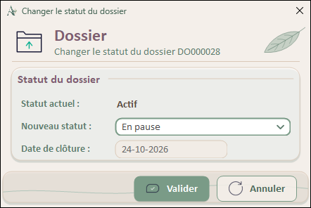

> Fichier : `UI/Forms/Dossiers/DossierStatutEditor.vb` — hérite de `Form` — implémente `IContextAwareForm`.

#### Rôle général

`DossierStatutEditor` propose les seules transitions autorisées depuis le statut courant du dossier. La transition est ensuite contrôlée (clôture : `GestionDossiers.ControlerCloture`), confirmée et appliquée par `UC_DossierFiche` via `GestionDossiers.ChangerStatutDossier`.

#### Responsabilités

- Charger les transitions possibles depuis `GestionDossiers.GetTransitionsPossibles`.
- Demander une date de clôture uniquement lorsque la cible est **Clôturé**.
- Exposer le code du statut cible et la date choisie avec `DialogResult.OK` après validation.

#### Dépendances

| Élément | Type | Rôle |
| --- | --- | --- |
| `GestionDossiers` | Module métier | transitions possibles |
| `GestionStatutsDossier` | Module métier | libellés des statuts |
| `DialogChoix` | Form | messages), UserControlContext (contexte UI partagé |
| `UserControlContext` | Classe | — |
| `UC_DossierFiche` | UserControl | — |

#### Variables privées

| Variable | Type | Rôle |
| --- | --- | --- |
| `CODE_STATUT_CLOTURE` | `Const String = "CLOTURE"` | — |
| `_context` | `UserControlContext` | Contexte UI partagé fourni par l'appelant (peut être Nothing). |
| `_codeStatutCourant` | `String` | Code du statut courant du dossier (source des transitions possibles). |
| `_libelleStatutCourant` | `String` | Libellé du statut courant (affichage). |

#### Contrôles principaux

| Contrôle | Type | Rôle |
| --- | --- | --- |
| `enTete` | AltheaEnTete | En-tête d'écran : titre « Dossier », sous-titre « Changer le statut » ; icône dans les ressources (`enTete.Icone`). |
| `lblStatutCourantLibelle` | Label | Libellé : « Statut actuel : » |
| `lblStatutCourantValeur` | Label | Libellé : « — » |
| `lblNouveauStatut` | Label | Libellé : « Nouveau statut : » |
| `carteStatut` | AltheaCarte | Carte « Statut du dossier » (UI-7, 15/10/2026). |
| `cboStatutCible` | AltheaListe | Statuts cibles autorisés (transitions légales). |
| `lblDateCloture` | Label | Libellé : « Date de clôture : » |
| `dtpDateCloture` | AltheaDate | Date de clôture (obligatoire, bornée à aujourd'hui par `DateMax`) ; active seulement pour la cible « Clôturé » ; lue par `DateClotureSaisie`. |
| `pnlActions` | AltheaBarreActions | — |
| `btnValider` | AltheaBouton | Appliquer le changement de statut sélectionné. |
| `btnAnnuler` | AltheaBouton | Annuler sans changer le statut. |

#### Méthodes principales

| Membre | Nature | Rôle |
| --- | --- | --- |
| `Code` | Public Property | — |
| `Libelle` | Public Property | — |
| `New` | Public Sub | — |
| `ToString` | Public Overrides Function | — |
| `CodeStatutCible` | Public ReadOnly Property | — |
| `DateClotureChoisie` | Public ReadOnly Property | — |
| `SetContext` | Public Sub | Reçoit le contexte UI partagé fourni par l'appelant (avant ShowDialog). |
| `DossierStatutEditor_Load` | Private Sub | Renseigne le statut courant et charge les transitions légales dans la combo. |
| `ChargerTransitions` | Private Sub | Charge les statuts cibles autorisés depuis la couche métier et les affiche dans la combo. |
| `cboStatutCible_SelectedIndexChanged` | Private Sub | Active/désactive la date de clôture selon la cible sélectionnée. |
| `MettreAJourDateCloture` | Private Sub | N'active la saisie de la date de clôture que si la cible sélectionnée est « Clôturé » ; le libellé reste lisible (V1.1.0, 15/10/2026). |
| `btnValider_Click` | Private Sub | Valide la saisie puis ferme la modale en DialogResult.OK si une cible est sélectionnée. |
| `btnAnnuler_Click` | Private Sub | Ferme la modale sans appliquer de changement. |

#### Gestion des icônes

- `$this.Icon` (Designer / ressources)
- `btnAnnuler.Image` (Designer / ressources)
- `btnValider.Image` (Designer / ressources)
- `enTete.Icone` (Designer / ressources)
- `pnlActions.BackgroundImage` (Designer / ressources)

#### Règles en vigueur

- Aucun accès base direct : la persistance reste dans la couche métier (appelée par l'appelant)
- La modale renvoie DialogResult.OK uniquement si une transition valide a été confirmée

#### Points d'attention

- Aucun point particulier identifié à ce jour.

#### Message au repreneur

> DossierStatutEditor (299 lignes). Point d'entrée : `SetContext`, `DossierStatutEditor_Load`. Toute évolution de règle se fait d'abord dans `GestionDossiers`, `GestionStatutsDossier`, pas dans l'écran. Toute modification visuelle passe par le Designer (.Designer.vb / .resx).

---

### **Form : SeanceEditor**

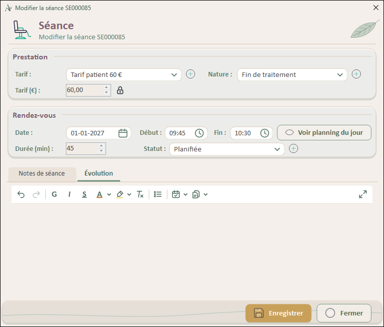

> Fichier : `UI/Forms/Dossiers/SeanceEditor.vb` — hérite de `Form` — implémente `IContextAwareForm`.

#### Rôle général

`SeanceEditor` est la Form modale de création et de modification d'une séance liée à un dossier. Elle est ouverte depuis l'onglet **Séances** de `UC_DossierFiche` et retourne `DialogResult.OK` après une sauvegarde réussie.

#### Responsabilités

- Saisir la nature de séance, la date, les horaires, la durée, le tarif et le statut.
- Alimenter les combos de nature et de tarif depuis les référentiels et liaisons autorisés pour le domaine du dossier, ainsi que le statut de séance.
- Résoudre le tarif applicable (tarif patient du dossier, convention du domaine, no-show), puis le figer dans la séance ; le montant n’est modifiable que via le cadenas.
- Proposer l’ajout **en contexte** d’une nature, d’un prix ou d’un statut manquant via les boutons [+].
- Consulter le planning du jour et signaler les chevauchements de créneau, jugés par le métier (`GestionSeances.ChercherChevauchement`, qui refuse aussi l'enregistrement — audit C.2 étape 1, 22/10/2026).
- Proposer les statuts permis par le métier (`GestionSeances.StatutsProposes`) ; pointer ici une séance « À confirmer » (planifiée passée, ADR-47) en choisissant son statut réel.
- Enregistrer l'identité de la séance, ses notes, son évolution (RTF + texte brut), son statut et son dû en une seule transaction (`GestionSeances.EnregistrerSeance`, audit B.2, 21/10/2026).
- Après un statut non dû sur une séance encaissée, proposer l'utilisation de l'avoir créé (`DialogUtilisationAvoir`, 21/10/2026).
- Forcer le mode lecture seule si le dossier est archivé.

#### Dépendances

| Élément | Type | Rôle |
| --- | --- | --- |
| `UC_RichTextEditor` (profil Compact) | UserControl | Éditeurs Notes de séance et Évolution ; reçoivent le contexte (horodatage signé). |
| `GestionLog` | Module métier | journalisation |
| `GestionSeances` | Module métier | `EnregistrerSeance` (identité, notes, statut et dû en une transaction, `ContexteOperation`), `StatutsProposes`, `ChercherChevauchement`, `SeanceEstVerrouillee`, `CODE_STATUT_PLANIFIEE`. |
| `Autorisation` | Module métier | `Possede` : cadenas du montant réservé au SuperUser (rôle courant, élévation comprise, 22/10/2026). |
| `GestionNaturesSeance` | Module métier | Nature de séance, filtrée selon le domaine. |
| `GestionStatutsSeance` | Module métier | Combo Statut. |
| `UserControlContext` | Classe | Contexte UI partagé. |
| `UtilsButtons` | Module utilitaire | Style et états visuels uniformes des boutons. |
| `GestionDossiers` | Module métier | Lecture du dossier (domaine, statut) pour filtrer natures et tarifs. |
| `GestionPrixSeance` | Module métier | Résolution et proposition du tarif daté. |
| `GestionTarification` | Module métier | Résolution et proposition du tarif daté. |
| `GestionPaiements` | Module métier | Contrôle des paiements existants avant modification de montant ou de statut. |
| `AppRole` | Enum | Rôles applicatifs utilisés pour les contrôles de droits. |
| `DialogChoix` | Form | Messages et confirmations utilisateur (remplace MessageBox). |
| `GestionPatients` | Module métier | Lecture du patient pour le bandeau d'identité. |
| `GestionQuotaInami` | Module métier | Calcul et affichage du quota INAMI de la période. |
| `PlanningJourViewer` | Form | Visualisation des créneaux de la journée sélectionnée. |
| `UC_PrixSeance` | UserControl | Ajout d'une valeur de référentiel en contexte via les boutons [+]. |
| `UC_NaturesSeance` | UserControl | Ajout d'une valeur de référentiel en contexte via les boutons [+]. |
| `UC_StatutsSeance` | UserControl | Ajout d'une valeur de référentiel en contexte via les boutons [+]. |
| `DialogUtilisationAvoir` | Form | Ouvert depuis ce composant (`ProposerApresChangementStatut`). |
| `UC_DossierFiche` | UserControl | Écran appelant ; recharge ses grilles après validation. |

#### Variables privées

| Variable | Type | Rôle |
| --- | --- | --- |
| `_dureeSeanceMinutes` | `ReadOnly Integer = GestionSeances.DureeSeanceParDefaut()` | Durée standard d'une séance, lue à l'ouverture (paramètre `SEANCE_DUREE_DEFAUT_MIN`, source unique côté métier). |
| `PAS_GRILLE_HORAIRE_MINUTES` | `Const Integer = 15` | Pas de la grille d'heures proposées (15 min). |
| `_context` | `UserControlContext` | Contexte UI partagé fourni par l'appelant (barre de statut, infobulles). Peut être Nothing. |
| `_idDossier` | `Long` | Identifiant du dossier auquel la séance est rattachée (obligatoire, > 0). |
| `_idSeance` | `Long` | Identifiant de la séance éditée (0 en création). |
| `_seance` | `Seance` | Séance en cours d'édition (Nothing en création tant qu'aucune n'est chargée). |
| `_creation` | `Boolean` | Indique si l'on est en mode création (True) ou modification (False). |
| `_lectureSeuleForcee` | `Boolean` | Force la lecture seule quel que soit le mode (ex. dossier archivé, D-Q10). |
| `_chargementEnCours` | `Boolean` | Empêche le pré-remplissage automatique du tarif pendant le chargement initial. |
| `_heureDebutPrecedente` | `TimeSpan?` | Memorise la derniere heure de debut connue, pour decaler l'heure de fin en conservant la duree. |
| `_idDomaine` | `Long` | Domaine du dossier (sert à filtrer les tarifs proposés via ref_prix_seance / lia_prix_seance_domaines). |
| `_tarifDeverrouille` | `Boolean` | Indique si le tarif a été déverrouillé pour édition manuelle (prix d'ami / cas particulier). |
| `_montantHorsTarifConserve` | `Boolean` | Montant enregistré différent du tarif attendu : conservé tel quel, un changement de statut ne le réaligne pas (décision de Joëlle, 22/10/2026) ; seul le cadenas le change. |
| `MONTANT_RESERVE_SUPERUSER` | `Const String` | Raison du cadenas inactif pour un utilisateur simple. |
| `_fenetrePrincipale` | `IFenetrePrincipale` | Fenêtre principale, nécessaire pour ouvrir un référentiel en contexte ([+]). Peut être Nothing (contrat depuis le 25/10/2026, ADR-55). |
| `_seanceVerrouillee` | `Boolean` | Indique que la séance est soldée (statut dû + paiement encaissé) et donc verrouillée en écriture. |
| `_verrouLeveManuellement` | `Boolean` | Indique qu'un SuperUser a levé manuellement le verrou d'une séance soldée pour cette session d'édition. |
| `_iconeCadenasFerme` / `_iconeCadenasOuvert` | `Image` | Icônes du cadenas, chargées une fois, libérées par `SeanceEditor_FormClosed`. |

#### Contrôles principaux

> **UI-7 (15/10/2026)** :
>
> - fond `AltheaFondFenetre`
> - champs en deux cartes — `cartePrestation` « Prestation » (tarif, nature, montant et cadenas) et `carteRendezVous` « Rendez-vous » (date, heures, planning du jour, durée, statut)
> - listes `AltheaListe`, date `AltheaDate`
> - [+] et cadenas en `AltheaBouton` Outil à icône seule (sans `UtilsButtons`), planning du jour en `AltheaBouton` Clair
> - saisie ouverte ou fermée par `DefinirSaisieActive` (consultation lisible).
>
> Restent Windows : les deux listes d'heures (champ d'heure du kit à venir) et les deux `NumericUpDown`.

| Contrôle | Type | Rôle |
| --- | --- | --- |
| `enTete` | AltheaEnTete | En-tête d'écran : titre « Séance », sous-titre « Gérez les séances et les notes de séances » ; icône dans les ressources (`enTete.Icone`). |
| `lblPrixSeance` | Label | Libellé : « Tarif : » |
| `cboPrixSeance` | AltheaListe | Nature autorisée, prix résolu/proposé et statut. |
| `lblNatureSeance` | Label | Libellé : « Nature : » |
| `cboNatureSeance` | AltheaListe | Nature autorisée, prix résolu/proposé et statut. |
| `btnAjouterPrixSeance` | AltheaBouton (Outil, icône seule) | Boutons [+] pour les référentiels associés. |
| `btnAjouterNatureSeance` | AltheaBouton (Outil, icône seule) | Boutons [+] pour les référentiels associés. |
| `btnDeverrouillerTarif` | AltheaBouton (Outil, icône seule) | Cadenas du tarif : icône fermée (tarif imposé) ou ouverte (saisie manuelle), `cadenas_24_normal` / `cadenas_ouvert_24_normal` (`Assets/Ico_divers`), posée par `AfficherEtatCadenas`. Grisé pour un utilisateur simple, avec la raison au survol (`MONTANT_RESERVE_SUPERUSER`, V1.9.0, 22/10/2026 : il était ouvert à tous). |
| `btnAjouterStatutSeance` | AltheaBouton (Outil, icône seule) | Boutons [+] pour les référentiels associés. |
| `lblStatutSeance` | Label | Libellé : « Statut : » |
| `cboStatutSeance` | AltheaListe | Nature autorisée, prix résolu/proposé et statut. |
| `lblDateSeance` | Label | Libellé : « Date : » |
| `dtpDateSeance` | AltheaDate | Date de la séance (obligatoire) ; lue par la propriété `DateSeanceSaisie`. |
| `btnVoirPlanningJour` | AltheaBouton (Clair) | Ouvre le planning de la date sélectionnée. |
| `lblHeureDebut` | Label | Libellé : « Début : » |
| `hreDebut` | AltheaHeure | Heure de début, facultative, sans croix (place réduite) ; heures proposées = grille paramétrée (UI-7, 16/10/2026). |
| `lblHeureFin` | Label | Libellé : « Fin : » |
| `hreFin` | AltheaHeure | Heure de fin (idem) ; `HeureReference` = début : la liste rappelle la durée. |
| `lblDureeMinutes` | Label | Libellé : « Durée (min) : » |
| `numDureeMinutes` | NumericUpDown | Durée calculée depuis les heures : toujours en lecture seule (fond teinté, flèches inactives). |
| `lblTarifSeance` | Label | Libellé : « Tarif (€) : » |
| `numTarifSeance` | NumericUpDown | Montant : lecture seule lisible sauf saisie active et cadenas ouvert. |
| `tabNotes` | AltheaOnglets | Onglets Notes de séance / Évolution (éditeurs riches). |
| `tabPageNotes` | TabPage | Libellé : « Notes de séance » |
| `tabPageEvolution` | TabPage | Libellé : « Évolution » |
| `pnlActions` | AltheaBarreActions | Zone des boutons d'action. |
| `btnEnregistrer` | AltheaBouton | Sauvegarde ou fermeture de la modale. |
| `btnDeverrouillerSeance` | AltheaBouton | Déverrouiller la séance pour la modifier (réservé SuperUser). |
| `btnFermer` | AltheaBouton | Sauvegarde ou fermeture de la modale. |

#### Méthodes principales

| Membre | Nature | Rôle |
| --- | --- | --- |
| `New` | Public Sub | Constructeur : initialise les composants Designer et l'état de départ. |
| `SetContext` | Public Sub | Reçoit le contexte UI partagé fourni par l'appelant. Doit être appelée AVANT ShowDialog. |
| `SeanceEditor_Load` | Private Sub | Initialise les combos référentiels, applique le titre, le mode lecture seule éventuel et charge la séance (modification) ou les valeurs par défaut (création). Branche la garde des modifications non enregistrées (`GardeModifications.SurveillerFenetre`, 19/10/2026). |
| `InitialiserBoutonsReferentiel` | Private Sub | Applique l'habillage standard aux boutons [+] d'ajout de référentiel en contexte et les masque lorsque la fenêtre Home n'est pas disponible (ouverture hors navigation principale). |
| `InitialiserCombos` | Private Sub | Alimente les combos Tarif (filtré selon le domaine du dossier), Nature et Statut depuis les référentiels actifs. Le domaine du dossier est résolu via GestionDossiers. |
| `RemplirHeuresProposees` | Private Sub | Donne aux champs d'heure les créneaux de `GestionSeances.CreneauxProposes` (plage et pas paramétrés) et le pas réel de la grille pour Haut / Bas (V2.0.0, 16/10/2026). |
| `ResoudreIdDomaine` | Private Function | Retourne l'identifiant du domaine du dossier courant (utilisé pour filtrer les tarifs). Retourne 0 si le dossier est introuvable. |
| `ChargerTarifsProposes` | Private Function | Retourne les tarifs proposés pour la séance : ceux rattachés au domaine du dossier et valides à la date saisie (lia_prix_seance_domaines). |
| `ChargerNaturesProposees` | Private Function | Retourne les natures de séance proposées à l'utilisateur, selon le domaine du dossier. |
| `StatutsProposes` | Private Function | Statuts proposés dans la liste, règle du métier (`GestionSeances.StatutsProposes` : création planifiée ou réalisée, « Reportée » réservé au bouton Reporter) ; remplace `ChargerStatutsProposes` (V1.10.0, 22/10/2026). |
| `LireIdDomaineDossier` | Private Function | Retourne l'identifiant du domaine du dossier de la séance. |
| `AppliquerDefautsCreation` | Private Sub | Applique les valeurs par défaut d'une nouvelle séance : date du jour, tarif du tarif sélectionné, statut « Planifiée » présélectionné, nature non présélectionnée (choix obligatoire), notes vides. |
| `ChargerSeance` | Private Sub | Charge une séance existante et renseigne les champs de la modale. |
| `AppliquerLectureSeule` | Private Sub | Applique le mode lecture seule (dossier archivé) : désactive la saisie et masque Enregistrer. |
| `AppliquerVerrouSeanceReportee` | Private Sub | Verrouille en lecture seule une séance dont le statut est REPORTEE : reportée, elle n'a plus vocation à être modifiée (son créneau est libéré et son éventuel paiement a été traité par le |
| `EvaluerVerrouSeanceSoldee` | Private Sub | Détermine si la séance éditée est verrouillée (réalisée et encaissée) et, le cas échéant, verrouille la saisie ; règle lue dans le métier (`GestionSeances.SeanceEstVerrouillee`, V2.0.0, 22/10/2026), qui la vérifie aussi à l'enregistrement ; `StatutCourantEstRealisee` supprimée. |
| `AppliquerVerrouSeance` | Private Sub | Reflète l'état du verrou « séance soldée » dans l'interface : désactive la saisie, masque le bouton Enregistrer et propose le déverrouillage manuel aux seuls utilisateurs SuperUser. |
| `DefinirSaisieActive` | Private Sub | Seul endroit qui ouvre ou ferme la saisie (archivé, reportée, soldée, déverrouillage) — consultation lisible ; utilisé par les trois procédures ci-dessus (UI-7, 15/10/2026). |
| `AfficherEtatCadenas` | Private Sub | Icône du cadenas selon l'état du tarif. |
| `SeanceEditor_FormClosed` | Private Sub | Libère les icônes du cadenas chargées par le code. |
| `btnDeverrouillerSeance_Click` | Private Sub | Lève manuellement, après confirmation explicite, le verrou d'une séance soldée. L'action est réservée aux SuperUser et tracée dans le journal applicatif pour audit. |
| `ChargerTarifDefautPatient` | Private Sub | Sélectionne le tarif par défaut du patient au moment de la création d'une nouvelle séance, si le patient possède un tarif défaut dans son profil (IdPrixSeanceDefaut). |
| `AppliquerTarifDepuisSelection` | Private Sub | Renseigne le tarif proposé pour la séance à partir du tarif (ref_prix_seance) sélectionné, puis l'ajuste selon le cahier des charges Pearl (D-TAR-1/2/3) via GestionTarification : circuit INAMI |
| `CalculerTarifAttendu` | Private Function | Montant attendu pour la séance selon le tarif sélectionné, ajusté par la résolution métier (INAMI / statut), borné aux limites du champ. Nothing si aucun tarif n'est sélectionné. |
| `SelectionnerStatutParCode` | Private Sub | Présélectionne dans le combo Statut l'entrée dont le code technique correspond. |
| `cboPrixSeance_SelectedIndexChanged` | Private Sub | En création, réaligne le tarif proposé sur le montant du tarif sélectionné (sauf déverrouillage). |
| `cboStatutSeance_SelectedIndexChanged` | Private Sub | En création, réaligne le tarif proposé selon le statut choisi (statut non dû → 0, No-show en Realism → 0, etc.), via la résolution métier GestionTarification. |
| `hreDebut_ValeurChangee` | Private Sub | Quand l'heure de début change : la fin devient début + durée par défaut si elle est vide ou antérieure, sinon elle suit du même écart ; le début devient l'heure de référence de la liste des fins ; durée recalculée. |
| `hreFin_ValeurChangee` | Private Sub | Recalcule automatiquement la durée en minutes dès que l'heure de fin change. |
| `RecalculerDureeAutomatique` | Private Sub | Calcule la durée de la séance (en minutes) à partir de l'écart entre l'heure de début et l'heure de fin. Une fin antérieure ou égale au début donne une durée nulle (0). Le champ |
| `btnDeverrouillerTarif_Click` | Private Sub | Cadenas : bascule le montant entre verrouillé (tarif sélectionné) et saisie manuelle (SuperUser/Admin) ; refermer le cadenas abandonne aussi un montant hors tarif déjà enregistré (V1.2.0, 22/10/2026). |
| `PeutModifierMontant` / `MontantEnregistreInchange` / `MemoriserMontantHorsTarif` | Private | Aides du montant (audit C.1, 22/10/2026) : cadenas réservé au SuperUser (`Autorisation.Possede`) ; montant et tarif inchangés depuis l'enregistrement ; montant enregistré hors tarif repéré au chargement. |
| `btnVoirPlanningJour_Click` | Private Sub | Ouvre une fenêtre de consultation affichant les séances déjà planifiées pour la date actuellement saisie, afin d'aider l'utilisateur à repérer un créneau libre en l'absence |
| `btnAjouterPrixSeance_Click` | Private Sub | Ouvre le référentiel des tarifs de séance dans une fenêtre modale (via Home, qui gère droits et élévation), puis recharge le combo en sélectionnant automatiquement la valeur nouvellement créée. |
| `dtpDateSeance_ValeurChangee` | Private Sub | Recharge les tarifs proposés lorsque la date de la séance change, la liaison tarif/domaine étant historisée : un tarif valable aujourd'hui peut ne plus l'être le mois prochain. |
| `btnAjouterNatureSeance_Click` | Private Sub | Ouvre le référentiel des natures de séance dans une fenêtre modale (via Home, qui gère droits et élévation), puis recharge le combo en sélectionnant automatiquement la valeur nouvellement créée. |
| `btnAjouterStatutSeance_Click` | Private Sub | Ouvre le référentiel des statuts de séance dans une fenêtre modale (via Home, qui gère droits et élévation), puis recharge le combo en sélectionnant automatiquement la valeur nouvellement créée. |
| `btnEnregistrer_Click` | Private Sub | Valide la saisie, persiste la séance via la couche métier, puis ferme la modale (DialogResult.OK). |
| `btnFermer_Click` | Private Sub | Ferme la modale sans enregistrer (DialogResult.Cancel). |
| `ValiderSaisie` | Private Function | Vérifie la cohérence minimale de la saisie (type et statut sélectionnés). |
| `ControlerCoherenceTarif` | Private Function | À l'enregistrement, vérifie que le montant indiqué correspond au tarif sélectionné. En cas d'écart, bloque l'enregistrement (la fenêtre reste ouverte) et explique quoi faire selon le rôle. Un montant enregistré laissé tel quel, sur le même tarif, est accepté (V1.1.0, 22/10/2026, même règle que `GestionSeances.EnregistrerSeance`). |
| `ConfirmerDepassementQuota` | Private Function | À la création, projette le quota du dossier après ajout de la séance, **à sa date** (`GestionQuotaInami.SimulerAjoutSeance`, période qui la contiendrait — V1.1.0, 22/10/2026). Si un plafond paramétré serait dépassé, affiche un avertissement bien visible ; l'utilisateur décide de poursuivre ou non. |
| `ValiderChevauchement` | Private Function | Signale qu'une autre séance (tous dossiers confondus) occupe déjà le créneau : règle jugée par `GestionSeances.ChercherChevauchement` (V2.0.0, 22/10/2026), qui refuse aussi l'enregistrement ; la fenêtre ne garde que le message, avec le nom du patient. Passer d'un statut « non tenu » à un autre (annulée → absence…) n'est pas contrôlé (V1.1.0, 22/10/2026). |
| `ConfirmerDatePassee` | Private Function | Avertit l'utilisateur lorsque la date de séance saisie est antérieure à aujourd'hui, afin d'éviter les erreurs de frappe sur l'année ou le mois. La saisie reste possible (encodage |
| `EnregistrerCreation` | Private Sub | Crée la séance avec ses notes/évolution et le statut choisi, en un seul appel métier (`GestionSeances.EnregistrerSeance`, une transaction, V2.0.0, 21/10/2026). |
| `EnregistrerModification` | Private Sub | Met à jour l'identité, les notes/évolution et le statut d'une séance existante en un seul appel (`EnregistrerSeance`) ; l'utilisation de l'avoir éventuellement créé est proposée ensuite (V2.0.0, 21/10/2026). |
| `RenseignerNotes` | Private Sub | Recopie les notes et l'évolution saisies dans la séance à enregistrer. |
| `LireMontantRegleSeance` | Private Function | Montant réellement encaissé (paiements PAYE) sur la séance en cours d'édition. |
| `ProposerUtilisationAvoir` | Private Sub | Après un statut non dû sur une séance encaissée : propose d'utiliser l'avoir créé pour régler une séance due du dossier (`DialogUtilisationAvoir.ProposerApresChangementStatut`, déroulé commun avec l'onglet Séances) ; facultatif. Remplace `ProposerReaffectationPaiement` (V2.0.0, 21/10/2026). |
| `LireIdCombo` | Private Function | Retourne l'identifiant sélectionné dans une combo liée par ValueMember. |
| `LireDureeSaisie` | Private Function | Retourne la durée saisie en minutes, ou Nothing si 0. |
| `LireCodeStatutSelectionne` | Private Function | Retourne le code technique du statut sélectionné, ou Nothing. |

#### Gestion des icônes

- `btnAjouterNatureSeance.Image` (Designer / ressources)
- `btnAjouterPrixSeance.Image` (Designer / ressources)
- `btnAjouterStatutSeance.Image` (Designer / ressources)
- `btnDeverrouillerSeance.Image` (Designer / ressources)
- `btnEnregistrer.Image` (Designer / ressources)
- `btnFermer.Image` (Designer / ressources)
- `pnlActions.BackgroundImage` (Designer / ressources)

#### Gestion des filtres et recherche

- Contrôles : `btnDeverrouillerTarif`, `btnDeverrouillerSeance`.
- Fonctionnement : filtrage en mémoire sur la liste chargée (pas de nouvel appel base), déclenché par les événements des contrôles ci-dessus ; la réinitialisation remet les critères par défaut puis réapplique le filtre.

#### Gestion des droits

- Rôles testés : `AppRole.SuperUser`.
- Méthodes concernées : `AppliquerVerrouSeanceReportee`, `EvaluerVerrouSeanceSoldee`, `AppliquerVerrouSeance`, `btnDeverrouillerSeance_Click`, `btnDeverrouillerTarif_Click`, `ControlerCoherenceTarif`.

#### Onglets

Chaque onglet reprend la trame ci-dessus ; seuls les éléments propres à l'onglet sont détaillés.

##### Onglet « Notes de séance » (`tabPageNotes`)

**Contrôles**

| Contrôle | Type | Rôle |
| --- | --- | --- |
| `rteNotes` | UC_RichTextEditor (profil Compact) | Notes de séance enrichies. |

##### Onglet « Évolution » (`tabPageEvolution`)

**Contrôles**

| Contrôle | Type | Rôle |
| --- | --- | --- |
| `rteEvolution` | UC_RichTextEditor (profil Compact) | Évolution enrichie. |

#### Règles en vigueur

- Retour DialogResult.OK après enregistrement réussi ; DialogResult.Cancel sinon
- Le dossier doit être déjà enregistré (idDossier > 0)
- Mode lecture seule possible (dossier archivé) : boutons d'enregistrement masqués
- Aucun accès base direct : délègue à GestionSeances / GestionNaturesSeance / GestionStatutsSeance
- La tarification et le contrôle du quota restent dans les couches métier ; la modale ne porte
  aucune règle de montant ni de plafond.
- **Une seule transaction** (ADR-46, 21/10/2026) : identité, notes, évolution, statut et dû s'enregistrent ensemble (`GestionSeances.EnregistrerSeance`) ; un refus ou un échec s'affiche dans une fenêtre, la saisie reste ouverte et rien n'est modifié.
- **Règles jugées par le métier** (audit C.2 étape 1, 22/10/2026) : statuts proposés et chevauchement ; l'écriture refuse aussi un statut « Reportée » en modification et un créneau occupé.
- **Montant libre** (audit C.1 étape 2, 22/10/2026) : un montant différent du tarif attendu est réservé au SuperUser, par le métier aussi ; un montant libre déjà enregistré est **conservé** quand un utilisateur modifie autre chose (décision de Joëlle).
- **À confirmer** (ADR-47, 21/10/2026) : une séance planifiée passée s'affiche « À confirmer » dans le dossier ; le pointage se fait ici, en choisissant son statut. Elle n'est pas verrouillée même encaissée (seul le statut réel « Réalisée » verrouille).

#### Points d'attention

- Le statut initial est **Planifiée** ; il peut être modifié dans la modale.
- Le tarif est résolu selon la date, le domaine, la nature, le statut et les règles de no-show ; il est figé sur la séance afin de préserver l'historique financier.
- Lorsque le domaine est soumis au quota, le contrôle de consommation est effectué par la couche métier ; les no-shows n’en consomment pas.
- Notes de séance et évolution : `UC_RichTextEditor` en profil Compact depuis la refonte du 19/10/2026 (ADR-42) ; « Ouvrir en grand » (édition dans l'éditeur complet) est prévu au temps 2 de la refonte.
- Les boutons [+] sont **masqués** si la modale est ouverte hors de la fenêtre `Home`, et **désactivés** en lecture seule (dossier archivé).
- Après un ajout via [+], la valeur nouvellement créée est **automatiquement sélectionnée** dans le combo (détection par comparaison des identifiants avant/après).
- La création automatique lors de la planification d'un rendez-vous sera traitée avec l'intégration Agenda.
- **Cadenas (`btnDeverrouillerTarif`)** : réservé SuperUser/Admin. Ouvert = montant saisissable manuellement ; refermer = montant du tarif sélectionné réappliqué. En modification, changer le tarif dans la liste **ne modifie pas** le montant.
- **Contrôle cohérence montant/tarif** (`ControlerCoherenceTarif`, bloquant) : si le cadenas est fermé et que le montant diffère du tarif attendu, la fenêtre reste ouverte avec un message selon le rôle (utilisateur simple : appeler un SuperUser ; SuperUser/Admin : utiliser le cadenas).
- **Changement de tarif sur séance encaissée** : confirmation annonçant l’avoir ou le reste dû résultant ; l’encaissement n’est jamais modifié.
- **Dépassement de quota** (`ConfirmerDepassementQuota`, création uniquement) : avertissement visible « Enregistrer quand même / Annuler », non bloquant.
- **Verrou séance soldée** : une séance Réalisée et encaissée est en lecture seule (règle du métier, `SeanceEstVerrouillee`) ; `btnDeverrouillerSeance` (SuperUser+) lève le verrou. Une séance Reportée est en lecture seule sans déverrouillage possible.
- Le statut Reportée n’est jamais proposable en modification (bouton « Reporter » dédié) ; à la création seuls Planifiée et Réalisée sont proposés.
- Voir le [Guide séances et paiements](../../Guide/Guide_Seances_Paiements.md) (partie 2) pour l’effet de chaque action sur les paiements.

#### Message au repreneur

> SeanceEditor (2192 lignes). Point d'entrée : `SetContext`, `SeanceEditor_Load`, `InitialiserBoutonsReferentiel`.
>
> Toute évolution de règle se fait d'abord dans `GestionSeances`, `GestionNaturesSeance`, `GestionStatutsSeance`, `GestionDossiers`, `GestionPrixSeance`, `GestionTarification`, `GestionPaiements`, `GestionPatients`, `GestionQuotaInami`, pas dans l'écran.
>
> L'écran compte 2 onglets : vérifier l'état des boutons de chaque onglet après modification.
>
> Toute modification visuelle passe par le Designer (.Designer.vb / .resx).

---

### **Form : PaiementEditor**

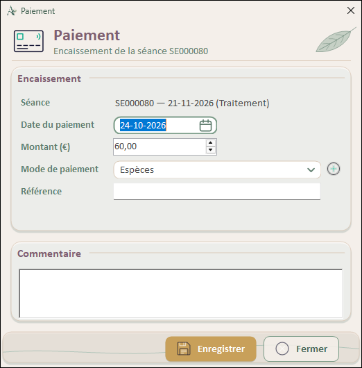

> Fichier : `UI/Forms/Dossiers/PaiementEditor.vb` — hérite de `Form` — implémente `IContextAwareForm`.

#### Rôle général

`PaiementEditor` permet d'encaisser une séance. La séance est **toujours imposée par l'appelant** (« Encaisser séance », ou double-clic sur une ligne de l'onglet Paiements du dossier) ; le montant est initialisé avec son reste dû.

Depuis le 22/10/2026 (V2.0.0, décision de Joëlle), la sélection parmi les séances non soldées du dossier est retirée, avec le bouton « Nouveau paiement » qui seul l'utilisait.

#### Responsabilités

- Afficher le rappel lisible de la séance (`SE… — jj/mm/aaaa (Nature)`) et son code dans l'en-tête.
- Saisir la date, le montant, le mode de paiement, une référence et un commentaire.
- Ajouter un mode de paiement en contexte via le bouton `[+]` si l’utilisateur en a le droit.
- Faire juger la saisie par le métier (`GestionPaiements.ValiderEncaissement`, audit C.2 étape 1, 22/10/2026) et expliquer la première erreur sur son champ.
- Persister le paiement et son affectation à une séance par `GestionPaiements`, puis annoncer son code (« Paiement PAI000123 enregistré. », 23/10/2026).
- Forcer la lecture seule depuis un dossier archivé.

#### Dépendances

| Élément | Type | Rôle |
| --- | --- | --- |
| `GestionLog` | Module métier | journalisation |
| `GestionPaiements` | Module métier | `ValiderEncaissement` (séance, montant positif et au plus égal au reste dû, mode, date), `CreatePaiement` (qui applique la même règle sur le reste dû relu dans sa transaction). |
| `GestionRecherche` | Module métier | `CodeElement` : code du paiement créé, annoncé dans la barre d'état (23/10/2026). |
| `GestionModesPaiement` | Module métier | Chargement des modes de paiement actifs (dont AVOIR) et ajout contextuel. |
| `UserControlContext` | Classe | Contexte UI partagé (statut, en-tête, session). |
| `UtilsButtons` | Module utilitaire | Style et états visuels uniformes des boutons. |
| `UC_ModesPaiement` | UserControl | Ouvert depuis ce composant. |
| `UC_DossierFiche` | UserControl | Écran appelant ; recharge ses grilles après validation. |

#### Variables privées

| Variable | Type | Rôle |
| --- | --- | --- |
| `_context` | `UserControlContext` | Contexte UI partagé fourni par l'appelant (barre de statut, infobulles). Peut être Nothing. |
| `_idSeance` | `Long` | Séance à laquelle le paiement est affecté, imposée par l'appelant (> 0, V2.0.0, 22/10/2026 ; `_idDossier` supprimé). |
| `_codeSeance` | `String` | Code technique de la séance (affichage rappel). |
| `_libelleSeance` | `String` | Libellé de rappel de la séance (« jj/mm/aaaa (Nature) »), plus parlant que le seul code. |
| `_resteDu` | `Decimal` | Reste dû de la séance au moment de l'ouverture (pré-remplissage du montant). |
| `_lectureSeuleForcee` | `Boolean` | Force la lecture seule quel que soit le mode (ex. dossier archivé). |
| `_fenetrePrincipale` | `IFenetrePrincipale` | Fenêtre principale, nécessaire pour ouvrir un référentiel en contexte ([+]). Peut être Nothing (contrat depuis le 25/10/2026, ADR-55). |
| `_chargementEnCours` | `Boolean` | Empêche des traitements pendant le chargement initial. |
| `_fondMontantNormal` | `Color` | Fond d'origine du montant, rétabli quand l'erreur signalée est corrigée. |

#### Contrôles principaux

| Contrôle | Type | Rôle |
| --- | --- | --- |
| `enTete` | AltheaEnTete | En-tête d'écran : titre « Paiement », sous-titre « Encaissement d'une séance » (« Encaissement de la séance SE… » dès que la séance est connue) ; icône dans les ressources (`enTete.Icone`). |
| `lblSeance` | Label | Libellé : « Séance » |
| `lblSeanceValeur` | Label | Rappel de la séance imposée (remplace la liste `cboSeance`, retirée le 22/10/2026). |
| `lblDatePaiement` | Label | Libellé : « Date du paiement » |
| `dtpDatePaiement` | AltheaDate | Date de l’encaissement ou de la prévision. |
| `lblMontant` | Label | Libellé : « Montant (€) » |
| `numMontant` | NumericUpDown | Montant pré-rempli avec le reste dû. |
| `lblModePaiement` | Label | Libellé : « Mode de paiement » |
| `cboModePaiement` | AltheaListe | Mode de paiement et ajout en contexte au référentiel ; transmis par son identifiant (`paiements.id_mode_paiement`, v2.50.0, 21/10/2026). |
| `btnAjouterModePaiement` | AltheaBouton (Outil, icône seule) | Mode de paiement et ajout en contexte au référentiel. |
| `lblReference` | Label | Libellé : « Référence » |
| `txtReference` | TextBox | Référence externe et commentaire libre. |
| `carteEncaissement` / `carteCommentaire` | AltheaCarte | Cartes « Encaissement » (séance, date, montant, mode, référence) et « Commentaire » (UI-7, 15/10/2026 ; le libellé `lblCommentaire` est remplacé par le titre de la carte). |
| `txtCommentaire` | AltheaZoneTexte | Commentaire libre, en texte simple (Althéa y ajoute ses mentions d'annulation et d'avoir), avec le correcteur d'orthographe (V1.6.0). |
| `pnlActions` | AltheaBarreActions | Zone des boutons d'action. |
| `btnEnregistrer` | AltheaBouton | Validation ou fermeture. |
| `btnFermer` | AltheaBouton | Validation ou fermeture. |

#### Méthodes principales

| Membre | Nature | Rôle |
| --- | --- | --- |
| `New` | Public Sub | Constructeur : initialise les composants Designer et l'état de départ. |
| `SetContext` | Public Sub | Reçoit le contexte UI partagé fourni par l'appelant. Doit être appelée AVANT ShowDialog. |
| `PaiementEditor_Load` | Private Sub | Initialise le bouton [+], le combo des modes de paiement, applique le rappel de séance et les valeurs par défaut (date du jour, montant = reste dû). Branche la garde des modifications non enregistrées (`GardeModifications.SurveillerFenetre`, 19/10/2026). |
| `InitialiserBoutonReferentiel` | Private Sub | Applique l'habillage standard au bouton [+] d'ajout de mode de paiement en contexte et le masque lorsque la fenêtre Home n'est pas disponible. |
| `InitialiserCombo` | Private Sub | Alimente le combo Mode de paiement depuis le référentiel actif. |
| `AppliquerDefautsCreation` | Private Sub | Applique les valeurs par défaut d'un nouveau paiement : rappel de séance, date du jour et montant présélectionné sur le reste dû (borné au maximum du contrôle). |
| `NommerSeanceDansEnTete` | Private Sub | En-tête « Encaissement de la séance SE000074 » dès que la séance est connue. |
| `AppliquerMontantParDefaut` | Private Sub | Propose par défaut le reste dû de la séance ciblée, borné aux limites du contrôle. Le montant reste modifiable afin d'autoriser les règlements partiels. |
| `AppliquerEtatSaisie` | Private Sub | État de saisie des deux cartes : saisie (zones blanches) ou lecture seule forcée (dossier archivé), en consultation lisible ; masque Enregistrer en lecture seule (V2.0.0, 15/10/2026 — remplace `AppliquerLectureSeule`). |
| `btnAjouterModePaiement_Click` | Private Sub | Ouvre le référentiel des modes de paiement dans une fenêtre modale (via Home), puis recharge le combo en sélectionnant automatiquement la valeur nouvellement créée. |
| `btnEnregistrer_Click` | Private Sub | Valide la saisie, persiste le paiement via la couche métier, annonce son code (« Paiement PAI… enregistré. », V2.1.0, 23/10/2026), puis ferme la modale (OK). Un refus du métier (dossier clôturé ou archivé…) ou un échec s'affiche dans une fenêtre ; la fenêtre reste ouverte, rien n'est enregistré (V1.1.0, 22/10/2026). |
| `btnFermer_Click` | Private Sub | Ferme la modale sans enregistrer (DialogResult.Cancel). |
| `ValiderSaisie` | Private Function | Fait juger la saisie par `GestionPaiements.ValiderEncaissement` (séance, montant strictement positif et au plus égal au reste dû, mode choisi) et explique la première erreur sur son champ (V2.0.0, 22/10/2026 : plus de copie de la règle ici). |
| `ControleDuChamp` / `LirePaiementSaisi` | Private Function | Contrôle qui saisit une propriété du paiement (`ErreurSaisie.Champ` ; Nothing pour la séance, imposée) ; paiement tel que saisi. |
| `SignalerErreur` / `MasquerErreur` / `ChampCorrige` | Private Sub | Phrase rose sous les champs, montant teinté s'il est en cause, focus, même message dans la barre d'état ; retiré dès que le montant ou le mode est corrigé. |
| `LibelleRappelSeance` | Private Function | Retourne le rappel de la séance ciblée, en privilégiant la date et la nature (plus parlantes que le code technique) et en se repliant sur le code puis l'identifiant. |
| `LireIdModeSelectionne` | Private Function | Retourne l'identifiant du mode de paiement sélectionné (`paiements.id_mode_paiement`) ; remplace `LireLibelleModeSelectionne` (V2.0.0, 21/10/2026, audit B.5 : renommer un mode coupait le lien avec l'historique). |

#### Gestion des icônes

- `$this.BackgroundImage` (Designer / ressources)
- `$this.Icon` (Designer / ressources)
- `btnEnregistrer.Image` (Designer / ressources)
- `btnFermer.Image` (Designer / ressources)

#### Règles en vigueur

- Retour DialogResult.OK après enregistrement réussi ; DialogResult.Cancel sinon
- La séance doit être déjà enregistrée (idSeance > 0) et toujours fournie par l'appelant
- Aucun accès base direct : délègue à GestionPaiements / GestionModesPaiement
- Le reste dû est calculé par la couche métier à partir des seuls paiements encaissés.
- **Encaissement jugé par le métier** (ADR-51, 22/10/2026) : la fenêtre lit `GestionPaiements.ValiderEncaissement` ; `CreatePaiement` applique la même règle sur le reste dû relu dans sa transaction et y réaligne le dû. Une date de paiement vide est signalée au lieu d'une erreur technique.

#### Points d'attention

- En V1, un paiement est lié à une seule séance, tandis qu’une séance peut recevoir plusieurs paiements.
- Le reste dû est calculé depuis le tarif figé de la séance et les seuls paiements encaissés ; il n’est jamais stocké dans le paiement.
- Le statut du paiement et le solde de la séance sont deux informations indépendantes : la grille affiche `Prévision`, `Annulé`, `Soldé` ou le montant restant selon le contexte.
- Un montant supérieur au reste dû est refusé (anti trop-perçu), par la fenêtre et par le métier. Seules les lignes PAYE entrent dans le calcul du réglé.
- Le code du paiement (PAI…) est annoncé après l'enregistrement : il se retrouve dans la colonne Code de l'onglet Paiements et par la recherche par code.

#### Message au repreneur

> PaiementEditor (626 lignes). Point d'entrée : `SetContext`, `PaiementEditor_Load`, `InitialiserBoutonReferentiel`. Toute évolution de règle se fait d'abord dans `GestionPaiements`, `GestionModesPaiement`, pas dans l'écran. Toute modification visuelle passe par le Designer (.Designer.vb / .resx).

---

### **Form : PlanningJourViewer**

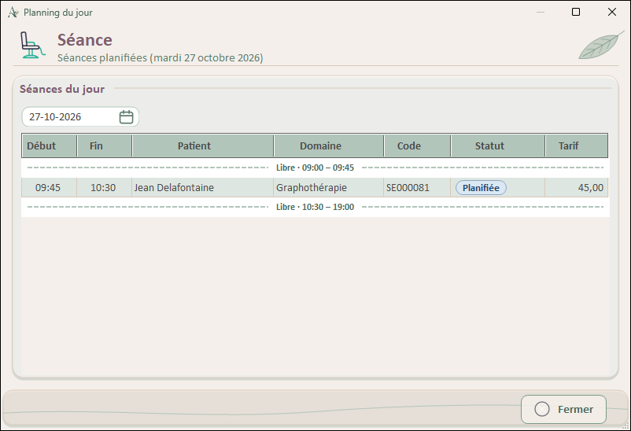

#### Rôle général

`PlanningJourViewer` est la modale de consultation des créneaux occupés pour la date choisie dans `SeanceEditor`. Elle aide à choisir une heure libre, sans se substituer au contrôle métier bloquant de chevauchement.

*V1.3.0 (18/10/2026, UI-9.2, maquette « Grilles — états lisibles »)* :

- statut en pastille (mêmes familles que la grille des séances : `SeanceListeItem.FamilleStatut`, `LibelleStatutAffichage`)
- **créneaux libres** en repères pointillés « Libre · 10:20 – 14:00 » sur une ligne réservée (`UtilsDataGrid.DessinerRepereSurLigne`), calculés par `GestionSeances.GetPlanningJour` dans la plage de la journée (SEANCE_HEURE_DEBUT_GRILLE / FIN), avec la même règle que le contrôle de chevauchement (`OccupeSonCreneau` : une séance annulée ou reportée libère sa place)
  - un trou plus court qu'une séance n'est pas annoncé, rien avant l'heure qu'il est aujourd'hui, rien pour un jour passé.

Lignes de créneau non sélectionnables (sélection invisible). Heures centrées, tarif à droite. Données : `LignePlanningJour` (séance ou créneau libre).

*Depuis le 21/10/2026 (ADR-47)*, une séance planifiée dont l'heure est passée s'y affiche « À confirmer » (pastille ocre, même famille que la grille des séances) ; *depuis le 23/10/2026*, les colonnes du planning viennent de la même requête que la recherche des séances d'une période (`QuerySeances.SelectSeancesPlanning`), sans changement de l'écran.

#### Responsabilités

- Afficher les séances de la journée sous forme de grille de planning.
- Mettre en évidence le créneau de la séance en cours lorsque celle-ci est en modification.
- Permettre le retour à `SeanceEditor` sans modifier de données.

#### Dépendances

| Élément | Type | Rôle |
| --- | --- | --- |
| `GestionSeances` | Module métier | `GetPlanningJour` (séances et créneaux libres). |
| `LignePlanningJour` | Classe | Ligne de la grille : séance ou créneau libre. |
| `UtilsDataGrid` | Module utilitaire | Pastilles, repère sur ligne, alignements. |
| `UtilsPastilles` | Module utilitaire | Couleurs du statut (familles des séances). |
| `UITheme` | Module utilitaire | — |
| `GestionLog` | Module métier | — |

#### Variables privées

| Variable | Type | Rôle |
| --- | --- | --- |
| `_dateAffichee` | `Date` | — |

#### Contrôles principaux

| Contrôle | Type | Rôle |
| --- | --- | --- |
| `enTete` | AltheaEnTete | En-tête d'écran : titre « Séance », sous-titre « Vue planification par journée » ; icône dans les ressources (`enTete.Icone`). |
| `cartePlanning` | AltheaCarte | Carte « Séances du jour », ancrée sur les quatre côtés (UI-7, 15/10/2026) ; fond `AltheaFondFenetre`. |
| `dtpDate` | AltheaDate | Jour affiché ; un changement recharge la grille (`dtpDate_ValeurChangee`). |
| `dgvPlanning` | DataGridView | Séances du jour (lecture seule). |
| `btnFermer` | AltheaBouton | Libellé : « Fermer » |

#### DataGridView : colonnes

##### DataGridView `dgvPlanning` : colonnes

| Colonne | En-tête | Propriété liée | Visible | Rôle |
| --- | --- | --- | --- | --- |
| `colHeureDebut` | Début | HeureDebut | Oui | — |
| `colHeureFin` | Fin | HeureFin | Oui | — |
| `colPatient` | Patient | NomCompletPatient | Oui | — |
| `colDomaine` | Domaine | LibelleDomaine | Oui | — |
| `colCodeSeance` | Code | CodeSeance | Oui | Code de la séance (SE…), vide pour un créneau libre (24/10/2026). |
| `colStatut` | Statut | LibelleStatutSeance | Oui | — |
| `colTarif` | Tarif | TarifSeance | Oui | — |

#### Méthodes principales

| Membre | Nature | Rôle |
| --- | --- | --- |
| `New` | Public Sub | — |
| `ChargerPlanning` | Private Sub | Charge les séances du jour sélectionné et les affiche dans la grille, triées par heure. |
| `dtpDate_ValueChanged` | Private Sub | Recharge le planning lorsque l'utilisateur change de date via le sélecteur. |

#### Règles en vigueur

- Fenêtre de pure consultation : aucune modification n'est possible depuis cette grille.
- Construction manuelle (pas de Designer), à l'instar de l'ancienne DialogPaiementReaffectation.

#### Points d'attention

- Le planning est une aide visuelle ; `GestionSeances` reste l’unique garant de l’absence de chevauchement.
- La modale est en lecture seule.

#### Message au repreneur

> PlanningJourViewer (130 lignes). Toute évolution de règle se fait d'abord dans `GestionSeances`, pas dans l'écran. Toute modification visuelle passe par le Designer (.Designer.vb / .resx).

---

## **Dialogues**

### **Dialogue : DialogMotifAnnulation**

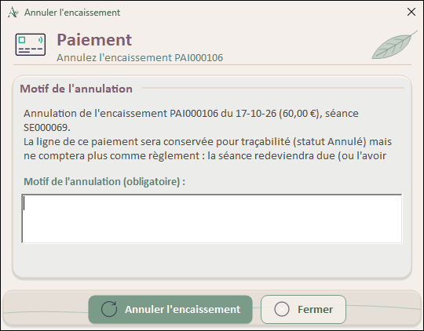

> Fichier : `UI/Forms/Dossiers/DialogMotifAnnulation.vb` — hérite de `Form`.

#### Rôle général

Modale Designer (`.vb` + `.Designer.vb` + `.resx`) ouverte depuis `UC_DossierFiche` pour annuler un paiement **encaissé** (SuperUser/Admin). Elle rappelle le paiement concerné et exige un motif.

#### Responsabilités

*À compléter.*

#### Dépendances

| Élément | Type | Rôle |
| --- | --- | --- |
| `DialogChoix` | Form | — |

#### Variables privées

| Variable | Type | Rôle |
| --- | --- | --- |
| `_couleurFondNormal` | `Color` | — |

#### Contrôles principaux

| Contrôle | Type | Rôle |
| --- | --- | --- |
| `carteMotif` | AltheaCarte | Carte « Motif de l'annulation » (UI-7, 15/10/2026) ; fond `AltheaFondFenetre`. |
| `lblInfo` | Label | Description de l'encaissement et conséquence de l'annulation. |
| `lblMotif` | Label | Libellé : « Motif de l'annulation (obligatoire) : » |
| `txtMotif` | AltheaZoneTexte | Motif (obligatoire), texte simple avec le correcteur d'orthographe (V1.4.0) ; fond rose pâle de la charte (`AltheaIconeEtat.Teintes(Erreur).Pale`) s'il manque. |
| `lblErreur` | Label | Libellé : « ⚠ Le motif est obligatoire : saisissez la raison de l'annulation ci-dessus. » — couleur d'erreur de la charte. |
| `btnOk` | AltheaBouton | Libellé : « Annuler l'encaissement » |
| `btnAnnuler` | AltheaBouton | Libellé : « Fermer » |

#### Méthodes principales

| Membre | Nature | Rôle |
| --- | --- | --- |
| `Motif` | Public ReadOnly Property | — |
| `New` | Public Sub | — |
| `btnOk_Click` | Private Sub | Gestionnaire d'événement Click de `btnOk`. |
| `txtMotif_TextChanged` | Private Sub | Gestionnaire d'événement TextChanged de `txtMotif`. |

#### Règles en vigueur

- Disposition portée par le Designer (DialogMotifAnnulation.Designer.vb).
- Le motif est obligatoire : la fenêtre reste ouverte tant qu'il n'est pas saisi, le champ est
  signalé visuellement et un message explicite est affiché (cas jugé critique).

#### Points d'attention

- Motif vide : champ signalé, message explicite, la fenêtre reste ouverte.
- Le motif est transmis à `GestionPaiements.AnnulerPaiementEncaisse`, qui enregistre la date, l'utilisateur (par son identifiant) et le motif dans les colonnes de l'annulation (`paiements.date_annulation`, `id_utilisateur_annulation`, `motif_annulation` ; v2.51.0, 22/10/2026).
  - Plus de mention ajoutée au commentaire (les annulations d'avant gardent la leur).
  - Aucune suppression physique.
- Le motif est limité à `GestionPaiements.LONGUEUR_MAX_MOTIF_ANNULATION` (500 caractères) : la saisie s'arrête à cette limite (V1.5.0, 22/10/2026).

#### Message au repreneur

> DialogMotifAnnulation (66 lignes). Toute modification visuelle passe par le Designer (.Designer.vb / .resx).

---

### **Dialogue : DialogReportSeance**

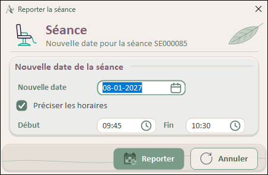

> Fichier : `UI/Forms/Dossiers/DialogReportSeance.vb` — hérite de `Form`.

#### Rôle général

`DialogReportSeance` est une boîte de dialogue dédiée au report d’une séance. Elle recueille les informations de report avant de déléguer la validation de disponibilité et la mise à jour à la couche métier.

Construite dans le Designer (`DialogReportSeance.vb` + `.Designer.vb` + `.resx`) : la disposition est portée par le Designer, le code-behind ne gère que les valeurs initiales (date et horaires suggérés), l’activation des horaires et le recalcul de l’heure de fin (début + durée standard).

#### Responsabilités

- Proposer une date de report et, facultativement, des horaires cohérents.
- Exposer les valeurs sélectionnées à l’appelant après DialogResult.OK.

#### Dépendances

| Élément | Type | Rôle |
| --- | --- | --- |
| `GestionSeances` | Module métier | — |
| `UC_DossierFiche` | UserControl | — |

#### Variables privées

| Variable | Type | Rôle |
| --- | --- | --- |
| `_dureeSeanceMinutes` | `ReadOnly Integer = GestionSeances.DureeSeanceParDefaut()` | Durée standard d'une séance, lue à l'ouverture (paramètre `SEANCE_DUREE_DEFAUT_MIN`). |

#### Contrôles principaux

| Contrôle | Type | Rôle |
| --- | --- | --- |
| `carteReport` | AltheaCarte | Carte « Nouvelle date de la séance » (UI-7, 15/10/2026) ; fond `AltheaFondFenetre`. |
| `lblDate` | Label | Libellé : « Nouvelle date » |
| `dtpDate` | AltheaDate | Nouvelle date (obligatoire). |
| `chkHoraires` | AltheaCase | Libellé : « Préciser les horaires » |
| `lblDebut` | Label | Libellé : « Début » |
| `hreDebut` | AltheaHeure | Heure de début (obligatoire si « Préciser les horaires » est cochée) ; mêmes heures proposées que la fiche séance (UI-7, 16/10/2026). |
| `lblFin` | Label | Libellé : « Fin » |
| `hreFin` | AltheaHeure | Heure de fin ; `HeureReference` = début (durée rappelée dans la liste). |
| `btnOk` | AltheaBouton | Libellé : « Reporter » |
| `btnAnnuler` | AltheaBouton | Libellé : « Annuler » |

#### Méthodes principales

| Membre | Nature | Rôle |
| --- | --- | --- |
| `NouvelleDate` | Public ReadOnly Property | — |
| `NouvelleHeureDebut` | Public ReadOnly Property | — |
| `NouvelleHeureFin` | Public ReadOnly Property | — |
| `New` | Public Sub | — |
| `ChkHoraires_CheckedChanged` | Private Sub | Gestionnaire d'événement CheckedChanged de `ChkHoraires`. |
| `HreDebut_ValeurChangee` | Private Sub | Fin = début + durée par défaut ; le début devient l'heure de référence de la liste des fins. |

#### Gestion des icônes

- `$this.Icon` (Designer / ressources)

#### Règles en vigueur

- Disposition et apparence portées par DialogReportSeance.Designer.vb (Designer obligatoire).
- La persistance, le contrôle de chevauchement et le tarif restent délégués à GestionSeances.

#### Points d'attention

- Le report reste soumis au contrôle de chevauchement : depuis le 22/10/2026 (audit C.2 étape 1), `GestionSeances` refuse le report si le créneau de la nouvelle séance est occupé, et le report est d'un seul tenant (origine « Reportée » et remplaçante créées dans une transaction, 21/10/2026).
- Le dialogue ne contourne pas les règles de dossier archivé, de statut ou de tarif historique.
- Seule une séance Planifiée est reportable ; la nouvelle séance recopie tarif et montant de l’origine (aucun recalcul : le tarif dépend du patient, pas de la date).

#### Message au repreneur

> DialogReportSeance (105 lignes). Toute évolution de règle se fait d'abord dans `GestionSeances`, pas dans l'écran. Toute modification visuelle passe par le Designer (.Designer.vb / .resx).

---

### **Dialogue : DialogPaiementsSeance**

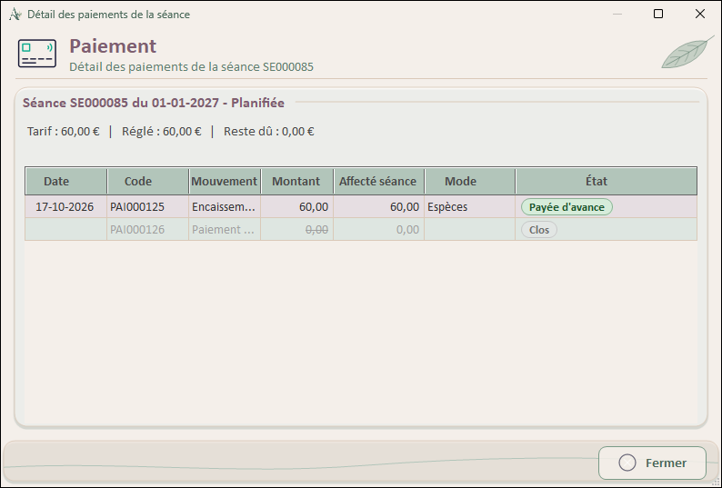

> Fichier : `UI/Forms/Dossiers/DialogPaiementsSeance.vb` — hérite de `Form`.

#### Rôle général

Modale Designer en lecture seule ouverte par le bouton `btnDetailPaiementsSeance` (à côté d’« Encaisser » dans l’onglet Séances). Le double-clic sur une séance reste réservé à `SeanceEditor`.

#### Responsabilités

- Afficher la séance (code, date, nature, statut) et sa synthèse : tarif, réglé, reste dû, avoir.
- Lister tous les mouvements (encaissés, en attente, annulés, reportés), avec le code de chaque paiement (colonne « Code », V1.4.0, 23/10/2026) ; colonne « État » en pastille, mêmes familles et précision que la grille des paiements du dossier ; ligne neutralisée en gris (`UITheme`), montant d'un paiement annulé barré (V1.3.0, 18/10/2026, UI-9.2).

#### Dépendances

Aucune dépendance applicative notable.

#### Variables privées

Aucune variable privée.

#### Contrôles principaux

| Contrôle | Type | Rôle |
| --- | --- | --- |
| `carteSeance` | AltheaCarte | Carte ancrée sur les quatre côtés ; son titre reprend la séance (code, date, statut), à la place de l'ancien `lblTitre` caché sous l'en-tête (UI-7, 15/10/2026). |
| `lblResume` | Label | Tarif, réglé, reste dû, avoir. |
| `dgvPaiements` | DataGridView | Mouvements de paiement de la séance (lecture seule). |
| `btnFermer` | AltheaBouton | Libellé : « Fermer » |

#### DataGridView : colonnes

##### DataGridView `dgvPaiements` : colonnes

| Colonne | En-tête | Propriété liée | Visible | Rôle |
| --- | --- | --- | --- | --- |
| `colDate` | Date | DatePaiement | Oui | — |
| `colCode` | Code | CodePaiement | Oui | Code du paiement (PAI…), ajouté le 23/10/2026 (relevé de Joëlle : il ne se voyait nulle part). |
| `colMouvement` | Mouvement | MouvementAffichage | Oui | — |
| `colMontant` | Montant | Montant | Oui | — |
| `colAffecte` | Affecté séance | MontantAffecte | Oui | — |
| `colMode` | Mode | ModePaiement | Oui | — |
| `colStatut` | État | LibelleStatutPaiement | Oui | Pastille État (V1.3.0, 18/10/2026). |

#### Méthodes principales

| Membre | Nature | Rôle |
| --- | --- | --- |
| `New` | Public Sub | — |
| `dgvPaiements_CellFormatting` | Private Sub | Gestionnaire d'événement CellFormatting de `dgvPaiements`. |

#### Règles en vigueur

- Disposition portée par le Designer (DialogPaiementsSeance.Designer.vb).
- Ouvert par bouton dédié (le double-clic de la grille ouvre la séance elle-même).

#### Points d'attention

- Aucun point particulier identifié à ce jour.

#### Message au repreneur

> DialogPaiementsSeance (116 lignes). Toute modification visuelle passe par le Designer (.Designer.vb / .resx).

---

### **Dialogue : DialogUtilisationAvoir**

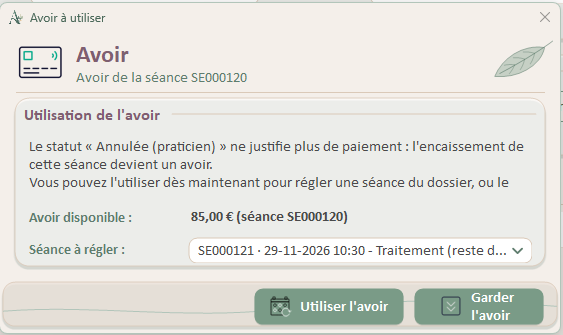

> Fichier : `UI/Forms/Dossiers/DialogUtilisationAvoir.vb` — hérite de `Form`. Ex-`DialogPaiementReaffectation` (renommée le 21/10/2026).

#### Rôle général

Quand une séance déjà encaissée est reportée ou passe à un statut non dû, son encaissement devient un avoir. `DialogUtilisationAvoir` propose de l'utiliser tout de suite pour régler une séance due du dossier, ou de le garder (décision de Joëlle du 21/10/2026 : l'avoir remplace la réaffectation).

#### Responsabilités

- Présenter l'avoir né de la séance (« Avoir disponible : 60,00 € (séance S…) ») et les séances dues non soldées du même dossier (`LibelleChoixSeance` : code, date, nature, reste dû).
- Point d'entrée unique `ProposerApresChangementStatut` (Shared), appelé par `UC_DossierFiche` après un report et par `SeanceEditor` après un changement de statut : lecture des séances, fenêtre, appel à `GestionPaiements.UtiliserAvoirDeSeance`, message du résultat.
- La fenêtre elle-même ne modifie rien.

#### Dépendances

| Élément | Type | Rôle |
| --- | --- | --- |
| `GestionSeances` | Module métier | Séances du dossier (avoir, reste dû). |
| `GestionPaiements` | Module métier | `UtiliserAvoirDeSeance` (une transaction). |
| `DialogChoix` | Form | Messages (résultat, refus, incident). |

#### Variables privées

| Variable | Type | Rôle |
| --- | --- | --- |
| `_seancesCandidates` | `List(Of SeanceListeItem)` | Séances que l'avoir peut régler (dues, non soldées, même dossier, hors séance d'origine). |
| `_idSeancePreselection` | `Long` | Séance à présélectionner (séance de remplacement d'un report ; 0 = aucune). |

#### Contrôles principaux

| Contrôle | Type | Rôle |
| --- | --- | --- |
| `carteReport` | AltheaCarte | Carte « Utilisation de l'avoir » ; fond `AltheaFondFenetre`. |
| `lblMessage` | Label | Contexte : statut appliqué, l'encaissement devient un avoir. |
| `lblAvoir` / `lblMontantAvoir` | Label | « Avoir disponible : » et le montant (séance d'origine). |
| `lblSeance` / `cboSeances` | Label / AltheaListe | « Séance à régler : » et la liste. |
| `btnUtiliser` | AltheaBouton | « Utiliser l'avoir » (OK). |
| `btnGarder` | AltheaBouton | « Garder l'avoir » (Cancel). |

#### Méthodes principales

| Membre | Nature | Rôle |
| --- | --- | --- |
| `SeanceCibleSelectionnee` | Public ReadOnly Property | Séance choisie. |
| `New` | Public Sub | Avoir, séances, statut, présélection, code de la séance d'origine. |
| `AppliquerContenu` | Private Sub | Message, montant, liste et présélection. |
| `ProposerApresChangementStatut` | Public Shared Sub | Déroulé complet (voir Responsabilités) ; sans séance due : message « conservé en avoir » ; incident : message, le statut reste enregistré. Reçoit le `ContexteOperation` de l'écran appelant (V2.0.2, 22/10/2026, audit C.1 ; l'utilisateur était transmis par son nom, puis par son identifiant en V2.0.1). L'utilisation est enregistrée dans `lia_paiements_avoirs` (v2.52.0, 22/10/2026). |

#### Règles en vigueur

- Seul l'avoir de la séance concernée est proposé ; seules les séances dues du même dossier peuvent être réglées ; pas de répartition : le surplus reste en avoir.

#### Message au repreneur

> Toute évolution de règle se fait d'abord dans `GestionPaiements`, pas dans l'écran. Toute modification visuelle passe par le Designer (.Designer.vb / .resx).

---

[TOC]
