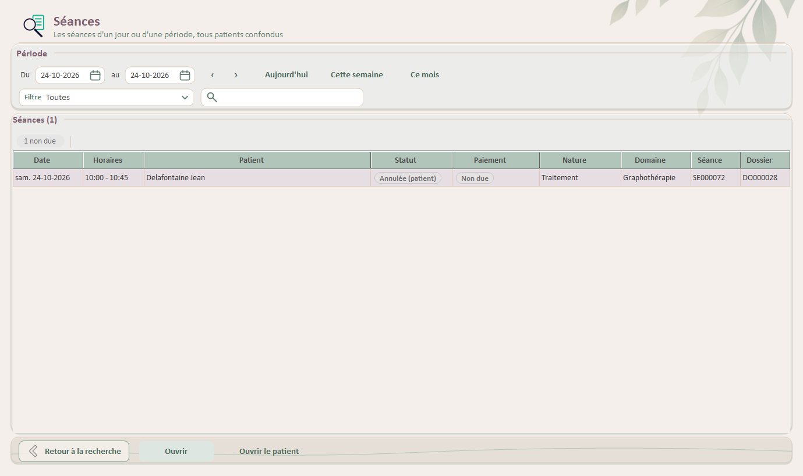
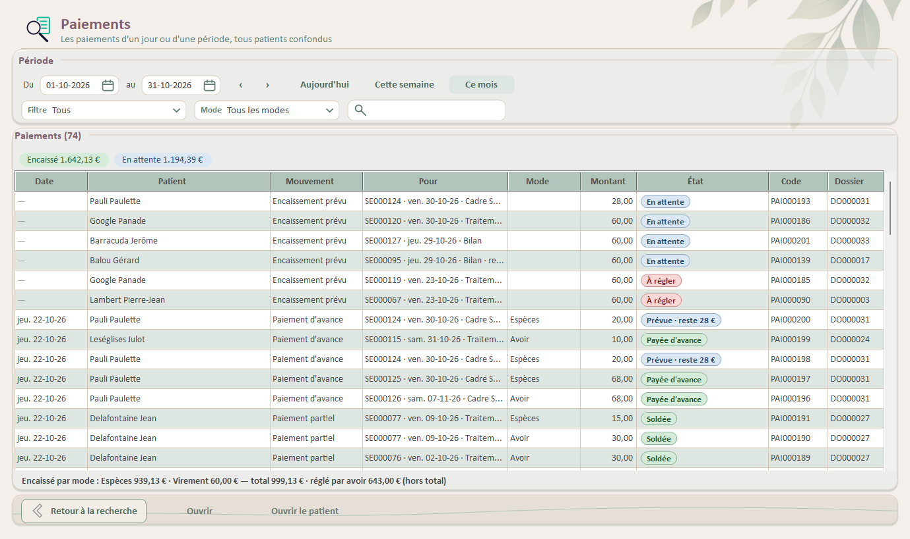
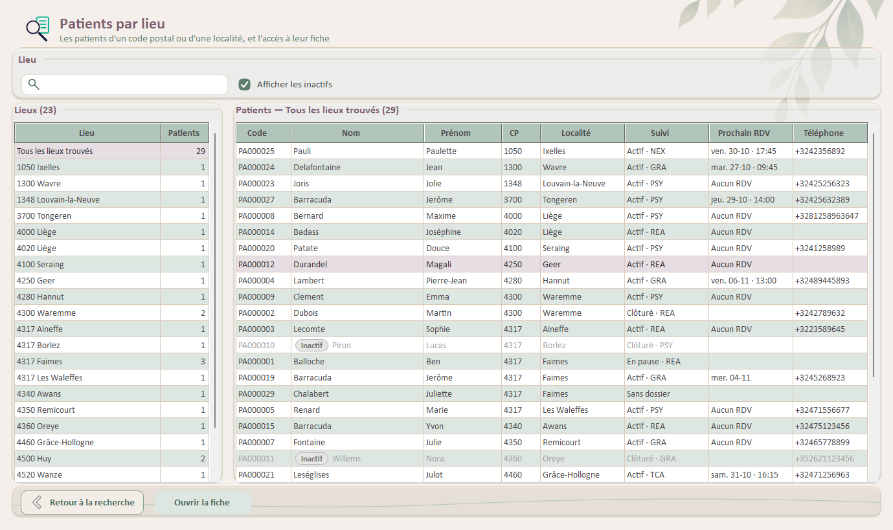

# 📘 **Documentation technique UI — Recherche transversale**

> Partie de la [documentation technique de l'interface](../Documentation_technique_UI_Althea.md) : sommaire, trame commune des fiches, vue d'ensemble et historique.
> Dernière mise à jour : 25/10/2026 — document scindé par domaine (décision de Joëlle)

Hub Recherche, recherche rapide par code, recherches spécialisées (séances, paiements, lieux, réseau), sélecteur de période et ouverture d'un résultat.

---

## **Recherche transversale**

Écrans du bouton **Recherche** du menu (ADR-52, processus 24) : un hub, une recherche rapide par code, des recherches spécialisées en tuiles.

Toutes partagent un résultat commun (`ResultatRecherche`), une ouverture commune (`OuvertureResultat`) et la mini-pile de navigation (`Home.NavigateDepuisRecherche`) : Retour ramène à la recherche, critères compris.

Aucun accès direct à la base : `GestionRecherche` (lecture seule) ; le journal ne reçoit que le type de recherche et le nombre de résultats.

Guide : `Docs/Guide/Guide_Utilisateur_Recherche.md` ; tests : `PLAN_TESTS_RECHERCHE.md` (RCH-01 à RCH-66).

### **UserControl : UC_RechercheHome**

> Fichier : `UI/Controls/Recherche/UC_RechercheHome.vb` (V1.4.0, 24/10/2026) — `UserControl`, `IContextAwareUserControl`.

#### Rôle général

Hub Recherche, ouvert par `Home.NavigateToRecherche` (bouton du menu sous Patients) : retrouver un élément sans passer par son patient, et y aller.

#### Responsabilités

- Recherche rapide par code (PA patient, DO dossier, SE séance, PAI paiement, FC contact, AS intervenant, TH thérapeute — qui ouvre le réseau par nom sur lui ; saisie tolérante, « se83 » = SE000083) : ce que c'est, de quel patient, et y aller.
- Tuiles des recherches spécialisées : Séances (R2), Paiements (R3), Patients par lieu (R4, `btnPatientsLieu`, icône `rechercheLieu_*`), Réseau par nom (R5, `btnReseau`, icône `rechercheReseau_*`, deuxième rangée).

#### Contrôles principaux

| Contrôle | Type | Rôle |
| --- | --- | --- |
| `enTete` | AltheaEnTete | « Recherche » — « Retrouvez un élément et allez-y directement ». |
| `carteRapide` | AltheaCarte | « Recherche rapide par code ». |
| `lblAide` | Label | Aide des codes (`GestionRecherche.AideCodes`). |
| `txtCode` | AltheaRecherche | Code ; Entrée lance la recherche. |
| `btnChercher` | AltheaBouton | Chercher. |
| `lblMessage` | Label | Code non reconnu, aucun élément, ou « Entrée ou double-clic sur la ligne pour y aller ». |
| `dgvResultats` | DataGridView | Résultat (une ligne). |
| `btnOuvrir` / `btnOuvrirPatient` | AltheaBouton | Aller à l'élément / à la fiche de son patient. |
| `carteAutres` | AltheaCarte | « Autres recherches » : tuiles `btnSeances`, `btnPaiements` (AltheaTuile, icônes `rechercheSeances`, `recherchePaiements` de `Boutons_ico_48`, provisoires) et `lblAutres` (« À venir… »). |

#### DataGridView `dgvResultats` : colonnes

| Colonne | Propriété | Contenu |
| --- | --- | --- |
| `colNature` | `LibelleNature` | Patient, Dossier, Séance, Paiement, Contact, Intervenant. |
| `colCode` | `Code` | Code de l'élément. |
| `colDescription` | `Description` | Date, statut, domaine, montant, dossier… (composée par `GestionRecherche`). |
| `colPatient` | `PatientAffichage` | « PA000005 · NOM Prénom ». |

#### Méthodes principales

| Membre | Nature | Rôle |
| --- | --- | --- |
| `PrerenseignerCode` | Public Sub | Code à relancer au chargement (fabrique de retour). |
| `Chercher` | Private Sub | `GestionRecherche.InterpreterCode` puis `RechercherParCode` ; la ligne trouvée est sélectionnée (Entrée l'ouvre). |
| `Ouvrir` | Private Sub | `OuvertureResultat.Ouvrir` / `OuvrirPatient` avec la fabrique de retour. |
| `OuvrirRecherche` | Private Sub | Ouvre une recherche spécialisée (tuile), empilée sur le hub (`NavigateDepuisRecherche`). |
| `CreerEcranCourant` | Private Function | Fabrique : le hub recréé avec son code, relancé au chargement. |

#### Règles en vigueur

- Le préfixe le plus long l'emporte (PAI avant PA) ; un paiement est rattaché au dossier de sa première séance affectée.
- Rien de ce qui est tapé n'est journalisé.

---

### **UserControl : UC_RechercheSeances**

> Fichier : `UI/Controls/Recherche/UC_RechercheSeances.vb` (V1.1.0, 23/10/2026) — `UserControl`, `IContextAwareUserControl`. Recherche R2.

#### Rôle général

Les séances d'un jour ou d'une période, tous patients confondus, avec leur patient, leur statut et leur paiement, et l'accès direct au dossier. Contexte « Recherche > Séances » (`CONTEXTE`).

#### Contrôles principaux

| Contrôle | Type | Rôle |
| --- | --- | --- |
| `carteCriteres` | AltheaCarte | « Période » : `dtpDu` / `dtpAu` (AltheaDate), `btnPrecedent` / `btnSuivant` (‹ ›), `btnAujourdhui`, `btnSemaine`, `btnMois`, `cboFiltre` (AltheaListe « Filtre »), `txtFiltre` (AltheaRecherche), `lblMessage`. |
| `carteResultats` | AltheaCarte | « Séances (n) » ou « (n sur m) » : `pnlResume` (résumé cliquable) et `dgvSeances`. |
| `pnlActions` | AltheaBarreActions | `btnRetour` (« Retour à la recherche »), `btnOuvrir`, `btnOuvrirPatient`. |

#### DataGridView `dgvSeances` : colonnes

| Colonne | Propriété (`SeancePlanningItem`) | Contenu |
| --- | --- | --- |
| `colDate` | `DateSeance` | Date avec le jour (« ven. 23/10/2026 »). |
| `colHoraires` | `HorairesAffichage` | « 09:00 - 09:45 ». |
| `colPatient` | `PatientAffichage` | « Nom Prénom ». |
| `colStatut` | `LibelleStatutAffichage` | Pastille (famille du statut, « À confirmer »). |
| `colPaiement` | `PaiementAffichage` | Pastille (« Réglée », « À régler · 60 € »…). |
| `colNature` / `colDomaine` | `LibelleNatureSeance` / `LibelleDomaine` | — |
| `colCode` / `colDossier` | `CodeSeance` / `CodeDossier` | — |

#### Méthodes principales

| Membre | Nature | Rôle |
| --- | --- | --- |
| `Prerenseigner` | Public Sub | Période, axe, texte et séance à resélectionner (fabrique de retour). |
| `Chercher` | Private Sub | `GestionRecherche.RechercherSeances` (plafond `LIMITE_RESULTATS` = 1000, message au-delà) ; messages « Aucune séance ce jour-là / sur cette période ». |
| `AfficherSeances` | Private Sub | Axe (`FiltresSeances.Filtrer`), texte, liste ; résumé sur toute la période (`FiltresSeances.MettreAJourResume`). |
| `SelectionnerSeance` | Private Sub | Ligne du retour resélectionnée et rendue visible (après l'affichage, `BeginInvoke`). |
| `Ouvrir` | Private Sub | `GestionRecherche.ResultatDeSeance` puis `OuvertureResultat` (dossier, onglet Séances). |
| `dgvSeances_CellPainting` | Event | Pastilles (`UtilsDataGrid.DessinerPastilleCellule`), lignes non dues atténuées. |

#### Règles en vigueur

- Période gérée par `SelecteurPeriode` (une seule recherche par geste) ; tri par en-tête possible, oublié à chaque nouvelle liste.
- Mêmes axes, couleurs et résumé que l'onglet Séances du dossier (`FiltresSeances`).

---

### **UserControl : UC_RecherchePaiements**

> Fichier : `UI/Controls/Recherche/UC_RecherchePaiements.vb` (V1.0.0, 23/10/2026) — `UserControl`, `IContextAwareUserControl`. Recherche R3.

#### Rôle général

Les paiements d'un jour ou d'une période, tous patients : le relevé de l'onglet Paiements du dossier (décision de Joëlle, 23/10/2026) avec le patient de chaque ligne, les totaux encaissés par mode et l'accès direct au dossier. Contexte « Recherche > Paiements ».

#### Contrôles principaux

| Contrôle | Type | Rôle |
| --- | --- | --- |
| `carteCriteres` | AltheaCarte | « Période » : mêmes contrôles que `UC_RechercheSeances`, plus `cboMode` (AltheaListe « Mode » : tous les modes, puis les modes du référentiel, désactivés compris). |
| `carteResultats` | AltheaCarte | « Paiements (n) » : `pnlResume`, `dgvPaiements`, `lblTotaux` (bas de carte). |
| `pnlActions` | AltheaBarreActions | `btnRetour`, `btnOuvrir`, `btnOuvrirPatient`. |

#### DataGridView `dgvPaiements` : colonnes

| Colonne | Propriété (`PaiementListeItem`) | Contenu |
| --- | --- | --- |
| `colDate` | `DateMouvement` | Date d'encaissement avec le jour, « — » pour un paiement attendu. |
| `colPatient` | `PatientAffichage` | « Nom Prénom ». |
| `colMouvement` / `colPour` | `MouvementCourt` / `PourAffichage` | Comme le dossier. |
| `colMode` / `colMontant` | `ModePaiement` / `MontantLigne` | Montant annulé barré. |
| `colEtat` | `EtatAffichage` | Pastille « État » (famille, mention). |
| `colCode` / `colDossier` | `CodePaiement` / `CodeDossier` | — |

#### Méthodes principales

| Membre | Nature | Rôle |
| --- | --- | --- |
| `Prerenseigner` | Public Sub | Période, axe, mode, texte et paiement à resélectionner. |
| `Chercher` | Private Sub | `GestionRecherche.RechercherPaiements` (plafond 1000 lignes). |
| `AfficherPaiements` | Private Sub | Relevé (`FiltresPaiements.LignesDuReleve`), mode, axe, texte ; plus récent en haut ; résumé (Encaissé, En attente) et totaux sur la période et le mode. |
| `AfficherTotaux` | Private Sub | `GestionRecherche.TotauxEncaissesParMode` : « Encaissé par mode : … — total … » ; règlement par avoir hors total. |
| `dgvPaiements_CellFormatting` / `_CellPainting` / `_CellToolTipTextNeeded` | Event | Comme le dossier : date, ligne neutralisée, montant barré, pastille, infobulle `PaiementListeItem.InfobulleLigne`. |

#### Règles en vigueur

- Une ligne par affectation à une séance (un paiement réparti apparaît sur plusieurs lignes).
- « En attente » réunit le non encaissé non annulé (prévu ou à régler) : la pastille les distingue (Joëlle, 23/10/2026).

### **UserControl : UC_RecherchePatientsLieu**

> Fichier : `UI/Controls/Recherche/UC_RecherchePatientsLieu.vb` (V1.1.1, 25/10/2026) — `UserControl`, `IContextAwareUserControl`. Recherche R4.

#### Rôle général

Les patients d'un code postal ou d'une localité (décisions de Joëlle, 24/10/2026) : une zone de recherche, la liste des lieux avec leur nombre de patients, les patients du lieu choisi et l'accès à leur fiche. Contexte « Recherche > Patients par lieu ».

#### Contrôles principaux

| Contrôle | Type | Rôle |
| --- | --- | --- |
| `carteCriteres` | AltheaCarte | « Lieu » : `txtLieu` (AltheaRecherche « Code postal ou localité… »), `chkAfficherInactifs` (AltheaCase), `lblMessage`. |
| `carteLieux` | AltheaCarte | « Lieux (n) », à gauche : `dgvLieux` (`colLieu` = `LieuPatients.Libelle`, `colNbPatients`) ; en tête « Tous les lieux trouvés », « Sans adresse » en dernier. |
| `carteResultats` | AltheaCarte | « Patients — lieu (n) » : `dgvPatients`. |
| `pnlActions` | AltheaBarreActions | `btnRetour` (Retour à la recherche), `btnOuvrir` (Ouvrir la fiche). |

#### DataGridView `dgvPatients` : colonnes

| Colonne | Propriété (`PatientListeItem`) | Contenu |
| --- | --- | --- |
| `colCode` / `colNom` / `colPrenom` | `CodePatient` / `Nom` / `Prenom` | Triables. |
| `colCodePostal` / `colLocalite` | `CodePostal` / `Localite` | Utiles dans « Tous les lieux trouvés ». |
| `colSuivi` / `colRendezVous` | `SuiviAffichage` / `RendezVousAffichage` | Textes de l'écran Patients. |
| `colTelephone` | `Telephone` | — |

#### Méthodes principales

| Membre | Nature | Rôle |
| --- | --- | --- |
| `Prerenseigner` | Public Sub | Texte, case des inactifs, clé du lieu (Nothing = tous, vide = sans adresse) et patient à resélectionner. |
| `UC_RecherchePatientsLieu_Load` | Private Sub | `GestionRecherche.ChargerPatientsPourLieux` une fois (patients et pays du cabinet), puis la liste des lieux. |
| `AfficherLieux` | Private Sub | `GestionRecherche.GrouperParLieu` à chaque frappe ou clic sur la case ; garde le lieu choisi s'il est encore listé ; message (aucun lieu, seulement des inactifs, erreur de chargement) ; barre d'état (inactifs masqués). |
| `AfficherPatients` | Private Sub | Les patients du lieu sélectionné. |
| `Ouvrir` / `CreerEcranCourant` | Private | `OuvertureResultat.OuvrirPatient` (`GestionRecherche.ResultatDePatient`) ; fabrique de retour avec les critères. |
| `dgvPatients_CellFormatting` | Event | Patient inactif en gris (comme l'écran Patients). |
| `dgvPatients_CellPainting` | Event | Pastille grise « Inactif » devant le nom d'un patient inactif (`UtilsDataGrid.DessinerPastilleAvantTexte`, V1.1.0, relevé de Joëlle). |

#### Règles en vigueur

- Un mot en chiffres = début du code postal ; un autre mot = partie de la localité ; accents, majuscules et traits d'union indifférents (`UtilsCodePostal.CleLocalite`) ; tous les mots doivent correspondre.
- Deux écritures d'une même localité forment un seul lieu (`LieuPatients`, l'écriture la plus fréquente est affichée) ; une adresse sans pays est du pays du cabinet, qui n'est pas répété (« 75001 Paris (FR) » pour un autre pays).
- Recherche en mémoire : rien n'est journalisé à la frappe (le chargement note le nombre de patients).

### **UserControl : UC_RechercheReseau**

> Fichier : `UI/Controls/Recherche/UC_RechercheReseau.vb` (V1.2.1, 25/10/2026) — `UserControl`, `IContextAwareUserControl`. Recherche R5.

#### Rôle général

Un thérapeute, un intervenant ou un contact par son nom (décisions de Joëlle, 24/10/2026) : les personnes du réseau des patients, une ligne par personne, les patients qui en relèvent, l'accès au patient et à la fiche de la personne. Contexte « Recherche > Réseau ».

#### Contrôles principaux

| Contrôle | Type | Rôle |
| --- | --- | --- |
| `carteCriteres` | AltheaCarte | « Nom » : `txtNom` (AltheaRecherche « Nom ou début du nom… »), `chkAfficherInactifs` (AltheaCase), `lblMessage`. |
| `cartePersonnes` | AltheaCarte | « Personnes (n) », à gauche : `dgvPersonnes` (`colCodePersonne` = `CodeTherapeute` — code TH… d'un thérapeute du référentiel, vide pour un intervenant saisi ou un contact, dont chaque fiche a son code dans la colonne Fiche des liens —, `colPersonne` = `NomComplet`, `colNature` = `NatureAffichage`, `colPrecision` = `Precision`, `colNbPatients`). |
| `carteResultats` | AltheaCarte | « Patients — personne (n) » : `dgvLiens`. |
| `pnlActions` | AltheaBarreActions | `btnRetour`, `btnOuvrir` (Ouvrir le patient), `btnFichePersonne` (Fiche de la personne). |

#### DataGridView `dgvLiens` : colonnes

| Colonne | Propriété (`LienReseau`) | Contenu |
| --- | --- | --- |
| `colCodePatient` / `colPatient` | `CodePatient` / `PatientAffichage` | — |
| `colRole` | `Role` | Lien (contact) ou rôle (intervenant). |
| `colDepuis` / `colEtat` | `DateDebut` / `EtatAffichage` | Suivi : « en cours », « jusqu'au … », « terminé le … » (gris). |
| `colFiche` | `CodeElement` | FC… (contact) ou AS… (suivi). |

#### Méthodes principales

| Membre | Nature | Rôle |
| --- | --- | --- |
| `Prerenseigner` | Public Sub | Texte, case des inactifs, clé de la personne, nature et identifiant du lien à resélectionner. |
| `ChargerReseau` | Private Sub | `GestionRecherche.ChargerReseau` (à l'ouverture et après un enregistrement depuis « Fiche de la personne »). |
| `AfficherPersonnes` / `AfficherLiens` | Private Sub | `GestionRecherche.FiltrerReseau` à chaque frappe ou clic sur la case ; personne gardée si encore listée ; liens de la personne sélectionnée. |
| `OuvrirPatient` | Private Sub | `OuvertureResultat.Ouvrir` (`GestionRecherche.ResultatDeLien`) : fiche du patient, onglet Famille / Contacts ou Intervenants. |
| `OuvrirFichePersonne` | Private Sub | `TherapeuteEdition` ; `ContactEdition` / `IntervenantEdition` en consultation (lien sélectionné, sinon le premier). |
| `dgvPersonnes_CellFormatting` / `dgvLiens_CellFormatting` | Event | Thérapeute désactivé, patient inactif et suivi terminé en gris. |
| `dgvLiens_CellPainting` | Event | Pastille grise « Inactif » devant un patient inactif (V1.2.0, comme l'écran Patients). |

#### Règles en vigueur

- Chaque mot tapé = début d'un mot du nom ou du prénom ; accents et majuscules indifférents (`UtilsTexte`).
- Une ligne par personne (`PersonneReseau.Cle`) : thérapeute par son identifiant ; intervenants saisis et contacts par nature, nom et prénom comparés ; intervenant lié à un thérapeute sous ce thérapeute.
- Un thérapeute apparaît toujours (même sans patient) ; un contact ou un intervenant dont tous les patients sont inactifs n'apparaît qu'avec la case cochée.

---

## **Infrastructure**

### **Classe : SelecteurPeriode**

> Fichier : `UI/Controls/Recherche/SelecteurPeriode.vb` (V1.0.0, 23/10/2026) — `Friend NotInheritable`, sans contrôle propre.

Relie les champs « du … au … » et les boutons d'une recherche (Aujourd'hui, Cette semaine — lundi à dimanche —, Ce mois, ‹ ›) et signale chaque nouvelle période par un seul évènement `PeriodeChangee`.

`Du`, `Au`, `EstUnJour`, `Definir(du, au, notifier)`, `Decaler(sens)` (un mois entier passe au mois voisin entier, sinon glissement de la durée), `DefinirInfobulles`.

Bornes gardées dans l'ordre par `AltheaDate.CorrigerBornes`. Chaque écran garde ses contrôles dans son Designer.

---

### **Module : OuvertureResultat**

> Fichier : `UI/Controls/Recherche/OuvertureResultat.vb` (V1.1.0, 23/10/2026).

Une seule routine pour aller à un élément trouvé, selon sa nature (`ResultatRecherche.Nature`) :

- patient → `UC_PatientFiche` (Identité)
- contact / intervenant → fiche, onglet Famille / Intervenants (`SelectionnerOngletAuChargement`)
- dossier → `UC_DossierFiche`
- séance / paiement → dossier, onglet Séances / Paiements, ligne sélectionnée sur sa page (`CiblerAuChargement`).

`Ouvrir(home, resultat, creerEcranCourant, context, contexteRetour)`, `OuvrirPatient`, constante `CONTEXTE_RECHERCHE`.

L'écran ouvert est empilé sur la recherche (`Home.NavigateDepuisRecherche`) ; les droits sont ceux des écrans ouverts.

---

[TOC]
