# 📘 **Documentation technique UI — Référentiels et domaines**

> Partie de la [documentation technique de l'interface](../Documentation_technique_UI_Althea.md) : sommaire, trame commune des fiches, vue d'ensemble et historique.
> Dernière mise à jour : 25/10/2026 — document scindé par domaine (décision de Joëlle)

Hub et socle des référentiels, référentiels standards, spécifiques et métier, domaines (conventions) et leurs rattachements, fenêtres Thérapeute, catégories de quota et hôte des référentiels en fenêtre.

---

## **Référentiels**

Les référentiels sont regroupés en quatre familles selon leur construction :

| Famille | Construction | Composants |
| --- | --- | --- |
| 1.2.1 Référentiels standards | Héritent de `UC_ReferentielBase` ; code / libellé / ordre / actif, sans champ propre. | 
| 1.2.2 Référentiels spécifiques (entité riche) | UserControl autonome, n'hérite pas du socle ; édition via une Form dédiée. | `UC_Therapeutes` |
| 1.2.3 Référentiels métier paramétrables | Héritent du socle et ajoutent des attributs métier propres ; leur applicabilité dépend des liaisons au domaine. | 
`UC_DomainesHome` (écran unique, accès menu Home et tuile Référentiels ; `UC_Domaines` archivé dans `UI/Forms/Test`, non compilé)

### **Socle commun des référentiels**

#### **UserControl : UC_ReferentielHome**

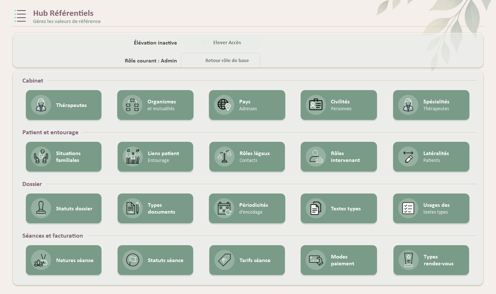

> Fichier : `UI/Controls/Referentiels/UC_ReferentielHome.vb` — hérite de `UserControl` — implémente `IContextAwareUserControl`.

##### Rôle général

Hub d'accueil de la section Référentiels. Habillé avec le kit Althéa (`AltheaTuile`, `AltheaCarte`, `AltheaTitreSection`) le 10/10/2026.

Il présente les référentiels généraux (liens patient, rôles, situations familiales, statuts et types, pays, civilités et spécialités), les référentiels spécialisés de natures, prix et modes de paiement, ainsi que l’entité riche Thérapeutes.

La tuile Domaines est retirée depuis le 20/10/2026 (Domaines s'ouvre par le menu de la Home).

##### Responsabilités

- Afficher les tuiles des référentiels accessibles selon la version et les droits.
- Activer/désactiver les tuiles selon le rôle (SuperUser / Admin uniquement)
- Gérer l'élévation temporaire et le retour au rôle de base
- Naviguer vers chaque UC référentiel via `Home.NavigateToReferentielView()`

##### Dépendances

| Élément | Type | Rôle |
| --- | --- | --- |
| `UserSession` | Classe | session utilisateur avec élévation |
| `UtilisateurApplication` | Classe | utilisateur connecté avec RoleMaxElevation |
| `UserControlContext` | Classe | contexte UI injecté par Home |
| `IFenetrePrincipale` | Interface | Fenêtre principale lue dans le contexte : navigation (`Ouvrir`), fil d'Ariane, bandeau, élévation (`DemanderElevation`) — ADR-55 |
| `ElevationAcces` | Form | Form élévation d'accès |
| `UtilsButtons` | Module utilitaire | thématisation des boutons |
| `GestionLog` | Module métier | journalisation |
| `IContextAwareUserControl` | Interface | Pour injection du contexte UI partagé |
| `AppRole` | Enum | — |
| `DialogChoix` | Form | — |
| `UC_LiensPatient` | UserControl | Ouvert depuis ce composant. |
| `UC_RoleLegal` | UserControl | Ouvert depuis ce composant. |
| `UC_Therapeutes` | UserControl | Ouvert depuis ce composant. |
| `UC_RolesIntervenant` | UserControl | Ouvert depuis ce composant. |
| `UC_SituationsFamiliales` | UserControl | Ouvert depuis ce composant. |
| `UC_StatutsDossier` | UserControl | Ouvert depuis ce composant. |
| `UC_StatutsSeance` | UserControl | Ouvert depuis ce composant. |
| `UC_TypesDocuments` | UserControl | Ouvert depuis ce composant. |
| `UC_TextesTypes` | UserControl | Ouvert depuis ce composant (tuile « Textes types », groupe Dossier, 19/10/2026). |
| `UC_TypesRendezVous` | UserControl | Ouvert depuis ce composant. |
| `UC_ModesPaiement` | UserControl | Ouvert depuis ce composant. |
| `UC_PrixSeance` | UserControl | Ouvert depuis ce composant. |
| `UC_NaturesSeance` | UserControl | Ouvert depuis ce composant. |
| `UC_Specialites` | UserControl | Ouvert depuis ce composant (tuile « Spécialités », groupe Cabinet, v2.55.0, 23/10/2026). |

##### Variables privées

| Variable | Type | Rôle |
| --- | --- | --- |
| `_context` | `UserControlContext` | Injecté par Home via SetContext() (implémentation IContextAwareUserControl) |
| `_userSession` | `UserSession` | Fourni au constructeur, contient CurrentRole et IsElevated |
| `_utilisateur` | `UtilisateurApplication` | Fourni au constructeur, contient RoleMaxElevation |

##### Contrôles principaux

| Contrôle | Type | Rôle |
| --- | --- | --- |
| `pnlForm` | Panel | — |
| `pnlCenter` | Panel | — |
| `tblMenu` | TableLayoutPanel | — |
| `btnLiensPatient` | Button | Gérer les liens patients. |
| `btnRolesIntervenant` | Button | Gérer les rôles des intervenants. |
| `btnSituationsFamiliales` | Button | Gérer les situations familiales. |
| `btnStatutsDossier` | Button | Gérer les statuts des dossiers. |
| `btnStatutsSeance` | Button | Gérer les statuts des séances. |
| `btnTypesDocuments` | Button | Gérer les types de documents. |
| `btnTypesRendezVous` | Button | Gérer les types de rendez-vous. |
| `btnRoleLegal` | Button | Gérer les rôles légaux. |
| `btnOrganismes` | Button | Gérer les organismes de remboursement et les mutualités (`UC_Organismes`). |
| `btnPeriodicites` | Button | Gérer les périodicités d'encodage (`UC_Periodicites`) — lot 29. Tag corrigé le 11/10/2026 (`periodicite_normal`, nom réel des icônes). |
| `btnPays` | AltheaTuile | Gérer les pays (`UC_Pays`) — v2.34.0, 5e colonne du groupe Cabinet. |
| `btnCivilites` | AltheaTuile | Gérer les civilités (`UC_Civilites`) — v2.34.0, 5e colonne du groupe Patient. |
| `btnSpecialites` | AltheaTuile | Gérer les spécialités des thérapeutes (`UC_Specialites`) — groupe Cabinet (V1.6.0, 23/10/2026, v2.55.0) ; icône des thérapeutes en attendant une icône dédiée (ToDo). Activée comme les autres tuiles (SuperUser / Admin). |
| `btnTherapeutes` | Button | Gérer les thérapeutes. |
| `btnModesPaiement` | Button | Gérer les modes de paiement. |
| `btnPrixSeance` | Button | Gérer les tarifs de séance. |
| `btnNaturesSeance` | Button | Gérer les natures de séance. |
| `pnlTop` | Panel | — |
| `enTete` | AltheaEnTete | En-tête d'écran : titre « Hub Référentiels », sous-titre « Gérez les valeurs de référence » ; icône dans les ressources (`enTete.Icone`). |
| `ttMenu` | ToolTip | — |
| `btnEleverAcces` | Button | Élever les droits de l'utilisateur. |
| `lblRoleCourant` | Label | Libellé : « Rôle courant » |
| `btnRetourRoleBase` | Button | Retourner au rôle de base. |
| `lblElevation` | Label | Libellé : « Elevation » |

##### Autres composants à utilité dédiée

| Composant | Type | Utilité |
| --- | --- | --- |
| `ttMenu` | ToolTip | — |

##### Méthodes principales

| Membre | Nature | Rôle |
| --- | --- | --- |
| `New` | Public Sub | — |
| `SetContext` | Public Sub | Injecte le contexte UI partagé fourni par Home (implémentation IContextAwareUserControl). |
| `SetStatus` | Private Sub | Met à jour le message de la barre d'état via le contexte partagé. |
| `AppliquerDroitsUtilisateur` | Private Sub | Configure les tuiles et boutons selon le rôle courant |
| `ActiverReferentielsDisponibles` | Private Sub | Active les tuiles autorisées (rôle SuperUser/Admin). |
| `DesactiverTousLesReferentiels` | Private Sub | Désactive toutes les tuiles (rôle insuffisant) |
| `InitialiserToolTips` | Private Sub | — |
| `UC_ReferentielHome_Load` | Private Sub | Initialise l'affichage du UserControl au chargement. |
| `btnOrganismes_Click` | Private Sub | Ouvre l'écran de gestion du référentiel des organismes (UC_Organismes). |
| `btnPeriodicites_Click` | Private Sub | Ouvre l'écran de gestion du référentiel des périodicités d'encodage (UC_Periodicites). |
| `btnPays_Click` / `btnCivilites_Click` | Private Sub | Ouvrent `UC_Pays` / `UC_Civilites` (v2.34.0). |
| `btnLiensPatient_Click` | Private Sub | Ouvre l'écran de gestion du référentiel des liens patient (UserControl UC_LiensPatient). |
| `btnRoleLegal_Click` | Private Sub | Ouvre l'écran de gestion du référentiel des rôles légaux des contacts (UserControl UC_RoleLegal). |
| `btnTherapeutes_Click` | Private Sub | Ouvre l'écran de gestion du référentiel des thérapeutes (UserControl UC_Therapeutes). |
| `btnRolesIntervenant_Click` | Private Sub | Ouvre l'écran de gestion du référentiel des rôles intervenant (UC_RolesIntervenant). |
| `btnSituationsFamiliales_Click` | Private Sub | Ouvre l'écran de gestion du référentiel des situations familiales (UC_SituationsFamiliales). |
| `btnStatutsDossier_Click` | Private Sub | Ouvre l'écran de gestion du référentiel des statuts de dossier (UC_StatutsDossier). |
| `btnStatutsSeance_Click` | Private Sub | Ouvre l'écran de gestion du référentiel des statuts de séance (UC_StatutsSeance). |
| `btnTypesDocuments_Click` | Private Sub | Ouvre l'écran de gestion du référentiel des types de documents (UC_TypesDocuments). |
| `btnTextesTypes_Click` | Private Sub | Ouvre l'écran des textes types (UC_TextesTypes) ; tuile `btnTextesTypes` (`texteType_normal`), activée pour SuperUser et Admin. |
| `btnUsagesTextes_Click` | Private Sub | Ouvre l'écran des usages des textes types (UC_UsagesTextesTypes) ; tuile `btnUsagesTextes` (`usageTexte_normal`). |
| `btnTypesRendezVous_Click` | Private Sub | Ouvre l'écran de gestion du référentiel des types de rendez-vous (UC_TypesRendezVous). |
| `btnModesPaiement_Click` | Private Sub | Ouvre l'écran de gestion du référentiel des modes de paiement (UC_ModesPaiement). |
| `btnPrixSeance_Click` | Private Sub | Ouvre l'écran de gestion du référentiel des tarifs de séance (UC_PrixSeance). |
| `btnNaturesSeance_Click` | Private Sub | Ouvre l'écran de gestion du référentiel des natures de séance (UC_NaturesSeance). |
| `btnSpecialites_Click` | Private Sub | Ouvre l'écran de gestion du référentiel des spécialités (UC_Specialites, v2.55.0, 23/10/2026). |
| `btnRetourRoleBase_Click_1` | Private Sub | Gestionnaire d'événement Click de `btnRetourRoleBase`. |
| `btnEleverAcces_Click_1` | Private Sub | Demande l'élévation à la fenêtre principale (`IFenetrePrincipale.DemanderElevation`, V2.0.0, 25/10/2026 : le bloc recopié est réuni dans `Home`), puis réapplique les droits de l'écran. |

##### Gestion des icônes

- `btnEleverAcces.Image` (Designer / ressources)
- `btnLiensPatient.Image` (Designer / ressources)
- `btnModesPaiement.Image` (Designer / ressources)
- `btnNaturesSeance.Image` (Designer / ressources)
- `btnPrixSeance.Image` (Designer / ressources)
- `btnRetourRoleBase.Image` (Designer / ressources)
- `btnRoleLegal.Image` (Designer / ressources)
- `btnRolesIntervenant.Image` (Designer / ressources)
- `btnSituationsFamiliales.Image` (Designer / ressources)
- `btnStatutsDossier.Image` (Designer / ressources)
- `btnStatutsSeance.Image` (Designer / ressources)
- `btnTherapeutes.Image` (Designer / ressources)
- `btnTypesDocuments.Image` (Designer / ressources)
- `btnTypesRendezVous.Image` (Designer / ressources)
- `enTete.Icone` (Designer / ressources)

##### Gestion des droits

- Rôles testés : `AppRole.SuperUser`.
- Méthodes concernées : `AppliquerDroitsUtilisateur`, `btnRoleLegal_Click`, `btnRolesIntervenant_Click`, `btnRetourRoleBase_Click_1`, `btnEleverAcces_Click_1`.

##### Règles en vigueur

- Tous les messages utilisateur passent par `DialogChoix` (jamais `MessageBox`).
- Les actions significatives sont journalisées via `GestionLog`.

##### Points d'attention

- Chargé dynamiquement dans le panneau central de Home via le mécanisme de navigation
- Implémente IContextAwareUserControl pour injection du contexte UI partagé
- Aucune logique métier ni accès direct à la base de données (tout passe par les couches inférieures)
- La gestion des référentiels est réservée aux rôles SuperUser et Admin (comme l'Administration)
- Le retour au rôle de base peut déclencher un retour automatique à l'Accueil si le rôle < SuperUser

##### Message au repreneur

> UC_ReferentielHome (1130 lignes). Point d'entrée : `SetContext`, `InitialiserToolTips`, `UC_ReferentielHome_Load`. Toute modification visuelle passe par le Designer (.Designer.vb / .resx).

---

#### **UserControl : UC_ReferentielBase**

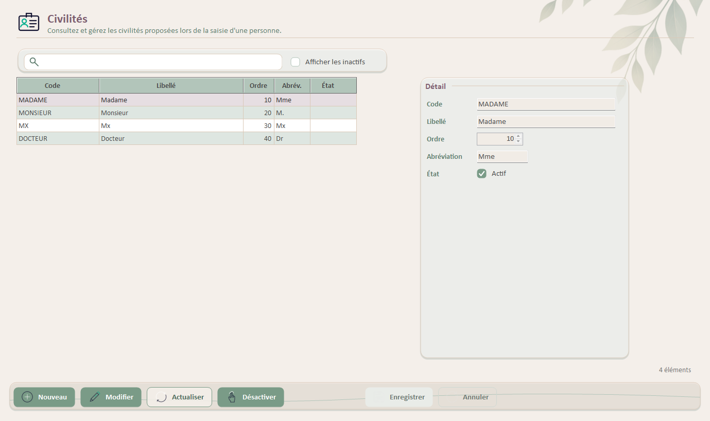

> Fichier : `UI/Controls/Referentiels/UC_ReferentielBase.vb` — hérite de `UserControl` — implémente `IContextAwareUserControl`.

##### Rôle général

`UC_ReferentielBase` est la **classe de base héritable** pour tous les écrans de gestion de référentiels (`ref_*`). Elle centralise : chargement, modes (Consultation / Création / Modification), CRUD via points d'extension, validation (unicité code + libellé, longueur max, format), droits, journalisation, activation/désactivation (soft-delete).

Chaque référentiel concret **hérite** de `UC_ReferentielBase` et n'implémente que ses spécificités métier (métadonnées + branchement couche métier). Aucune logique n'est dupliquée.

##### Responsabilités

- Afficher la liste des éléments dans une grille générique (`dgvReferentiel`)
- Gérer la recherche et le filtre « Afficher inactifs »
- Orchestrer les modes et l'état des boutons
- Valider les saisies (champs requis, longueur code, unicité code et libellé)
- Appliquer les droits d'accès selon le rôle (`RoleMinimum` = `ReglesReferentiels.ROLE_ECRITURE`, une seule définition partagée avec le métier depuis le 22/10/2026)
- Afficher tels quels les refus du métier (ligne système, droit) dans des fenêtres Althéa (`DialogChoix`, 22/10/2026 : plus de `MessageBox`)
- Journaliser via `GestionLog`
- Fournir des **hooks champ supplémentaire** pour les référentiels avec champ additionnel (ex. `tarif_defaut`)

##### Dépendances

| Élément | Type | Rôle |
| --- | --- | --- |
| `UserControlContext` | Classe | contexte UI partagé |
| `IContextAwareUserControl` | Interface | injection du contexte UI partagé |
| `ReferentielLigne` | Classe | modèle de présentation générique |
| `AppRole` | Enum | gestion des droits |
| `GestionLog` | Module métier | journalisation |
| `NavigationManager` | Classe | — |
| `UtilsButtons` | Module utilitaire | — |
| `UtilsDataGrid` | Module utilitaire | — |
| `ReglesReferentiels` | Module métier | `ROLE_ECRITURE` : rôle d'écriture des référentiels (SuperUser), vérifié aussi par chaque écriture du métier (22/10/2026, audit C.1 étape 3). |
| `DialogChoix` | Form | Refus, confirmations et erreurs (remplace les `MessageBox`, 22/10/2026). |

##### Variables privées

| Variable | Type | Rôle |
| --- | --- | --- |
| `_context` | `UserControlContext` | Contexte UI partagé injecté par Home via SetContext() |
| `_lignes` | `List(Of ReferentielLigne)` | Liste complète des éléments chargés depuis la base (avant filtrage mémoire) |
| `_mode` | `ModeReferentiel` | Mode courant de l'écran (consultation, création, modification) |
| `_idEnCours` | `ULong` | Identifiant de l'élément en cours d'édition (0 = aucun / création) |
| `_miseAJourCode` | `Boolean` | Garde anti-réentrance lors du nettoyage automatique du code (txtCode_TextChanged) |
| `_tabDonneesLiees` | `AltheaOnglets` | Conteneur d'onglets des données liées (onglets du kit, fond transparent), créé à la demande si HauteurDonneesLiees > 0 |

##### Contrôles principaux

| Contrôle | Type | Rôle |
| --- | --- | --- |
| `pnlForm` | Panel | — |
| `enTete` | AltheaEnTete | En-tête d'écran : titre et sous-titre fournis par la classe dérivée (`TitreReferentiel`, `SousTitreReferentiel`), icône par `IconeTitre` ; icône dans les ressources (`enTete.Icone`). |
| `pnlActions` | AltheaBarreActions | — |
| `btnEnregistrer` | AltheaBouton | Enregistrer la saisie en cours. |
| `btnAnnuler` | AltheaBouton | Annuler la saisie en cours. |
| `btnActiverDesactiver` | AltheaBouton | Activer ou désactiver l'élément sélectionné. |
| `btnActualiser` | AltheaBouton | Recharger la liste. |
| `btnNouveau` | AltheaBouton | Créer un nouvel élément. |
| `btnModifier` | AltheaBouton | Modifier l'élément sélectionné. |
| `pnlCenter` | Panel | — |
| `pnlTop` | Panel | Bande du haut : carte de recherche à gauche, titre « Détail » à droite (au-dessus du panneau de détail). |
| `carteRecherche` | AltheaCarte | Bandeau de recherche (modèle « Simple ») ; sa largeur suit celle de la liste (minimum 520 px, `LARGEUR_MIN_RECHERCHE`). |
| `txtRecherche` | AltheaRecherche | Filtrer sur le code ou le libellé (texte d'aide « Code ou libellé… »). |
| `chkAfficherInactifs` | AltheaCase | « Afficher les inactifs » : éléments désactivés inclus. |
| `dgvReferentiel` | DataGridView | — |
| `pnlEdition` | AltheaCarte | Carte « Détail » (titre « Nouvel élément » / « Modification » selon le mode), `Padding` 12; 8; 12; 10. Règle des fenêtres (16/10/2026) : libellé à gauche (x = 12, Calibri 10,5 gras Sauge foncé), champ à droite (x = 112, Calibri 11, fond blanc en saisie), une ligne tous les 34 px à partir de y = 40. |
| `lblCode`, `txtCode` | Label, TextBox | Ligne 1 : code (majuscules, `LongueurMaxCode`). |
| `lblLibelle`, `txtLibelle` | Label, TextBox | Ligne 2 : libellé. |
| `lblOrdre`, `numOrdre` | Label, NumericUpDown | Ligne 3 : ordre d'affichage (90 px, aligné à droite). |
| *(champs propres)* | — | Lignes suivantes : champs ajoutés par la classe dérivée (`AjouterLigneDetail`). |
| `lblActif`, `chkActif` | Label, AltheaCase | Dernière ligne : « État » / « Actif », placée par `PlacerLigneEtat` après les champs propres. |

##### DataGridView : colonnes

###### DataGridView `dgvReferentiel` : colonnes

| Colonne | En-tête | Propriété liée | Visible | Rôle |
| --- | --- | --- | --- | --- |
| `colId` | Id | — | Non | — |
| `colCode` | Code | — | Oui | — |
| `colLibelle` | Libellé | — | Oui | — |
| `colOrdre` | Ordre | `OrdreAffichage` | Oui | Aligné à droite. |
| `colActif` | État | `LibelleEtat` | Oui | Pastille « Système » ou « Inactif » ; rien pour une ligne normale (V1.5.0, 18/10/2026, UI-9.4 — remplace la case « Actif » et la colonne cadenas). |

##### Méthodes principales

| Membre | Nature | Rôle |
| --- | --- | --- |
| `IdEnCours` | Protected ReadOnly Property | Identifiant de l'élément en cours d'édition (0 en création). |
| `EnregistrementEffectue` | Public Event | Notifie qu'un enregistrement (création ou modification) vient de réussir. |
| `TitreReferentiel` | Protected Overridable ReadOnly Property | Titre affiché dans l'en-tête |
| `SousTitreReferentiel` | Protected Overridable ReadOnly Property | Sous-titre descriptif |
| `CheminContexte` | Protected Overridable ReadOnly Property | Fil d'Ariane (`Référentiels > X`) |
| `RoleMinimum` | Protected ReadOnly Property | Rôle requis pour modifier : `ReglesReferentiels.ROLE_ECRITURE` ; plus surchargeable depuis la V1.8.0 (22/10/2026), les 20 surcharges identiques des écrans dérivés sont retirées. |
| `LongueurMaxCode` | Protected Overridable ReadOnly Property | Longueur max du code (selon la table) |
| `RemplacerEspacesParUnderscore` | Protected Overridable ReadOnly Property | Remplace les espaces par `_` dans le code (défaut : True) |
| `CreationPermise` | Protected Overridable ReadOnly Property | False : bouton Nouveau retiré, Modifier / Actualiser / Activer resserrés (`RetirerCreationSiInterdite`, V1.7.0, 19/10/2026) — ex. `UC_UsagesTextesTypes` (défaut : True) |
| `ChargerElements` | Protected Overridable Function | Retourne les éléments sous forme de `List(Of ReferentielLigne)` |
| `CodeExisteDeja` | Protected Overridable Function | Vérifie l'unicité du code |
| `LibelleExisteDeja` | Protected Overridable Function | Vérifie l'unicité du libellé |
| `InsererElement` | Protected Overridable Sub | Insère un nouvel élément |
| `MettreAJourElement` | Protected Overridable Sub | Met à jour un élément existant |
| `DefinirActivation` | Protected Overridable Sub | Active ou désactive (soft-delete) |
| `ConfigurerChampSupplementaire` | Protected Overridable Sub | Crée et ajoute le contrôle additionnel au panneau d'édition (appelé au Load) |
| `AfficherChampSupplementaire` | Protected Overridable Sub | Affiche la valeur depuis la `ReferentielLigne` sélectionnée |
| `ViderChampSupplementaire` | Protected Overridable Sub | Réinitialise le champ (mode création / vidage) |
| `ActiverChampSupplementaire` | Protected Overridable Sub | Exceptions propres au référentiel après la bascule de mode (ex. type verrouillé) ; la base a déjà passé tout le panneau en consultation ou en saisie. |
| `ValiderChampSupplementaire` | Protected Overridable Function | Valide avant enregistrement (retourne Boolean) |
| `AjouterLigneDetail(libelle, champ[, lignes])` | Protected Function | Pose un libellé et son champ sur la prochaine ligne libre du panneau « Détail » ; renvoie le libellé. |
| `CreerZoneTexteDetail`, `CreerListeDetail`, `CreerCaseDetail`, `CreerNombreDetail` | Protected Function | Créent un champ aux polices et couleurs du kit (`TextBox`, `AltheaListe`, `AltheaCase`, `NumericUpDown`). |
| `X_CHAMP_DETAIL`, `LARGEUR_CHAMP_DETAIL` | Protected Const | Colonne (112) et largeur (270) des champs, pour poser un contrôle à côté d'un champ. |
| `HauteurDonneesLiees` | Protected Overridable ReadOnly Property | Hauteur réservée à la zone d'onglets (0 = pas de données liées, défaut). |
| `TabDonneesLiees` | Protected ReadOnly Property | `TabControl` hôte fourni par le socle, auquel la classe dérivée ajoute ses `TabPage`. |
| `ConfigurerDonneesLiees` | Protected Overridable Sub | Crée et ajoute les onglets au `TabControl` (appelé au Load). |
| `ChargerDonneesLiees` | Protected Overridable Sub | Recharge les onglets pour l'élément sélectionné. |
| `ActiverDonneesLiees` | Protected Overridable Sub | Désactive la zone d'onglets pendant l'édition de l'élément parent (implémentation de base : `TabControl.Enabled = Not enEdition`). |
| `InitialiserDonneesLiees` | Private Sub | Crée la zone d'onglets sous la liste si la classe dérivée en déclare une. |
| `SetContext` | Public Sub | Reçoit le contexte UI partagé injecté par Home. |
| `UC_ReferentielBase_Load` | Private Sub | Initialise l'écran, applique les droits et charge la liste. |
| `InitialiserEntete` | Private Sub | Applique le titre et le sous-titre fournis par la classe dérivée. |
| `InitialiserBoutons` | Private Sub | Initialise les boutons standards (icônes + style Althéa). |
| `InitialiserDataGridView` | Private Sub | Configure la grille générique et lie les colonnes à ReferentielLigne. |
| `ConfigurerColonnesSupplementaires` | Protected Overridable Sub | Point d'extension permettant à un référentiel d'ajouter ses propres colonnes à la grille principale (ex. le montant des tarifs de séance). |
| `InitialiserToolTips` | Private Sub | Initialise les aides contextuelles des boutons. |
| `ConstruireToolTipCode` | Private Function | Construit l'aide contextuelle du champ code selon la longueur et l'option underscore. |
| `PasserEnMode` | Private Sub | Bascule l'écran dans un mode donné et ajuste l'état des contrôles. |
| `ActualiserBoutonsSelection` | Private Sub | Active/désactive Modifier et Activer/Désactiver selon la ligne sélectionnée. |
| `ChargerListe` | Private Sub | Charge les éléments via le point d'extension et applique le filtre courant. |
| `AppliquerFiltre` | Private Sub | Filtre la liste en mémoire sur le texte de recherche et lie la grille. |
| `LigneSelectionnee` | Private Function | Retourne la ReferentielLigne sélectionnée dans la grille, ou Nothing. |
| `AfficherDetailSelection` | Private Sub | Affiche les valeurs de l'élément sélectionné dans le panneau d'édition (lecture). |
| `ViderDetail` | Private Sub | Réinitialise le panneau d'édition. |
| `AppliquerDroitsUtilisateur` | Private Sub | Restreint les actions de modification selon le rôle de l'utilisateur courant. |
| `PeutModifier` | Private Function | Vérifie le droit de modification avant toute action d'écriture. |
| `SaisieValide` | Private Function | Valide les champs du panneau d'édition (requis, longueurs, unicité). |
| `DefinirErreur` | Private Sub | — |
| `EffacerErreurs` | Private Sub | — |
| `txtCode_KeyPress` | Private Sub | Filtre la saisie du code au clavier (lettres, chiffres et caractères de contrôle). |
| `txtCode_TextChanged` | Private Sub | Normalise le code après toute modification (frappe ou collage). |
| `btnNouveau_Click` | Private Sub | Passe en mode création et prépare un panneau d'édition vierge. |
| `btnModifier_Click` | Private Sub | Passe en mode modification sur l'élément sélectionné. |
| `btnActiverDesactiver_Click` | Private Sub | Bascule l'état actif de l'élément sélectionné (soft-delete / réactivation). |
| `btnActualiser_Click` | Private Sub | Recharge la liste depuis la base. |
| `btnEnregistrer_Click` | Private Sub | Valide et enregistre la saisie (création ou modification). |
| `btnAnnuler_Click` | Private Sub | Annule la saisie en cours et revient en consultation. Abandonner / Continuer la saisie s'il y a des modifications (19/10/2026). |
| `PeutQuitter` | Public Function (IUnsavedChangesAware) | Détail en saisie : Enregistrer / Quitter sans enregistrer / Rester (`GardeModifications` sur `pnlEdition`, V1.6.0) ; appelée par Home et par `ReferentielModalHost`. |
| `dgvReferentiel_SelectionChanged` | Private Sub | Met à jour le détail et l'état des boutons à chaque changement de sélection. |
| `txtRecherche_TextChanged` | Private Sub | Applique le filtre de recherche à chaque frappe. |
| `chkAfficherInactifs_CheckedChanged` | Private Sub | Recharge la liste en incluant ou non les éléments désactivés. Définit le mode courant d'un écran de gestion de référentiel. |

##### Gestion des icônes

- `btnActiverDesactiver.Image` (Designer / ressources)
- `btnActualiser.Image` (Designer / ressources)
- `btnAnnuler.Image` (Designer / ressources)
- `btnEnregistrer.Image` (Designer / ressources)
- `btnModifier.Image` (Designer / ressources)
- `btnNouveau.Image` (Designer / ressources)
- `pnlActions.BackgroundImage` (Designer / ressources)

##### Gestion des filtres et recherche

- Contrôles : `txtRecherche`, `chkAfficherInactifs`.
- Méthodes : `AppliquerFiltre`, `txtRecherche_TextChanged`.
- Fonctionnement : filtrage en mémoire sur la liste chargée (pas de nouvel appel base), déclenché par les événements des contrôles ci-dessus ; la réinitialisation remet les critères par défaut puis réapplique le filtre.

##### Gestion des droits

- Rôles testés : `AppRole.SuperUser`.
- Rôle d'écriture : `RoleMinimum` = `ReglesReferentiels.ROLE_ECRITURE` (SuperUser), même règle que le métier, qui la vérifie à chaque écriture (`ContexteOperation`, audit C.1 étape 3, 22/10/2026).
- Méthodes concernées : `RoleMinimum`, `AppliquerDroitsUtilisateur`.
- L'ajout « à la volée » depuis une fiche (bouton [+]) reste soumis à l'élévation pour un User (décision de Joëlle, 22/10/2026).

##### Métadonnées

| Propriété | Rôle |
|---|---|
| `TitreReferentiel` | Titre affiché dans l'en-tête |
| `SousTitreReferentiel` | Sous-titre descriptif |
| `CheminContexte` | Fil d'Ariane (`Référentiels > X`) |
| `RoleMinimum` | Rôle requis pour modifier (`ReglesReferentiels.ROLE_ECRITURE`, non surchargeable depuis le 22/10/2026) |
| `LongueurMaxCode` | Longueur max du code (selon la table) |
| `RemplacerEspacesParUnderscore` | Remplace les espaces par `_` dans le code (défaut : True) |
| `CreationPermise` | Référentiel sans création (lignes nées par migration) : Nouveau retiré (défaut : True) |

##### Données

| Méthode | Rôle |
|---|---|
| `ChargerElements(afficherInactifs)` | Retourne les éléments sous forme de `List(Of ReferentielLigne)` |
| `CodeExisteDeja(code, idExclu)` | Vérifie l'unicité du code |
| `LibelleExisteDeja(libelle, idExclu)` | Vérifie l'unicité du libellé |
| `InsererElement(code, libelle, ordre, actif)` | Insère un nouvel élément |
| `MettreAJourElement(id, code, libelle, ordre, actif)` | Met à jour un élément existant |
| `DefinirActivation(id, actif)` | Active ou désactive (soft-delete) |

##### Hooks champ supplémentaire

| Méthode | Rôle |
|---|---|
| `ConfigurerChampSupplementaire()` | Crée et ajoute le contrôle additionnel au panneau d'édition (appelé au Load) |
| `AfficherChampSupplementaire(ligne)` | Affiche la valeur depuis la `ReferentielLigne` sélectionnée |
| `ViderChampSupplementaire()` | Réinitialise le champ (mode création / vidage) |
| `ActiverChampSupplementaire(enEdition)` | Exceptions après la bascule de mode (la base a déjà appliqué `UtilsControls.DefinirLectureSeule` à tout `pnlEdition`) |
| `ValiderChampSupplementaire()` | Valide avant enregistrement (retourne Boolean) |

Exemple (champ propre d'un référentiel) :

```vb
Protected Overrides Sub ConfigurerChampSupplementaire()
    _numMontant = CreerNombreDetail("numMontant", 0D, 99999999.99D, 2, 130)
    AjouterLigneDetail("Montant (€)", _numMontant)
End Sub
```

> 💡 Ces hooks ont des implémentations vides par défaut (no-op / retour `True`).
>
> Depuis le 16/10/2026 (UI-7), aucun écran dérivé ne calcule de position ni n'écrit de couleur : `AjouterLigneDetail` et les `Creer…Detail` s'en chargent, l'état vient toujours en dernier, et la consultation est lisible (texte normal sur fond teinté) au lieu de champs grisés.
>
> `UC_Domaines` les utilise pour intégrer ses comportements métier au panneau d’édition ; les autres référentiels spécialisés portent leurs champs propres dans leur implémentation.

##### Hooks données liées (onglets)

Points d'extension permettant à un référentiel d'héberger des onglets de données liées sous la liste (utilisés par `UC_NaturesSeance`). Le socle crée et gère un `AltheaOnglets` (onglets du kit), exposé en lecture via `TabDonneesLiees` sous le type `TabControl`.

| Membre | Rôle |
|---|---|
| `HauteurDonneesLiees` (Property) | Hauteur réservée à la zone d'onglets (0 = pas de données liées, défaut). |
| `TabDonneesLiees` (Property, lecture) | `TabControl` hôte fourni par le socle, auquel la classe dérivée ajoute ses `TabPage`. |
| `ConfigurerDonneesLiees()` | Crée et ajoute les onglets au `TabControl` (appelé au Load). |
| `ChargerDonneesLiees(ligne)` | Recharge les onglets pour l'élément sélectionné. |
| `ActiverDonneesLiees(enEdition)` | Désactive la zone d'onglets pendant l'édition de l'élément parent (implémentation de base : `TabControl.Enabled = Not enEdition`). |

##### Modèle de présentation générique : ReferentielLigne


```vb
Public Class ReferentielLigne
    Public Property IdReferentiel As ULong
    Public Property Code         As String
    Public Property Libelle      As String
    Public Property OrdreAffichage As Integer
    Public Property Actif        As Boolean
End Class
```

##### Architecture complète d'une pile référentiel


```
Core\Database\Queries\Query<X>.vb          → SQL (SELECT actifs/tous, COUNT code/libellé/usage,
                                              UPDATE, INSERT, DELETE soft+hard)
Metier\Referentiels\<X>.vb                 → Modèle (id, code, libelle, actif, ordre [+ tarif])
Metier\Referentiels\Gestion<X>.vb          → Service CRUD + unicité + <X>EstUtilise()
UI\Controls\Referentiels\UC_<X>.vb         → UserControl concret héritant UC_ReferentielBase
```

##### Règles importantes


- **Un UC par référentiel** : jamais de logique partagée dans l'UC, toujours déléguée à la couche métier.
- **Nommage réel** : `UC_Pays`, `UC_LiensPatient`, `UC_RolesIntervenant`… (sans préfixe supplémentaire).
- **Soft-delete prioritaire** : si `<X>EstUtilise()` retourne `True`, désactiver via `Desactiver<X>()` ; suppression physique uniquement si non utilisé.
- **Unicité vérifiée avant écriture** : `CodeExisteDeja` et `LibelleExisteDeja` sont appelés par `UC_ReferentielBase.SaisieValide()` avant tout INSERT/UPDATE.
- **Aucun accès DB dans l'UC** : tout passe par la couche `Gestion<X>`.

##### Lignes système

Certaines valeurs de référentiel sont **utilisées par l'application elle-même** (le code les recherche par leur code métier).

Elles sont marquées en base par la colonne `est_systeme = 1` (migration `v2.21.0_lot19_referentiels_est_systeme.sql`) et affichées avec une **pastille « Système »** (bleue) dans la colonne « État » de la grille (cadenas jusqu'au 18/10/2026, UI-9.4).

| Élément | Où dans le code | Effet |
| --- | --- | --- |
| `ReferentielLigne.EstSysteme` | `Metier/Referentiels/ReferentielLigne.vb` | Alimenté par chaque `ChargerElements` depuis le modèle métier (`Gestion<X>` lit `est_systeme`). |
| `ReferentielLigne.Etat` / `LibelleEtat` | `Metier/Referentiels/ReferentielLigne.vb` | Inactif d'abord, puis Système, sinon rien : la colonne « État » (`colActif`, liée à `LibelleEtat`, triable). |
| `dgvReferentiel_CellPainting` / `_CellToolTipTextNeeded` | `UC_ReferentielBase` | Pastille « Système » (bleu) ou « Inactif » (gris) ; infobulle « Ligne système : code et activation verrouillés. » ; `dgvReferentiel_CellFormatting` atténue une ligne inactive. |
| `PasserEnMode` (`_ligneSystemeEnCours`) | `UC_ReferentielBase` | En modification d'une ligne système : `txtCode` et `chkActif` désactivés ; **libellé et ordre restent modifiables**. |
| `ActualiserBoutonsSelection` | `UC_ReferentielBase` | `btnActiverDesactiver` désactivé pour une ligne système active. |
| `btnActiverDesactiver_Click` | `UC_ReferentielBase` | Garde-fou : refuse la désactivation avec un message. |
| `btnEnregistrer_Click` | `UC_ReferentielBase` | Garde-fou : restaure le code d'origine et force `Actif = True`. |

Pourquoi : renommer le code ou désactiver ces lignes casserait silencieusement une règle (statut cherché par code, type de document par défaut…). Le libellé reste libre car il n'est qu'affiché.

Les référentiels concernés détaillent leurs lignes verrouillées dans leur propre section « Lignes système » : `UC_StatutsDossier`, `UC_StatutsSeance`, `UC_TypesDocuments`, `UC_PrixSeance`, `UC_ModesPaiement`. Les autres référentiels n'ont aucune ligne système (`UC_LiensPatient` et `UC_RoleLegal` depuis la v2.58.0).

> À ne pas confondre avec le cadenas de `SeanceEditor` (`btnDeverrouillerTarif`), qui déverrouille la saisie manuelle du montant d'une séance.


##### Règles en vigueur

- Aucun accès direct à la base : les lectures/écritures passent par la couche métier `Gestion*`.
- Les actions significatives sont journalisées via `GestionLog`.
- **Droits et lignes système côté métier** (ADR-50, ADR-28, 22/10/2026) : chaque écriture des référentiels reçoit le `ContexteOperation` et vérifie le rôle ; la protection d'une ligne système est écrite dans la requête et le métier refuse une écriture qui n'a concerné aucune ligne.
  - L'écran affiche ces refus tels quels (`InvalidOperationException` : « Opération impossible » / « Enregistrement impossible » ; `UnauthorizedAccessException` : « Autorisation insuffisante »)
  - un échec annonce « rien n'a été modifié ».

##### Points d'attention

- Implémente IContextAwareUserControl (injection du contexte UI par Home/NavigationManager)
- Ne contient AUCUN accès direct à la base de données : tout passe par les points
  d'extension Overridable surchargés par les classes dérivées (ex. UC_Pays).
- N'est pas MustInherit afin de rester compatible avec le concepteur Windows Forms.

##### Message au repreneur

> UC_ReferentielBase (1524 lignes). Point d'entrée : `InitialiserDonneesLiees`, `SetContext`, `UC_ReferentielBase_Load`. Toute modification visuelle passe par le Designer (.Designer.vb / .resx).

---

### **1.2.1 Référentiels standards**

Ces UserControls ne contiennent que leurs métadonnées (titre, fil d'Ariane, longueur de code ; le rôle d'écriture est celui du socle depuis le 22/10/2026) et le branchement des six points d'extension « Données » de `UC_ReferentielBase`. Toute la mécanique (recherche, inactifs, modes, unicité, droits, journalisation) est décrite dans le socle.

#### **UserControl : UC_LiensPatient**

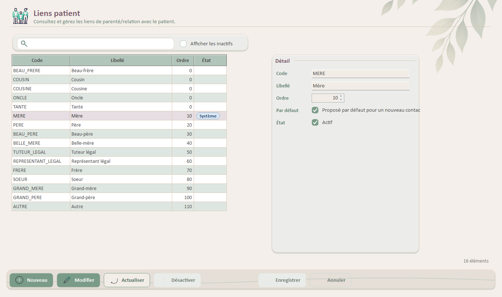

> Fichier : `UI/Controls/Referentiels/UC_LiensPatient.vb` — hérite de `UC_ReferentielBase`.

##### Rôle général

Écran de gestion du référentiel des liens de parenté/relation avec le patient (table ref_liens_patient). Hérite de UC_ReferentielBase et se contente de fournir les métadonnées d'affichage et de brancher la couche métier GestionLiensPatient via les points d'extension.

##### Responsabilités

- Définir le titre, le sous-titre et le fil d'Ariane propres aux liens patient
- Charger les liens patient via GestionLiensPatient et les convertir en ReferentielLigne
- Case **Proposé pour un nouveau contact**, ligne « Par défaut » (`par_defaut`, 24/10/2026, v2.57.0) : une seule à la fois, les autres décochées par le métier dans la même transaction
- Déléguer les vérifications d'unicité (code, libellé) et le CRUD à GestionLiensPatient

##### Dépendances

| Élément | Type | Rôle |
| --- | --- | --- |
| `UC_ReferentielBase` | UserControl | classe de base héritée |
| `GestionLiensPatient` | Module métier | couche métier |
| `LienPatient` | Classe | modèle métier |
| `ReferentielLigne` | Classe | modèle de présentation générique |
| `AppRole` | Enum | gestion des droits |

##### Variables privées

| Variable | Type | Rôle |
| --- | --- | --- |
| `_chkParDefaut` | `AltheaCase` | Case « Proposé pour un nouveau contact » du panneau « Détail » (v2.57.0). |
| `_parId` | `Dictionary(Of ULong, LienPatient)` | Éléments chargés : `ReferentielLigne` ne transporte pas la case « par défaut ». |

##### Contrôles principaux

Aucun contrôle Designer (classe non visuelle ou interface construite par la classe de base).

##### Méthodes principales

| Membre | Nature | Rôle |
| --- | --- | --- |
| `TitreReferentiel` | Protected Overrides ReadOnly Property | — |
| `SousTitreReferentiel` | Protected Overrides ReadOnly Property | — |
| `CheminContexte` | Protected Overrides ReadOnly Property | — |
| `LongueurMaxCode` | Protected Overrides ReadOnly Property | — |
| `ChargerElements` | Protected Overrides Function | Charge les liens patient via GestionLiensPatient et les convertit en ReferentielLigne. |
| `CodeExisteDeja` | Protected Overrides Function | Vérifie l'unicité du code via GestionLiensPatient. |
| `LibelleExisteDeja` | Protected Overrides Function | Vérifie l'unicité du libellé via GestionLiensPatient. |
| `InsererElement` | Protected Overrides Sub | Insère un nouveau lien patient via GestionLiensPatient. |
| `MettreAJourElement` | Protected Overrides Sub | Met à jour un lien patient existant via GestionLiensPatient. |
| `DefinirActivation` | Protected Overrides Sub | Active ou désactive un lien patient (soft-delete) via GestionLiensPatient. |

##### Gestion des droits

- Rôles testés : `AppRole.SuperUser`.
- Rôle d'écriture : règle unique du socle (`RoleMinimum` = `ReglesReferentiels.ROLE_ECRITURE`) ; la surcharge `RoleMinimum` est retirée et le métier vérifie le droit à chaque écriture (22/10/2026, audit C.1 étape 3).

##### Règles en vigueur

- Aucun accès direct à la base : les lectures/écritures passent par la couche métier `Gestion*`.

##### Points d'attention

- Aucun Designer propre : tout le visuel provient de UC_ReferentielBase.
- Aucun accès direct à la base de données : tout passe par GestionLiensPatient.
- Le code peut être long (varchar 50) avec des espaces remplacés automatiquement par des _
  (comportement par défaut de UC_ReferentielBase, donc aucune surcharge nécessaire ici).

##### Lignes système

Aucune depuis la v2.58.0 (25/10/2026) : `MERE`, verrouillée en v2.21.0, n'est plus cherchée par son code depuis la v2.57.0 (la fenêtre Contact lit la case « par défaut ») et a été déverrouillée.

##### Message au repreneur

> UC_LiensPatient (169 lignes). Toute évolution de règle se fait d'abord dans `GestionLiensPatient`, pas dans l'écran.

---

#### **UserControl : UC_RolesIntervenant**

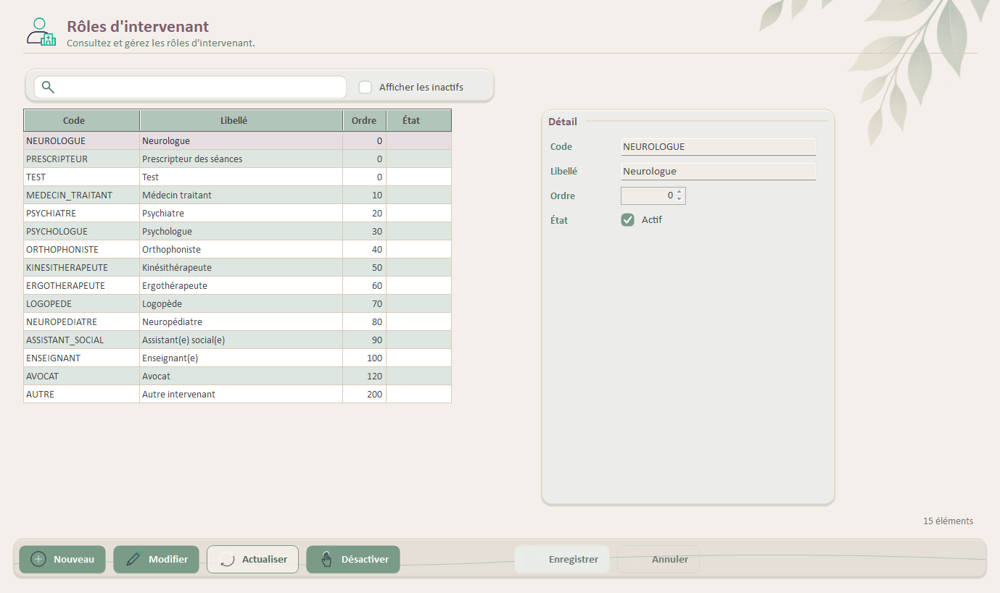

> Fichier : `UI/Controls/Referentiels/UC_RolesIntervenant.vb` — hérite de `UC_ReferentielBase`.

##### Rôle général

Écran de gestion du référentiel des rôles d'intervenant (table ref_roles_intervenant). Hérite de UC_ReferentielBase et fournit les métadonnées d'affichage et le branchement de la couche métier GestionRolesIntervenant via les points d'extension.

##### Responsabilités

- Fournir les métadonnées d'affichage (titre, sous-titre, fil d'Ariane, longueur du code ; le rôle d'écriture est celui du socle depuis le 22/10/2026).
- Brancher les six points d'extension « Données » du socle sur la couche métier dédiée.
- Déléguer au socle la recherche, le filtre des inactifs, les modes, la validation, les droits et la journalisation.

##### Dépendances

| Élément | Type | Rôle |
| --- | --- | --- |
| `UC_ReferentielBase` | UserControl | classe de base héritée |
| `GestionRolesIntervenant` | Module métier | couche métier |
| `RoleIntervenant` | Classe | modèle métier |
| `ReferentielLigne` | Classe | modèle de présentation générique |
| `AppRole` | Enum | gestion des droits |

##### Variables privées

Aucune variable privée.

##### Contrôles principaux

Aucun contrôle Designer (classe non visuelle ou interface construite par la classe de base).

##### Méthodes principales

| Membre | Nature | Rôle |
| --- | --- | --- |
| `TitreReferentiel` | Protected Overrides ReadOnly Property | — |
| `SousTitreReferentiel` | Protected Overrides ReadOnly Property | — |
| `CheminContexte` | Protected Overrides ReadOnly Property | — |
| `LongueurMaxCode` | Protected Overrides ReadOnly Property | — |
| `ChargerElements` | Protected Overrides Function | — |
| `CodeExisteDeja` | Protected Overrides Function | — |
| `LibelleExisteDeja` | Protected Overrides Function | — |
| `InsererElement` | Protected Overrides Sub | — |
| `MettreAJourElement` | Protected Overrides Sub | — |
| `DefinirActivation` | Protected Overrides Sub | — |

##### Gestion des droits

- Rôles testés : `AppRole.SuperUser`.
- Rôle d'écriture : règle unique du socle (`RoleMinimum` = `ReglesReferentiels.ROLE_ECRITURE`) ; la surcharge `RoleMinimum` est retirée et le métier vérifie le droit à chaque écriture (22/10/2026, audit C.1 étape 3).

##### Règles en vigueur

- Aucun accès direct à la base : les lectures/écritures passent par la couche métier `Gestion*`.

##### Points d'attention

- Aucun Designer propre : tout le visuel provient de UC_ReferentielBase.
- Aucun accès direct à la base de données : tout passe par GestionRolesIntervenant.
- Code long (varchar 30) avec espaces convertis en _ (comportement par défaut de la base).

##### Message au repreneur

> UC_RolesIntervenant (136 lignes). Toute évolution de règle se fait d'abord dans `GestionRolesIntervenant`, pas dans l'écran.

---

#### **UserControl : UC_RoleLegal**

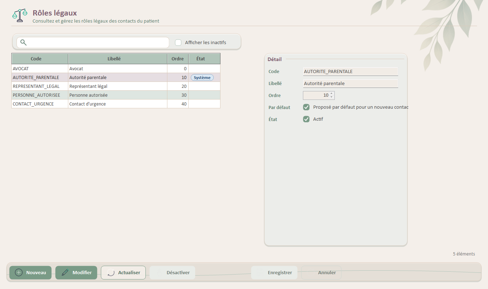

> Fichier : `UI/Controls/Referentiels/UC_RoleLegal.vb` — hérite de `UC_ReferentielBase`.

##### Rôle général

Écran de gestion du référentiel des rôles légaux des contacts de l'entourage du patient (table ref_role_legal). Hérite de UC_ReferentielBase et se contente de fournir les métadonnées d'affichage et de brancher la couche métier GestionRoleLegal via les points d'extension.

##### Responsabilités

- Définir le titre, le sous-titre et le fil d'Ariane propres aux rôles légaux
- Charger les rôles légaux via GestionRoleLegal et les convertir en ReferentielLigne
- Case **Proposé pour un nouveau contact**, ligne « Par défaut » (`par_defaut`, 24/10/2026, v2.57.0) : une seule à la fois, les autres décochées par le métier dans la même transaction
- Déléguer les vérifications d'unicité (code, libellé) et le CRUD à GestionRoleLegal

##### Dépendances

| Élément | Type | Rôle |
| --- | --- | --- |
| `UC_ReferentielBase` | UserControl | classe de base héritée |
| `GestionRoleLegal` | Module métier | couche métier |
| `RoleLegal` | Classe | modèle métier |
| `ReferentielLigne` | Classe | modèle de présentation générique |
| `AppRole` | Enum | gestion des droits |

##### Variables privées

| Variable | Type | Rôle |
| --- | --- | --- |
| `_chkParDefaut` | `AltheaCase` | Case « Proposé pour un nouveau contact » du panneau « Détail » (v2.57.0). |
| `_parId` | `Dictionary(Of ULong, RoleLegal)` | Éléments chargés : `ReferentielLigne` ne transporte pas la case « par défaut ». |

##### Contrôles principaux

Aucun contrôle Designer (classe non visuelle ou interface construite par la classe de base).

##### Méthodes principales

| Membre | Nature | Rôle |
| --- | --- | --- |
| `TitreReferentiel` | Protected Overrides ReadOnly Property | — |
| `SousTitreReferentiel` | Protected Overrides ReadOnly Property | — |
| `CheminContexte` | Protected Overrides ReadOnly Property | — |
| `LongueurMaxCode` | Protected Overrides ReadOnly Property | — |
| `ChargerElements` | Protected Overrides Function | Charge les rôles légaux via GestionRoleLegal et les convertit en ReferentielLigne. |
| `CodeExisteDeja` | Protected Overrides Function | Vérifie l'unicité du code via GestionRoleLegal. |
| `LibelleExisteDeja` | Protected Overrides Function | Vérifie l'unicité du libellé via GestionRoleLegal. |
| `InsererElement` | Protected Overrides Sub | Insère un nouveau rôle légal via GestionRoleLegal. |
| `MettreAJourElement` | Protected Overrides Sub | Met à jour un rôle légal existant via GestionRoleLegal. |
| `DefinirActivation` | Protected Overrides Sub | Active ou désactive un rôle légal (soft-delete) via GestionRoleLegal. |

##### Gestion des droits

- Rôles testés : `AppRole.SuperUser`.
- Rôle d'écriture : règle unique du socle (`RoleMinimum` = `ReglesReferentiels.ROLE_ECRITURE`) ; la surcharge `RoleMinimum` est retirée et le métier vérifie le droit à chaque écriture (22/10/2026, audit C.1 étape 3).

##### Règles en vigueur

- Aucun accès direct à la base : les lectures/écritures passent par la couche métier `Gestion*`.

##### Points d'attention

- Aucun Designer propre : tout le visuel provient de UC_ReferentielBase.
- Aucun accès direct à la base de données : tout passe par GestionRoleLegal.
- Le code peut être long (varchar 30) avec des espaces remplacés automatiquement par des _
  (comportement par défaut de UC_ReferentielBase, donc aucune surcharge nécessaire ici).

##### Lignes système

Aucune depuis la v2.58.0 (25/10/2026) : `AUTORITE_PARENTALE`, verrouillée en v2.21.0, n'est plus cherchée par son code depuis la v2.57.0 (la fenêtre Contact lit la case « par défaut ») et a été déverrouillée.

##### Message au repreneur

> UC_RoleLegal (169 lignes). Toute évolution de règle se fait d'abord dans `GestionRoleLegal`, pas dans l'écran.

---

#### **UserControl : UC_SituationsFamiliales**

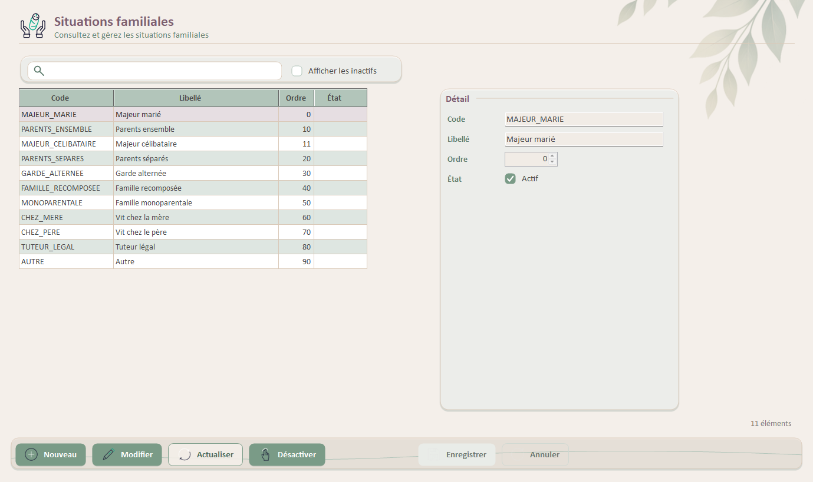

> Fichier : `UI/Controls/Referentiels/UC_SituationsFamiliales.vb` — hérite de `UC_ReferentielBase`.

##### Rôle général

Écran de gestion du référentiel des situations familiales (table ref_situations_familiales). Hérite de UC_ReferentielBase et fournit les métadonnées d'affichage et le branchement de la couche métier GestionSituationsFamiliales via les points d'extension.

##### Responsabilités

- Fournir les métadonnées d'affichage (titre, sous-titre, fil d'Ariane, longueur du code ; le rôle d'écriture est celui du socle depuis le 22/10/2026).
- Brancher les six points d'extension « Données » du socle sur la couche métier dédiée.
- Déléguer au socle la recherche, le filtre des inactifs, les modes, la validation, les droits et la journalisation.

##### Dépendances

| Élément | Type | Rôle |
| --- | --- | --- |
| `UC_ReferentielBase` | UserControl | classe de base héritée |
| `GestionSituationsFamiliales` | Module métier | couche métier |
| `SituationFamiliale` | Classe | modèle métier |
| `ReferentielLigne` | Classe | modèle de présentation générique |
| `AppRole` | Enum | gestion des droits |

##### Variables privées

Aucune variable privée.

##### Contrôles principaux

Aucun contrôle Designer (classe non visuelle ou interface construite par la classe de base).

##### Méthodes principales

| Membre | Nature | Rôle |
| --- | --- | --- |
| `TitreReferentiel` | Protected Overrides ReadOnly Property | — |
| `SousTitreReferentiel` | Protected Overrides ReadOnly Property | — |
| `CheminContexte` | Protected Overrides ReadOnly Property | — |
| `LongueurMaxCode` | Protected Overrides ReadOnly Property | — |
| `ChargerElements` | Protected Overrides Function | — |
| `CodeExisteDeja` | Protected Overrides Function | — |
| `LibelleExisteDeja` | Protected Overrides Function | — |
| `InsererElement` | Protected Overrides Sub | — |
| `MettreAJourElement` | Protected Overrides Sub | — |
| `DefinirActivation` | Protected Overrides Sub | — |

##### Gestion des droits

- Rôles testés : `AppRole.SuperUser`.
- Rôle d'écriture : règle unique du socle (`RoleMinimum` = `ReglesReferentiels.ROLE_ECRITURE`) ; la surcharge `RoleMinimum` est retirée et le métier vérifie le droit à chaque écriture (22/10/2026, audit C.1 étape 3).

##### Règles en vigueur

- Aucun accès direct à la base : les lectures/écritures passent par la couche métier `Gestion*`.

##### Points d'attention

- Aucun Designer propre : tout le visuel provient de UC_ReferentielBase.
- Aucun accès direct à la base de données : tout passe par GestionSituationsFamiliales.
- Code long (varchar 50) avec espaces convertis en _ (comportement par défaut de la base).

##### Message au repreneur

> UC_SituationsFamiliales (136 lignes). Toute évolution de règle se fait d'abord dans `GestionSituationsFamiliales`, pas dans l'écran.

---

#### **UserControl : UC_SituationsJuridiques**

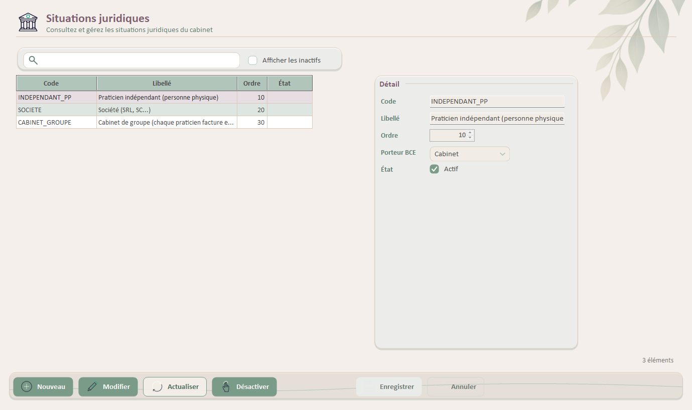

> Fichier : `UI/Controls/Referentiels/UC_SituationsJuridiques.vb` — hérite de `UC_ReferentielBase`. **Accessible depuis le hub Administration** (section « Cabinet et accès »), et non depuis les Référentiels : la situation juridique est un paramètre du cabinet (porteur du numéro BCE). Mêmes droits que la fiche Cabinet : Admin et SuperUser. Icône

##### Rôle général

Écran de gestion du référentiel des situations juridiques du cabinet (table `ref_situations_juridiques` : indépendant personne physique, société, cabinet de groupe…).

Hérite de `UC_ReferentielBase` et y ajoute un **champ supplémentaire métier**, le **Porteur du numéro BCE** (Cabinet ou Praticien), qui pilote dans `UC_Cabinet` l'emplacement de saisie du numéro d'entreprise.

C'est le premier référentiel standard à utiliser les points d'extension « champ supplémentaire » du socle : il sert de modèle pour tout référentiel ayant besoin d'un attribut au-delà de code / libellé / ordre / actif.

##### Responsabilités

- Fournir les métadonnées d'affichage (titre « Situations juridiques », sous-titre, fil d'Ariane « Administration > Situations juridiques » (depuis le 20/10/2026), icône, longueur du code ; rôle d'écriture du socle depuis le 22/10/2026).
- Construire, afficher, vider et activer le champ supplémentaire **Porteur du BCE** via les quatre points d'extension dédiés.
- Brancher les six points d'extension « Données » du socle sur `GestionSituationsJuridiques`, en transmettant le porteur saisi à l'insertion et à la mise à jour.
- Déléguer au socle la recherche, le filtre des inactifs, les modes, la validation générique, les droits, la journalisation et la protection des lignes système.

##### Dépendances

| Élément | Type | Rôle |
| --- | --- | --- |
| `UC_ReferentielBase` | UserControl | classe de base héritée (socle, dont points d'extension champ supplémentaire) |
| `GestionSituationsJuridiques` | Module métier | couche métier (lecture, insertion, mise à jour, activation) |
| `SituationJuridique` | Classe | modèle métier (`IdSituationJuridique`, `CodeSituationJuridique`, `LibelleSituationJuridique`, `PorteurBce`, `OrdreAffichage`, `Actif`, `EstSysteme`) |
| `ReferentielLigne` | Classe | modèle de présentation générique ; le porteur est véhiculé via sa charge utile |
| `AppRole` | Enum | gestion des droits (`SuperUser`) |
| `UC_Cabinet` | UserControl | consommateur : lit `PorteurBce` de la situation sélectionnée (`AppliquerPorteurBce`, `ValiderPorteurBce`) |

##### Variables privées

| Variable | Type | Rôle |
| --- | --- | --- |
| `_cboPorteur` | AltheaListe | liste à deux valeurs fixes « Cabinet » / « Praticien » (`DropDownList`), « Cabinet » par défaut |

> Ce contrôle est créé par code et non par le Designer : le socle `UC_ReferentielBase` ne connaît pas les champs spécifiques et les pose sur la ligne suivante du panneau « Détail » (`AjouterLigneDetail`, 16/10/2026).

##### Contrôles principaux

Aucun contrôle Designer propre : tout le visuel (liste, filtre, panneau Détail, boutons) provient de `UC_ReferentielBase`. Le champ supplémentaire est positionné sous la case « Actif » du panneau Détail.

##### Méthodes principales

| Membre | Nature | Rôle |
| --- | --- | --- |
| `IconeTitre` | Protected Overrides ReadOnly Property | `My.Resources.Titre_situationJuridique` |
| `TitreReferentiel` / `SousTitreReferentiel` / `CheminContexte` | Protected Overrides ReadOnly Property | métadonnées d'en-tête et fil d'Ariane |
| `LongueurMaxCode` | Protected Overrides ReadOnly Property | 50 (espaces → `_`, comportement par défaut du socle) |
| `ConfigurerChampSupplementaire` | Protected Overrides Sub | crée `_cboPorteur` (`AltheaListe`) et le pose par `AjouterLigneDetail` (« Porteur BCE ») ; l'info-bulle porte l'explication complète |
| `AfficherChampSupplementaire(ligne)` | Protected Overrides Sub | positionne la liste sur le porteur de la ligne sélectionnée |
| `ViderChampSupplementaire` | Protected Overrides Sub | remet « Cabinet » (mode Création) |
| `PorteurSaisi()` | Private Function | traduit l'index de la liste en valeur du modèle (`PorteurBce`) |
| `ChargerElements` / `CodeExisteDeja` / `LibelleExisteDeja` | Protected Overrides Function | lecture et contrôles d'unicité via la couche métier |
| `InsererElement` / `MettreAJourElement` / `DefinirActivation` | Protected Overrides Sub | écriture via la couche métier, porteur inclus |

##### Gestion des droits

- Rôle d'écriture : règle unique du socle (`RoleMinimum` = `ReglesReferentiels.ROLE_ECRITURE`, SuperUser) ; la surcharge `RoleMinimum` est retirée et le métier vérifie le droit à chaque écriture (22/10/2026, audit C.1 étape 3).
- En lecture, l'écran est consultable par tout utilisateur autorisé à ouvrir les référentiels.

##### Lignes système

Mécanisme décrit dans le socle (`UC_ReferentielBase`, § Lignes système). Code et activation verrouillés ; libellé, **porteur** et ordre restent modifiables. Les trois lignes ci-dessous sont créées par la migration v2.31.0 et constituent le socle minimal pour un cabinet belge.

| Code verrouillé | Porteur BCE | Table |
| --- | --- | --- |
| `INDEPENDANT_PP` | Praticien | `ref_situations_juridiques` |
| `SOCIETE` | Cabinet | `ref_situations_juridiques` |
| `CABINET_GROUPE` | Cabinet | `ref_situations_juridiques` |

##### Règles en vigueur

- Aucun accès direct à la base : les lectures/écritures passent par `GestionSituationsJuridiques`.
- Le porteur est obligatoire par construction (liste sans valeur vide) ; aucune validation supplémentaire n'est nécessaire.
- Changer le porteur d'une situation **déjà affectée au cabinet** ne modifie pas les données du cabinet : c'est `UC_Cabinet` qui, à sa prochaine ouverture ou au prochain changement de situation, propose le déplacement du BCE (voir `ValiderPorteurBce`).
- Une situation désactivée reste affichée dans la liste de `UC_Cabinet` si elle est la situation courante du cabinet (filtre `Actif OrElse id courant`).

##### Points d'attention

- Les contrôles du champ supplémentaire sont créés par code (exception documentée à la règle « tout dans le Designer », imposée par l'architecture héritée du socle). Leur style reprend celui des contrôles Designer du socle (police, couleurs).
- Toute nouvelle valeur de porteur (ex. un troisième porteur) impose d'étendre à la fois `PorteurBce` côté modèle, la liste de `_cboPorteur` et `AppliquerPorteurBce` dans `UC_Cabinet`.
- Ne jamais renommer ni désactiver les trois codes système : `UC_Cabinet` ne les recherche pas par code (il lit `PorteurBce`), mais la migration et la documentation s'y réfèrent.

##### Message au repreneur

> UC_SituationsJuridiques (181 lignes). Modèle de référence pour un référentiel standard **avec champ supplémentaire** : copier les quatre overrides `*ChampSupplementaire` et `PorteurSaisi()` plutôt que de dériver un nouveau socle.
>
> Toute évolution de règle se fait d'abord dans `GestionSituationsJuridiques`, pas dans l'écran.
>
> Tests : `Docs/Tests/PLAN_TESTS_REFERENTIELS.md` § 14.15.

---

#### **UserControl : UC_TypesIdentifiantPro**

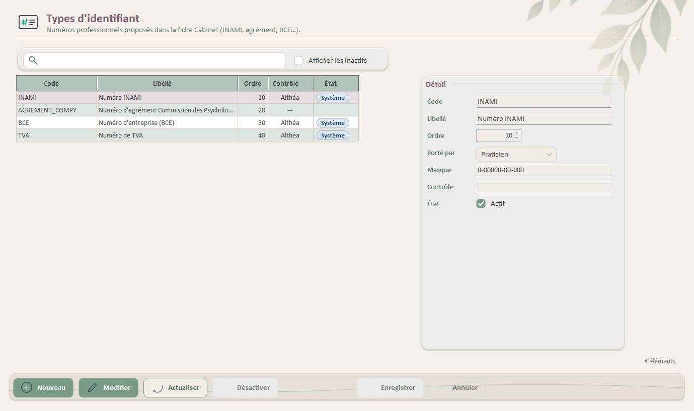

> Fichier : `UI/Controls/Referentiels/UC_TypesIdentifiantPro.vb` — hérite de `UC_ReferentielBase` (20/10/2026). **Ouvert depuis le hub Administration** (section « Cabinet et accès », ADR-31), mêmes droits que la fiche Cabinet ; modification réservée au SuperUser. Icône `Titre_typesIdentifiant`.

##### Rôle général

Gère le référentiel `ref_types_identifiant_pro` : les numéros professionnels proposés dans l'onglet Identifiants de `UC_Cabinet` (INAMI, agrément, BCE, TVA…).

Trois champs supplémentaires :

- **Porté par** (Praticien / Cabinet, colonne `cible` ; préparé pour la V2, plusieurs praticiens)
- **Masque** (indicatif, rappelé par `UC_Cabinet` quand une valeur est refusée)
- et **Contrôle** (expression régulière, vérifiée avant d'enregistrer).

Colonne de grille « Contrôle » (`ReferentielLigne.Complement`) : Althéa, Expression ou —.

##### Règles

- INAMI, BCE et TVA : contrôle écrit dans `UtilsIdentifiantBelge` et choisi par le code (`EstControleParAlthea`) ; lignes système (v2.47.0) — code et activation verrouillés par le socle, expression en lecture seule (`ActiverChampSupplementaire`) car elle ne serait pas utilisée.
- Expression de contrôle : `ValiderChampSupplementaire` l'analyse (`Regex.Match` sur une chaîne vide, délai d'une seconde) ; mal formée → erreur sous le champ, rien n'est enregistré.
- Pas de suppression : un type désactivé reste lisible sur les identifiants qui l'utilisent (`UC_Cabinet.TypesProposes`).

##### Dépendances

| Élément | Type | Rôle |
| --- | --- | --- |
| `UC_ReferentielBase` | UserControl | socle (champs supplémentaires, colonne supplémentaire, lignes système) |
| `GestionTypesIdentifiantPro` / `QueryTypesIdentifiantPro` | Modules | lecture (aussi pour `UC_Cabinet`), insertion, mise à jour, activation ; garde-fou des lignes système dans les requêtes |
| `TypeIdentifiantPro` | Classe | modèle (`Cible` : `CIBLE_PRATICIEN` / `CIBLE_CABINET`) |
| `UtilsIdentifiantBelge` | Module | `EstControleParAlthea`, contrôles INAMI, BCE, TVA |

> UC_TypesIdentifiantPro (≈ 270 lignes). Tests : `Docs/Tests/PLAN_TESTS_REFERENTIELS.md` section 18, `PLAN_TESTS_UC_CABINET.md` 8.7 et 8.8.

---

#### **UserControl : UC_StatutsDossier**

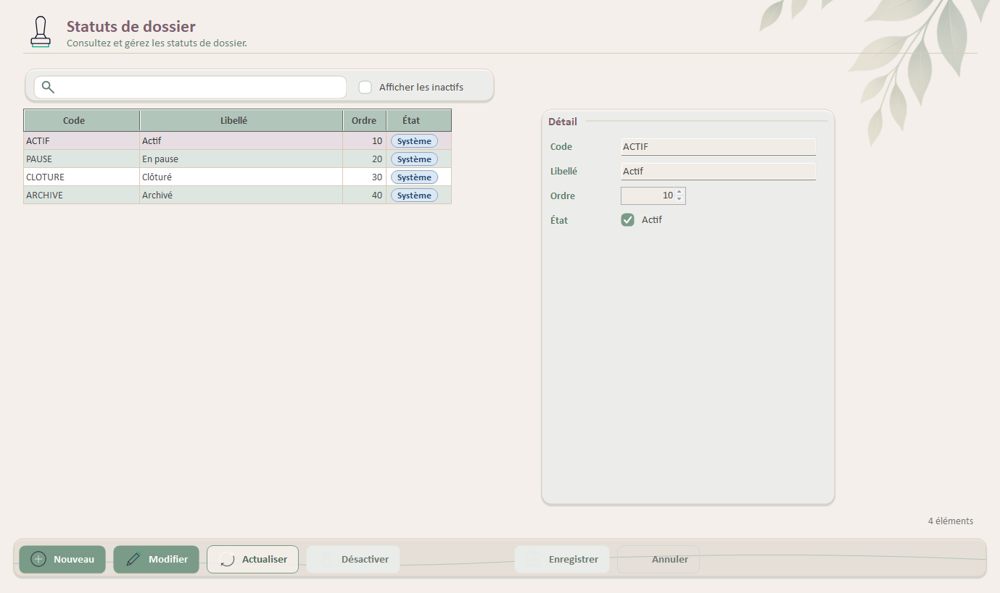

> Fichier : `UI/Controls/Referentiels/UC_StatutsDossier.vb` — hérite de `UC_ReferentielBase`.

##### Rôle général

Écran de gestion du référentiel des statuts de dossier (table ref_statuts_dossier). Hérite de UC_ReferentielBase et fournit les métadonnées d'affichage et le branchement de la couche métier GestionStatutsDossier via les points d'extension.

##### Responsabilités

- Fournir les métadonnées d'affichage (titre, sous-titre, fil d'Ariane, longueur du code ; le rôle d'écriture est celui du socle depuis le 22/10/2026).
- Brancher les six points d'extension « Données » du socle sur la couche métier dédiée.
- Déléguer au socle la recherche, le filtre des inactifs, les modes, la validation, les droits et la journalisation.

##### Dépendances

| Élément | Type | Rôle |
| --- | --- | --- |
| `UC_ReferentielBase` | UserControl | classe de base héritée |
| `GestionStatutsDossier` | Module métier | couche métier |
| `StatutDossier` | Classe | modèle métier |
| `ReferentielLigne` | Classe | modèle de présentation générique |
| `AppRole` | Enum | gestion des droits |

##### Variables privées

Aucune variable privée.

##### Contrôles principaux

Aucun contrôle Designer (classe non visuelle ou interface construite par la classe de base).

##### Méthodes principales

| Membre | Nature | Rôle |
| --- | --- | --- |
| `TitreReferentiel` | Protected Overrides ReadOnly Property | — |
| `SousTitreReferentiel` | Protected Overrides ReadOnly Property | — |
| `CheminContexte` | Protected Overrides ReadOnly Property | — |
| `LongueurMaxCode` | Protected Overrides ReadOnly Property | — |
| `ChargerElements` | Protected Overrides Function | — |
| `CodeExisteDeja` | Protected Overrides Function | — |
| `LibelleExisteDeja` | Protected Overrides Function | — |
| `InsererElement` | Protected Overrides Sub | — |
| `MettreAJourElement` | Protected Overrides Sub | — |
| `DefinirActivation` | Protected Overrides Sub | — |

##### Gestion des droits

- Rôles testés : `AppRole.SuperUser`.
- Rôle d'écriture : règle unique du socle (`RoleMinimum` = `ReglesReferentiels.ROLE_ECRITURE`) ; la surcharge `RoleMinimum` est retirée et le métier vérifie le droit à chaque écriture (22/10/2026, audit C.1 étape 3).

##### Règles en vigueur

- Aucun accès direct à la base : les lectures/écritures passent par la couche métier `Gestion*`.

##### Points d'attention

- Aucun Designer propre : tout le visuel provient de UC_ReferentielBase.
- Aucun accès direct à la base de données : tout passe par GestionStatutsDossier.
- Code long (varchar 30) avec espaces convertis en _ (comportement par défaut de la base).

##### Lignes système

Mécanisme décrit dans le socle (`UC_ReferentielBase`, § Lignes système). Code et activation verrouillés ; libellé et ordre restent modifiables. Ces codes sont recherchés tels quels par l'application : les renommer ou les désactiver casserait la règle qui s'y réfère.

| Code(s) verrouillé(s) | Table |
| --- | --- |
| `ACTIF`, `PAUSE`, `CLOTURE`, `ARCHIVE` | `ref_statuts_dossier` |

##### Message au repreneur

> UC_StatutsDossier (136 lignes). Toute évolution de règle se fait d'abord dans `GestionStatutsDossier`, pas dans l'écran.

---

#### **UserControl : UC_StatutsSeance**

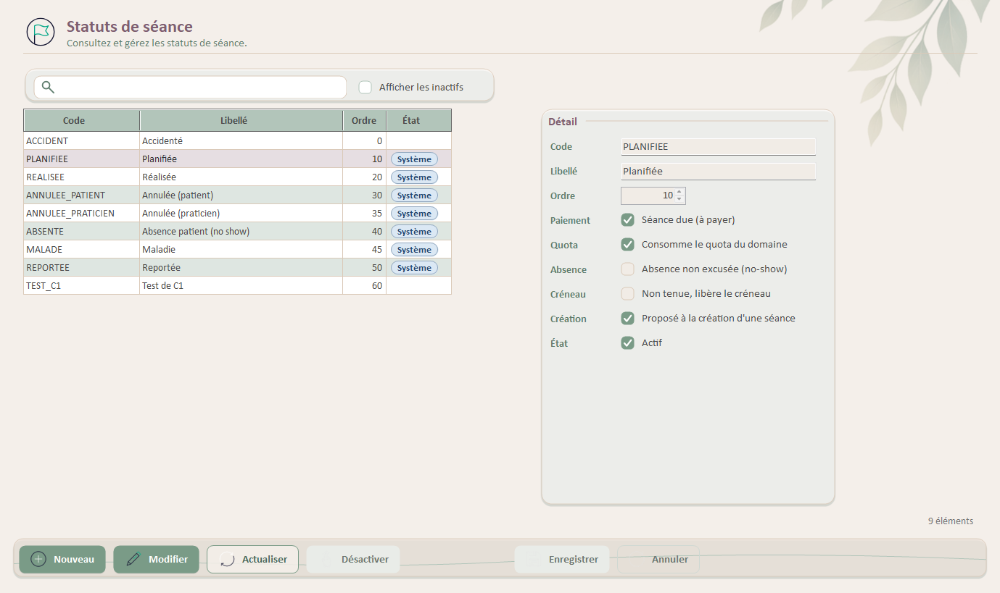

> Fichier : `UI/Controls/Referentiels/UC_StatutsSeance.vb` — hérite de `UC_ReferentielBase`.

##### Rôle général

Écran de gestion du référentiel des statuts de séance (table ref_statuts_seance). Hérite de UC_ReferentielBase et fournit les métadonnées d'affichage et le branchement de la couche métier GestionStatutsSeance via les points d'extension.

##### Responsabilités

- Fournir les métadonnées d'affichage (titre, sous-titre, fil d'Ariane, longueur du code ; le rôle d'écriture est celui du socle depuis le 22/10/2026).
- Brancher les six points d'extension « Données » du socle sur la couche métier dédiée.
- Ajouter au panneau « Détail » cinq cases qui portent les règles du statut : **Séance due (à payer)** (`est_du`), **Consomme le quota du domaine** (`consomme_quota`), **Absence non excusée (no-show)** (`est_absence`, V1.2.0, 22/10/2026, migration v2.53.0), **Non tenue, libère le créneau** (`est_non_tenue`, ligne « Créneau ») et **Proposé à la création d'une séance** (`propose_creation`, ligne « Création ») (V1.4.0, 24/10/2026, migration v2.57.0).
- Déléguer au socle la recherche, le filtre des inactifs, les modes, la validation, les droits et la journalisation.

##### Dépendances

| Élément | Type | Rôle |
| --- | --- | --- |
| `UC_ReferentielBase` | UserControl | classe de base héritée |
| `GestionStatutsSeance` | Module métier | couche métier |
| `StatutSeance` | Classe | modèle métier (`EstDu`, `ConsommeQuota`, `EstAbsence`, `EstNonTenue`, `ProposeCreation`) |
| `ReferentielLigne` | Classe | modèle de présentation générique |
| `AppRole` | Enum | gestion des droits |

##### Variables privées

| Variable | Type | Rôle |
| --- | --- | --- |
| `_chkEstDu`, `_chkConsommeQuota`, `_chkEstAbsence`, `_chkNonTenue`, `_chkProposeCreation` | `AltheaCase` | Cases du panneau « Détail » (créées par `ConfigurerChampSupplementaire`). |
| `_statutsParId` | `Dictionary(Of ULong, StatutSeance)` | Statuts chargés : `ReferentielLigne` ne transporte pas ces drapeaux. |

##### Contrôles principaux

Aucun contrôle Designer (classe non visuelle ou interface construite par la classe de base).

##### Méthodes principales

| Membre | Nature | Rôle |
| --- | --- | --- |
| `TitreReferentiel` | Protected Overrides ReadOnly Property | — |
| `SousTitreReferentiel` | Protected Overrides ReadOnly Property | — |
| `CheminContexte` | Protected Overrides ReadOnly Property | — |
| `LongueurMaxCode` | Protected Overrides ReadOnly Property | — |
| `ConfigurerChampSupplementaire` | Protected Overrides Sub | Crée les cinq cases du panneau « Détail » et leurs infobulles. |
| `AfficherChampSupplementaire` / `ViderChampSupplementaire` | Protected Overrides Sub | Coche les cases selon le statut sélectionné ; les vide. |
| `EstDuSaisi` / `ConsommeQuotaSaisi` / `EstAbsenceSaisi` / `NonTenueSaisi` / `ProposeCreationSaisi` | Private Function | Valeur des cases, transmise à l'écriture. |
| `ChargerElements` | Protected Overrides Function | — |
| `CodeExisteDeja` | Protected Overrides Function | — |
| `LibelleExisteDeja` | Protected Overrides Function | — |
| `InsererElement` | Protected Overrides Sub | Écriture avec le `ContexteOperation` (droit vérifié par le métier, V1.3.0, 22/10/2026). |
| `MettreAJourElement` | Protected Overrides Sub | Idem. |
| `DefinirActivation` | Protected Overrides Sub | Idem. |

##### Gestion des droits

- Rôles testés : `AppRole.SuperUser`.
- Rôle d'écriture : règle unique du socle (`UC_ReferentielBase`, module `ReglesReferentiels`) ; la surcharge `RoleMinimum` est retirée (V1.3.0, 22/10/2026, audit C.1 étape 3). Le métier vérifie aussi le droit à chaque écriture.

##### Règles en vigueur

- Aucun accès direct à la base : les lectures/écritures passent par la couche métier `Gestion*`.
- **Absence non excusée** (décision de Joëlle, 22/10/2026, ADR-48) : la case gouverne
  - le tarif (absence non facturée dans un domaine qui ne facture pas les absences)
  - la facturation (reste dû, dû en attente)
  - le compteur d'absences et la « dernière séance » de la grille Patients
  - la pastille et le filtre « Absences » de l'onglet Séances
  - l'aperçu du patient.
  - Le code `ABSENTE` n'est plus lu par aucune requête ; un second statut d'absence peut être créé et coché.
- **Non tenue, libère le créneau** (audit C.3 étape 2, v2.57.0, ADR-54) : la séance n'occupe pas son horaire (Planning du jour, contrôle de chevauchement de `GestionSeances`) ; au départ Annulée patient, Annulée praticien, Reportée et Maladie. Une absence non excusée garde son créneau mais compte comme non tenue pour passer d'un statut non tenu à un autre sans contrôle.
- **Proposé à la création** : statuts de la liste d'une nouvelle séance (Planifiée et Réalisée au départ). Planifiée ne peut pas être décochée (refus de `GestionStatutsSeance`) ; en modification, tous les statuts actifs sauf Reportée, qui naît du report.

##### Points d'attention

- Aucun Designer propre : tout le visuel provient de UC_ReferentielBase.
- Aucun accès direct à la base de données : tout passe par GestionStatutsSeance.
- Code long (varchar 30) avec espaces convertis en _ (comportement par défaut de la base).

##### Lignes système

Mécanisme décrit dans le socle (`UC_ReferentielBase`, § Lignes système). Code et activation verrouillés ; libellé et ordre restent modifiables. Ces codes sont recherchés tels quels par l'application : les renommer ou les désactiver casserait la règle qui s'y réfère.

| Code(s) verrouillé(s) | Table |
| --- | --- |
| `PLANIFIEE`, `REALISEE`, `REPORTEE` | `ref_statuts_seance` |

Cherchés par leur code (`CodesSysteme.StatutsSeance`) : le statut d'une nouvelle séance, la séance réalisée, le report. `ABSENTE`, `ANNULEE_PATIENT`, `ANNULEE_PRATICIEN`, `MALADE` (et `NO_SHOW`) ont été déverrouillés en v2.58.0 (25/10/2026) : leurs règles passent par les cases depuis la v2.57.0.

##### Message au repreneur

> UC_StatutsSeance (232 lignes). Toute évolution de règle se fait d'abord dans `GestionStatutsSeance`, pas dans l'écran.

---

#### **UserControl : UC_TypesDocuments**

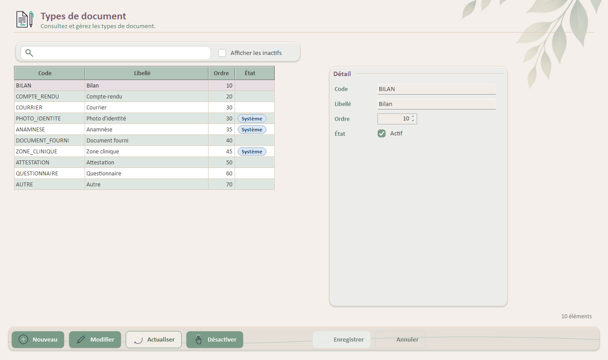

> Fichier : `UI/Controls/Referentiels/UC_TypesDocuments.vb` — hérite de `UC_ReferentielBase`.

##### Rôle général

Écran de gestion du référentiel des types de document (table ref_types_documents). Hérite de UC_ReferentielBase et fournit les métadonnées d'affichage et le branchement de la couche métier GestionTypesDocuments via les points d'extension.

##### Responsabilités

- Fournir les métadonnées d'affichage (titre, sous-titre, fil d'Ariane, longueur du code ; le rôle d'écriture est celui du socle depuis le 22/10/2026).
- Brancher les six points d'extension « Données » du socle sur la couche métier dédiée.
- Déléguer au socle la recherche, le filtre des inactifs, les modes, la validation, les droits et la journalisation.

##### Dépendances

| Élément | Type | Rôle |
| --- | --- | --- |
| `UC_ReferentielBase` | UserControl | classe de base héritée |
| `GestionTypesDocuments` | Module métier | couche métier |
| `TypeDocument` | Classe | modèle métier |
| `ReferentielLigne` | Classe | modèle de présentation générique |
| `AppRole` | Enum | gestion des droits |

##### Variables privées

Aucune variable privée.

##### Contrôles principaux

Aucun contrôle Designer (classe non visuelle ou interface construite par la classe de base).

##### Méthodes principales

| Membre | Nature | Rôle |
| --- | --- | --- |
| `TitreReferentiel` | Protected Overrides ReadOnly Property | — |
| `SousTitreReferentiel` | Protected Overrides ReadOnly Property | — |
| `CheminContexte` | Protected Overrides ReadOnly Property | — |
| `LongueurMaxCode` | Protected Overrides ReadOnly Property | — |
| `ChargerElements` | Protected Overrides Function | — |
| `CodeExisteDeja` | Protected Overrides Function | — |
| `LibelleExisteDeja` | Protected Overrides Function | — |
| `InsererElement` | Protected Overrides Sub | — |
| `MettreAJourElement` | Protected Overrides Sub | — |
| `DefinirActivation` | Protected Overrides Sub | — |

##### Gestion des droits

- Rôles testés : `AppRole.SuperUser`.
- Rôle d'écriture : règle unique du socle (`RoleMinimum` = `ReglesReferentiels.ROLE_ECRITURE`) ; la surcharge `RoleMinimum` est retirée et le métier vérifie le droit à chaque écriture (22/10/2026, audit C.1 étape 3).

##### Règles en vigueur

- Aucun accès direct à la base : les lectures/écritures passent par la couche métier `Gestion*`.

##### Points d'attention

- Aucun Designer propre : tout le visuel provient de UC_ReferentielBase.
- Aucun accès direct à la base de données : tout passe par GestionTypesDocuments.
- Code long (varchar 30) avec espaces convertis en _ (comportement par défaut de la base).

##### Lignes système

Mécanisme décrit dans le socle (`UC_ReferentielBase`, § Lignes système). Code et activation verrouillés ; libellé et ordre restent modifiables. Ces codes sont recherchés tels quels par l'application : les renommer ou les désactiver casserait la règle qui s'y réfère.

| Code(s) verrouillé(s) | Table |
| --- | --- |
| `ANAMNESE`, `ZONE_CLINIQUE`, `PHOTO_IDENTITE` | `ref_types_documents` |

##### Message au repreneur

> UC_TypesDocuments (136 lignes). Toute évolution de règle se fait d'abord dans `GestionTypesDocuments`, pas dans l'écran.

---

#### **UserControl : UC_TextesTypes**

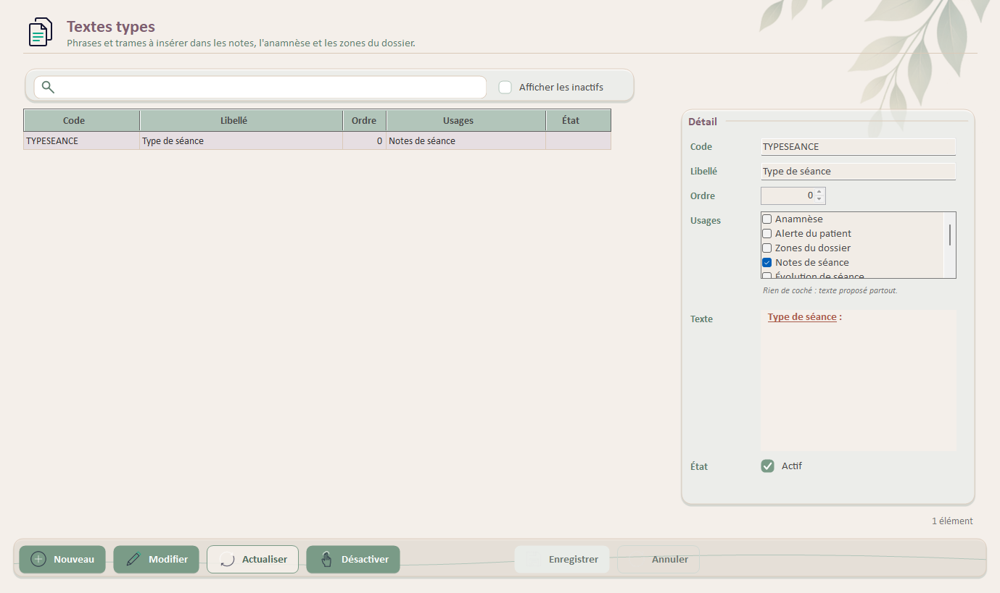

> Fichier : `UI/Controls/Referentiels/UC_TextesTypes.vb` (V1.1.0, 19/10/2026) — hérite de `UC_ReferentielBase`. ADR-44.

##### Rôle général

Référentiel des textes types (`ref_textes_types`) : phrases et trames insérées par le bouton « Textes types » des éditeurs, selon leur usage (`ref_usages_textes_types`) ou partout.

##### Contrôles ajoutés au panneau Détail

| Contrôle | Type | Rôle |
| --- | --- | --- |
| `_lstUsages` | CheckedListBox (3 lignes) | Usages du texte (tous, un usage inactif marqué « (inactif) ») ; rien de coché = partout ; cases figées hors saisie (`ItemCheck`), fond teinté ; indication grise dessous. |
| `_rteContenu` | UC_RichTextEditor (profil Compact, 7 lignes) | Texte ; « Ouvrir en grand » pour écrire à l'aise ; consultation : sans barre (`ActiverChampSupplementaire` bascule `ReadOnlyMode`, la base ne connaît pas ce contrôle). |
| Colonne `colUsages` | DataGridViewTextBoxColumn | Usages du texte, séparés par des virgules (`ReferentielLigne.Complement`, « Partout » sans usage). |

##### Méthodes principales

| Membre | Nature | Rôle |
| --- | --- | --- |
| `ConfigurerChampSupplementaire` / `ChargerUsages` | Protected / Private | Usage et éditeur ; usages lus en base (repli : « Partout » seul, journalisé). |
| `AfficherChampSupplementaire` / `ViderChampSupplementaire` | Protected Sub | Usage et contenu (RTF, repli texte) ; titre de « Ouvrir en grand » = libellé du texte. |
| `ValiderChampSupplementaire` | Protected Function | Texte vide refusé (erreur sur le champ). |
| `ChargerElements`, `InsererElement`, `MettreAJourElement`, `DefinirActivation` | Protected | Branchement de `GestionTextesTypes` ; pas de suppression (désactivation). |

##### Message au repreneur

> UC_TextesTypes (≈ 330 lignes). Un nouvel usage se crée par migration (ligne système) + constante `UsagesTexteType` + déclaration dans l'écran de l'éditeur concerné (`UsageTextesTypes`).

---

#### **UserControl : UC_UsagesTextesTypes**

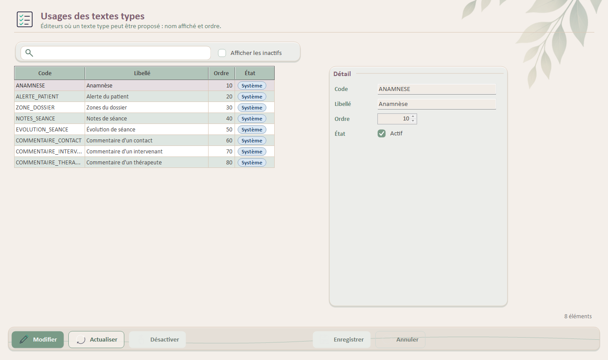

> Fichier : `UI/Controls/Referentiels/UC_UsagesTextesTypes.vb` (V1.0.0, 19/10/2026) — hérite de `UC_ReferentielBase`. ADR-44.

Usages des textes types (`ref_usages_textes_types`) : libellé et ordre. `CreationPermise = False` (pas de bouton Nouveau) ; lignes système : code et état verrouillés par la base. `MettreAJourElement` ne reprend pas le code ; `InsererElement` lève une exception (jamais appelée).

---

#### **UserControl : UC_TypesRendezVous**

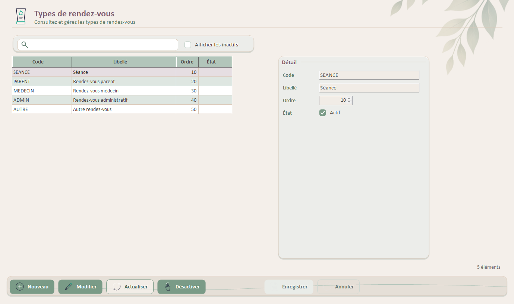

> Fichier : `UI/Controls/Referentiels/UC_TypesRendezVous.vb` — hérite de `UC_ReferentielBase`.

##### Rôle général

Écran de gestion du référentiel des types de rendez-vous (table ref_types_rendez_vous). Hérite de UC_ReferentielBase et fournit les métadonnées d'affichage et le branchement de la couche métier GestionTypesRendezVous via les points d'extension.

##### Responsabilités

- Fournir les métadonnées d'affichage (titre, sous-titre, fil d'Ariane, longueur du code ; le rôle d'écriture est celui du socle depuis le 22/10/2026).
- Brancher les six points d'extension « Données » du socle sur la couche métier dédiée.
- Déléguer au socle la recherche, le filtre des inactifs, les modes, la validation, les droits et la journalisation.

##### Dépendances

| Élément | Type | Rôle |
| --- | --- | --- |
| `UC_ReferentielBase` | UserControl | classe de base héritée |
| `GestionTypesRendezVous` | Module métier | couche métier |
| `TypeRendezVous` | Classe | modèle métier |
| `ReferentielLigne` | Classe | modèle de présentation générique |
| `AppRole` | Enum | gestion des droits |

##### Variables privées

Aucune variable privée.

##### Contrôles principaux

Aucun contrôle Designer (classe non visuelle ou interface construite par la classe de base).

##### Méthodes principales

| Membre | Nature | Rôle |
| --- | --- | --- |
| `TitreReferentiel` | Protected Overrides ReadOnly Property | — |
| `SousTitreReferentiel` | Protected Overrides ReadOnly Property | — |
| `CheminContexte` | Protected Overrides ReadOnly Property | — |
| `LongueurMaxCode` | Protected Overrides ReadOnly Property | — |
| `ChargerElements` | Protected Overrides Function | — |
| `CodeExisteDeja` | Protected Overrides Function | — |
| `LibelleExisteDeja` | Protected Overrides Function | — |
| `InsererElement` | Protected Overrides Sub | — |
| `MettreAJourElement` | Protected Overrides Sub | — |
| `DefinirActivation` | Protected Overrides Sub | — |

##### Gestion des droits

- Rôles testés : `AppRole.SuperUser`.
- Rôle d'écriture : règle unique du socle (`RoleMinimum` = `ReglesReferentiels.ROLE_ECRITURE`) ; la surcharge `RoleMinimum` est retirée et le métier vérifie le droit à chaque écriture (22/10/2026, audit C.1 étape 3).

##### Règles en vigueur

- Aucun accès direct à la base : les lectures/écritures passent par la couche métier `Gestion*`.

##### Points d'attention

- Aucun Designer propre : tout le visuel provient de UC_ReferentielBase.
- Aucun accès direct à la base de données : tout passe par GestionTypesRendezVous.
- Code long (varchar 30) avec espaces convertis en _ (comportement par défaut de la base).

##### Message au repreneur

> UC_TypesRendezVous (136 lignes). Toute évolution de règle se fait d'abord dans `GestionTypesRendezVous`, pas dans l'écran.

---

#### **UserControl : UC_Lateralites**

> Fichier : `UI/Controls/Referentiels/UC_Lateralites.vb` (V1.1.0, 22/10/2026) — hérite de `UC_ReferentielBase`. Migration v2.46.0.

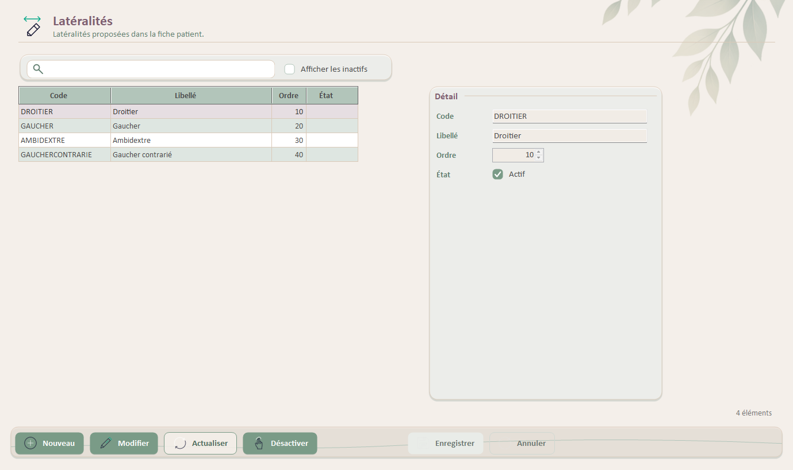

##### Rôle général

Référentiel des latéralités (`ref_lateralites`) proposées dans la fiche patient : code, libellé, ordre, activation. Tuile du groupe Patient du hub Référentiels. Décision de Joëlle (20/10/2026) : la liste n'est plus écrite dans le code.

##### Règles en vigueur

- Pas de suppression : une latéralité désactivée n'est plus proposée, mais reste affichée chez les patients qui l'ont.
- Écritures transmises avec le `ContexteOperation`, droit vérifié par le métier (`ReglesReferentiels`, audit C.1 étape 3, V1.1.0).
- Aucun accès direct à la base : `GestionLateralites`.

---

#### **UserControl : UC_Specialites**

> Fichier : `UI/Controls/Referentiels/UC_Specialites.vb` (V1.0.0, 23/10/2026) — hérite de `UC_ReferentielBase`. Migration v2.55.0.

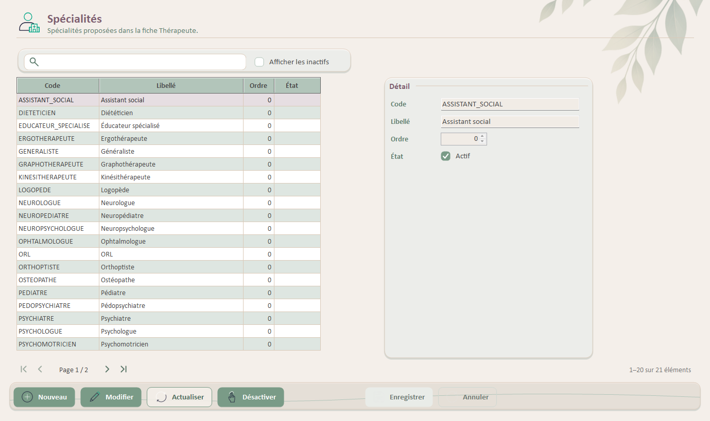

##### Rôle général

Référentiel des spécialités des thérapeutes (`ref_specialites`) : code, libellé, ordre, activation.

Tuile « Spécialités » du groupe Cabinet du hub Référentiels ; ouvert aussi en fenêtre par le bouton **[+]** de la fiche Thérapeute (`ReferentielModalHost`), la nouvelle valeur étant alors sélectionnée d'office.

Décisions de Joëlle (23/10/2026) :

- une seule spécialité par thérapeute, choisie dans la liste (plus de saisie libre)
- liste de départ et reprise des valeurs déjà saisies.

##### Règles en vigueur

- Pas de suppression : une spécialité désactivée n'est plus proposée, mais reste affichée chez les thérapeutes qui l'ont.
- Droits et écritures comme les autres référentiels (`UC_ReferentielBase`, `ReglesReferentiels`).
- Aucun accès direct à la base : `GestionSpecialites`.

##### Points d'attention

- Icône de titre et de tuile provisoires (celles des thérapeutes / rôles d'intervenant), en attendant une icône dédiée (ToDo).

---

### **1.2.2 Référentiels spécifiques (entité riche)**

#### **UserControl : UC_Therapeutes**

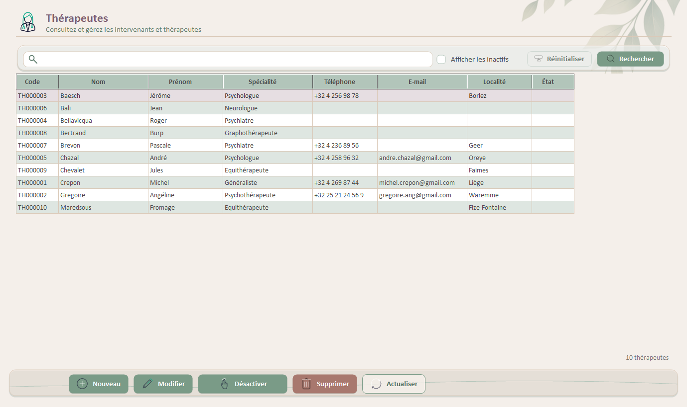

> Fichier : `UI/Controls/Referentiels/UC_Therapeutes.vb` — hérite de `UserControl` — implémente `IContextAwareUserControl`.

##### Rôle général

Contrairement aux 12 référentiels simples, il **n'hérite pas** de `UC_ReferentielBase`

Il est accessible depuis le hub `UC_ReferentielHome` (tuile « Thérapeutes ») et constitue la source du combo Thérapeute d'`IntervenantEdition`.

##### Responsabilités

- Lister les thérapeutes (nom, prénom, spécialité, coordonnées, état).
- Permettre la recherche et le filtrage en mémoire (texte + inactifs).
- Ouvrir `TherapeuteEdition` en mode Création / Modification.
- Activer/désactiver (soft-delete) ou supprimer (si non référencé) un thérapeute.
- Utiliser le contexte UI partagé fourni par `Home`.
- Journaliser les actions via `GestionLog`.

##### Dépendances

| Élément | Type | Rôle |
| --- | --- | --- |
| `UserControlContext` | Classe | Contexte UI injecté par `Home`. |
| `UtilsDataGrid` | Module utilitaire | Configuration visuelle de la grille. |
| `DialogChoix` | Form | Boîtes de dialogue (remplace MessageBox). |
| `TherapeuteEdition` | Form | Création / modification d'un thérapeute. |
| `GestionLog` | Module métier | Journalisation. |
| `IContextAwareUserControl` | Interface | injection du contexte UI partagé |
| `GestionTherapeutes` | Module métier | Couche métier : liste, CRUD, activation, usage. |
| `UtilsButtons` | Module utilitaire | — |
| `UtilsTelephone` | Module utilitaire | — |
| `UC_Utilisateurs` | UserControl | — |

##### Variables privées

| Variable | Type | Rôle |
| --- | --- | --- |
| `_context` | `UserControlContext` | Injecté par Home via SetContext() (implémentation IContextAwareUserControl) |
| `_therapeutes` | `List(Of Therapeute)` | Liste complète des thérapeutes chargée depuis la base (filtrage en mémoire). |

##### Contrôles principaux

| Contrôle | Type | Rôle |
| --- | --- | --- |
| `pnlForm` | Panel | — |
| `pnlCenter` | Panel | — |
| `dgvTherapeutes` | DataGridView | Liste des thérapeutes. |
| `pnlTop` | AltheaCarte | Bandeau de recherche (modèle « Moyen »), une ligne. |
| `btnRechercher` | AltheaBouton | Applique les filtres. |
| `btnReinitialiserFiltres` | AltheaBouton (Clair) | Réinitialise les filtres. |
| `chkAfficherInactifs` | AltheaCase | « Afficher les inactifs » : thérapeutes inactifs inclus. |
| `txtRecherche` | AltheaRecherche | Recherche multi-critères ; texte d'aide « Nom, prénom, spécialité… ». |
| `pnlActions` | AltheaBarreActions | Zone des boutons d'action. |
| `btnNouveau` | AltheaBouton | Ouvre `TherapeuteEdition`. |
| `btnModifier` | AltheaBouton | Ouvre `TherapeuteEdition`. |
| `btnActiverDesactiver` | AltheaBouton | Soft-delete / suppression physique. |
| `btnSupprimer` | AltheaBouton | Soft-delete / suppression physique. |
| `btnActualiser` | AltheaBouton | Recharge la liste. |
| `enTete` | AltheaEnTete | En-tête d'écran : titre « Thérapeutes », sous-titre « Consultez et gérez les intervenants et thérapeutes » ; icône dans les ressources (`enTete.Icone`). |

##### DataGridView : colonnes

###### DataGridView `dgvTherapeutes` : colonnes

| Colonne | En-tête | Propriété liée | Visible | Rôle |
| --- | --- | --- | --- | --- |
| `colNom` | Nom | — | Oui | Identité du thérapeute. |
| `colPrenom` | Prénom | — | Oui | Identité du thérapeute. |
| `colSpecialite` | Spécialité | `Specialite` | Oui | Libellé de la spécialité, lu dans le référentiel `ref_specialites` (v2.55.0, 23/10/2026) ; seul `IdSpecialite` est enregistré. |
| `colTelephone` | Téléphone | — | Oui | Coordonnées. |
| `colEmail` | E-mail | — | Oui | Coordonnées. |
| `colLocalite` | Localité | — | Oui | Localité. |
| `colActif` | État | `LibelleEtat` | Oui | Pastille « Inactif » (gris) ; rien pour un thérapeute actif ; ligne inactive atténuée (V1.1.0, 18/10/2026, UI-9.4). |
| `colIdTherapeute` | Id thérapeute | — | Non | Identifiant technique (masqué). |
| `colCodeTherapeute` | Code | `CodeTherapeute` | Oui | TH…, en tête de la grille (visible depuis le 24/10/2026, relevé de Joëlle). |

##### Méthodes principales

| Membre | Nature | Rôle |
| --- | --- | --- |
| `SetContext` | Public Sub | Implémentation de `IContextAwareUserControl`. |
| `UC_Therapeutes_Load` | Private Sub | Initialise le UserControl et charge la liste. |
| `InitialiserBoutons` | Private Sub | Initialise les boutons standards du UserControl. |
| `InitialiserDataGridView` | Private Sub | Configuration de la grille et des infobulles. |
| `InitialiserToolTips` | Private Sub | Configuration de la grille et des infobulles. |
| `ChargerTherapeutes` | Private Sub | Charge la liste depuis la base. |
| `AppliquerFiltres` | Private Sub | Filtrage en mémoire. |
| `CorrespondRecherche` | Private Function | Filtrage en mémoire. |
| `CChamps` | Private Function | Retourne une chaîne sûre (jamais Nothing) pour la recherche. |
| `MettreAJourEtatBoutons` | Private Sub | Active/désactive les boutons selon la sélection. |
| `GetTherapeuteSelectionne` | Private Function | Sélection et ouverture de l'édition. |
| `OuvrirEdition` | Private Sub | Sélection et ouverture de l'édition ; transmet Home à `TherapeuteEdition` (bouton [+] des spécialités, V1.2.1, 23/10/2026). |
| `dgvTherapeutes_SelectionChanged` | Private Sub | Met à jour l'état des boutons lorsque la sélection change. |
| `dgvTherapeutes_CellFormatting` | Private Sub | Gestionnaire d'événement CellFormatting de `dgvTherapeutes`. |
| `dgvTherapeutes_CellDoubleClick` | Private Sub | Ouvre la modification du thérapeute sur double-clic d'une ligne. |
| `btnRechercher_Click` | Private Sub | Filtres. |
| `txtRecherche_KeyDown` | Private Sub | Déclenche la recherche sur la touche Entrée. |
| `btnReinitialiserFiltres_Click` | Private Sub | Filtres. |
| `chkAfficherInactifs_CheckedChanged` | Private Sub | Filtres. |
| `btnActualiser_Click` | Private Sub | Recharge la liste des thérapeutes. |
| `btnNouveau_Click` | Private Sub | Création / modification. |
| `btnModifier_Click` | Private Sub | Création / modification. |
| `btnActiverDesactiver_Click` | Private Sub | Soft-delete / suppression physique. |
| `btnSupprimer_Click` | Private Sub | Soft-delete / suppression physique. |

##### Gestion des icônes

- `btnActiverDesactiver.Image` (Designer / ressources)
- `btnActualiser.Image` (Designer / ressources)
- `btnModifier.Image` (Designer / ressources)
- `btnNouveau.Image` (Designer / ressources)
- `btnRechercher.Image` (Designer / ressources)
- `btnReinitialiserFiltres.Image` (Designer / ressources)
- `btnSupprimer.Image` (Designer / ressources)
- `enTete.Icone` (Designer / ressources)
- `pnlActions.BackgroundImage` (Designer / ressources)

##### Gestion des filtres et recherche

- Contrôles : `btnRechercher`, `btnReinitialiserFiltres`, `chkAfficherInactifs`, `txtRecherche`.
- Méthodes : `AppliquerFiltres`, `CorrespondRecherche`, `btnRechercher_Click`, `txtRecherche_KeyDown`, `btnReinitialiserFiltres_Click`.
- Fonctionnement : filtrage en mémoire sur la liste chargée (pas de nouvel appel base), déclenché par les événements des contrôles ci-dessus ; la réinitialisation remet les critères par défaut puis réapplique le filtre.

##### Règles en vigueur

- Tous les messages utilisateur passent par `DialogChoix` (jamais `MessageBox`).
- Aucun accès direct à la base : les lectures/écritures passent par la couche métier `Gestion*`.
- Les actions significatives sont journalisées via `GestionLog`.

##### Points d'attention

- `UC_Therapeutes` est une **entité riche**, pas un référentiel `code/libellé` : ne jamais le ramener à `UC_ReferentielBase`.
- **Soft-delete prioritaire** : un thérapeute référencé par un suivi (`autres_suivis_patient`) ne peut être que désactivé ; suppression physique uniquement si non utilisé.
- **Aucun accès DB** dans l'UC : tout passe par `GestionTherapeutes`.
- Utiliser `DialogChoix` pour **tous** les messages utilisateur.
- Implémente IContextAwareUserControl
- Aucun accès direct à la base de données (tout passe par GestionTherapeutes)
- Écritures (modification, activation, suppression) transmises avec le `ContexteOperation` : le droit (SuperUser) est vérifié par le métier, un refus est affiché tel quel (V1.2.0, 22/10/2026, audit C.1 étape 3).
- La spécialité vient du référentiel `ref_specialites` (v2.55.0, 23/10/2026) : la colonne texte `therapeutes.specialite` n'est plus lue ni écrite.

##### Message au repreneur

> UC_Therapeutes (740 lignes). Point d'entrée : `SetContext`, `UC_Therapeutes_Load`, `InitialiserBoutons`. Toute évolution de règle se fait d'abord dans `GestionTherapeutes`, pas dans l'écran. Toute modification visuelle passe par le Designer (.Designer.vb / .resx).

---

### **1.2.3 Référentiels métier paramétrables**

Une valeur de ces référentiels ne constitue pas, à elle seule, une règle métier : les liaisons au domaine et les périodes de validité déterminent son applicabilité.

#### **UserControl : UC_NaturesSeance**

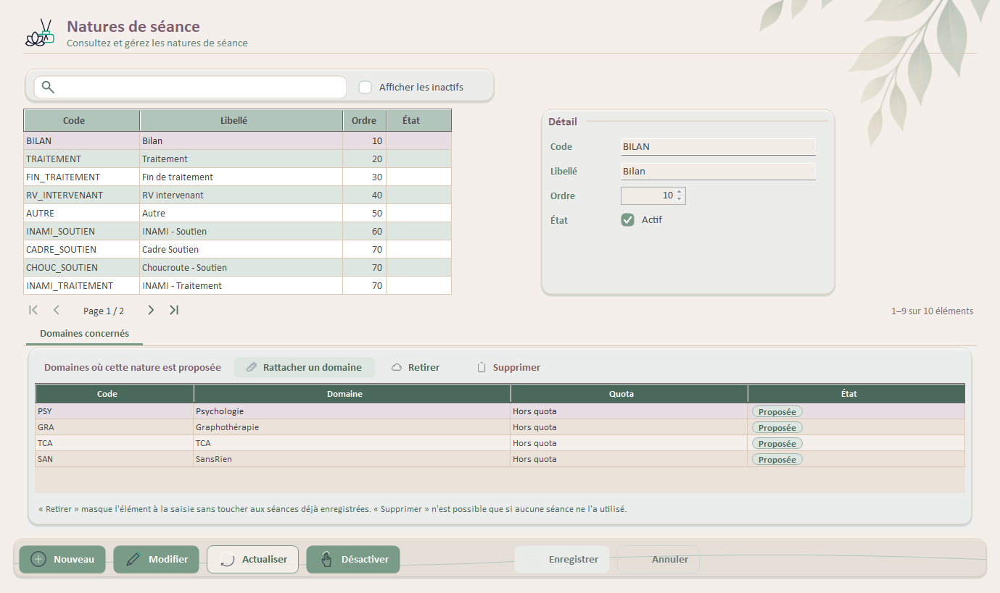

> Fichier : `UI/Controls/Referentiels/UC_NaturesSeance.vb` — hérite de `UC_ReferentielBase`.

##### Rôle général

Écran de gestion du référentiel des natures de séance (table ref_natures_seance). Hérite de UC_ReferentielBase et se contente de fournir les métadonnées d'affichage et de brancher la couche métier GestionNaturesSeance via les points d'extension.

##### Responsabilités

- Définir le titre, le sous-titre et le fil d'Ariane propres aux natures de séance
- Charger les natures via GestionNaturesSeance et les convertir en ReferentielLigne
- Déléguer les vérifications d'unicité (code, libellé) et le CRUD à GestionNaturesSeance
- Héberger l'onglet des domaines où la nature est proposée à la saisie (D-POR-5)

> **Pas de champ propre.** Le code de prestation INAMI qu'affichait autrefois cet écran a disparu avec sa colonne (`ref_natures_seance.code_prestation_inami`, migrations v2.27.0 / v2.28.0 du 01/10/2026) : le quota ne dépend plus de la nature, la **catégorie de quota se paramètre par domaine** (onglet Natures de l'espace Domaines).
>
> Le panneau « Détail » ne montre donc que les champs génériques de `UC_ReferentielBase` (Code, Libellé, Ordre, État).
>
> Le cache des natures qui servait à ce champ (`NatureDeLaLigne` / `_naturesParId`) a été retiré en V1.2.0 (16/10/2026).

##### Dépendances

| Élément | Type | Rôle |
| --- | --- | --- |
| `UC_ReferentielBase` | UserControl | classe de base héritée |
| `GestionNaturesSeance` | Module métier | couche métier |
| `NatureSeance` | Classe | modèle métier |
| `ReferentielLigne` | Classe | modèle de présentation générique |
| `UC_LiaisonsNaturesDomaines` | UserControl | panneau de données liées |
| `AppRole` | Enum | gestion des droits |

##### Variables privées

| Variable | Type | Rôle |
| --- | --- | --- |
| `_pnlDomaines` | `UC_LiaisonsNaturesDomaines` | Panneau des domaines où la nature est proposée, hébergé dans l'onglet de données liées |

##### Contrôles principaux

Aucun contrôle Designer (classe non visuelle ou interface construite par la classe de base).

##### Méthodes principales

| Membre | Nature | Rôle |
| --- | --- | --- |
| `TitreReferentiel` | Protected Overrides ReadOnly Property | — |
| `SousTitreReferentiel` | Protected Overrides ReadOnly Property | — |
| `CheminContexte` | Protected Overrides ReadOnly Property | — |
| `LongueurMaxCode` | Protected Overrides ReadOnly Property | — |
| `HauteurDonneesLiees` | Protected Overrides ReadOnly Property | Réserve la zone d'onglets sous la liste des natures. |
| `ConfigurerDonneesLiees` | Protected Overrides Sub | Crée l'onglet « Domaines concernés ». |
| `ChargerDonneesLiees` | Protected Overrides Sub | Recharge l'onglet pour la nature sélectionnée. |
| `ActiverDonneesLiees` | Protected Overrides Sub | Passe le panneau en lecture seule pendant l'édition de la nature parente. |
| `ChargerElements` | Protected Overrides Function | — |
| `CodeExisteDeja` | Protected Overrides Function | — |
| `LibelleExisteDeja` | Protected Overrides Function | — |
| `InsererElement` | Protected Overrides Sub | — |
| `MettreAJourElement` | Protected Overrides Sub | — |
| `DefinirActivation` | Protected Overrides Sub | — |

##### Gestion des droits

- Rôles testés : `AppRole.SuperUser`.
- Rôle d'écriture : règle unique du socle (`RoleMinimum` = `ReglesReferentiels.ROLE_ECRITURE`) ; la surcharge `RoleMinimum` est retirée et le métier vérifie le droit à chaque écriture (22/10/2026, audit C.1 étape 3).

##### Règles en vigueur

- La nature de séance (Bilan, Traitement, Fin de traitement, RV intervenant, Autre) n'a AUCUNE
  incidence sur le prix : le tarif provient exclusivement de ref_prix_seance.
- Le quota ne dépend pas de la nature : la catégorie de quota d'une nature se règle **par domaine**
  (onglet Natures de l'espace Domaines, `UC_DomainesHome`), depuis la v2.27.0 (01/10/2026).

##### Points d'attention

- Aucun Designer propre : tout le visuel provient de UC_ReferentielBase.
- Aucun accès direct à la base de données : tout passe par GestionNaturesSeance.
- Conformément au choix d'ergonomie retenu, les données liées sont intégrées sous forme
  d'onglet plutôt que de fenêtre modale séparée.

##### Message au repreneur

> UC_NaturesSeance (≈ 250 lignes). Toute évolution de règle se fait d'abord dans `GestionNaturesSeance`, pas dans l'écran.

---

#### **UserControl : UC_PrixSeance**

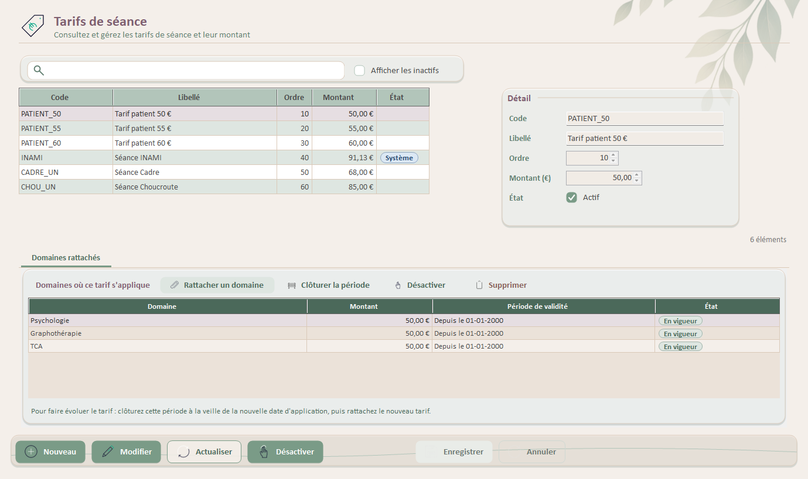

> Fichier : `UI/Controls/Referentiels/UC_PrixSeance.vb` — hérite de `UC_ReferentielBase`.

##### Rôle général

Ces trois écrans de référentiel appliquent les conventions de `UC_ReferentielBase` : recherche, filtre des inactifs, modes consultation/création/modification, contrôle d’unicité, droits et journalisation.

| UserControl        | Rôle métier                                                  | Usage UI                                                     |
| ------------------ | ------------------------------------------------------------ | ------------------------------------------------------------ |
| `UC_NaturesSeance` | Maintenir les natures de séance et les domaines où elles sont proposées. | Alimente `SeanceEditor`, après filtrage des liaisons du domaine. |
| `UC_PrixSeance`    | Maintenir le catalogue des prix de séance.                   | Alimente les liaisons domaine–tarif et les propositions de `SeanceEditor`. |
| `UC_ModesPaiement` | Maintenir les modes d’encaissement.                          | Alimente `PaiementEditor`, avec ajout contextuel possible.   |

Une valeur de ces référentiels ne constitue pas, à elle seule, une règle métier : les liaisons et les périodes de validité déterminent son applicabilité.

##### Responsabilités

- Fournir les métadonnées d'affichage (titre, sous-titre, fil d'Ariane, longueur du code ; le rôle d'écriture est celui du socle depuis le 22/10/2026).
- Brancher les six points d'extension « Données » du socle sur la couche métier dédiée.
- Déléguer au socle la recherche, le filtre des inactifs, les modes, la validation, les droits et la journalisation.

##### Dépendances

| Élément | Type | Rôle |
| --- | --- | --- |
| `UC_ReferentielBase` | UserControl | classe de base héritée |
| `GestionPrixSeance` | Module métier | couche métier |
| `PrixSeance` | Classe | modèle métier |
| `ReferentielLigne` | Classe | modèle de présentation générique, propriété Tarif |
| `UC_LiaisonsPrixDomaines` | UserControl | panneau de données liées |
| `AppRole` | Enum | gestion des droits |

##### Variables privées

| Variable | Type | Rôle |
| --- | --- | --- |
| `_numMontant` | `NumericUpDown` | Sélecteur du montant (decimal(10,2)) |
| `_pnlDomaines` | `UC_LiaisonsPrixDomaines` | Panneau des domaines rattachés, hébergé dans l'onglet de données liées |

##### Contrôles principaux

Aucun contrôle Designer (classe non visuelle ou interface construite par la classe de base).

##### Méthodes principales

| Membre | Nature | Rôle |
| --- | --- | --- |
| `TitreReferentiel` | Protected Overrides ReadOnly Property | — |
| `SousTitreReferentiel` | Protected Overrides ReadOnly Property | — |
| `CheminContexte` | Protected Overrides ReadOnly Property | — |
| `LongueurMaxCode` | Protected Overrides ReadOnly Property | — |
| `ConfigurerChampSupplementaire` | Protected Overrides Sub | Crée le montant (`CreerNombreDetail`) et le pose sous l'ordre (`AjouterLigneDetail`) ; l'état suit. Appelée une fois au chargement. |
| `AfficherChampSupplementaire` | Protected Overrides Sub | Affiche le montant de la ligne sélectionnée dans le sélecteur. |
| `ViderChampSupplementaire` | Protected Overrides Sub | Réinitialise le montant (mode création / vidage du détail). |
| `ConfigurerColonnesSupplementaires` | Protected Overrides Sub | Ajoute la colonne « Montant » à la liste des tarifs. |
| `HauteurDonneesLiees` | Protected Overrides ReadOnly Property | Réserve la zone d'onglets sous la liste des tarifs. |
| `ConfigurerDonneesLiees` | Protected Overrides Sub | Crée l'onglet « Domaines rattachés ». |
| `ChargerDonneesLiees` | Protected Overrides Sub | Recharge l'onglet pour le tarif sélectionné. |
| `ActiverDonneesLiees` | Protected Overrides Sub | Passe le panneau en lecture seule pendant l'édition du tarif parent. |
| `ChargerElements` | Protected Overrides Function | — |
| `CodeExisteDeja` | Protected Overrides Function | — |
| `LibelleExisteDeja` | Protected Overrides Function | — |
| `InsererElement` | Protected Overrides Sub | — |
| `MettreAJourElement` | Protected Overrides Sub | — |
| `DefinirActivation` | Protected Overrides Sub | — |

##### Gestion des droits

- Rôles testés : `AppRole.SuperUser`.
- Rôle d'écriture : règle unique du socle (`RoleMinimum` = `ReglesReferentiels.ROLE_ECRITURE`) ; la surcharge `RoleMinimum` est retirée et le métier vérifie le droit à chaque écriture (22/10/2026, audit C.1 étape 3).

##### Règles en vigueur

- ref_prix_seance possède un champ supplémentaire montant (decimal(10,2) NOT NULL) qui n'existe
  pas dans les référentiels simples. Il est ajouté au panneau d'édition générique via les points
  d'extension « Champ supplémentaire » de UC_ReferentielBase :
  ConfigurerChampSupplementaire, AfficherChampSupplementaire, ViderChampSupplementaire,
  ValiderChampSupplementaire (la bascule consultation / saisie est faite par la base).
- Le montant est la SOURCE lue à la création d'une séance puis FIGÉE dans seances.tarif_seance
  (snapshot) : modifier ce montant n'affecte jamais les séances déjà comptées.
- Un onglet intégré « Domaines rattachés » expose les liaisons historisées du tarif
  (lia_prix_seance_domaines) : c'est ce rattachement qui rend le tarif applicable à un
  domaine sur une période donnée (D-POR-4).

##### Points d'attention

- Aucun Designer propre : le visuel de base provient de UC_ReferentielBase ; le champ montant
  est créé par code et ajouté au panneau d'édition (pnlEdition).
- Aucun accès direct à la base de données : tout passe par GestionPrixSeance.
- Conformément au choix d'ergonomie retenu, les données liées sont intégrées sous forme
  d'onglet plutôt que de fenêtre modale séparée.

##### Lignes système

Mécanisme décrit dans le socle (`UC_ReferentielBase`, § Lignes système). Code et activation verrouillés ; libellé et ordre restent modifiables. Ces codes sont recherchés tels quels par l'application : les renommer ou les désactiver casserait la règle qui s'y réfère.

| Code(s) verrouillé(s) | Table |
| --- | --- |
| `INAMI` (repli documenté du tarif conventionné) | `ref_prix_seance` |

##### Message au repreneur

> UC_PrixSeance (328 lignes). Toute évolution de règle se fait d'abord dans `GestionPrixSeance`, pas dans l'écran.

---

#### **UserControl : UC_ModesPaiement**

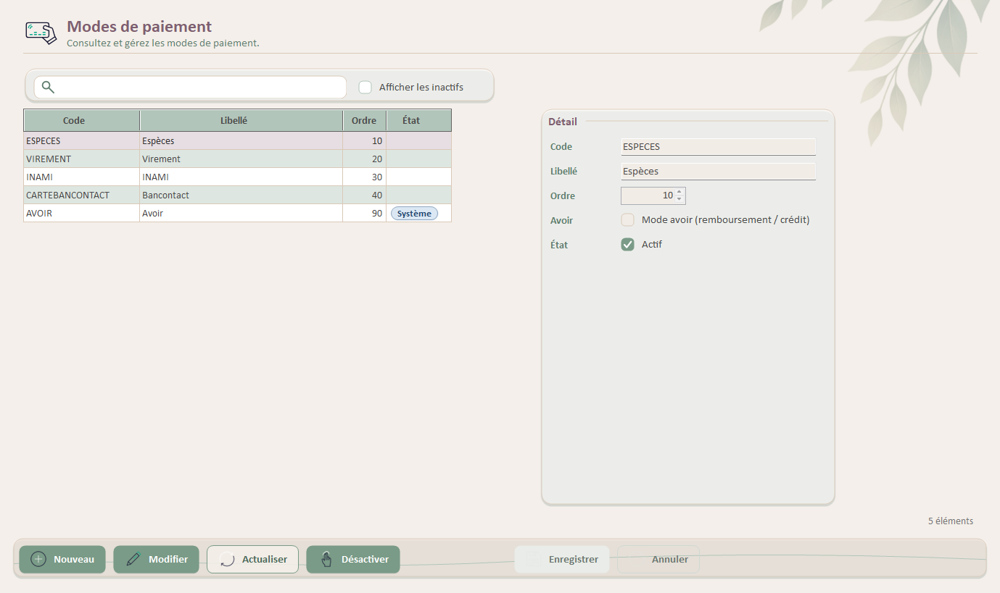

> Fichier : `UI/Controls/Referentiels/UC_ModesPaiement.vb` — hérite de `UC_ReferentielBase`.

##### Rôle général

Écran de gestion du référentiel des modes de paiement (table ref_modes_paiement). Hérite de UC_ReferentielBase et fournit les métadonnées d'affichage et le branchement de la couche métier GestionModesPaiement via les points d'extension.

##### Responsabilités

- Fournir les métadonnées d'affichage (titre, sous-titre, fil d'Ariane, longueur du code ; le rôle d'écriture est celui du socle depuis le 22/10/2026).
- Brancher les six points d'extension « Données » du socle sur la couche métier dédiée.
- Déléguer au socle la recherche, le filtre des inactifs, les modes, la validation, les droits et la journalisation.

##### Dépendances

| Élément | Type | Rôle |
| --- | --- | --- |
| `UC_ReferentielBase` | UserControl | classe de base héritée |
| `GestionModesPaiement` | Module métier | couche métier |
| `ModePaiement` | Enum | modèle métier |
| `ReferentielLigne` | Classe | modèle de présentation générique |
| `AppRole` | Enum | gestion des droits |

##### Variables privées

Aucune variable privée.

##### Contrôles principaux

Aucun contrôle Designer (classe non visuelle ou interface construite par la classe de base).

##### Méthodes principales

| Membre | Nature | Rôle |
| --- | --- | --- |
| `TitreReferentiel` | Protected Overrides ReadOnly Property | — |
| `SousTitreReferentiel` | Protected Overrides ReadOnly Property | — |
| `CheminContexte` | Protected Overrides ReadOnly Property | — |
| `LongueurMaxCode` | Protected Overrides ReadOnly Property | — |
| `ChargerElements` | Protected Overrides Function | — |
| `CodeExisteDeja` | Protected Overrides Function | — |
| `LibelleExisteDeja` | Protected Overrides Function | — |
| `InsererElement` | Protected Overrides Sub | — |
| `MettreAJourElement` | Protected Overrides Sub | — |
| `DefinirActivation` | Protected Overrides Sub | — |

##### Gestion des droits

- Rôles testés : `AppRole.SuperUser`.
- Rôle d'écriture : règle unique du socle (`RoleMinimum` = `ReglesReferentiels.ROLE_ECRITURE`) ; la surcharge `RoleMinimum` est retirée et le métier vérifie le droit à chaque écriture (22/10/2026, audit C.1 étape 3).

##### Règles en vigueur

- Aucun Designer propre : tout le visuel provient de UC_ReferentielBase.
- Aucun accès direct à la base de données : tout passe par GestionModesPaiement.
- Code long (varchar 30) avec espaces convertis en _ (comportement par défaut de la base).
- Un mode de paiement reste une donnée de référentiel : aucun comportement métier ne dépend de
  son libellé ou de son code.

##### Points d'attention

- **Mode relié par identifiant** (v2.50.0, 21/10/2026, ADR-49) : un paiement porte `paiements.id_mode_paiement` (clé étrangère) ; renommer un mode ne coupe plus le lien avec l'historique, les anciens paiements affichent le nouveau libellé. La colonne texte `paiements.mode_paiement` n'est plus lue (conservée).
- Un règlement par avoir est reconnu par la case « Mode avoir » du référentiel, plus par le libellé « Avoir ».
- Un mode utilisé ne peut plus être supprimé (la base le refuse) : il se désactive.
- Écritures transmises avec le `ContexteOperation`, droit vérifié par le métier (V1.3.0, 22/10/2026).

##### Lignes système

Mécanisme décrit dans le socle (`UC_ReferentielBase`, § Lignes système). Code et activation verrouillés ; libellé et ordre restent modifiables. Ces codes sont recherchés tels quels par l'application : les renommer ou les désactiver casserait la règle qui s'y réfère.

| Code(s) verrouillé(s) | Table |
| --- | --- |
| `AVOIR` | `ref_modes_paiement` |

##### Message au repreneur

> UC_ModesPaiement (195 lignes). Toute évolution de règle se fait d'abord dans `GestionModesPaiement`, pas dans l'écran.

---

#### **UserControl : UC_Organismes**

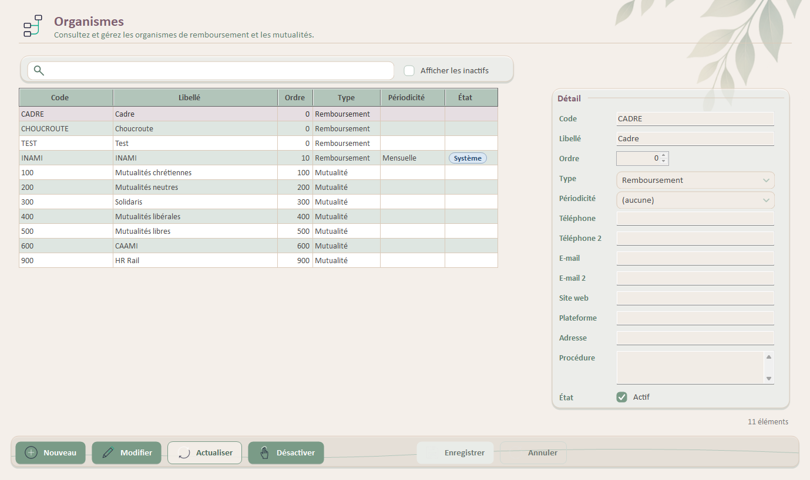

> Fichier : `UI/Controls/Referentiels/UC_Organismes.vb` — hérite de `UC_ReferentielBase`.

##### Rôle général

Écran de gestion du référentiel des organismes (`ref_organismes`) : organismes de remboursement (rattachés aux domaines) et mutualités (rattachées aux patients). Branche la couche métier `GestionOrganismes` sur le socle.

Depuis la v2.34.0, une liste **Type** (Remboursement / Mutualité, énumération `TypeOrganisme`) précède la périodicité ; elle est verrouillée sur une ligne système.

**Ouverture en contexte (R3, 12/10/2026)** : `New(typeImpose, idASelectionner)` limite la liste à un type, verrouille ce type pour les créations, adapte le titre (« Mutualités ») et présélectionne l'organisme courant (`SelectionnerElement` de la base, dans `UC_Organismes_Load`).

Utilisé depuis la fiche Patient (mutualités) et depuis `UC_DomainesHome` (organismes de remboursement).

La grille affiche une colonne « Type », valorisée dans `CellFormatting` (le modèle générique `ReferentielLigne` n'a qu'un complément, déjà pris par la périodicité).

Depuis le lot 29 (v2.33.0), le panneau Détail est complété sous les champs génériques par :

- liste **Périodicité** (référentiel `ref_periodicites`, entrée « (aucune) » = NULL)
- **Téléphone / Téléphone 2**
- **E-mail / E-mail 2**
- **Site web**
- **Plateforme** (URL d'encodage)
- **Adresse** et **Procédure** (mémo multiligne).

La liste affiche une colonne « Périodicité » (`ReferentielLigne.Complement`).

##### Dépendances

| Élément | Type | Rôle |
| --- | --- | --- |
| `UC_ReferentielBase` | UserControl | Socle hérité |
| `GestionOrganismes`, `Organisme` | Module / Classe | Couche métier et modèle |
| `GestionPeriodicites`, `Periodicite` | Module / Classe | Alimentation de la liste Périodicité (actives) ; repli journalisé si le référentiel est vide |
| `UtilsValidation` | Module | `IsValidTelephone`, `IsValidEmail` (champs vides acceptés) |

##### Méthodes principales

Propriétés de métadonnées (`IconeTitre`, `TitreReferentiel`, `SousTitreReferentiel`, `CheminContexte`, `LongueurMaxCode` ; `RoleMinimum` n'est plus surchargé depuis le 22/10/2026) et surcharges CRUD (`ChargerElements`, `CodeExisteDeja`, `LibelleExisteDeja`, `InsererElement`, `MettreAJourElement`, `DefinirActivation`).

Surcharges des champs supplémentaires :

- `ConfigurerChampSupplementaire` (dix champs posés par `AjouterLigneDetail` : Type et Périodicité en `AltheaListe`, coordonnées, procédure sur deux lignes)
- `AfficherChampSupplementaire`
- `ViderChampSupplementaire`
- `ActiverChampSupplementaire` (type en lecture seule pour une ligne système ou un type imposé)
- `ValiderChampSupplementaire` (avertissement ciblé et focus sur le champ fautif, fenêtre non fermée)
- `ConfigurerColonnesSupplementaires`.

`RenseignerChampsSupplementaires` convertit les champs vides en `Nothing` (→ NULL en base).

##### Règles en vigueur

- Les lignes système (INAMI) ne peuvent ni changer de code ou de type, ni être désactivées (ADR-28).
- `UC_DomainesHome` ne propose que les organismes de type Remboursement (plus celui déjà rattaché, s'il diffère).
- Suppression physique uniquement si aucun domaine n'est rattaché ; sinon désactivation.
- Aucun comportement métier n'est déduit du code de l'organisme ni de celui de sa périodicité (seul `nb_mois` porte un sens).
- La périodicité est portée par l'organisme, jamais par le dossier ou le patient.

##### Message au repreneur

> UC_Organismes. Accessible depuis `UC_ReferentielHome` et en modal depuis `UC_DomainesHome` (bouton [+] de l'onglet Général). Les champs supplémentaires sont créés par code (contrainte du socle `UC_ReferentielBase`, sans Designer propre).

---

#### **UserControl : UC_Periodicites**

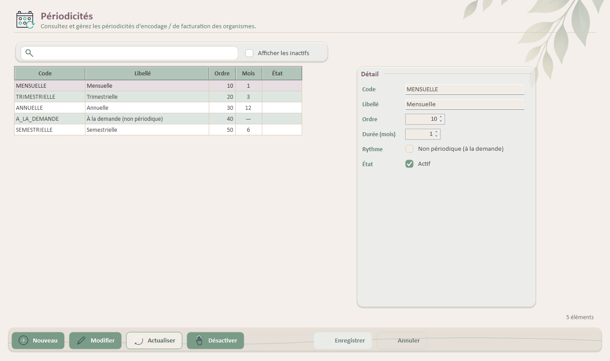

> Fichier : `UI/Controls/Referentiels/UC_Periodicites.vb` — hérite de `UC_ReferentielBase`.

##### Rôle général

Écran de gestion du référentiel des périodicités d'encodage (`ref_periodicites`, lot 29). Champ supplémentaire **Durée (mois)** (`NumericUpDown`) avec case **Non périodique** (→ `nb_mois = NULL`) ; colonne « Mois » dans la liste (« — » si non périodique). Icône de titre `Titre_periodicite`.

##### Dépendances

| Élément | Type | Rôle |
| --- | --- | --- |
| `UC_ReferentielBase` | UserControl | Socle hérité |
| `GestionPeriodicites`, `Periodicite` | Module / Classe | Couche métier et modèle |

##### Règles en vigueur

- Désactivation uniquement (soft-delete) ; les organismes rattachés conservent leur périodicité.
- Nouvelle périodicité = paramétrage, sans recompilation : l'application ne lit que `nb_mois`.

---

#### **UserControl : UC_Pays**

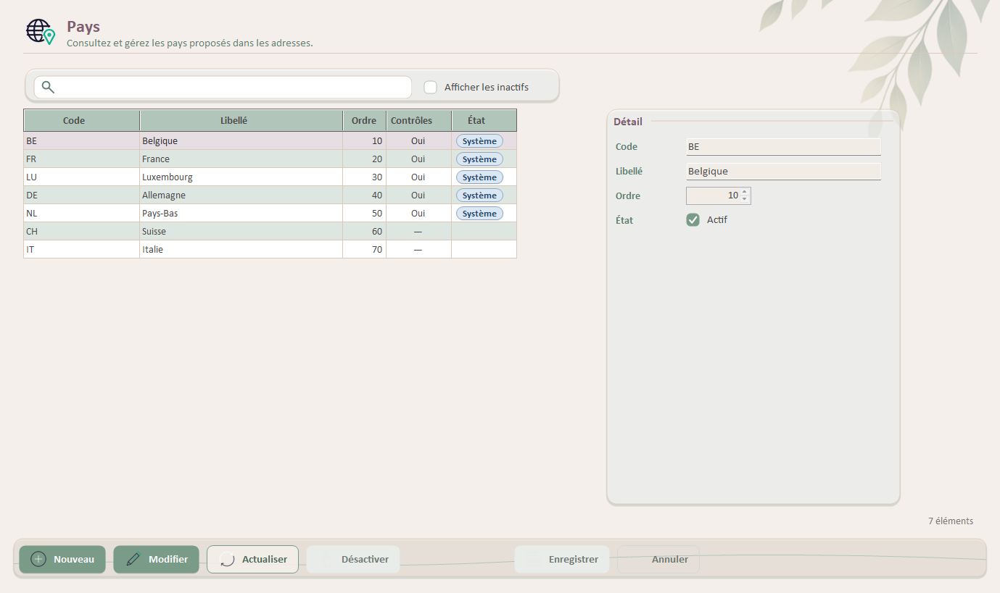

> Fichier : `UI/Controls/Referentiels/UC_Pays.vb` — hérite de `UC_ReferentielBase` (v2.34.0).

##### Rôle général

Écran de gestion du référentiel des pays (`ref_pays`). Le **code est le code ISO 3166-1 alpha-2** (2 lettres, contrôlé dans `ValiderChampSupplementaire`, espaces non convertis).

Colonne « Contrôles » : « Oui » si l'application dispose de règles de validation du téléphone et du code postal pour ce code (`UtilsTelephone.DeduirePays`). Icône de titre `Titre_pays`.

##### Règles en vigueur

- Les 5 pays dotés de règles (BE, FR, LU, DE, NL) sont des lignes système : code et activation verrouillés.
- Les règles restent dans le code, indexées par le code ISO ; un pays ajouté est accepté sans contrôle de format.

---

#### **UserControl : UC_Civilites**


> Fichier : `UI/Controls/Referentiels/UC_Civilites.vb` — hérite de `UC_ReferentielBase` (v2.34.0).

##### Rôle général

Écran de gestion du référentiel des civilités (`ref_civilites`). Champ supplémentaire **Abréviation** (facultatif, 10 caractères, pour les courriers) ; colonne « Abrév. » dans la liste. Icône de titre `Titre_civilites`.

##### Règles en vigueur

- Désactivation uniquement (soft-delete).
- Les civilités sont proposées partout où une personne est saisie (branchement des écrans : étape R2).

---

### **1.2.4 Domaines et tables de liaison**

- Une révision tarifaire crée une nouvelle période de validité ; elle ne modifie jamais le montant historique d'une séance.
- Une nature n'est proposée dans `SeanceEditor` que si elle est active et liée au domaine du dossier.
- Les panneaux de liaison reçoivent le domaine courant de l'écran hôte (`UC_DomainesHome` ou `UC_Domaines`) et ne doivent pas devenir des points d'accès à un domaine implicite.
- Un domaine représente une convention (tarif + organisme + quotas). La catégorie de quota d'une nature est portée par la liaison nature–domaine (ADR-27).
- Une règle de quota se corrige ou se supprime tant qu'elle n'a pas servi ; ensuite, on ajoute une nouvelle règle (la précédente est clôturée automatiquement à la veille) ou on la clôture (ADR-40).

#### **UserControl : UC_DomainesHome**

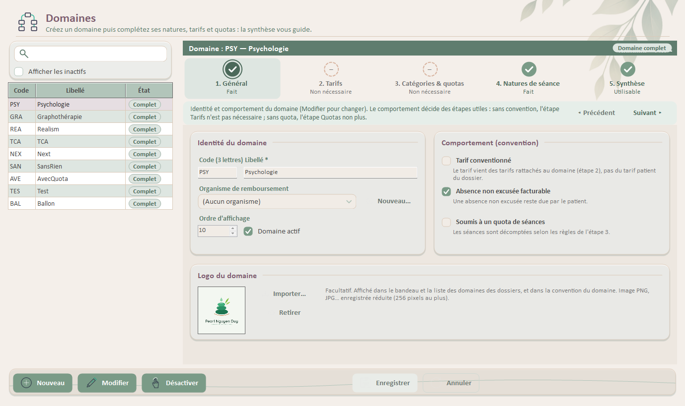

> Fichier : `UI/Controls/Domaines/UC_DomainesHome.vb` (V1.13.0, Designer V1.3.0) — hérite de `UserControl` (Designer) — implémente `IContextAwareUserControl`, `IUnsavedChangesAware`. N'hérite **pas** de `UC_ReferentielBase`.
> UI-9.4 (18/10/2026) : état des domaines en pastille (Complet sauge, À compléter ocre, Inactif gris ; domaine inactif atténué) ; règles de quota en pastille (`QuotaInamiRegle.Etat` : En vigueur, À venir, Terminée, Désactivée ; période sans règle « Sans règle » en ocre sur sa ligne d'alerte) ; catégorie inactive en pastille grise ; alerte et plafond alignés à droite.
> Refonte UI-6 (14/10/2026, maquette « Domaines — A ») : navigation par étapes, cartes du kit, barres locales, règles de quota guidées (ADR-40). Les captures ci-dessous datent d'avant UI-6 et sont à refaire.

##### Étape 1. Général


Deux cartes dans `tblGeneral` :

- **Identité du domaine** (`carteIdentite` : code, libellé, organisme de remboursement facultatif dans `cboOrganisme` (`AltheaListe`) avec `btnNouvelOrganisme` « Nouveau… », ordre, actif)
- et **Comportement (convention)** (`carteComportement` : les trois indicateurs qui pilotent les règles métier du domaine — jamais son code : `tarif_convention`, `no_show_facturable`, `soumis_quota`, chacun avec une aide).

C'est la seule étape modifiée par le cycle Nouveau / Modifier / Enregistrer ; en consultation, ses champs sont en lecture seule lisible (`UtilsControls.DefinirLectureSeule`).

**Logo du domaine** (`carteLogo`, V1.10.0, 20/10/2026) :

- `picLogo`, `btnLogoImporter` / `btnLogoRetirer` (actifs en saisie), `lblAideLogo`
- le logo choisi est réduit (`ImagesHelper.Reduire`) et gardé en attente (`_logoChoisi`, `_logoRetire`), écrit avec le domaine (`EnregistrerLogo` : fichier puis base, ou base puis fichier pour un retrait), oublié en revenant en consultation
- la garde le voit (`GardeModifications.AjouterValeur("logo", EtatLogo)`).

##### Étape 2. Tarifs

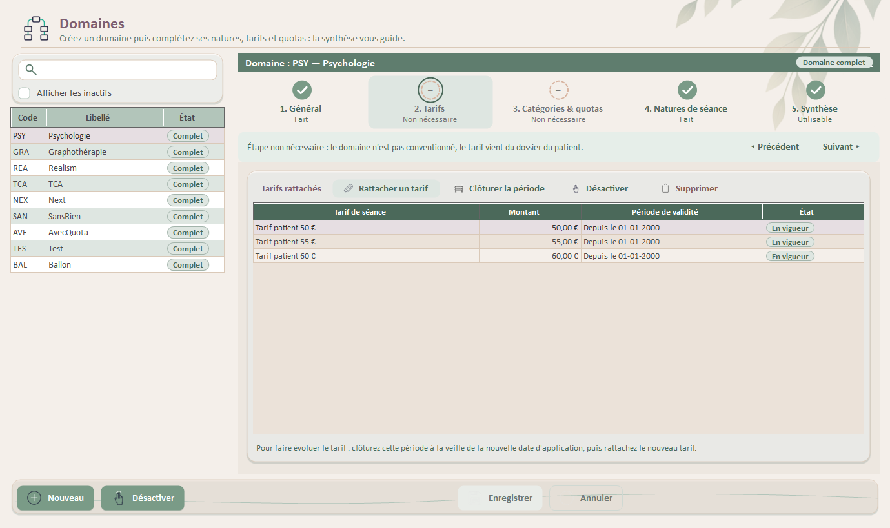

Héberge `UC_LiaisonsPrixDomaines` (V2, mode `ParDomaine`, `TexteCreation` = « Créer un nouveau tarif… ») : carte avec barre locale (Rattacher un tarif, Clôturer la période, Désactiver/Réactiver, Supprimer, création à droite) et formulaire au pied de la carte.

L'action de création lève `CreationDemandee`, qui ouvre `UC_PrixSeance` en modal ; chaque rattachement modifié lève `RattachementsModifies` (`RafraichirApresRattachement` : liste, étapes, synthèse).

Le tarif résolu à la date de la séance est celui en vigueur dans cette étape.

##### Étape 3. Catégories & quotas

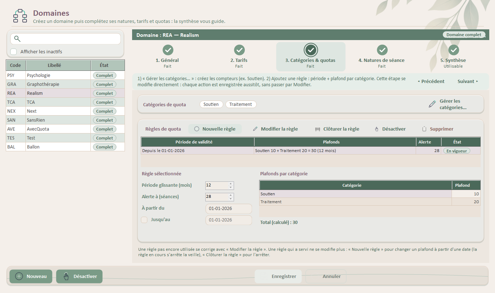

L'ordre de l'écran suit l'ordre du travail.

- En haut, `carteCategories` : les catégories du domaine en pastilles (`flpCategories`) et `btnQuotaCategories` (« Gérer les catégories… » → `CategoriesQuotaEditor`).
- En dessous, `carteRegles` : barre locale `barreRegles` (Nouvelle règle, Modifier la règle, Clôturer la règle, Désactiver/Réactiver, Supprimer), grille `dgvQuotas` (période de validité, période glissante, plafonds, alerte, état) et zone `pnlQuotaEdition` (« Règle sélectionnée » en lecture seule, ou saisie selon `ModeQuota`).
- La note `lblAideQuotas`, sous la carte, guide la saisie et signale en ocre les périodes sans règle.

Chaque **période sans règle** figure aussi dans `dgvQuotas`, à sa place chronologique, sur une ligne d'alerte (fond jaune pâle, texte ocre gras, état « Sans règle ») ; chaque ligne porte dans `Tag` sa règle (`QuotaInamiRegle`) ou sa période (classe interne `PeriodeSansRegle`). Sélectionner cette ligne puis « Nouvelle règle » propose ses dates.

Domaine non soumis à quota : seule `carteQuotaNonNecessaire` est affichée.

Cycle d'une règle (ADR-27, ADR-40) :

- une **nouvelle règle** est pré-remplie depuis la règle en vigueur, peut commencer dans le passé et clôture la règle ouverte à la veille
- un **récapitulatif** est confirmé avant tout enregistrement
- une règle **qui n'a pas servi** (aucune séance du domaine dans sa période) se corrige (« Modifier la règle ») ou se supprime (la règle précédente qu'elle avait clôturée est rouverte, même transaction)
- une règle qui a servi se clôture ou se désactive seulement.

Les contrôles sont dans `GestionQuotasInami`.

Depuis le 21/10/2026 (audit B.2), l'arrêt de la règle précédente et l'ajout de la nouvelle se font dans une seule transaction (`GestionQuotasInami.AjouterRegleEnChaine`) ; la cohérence de la saisie (`ValiderCoherence`) est contrôlée **avant** le récapitulatif.

Les règles du domaine sont lues par `GestionQuotasInami.GetQuotasParDomaine` (23/10/2026, une seule méthode pour l'écran et la synthèse).

##### Étape 4. Natures de séance

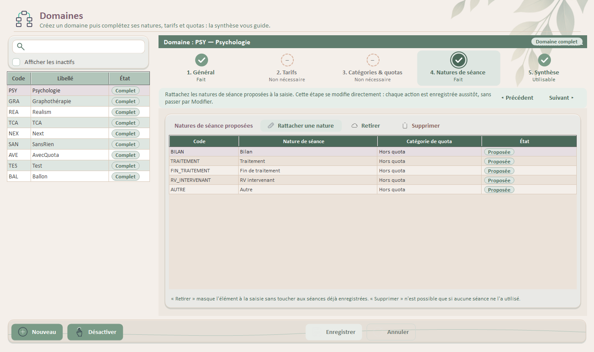

Héberge `UC_LiaisonsNaturesDomaines` (V2, mode `ParDomaine`, `TexteCreation` = « Créer une nouvelle nature… ») : natures proposées à la saisie pour les dossiers du domaine.

La **catégorie de quota** (ou « Hors quota ») se choisit au rattachement et se change directement dans la grille (colonne `colCategorie`) ; changer celle d'une nature déjà utilisée modifie le décompte des dossiers existants (confirmation).

La création ouvre `UC_NaturesSeance` en modal.

##### Étape 5. Synthèse

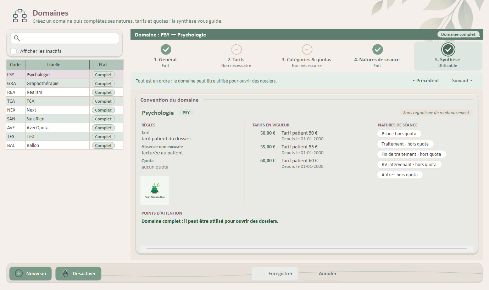

Carte `carteSynthese` « Convention du domaine » contenant `ucSynthese` (`UC_SyntheseDomaine`), comme dans la fiche dossier : en-tête (libellé, code, organisme), blocs **Règles**, **Tarifs en vigueur**, **Natures de séance**, **Quota applicable** et **Points d'attention** (domaine complet, ou manques avec l'étape où les corriger).

##### Rôle général

Écran unique de paramétrage d'un domaine-convention, ouvert depuis le bouton **Domaines** de `Home`. Il regroupe l'identité, l'organisme, les comportements, les tarifs, les catégories et règles de quota, les natures et une synthèse de complétude, parcourus en cinq étapes qui indiquent chacune ce qui reste à faire.

##### Responsabilités

- Lister, filtrer (recherche, inactifs) et sélectionner les domaines ; afficher l'état de chaque domaine dans la liste (`AfficherEtatLigne`).
- Créer / modifier / activer-désactiver un domaine (identité, organisme facultatif, trois comportements) ; la saisie est jugée par le métier (`GestionDomaines.ValiderDomaine`, audit C.2 étape 3, 23/10/2026).
- Naviguer par étapes (`etapes`, `AltheaEtapes`) : état de chaque étape (fait, à compléter, non nécessaire), consigne de l'étape affichée, pastille d'état du domaine (`pstEtatDomaine`).
- Héberger les panneaux `UC_LiaisonsPrixDomaines` (étape 2) et `UC_LiaisonsNaturesDomaines` (étape 4).
- Conduire le cycle des règles de quota : nouvelle règle guidée, correction d'une règle inutilisée, clôture, activation, suppression d'une règle erronée.
- Ouvrir `CategoriesQuotaEditor` pour gérer les catégories du domaine.
- Ouvrir en modal (`ReferentielModalHost`) les référentiels Organismes, Natures et Tarifs pour un ajout rapide.

##### Dépendances

| Élément | Type | Rôle |
| --- | --- | --- |
| `GestionDomaines`, `Domaine` | Module / Classe | Domaine ; `ValiderDomaine` (saisie) et `CalculerManques` (complétude, `ManqueDomaine` / `EtapeDomaine` dans `Metier/Referentiels`), 23/10/2026 |
| `GestionOrganismes`, `Organisme` | Module / Classe | Liste des organismes |
| `GestionQuotasInami`, `QuotaInamiRegle`, `QuotaPlafond` | Module / Classes | Règles, plafonds, contrôles de modification et de suppression, périodes sans règle |
| `GestionCategoriesQuota`, `CategorieQuota` | Module / Classe | Catégories du domaine |
| `UC_SyntheseDomaine` | UserControl | Synthèse du domaine (étape 5) |
| `AffichageErreursSaisie` | Module utilitaire | Erreurs de `ValiderDomaine` sur leurs champs (« Soumis à quota » compris), fenêtre récapitulative, focus (23/10/2026) |
| `UC_LiaisonsPrixDomaines`, `UC_LiaisonsNaturesDomaines` | UserControl | Étapes Tarifs et Natures |
| `AltheaEtapes`, `AltheaOnglets` (`MasquerOnglets`), `AltheaCarte`, `AltheaBarreOutils`, `AltheaPastille` | Kit | Présentation |
| `CategoriesQuotaEditor`, `ReferentielModalHost` | Form | Dialogues ouverts depuis l'écran |
| `UserControlContext`, `DialogChoix`, `GestionLog`, `UtilsControls` | Infrastructure | Contexte, messages, journalisation, lecture seule |

##### Variables privées

| Variable | Type | Rôle |
| --- | --- | --- |
| `_context` | `UserControlContext` | Contexte UI injecté |
| `_mode` | `ModeEcran` | Consultation / Création / Modification (fiche du domaine) |
| `_domaines` | `List(Of Domaine)` | Domaines chargés |
| `_pnlNatures`, `_pnlTarifs` | UserControl (`WithEvents`) | Panneaux de liaison hébergés (`CreationDemandee`, `RattachementsModifies`) |
| `_quotas` | `List(Of QuotaInamiRegle)` | Règles du domaine sélectionné |
| `_modeQuota` | `ModeQuota` | Consultation / NouvelleRegle / Modification / Cloture (zone de la règle) |
| `_chargementEnCours` | `Boolean` | Neutralise les événements pendant un chargement |

##### Contrôles principaux

| Contrôle | Type | Rôle |
| --- | --- | --- |
| `dgvDomaines`, `txtRecherche`, `chkAfficherInactifs` | Grille / filtres | Liste des domaines (Code, Libellé, État) dans la carte `pnlListeTop`. |
| `lblDomaineCourant`, `pstEtatDomaine` | Label / AltheaPastille | Domaine sélectionné et son état (Domaine complet, À compléter, Inactif…). |
| `pnlAssistant` : `etapes`, `lblAssistantEtape`, `btnAssistantPrecedent`, `btnAssistantSuivant` | AltheaCarte | Étapes, consigne, navigation. |
| `tabDomaine` | AltheaOnglets | Pages des cinq étapes ; bande masquée à l'exécution (`MasquerOnglets`). |
| `carteIdentite`, `carteComportement`, `carteLogo` | AltheaCarte | Étape 1 (logo du domaine : 20/10/2026). |
| `carteCategories`, `carteRegles` (`barreRegles`, `dgvQuotas`, `pnlQuotaEdition`), `carteQuotaNonNecessaire`, `lblAideQuotas` | AltheaCarte / … | Étape 3. |
| `carteSynthese`, `ucSynthese` | AltheaCarte / UC_SyntheseDomaine | Étape 5. |
| `pnlActions` (`btnNouveau`, `btnModifier`, `btnActiverDesactiver`, `btnEnregistrer`, `btnAnnuler`) | AltheaBarreActions | Cycle d'édition de la fiche du domaine. |

##### Méthodes principales

| Membre | Nature | Rôle |
| --- | --- | --- |
| `SetContext` | Public Sub | Reçoit le contexte UI. |
| `ChargerListe`, `AppliquerFiltre`, `AfficherSelection`, `AfficherEtatLigne` | Private | Liste et sélection des domaines. |
| `ActualiserAssistant`, `DefinirEtatsEtapes`, `AfficherEtatDomaine`, `PremiereEtapeACompleter`, `etapes_EtapeChoisie` | Private | Étapes, consigne, pastille ; après création, ouverture de la première étape à compléter. Étapes 2 à 4 : « se modifie directement… sans passer par Modifier » (V2.1.0, 19/10/2026). |
| `ActualiserBoutons` | Private Sub | État de la barre d'actions ; **Modifier** montré seulement sur l'étape 1 (Général), Désactiver prend alors sa place (V1.1.0, 19/10/2026 ; Reference_UI § 5.7). |
| `PasserEnMode`, `btnEnregistrer_Click` | Private | Cycle d'édition ; pendant Modifier, étapes 2 à 5 indisponibles et panneaux de liaison en lecture seule. Un refus du métier à l'enregistrement s'affiche dans une fenêtre. |
| `ValiderSaisie`, `ChampsDuDomaine` | Private Function | Fait juger la saisie par `GestionDomaines.ValiderDomaine` (code de 3 lettres et unique, libellé obligatoire et unique, quota pas retiré tant que des règles de quota sont actives) ; toutes les erreurs d'un coup par `AffichageErreursSaisie.Signaler` (V2.0.0, 23/10/2026 : une fenêtre par erreur auparavant, et seulement la première). `ChampsDuDomaine` : propriété → contrôle (`txtCode`, `txtLibelle`, `chkSoumisQuota`). |
| `RafraichirApresRattachement`, `_pnlTarifs_CreationDemandee`, `_pnlNatures_CreationDemandee` | Private | Événements des panneaux de liaison. |
| `ChargerQuotas`, `AfficherLignesQuotas`, `AfficherCategoriesQuota`, `AfficherZoneQuota`, `AfficherRegle`, `AfficherAideQuotasConsultation` | Private | Étape 3 : grille (règles et lignes « sans règle »), affichage selon `ModeQuota`. |
| `QuotaSelectionne`, `PeriodeSelectionnee`, `TrouDuJour`, `TrouAProposer`, `AlerteTrousCrees`, `CopiePourSimulation` | Private | Sélection par `Tag` ; période à proposer ; annonce des périodes qu'une action créerait. |
| `PasserEnModeQuota`, `CommencerSaisiePlafonds`, `ConfirmerRegle`, `btnQuotaValider_Click` | Private | Saisie guidée et récapitulatif (`ConfirmerRegle`) avant enregistrement. |
| `PeutQuitter`, `DeQuoiDomaine` | Public / Private | Domaine ou règle de quota en saisie : Enregistrer / Quitter sans enregistrer / Rester ; Annuler : Abandonner / Continuer la saisie (`GardeModifications`, V1.8.0, 19/10/2026). |
| `AjouterRegle`, `CorrigerRegle`, `CloturerRegle` | Private Sub | Ajout (règle ouverte arrêtée la veille dans la même transaction, `GestionQuotasInami.AjouterRegleEnChaine` ; `AnnulerClotureAutomatique` supprimée le 21/10/2026), correction d'une règle inutilisée, clôture. Un refus s'affiche avec sa raison ; un échec annonce « Rien n'a été modifié ». |
| `btnQuotaModifier_Click`, `btnQuotaActiver_Click`, `btnQuotaSupprimer_Click`, `ActualiserBoutonsQuota` | Private | Contrôles préalables (`ControlerModification`, `ControlerSuppression`), réouverture de la règle précédente, avertissement de période non couverte. |
| `AfficherSynthese` | Private Sub | Délègue à `UC_SyntheseDomaine`. La complétude (liste, étapes, pastille, consigne) est lue dans `GestionDomaines.CalculerManques` (23/10/2026 ; la méthode privée `CalculerManques` de l'écran est retirée). |
| `OuvrirReferentiel` | Private Sub | Ouvre un référentiel dans `ReferentielModalHost`. |

##### Gestion des droits

- Modification réservée à `AppRole.SuperUser` et au-delà (`PeutModifier`) ; consultation pour les autres, y compris dans les barres locales.

##### Règles en vigueur

- Aucun accès direct à la base : tout passe par les modules `Gestion*`.
- Aucune règle n'est déduite du code du domaine ou de l'organisme.
- **Fiche et listes rattachées** (Rules) : Modifier / Enregistrer pour l'étape 1 ; étapes 2 à 4 en consultation, action par action, enregistrement immédiat.
- **Consultation lisible** (Rules) : jamais `Enabled = False` sur une zone de saisie entière.
- Règle de quota : modifiable et supprimable tant qu'elle n'a pas servi, figée ensuite (ADR-40).
- Une catégorie utilisée ne peut qu'être désactivée.
- **Saisie jugée par le métier** (ADR-51, 23/10/2026) : `GestionDomaines.ValiderDomaine` est lue par l'écran et appliquée par `InsertDomaine` / `UpdateDomaine`.

##### Points d'attention

- L'état des étapes, la pastille et la synthèse viennent de la même fonction (`GestionDomaines.CalculerManques`, depuis le 23/10/2026 ; auparavant `UC_SyntheseDomaine.CalculerManquesParEtape`) : une règle de complétude se change dans le métier, jamais dans l'écran.
- Corriger la date de début d'une règle ne déplace pas la fin de la règle précédente (décision du 14/10/2026, ADR-40) : l'écart éventuel est annoncé par `AlerteTrousCrees` (simulation sur `CopiePourSimulation`) dans le récapitulatif, comme pour une nouvelle règle ou une clôture.
- La grille n'est plus indexée sur `_quotas` : `QuotaSelectionne` et `PeriodeSelectionnee` lisent le `Tag` de la ligne.
- Changer la catégorie d'une nature déjà utilisée modifie le décompte des dossiers existants (confirmation).
- Seul écran de gestion des domaines : accessible depuis le menu Home et depuis la tuile Domaines de `UC_ReferentielHome` (qui délègue au menu Home).

##### Message au repreneur

> UC_DomainesHome (≈ 2 130 lignes). Guide utilisateur : `Docs/Guide/Guide_Utilisateur_Domaines.md` ; plan de tests : `Docs/Tests/PLAN_TESTS_DOMAINES.md`.
>
> Toute évolution de règle se fait d'abord dans `GestionDomaines`, `GestionQuotasInami`, `GestionCategoriesQuota`, `GestionLiaisonsNaturesDomaines`, pas dans l'écran.
>
> Toute modification visuelle passe par le Designer ; seuls les panneaux de liaison et les blocs de synthèse sont construits par le code.

---

#### **UserControl : UC_SyntheseDomaine**


> Fichier : `UI/Controls/Domaines/UC_SyntheseDomaine.vb` — hérite de `UserControl` (Designer : `.Designer.vb` + `.resx`).

##### Rôle général

Contrôle en lecture seule qui présente la synthèse mise en forme d'un domaine-convention. Il est la **source unique** de cette présentation (les règles de complétude sont dans le métier depuis le 23/10/2026 : `GestionDomaines.CalculerManques`), réutilisée par l'onglet Synthèse de `UC_DomainesHome` et par l'onglet Fiche Dossier de `UC_DossierFiche`.

##### Responsabilités

- Afficher une ligne d'en-tête : libellé du domaine, pastille du code, pastille de l'organisme (« Sans organisme de remboursement » sinon).
- Présenter un bloc par rubrique : **Règles** (tarif de convention, no-show facturable, soumis à quota), **Tarifs en vigueur** (montant + libellé + période), **Natures de séance** (pastilles « quota … » ou « hors quota »), **Quota applicable** (plafonds, durée, alerte, validité) pour un domaine soumis à quota.
- Optionnellement, afficher le bloc **Points d'attention** (domaine complet, ou éléments manquants avec l'étape où les corriger).
- Disposer les blocs selon la largeur : **trois colonnes** séparées par un filet à partir de 780 px utiles (Règles / Tarifs / Natures), puis en pleine largeur le **Quota** (champs côte à côte, plafonds en double largeur — V2.3.0) et les Points d'attention ; **blocs empilés** défilants sinon.
- Afficher les points d'attention calculés par `GestionDomaines.CalculerManques` (V2.5.0, 23/10/2026, audit C.2 étape 3) : `CalculerManques` et `CalculerManquesParEtape`, qu'il exposait depuis la V2.1.0, sont sorties dans le métier, règles inchangées ; `ManqueDomaine` et `EtapeDomaine` sont dans `Metier/Referentiels`.

##### Dépendances

| Élément | Type | Rôle |
| --- | --- | --- |
| `Domaine` | Classe | modèle métier affiché |
| `GestionLiaisonsPrixDomaines` / `LiaisonPrixDomaine` | Module / Classe | tarifs rattachés et en vigueur |
| `GestionLiaisonsNaturesDomaines` / `LiaisonNatureDomaine` | Module / Classe | natures et catégorie de quota |
| `GestionQuotasInami` / `QuotaInamiRegle` | Module / Classe | règle de quota en vigueur (`GetQuotasParDomaine`, 23/10/2026) |
| `GestionCategoriesQuota` | Module | libellés des catégories |
| `GestionDomaines` | Module | `CalculerManques` : points d'attention (complétude, 23/10/2026) |

##### Contrôles principaux

| Contrôle | Type | Rôle |
| --- | --- | --- |
| `pnlEntete` | Panel | Ligne d'en-tête (44 px) soulignée d'un filet beige. |
| `lblTitre` | Label | Libellé du domaine. |
| `pstCode` | AltheaPastille | Code du domaine. |
| `pstOrganisme` | AltheaPastille | Organisme de remboursement, aligné à droite. |
| `pnlCorps` | Panel | Zone des blocs (`BlocSynthese`, classe interne construite par le code), défilement vertical en mode empilé. |

##### Méthodes principales

| Membre | Nature | Rôle |
| --- | --- | --- |
| `AfficherDomaine(dom, inclureCompletude)` | Public Sub | Remplit le bandeau et la synthèse ; `Nothing` affiche un message d'invite. |
| `ConstruireCompletude` | Private Function | Bloc « Points d'attention » : messages de `GestionDomaines.CalculerManques(dom, tarifs, natures, quotas)` (données déjà lues par la synthèse). |
| `DisposerBlocs` | Private Sub | Place les blocs en colonnes ou empilés selon la largeur ; relancé à chaque redimensionnement. |
| `BlocSynthese.Disposer(largeur, champsEnLigne)` | Function (classe interne) | `champsEnLigne` : un bloc fait uniquement de champs les place côte à côte (`DisposerChampsEnLigne`). |

##### Règles en vigueur

- Lecture seule : aucune écriture, tout passe par les couches `Gestion*`.
- Les valeurs affichées sont celles **en vigueur à la date du jour** (périodes de validité).
- Toute évolution des règles de complétude se fait dans `GestionDomaines.CalculerManques` (23/10/2026), jamais dans ce contrôle ni dans les écrans hôtes.

##### Points d'attention

- Chaque appel à `AfficherDomaine` relit la base : éviter de l'appeler en boucle.
- `Dock = Fill` dans les deux hôtes, chacun dans une carte « Convention du domaine » (fiche dossier ; étape Synthèse de `UC_DomainesHome` depuis UI-6) ; fond transparent : l'hôte fournit la carte.
- V2.0.0 (11/10/2026, UI-5) : la RichTextBox de la V1 est remplacée par des blocs du kit.

##### Message au repreneur

> UC_SyntheseDomaine. Point d'entrée : `AfficherDomaine`. Pour ajouter une information à la synthèse, ajouter un bloc (`Construire*`) ou un élément dans un bloc existant : il apparaîtra automatiquement dans les deux écrans hôtes ; penser à son placement dans `DisposerEnColonnes`.

---

#### **UserControl : UC_LiaisonsPrixDomaines**

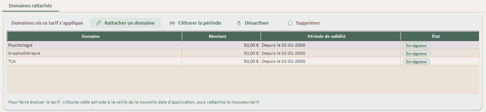

> Fichier : `UI/Controls/Referentiels/UC_LiaisonsPrixDomaines.vb` (V2.1.0, 18/10/2026) — hérite de `UserControl`, sans Designer. Capture antérieure à la V2, à refaire.

##### Rôle général

Panneau intégré d'administration des rattachements historisés entre tarifs de séance et domaines (`lia_prix_seance_domaines`). Hébergé dans une page d'un écran parent (étape Tarifs de `UC_DomainesHome`, onglet Domaines du référentiel Tarifs), sans fenêtre modale (D-POR-4).

##### Responsabilités

- Afficher l'historique des rattachements de l'élément parent (un tarif, ou un domaine).
- Créer un nouveau rattachement avec sa période de validité.
- Clôturer un rattachement en vigueur à une date choisie.
- Désactiver ou réactiver un rattachement, et supprimer une ligne créée par erreur.
- Signaler à l'hôte une demande de création (`CreationDemandee`) et toute modification (`RattachementsModifies`).

##### Présentation (V2.0.0, UI-6, ADR-34)

- Une `AltheaCarte` : barre locale `AltheaBarreOutils` en haut (Rattacher un tarif / un domaine, Clôturer la période, Désactiver ou Réactiver, Supprimer en dernier ; action de création de l'hôte à droite si `TexteCreation` est renseigné), grille sur toute la largeur, note d'aide contextuelle.
- Un formulaire au pied de la carte (`_pied`), fermé par défaut (`ModeFormulaire.Ferme`), ouvert en **Rattachement** (élément, À partir du, Jusqu'au) ou en **Clôture** (dernier jour), avec Valider / Annuler.
- Tous les messages passent par `DialogChoix`.

##### Dépendances

| Élément | Type | Rôle |
| --- | --- | --- |
| `GestionLiaisonsPrixDomaines`, `LiaisonPrixDomaine` | Module / Classe | Couche métier, validation (`ValiderLiaison`) |
| `GestionDomaines`, `GestionPrixSeance` | Modules | Éléments rattachables |
| `AltheaCarte`, `AltheaBarreOutils`, `AltheaBouton`, `AltheaListe`, `AltheaCase` | Kit | Présentation |
| `UtilsDataGrid`, `UtilsButtons`, `UITheme`, `DialogChoix`, `GestionLog` | Utilitaires | Grille, icônes, couleurs, messages, journal |

##### Variables privées

| Variable | Type | Rôle |
| --- | --- | --- |
| `_carte`, `_barre` | `AltheaCarte`, `AltheaBarreOutils` | Carte et barre locale |
| `_btnRattacher`, `_btnCloturer`, `_btnBasculer`, `_btnSupprimer`, `_btnCreer` | `AltheaBouton` | Actions de la barre |
| `_dgv`, `_lblAide` | `DataGridView`, `Label` | Grille et note d'aide |
| `_pied`, `_lblFormulaire`, `_cboAjout`, `_lblDebut`, `_dtpDebut`, `_chkFin`, `_dtpFin`, `_btnValider`, `_btnAnnulerFormulaire` | Formulaire | Saisie au pied de la carte |
| `_idParent` | `ULong` | Élément parent affiché (0 = aucune sélection) |
| `_liaisons` | `List(Of LiaisonPrixDomaine)` | Rattachements affichés |
| `_lectureSeule` | `Boolean` | Aucune écriture (hôte en édition ou utilisateur sans droit) |
| `_mode` | `SensLiaison` | `ParPrix` ou `ParDomaine` |
| `_modeFormulaire` | `ModeFormulaire` | `Ferme`, `Rattachement`, `Cloture` |

##### DataGridView `_dgv` : colonnes

| Colonne | En-tête | Rôle |
| --- | --- | --- |
| `colLibelle` | Domaine / Tarif de séance (selon le sens) | Élément rattaché |
| `colMontant` | Montant | Montant du tarif |
| `colPeriode` | Période de validité | « Depuis le … » ou « Du … au … » |
| `colEtat` | État | Pastille (`LiaisonPrixDomaine.Etat`) : En vigueur (sauge), À venir (bleu), Clôturé et Désactivé (gris, ligne atténuée) — V2.1.0, 18/10/2026 |

##### Méthodes principales

| Membre | Nature | Rôle |
| --- | --- | --- |
| `Mode`, `TexteCreation` | Public Property | Sens de lecture ; texte de l'action de création (vide = pas de bouton). |
| `ChargerPour(idParent)` | Public Sub | Charge les rattachements de l'élément parent. |
| `DefinirLectureSeule(valeur)` | Public Sub | Neutralise les actions d'écriture, formulaire compris. |
| `ConstruireInterface`, `ConstruireFormulaire`, `PlacerBoutonsBarre`, `AppliquerLibellesMode` | Private Sub | Construction et libellés selon le sens. |
| `AfficherFormulaire(contenu)` | Private Sub | Ouvre / ferme le formulaire au pied de la carte. |
| `BtnRattacher_Click`, `BtnCloturer_Click`, `BtnValider_Click`, `CreerRattachement`, `CloturerRattachement` | Private | Rattachement et clôture. |
| `BtnBasculer_Click`, `BtnSupprimer_Click` | Private Sub | Activation, suppression (avertissement si des séances existent sur la période). |
| `ActualiserBoutons`, `ConstruireTexteAide`, `InitialiserToolTips` | Private | État des actions, aide contextuelle, infobulles. |

##### Règles en vigueur

- Aucun accès direct à la base : tout passe par `GestionLiaisonsPrixDomaines`.
- Un tarif évolue par périodes : clôturer à la veille, puis rattacher le nouveau ; jamais de modification de montant en place.
- Les actions significatives sont journalisées via `GestionLog` (identifiants seulement).

##### Points d'attention

- Aucun Designer (exception admise, Rules § 9) : le même panneau sert dans deux écrans et deux sens de lecture.
- La validation métier (chevauchement, ambiguïté de tarif conventionné, cohérence des dates) est dans `GestionLiaisonsPrixDomaines.ValiderLiaison`, pour que tous les écrans affichent les mêmes messages.
- Le paramètre de `AfficherFormulaire` s'appelle `contenu` : VB ne distingue pas la casse, un paramètre `mode` entrerait en conflit avec la propriété `Mode`.

##### Message au repreneur

> UC_LiaisonsPrixDomaines (≈ 880 lignes). Points d'entrée : `Mode`, `ChargerPour`, événements `CreationDemandee` / `RattachementsModifies`. Toute évolution de règle se fait d'abord dans `GestionLiaisonsPrixDomaines`, pas dans le panneau.

---

#### **UserControl : UC_LiaisonsNaturesDomaines**

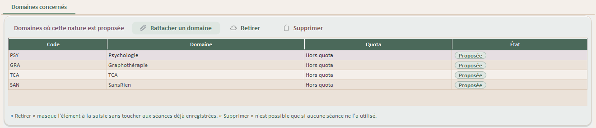

> Fichier : `UI/Controls/Referentiels/UC_LiaisonsNaturesDomaines.vb` (V2.1.0, 18/10/2026) — hérite de `UserControl`, sans Designer. Capture antérieure à la V2, à refaire.

##### Rôle général

Panneau intégré d'administration des rattachements entre natures de séance et domaines (`lia_natures_seance_domaines`), avec la **catégorie de quota** consommée par chaque nature dans le domaine. Hébergé dans l'étape Natures de `UC_DomainesHome` et dans l'onglet Domaines du référentiel Natures (D-POR-5).

##### Responsabilités

- Afficher les rattachements de l'élément parent (un domaine, ou une nature de séance).
- Proposer à l'ajout uniquement les éléments pas encore rattachés (aucun doublon possible), avec leur catégorie de quota en sens « par domaine ».
- Changer la catégorie de quota directement dans la grille (confirmation si la nature a déjà servi).
- Retirer ou rétablir un rattachement, avec avertissement si le domaine se retrouverait sans nature.
- Supprimer un rattachement créé par erreur, sauf s'il a déjà servi à des séances.
- Signaler à l'hôte une demande de création (`CreationDemandee`) et toute modification (`RattachementsModifies`).

##### Présentation (V2.0.0, UI-6, ADR-34)

- Une `AltheaCarte` : barre locale (Rattacher une nature / un domaine, Retirer ou Rétablir, Supprimer ; création à droite), grille, note d'aide, formulaire « Nouveau rattachement » au pied de la carte (élément + catégorie de quota).
- Sens « par domaine », domaine pourvu de catégories : colonne `colCategorie` (`DataGridViewComboBoxColumn` non liée, « Hors quota » = `CleHorsQuota`), remplie après chaque chargement ; sinon colonne `colQuota` en lecture.

##### Dépendances

| Élément | Type | Rôle |
| --- | --- | --- |
| `GestionLiaisonsNaturesDomaines`, `LiaisonNatureDomaine` | Module / Classe | Couche métier (`InsertLiaison` avec catégorie, mise à jour de catégorie) |
| `GestionCategoriesQuota`, `CategorieQuota` | Module / Classe | Catégories du domaine |
| `AltheaCarte`, `AltheaBarreOutils`, `AltheaBouton`, `AltheaListe` | Kit | Présentation |
| `UtilsDataGrid`, `UtilsButtons`, `UITheme`, `DialogChoix`, `GestionLog` | Utilitaires | Grille, icônes, couleurs, messages, journal |

##### Variables privées

| Variable | Type | Rôle |
| --- | --- | --- |
| `_carte`, `_barre` | `AltheaCarte`, `AltheaBarreOutils` | Carte et barre locale |
| `_btnRattacher`, `_btnBasculer`, `_btnSupprimer`, `_btnCreer` | `AltheaBouton` | Actions de la barre |
| `_dgv`, `_lblAide` | `DataGridView`, `Label` | Grille et note d'aide |
| `_pied`, `_lblFormulaire`, `_cboAjout`, `_lblCategorieAjout`, `_cboCategorieAjout`, `_btnValider`, `_btnAnnulerFormulaire` | Formulaire | Saisie au pied de la carte |
| `_choixCategories` | `List(Of KeyValuePair(Of ULong, String))` | Choix de la colonne catégorie (Hors quota + catégories, inactives marquées) |
| `_chargementCategorie` | `Boolean` | Neutralise l'enregistrement pendant le remplissage de la colonne |
| `_idParent`, `_liaisons`, `_lectureSeule`, `_mode` | — | Élément parent, rattachements, lecture seule, sens de lecture |

##### DataGridView `_dgv` : colonnes

| Colonne | En-tête | Rôle |
| --- | --- | --- |
| `colCode` | Code | Code de l'élément rattaché |
| `colLibelle` | Nature de séance / Domaine (selon le sens) | Élément rattaché |
| `colCategorie` | Catégorie de quota | Liste modifiable (sens « par domaine », domaine avec catégories) |
| `colQuota` | Quota | Catégorie en lecture (autres cas) |
| `colEtat` | État | Pastille (`LiaisonNatureDomaine.Etat`) : Proposée (sauge), Nature désactivée (ocre : rattachée mais pas proposée), Retirée du domaine (gris) ; non proposée = ligne atténuée — V2.1.0, 18/10/2026 |

##### Méthodes principales

| Membre | Nature | Rôle |
| --- | --- | --- |
| `Mode`, `ParDomaine`, `TexteCreation` | Public Property | Sens de lecture ; texte de l'action de création. |
| `ChargerPour(idParent)` | Public Sub | Charge les rattachements et les catégories du domaine. |
| `DefinirLectureSeule(valeur)` | Public Sub | Neutralise les actions d'écriture, colonne catégorie comprise. |
| `ChargerCategories`, `ColonneCategorie`, `Dgv_DataBindingComplete` | Private | Alimentation de la colonne catégorie. |
| `Dgv_CurrentCellDirtyStateChanged`, `Dgv_CellValueChanged`, `AppliquerCategorie`, `Dgv_DataError` | Private | Validation immédiate du choix (`CommitEdit`, application différée par `BeginInvoke`), refus d'une catégorie inactive, confirmation si la nature a servi. |
| `AfficherFormulaire`, `BtnValider_Click` | Private | Formulaire de rattachement. |
| `BtnBasculer_Click`, `BtnSupprimer_Click` | Private Sub | Retrait / rétablissement, suppression. |
| `ActualiserBoutons`, `ConstruireTexteAide`, `InitialiserToolTips`, `SelectionnerLiaison` | Private | État des actions, aide, infobulles, resélection. |

##### Règles en vigueur

- Aucun accès direct à la base : tout passe par `GestionLiaisonsNaturesDomaines`.
- La catégorie de quota est portée par la liaison (`lia_natures_seance_domaines.id_categorie_quota`), jamais par la nature.
- Une nature n'est proposée dans `SeanceEditor` que si elle est active et liée au domaine du dossier.

##### Points d'attention

- Aucun Designer (exception admise, Rules § 9).
- Changer la catégorie d'une nature déjà utilisée modifie le décompte des dossiers existants, y compris pour le passé.
- Le panneau reçoit son élément parent de l'hôte et ne doit pas devenir un point d'accès à un domaine implicite.

##### Message au repreneur

> UC_LiaisonsNaturesDomaines (≈ 930 lignes). La colonne catégorie n'est pas liée aux données : elle est remplie dans `Dgv_DataBindingComplete` ; toute nouvelle colonne liée doit en tenir compte.

---

## **Fenêtres**

### **Form : TherapeuteEdition**

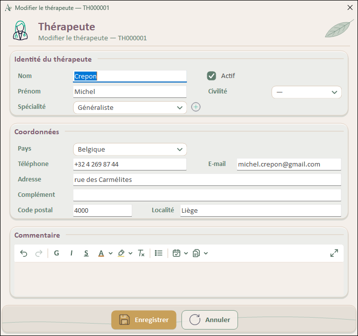

> Fichier : `UI/Forms/Patients/TherapeuteEdition.vb` — hérite de `Form` — implémente `IContextAwareForm`.

#### Rôle général

`TherapeuteEdition` est la Form modale de création / modification d'un thérapeute, ouverte depuis `UC_Therapeutes` (ou via le bouton [+] d'`IntervenantEdition`).

#### Responsabilités

- Saisir l'identité (nom, prénom, spécialité choisie dans le référentiel `ref_specialites`) et l'état actif du thérapeute.
- Saisir les coordonnées country-aware (téléphone, e-mail, adresse, pays, localité).
- Saisir un commentaire libre.
- Faire juger la saisie par le métier (`GestionTherapeutes.ValiderTherapeute`, audit C.2 étape 2b, 23/10/2026) et montrer les erreurs (`AffichageErreursSaisie`).
- Signaler un homonyme et demander confirmation (« Homonyme », 23/10/2026).
- Persister le thérapeute via `GestionTherapeutes` (création / mise à jour).

#### Dépendances

| Élément | Type | Rôle |
| --- | --- | --- |
| `UtilsTelephone` | Module utilitaire | Formatage/normalisation/validation du téléphone. |
| `UtilsValidation` | Module utilitaire | Validation e-mail. |
| `DialogChoix` | Form | Boîtes de dialogue. |
| `GestionLog` | Module métier | Journalisation. |
| `GestionTherapeutes` | Module métier | Persistance du thérapeute ; `ValiderTherapeute` (nom, téléphone et code postal selon le pays, e-mail) ; `TherapeuteExiste` (homonyme). |
| `AffichageErreursSaisie` | Module utilitaire | Erreurs sur leurs champs (`errProvider` local), fenêtre récapitulative, focus (23/10/2026). |
| `UtilsSaisieReferentiels` | Module utilitaire | `ChargerSpecialites` / `IdSpecialiteSaisie` (v2.55.0), pays, civilités. |
| `GestionSpecialites`, `UC_Specialites`, `Home` | Module / UserControl / Form | Bouton [+] : référentiel des spécialités ouvert par `Home.OuvrirReferentielModal`, nouvelle valeur relue et sélectionnée (23/10/2026). |
| `UserControlContext` | Classe | — |
| `UtilsButtons` | Module utilitaire | — |
| `Gestionnaires` | Module métier | — |
| `UC_Therapeutes` | UserControl | — |

#### Variables privées

| Variable | Type | Rôle |
| --- | --- | --- |
| `_context` | `UserControlContext` | Remarque : errProvider reste local (les icônes d'erreur doivent se positionner sur la modale). |
| `_therapeute` | `Therapeute` | Thérapeute en cours d'édition (Nothing en création). |
| `_creation` | `Boolean` | Indique si l'on est en mode création (True) ou modification (False). |
| `_fenetrePrincipale` | `IFenetrePrincipale` | Fenêtre principale reçue par le constructeur (facultative) : ouvre le référentiel des spécialités (droits et élévation compris) ; sans elle, le bouton [+] est grisé (23/10/2026 ; contrat depuis V1.9.0, ADR-55). |

> **UI-7 (14/10/2026)** : fond `AltheaFondFenetre.Appliquer(Me)` dans le constructeur (beige clair, petite feuille dessinée) ; cadres en `AltheaCarte`.

#### Contrôles principaux

| Contrôle | Type | Rôle |
| --- | --- | --- |
| `enTete` | AltheaEnTete | En-tête d'écran : titre « Thérapeute », sous-titre « Gestion des informations et coordonnées des différents thérapeutes qui suivent le patient » ; icône dans les ressources (`enTete.Icone`). |
| `grpIdentite` | AltheaCarte | Zone identité. |
| `lblNom` | Label | Libellé : « Nom » |
| `txtNom` | TextBox | Identité et spécialité. |
| `lblPrenom` | Label | Libellé : « Prénom » |
| `txtPrenom` | TextBox | Identité et spécialité. |
| `lblSpecialite` | Label | Libellé : « Spécialité » |
| `cboSpecialite` | AltheaListe | Spécialité choisie dans `ref_specialites` (une seule par thérapeute, v2.55.0, 23/10/2026 ; remplace la zone de texte `txtSpecialite`). Une spécialité désactivée n'est plus proposée mais reste affichée chez le thérapeute qui l'a. |
| `btnAjouterSpecialite` | AltheaBouton | Bouton [+] : ouvre le référentiel des spécialités en fenêtre ; la nouvelle valeur est sélectionnée d'office (23/10/2026). |
| `chkActif` | AltheaCase | État actif/inactif. |
| `lblCivilite` / `cboCivilite` | Label / AltheaListe | Civilité (`ref_civilites`), à droite du prénom (R2, 12/10/2026). |
| `grpCoordonnees` | AltheaCarte | Zone coordonnées. |
| `lblTelephone` | Label | Libellé : « Téléphone » |
| `txtTelephone` | TextBox | Coordonnées country-aware. |
| `lblEmail` | Label | Libellé : « E-mail » |
| `txtEmail` | TextBox | Coordonnées country-aware. |
| `lblPays` | Label | Libellé : « Pays » |
| `cboPays` | AltheaListe | Pays (`ref_pays`, liste fermée, `UtilsSaisieReferentiels`) ; son code ISO pilote les contrôles du téléphone et du code postal (v2.34.0, étape R2). |
| `lblAdresseLigne1` | Label | Libellé : « Adresse » |
| `txtAdresseLigne1` | TextBox | Adresse. |
| `lblAdresseLigne2` | Label | Libellé : « Complément » |
| `txtAdresseLigne2` | TextBox | — |
| `lblCodePostal` | Label | Libellé : « Code postal » |
| `txtCodePostal` | TextBox | Adresse belge : code existant, localité proposée et suggérée depuis le code, code trouvé depuis la localité (choix « Liège · 4020 »), avertissement puis confirmation si elle ne correspond pas (`SaisieLocaliteBelge`, 24/10/2026). |
| `lblLocalite` | Label | Libellé : « Localité » |
| `txtLocalite` | TextBox | Adresse. |
| `btnEnregistrer` | AltheaBouton | Validation / annulation. |
| `btnAnnuler` | AltheaBouton | Validation / annulation. |
| `ttMain` | ToolTip | — |
| `errProvider` | ErrorProvider | — |
| `pnlAction` | AltheaBarreActions | — |
| `grpCommentaire` | AltheaCarte | Commentaire libre. |
| `rteCommentaire` | UC_RichTextEditor (profil Compact) | Commentaire enrichi. |

#### Autres composants à utilité dédiée

| Composant | Type | Utilité |
| --- | --- | --- |
| `ttMain` | ToolTip | — |
| `errProvider` | ErrorProvider | — |

#### Méthodes principales

| Membre | Nature | Rôle |
| --- | --- | --- |
| `New` | Public Sub | Constructeur (Création ou Modification) ; reçoit Home en paramètre facultatif (V1.2.0, 23/10/2026). |
| `SetContext` | Public Sub | Reçoit le contexte UI partagé fourni par Home (barre de statut et infobulles communes). |
| `TherapeuteEdition_Load` | Private Sub | Initialise les infobulles une fois le contexte injecté (les tooltips passent par _context lorsqu'il est disponible, sinon par le ToolTip local). Branche la garde des modifications non enregistrées (`GardeModifications.SurveillerFenetre`, 19/10/2026). |
| `InitialiserToolTips` | Private Sub | Initialisation. |
| `DefinirToolTip` | Private Sub | Définit une infobulle en privilégiant le contexte partagé de Home (_context) pour harmoniser le comportement ; repli sur le ToolTip local (ttMain) si aucun contexte n'est injecté. |
| `InitialiserFenetre` | Private Sub | Titre selon le mode ; listes (pays, civilités, spécialités) ; bouton [+] actif si Home est fournie (V1.2.0, 23/10/2026). |
| `RemplirChamps` | Private Sub | Pré-remplissage en modification (spécialité sélectionnée dans la liste, V1.1.0, 23/10/2026). |
| `CodePaysSaisi` | Private Function | Code ISO du pays choisi, pour les contrôles (pays et civilité chargés par `UtilsSaisieReferentiels`). |
| `ValiderSaisie` | Private Function | Fait juger la saisie par `GestionTherapeutes.ValiderTherapeute` ; erreurs montrées par `AffichageErreursSaisie.Signaler` (V2.0.0, 23/10/2026 : plus de copie des règles ; l'homonymie n'est plus un refus). |
| `ChampsDuTherapeute` | Private Function | Correspondance propriété du thérapeute → contrôle (`txtNom`, `txtTelephone`, `txtCodePostal`, `txtEmail`). |
| `ConfirmerHomonymeEventuel` / `MemeTexte` | Private Function | Mêmes nom et prénom qu'un autre thérapeute : confirmation « Homonyme », à la création ou quand la modification change le nom ou le prénom (pas de nouvelle question pour un homonyme déjà accepté) (23/10/2026). |
| `AlimenterTherapeuteDepuisChamps` | Private Sub | Recopie la saisie dans un thérapeute (validation et enregistrement jugent la même chose) ; spécialité par son identifiant, libellé recopié pour l'appelant (V1.1.0, 23/10/2026). |
| `Enregistrer` | Private Sub | Valide, confirme un homonyme, puis crée ou met à jour avec le `ContexteOperation` ; refus de droit ou du métier affiché dans une fenêtre, la saisie reste ouverte (V1.1.0, 23/10/2026). |
| `NormaliserTexte` | Private Function | Convertit une chaîne en valeur stockable : Nothing si vide/blanc, sinon la chaîne nettoyée. |
| `ControlerChampsPays` | Private Sub | Signal immédiat, non bloquant, du téléphone et du code postal selon le pays (sortie de champ) ; code belge inexistant compris, localité hors du code : avertissement (`SaisieLocaliteBelge`). |
| `btnAjouterSpecialite_Click` | Private Sub | Ouvre `UC_Specialites` par `Home.OuvrirReferentielModal`, recharge la liste et sélectionne la spécialité créée (sinon garde la sélection) (23/10/2026). |
| `TherapeuteEnregistre` | Public ReadOnly Property | Expose le thérapeute après enregistrement (utile à l'appelant pour la resélection en liste). |
| `btnEnregistrer_Click` | Private Sub | Déclenche la validation et l'enregistrement du thérapeute. |
| `btnAnnuler_Click` | Private Sub | Ferme la fenêtre sans enregistrer. |
| `txtTelephone_Leave` | Private Sub | Téléphone country-aware. |
| `cboPays_SelectedIndexChanged` | Private Sub | Téléphone country-aware. |

#### Gestion des icônes

- `btnAnnuler.Image` (Designer / ressources)
- `btnEnregistrer.Image` (Designer / ressources)
- `pnlAction.BackgroundImage` (Designer / ressources)

#### Règles en vigueur

- Tous les messages utilisateur passent par `DialogChoix` (jamais `MessageBox`).
- Aucun accès direct à la base : les lectures/écritures passent par la couche métier `Gestion*`.
- Les actions significatives sont journalisées via `GestionLog`.

#### Points d'attention

- Téléphone et e-mail sont validés **selon le pays** sélectionné.
- **Règles dans le métier** (ADR-51, 23/10/2026) : `GestionTherapeutes.ValiderTherapeute` est lue par la fenêtre et appliquée par `CreateTherapeute` / `UpdateTherapeute`.
- **Homonyme** (décision de Joëlle, 23/10/2026) : il n'est plus refusé, il est signalé et confirmé.
- **Spécialité** (v2.55.0) : une seule par thérapeute ; seul `IdSpecialite` est écrit, la colonne texte `therapeutes.specialite` n'est plus lue ni écrite.
- **Aucun accès DB** : tout passe par `GestionTherapeutes`.
- **Harmonisation du contexte UI** : la Form implémente `IContextAwareForm` ; statut (`SetStatus`) et infobulles (`SetToolTip`) passent par le contexte partagé de `Home` (`_context`, avec repli local).
  - L'`ErrorProvider` reste **local**.
  - Le contexte est injecté par tous les points d'ouverture (`Home.OuvrirCreationTherapeuteModal`, `UC_Therapeutes`). Voir ADR-10 et `Rules.md` §15.
- Retour `DialogResult.OK` après enregistrement réussi.
- Retour DialogResult.OK après enregistrement réussi
- Réutilise UtilsTelephone (téléphone/pays) et UtilsValidation (e-mail), comme ContactEdition

#### Message au repreneur

> TherapeuteEdition (685 lignes). Point d'entrée : `SetContext`, `TherapeuteEdition_Load`, `InitialiserFenetre`. Toute évolution de règle se fait d'abord dans `GestionTherapeutes`, `Gestionnaires`, pas dans l'écran. Toute modification visuelle passe par le Designer (.Designer.vb / .resx).

---

### **Form : CategoriesQuotaEditor**

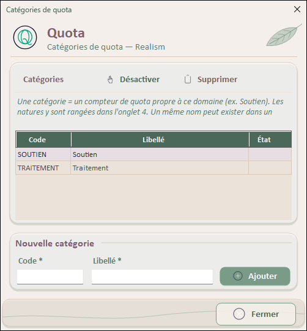

> Fichier : `UI/Forms/Domaines/CategoriesQuotaEditor.vb` — hérite de `Form` (Designer).

#### Rôle général

Boîte de dialogue de gestion des catégories de quota d'un domaine (`ref_categories_quota`), ouverte par **Gérer les catégories…** dans l'onglet Catégories & quotas de `UC_DomainesHome`.

#### Responsabilités

- Lister les catégories du domaine (Code, Libellé, État).
- Ajouter une catégorie.
- Activer / désactiver une catégorie.
- Supprimer une catégorie jamais utilisée.

#### Dépendances

| Élément | Type | Rôle |
| --- | --- | --- |
| `GestionCategoriesQuota`, `CategorieQuota` | Module / Classe | Couche métier et modèle |
| `DialogChoix` | Dialogue | Confirmations |

#### Contrôles principaux

| Contrôle | Type | Rôle |
| --- | --- | --- |
| `enTete` | AltheaEnTete | Titre « Quota », sous-titre « Catégories de quota — *domaine* ». |
| `carteCategories` | AltheaCarte | Carte de la liste : barre locale, aide, grille (comme les cartes de l'écran Domaines). |
| `barreCategories` | AltheaBarreOutils | Barre locale titrée « Catégories ». |
| `btnActiver` | AltheaBouton (Outil) | « Désactiver » / « Réactiver » la catégorie sélectionnée. |
| `btnSupprimer` | AltheaBouton (OutilDanger) | Supprimer une catégorie jamais utilisée. |
| `lblAide` | Label | Aide (italique sauge) : ce qu'est une catégorie. |
| `dgvCategories` (`colCode`, `colLibelle`, `colEtat`) | DataGridView | Catégories du domaine (`InitDataGridSecondaire`) ; État : pastille « Inactive », rien pour une catégorie active, ligne inactive atténuée (V1.3.0, 18/10/2026, UI-9.4). |
| `carteNouvelle` | AltheaCarte | Carte « Nouvelle catégorie » : `txtCode`, `txtLibelle` (libellés au-dessus), `btnAjouter` (bouton par défaut, Entrée). |
| `btnFermer` | AltheaBouton (Clair) | Ferme le dialogue (Échap). |

> **UI-7 (15/10/2026)** : fond `AltheaFondFenetre` (image de fond retirée du `.resx`) ; `GroupBox` et boutons Windows remplacés ; suppression confirmée par `DialogChoix.ConfirmerSuppression` (« Supprimer » en terre).

#### Méthodes principales

| Membre | Nature | Rôle |
| --- | --- | --- |
| `New` | Public Sub | Reçoit le domaine concerné. |
| `Charger`, `Selection`, `ActualiserBoutons` | Private | Chargement et état des boutons. |
| `btnAjouter_Click`, `btnActiver_Click`, `btnSupprimer_Click` | Private Sub | Actions. |

#### Règles en vigueur

- Une catégorie utilisée (nature rattachée ou plafond historisé) ne peut qu'être désactivée.
- Pas de modification de code / libellé : désactiver puis créer une nouvelle catégorie.
- Toute écriture vide le cache des règles de quota.

#### Message au repreneur

> CategoriesQuotaEditor (164 lignes). Règles dans `GestionCategoriesQuota`, pas dans le dialogue.

---

### **Form : ReferentielModalHost**

> Fichier : `UI/Forms/Communs/ReferentielModalHost.vb` — hérite de `Form`.

#### Rôle général

`ReferentielModalHost` est l'hôte modal générique qui héberge un référentiel (`UC_ReferentielBase` ou un écran de liste comme `UC_Therapeutes`) ouvert **en contexte** depuis un bouton [+] d'un dialogue patient. Il injecte un `UserControlContext` dédié, redimensionne la fenêtre selon la vue hébergée et gère le retour vers l'écran appelant.

#### Responsabilités

- Héberger la vue de référentiel en `DockStyle.Fill` et lui injecter le contexte modal dédié (`SetContext`).
- Fermer **automatiquement** la fenêtre après un enregistrement réussi (`EnregistrementEffectue` → `DialogResult.OK`).
- Offrir un **retour explicite** via une barre d'actions basse contenant un bouton **« Fermer »** (consultation / parcours d'une liste sans enregistrer).
- Donner à la vue hébergée le **fond du kit** (`AltheaFondFenetre`, beige clair et feuille dessinée), posé sur son panneau racine `pnlForm` quand il la recouvre (V1.2.0, 18/10/2026).

#### Dépendances

| Élément | Type | Rôle |
| --- | --- | --- |
| `UserControlContext` | Classe | — |
| `UserSession` | Classe | — |
| `NavigationManager` | Classe | — |
| `UtilsButtons` | Module utilitaire | — |
| `UITheme` | Module utilitaire | — |
| `UC_ReferentielBase` | UserControl | — |

#### Variables privées

| Variable | Type | Rôle |
| --- | --- | --- |
| `_vueReferentiel` | `UserControl` | UserControl de référentiel hébergé dans la fenêtre (UC_Ref<X>). |
| `_contexteModal` | `UserControlContext` | Contexte UI dédié au modal, injecté à l'UC hébergé. |
| `_toolTip` | `ToolTip` | Composants UI propres au modal (le contexte de Home n'est pas réutilisé pour éviter les effets de bord). |
| `_errorProvider` | `ErrorProvider` | — |
| `_pnlActions` | `Panel` | Barre d'actions basse (`DockStyle.Bottom`). |
| `_btnFermer` | `Button` | Fermeture explicite (`DialogResult.Cancel`), aussi liée à la touche **Échap** (`CancelButton`). |
| `HauteurBarreActions` | `Const Integer = 48` | — |

#### Contrôles principaux

Aucun contrôle Designer (classe non visuelle ou interface construite par la classe de base).

#### Méthodes principales

| Membre | Nature | Rôle |
| --- | --- | --- |
| `New` | Public Sub | — |
| `ConfigurerFenetre` | Private Sub | Applique les propriétés visuelles de la fenêtre modale (titre, taille, centrage, bordure). |
| `HebergerVue` | Private Sub | Injecte le contexte modal dans l'UC hébergé (s'il le supporte) puis l'ajoute en Dock.Fill. |
| `ConstruireBarreActions` | Private Sub | Construit la barre d'actions basse (Dock.Bottom) contenant le bouton « Fermer », afin d'offrir un retour explicite et propre vers l'écran appelant lorsqu'aucun enregistrement n'est effectué |
| `PositionnerBoutonFermer` | Private Sub | Aligne le bouton « Fermer » sur le bord droit de la barre d'actions, centré verticalement. |
| `PnlActions_SizeChanged` | Private Sub | Repositionne le bouton « Fermer » lorsque la barre d'actions change de taille (redimensionnement de la fenêtre modale). |
| `BtnFermer_Click` | Private Sub | Ferme la fenêtre modale sur demande explicite de l'utilisateur (retour à l'écran appelant), sans signaler d'enregistrement (DialogResult.Cancel). |
| `VueReferentiel_EnregistrementEffectue` | Private Sub | Ferme automatiquement la fenêtre modale après un enregistrement réussi dans le référentiel, afin de ramener l'utilisateur sur l'écran appelant (ex. fiche patient) sans manipulation. |
| `OnFormClosed` | Protected Overrides Sub | Libère les composants propres au modal à la fermeture de la fenêtre. |
| `OnFormClosing` | Protected Overrides Sub | Fermer pendant une saisie modifiée du référentiel hébergé : même question que Home (`IUnsavedChangesAware.PeutQuitter`, V1.3.0, 19/10/2026). |

#### Règles en vigueur


#### Points d'attention

- Z-order : la vue est ajoutée en `Fill` **avant** la barre `Bottom` (règle WinForms, cf. `Login`).
- Le bouton « Fermer » est ancré à droite et repositionné dynamiquement au redimensionnement (`PositionnerBoutonFermer` + handler `SizeChanged`).
- Les `ToolTip` / `ErrorProvider` du host sont **locaux** au modal (pas le contexte de `Home`) pour éviter les effets de bord ; les handlers sont retirés dans `OnFormClosed`.

---


...
- Form codée à la main (pas de Designer) : hôte volontairement minimal et générique
- Le contrôle de droit et l'élévation éventuelle sont gérés EN AMONT par l'appelant
  (Home.OuvrirReferentielModal), sur le modèle de Home.btnReferentiels_Click : l'hôte ne
  duplique aucune logique de sécurité
- Le contexte fourni à l'UC porte la session (pour les droits) mais des labels d'en-tête /
  de statut à Nothing afin de NE PAS écraser le contexte de la fenêtre Home en arrière-plan ;
  un ToolTip et un ErrorProvider propres au modal sont créés ici

#### Message au repreneur

> ReferentielModalHost (352 lignes).

---

[TOC]
