# 📘 **Documentation technique UI — Socle commun**

> Partie de la [documentation technique de l'interface](../Documentation_technique_UI_Althea.md) : sommaire, trame commune des fiches, vue d'ensemble et historique.
> Dernière mise à jour : 25/10/2026 — document scindé par domaine (décision de Joëlle)

Fenêtre principale (Home), accueil, éditeur de texte riche, pagination, dialogue standard (DialogChoix), fenêtres de test, et infrastructure de l'interface (contexte, navigation, contrats, filtres partagés).

---

## **Écrans**

### **UserControl : UC_Accueil**

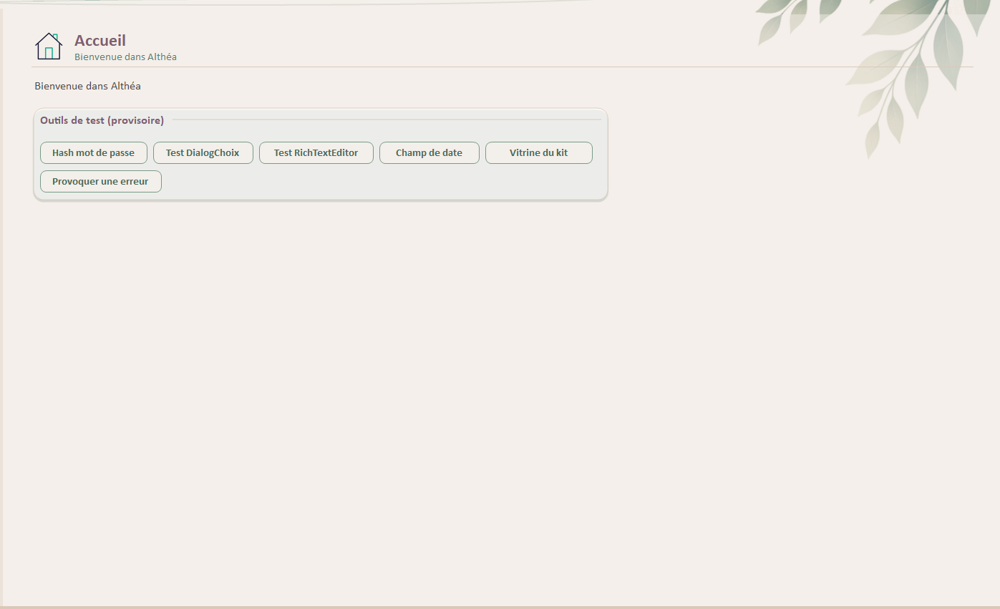

> Fichier : `UI/Controls/UC_Accueil.vb` — hérite de `UserControl`.

#### Rôle général

> [!IMPORTANT]
>
> Ce UserControl est **prévu** mais **n'est pas encore implémenté**.
> La classe `UC_Accueil` existe dans le projet et est actuellement **vide**.
> Documentation à compléter au fur et à mesure de l'avancée.

#### Responsabilités

- Servir de point d’entrée visuel neutre avant la navigation vers un module fonctionnel.

#### Dépendances

| Élément | Type | Rôle |
| --- | --- | --- |
| `NavigationManager` | Classe | — |

#### Variables privées

Aucune variable privée.

#### Contrôles principaux

| Contrôle | Type | Rôle |
| --- | --- | --- |
| `pnlForm` | Panel | — |
| `enTete` | AltheaEnTete | En-tête d'écran : titre « Accueil », sous-titre « Bienvenue dans Althéa » ; icône dans les ressources (`enTete.Icone`). |
| `pnlCenter` | Panel | — |
| `lblMessage` | Label | Libellé : « Bienvenue dans Althéa » |
| `carteTests` | AltheaCarte | « Outils de test (provisoire) », visible seulement dans une version Debug (`#If DEBUG`) : `btnTestHash`, `btnTestDialogChoix`, `btnTestRichTextEditor` (déplacés du menu de la Home le 11/10/2026), `btnTestChampDate`, `btnTestVitrineKit` (16/10/2026). |

#### Méthodes principales

| Membre | Nature | Rôle |
| --- | --- | --- |
| `UC_Accueil_Load` | Private Sub | Masque la carte des outils de test hors Debug. |
| `btnTestHash_Click` / `btnTestDialogChoix_Click` / `btnTestRichTextEditor_Click` / `btnTestChampDate_Click` / `btnTestVitrineKit_Click` | Private Sub | Outils de test provisoires (hash d'un mot de passe, fenêtre de démonstration `TestDialogChoix` — tous les cas de `DialogChoix` —, `TestRichTextEditor`, `TestChampDate`, vitrine du kit `TestKitAlthea` — tous les contrôles du kit dans leurs états). |

#### Gestion des icônes

- `enTete.Icone` (Designer / ressources)

#### Règles en vigueur

- Composant volontairement minimal à ce stade ; il ne porte ni logique métier ni accès aux données.

#### Points d'attention

- Aucun point particulier identifié à ce jour.

#### Message au repreneur

> UC_Accueil (23 lignes). Toute modification visuelle passe par le Designer (.Designer.vb / .resx).

---

### **UserControl : UC_RichTextEditor**

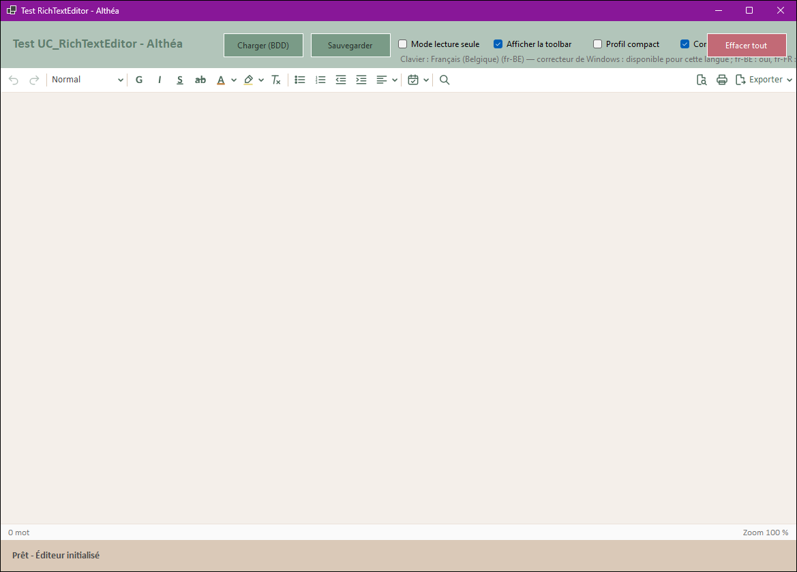

*Profil Compact (notes et commentaires) :*

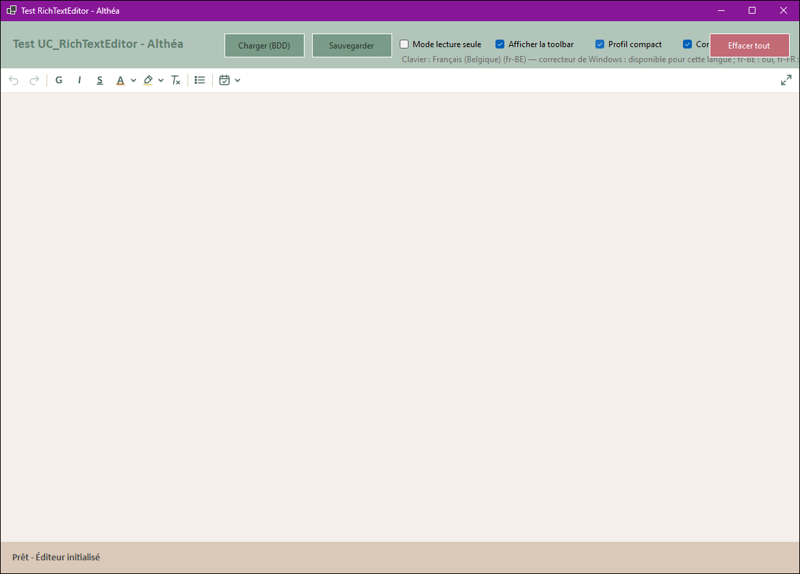


> Fichier : `UI/Controls/Communs/UC_RichTextEditor.vb` (V2.4.0, 20/10/2026) — hérite de `UserControl` — implémente `IContextAwareUserControl`.

#### Rôle général

Éditeur de texte riche (RTF) d'Althéa, en deux **profils** (ADR-42) :

| Profil | Écrans | Barre |
| --- | --- | --- |
| **Complet** (défaut) | Anamnèse (`UC_PatientFiche`), zones du dossier (`DossierZoneEditor`) | Annuler / Rétablir · style de paragraphe · G I S barré, couleur, surligneur, effacer · puces, numéros, retraits, alignement · date · rechercher ; à droite Aperçu, Imprimer, Exporter ▾. Bande de recherche, menu du clic droit, ligne d'état. |
| **Compact** | Alerte (`UC_PatientFiche`), notes et évolution (`SeanceEditor`), commentaires (`ContactEdition`, `IntervenantEdition`, `TherapeuteEdition`) | Annuler / Rétablir · G I S, couleur, surligneur, effacer · puces · date ; à droite Ouvrir en grand (`EditeurTexteAgrandi`, temps 2). |

En consultation (`ReadOnlyMode`), le profil Complet garde une **barre de consultation** (pastille « Lecture seule » · Rechercher, Copier ; Aperçu, Imprimer, Exporter) ; le profil Compact masque sa barre. Le contenu est exposé en deux formes : RTF (affichage) et texte brut (recherche).

La refonte du 19/10/2026 remplace l'ancien éditeur à listes de police et de taille et la variante `UC_RichTextEditorSimple` (supprimée).

#### Responsabilités

- Présenter la barre du profil et du mode (`DefinirPresences`, `AppliquerPresentation`), dans le rendu du kit (`AltheaRenduBarre`).
- Mettre en forme : caractères (gras, italique, souligné, barré, couleurs et surligneurs de la charte), styles de paragraphe (Titre, Sous-titre, Normal, Citation, Petit), listes à puces et numérotées, retraits, alignements (justifié compris), effacement de la mise en forme.
- Insérer la date, la date et l'heure, ou un horodatage signé (« — 19/10/2026 14:32 · P. N. », auteur : `NomAuteur` ou utilisateur du contexte).
- Rechercher et remplacer (profil Complet) ; coller sans mise en forme ; menu du clic droit.
- Aperçu, impression et export PDF / Word (profil Complet), l'emplacement de l'export pouvant être fourni par le conteneur (ADR-21) ; en-tête (cabinet, praticien, titre, patient) et pied de page (mention, date d'édition, page n / N) sur chaque page (temps 2).
- Signaler toute modification, mise en forme comprise (`ContentChanged`) ; afficher mots, « Modifié » et zoom (ligne d'état).
- Absorber les raccourcis avant le `RichTextBox` et la fenêtre (`ProcessCmdKey`) ; aucun raccourci ne modifie le texte en consultation.

#### Dépendances

| Élément | Type | Rôle |
| --- | --- | --- |
| `RichTextEditorHelper` | Module utilitaire | Opérations techniques sans dialogue : configuration, mise en forme, styles, listes, recherche, impression, exports (journalise et renvoie un résultat). |
| `AltheaRenduBarre` | Classe (kit) | Rendu de la barre, de ses menus et du menu contextuel. |
| `AltheaRecherche`, `AltheaBouton` (Outil), `AltheaCase` | Contrôles du kit | Bande de recherche et de remplacement. |
| `DialogChoix` | Dialogue | Messages (document vide, échec d'impression ou d'export, réussite d'un export sans chemin fourni). |
| `IContextAwareUserControl` / `UserControlContext` | Interface / Classe | Contexte facultatif : auteur de l'horodatage signé. |
| `UITheme` | Module utilitaire | Couleurs (dont la région « Éditeur de texte » : `EditeurTexteTerre`, `EditeurTexteBleu`, `EditeurSurligneurJaune`). |

#### Variables privées

| Variable | Type | Rôle |
| --- | --- | --- |
| `MARGE_TEXTE` | `Const Integer = 10` | Marge intérieure du texte (pixels). |
| `FORMAT_DATE` / `FORMAT_DATE_HEURE` | `Const String` | Formats insérés par le bouton Date. |
| `TITRE_PAR_DEFAUT` | `Const String = "Notes Althéa"` | Titre par défaut des impressions et des exports. |
| `Presence` | `Enum` privée (Flags) | Modes où un élément de la barre apparaît : Complet, Compact, Consultation. |
| `_context` | `UserControlContext` | Contexte partagé (facultatif). |
| `_isLoading` | `Boolean` | Chargement en cours : pas de `ContentChanged`. |
| `_profil` / `_barreDemandee` | `ProfilEditeur` / `Boolean` | Profil choisi ; `ShowToolbar`. |
| `_nomAuteur` / `_titreDocument` | `String` | Auteur imposé de l'horodatage ; titre des impressions et de la fenêtre « Ouvrir en grand ». |
| `_sortiesAffichees` | `Boolean` | `AfficherSorties` : aperçu, impression, export montrés. |
| `_patientDocument` | `String` | `PatientDocument` : patient de l'en-tête des documents. |
| `_presence` | `Dictionary(Of ToolStripItem, Presence)` | Présence de chaque élément de la barre selon le mode. |
| `_ressourcesMenus` | `List(Of IDisposable)` | Polices et pastilles créées pour les menus, libérées avec le contrôle. |
| `_debutRecherche` | `Integer` | Position du curseur à l'ouverture de la recherche (recherche au fil de la frappe). |
| `mnuDateJour`, `mnuDateHeure`, `mnuHorodatage` | `ToolStripMenuItem` | Menu du bouton Date, textes recalculés à l'ouverture. |

#### Contrôles principaux

| Contrôle | Type | Rôle |
| --- | --- | --- |
| `toolStrip` | ToolStrip | Barre (blanche, trait Beige dessous, icônes 20 px, rendu `AltheaRenduBarre`). |
| `lblLectureSeule` / `sepLecture` | ToolStripLabel / Separator | Pastille grise « Lecture seule » (consultation). |
| `btnAnnuler`, `btnRetablir` | ToolStripButton | Historique (grisés sans historique). |
| `btnStyle` | ToolStripDropDownButton | Style du paragraphe (nom du style courant ; menu construit par le code, chaque style dans son rendu). |
| `btnGras`, `btnItalique`, `btnSouligne`, `btnBarre` | ToolStripButton | Caractères (cochés selon la sélection). |
| `btnCouleur`, `btnSurligneur` | ToolStripDropDownButton | Couleur du texte (6 teintes) et surligneur (3 teintes pâles + « Aucun »), menus construits par le code. |
| `btnEffacer` | ToolStripButton | Effacer la mise en forme. |
| `btnPuces`, `btnNumeros`, `btnRetraitMoins`, `btnRetraitPlus` | ToolStripButton | Listes et retraits. |
| `btnAlignement` › `mnuAlignGauche`, `mnuAlignCentre`, `mnuAlignDroite`, `mnuAlignJustifier` | ToolStripDropDownButton › MenuItem | Alignement ; l'icône du bouton montre l'alignement courant. |
| `btnDate` | ToolStripDropDownButton | Date, date et heure, horodatage signé. |
| `btnTextesTypes` | ToolStripDropDownButton | Textes types de l'usage de l'éditeur (édition, si `UsageTextesTypes` est renseigné). |
| `btnRechercher` / `btnCopier` | ToolStripButton | Ouvre la recherche ; copier (consultation). |
| `btnExporter` › `mnuExportPdf`, `mnuExportWord`, `mnuMiseEnPage` | ToolStripDropDownButton › MenuItem | Exports et mise en page (à droite). |
| `btnImprimer`, `btnApercu` | ToolStripButton | Impression, aperçu (à droite). |
| `btnOuvrirEnGrand` | ToolStripButton | Ouvrir en grand (profil Compact en édition, à droite). |
| `pnlRecherche` | Panel | Bande de recherche : `txtRecherche` (AltheaRecherche), `lblOccurrences` (« 2 sur 5 »), `btnOccPrecedente` / `btnOccSuivante`, `chkCasse`, `btnAfficherRemplacer`, `btnFermerRecherche`. |
| `pnlRemplacer` | Panel | `txtRemplacer`, `btnRemplacer`, `btnRemplacerTout` (hors consultation). |
| `pnlEtat` | Panel | Ligne d'état (profil Complet) : `lblMots`, `lblModifie`, `lblZoom` (clic = 100 %). |
| `rtbEditor` | RichTextBox | Texte (Calibri 11, gris foncé sur beige clair, sans cadre). |
| `menuContextuel` | ContextMenuStrip | Couper, Copier, Coller, Coller sans mise en forme, Tout sélectionner. |
| `infobulle` | ToolTip | Infobulles de la bande de recherche et du zoom. |

#### Méthodes principales

| Membre | Nature | Rôle |
| --- | --- | --- |
| `Profil` | Public Property | `Complet` (défaut) ou `Compact`. |
| `RtfContent` / `TextContent` | Public Property / ReadOnly | Contenu RTF (affectation = chargement) ; texte brut. Non sérialisés par le Designer. |
| `ReadOnlyMode` / `ShowToolbar` | Public Property | Consultation ; barre affichée (respectée dans tous les modes). |
| `TitreDocument` / `NomAuteur` | Public Property | Titre des impressions et nom proposé à l'export ; auteur de l'horodatage. |
| `PatientDocument` | Public Property | Patient imprimé dans l'en-tête des documents (`EnTeteDocument.DesignerPatient`). |
| `CorrecteurOrthographe` | Public Property | Correcteur de Windows (défaut : True) ; actif si réglage `EDITEUR_CORRECTEUR_ORTHOGRAPHE` (lu au chargement) et en saisie (`CorrecteurActif`, `AppliquerCorrecteur` : soulignement + langue du clavier sans « Modifié »). |
| `_lignesCorrecteur` | `CorrecteurTexte` | Clic droit sur un mot inconnu : suggestions en gras, Ajouter au dictionnaire (`Preparer` à l'ouverture du menu) ; pas de « Ignorer » (incohérent) ; code commun avec `AltheaZoneTexte` (V2.4.1). |
| `UsageTextesTypes` | Public Property | Usage pour les textes types (`UsagesTexteType`), renseigné par le code de l'écran ; vide = pas de bouton. |
| `btnTextesTypes_DropDownOpening` / `TexteType_Click` | Private Sub | Menu des textes de l'usage et « partout », relu à chaque ouverture (infobulle : début du texte) ; insertion RTF au curseur (`InsererRtf`). |
| `AfficherSorties` / `EstModifie` | Public Property / ReadOnly | Aperçu, impression, export (et Ctrl+P) masquables ; contenu modifié depuis le chargement ou `MarquerEnregistre`. |
| `ChargerContenu` | Public Sub | Charge le RTF avec repli sur le texte brut (RTF illisible journalisé) ; vide l'historique, pas de « Modifié ». |
| `MarquerEnregistre` | Public Sub | Efface l'état « Modifié » après un enregistrement. |
| `ContentChanged` | Public Event | Texte ou mise en forme modifiés (hors chargement). |
| `ExportRequested` / `ExportCompleted` | Public Event | Export contextuel délégué au conteneur (ADR-21). |
| `SetContext` | Public Sub | Reçoit le contexte (auteur de l'horodatage). |
| `New` | Public Sub | Rendu du kit, menus construits par le code, présences, présentation. |
| `DefinirPresences` / `AppliquerPresentation` | Private Sub | Éléments de la barre par mode ; barre, recherche et ligne d'état selon profil, consultation et `ShowToolbar`. |
| `MettreAJourBarre` / `MettreAJourLigneEtat` | Private Sub | Reflète la sélection (cochés, style, liste, alignement, historique) sans rien réappliquer ; mots, « Modifié », zoom. |
| `ConstruireMenuStyles` / `ConstruireMenuCouleurs` / `ConstruireMenuDate` | Private Sub | Menus de la barre. |
| `ExecuterMiseEnForme` / `SignalerModification` | Private Sub | Toute action sur le texte : refusée en consultation, puis `ContentChanged`, barre, focus. |
| `InsererHorodatage` / `InitialesAuteur` | Private | Horodatage signé sur sa propre ligne. |
| `OuvrirRecherche` / `AllerOccurrence` / `MettreAJourOccurrences` / `Remplacer` | Private Sub | Recherche au fil de la frappe, occurrences en boucle, remplacement. |
| `DemanderExport` / `DemanderEmplacement` | Private | Export contextuel ou emplacement choisi ; messages. Exports avec en-tête et pied de page. |
| `EnTeteDuDocument` | Private Function | `EnTeteDocument.Creer(TitreDocument, PatientDocument)`, relu à chaque aperçu, impression ou export. |
| `OuvrirEnGrand` / `IconeDeLaFenetre` | Private | Ouvre `EditeurTexteAgrandi` (titre, contenu, auteur, icône de l'en-tête de la fenêtre d'origine) ; si Valider, recharge le texte comme une modification (`ExecuterMiseEnForme`). |
| `menuContextuel_Opening` | Private Sub | Actions du clic droit selon le mode, la sélection et le presse-papiers. |
| `ProcessCmdKey` / `TraiterRaccourci` | Protected / Private | Raccourcis (Ctrl+G / B, I, U, L / E / R / J, Ctrl+Maj+V, Ctrl+F, Ctrl+H, F3, Échap, Entrée, Ctrl+P). |

*Classes du même fichier : `ProfilEditeur` (enum), `ExportFormat` (enum), `ExportRequestedEventArgs`, `ExportCompletedEventArgs`.*

#### Gestion des icônes

- PNG 20 px `Assets/Editor_Ico/<nom>_20_normal.png` (34 icônes depuis `agrandir` le 19/10/2026, un seul style, source SVG unique), intégrés par le Designer dans `UC_RichTextEditor.resx` (`btnXxx.Image`, `mnuXxx.Image`).
- Pas de variantes `_hover` / `_disabled` : survol et coche sont des fonds (`AltheaRenduBarre`), l'état désactivé une opacité de 40 %.
- Les anciennes icônes (`alignLeft_24`, `print_22`…) sont supprimées. Inventaire : Charte graphique, « Icones RichTextEditor ».

#### Règles en vigueur

- Une note garde la police d'Althéa : styles de paragraphe, pas de police ni de taille libres (ADR-42).
- Couleurs du texte et surligneurs limités à la charte.
- Double format obligatoire en base : `_rtf` + `_txt` (Rules § 21).
- Le module technique n'affiche rien ; aucun contenu de note ni chemin de fichier dans les journaux.

#### Points d'attention

- Un nouveau bouton : élément de la barre dans le Designer, gestionnaire passant par `ExecuterMiseEnForme` s'il modifie le texte, ligne dans `DefinirPresences`.
- `ShowToolbar = False` masque la barre dans tous les modes (avant la refonte, `ReadOnlyMode` la réaffichait : les écrans qui posaient `ShowToolbar = False` ont été corrigés).
- L'impression (`EM_FORMATRANGE`) et les exports Syncfusion restent sensibles : tester aperçu, impression et exports après toute modification du `RichTextBox`. Licence Syncfusion : ADR-41.
- Guide : [UC_RichTextEditor_Documentation.md](../../Guide/UC_RichTextEditor_Documentation.md) ; tests : [PLAN_TESTS_UC_RICHTEXTEDITOR.md](../../Tests/PLAN_TESTS_UC_RICHTEXTEDITOR.md) (V2.0) ; historique : [Historique_Implementation_RichTextEditor.md](../../Conception/Historique_Implementation_RichTextEditor.md).

#### Message au repreneur

> UC_RichTextEditor (≈ 1 350 lignes). Point d'entrée : `New`, `AppliquerPresentation`, `ExecuterMiseEnForme`. Les opérations sur le texte vont dans `RichTextEditorHelper` ; le contrôle ne porte que l'interface. Toute modification visuelle de la barre passe par le Designer (.Designer.vb / .resx) et par `DefinirPresences`.

---

### **UserControl : UC_Pagination**

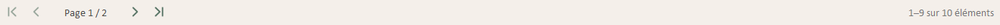

> Fichier : `UI/Controls/Communs/UC_Pagination.vb` (V1.1.0, 19/10/2026) — hérite de `UserControl` (Designer).

#### Rôle général

Barre de pagination réutilisable pour un `DataGridView` lié à une liste chargée en mémoire. La grille n'affiche que la page courante ; la liste complète reste détenue par la barre. Reprise dans le thème le 19/10/2026 : boutons Outil du kit, « Page 2 / 5 », résumé « 21–40 sur 87 patients ».

#### Responsabilités

- Conserver la liste complète et n'afficher dans la grille que la page courante.
- Calculer le nombre de lignes par page selon la hauteur réellement disponible : sans l'en-tête, sans l'ascenseur horizontal s'il est visible, sans la place réservée aux repères (`HauteurReservee`) — aucune ligne coupée.
- Offrir la navigation première / précédente / suivante / dernière page, masquée quand tout tient sur une page.
- Résumer : « Aucun patient », « 3 contacts », « 21–40 sur 87 patients » (singulier et pluriel tirés du libellé « patient(s) »).
- Trier la liste complète (et non la seule page) lors d'un clic sur un en-tête de colonne, si la grille est triable.

#### Dépendances

| Élément | Type | Rôle |
| --- | --- | --- |
| `DataGridView` hôte | Contrôle | Grille attachée via `Attacher`. |
| `AltheaBouton` (variante Outil) | Contrôle du kit | Boutons de navigation (chevrons `page*_24_normal`, `Assets/Ico_divers`). |

#### Variables privées

| Variable | Type | Rôle |
| --- | --- | --- |
| `_hauteurReservee` | `Integer` | Hauteur retirée du calcul de la page (repères dessinés sous des lignes). |
| `_libelleSingulier` / `_libellePluriel` | `String` | Libellés du résumé, tirés de « patient(s) ». |

#### Contrôles principaux

| Contrôle | Type | Rôle |
| --- | --- | --- |
| `btnPremiere`, `btnPrecedente`, `btnSuivante`, `btnDerniere` | AltheaBouton (Outil, 30 × 30) | Navigation ; image du Designer, Tag = nom de l'icône, infobulles. |
| `lblPage` | Label | « Page n / N » (Calibri 10, gris foncé). |
| `lblResume` | Label | Résumé à droite (Calibri 10, gris discret). |
| `infobulle` | ToolTip | « Première page »… |

#### Méthodes principales

| Membre | Nature | Rôle |
| --- | --- | --- |
| `Attacher(grille, libelleElements, triable)` | Public Sub | Associe la barre à une grille (redimensionnement, tri par en-tête si `triable`) et fixe le libellé du résumé. |
| `DefinirSource(liste, page)` | Public Sub | Fournit la liste complète ; page 1 sauf page demandée. |
| `PageDeIndex(index)` | Public Function | Page qui contient un élément (ex. séances ouvertes sur la page d'aujourd'hui). |
| `AfficherPage` | Public Sub | Affiche une page donnée. |
| `HauteurReservee` | Public Property (non sérialisée) | Place des repères à retirer du calcul (ex. `2 * HAUTEUR_SEPARATEUR_GROUPE` pour les patients, `HAUTEUR_SEPARATEUR_JOUR` pour les séances). |
| `TaillePage`, `PageCourante`, `NombrePages` | Public ReadOnly Property | État de la pagination. |
| `PageChangee` | Public Event | Levé après chaque changement de page. |
| `CalculerTaillePage` / `RecalculerTaillePage` | Private | Lignes visibles ; au redimensionnement, le premier élément affiché reste visible. |
| `MettreAJourBarre` / `DefinirLibelles` | Private Sub | Résumé, état des boutons, navigation masquée sur une page. |

#### Règles en vigueur

- Toute nouvelle source (filtre, recherche, actualisation) ramène à la page 1, sauf page demandée.
- Un tri ramène à la page 1 ; un redimensionnement conserve le premier élément visible.
- La barre garde sa hauteur quand la navigation est masquée (pas d'oscillation avec le redimensionnement).

#### Points d'attention

- Utilisée par `UC_PatientHome`, `UC_PatientFiche`, `UC_ReferentielBase` (donc tous les référentiels hérités), `UC_Therapeutes`, et depuis le 19/10/2026 par `UC_DossierFiche` (Séances, Paiements). Inutile ailleurs (grilles courtes ; Administration écartée).
- La grille ne doit plus être liée directement à la liste complète : passer par `DefinirSource` (et `DefinirSource(Nothing)` pour vider).
- Une grille à repères (marges titrées, ligne « Aujourd'hui ») doit déclarer `HauteurReservee`, sinon la dernière ligne peut être coupée.

#### Message au repreneur

> UC_Pagination (≈ 340 lignes). Pour paginer une nouvelle grille : placer la barre dans le Designer (Dock Bottom sous la grille), appeler `Attacher(grille, "élément(s)")`, régler `HauteurReservee` si la grille dessine des repères, puis `DefinirSource(liste)` à chaque rechargement. Tests : `PLAN_TESTS_KIT_ALTHEA` § 7.

---

## **Fenêtres**

### **Form : Home**

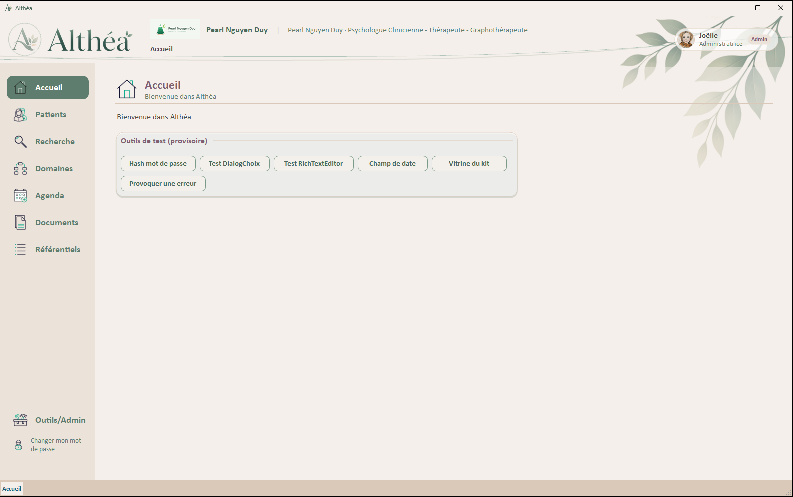

> Fichier : `UI/Forms/Home.vb` — hérite de `Form`.

#### Rôle général

`Home` est la Form principale de l’application Althéa.

Elle joue le rôle de **Shell applicatif** :

- affichage du menu principal
- affichage du contexte général
- hébergement futur des `UserControls` métier
- affichage des messages d’état via `stsStatus`

Elle ne doit pas contenir de logique métier lourde ni d’accès direct à la base de données.

> [!IMPORTANT]
>
> Todo : à mettre à jour au fur et à mesure de l'avancée

> **Contrat (audit C.4, ADR-55, 25/10/2026)** : `Home` implémente `IFenetrePrincipale` (navigation, référentiels en fenêtre, fil d'Ariane, bandeau) et se fournit dans le `UserControlContext` (`FenetrePrincipale`). Les écrans et fenêtres passent par ce contrat ; les méthodes publiques ci-dessous en sont l'implémentation.

#### Responsabilités

- Initialiser le menu principal.
- Gérer l’état visuel du bouton de menu sélectionné.
- Préparer la future navigation vers les environnements métier.
- Afficher le statut courant dans `stsLabelStatus`.
- Héberger les futurs écrans métier dans `pnlContent`.
- Fournir le contexte UI global aux UserControls via `UserControlContext`.
- Centraliser le `StatusStrip`, le `ToolTip`, l’`ErrorProvider` et le contexte affiché.
- Injecter le contexte dans les écrans compatibles via `IContextAwareUserControl`.
- Fournir le contexte aux Forms modales compatibles via `IContextAwareForm`.
- Mettre fin à l'élévation après une période sans activité (audit A.5, 20/10/2026).
- Ouvrir le hub Recherche et les éléments trouvés en gardant la recherche dans la mini-pile (ADR-52, 23/10/2026).

#### Dépendances

| Élément | Type | Rôle |
| --- | --- | --- |
| `Login` | Form | authentification initiale au démarrage |
| `ChangePassword` | Form | changement de mot de passe obligatoire |
| `ElevationAcces` | Form | élévation temporaire de privilèges |
| `UserSession` | Classe | session utilisateur, rôle courant, état d''élévation |
| `UtilisateurApplication` | Classe | utilisateur authentifié |
| `UserControlContext` | Classe | contexte UI partagé pour les UserControls |
| `NavigationManager` | Classe | Sera responsable du chargement centralisé des `UserControls`. |
| `UC_Accueil` | UserControl | UserControl d''accueil chargé par défaut |
| `UC_AdminHome` | UserControl | UserControl administration |
| `UtilsButtons` | Module utilitaire | Initialisation et comportement des boutons standards. |
| `GestionLog` | Module métier | Journalise les actions de navigation dans le menu. |
| `Gestionnaire` | Module métier | — |
| `DialogChoix` | Form | — |
| `AppRole` | Enum | — |
| `UC_PatientHome` | UserControl | Ouvert depuis ce composant. |
| `UC_ReferentielHome` | UserControl | Ouvert depuis ce composant. |
| `NavigationEntry` | Classe | Ouvert depuis ce composant. |
| `ReferentielModalHost` | Form | Ouvert depuis ce composant. |
| `TherapeuteEdition` | Form | Ouvert depuis ce composant. |
| `TestRichTextEditor` | Form | Ouvert depuis ce composant. |
| `UC_Parametres` | UserControl | — |
| `UC_PatientFiche` | UserControl | — |
| `UC_DossierFiche` | UserControl | — |
| `UC_Therapeutes` | UserControl | — |
| `UC_RechercheHome` | UserControl | Hub Recherche, ouvert par `btnRecherche` (23/10/2026). |
| `OuvertureResultat` | Module UI | Libellé de contexte `CONTEXTE_RECHERCHE` ; appelle `NavigateDepuisRecherche` pour ouvrir un élément trouvé. |
| `SuiviActivite` | Classe UI (`UI/Context`) | Filtre de messages de l'application : note touche, clic et molette dans la session (fin de l'élévation après inactivité). |
| `GestionParametres` | Module métier | Lit `SECURITE_ELEVATION_MINUTES` (durée d'inactivité avant la fin de l'élévation). |

#### Variables privées

| Variable | Type | Rôle |
| --- | --- | --- |
| `_homeMenuButtons` | `List(Of Button)` | Liste centralisée des boutons du menu principal (pnlMenu). |
| `_navManager` | `NavigationManager` | Gestionnaire de navigation centralisé pour charger les UserControls métier dans pnlContent. |
| `_userSession` | `UserSession` | Session utilisateur courante maintenant l'état d'authentification, le rôle actif, et l'élévation temporaire. |
| `_uiContext` | `UserControlContext` | Contexte UI partagé fourni à tous les UserControls via IContextAwareUserControl.SetContext(). |
| `_authenticatedUser` | `UtilisateurApplication` | Utilisateur authentifié retourné par Login.vb au démarrage de l'application. |
| `_boutonMenuCourant` | `Button` | Bouton du menu de l'écran affiché : la fin de l'élévation quitte l'Administration ou les Référentiels. |
| `INTERVALLE_CONTROLE_ELEVATION_MS` | `Const Integer` | Intervalle de contrôle de l'inactivité (30 000 ms). |
| `_suiviActivite` | `SuiviActivite` | Filtre installé au chargement (`Application.AddMessageFilter`), retiré à la fermeture. |
| `_minuterieElevation` | `Timer` | Minuterie du contrôle de l'inactivité (`MinuterieElevation_Tick`). |
| `_finElevationEnCours`, `_finElevationReportee`, `_elevationSurveillee` | `Boolean` / `DateTime?` | Garde pendant le message de fin ; report déjà journalisé ; élévation déjà notée au journal (une ligne par élévation). |

#### Contrôles principaux

| Contrôle | Type | Rôle |
| --- | --- | --- |
| `ttMain` | ToolTip | Prévu pour afficher les aides utilisateur. |
| `errProvider` | ErrorProvider | Prévu pour signaler les erreurs UI. Peu utilisé actuellement dans `Home`. |
| `stsStatus` | StatusStrip | Barre de statut de la Form. |
| `stsLabelStatus` | ToolStripStatusLabel | Affiche l’état courant : Accueil, Patients, Connexion OK, etc. |
| `pnlForm` | Panel | Conteneur principal de la Form. Sert de fond et regroupe l’ensemble de la structure UI. |
| `pnlHeader` | Panel | Bandeau (maquette « Home A », 11/10/2026) : logo Althéa, cabinet et praticien, fil d'Ariane, pastille de l'utilisateur. |
| `picLogoCabinet`, `lblCabinet`, `lblCabinetSeparateur`, `lblPraticien` | PictureBox / Label | Logo et nom du cabinet, praticien (« Prénom Nom · Titre ») : `RafraichirBandeauCabinet` (au chargement et après un enregistrement dans `UC_Cabinet`), alignés par `PlacerBandeauCabinet`. |
| `picTitre` | PictureBox | Affiche l’élément graphique/titre de l’application. |
| `pnlMenu` | Panel | Menu latéral gauche. Boutons `AltheaBoutonMenu` (pastille arrondie : Sauge foncé pour l'écran actif, Gris-vert clair au survol ; états gérés par `UtilsButtons`) ; filet (`pnlMenu_Paint`) avant Outils / Admin et le mot de passe. |
| `btnAccueil` | Button | Active l’environnement Accueil. Reste sélectionné tant que l’environnement Accueil est actif. |
| `btnPatients` | Button | Active l’environnement Patients. Devra charger plus tard le UserControl patients. |
| `btnRecherche` | Button | « Recherche », sous Patients (23/10/2026) : ouvre le hub `UC_RechercheHome` (`NavigateToRecherche`). `Tag = recherche`, icônes `recherche_*` chargées par `UtilsButtons` (provisoires). |
| `btnAgenda` | Button | Active l’environnement Agenda. Devra charger plus tard le UserControl agenda. |
| `btnDomaines` | Button | Ouvre `UC_DomainesHome` (paramétrage complet des domaines-conventions). |
| `btnDocuments` | Button | Active l’environnement Documents. Devra charger plus tard le UserControl documents. |
| `btnAdmin` | Button | Active l’environnement Outils / Admin. À préciser selon l’évolution fonctionnelle. |
| `btnReferentiels` | Button | Active l’environnement Référentiels. Devra charger plus tard le UserControl de gestion des référentiels. |
| `pnlContent` | Panel | Zone centrale dynamique. Destinée à recevoir les futurs `UserControls`. |
| `lblContexte` | AltheaFilAriane | Fil d'Ariane : texte reçu par `SetContexte` / `UserControlContext.SetHeader`, dessiné en segments (chevrons, dernier en gras, précisions entre parenthèses ou crochets atténuées, repli « … ») ; pastille facultative (domaine du dossier), effacée à chaque navigation par le menu. |
| `lblUtilisateurConnecte` | AltheaPuceUtilisateur | Pastille de l'utilisateur : photo du compte (ou initiales à défaut), nom et précision (nom d'affichage coupé au « - »), rôle, « Élévation » si active. |
| `btnChangerMotDePasse` | AltheaBoutonMenu | Libellé : « Changer mon mot de passe » (deux lignes, icône 24 px). |

#### Autres composants à utilité dédiée

| Composant | Type | Utilité |
| --- | --- | --- |
| `ttMain` | ToolTip | Prévu pour afficher les aides utilisateur. |
| `errProvider` | ErrorProvider | Prévu pour signaler les erreurs UI. Peu utilisé actuellement dans `Home`. |

#### Méthodes principales

| Membre | Nature | Rôle |
| --- | --- | --- |
| `AuthenticatedUser` | Public ReadOnly Property | Retourne l'utilisateur authentifié courant récupéré depuis Login.vb au démarrage. |
| `Home_Load` | Private Sub | Initialise la Form, prépare les boutons du menu et sélectionne Accueil par défaut. |
| `RafraichirBandeauCabinet` | Public Sub | Affiche logo, nom du cabinet et praticien dans le bandeau ; appelée au chargement et par `UC_Cabinet` après enregistrement. Rafraîchit aussi la photo de l'utilisateur (la photo d'un compte lié suit la fiche praticien). |
| `Home_Shown` | Private Sub | Après affichage : rappel de sauvegarde (`GestionSauvegardes.MessageRappel`) si la dernière sauvegarde réussie dépasse `SAUVEGARDE_RAPPEL_JOURS` (SuperUser et Admin). |
| `RafraichirPhotoUtilisateur` | Public Sub | Affiche dans la pastille la photo du compte connecté selon `PhotosUtilisateur` (photo du praticien lié, sinon photo propre, sinon initiales) et libère l'image précédente ; appelée par `RafraichirBandeauCabinet` et par `UC_Utilisateurs` à la fermeture de `UtilisateurEdition`. Une erreur de lecture est journalisée et laisse les initiales. |
| `UpdateConnectedUserDisplay` | Public Sub | Met à jour l'affichage de l'utilisateur connecté dans le header (lblUtilisateurConnecte) avec le nom, le rôle courant, et l'état d'élévation temporaire. |
| `InitializeHomeMenuButtons` | Private Sub | Remplit la liste `_homeMenuButtons` et initialise chaque bouton via `UtilsButtons.InitHomeMenuButton`. |
| `SelectHomeMenuButton` | Private Sub | Marque un bouton comme sélectionné, met à jour le statut et loggue la navigation. |
| `btnAccueil_Click` | Private Sub | Sélectionne l’environnement Accueil. |
| `btnPatients_Click` | Private Sub | Sélectionne l’environnement Patients. |
| `btnRecherche_Click` | Private Sub | Ouvre le hub Recherche (`NavigateToRecherche`). |
| `btnDomaines_Click` | Private Sub | Charge `UC_DomainesHome` dans `pnlContent`. |
| `btnAgenda_Click` | Private Sub | Sélectionne l’environnement Agenda. |
| `btnDocuments_Click` | Private Sub | Sélectionne l’environnement Documents. |
| `btnReferentiels_Click` | Private Sub | Sélectionne l’environnement Référentiels. |
| `btnAdmin_Click` | Private Sub | Sélectionne l’environnement Outils / Admin. |
| `btnChangerMotDePasse_Click` | Private Sub | Ouvre la Form ChangePassword en mode UserChange pour permettre à l'utilisateur de changer son mot de passe. |
| `NavigateTo` | Private Sub | Navigue vers un UserControl métier et synchronise le menu, le contenu (pnlContent), le contexte de navigation (lblContexte), et le StatusStrip. |
| `NavigateToAdminView` | Public Sub | Navigue vers un écran d'administration (sous-UserControl de UC_AdminHome) avec contexte hiérarchique. |
| `NavigateToReferentielView` | Public Sub | Navigue vers un écran de référentiel (sous-UserControl de UC_ReferentielHome) avec contexte hiérarchique. |
| `NavigateToAccueil` | Public Sub | Retourne vers l'écran d'accueil (UC_Accueil) avec contexte "Accueil". |
| `NavigateToPatients` | Public Sub | Retourne vers l'écran d'accueil des patients (UC_PatientHome) avec contexte "Patients". |
| `NavigateToRecherche` | Public Sub | Ouvre le hub Recherche (`UC_RechercheHome`, contexte « Recherche ») : bouton du menu, et Retour d'une recherche spécialisée quand la mini-pile est vide (23/10/2026). |
| `NavigateDepuisRecherche` | Public Sub | Ouvre l'écran d'un élément trouvé (fiche patient, hub dossier) ou une recherche spécialisée en empilant la recherche (fabrique `creerEcranCourant`) ; `contexteRetour` (« Recherche » par défaut, « Recherche > Séances »…) est réaffiché au retour. Bouton du menu : `btnRecherche` (23/10/2026). |
| `NavigateToPatientFiche` | Public Sub | Ouvre la fiche patient (UC_PatientFiche) en empilant l'écran patients courant dans la mini-pile de navigation (D-Q15) pour permettre un retour à la liste avec son filtre restauré. |
| `NavigateToDossierFiche` | Public Sub | Ouvre le hub d'un dossier (UC_DossierFiche) en empilant l'écran patient courant dans la mini-pile de navigation (D-Q15), pour permettre un retour à la fiche patient restaurée. |
| `NavigateAvecHistorique` | Public Sub | Navigue vers une vue métier en empilant l'écran COURANT dans la mini-pile de navigation (D-Q15), afin de permettre un retour ultérieur via NavigateRetour(). |
| `DemanderElevation` / `ObtenirElevationPourZone` / `OuvrirFenetreElevation` | Public / Private Function | Élévation d'accès réunie (25/10/2026, ADR-55) : demandée par un écran (fil d'Ariane temporaire), par une zone réservée (question d'abord) ; `OuvrirFenetreElevation` est le seul endroit où `ElevationAcces` s'ouvre (contexte UI, bandeau rafraîchi). |
| `NavigateRetour` | Public Function | Revient à l'écran précédent de la mini-pile de navigation (D-Q15) et restaure son menu et son contexte. Le dernier filtre de recherche est rétabli via la fabrique de l'étape. |
| `OuvrirReferentielModal` | Public Function | Ouvre un écran de référentiel existant (UC_Ref<X>) dans une fenêtre modale générique (ReferentielModalHost), pour permettre l'ajout d'une valeur de référentiel « en contexte » |
| `OuvrirCreationTherapeuteModal` | Public Function | Ouvre directement la Form modale de création d'un thérapeute (TherapeuteEdition), sans passer par l'écran de liste UC_Therapeutes. Réutilise le contrôle de droit + élévation déjà en place. Transmet Home à `TherapeuteEdition` (bouton [+] des spécialités, 23/10/2026). |
| `MinuterieElevation_Tick` | Private Sub | Toutes les 30 s, si la session est élevée : note au journal la surveillance (une fois par élévation), puis met fin à l'élévation si aucune activité depuis `SECURITE_ELEVATION_MINUTES` ; reportée tant qu'une fenêtre modale visible est ouverte (`FenetreModaleOuverte`). |
| `TerminerElevationParInactivite` | Private Sub | Ramène la session au rôle de base (`ResetElevation`), journalise, met à jour la pastille, affiche « Fin de l'élévation » et revient à l'accueil depuis l'Administration ou les Référentiels. |
| `PeutAccederAdminHome` | Private Function | Vérifie si l'utilisateur courant possède les droits d'accès à l'espace Administration (UC_AdminHome). |
| `PeutAccederReferentielHome` | Private Function | Vérifie si l'utilisateur courant possède les droits d'accès à l'espace Référentiels (UC_ReferentielHome). |
| `BuildAdminContexte` | Public Function | Construit un libellé de contexte hiérarchique pour les écrans issus de l'administration. |
| `BuildReferentielContexte` | Public Function | Construit un libellé de contexte hiérarchique pour les écrans issus des référentiels. |
| `SetContexte` | Public Sub | Met à jour le contexte de navigation affiché dans lblContexte (header) et stsLabelStatus (barre de statut). |
| `PushContexteTemporaire` | Public Function | Applique temporairement un contexte avant ouverture d'une Form modale et retourne le contexte précédent. |
| `RestoreContexte` | Public Sub | Restaure un contexte précédemment sauvegardé via PushContexteTemporaire(). |

#### Gestion des icônes

- `$this.Icon` (Designer / ressources)
- `btnAccueil.Image` (Designer / ressources)
- `btnAdmin.Image` (Designer / ressources)
- `btnAgenda.Image` (Designer / ressources)
- `btnChangerMotDePasse.Image` (Designer / ressources)
- `btnDocuments.Image` (Designer / ressources)
- `btnDomaines.Image` (Designer / ressources)
- `btnPatients.Image` (Designer / ressources)
- `btnReferentiels.Image` (Designer / ressources)
- `picTitre.BackgroundImage` (Designer / ressources)

#### Règles en vigueur

Les boutons du menu Home ne sont pas des boutons standards.

Ils utilisent :

- `Tag = accueil`, `patients`, `agenda`, etc.
- images dans `Assets\Boutons_Home`
- état persistant `selected`
- gestion centralisée via `UtilsButtons.InitHomeMenuButton`

Le bouton sélectionné reste actif jusqu’à ce qu’un autre bouton de menu soit choisi.

`InitializeHomeMenuButtons` gère 8 boutons : Accueil, Patients, **Recherche** (placé sous Patients, 23/10/2026), Domaines, Agenda, Documents, Référentiels, Outils / Admin.

**Fin de l'élévation après inactivité** (audit A.5, décision de Joëlle, 20/10/2026) : sans touche, clic ni molette pendant `SECURITE_ELEVATION_MINUTES` (15 min par défaut, paramètre Admin), l'élévation prend fin. Un simple mouvement de souris ne compte pas.

Jamais pendant qu'une fenêtre modale visible est ouverte par-dessus la Home (V1.16.1, 21/10/2026 : une fenêtre seulement cachée ne bloque plus).

Le retour à l'accueil passe par la navigation habituelle : des modifications non enregistrées déclenchent la question Enregistrer / Quitter / Rester.

À terme, les méthodes Click devront aussi charger un `UserControl` dans `pnlContent`.

Exemple cible :

`SelectHomeMenuButton(btnPatients, "Patients")
LoadView(New UC_PatientsHome())`

------

#### Points d'attention

- Home est le nœud central de l''application : tous les UserControls métier sont chargés dans pnlContent
- Home ne contient aucune logique métier ni accès direct à la base de données
- L''architecture est organisée en panneaux :
  * pnlMenu (gauche)    : boutons de navigation principale
  * pnlHeader (haut)    : contexte utilisateur (lblUtilisateurConnecte) et contexte de navigation (lblContexte)
  * pnlContent (centre) : zone dynamique où sont chargés les UserControls
  * stsStatus (bas)     : StatusStrip partagé (stsLabelStatus)
- Le mécanisme de navigation est centralisé via NavigationManager (instancié dans Home_Load)
- Les UserControls implémentant IContextAwareUserControl reçoivent automatiquement le contexte via SetContext()
- L''élévation de privilèges est temporaire et limitée à la session en cours (gérée par UserSession)
- Le DialogResult n''est jamais utilisé (Home est la Form principale, pas une modale)
- Tous les UserControls naviguent en appelant des méthodes publiques de Home (NavigateToAccueil, NavigateToAdminView)

#### Message au repreneur

> Home (2368 lignes). Point d'entrée : `Home_Load`. Toute évolution de règle se fait d'abord dans `Gestionnaire`, pas dans l'écran. Toute modification visuelle passe par le Designer (.Designer.vb / .resx).

---

### **Form : EditeurTexteAgrandi**

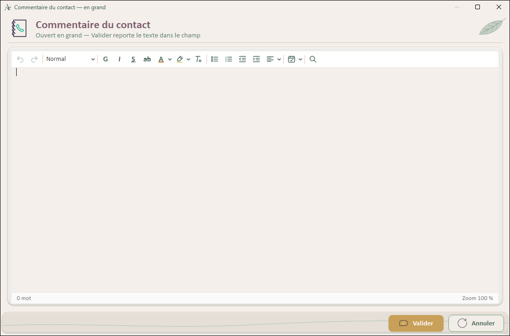

> Fichier : `UI/Forms/Communs/EditeurTexteAgrandi.vb` (V1.0.0, 19/10/2026) — hérite de `Form`.

#### Rôle général

Fenêtre « Ouvrir en grand » d'un éditeur au profil Compact : le même texte dans un `UC_RichTextEditor` au profil Complet, sans aperçu, impression ni export (`AfficherSorties = False`).

**Valider** rend `DialogResult.OK` si le texte a changé ; l'éditeur d'origine relit `RtfContent` / `TextContent` et les reporte dans son champ. Rien n'est écrit en base ici.

#### Contrôles principaux

| Contrôle | Type | Rôle |
| --- | --- | --- |
| `enTete` | AltheaEnTete | Titre du champ (`TitreDocument` d'origine), icône de la fenêtre d'origine, sous-titre « Ouvert en grand — Valider reporte le texte dans le champ ». |
| `carteTexte` › `rteTexte` | AltheaCarte › UC_RichTextEditor | Éditeur au profil Complet. |
| `pnlActions` (`btnValider` Ocre, `btnAnnuler` Clair) | AltheaBarreActions | Valider, Annuler (`CancelButton` : Échap). |

#### Méthodes principales

| Membre | Nature | Rôle |
| --- | --- | --- |
| `New(titre, rtf, txt, nomAuteur, icone)` | Public Sub | Contenu et présentation reçus de l'éditeur d'origine. |
| `RtfContent` / `TextContent` | Public ReadOnly | Contenu à reporter après Valider. |
| `EditeurTexteAgrandi_Load` | Private Sub | `GardeModifications.SurveillerFenetre(Me, btnValider, "du texte")`, fond du kit, titres, `AjusterAEcran`, chargement. |
| `AjusterAEcran` | Private Sub | Taille du Designer ramenée à 90 % de la zone de travail de l'écran au plus (`PART_ECRAN_MAX`), recentrée. |
| `btnValider_Click` / `btnAnnuler_Click` | Private Sub | OK si `rteTexte.EstModifie`, sinon Cancel ; Annuler. |

#### Message au repreneur

> EditeurTexteAgrandi (≈ 150 lignes). Ouvert uniquement par `UC_RichTextEditor.OuvrirEnGrand`. Garder la fenêtre sans accès base : le champ d'origine s'enregistre avec sa fiche.

---

### **Form : TestRichTextEditor**


> Fichier : `UI/Forms/Test/TestRichTextEditor.vb` — hérite de `Form`.

#### Rôle général

Form de test pour valider le UserControl UC_RichTextEditor.

#### Responsabilités

- Tester le chargement de contenu RTF
- Tester la sauvegarde RTF + TXT
- Tester toutes les fonctionnalités de formatage
- Tester les modes ReadOnly et ShowToolbar

#### Dépendances

| Élément | Type | Rôle |
| --- | --- | --- |
| `UC_RichTextEditor` | UserControl | — |
| `Gestionnaires` | Module métier | — |

#### Variables privées

Aucune variable privée.

#### Contrôles principaux

| Contrôle | Type | Rôle |
| --- | --- | --- |
| `pnlTop` | Panel | — |
| `lblTitre` | Label | Libellé : « Test UC_RichTextEditor - Althéa » |
| `btnSauvegarder` | Button | Libellé : « Sauvegarder » |
| `btnCharger` | Button | Libellé : « Charger (BDD) » |
| `chkReadOnly` | CheckBox | Libellé : « Mode lecture seule » |
| `chkShowToolbar` | CheckBox | Libellé : « Afficher la toolbar » |
| `chkCompact` | CheckBox | Libellé : « Profil compact » (19/10/2026) : bascule `ucEditor.Profil`. |
| `pnlBottom` | Panel | — |
| `lblStatus` | Label | Libellé : « Prêt - Éditeur initialisé » |
| `ucEditor` | UC_RichTextEditor | — |
| `btnEffacer` | Button | Libellé : « Effacer tout » |

#### Méthodes principales

| Membre | Nature | Rôle |
| --- | --- | --- |
| `TestRichTextEditor_Load` | Private Sub | Gestionnaire d'événement Load de `TestRichTextEditor`. |
| `OnContentChanged` | Private Sub | — |
| `btnSauvegarder_Click` | Private Sub | Gestionnaire d'événement Click de `btnSauvegarder`. |
| `btnCharger_Click` | Private Sub | Gestionnaire d'événement Click de `btnCharger`. |
| `chkReadOnly_CheckedChanged` | Private Sub | Gestionnaire d'événement CheckedChanged de `chkReadOnly`. |
| `chkShowToolbar_CheckedChanged` | Private Sub | Gestionnaire d'événement CheckedChanged de `chkShowToolbar`. |
| `chkCompact_CheckedChanged` | Private Sub | Passe l'éditeur du profil Complet au profil Compact et inversement. |
| `btnEffacer_Click` | Private Sub | Gestionnaire d'événement Click de `btnEffacer`. |

#### Règles en vigueur


#### Points d'attention

- Form temporaire pour développement/validation
- Peut être supprimée ou désactivée en production

#### Message au repreneur

> TestRichTextEditor (121 lignes). Point d'entrée : `TestRichTextEditor_Load`. Toute évolution de règle se fait d'abord dans `Gestionnaires`, pas dans l'écran. Toute modification visuelle passe par le Designer (.Designer.vb / .resx).

---

### **Forms de test (Debug)**

Fenêtres de démonstration ouvertes depuis la carte « Outils de test » de `UC_Accueil` (Debug seulement), sans donnée réelle ni accès à la base ; elles servent aussi aux captures de `Reference_UI.md`.

| Form | Fichier | Rôle |
| --- | --- | --- |
| `TestKitAlthea` | `UI/Forms/Test/TestKitAlthea.vb` (V2.2.0, 20/10/2026) | Vitrine du kit : chaque contrôle dans ses états, par famille (palette et polices, boutons, structure, champs, indicateurs, grilles) ; banc de vérification après chaque modification du kit. |
| `TestDialogChoix` | `UI/Forms/Test/TestDialogChoix.vb` (V1.0.0, 14/10/2026) | Cas typiques de `DialogChoix` V2 (information, erreur, confirmations, récapitulatif, attente) et icônes `AltheaIconeEtat` en 48 et 24 px. |
| `TestChampDate` | `UI/Forms/Test/TestChampDate.vb` (V1.0.0, 14/10/2026) | `AltheaDate` (obligatoire, facultative, bornée, du / au, lecture seule) et `AltheaCalendrier` seul. |

---

## **Dialogues**

### **Dialogue : DialogChoix**

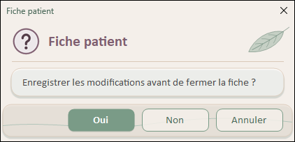

| Information | Avertissement | Erreur |
| :---: | :---: | :---: |
| 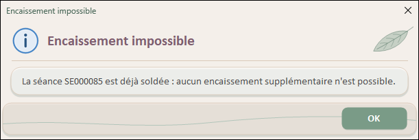 | 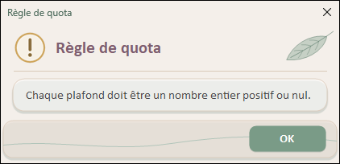 | 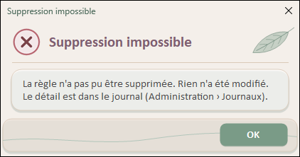 |

| Succès | Confirmation | Suppression |
| :---: | :---: | :---: |
| 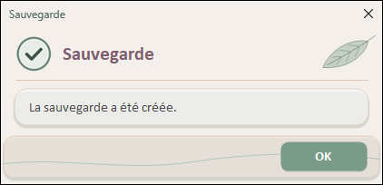 | 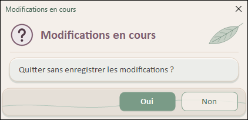 | 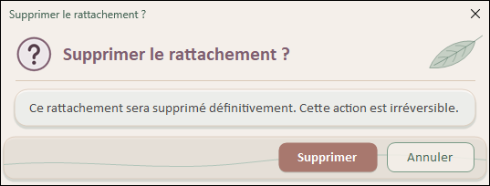 |

> Fichier : `UI/Forms/Communs/DialogChoix.vb` (V2.1.0, 16/10/2026) — hérite de `Form`. Captures du 24/10/2026 (V2, fenêtre de démonstration `TestDialogChoix`) ; maquette « C » dans `Docs/Rules/Reference_UI.md` § 2.7.

#### Rôle général

`DialogChoix` est la boîte de dialogue d'Althéa ; elle remplace les `MessageBox` dans toute l'application (ADR-11).

V2.0.0 (UI-7, 14/10/2026) : icônes dessinées (`AltheaIconeEtat`) à la place des GIF, parties structurées, boutons qui disent l'action, taille adaptée au contenu.

V2.1.0 (16/10/2026, maquette « DialogChoix — C » retenue) : la boîte devient **une petite fenêtre du kit, comme les autres** (la V2.0, en-tête teinté et corps blanc sans barre de titre, jurait avec les fenêtres en cartes) :

- **Barre de titre Windows et fond du kit** : `AltheaFondFenetre.Appliquer(Me)` (beige clair, feuille, barre de titre beige) ; `FormBorderStyle = FixedDialog`, sans icône, sans réduire / agrandir. La barre de titre affiche le titre du dialogue, comme les autres fenêtres.
- **En-tête `AltheaEnTete`** : icône d'état 40 px (image produite par `AltheaIconeEtat.CreerImage`), titre **mauve** Calibri 15,75 gras, trait fin. **Le type se lit sur l'icône seule** : plus de bandeau coloré.
- **Message dans une `AltheaCarte`** (blanche translucide), composé de parties facultatives, toujours dans cet ordre : message, liste « libellé : valeur » (encadré beige clair), complément, encadré d'attention (ocre), remarque discrète, question finale (gras).
- **Boutons dans une `AltheaBarreActions`** (vague), **dans l'ordre habituel de l'application** : l'action à gauche, Annuler / Non à droite (bouton 1, 2, 3 de gauche à droite, groupe aligné à droite) ; ils peuvent dire l'action (« Clôturer », « Supprimer », « Enregistrer »).
- **Taille adaptée au contenu** : 420 à 640 px de large (assez pour que le titre ne passe pas sous la feuille), au plus 70 % de la hauteur de l'écran ; au-delà, le message défile dans sa carte (replacé plus étroit pour la barre de défilement). Recentrée sur la fenêtre appelante après le calcul.

`DialogChoix` met en forme ; il n'interprète jamais le texte du message.

#### Responsabilités

- Afficher un message d'un des types Information, Avertissement, Erreur, Succès, Question, Attente.
- Proposer 1 à 3 boutons, avec le mapping fixe Bouton1 = `Yes` (`OK` s'il est seul), Bouton2 = `No`, Bouton3 = `Cancel`.
- Gérer le clavier : **Entrée** = bouton par défaut (l'action ; **Annuler** si l'action est destructrice, `VarianteAction = Terre`) ; **Échap** et la **croix de la barre de titre** = dernier bouton (Annuler, Non, ou OK s'il est seul).
- Ne jamais afficher de détail technique : une erreur renvoie au journal.

#### Dépendances

| Élément | Type | Rôle |
| --- | --- | --- |
| `AltheaFondFenetre` | Classe du kit | Fond beige à la feuille et barre de titre du kit ; `LargeurZone` (place de la feuille) |
| `AltheaEnTete` | Contrôle du kit | En-tête (icône, titre, trait) |
| `AltheaIconeEtat` | Contrôle du kit | Icône d'état (`CreerImage` pour l'en-tête, contrôle pour l'encadré d'attention) et teintes (`Teintes(etat)` : base, pâle, foncée) |
| `AltheaCarte` | Contrôle du kit | Carte du message, encadrés « détails » et « attention » |
| `AltheaBarreActions` | Contrôle du kit | Barre des boutons |
| `AltheaBouton` | Contrôle du kit | Boutons (`Variante` : Sauge, Ocre, Terre, Clair) |
| `UITheme` | Module | Couleurs de la charte |

#### Contrôles principaux (Designer)

| Contrôle | Type | Rôle |
| --- | --- | --- |
| `enTete` | AltheaEnTete | En-tête : icône d'état 40 px, titre (hauteur 58) |
| `carteMessage`, `pnlCorps` | AltheaCarte, Panel transparent | Carte du message (marges 12, `Padding` 16; 12; 16; 18) ; `pnlCorps` (Dock Fill) défile si besoin |
| `lblMessage`, `carteDetails`, `lblComplement`, `carteAttention` (`iconeAttention`, `lblAttention`), `lblRemarque`, `lblQuestionFinale` | Label, AltheaCarte… | Parties du corps, masquées si vides ; les lignes de détail sont créées au chargement |
| `pnlActions`, `btn1`, `btn2`, `btn3` | AltheaBarreActions, AltheaBouton | Barre d'actions (hauteur 54), boutons de gauche à droite |

#### Propriétés et méthodes publiques

| Membre | Nature | Rôle |
| --- | --- | --- |
| `Titre`, `Message`, `TypeDialogue` | Property | Titre (en-tête et barre de titre), message principal, type (icône). |
| `AjouterDetail(libelle, valeur)` | Sub | Ajoute une ligne à l'encadré « libellé : valeur ». |
| `Complement` | Property | Texte sous les détails, au style du message. |
| `Attention` | Property | Encadré d'avertissement ocre (petite icône). |
| `Remarque` | Property | Texte discret (petit, gris). |
| `QuestionFinale` | Property | Question en gras au-dessus des boutons. |
| `VarianteAction` | Property | Couleur du bouton 1 : Sauge (défaut), Ocre (Enregistrer), Terre (destructif : Annuler devient le bouton par défaut). |
| `SetBoutons(b1[, b2[, b3]])` | Sub | Textes et nombre de boutons. |
| `Information`, `Avertissement`, `Erreur`, `Succes` | Shared Sub | Message avec bouton OK. |
| `Confirmer(message[, titre])` | Shared Function | Oui / Non (V1, conservée). |
| `Confirmer(message, titre, texteAction, texteAnnuler[, variante[, attention]])` | Shared Function | V2 : boutons qui disent l'action, encadré d'attention facultatif. |
| `ConfirmerSuppression(message[, titre[, attention]])` | Shared Function | « Supprimer » en Terre, Annuler par défaut. |
| `Question(message[, titre])` | Shared Function | Oui / Non / Annuler. |
| `DemanderAvantDepart(deQuoi)` | Shared Function | V2.2.0 (19/10/2026) : « Les modifications {deQuoi} n'ont pas été enregistrées » — Enregistrer / Quitter sans enregistrer / Rester (Échap) ; renvoie `ChoixAvantDepart`. |

#### Méthodes internes

| Membre | Rôle |
| --- | --- |
| `AppliquerType`, `EtatDuType` | Icône de l'en-tête selon `TypeDialogue` (`Loading` / `Processing` → Attente, arc fixe dans l'image) ; couleurs de l'encadré d'attention. |
| `PreparerBoutons` | Variantes, bouton par défaut (`AcceptButton`), focus. |
| `DisposerContenu`, `PlacerParties` | Largeur (texte le plus long, titre + place de la feuille, boutons), placement des parties, hauteur bornée à l'écran (second placement plus étroit si le message défile), puis `PlacerBoutons`, `Recentrer`. |
| `PlacerTexte`, `PlacerDetails`, `PlacerAttention` | Placement de chaque partie ; visibilité décidée sans relire `Visible` (fenêtre pas encore affichée). |
| `ProcessCmdKey`, `ResultatAbandon` | Échap → dernier bouton. |
| `DialogChoix_FormClosing`, `ChoisirResultat` | La croix (ou Alt+F4) donne le même résultat qu'Échap : sans cela, Windows renverrait toujours `Cancel`, même pour un dialogue à deux boutons qui attend `No`. |

#### Utilisation

```vb
' Simple (inchangé depuis la V1)
DialogChoix.Information("Choisissez d'abord l'élément à rattacher dans la liste.", "Rattachement")
If DialogChoix.Confirmer("Quitter sans enregistrer ?", "Modifications en cours") = DialogResult.Yes Then …

' Boutons qui disent l'action
If DialogChoix.Confirmer("Clôturer cette règle au 31/12/2026 ?", "Clôture de la règle", "Clôturer", "Annuler") = DialogResult.Yes Then …
If DialogChoix.ConfirmerSuppression(message, "Supprimer la règle ?", attention) = DialogResult.Yes Then …

' Récapitulatif structuré
Using dlg As New DialogChoix()
    dlg.Titre = "Nouvelle règle de quota"
    dlg.TypeDialogue = TypeDialogue.Question
    dlg.Message = "Vérifiez la nouvelle règle avant de l'enregistrer :"
    dlg.AjouterDetail("Plafonds", "Soutien 10 + Traitement 20 = 30")
    dlg.Complement = "La règle actuelle s'arrêtera le 31/12/2026."
    dlg.Attention = "…"
    dlg.Remarque = "…"
    dlg.QuestionFinale = "Enregistrer cette règle ?"
    dlg.VarianteAction = VarianteBouton.Ocre
    dlg.SetBoutons("Enregistrer", "Revenir à la saisie")
    If dlg.ShowDialog() = DialogResult.Yes Then …
End Using
```

#### Teintes par type

| `TypeDialogue` | `EtatIcone` | Couleur de base (charte) |
| --- | --- | --- |
| `Information` | Information | `ColorBleuMoyen` (distingue l'information du succès) |
| `Warning` | Avertissement | `ColorJauneModere` |
| `Error` | Erreur | `ColorRoseFonce` légèrement assombri |
| `Question` | Question | `ColorMauveFonce` |
| `Success` | Succès | `ColorSaugeFonce` |
| `Loading`, `Processing` | Attente (arc qui tourne) | `ColorSaugeClair` |

Fond de l'icône = base mélangée à 85 % de blanc ; contour = base ; signe = base assombrie de 30 % (`AltheaIconeEtat.Teintes`). Depuis la V2.1 la couleur n'apparaît que sur l'icône : le titre reste mauve.

#### Points d'attention

- **Toujours** `DialogChoix`, jamais `MessageBox.Show`.
- Mapping `DialogResult` inchangé : les 202 appels V1 fonctionnent sans modification ; les nouvelles possibilités s'adoptent écran par écran (premier écran : règles de quota de `UC_DomainesHome`, 14/10/2026).
- Une action destructrice passe par `ConfirmerSuppression` ou `VarianteAction = Terre` : Entrée n'y déclenche pas l'action.
- Pas de détail technique ni de donnée sensible dans un message (Rules, Sécurité) ; le journal porte le détail.
- Les anciennes icônes GIF (`Assets/Gif_Animated`, ressources `*_64`) ont été supprimées au lot UI-8 (17/10/2026).

#### Message au repreneur

> `DialogChoix` est utilisé partout : toute modification se vérifie dans la fenêtre de démonstration `UI/Forms/Test/TestDialogChoix` (bouton de test DialogChoix de l'accueil, en Debug), qui ouvre chaque cas typique et affiche le résultat renvoyé. Plan de tests : `Docs/Tests/PLAN_TESTS_DIALOGCHOIX.md`.

---

## **Infrastructure**

### **Classe : UserControlContext**

> Fichier : `UI/Context/UserControlContext.vb` — hérite de `—`.

#### Rôle général

Fournit un contexte UI partagé pour les UserControls de l'application. Table correspondante dans la base de données : Aucune (classe de contexte UI)

#### Responsabilités

- Centraliser l'accès aux composants globaux de la Form Home (StatusStrip, ToolTip, ErrorProvider, Header)
- Fournir des méthodes pour mettre à jour le statut, l'en-tête, les infobulles et les erreurs
- Donner accès à la session utilisateur (UserSession) pour la gestion des rôles
- Simplifier le passage de contexte aux UserControls

#### Dépendances

| Élément | Type | Rôle |
| --- | --- | --- |
| `UserSession` | Classe | pour la gestion des rôles et l'authentification |
| `System.Windows.Forms` | Classe | ToolStripStatusLabel, ToolTip, ErrorProvider, Label, Control |
| `UserControlContext` | Classe | — |
| `AppRole` | Enum | — |

#### Variables privées

| Variable | Type | Rôle |
| --- | --- | --- |
| `_statusLabel` | `ToolStripStatusLabel` | Label de la barre de statut partagé (Home) |
| `_toolTip` | `ToolTip` | Outil ToolTip partagé (Home) |
| `_errorProvider` | `ErrorProvider` | Outil ErrorProvider partagé (Home) |
| `_headerLabel` | `Label` | Label de contexte partagé pour les titres de section (Home) |
| `_userSession` | `UserSession` | Session utilisateur partagée (Home) |
| `_authenticatedUser` | `UtilisateurApplication` | Utilisateur authentifié (Home) |
| `_fenetrePrincipale` | `IFenetrePrincipale` | Fenêtre principale (Home) ; Nothing dans le contexte d'une fenêtre de référentiel (V1.4.0, 25/10/2026). |

#### Contrôles principaux

Aucun contrôle Designer (classe non visuelle ou interface construite par la classe de base).

#### Méthodes principales

| Membre | Nature | Rôle |
| --- | --- | --- |
| `New` | Public Sub | Initialise une nouvelle instance de UserControlContext avec les composants globaux de la Form Home. |
| `SetStatus` | Public Sub | Met à jour le message affiché dans la barre de statut de la Form Home. |
| `SetHeader(message, pastille)` | Public Sub | Met à jour le fil d'Ariane de la Home ; `pastille` facultative (domaine du dossier) — un appel sans pastille l'efface. |
| `SetToolTip` | Public Sub | Définit ou met à jour l'infobulle d'un contrôle. |
| `SetError` | Public Sub | Définit ou met à jour le message d'erreur visuel d'un contrôle via ErrorProvider. |
| `ClearError` | Public Sub | Efface le message d'erreur visuel d'un contrôle spécifique. |
| `ClearAllErrors` | Public Sub | Efface tous les messages d'erreur de l'ErrorProvider pour tous les contrôles. |
| `HasRole` | Public Function | Vérifie si l'utilisateur actuellement connecté possède le rôle requis ou un rôle supérieur. |
| `AuthenticatedUser` | Public ReadOnly Property | Expose l'utilisateur authentifié complet pour les formulaires/contrôles nécessitant les informations détaillées de l'utilisateur. |
| `RoleCourant` / `ContexteOperation` | Public ReadOnly Property | Rôle courant (élévation comprise) ; qui fait l'opération, transmis au métier (ADR-50). |
| `FenetrePrincipale` | Public ReadOnly Property | `IFenetrePrincipale` : naviguer, revenir, référentiel en fenêtre, fil d'Ariane, bandeau (audit C.4, ADR-55) ; remplace `TryCast(FindForm(), Home)`. |

#### Gestion des droits

- Méthodes concernées : `HasRole`.

#### Règles en vigueur


#### Points d'attention

- Cette classe est instanciée par la Form Home et passée aux UserControls lors de leur création
- Aucune validation des paramètres n'est effectuée dans le constructeur (responsabilité de l'appelant)

#### Message au repreneur

> UserControlContext (313 lignes).

---

### **Interface : IContextAwareUserControl**

> Fichier : `UI/Navigation/IContextAwareUserControl.vb` — hérite de `—`.

#### Rôle général

Définit le contrat permettant à un UserControl de recevoir le contexte UI global (UserControlContext) fourni par Home via NavigationManager lors du chargement dynamique.

#### Responsabilités

- Déclarer la méthode SetContext() pour injection du contexte UI
- Permettre aux UserControls d'accéder aux composants partagés sans référencer Home directement

#### Dépendances

| Élément | Type | Rôle |
| --- | --- | --- |
| `UserControlContext` | Classe | classe injectée via SetContext |
| `NavigationManager` | Classe | responsable de l'injection |
| `UserSession` | Classe | — |
| `UC_Accueil` | UserControl | — |
| `UC_AdminHome` | UserControl | — |
| `UC_Parametres` | UserControl | — |

#### Variables privées

Aucune variable privée.

#### Contrôles principaux

Aucun contrôle Designer (classe non visuelle ou interface construite par la classe de base).

#### Méthodes principales

Aucune méthode propre.

#### Règles en vigueur

- Implémentée par tous les UserControls chargés dynamiquement dans Home.pnlContent
- Exemples d'implémentations : UC_Accueil, UC_AdminHome, UC_Parametres, ConfigurationConnexion
- SetContext() est appelée automatiquement par NavigationManager.Navigate() avant l'ajout au Panel
- Le contexte fourni contient : StatusStrip, ToolTip, ErrorProvider, lblContexte, UserSession
- Permet aux UserControls d'afficher des messages de statut, erreurs, infobulles via _context
- Alternative à la propagation de références : découplage entre Home et les UserControls

#### Points d'attention

- Aucun point particulier identifié à ce jour.

#### Message au repreneur

> IContextAwareUserControl (62 lignes).

---

### **Interface : IContextAwareForm**

> Fichier : `UI/Navigation/IContextAwareForm.vb` — hérite de `—`.

#### Rôle général

Définit le contrat permettant à une Form modale de recevoir le contexte UI global (UserControlContext) fourni par Home avant l'ouverture via ShowDialog().

#### Responsabilités

- Déclarer la méthode SetContext() pour injection du contexte UI
- Permettre aux Forms modales d'accéder aux composants partagés sans référencer Home directement

#### Dépendances

| Élément | Type | Rôle |
| --- | --- | --- |
| `UserControlContext` | Classe | classe injectée via SetContext |
| `UserSession` | Classe | — |
| `NavigationManager` | Classe | — |

#### Variables privées

Aucune variable privée.

#### Contrôles principaux

Aucun contrôle Designer (classe non visuelle ou interface construite par la classe de base).

#### Méthodes principales

Aucune méthode propre.

#### Règles en vigueur

- Implémentée par les Forms modales ouvertes depuis Home ou depuis les UserControls
- Exemples d'implémentations : ConfigurationConnexion, ElevationAcces et éditeurs modaux.
- SetContext() est appelée manuellement avant ShowDialog() par le code appelant
- Le contexte fourni contient : StatusStrip, ToolTip, ErrorProvider, lblContexte, UserSession
- Permet aux Forms modales d'afficher des messages de statut, erreurs, infobulles via _context
- Différence avec IContextAwareUserControl : injection manuelle vs automatique par NavigationManager
- Alternative au passage de Home comme paramètre constructeur : découplage et injection de dépendance

#### Points d'attention

- Aucun point particulier identifié à ce jour.

#### Message au repreneur

> IContextAwareForm (64 lignes).

---

### **Classe : NavigationEntry**

> Fichier : `UI/Navigation/NavigationEntry.vb` — hérite de `—`.

#### Rôle général

Décrit une étape de navigation rejouable, conservée dans l'historique Push/Pop du NavigationManager (mini-pile de navigation, D-Q15).

#### Responsabilités

- Mémoriser une fabrique de vue (Func(Of UserControl)) permettant de RECRÉER l'écran au retour
- Mémoriser le bouton de menu à resélectionner pour rester cohérent visuellement
- Mémoriser le libellé de contexte hiérarchique associé à l'écran
- Transporter optionnellement un état de filtre (dernier filtre de recherche) à restaurer

#### Dépendances

| Élément | Type | Rôle |
| --- | --- | --- |
| `System.Windows.Forms` | Classe | UserControl, Button |
| `NavigationManager` | Classe | — |

#### Variables privées

Aucune variable privée.

#### Contrôles principaux

Aucun contrôle Designer (classe non visuelle ou interface construite par la classe de base).

#### Méthodes principales

| Membre | Nature | Rôle |
| --- | --- | --- |
| `CreerVue` | Public ReadOnly Property | — |
| `MenuButton` | Public ReadOnly Property | — |
| `Contexte` | Public ReadOnly Property | — |
| `EtatFiltre` | Public ReadOnly Property | — |
| `New` | Public Sub | — |

#### Gestion des filtres et recherche

- Méthodes : `EtatFiltre`.
- Fonctionnement : les critères sont transmis au rechargement des données.

#### Règles en vigueur

- Les vues précédentes sont libérées (Dispose) lors de la navigation : on ne stocke donc PAS
  l'instance mais une FABRIQUE qui la recrée à l'identique au moment du retour
- La fabrique capture généralement l'état de filtre par closure ; EtatFiltre reste disponible
  pour les écrans qui préfèrent y accéder explicitement
- Classe de données immuable (propriétés ReadOnly affectées au constructeur)

#### Points d'attention

- Aucun point particulier identifié à ce jour.

#### Message au repreneur

> NavigationEntry (87 lignes).

---

### **Classe : NavigationManager**

> Fichier : `UI/Navigation/NavigationManager.vb` — hérite de `—`.

#### Rôle général

Gestionnaire centralisé de la navigation entre les UserControls dans la Form principale Home. Gère le chargement dynamique des UserControls dans pnlContent avec injection automatique du contexte UI partagé (UserControlContext) pour les UserControls implémentant IContextAwareUserControl.

#### Responsabilités

- Charger dynamiquement un UserControl dans le Panel central (pnlContent)
- Décharger et libérer proprement les UserControls précédents (Dispose)
- Injecter automatiquement le contexte UI (_context) via IContextAwareUserControl.SetContext()
- Garantir que le UserControl chargé occupe tout l''espace disponible (Dock = Fill)
- Faire apparaître le nouvel écran d'un coup, dans son état final (affichage de la zone gelé pendant la navigation)
- Assurer une navigation cohérente et sans fuite mémoire

#### Dépendances

| Élément | Type | Rôle |
| --- | --- | --- |
| `System.Windows.Forms` | Classe | Panel, UserControl, Control, DockStyle |
| `UserControlContext` | Classe | contexte UI partagé |
| `IContextAwareUserControl` | Interface | interface pour injection du contexte |
| `UtilsAffichage` | Module | gel (`SuspendreDessin`) et reprise (`ReprendreDessin`) de l'affichage de `pnlContent` |

#### Variables privées

| Variable | Type | Rôle |
| --- | --- | --- |
| `_pnlContent` | `Panel` | Panel central de Home (pnlContent) dans lequel les UserControls sont chargés dynamiquement. |
| `_context` | `UserControlContext` | Contexte UI partagé injecté automatiquement aux UserControls implémentant IContextAwareUserControl. |
| `_historique` | `Stack(Of NavigationEntry)` | et porte le contexte + le dernier filtre à restaurer lors d'un retour en arrière. |

#### Contrôles principaux

Aucun contrôle Designer (classe non visuelle ou interface construite par la classe de base).

#### Méthodes principales

| Membre | Nature | Rôle |
| --- | --- | --- |
| `New` | Public Sub | — |
| `Navigate` | Public Sub | Charge dynamiquement un UserControl dans le Panel central (_pnlContent) avec injection automatique du contexte UI pour les UserControls implémentant IContextAwareUserControl. |
| `CanNavigateBack` | Public ReadOnly Property | Indique s'il existe une étape précédente vers laquelle revenir. |
| `NavigateAndPush` | Public Sub | Empile l'étape COURANTE (pour pouvoir y revenir) puis navigue vers une nouvelle vue. |
| `NavigateBack` | Public Function | Dépile l'étape précédente, recrée sa vue et la charge, puis retourne l'étape restaurée. |
| `ClearHistory` | Public Sub | Vide l'historique de navigation (réinitialise la mini-pile). |

#### Règles en vigueur

Séquence de `Navigate` (V1.1.0, 16/10/2026) :

1. Injection du contexte (`SetContext`), avant tout ajout.
2. **Affichage de `pnlContent` gelé** (`UtilsAffichage.SuspendreDessin`) et mise en page suspendue.
3. Libération des écrans précédents, puis ajout du nouveau, **masqué** et **déjà à sa taille définitive** (`Bounds = pnlContent.DisplayRectangle`, puis `Dock = Fill`) : un contrôle masqué n'est pas placé par `Dock`, il ferait sinon son `Load` à la taille du Designer.
4. `Visible = True` : le `Load` de l'écran s'exécute (lectures en base, placement des panneaux).
5. Dans un `Finally`, **reprise de l'affichage** et redessin de la zone en une fois (`UtilsAffichage.ReprendreDessin`).

Avant le 16/10/2026, chaque écran se mettait en place sous les yeux de l'utilisateur : pendant les lectures en base, Windows redessinait les parties déjà créées (grille vide, panneaux à leur place du Designer), puis tout se recalait.

#### Points d'attention

- Classe utilitaire instanciée dans Home.Load après authentification réussie
- Le dégel est dans un `Finally` : une zone restée gelée ne se redessinerait plus, même en cas d'erreur pendant le `Load`.
- Pendant le chargement, l'écran précédent reste affiché tel quel (curseur d'attente), puis le nouveau apparaît.
- Utilisée exclusivement par Home via NavigateTo() et ses dérivées (NavigateToAccueil, NavigateToAdminView)
- Ne contient aucune logique métier ni accès base de données
- L''injection du contexte se fait AVANT l''ajout au Panel pour éviter les effets de bord
- Tous les anciens contrôles sont explicitement Dispose() avant Clear() pour libérer les ressources
- Le Panel cible (_pnlContent) et le contexte (_context) sont ReadOnly et fournis au constructeur

#### Message au repreneur

> NavigationManager (≈ 270 lignes). Ne pas retirer le gel de l'affichage ni la taille donnée d'avance : ce sont eux qui évitent que les écrans « tressautent » au chargement.

---

### **Classe : SuiviActivite**

> Fichier : `UI/Context/SuiviActivite.vb` (V1.0.0, 20/10/2026) — `IMessageFilter`.

Note l'activité de l'utilisateur (touche, clic, molette) pour la fin de l'élévation après inactivité (audit A.5 ; paramètre `SECURITE_ELEVATION_MINUTES`, v2.48.0).

Installé par `Home` (`Application.AddMessageFilter`) ; voit passer les messages de toutes les fenêtres sans rien intercepter (`PreFilterMessage` rend toujours False) ; un simple mouvement de souris ne compte pas ; aucune donnée lue ni journalisée.

La minuterie de `Home` contrôle régulièrement l'inactivité.

---

### **Classe : FiltreCaptureEcran**

> Fichier : `UI/Context/FiltreCaptureEcran.vb` (V1.0.0, 24/10/2026) — `IMessageFilter`, compilé en **Debug seulement** (`#If DEBUG`).

Outil de documentation : capture d'écran au clavier, en PNG à la taille réelle de l'application, pour les illustrations de `Docs/Illustrations/Doc_UI`.

| Raccourci | Capture | Fichier |
| --- | --- | --- |
| Ctrl+Maj+F8 | le contenu : l'écran affiché dans `Home` (son UserControl, sans menu ni bandeau), ou la fenêtre active (dialogue, fiche) | `<Classe>.png` |
| Ctrl+Maj+F7 | la fenêtre active entière | `<Classe>_fenetre.png` |

- Fichiers écrits dans `Docs/Illustrations/Doc_UI/_captures/` (dossier retrouvé en remontant jusqu'à `Althea.vbproj` ; à défaut `Images\Althea_captures`), **non suivi par git** : on choisit puis on renomme les captures à leur place définitive.
- Une capture ne remplace jamais la précédente : celles d'un même écran sont numérotées `_2`, `_3`… (onglets, parties d'un écran qui défile, pris dans l'ordre).
- `PrintWindow` (`PW_RENDERFULLCONTENT`) : la fenêtre se dessine elle-même, même recouverte ou en partie hors de l'écran — couleurs exactes, pas de flou ; repli sur une copie de l'écran si l'appel échoue.
- Un bip confirme ; le journal note le nom du fichier seulement. F12 est évité (réservé au débogueur).
- Installé par `Home_Load` à côté de `SuiviActivite` ; absent de la version Release.

---

### **Interface : IUnsavedChangesAware**

> Fichier : `UI/Navigation/IUnsavedChangesAware.vb` (V1.0.0, 08/10/2026).

Contrat optionnel d'un UserControl chargé dans `Home` : `PeutQuitter` rend False pour bloquer la navigation (ou la fermeture) tant que des modifications ne sont pas enregistrées — l'implémentation pose la question (`DialogChoix.DemanderAvantDepart`, ADR-43).

Interrogé par `NavigationManager.PeutQuitterVueCourante` avant tout déchargement de la vue.

Implémenté par `UC_PatientFiche`, `UC_DossierFiche`, `UC_DomainesHome`, `UC_ReferentielBase` (donc tous les référentiels), `UC_Cabinet`, `UC_Parametres` et `UC_Sauvegardes` (opération en cours).

---

### **Classe : ResumeFiltre**

> Fichier : `UI/Controls/Communs/ResumeFiltre.vb` (V1.1.0, 17/10/2026) — `Friend NotInheritable`.

Résumé cliquable au-dessus d'une grille : une rangée de pastilles qui choisissent chacune un filtre (un index) ; un nouveau clic revient à « Tous ». Branché sur une liste de filtre (séances, paiements, recherches) ou sur un état propre à l'écran (grille Patients).

`AjouterNombre`, `AjouterMontant`, `AjouterLibre`, `AjouterSeparateur`, `Reconstruire`.

Le filtre reste porté par l'écran ; le changement d'index est différé (`BeginInvoke`) pour ne pas libérer la pastille cliquée au milieu de son événement.

---

### **Modules : FiltresSeances et FiltresPaiements**

> Fichiers : `UI/Controls/Communs/FiltresSeances.vb`, `UI/Controls/Communs/FiltresPaiements.vb` (V1.0.0, 23/10/2026).

Filtres et résumés communs à l'onglet Séances / Paiements de `UC_DossierFiche` et aux recherches `UC_RechercheSeances` / `UC_RecherchePaiements` : mêmes axes, mêmes couleurs, même définition (sortis du dossier sans changement de comportement).

| Membre | Rôle |
| --- | --- |
| `AxeFiltreSeance` / `AxeFiltrePaiement` | Enum des axes, dans l'ordre de la liste « Filtre » (l'index choisi est l'axe). |
| `RemplirListe(liste)` | Remplit la liste « Filtre » (`ElementListePastille`, couleur de chaque pastille). |
| `Axe(liste)` | Axe choisi. |
| `Filtrer(lignes, axe)` | Lignes de l'axe (générique sur `SeanceListeItem` / `PaiementListeItem`). |
| `FiltresPaiements.LignesDuReleve` | Lignes du relevé : sans les dus en attente clos par l'application. |
| `MettreAJourResume(resume, lignes[, seances])` | Résumé cliquable (`Friend` : `ResumeFiltre` est interne) ; paiements : avoir et reste à régler seulement quand les séances du dossier sont fournies. |

> Les axes ne lisent que des propriétés métier (famille du statut, dû, solde) ; ils pourront être séparés de leur affichage lors du lot C.3 (rapport d'audit, § 9).

---

### **Interface : IFenetrePrincipale**

> Fichier : `UI/Navigation/IFenetrePrincipale.vb` (V1.1.0, 25/10/2026) — implémentée par `Home`.

#### Rôle général

Ce que la fenêtre principale offre aux écrans et aux fenêtres (audit C.4, ADR-55) : naviguer (menu, écran d'administration ou de référentiel, fiche avec retour, ouverture depuis la recherche), revenir, ouvrir un référentiel ou la création d'un thérapeute en fenêtre (droits et élévation compris), demander une élévation (`DemanderElevation`), tenir le fil d'Ariane et rafraîchir le bandeau.

#### Règles en vigueur

- Un écran la lit dans `UserControlContext.FenetrePrincipale` ; une fenêtre la reçoit en paramètre (`fenetrePrincipale As IFenetrePrincipale`). Jamais la classe `Home` (Rules § 9).
- Nothing est une valeur normale (écran hébergé dans une fenêtre de référentiel, `ReferentielModalHost`) : ce qui en dépend est masqué.
- Une capacité nouvelle de la fenêtre principale s'ajoute au contrat.

---

[TOC]
