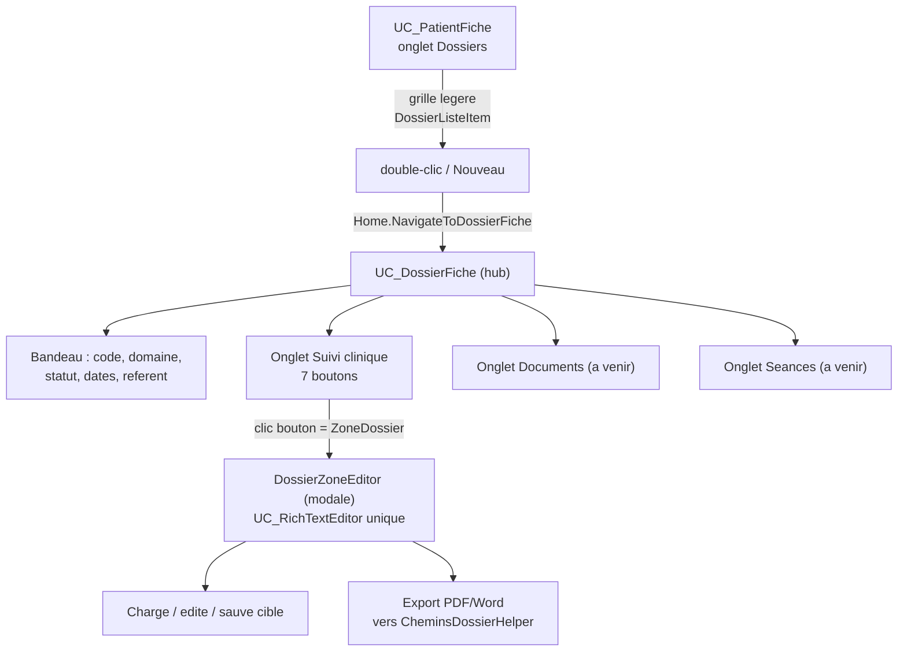

# 🗂️ Althéa — Plan de conception du module **Dossiers**

> **Type** : Document de conception fonctionnelle et technique (feuille de route d'un lot)
> **Date de rédaction** : 21/07/2026
> **Statut** : 🟢 Arbitrages actés — prêt à démarrer la brique **B0**
> **Auteur** : Joëlle (Manou) — assisté
> **Portée** : Lot 1 (suite) — brique « Dossiers » du cœur métier
> **Sources de vérité** : `Docs/Conception/Plan_Conception_Metier_Althea.md`, `Docs/Database/Database_technique.md`, `Docs/Rules/ARCHITECTURE_DECISIONS.md`, `Docs/Todo/ToDo.md §C2`

---

## 0. Comment lire ce document

Ce document fige le **périmètre et la découpe** de la brique Dossiers **avant** d'écrire du code, conformément à la règle d'or du projet (*réfléchir avant de coder, valider étape par étape*). Il complète le plan de conception métier général et ne remplace ni les ADR ni le dictionnaire de base de données.

---

## 1. Point de départ

- Le cœur **Patient** est terminé : `UC_PatientHome` (liste) → `UC_PatientFiche` (hub patient) avec les onglets **Identité**, **Anamnèse**, **Famille/Contacts**, **Intervenants** fonctionnels.
- Il reste l'onglet **Dossiers**, non implémenté (aujourd'hui coquille « à venir »).
- Objectif du lot : implémenter la gestion complète des dossiers de suivi clinique (`ToDo.md §C2`).

### Deux exigences ajoutées (non prévues à l'époque du ToDo)

1. **Exports contextuels** : comme pour l'onglet Anamnèse, chaque export PDF/Word d'une zone de dossier doit aller dans le dossier du patient (chemin déterministe, cf. `CheminsPatientHelper`). Concerne les zones `motif_suivi`, `historique`, `antecedents`, `diagnostic`, `traitements_en_cours`, `objectifs_suivi`, `historique_archive`.
2. **Volumétrie UI** : 7 zones RTF + statut + futurs documents/séances → interrogation légitime sur l'opportunité de sortir le dossier d'un simple onglet patient.

---

## 2. Constats de la relecture (ce qui tranche le débat)

| Constat | Preuve dans le schéma / les décisions | Conséquence |
|---|---|---|
| **Un patient a plusieurs dossiers** | `dossiers` porte `id_patient` **+** `id_domaine` ; D-Q5 : « un nouveau suivi dans un autre domaine = nouveau dossier » | Il faut une **liste de dossiers** en amont, pas 7 zones directement dans l'onglet |
| **Le dossier est un hub, pas un satellite** | Références entrantes : `documents.id_dossier`, `rendez_vous.id_dossier`, `seances.id_dossier` | Documents, RDV et séances se rattachent **au dossier** → centre de gravité clinique |
| **Charge technique lourde** | 7 zones RTF (14 colonnes `xxx_rtf`/`xxx_txt`) + cycle de vie du statut ; `UC_PatientFiche.vb` fait déjà ~3040 lignes | Greffer tout ça dans la fiche patient la rendrait ingérable |

> **Décision structurante** : on **sort le dossier de la fiche patient**, sans le déconnecter du patient — en **répliquant le pattern éprouvé** `UC_PatientHome → UC_PatientFiche` un niveau plus bas.

---

## 3. Arbitrages actés (21/07/2026)

- **D-DOS-1 — Structure `UC_DossierFiche`** : sous-onglets **dès le départ** → *Suivi clinique* / *Documents* / *Séances*. Seul *Suivi clinique* est implémenté maintenant ; *Documents* et *Séances* sont des coquilles « à venir » (comme l'était l'onglet Dossiers).
- **D-DOS-2 — Onglet Suivi clinique** : une série de **boutons** (un par zone) ouvrant **une seule fenêtre modale réutilisable** `DossierZoneEditor`, paramétrée par un enum `ZoneDossier`. Aucune duplication d'éditeur.
- **D-DOS-3 — Chemins** : helper **dédié `CheminsDossierHelper`** (s'appuie sur `CheminsPatientHelper`), pour une meilleure lisibilité future.
- **D-DOS-4 — `historique_archive`** : zone visible **uniquement à l'archivage**, en **lecture seule**.
- **D-DOS-5 — Création du dossier** : `UC_DossierFiche` gère **lui-même** son mode *Création* (comme `UC_PatientFiche`, activation progressive D-Q14). **Pas** de mini-modale « Nouveau dossier » préalable. Clic *Nouveau* → ouverture directe du hub en création → saisie domaine/date/statut → enregistrement → activation des onglets.

---

## 4. Le pattern `DossierZoneEditor` (D-DOS-2 détaillé)

Une **coquille modale stable**, calquée sur le duo `ContactEdition` (form `IContextAwareForm`) + mécanique Anamnèse (sauvegarde ciblée + export contextuel) :

- Le bouton cliqué fournit une valeur `ZoneDossier` (enum).
- La fenêtre en déduit : le **titre** affiché, la **paire de colonnes** `xxx_rtf` / `xxx_txt` à lire/écrire, le **préfixe de fichier** à l'export.
- Un **seul** `UC_RichTextEditor` instancié → zéro duplication pour 7 zones.
- Cycle Modifier / Enregistrer / Annuler avec **persistance ciblée** (comme l'anamnèse).

**Côté métier (DRY)** : une seule méthode `UpdateZoneDossier(idDossier, zone, rtf, txt)` (+ `GetZoneDossier`) qui résout le nom de colonne depuis l'enum via un **mapping interne whitelisté** (aucune injection SQL possible), plutôt que 7 méthodes distinctes.

---

## 5. Architecture cible



---

## 6. Table `dossiers` (rappel schéma — déjà existant)

| Champ | Type | Remarque |
|---|---|---|
| `id_dossier` | `bigint unsigned` PK | séquence `seq_dossiers` |
| `code_dossier` | `varchar(12)` généré | `concat('DO', lpad(id_dossier,6,'0'))` → `DO000012` |
| `id_patient` | FK `patients` | rattachement patient |
| `id_domaine` | FK `ref_domaines` | domaine métier |
| `id_statut_dossier` | FK `ref_statuts_dossier` | statut courant |
| `date_ouverture` | `date NOT NULL` | obligatoire |
| `date_cloture` | `date` nullable | obligatoire au passage en Clôturé |
| `date_archivage` | `date` nullable | renseignée au passage en Archivé |
| `modalites_paiement` | `varchar(150)` | optionnel |
| `id_therapeute_traitant` | FK `therapeutes` nullable | référent principal du dossier |
| `motif_suivi_rtf/txt` | `longtext` | zone 1 |
| `historique_rtf/txt` | `longtext` | zone 2 |
| `antecedents_rtf/txt` | `longtext` | zone 3 |
| `diagnostic_rtf/txt` | `longtext` | zone 4 |
| `traitements_en_cours_rtf/txt` | `longtext` | zone 5 |
| `objectifs_suivi_rtf/txt` | `longtext` | zone 6 |
| `historique_archive_rtf/txt` | `longtext` | zone 7 (archivage, lecture seule) |
| `date_creation` / `date_modification` | `datetime` | gérées par la base |

> ✅ Aucun référentiel à créer : `ref_domaines` et `ref_statuts_dossier` existent déjà.
> ✅ Aucune modification de schéma prévue : le lot est **applicatif** (métier + UI).

---

## 7. Cycle de vie du statut (règles D-Q5 / D-Q10 — à implémenter)

- États (libellés du référentiel `ref_statuts_dossier`) : **Actif** (`ACTIF`) / **En pause** (`PAUSE`) / **Clôturé** (`CLOTURE`) / **Archivé** (`ARCHIVE`).
- Toute transition est **journalisée** (`GestionLog`) et confirmée via **`DialogChoix`**.
- `date_cloture` **obligatoire** au passage en *Clôturé*.
- **Réouverture** *Clôturé → Actif* possible **uniquement dans le même domaine** (tracée). Un nouveau suivi dans un autre domaine = **nouveau dossier**.
- **Archivé** = **lecture seule** et **terminal** : `historique_archive_rtf/txt` figé, zones non modifiables ; la zone d'archive devient visible (D-DOS-4).
- **Transfert inter-domaines** : documents, notes et séances restent attachés au dossier ; séances passées gardent leur tarif figé ; transfert tracé.

---

## 8. Impacts chemins déterministes (D-DOS-3)

Extension de l'arborescence documentaire au niveau dossier (conforme D-Q4) :

```
{PATH_GENERAL}/{PATH_DOCUMENT}/{code_patient}/{code_dossier}/
	suivi_{code_dossier}_{zone}_{yyyyMMdd_HHmmss}.pdf|docx
```

`CheminsDossierHelper` fournira l'équivalent dossier de `CheminsPatientHelper` : `GetDossierDuDossier(codePatient, codeDossier)`, `AssurerDossierDuDossier(...)`, `FormaterCodeDossier(idDossier)` (`DO` + 6 chiffres), en réutilisant la racine et le sous-dossier documents déjà exposés.

---

## 9. Plan incrémental (brique par brique, testable)

> Chaque brique se termine par un **build vert + un test fonctionnel** avant d'enchaîner. Tous les nouveaux `.vb` en **UTF-8 avec BOM** (convention projet).

| Brique | Contenu | Test de validation |
|---|---|---|
| **B0 — Fondations données** | `Dossier.vb`, `DossierListeItem.vb`, `QueryDossiers.vb`, `GestionDossiers.vb` (lecture : `GetDossiersParPatient`, `GetDossier`) | Lecture d'un dossier de test injecté en DB |
| **B1 — CheminsDossierHelper** | `{…}/{code_patient}/{code_dossier}/` + `AssurerDossierDuDossier`, `FormaterCodeDossier` | Vérifier chemin construit + création dossier |
| **B2 — Grille + navigation** | Onglet Dossiers → grille `DossierListeItem` + bouton *Nouveau* ; `Home.NavigateToDossierFiche` ; `UC_DossierFiche` coquille (bandeau + 3 onglets) | Double-clic ouvre le hub ; retour restaure la fiche patient |
| **B3 — Identité du dossier** | `UC_DossierFiche` création/modif : domaine, statut initial, date ouverture, référent, modalités ; `InsertDossier` / `UpdateDossier` | Créer un dossier → apparaît dans la grille |
| **B4 — Suivi clinique (cœur)** | Enum `ZoneDossier`, modale `DossierZoneEditor`, `UpdateZoneDossier` / `GetZoneDossier` ciblés | Éditer/sauver/rouvrir chaque zone → persistant |
| **B5 — Export contextuel** | `ExportRequested` → `CheminsDossierHelper` (préfixe par zone + horodatage) | Export PDF/Word d'une zone → fichier au bon endroit |
| **B6 — Cycle de vie statut** | Transitions En cours/Pause/Clôturé/Archivé (D-Q5/D-Q10), `date_cloture`, réouverture même domaine, archivage → zone archive visible lecture seule + zones figées, tracé `GestionLog` + `DialogChoix` | Parcours complet des transitions + garde-fous |
| **B7 — Recherche/filtrage** | Filtre grille par statut/domaine/date (si le volume le justifie) | Filtrage en mémoire |
| **B8 — Documentation** | `CHANGELOG.md`, `README.md`, docs UI/Process, ADR si nouveau pattern | Cohérence docs ↔ code |

---

## 10. Nouveaux artefacts prévus (récapitulatif)

| Artefact | Couche | Emplacement cible |
|---|---|---|
| `Dossier.vb` | Métier (modèle) | `/Metier/Patients` (ou `/Metier/Dossiers`) |
| `DossierListeItem.vb` | Métier (présentation) | idem |
| `GestionDossiers.vb` | Métier (service) | idem |
| `QueryDossiers.vb` | Accès données (SQL) | `/Core/Database/Queries` |
| `CheminsDossierHelper.vb` | Utilitaire | `/Utils/Helpers` |
| `UC_DossierFiche.vb` (+ Designer) | UI (hub) | `/UI/Controls/Patients` (ou `/UI/Controls/Dossiers`) |
| `DossierZoneEditor.vb` (+ Designer) | UI (modale) | `/UI/Forms/Patients` (ou `/UI/Forms/Dossiers`) |
| `ZoneDossier` (enum) | Métier ou UI | à côté de `DossierZoneEditor` |

> 🔎 Le rangement exact (`/Patients` vs nouveau `/Dossiers`) sera tranché au démarrage de B0 selon la cohérence des namespaces existants.

---

## 11. Réutilisation de l'existant (rien à réinventer)

- **Navigation** : `Home.NavigateAvecHistorique` (générique) + jumeau `NavigateToDossierFiche` calqué sur `NavigateToPatientFiche` ; mini-pile D-Q15 et fil d'Ariane déjà en place.
- **Export contextuel** : pattern ADR `ExportRequested` / `ExportCompleted` (rempli côté conteneur) déjà validé sur l'anamnèse.
- **Sauvegarde ciblée** : modèle `GestionPatients.UpdateAnamnesePatient` (mise à jour localisée sans réécrire les autres colonnes).
- **Modale contextuelle** : `ContactEdition` / `IContextAwareForm` (contexte UI partagé, `errProvider` local).
- **Éditeurs riches** : `UC_RichTextEditor` (complet) et `UC_RichTextEditorSimple` (compact) ; règle double colonne `xxx_rtf` / `xxx_txt` (ADR-15).
- **Référentiels** : `ref_domaines`, `ref_statuts_dossier` (combos alimentés directement).

---

## 12. Ordre de démarrage

**Prochaine action** : brique **B0** (fondations données, sans UI), livrée avec son mini-plan de test.
