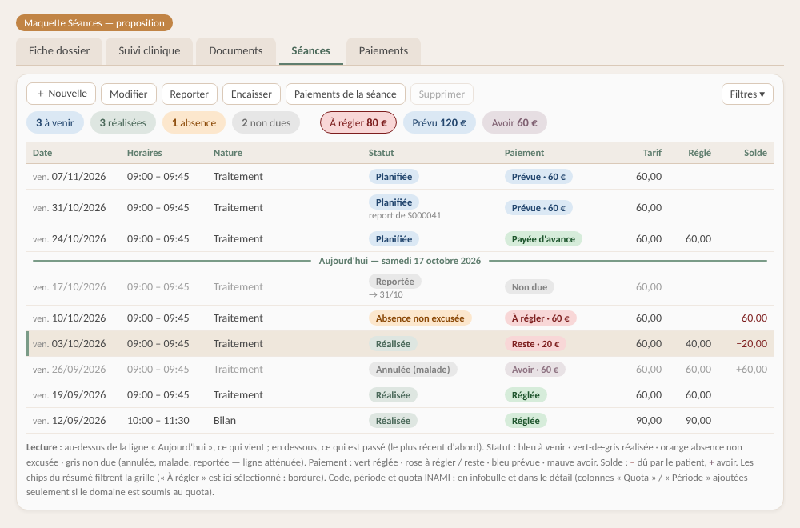
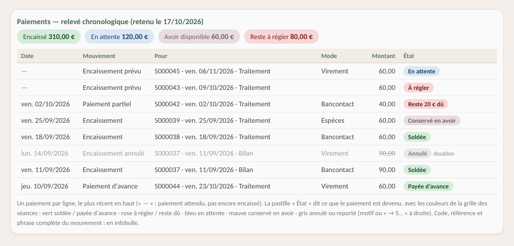

# Althéa - Guide : séances et paiements

> Public : utilisatrice d'Althéa (partie 1) ; maintenance de l'application (partie 2).
> Écrans concernés : fiche Dossier › onglets **Séances** et **Paiements** ; fenêtres Séance, Paiement, Reporter la séance, Utilisation de l'avoir, Détail des paiements ; changement de statut du dossier (clôture).
> État de référence : 17/10/2026 — grilles à pastilles, relevé chronologique des paiements, avoirs alignés sur une seule définition, règles de clôture du dossier (§ 5.9).
>
> Mis à jour le 21/10/2026 :
>
> - annulation refusée après utilisation en avoir, une seule ligne de dû par séance (audit B.1)
> - après un report ou une annulation, l'encaissement devient un avoir que l'on propose d'utiliser — plus de réaffectation (audit B.2, décision de Joëlle)
> - reste dû, avoir et « échue » calculés à un seul endroit, la vue `v_seances_solde` — une absence non facturable ne doit plus rien nulle part (audit B.4, ADR-48).
>
> Mis à jour le 22/10/2026 :
>
> - cadenas réservé au SuperUser, montant libre conservé, dossier archivé entièrement en consultation (audit C.1)
> - report refusé sur un créneau occupé (audit C.2)
> - encaissement depuis l'onglet Séances seulement, ligne à choisir avant d'agir, colonne « Solde » retirée.
>
> Mis à jour le 23/10/2026 :
>
> - colonne « Code » des paiements
> - séances et paiements retrouvés sans passer par le patient (recherche transversale, fin du § 4).
>
> Mis à jour le 24/10/2026 : créneau libéré et statuts d'une nouvelle séance réglés par des cases du référentiel des statuts de séance (v2.57.0, § 5.1).
>
> Ce guide remplace le « Relevé des conséquences Séances ↔ Paiements » (supprimé le 17/10/2026).

---

# Partie 1 — Utiliser

## 1. Les notions à connaître

| Notion | Ce que c'est | À retenir |
|---|---|---|
| Séance **due** / **non due** | Le statut dit si la séance doit être payée (référentiel *Statuts de séance*, case « Séance due (à payer) »). | Planifiée, Réalisée, Absence (no show) sont dues ; Annulée, Maladie, Reportée ne le sont pas. |
| Séance **passée** / **à venir** | Passée dès que son heure de fin est dépassée (à défaut l'heure de début ; sans heure, le lendemain). | Une séance Planifiée passée s'affiche **« À confirmer »** (pastille ocre) tant que son statut n'a pas été choisi dans la fenêtre Séance (21/10/2026) ; elle reste due et peut encore être reportée. |
| **Montant** de la séance | Tarif retenu, **figé** à l'enregistrement. | Ne change qu'avec le cadenas (SuperUser / Admin). Modifier un référentiel de tarifs ne touche jamais une séance enregistrée. Un montant libre (prix d'ami) reste tel quel quand on change ensuite le statut. |
| **Réglé** | Total encaissé sur la séance. | Seuls les paiements **encaissés** comptent ; ni les paiements en attente, ni les annulés. |
| **Reste dû** | Montant − réglé, pour une séance due. | Jamais négatif ; 0 pour une séance non due et pour une absence non facturable. |
| **À régler** | Reste dû d'une séance due **passée** : ce que le patient doit maintenant. | Rose dans les grilles. |
| **Prévu** | Reste dû d'une séance due **à venir**. | Bleu. |
| **Paiement en attente** | Ligne créée par l'application pour ce qu'il reste à payer sur une séance. | Une seule par séance, tenue à jour automatiquement. Ce n'est pas un encaissement. |
| **Avoir** | Argent encaissé qui ne couvre plus aucune séance : encaissement resté sur une séance devenue non due (annulée, maladie, reportée), ou part encaissée au-delà du montant d'une séance (montant baissé après paiement). | Calculé, jamais saisi. Réutilisable pour une autre séance du patient, même dans un autre dossier. |
| **Absence non facturable** | Absence (no show) dans un domaine dont la convention ne la facture pas. | Rien à payer. Est une « absence » tout statut coché « Absence non excusée » dans Référentiels › Statuts de séance (22/10/2026). |

**Trois principes** guident tout le reste :

1. **Aucun paiement n'est supprimé.** Un encaissement erroné s'**annule** (SuperUser / Admin, motif obligatoire) ; la ligne reste visible, grisée et barrée.
2. **Les montants sont calculés**, jamais saisis à la main : réglé, reste dû, avoir et totaux se recalculent à chaque affichage.
3. **Le statut d'un paiement et le solde de la séance sont deux choses** : un paiement « encaissé » peut laisser un reste dû (paiement partiel), un paiement « en attente » ne règle rien.

## 2. L'onglet Séances en un coup d'œil

- **Code** de la séance en première colonne (SE000074) ; il est aussi rappelé dans l'en-tête des fenêtres ouvertes sur une séance ou un paiement.
- **Ordre** : la plus récente en haut. Une ligne **« Aujourd'hui »** sépare les séances à venir des séances passées (elle disparaît si l'on trie par une colonne ; un changement de filtre remet l'ordre normal).
- **Statut** (pastille) :
  - bleu à venir
  - **ocre à confirmer** (planifiée passée, issue à pointer)
  - vert-de-gris réalisée
  - orange absence non excusée
  - gris non due.
  - Le résumé compte les séances à confirmer ; le filtre « À confirmer » les liste.
  - À droite, en gris : « → 31/10 · S000045 » (séance reportée : date et code de la nouvelle) ou « report de S000041 » (séance issue d'un report).
- **Paiement** (pastille) : vert *Réglée* / *Payée d'avance* (*Réglée · avoir 10 €* si trop payé) · rose *À régler · 60 €* / *Reste · 20 €* · bleu *Prévue · 60 €* · mauve *Avoir · 60 €* · gris *Non due* / *Non facturée (convention)*.

- **Lignes non dues** en texte gris : l'œil va à ce qui compte.
- **Infobulle** d'une ligne : code de la séance, tarif appliqué, période et rang dans le quota.
- **Résumé** au-dessus de la grille (calculé sur **tout** le dossier) : nombre de séances à venir, à confirmer, réalisées, absences, non dues ; montants à régler, prévus, en avoir. **Cliquer une pastille** affiche les séances concernées ; recliquer revient à « Toutes ».
- **Filtres** (21/10/2026), chacun aux couleurs de sa pastille : Toutes, **Aujourd'hui**, À venir (séances dues pas encore passées — une séance reportée ou annulée n'en fait pas partie), À confirmer, Passées, Réalisées, Absences sans prévenir, **Reportées**, Non dues, Exigibles, Réglées, Avec avoir.

> **Choisir la ligne d'abord** (22/10/2026) : à l'ouverture du dossier et après chaque opération, aucune séance n'est sélectionnée ; les boutons qui agissent sur une séance restent grisés (« Sélectionnez une séance dans la liste. ») tant qu'on n'a pas cliqué une ligne. Avant, la première ligne était prise d'office, sans être visible.

| Bouton | Quand est-il actif ? |
|---|---|
| **Nouvelle séance** | Dossier ni clôturé ni archivé. |
| **Modifier séance** | Une séance sélectionnée (en lecture seule si le dossier est clôturé / archivé, ou si la séance est reportée). |
| **Reporter séance** | Séance **Planifiée** sélectionnée, dossier modifiable. |
| **Supprimer séance** | Séance non reportée ; la suppression est ensuite refusée si un encaissement existe (§ 5.7). |
| **Encaisser séance** | Séance **due, non reportée et non soldée**, dossier modifiable. |
| **Détail paiements** | Une séance sélectionnée : synthèse tarif / réglé / reste / avoir et tous ses mouvements (lecture seule). |

## 3. L'onglet Paiements en un coup d'œil

C'est un **relevé chronologique**, comme un extrait de compte : un paiement par ligne, le plus récent en haut.

| Colonne | Contenu |
|---|---|
| **Date** | Date d'encaissement (« — » : paiement attendu, pas encore encaissé). |
| **Code** | Code du paiement (PAI000123), encaissements prévus compris ; il permet de le retrouver par la recherche (23/10/2026). |
| **Mouvement** | Ce qui s'est passé : Encaissement, Paiement partiel, Paiement d'avance, Encaissement prévu, Encaissement annulé. |
| **Pour** | La séance concernée : « S000043 · ven. 10/10/2026 · Traitement » (+ « report de S… »). |
| **Mode** | Espèces, virement, Bancontact… ; « Avoir » pour un règlement par avoir. |
| **Montant** | Ce que le paiement porte **sur cette séance** (voir encadré). |
| **État** | Ce que le paiement est devenu (pastille, tableau ci-dessous). |

| Pastille État | Signification |
|---|---|
| vert **Soldée** / **Payée d'avance** | Encaissé ; la séance est entièrement réglée (avant la séance : « d'avance »). |
| rose **À régler** | Paiement attendu pour une séance passée : il est en retard. |
| rose **Reste · 20 €** | Encaissement partiel d'une séance passée : il reste 20 € à régler (même texte que dans l'onglet Séances). |
| bleu **En attente** | Paiement attendu pour une séance à venir. |
| bleu **Prévue · reste 20 €** | Acompte sur une séance à venir : 20 € restent prévus, ce n'est pas encore un dû. |
| mauve **Avoir · 60 €** | Encaissement sur une séance qui n'est plus due : 60 € sont disponibles. Après une utilisation partielle, la pastille montre ce qui reste. |
| vert **Soldée** + « avoir 10 € » | Séance réglée au-delà de son montant (montant baissé après paiement) : les 10 € en trop sont en avoir. |
| gris **Avoir utilisé → S000050** | L'avoir a été entièrement utilisé (pour la séance indiquée) ; ligne grisée, montant d'origine gardé pour la trace. |
| gris **Annulé** (+ motif) | Encaissement annulé ; ligne grisée, montant barré. |

> **Un paiement, plusieurs lignes ?** Quand on reporte une séance déjà payée, l'encaissement peut être **réparti** : 45 € sur la séance de remplacement, 15 € sur une autre séance due.
>
> Chaque séance a alors sa ligne avec **sa part** ; l'infobulle rappelle « Paiement de 60,00 €, dont 15,00 € sur cette séance ».
>
> Les totaux ne comptent l'argent qu'une fois.

> **Et la ligne du paiement attendu ?** Après un encaissement, l'application clôt d'elle-même le paiement attendu de la séance (ou le ramène au reste dû).
>
> Une attente close n'est pas une annulation : elle n'apparaît pas dans le relevé, seulement dans **Détail paiements** (statut « Clos »).
>
> Il en va de même quand la séance devient non due ou est reportée.

- **Résumé** au-dessus de la grille, sur tout le dossier : **Encaissé** · **En attente** · **Avoir disponible** · **Reste à régler**.
  - L'avoir et le reste à régler donnent les mêmes montants que l'onglet Séances.
  - « En attente » et « Reste à régler » se recoupent : un paiement attendu pour une séance passée est à la fois attendu et en retard.
  - Chaque pastille choisit le filtre correspondant.
- **Filtres** (aux couleurs des pastilles) : Tous, Encaissés, En attente, Annulés, Séances soldées, Séances restant dues, Avoirs, Séances reportées, À régler. **Période** : date d'encaissement (date de la séance pour un paiement attendu).
- **Tri** par clic sur un en-tête ; un filtre remet l'ordre normal.
- **Infobulle** : code du paiement, phrase complète du mouvement, référence, mentions d'annulation et d'utilisation d'avoir. La recherche trouve aussi le code et la référence.
- **Double-clic** : ouvre la fenêtre Paiement pour **encaisser** la séance concernée (message si elle est soldée ou non due). Un paiement enregistré ne se modifie pas : il s'annule.

| Bouton | Quand est-il actif ? |
|---|---|
| **Annuler l'encaissement** | Paiement **encaissé** sélectionné, utilisateur **SuperUser / Admin**, dossier modifiable. |

> Pas de bouton « Nouveau paiement » ici (22/10/2026, décision de Joëlle) : un paiement appartient toujours à une séance ; on l'encaisse depuis l'onglet **Séances** (« Encaisser séance »), ou par double-clic sur une ligne de cet onglet.

## 4. Où voir chaque montant

| Information | Où |
|---|---|
| Montants dus et prévus du dossier (et total du patient) ; avoir du patient | Bandeau de la fiche Dossier (bloc Finances), depuis le 22/10/2026 : **Montants dus** « 120,00 € ici · 180,00 € tous dossiers » (séances passées pas réglées ; le second montant n'apparaît que si le patient doit aussi ailleurs) ; **Prévu** « 28,00 € » (reste à payer des séances à venir, payées en partie ou pas du tout : ce n'est pas encore un dû) ; **Avoir** du patient, tous dossiers, avec la part de ce dossier (« (autre dossier) », « dont 15,00 € ici »). Détail par dossier en infobulle de chaque montant. |
| Montant dû et avoir du patient (tous dossiers) | Grille Patients : le montant dû, sinon « Avoir (xx €) », sinon « À jour » ; l'infobulle donne le détail (avoir rappelé même s'il y a un montant dû). |
| Réglé, reste dû, état de paiement par séance | Onglet Séances (colonne Réglé, pastille Paiement). |
| Tous les mouvements d'une séance | Bouton **Détail paiements**. |
| Historique des paiements du dossier | Onglet Paiements. |
| Trace technique | Journal applicatif, catégorie Database (identifiants seulement). |

> Bandeau, grilles et grille Patients suivent la même règle depuis le 17/10/2026 : une séance due compte dans le montant dû dès que son heure de fin est passée (sans heure : à partir du lendemain). L'avoir appartient au patient : il sert dans n'importe lequel de ses dossiers.

### Retrouver des séances ou des paiements sans passer par le patient

Le bouton **Recherche** du menu (sous Patients) liste les séances ou les paiements d'un jour ou d'une période, **tous patients confondus**, avec les mêmes pastilles, filtres et résumé que les onglets du dossier ; pour les paiements, les totaux encaissés par mode.

Il retrouve aussi une séance ou un paiement par son code (SE…, PAI…). Un double-clic ouvre le dossier sur le bon onglet, la ligne sélectionnée ; Retour ramène à la recherche.

Mode d'emploi : [Guide de la recherche](Guide_Utilisateur_Recherche.md).

## 5. Pas à pas

### 5.1 Planifier une séance

**Nouvelle séance** → nature, date, heures, tarif → **Enregistrer**. La séance est créée **Planifiée** ; un paiement en attente du montant de la séance est créé.

- Le tarif proposé suit la convention du domaine ou le tarif du patient. Le montant suit le tarif tant que le cadenas est fermé.
- Un chevauchement avec une autre séance est **refusé** — sauf avec une séance dont le statut libère le créneau (annulée, reportée, maladie… : case « Non tenue, libère le créneau » du référentiel des statuts de séance). Une absence non excusée garde son créneau.
- Les statuts proposés pour une nouvelle séance sont ceux cochés « Proposé à la création » (Planifiée et Réalisée au départ).
- Si le domaine a un quota et que le plafond est dépassé : avertissement « Enregistrer quand même / Annuler ».

### 5.2 Changer le statut

Dans la fenêtre Séance, choisir le nouveau statut puis **Enregistrer**.

- **Vers un statut non dû** (annulée, maladie…) : le paiement en attente est annulé. Si un montant avait déjà été **encaissé**, il devient un **avoir**, et l'application propose de l'utiliser tout de suite pour régler une séance due du dossier (§ 5.3).
- **Vers un statut dû** : le reste dû est recréé (et un éventuel avoir de la séance disparaît, puisqu'il la règle à nouveau).
- **Entre deux statuts dus** (Planifiée ↔ Réalisée) : rien ne change côté paiements. Une séance **soldée** passée en Réalisée est **verrouillée** : seul un SuperUser peut lever le verrou pour la modifier.
- **Entre deux statuts « non tenus »** (annulée, maladie, absence non excusée… ; 22/10/2026, demande de Joëlle) : l'horaire n'est pas contrôlé, même si une autre séance occupe désormais le créneau — la séance n'a pas eu lieu et ne le reprend pas.

### 5.3 Reporter une séance

**Reporter séance** (séance Planifiée uniquement) → nouvelle date et heures → valider.

- La séance d'origine devient **Reportée** (lecture seule, non supprimable) ; une nouvelle séance est créée avec le **même montant** (le tarif dépend du patient, pas de la date).
- Si la nouvelle date et les nouvelles heures **chevauchent** une autre séance, le report est **refusé** : « Ce créneau chevauche la séance S… (10:00 - 10:45) : choisissez un autre horaire. » Rien n'est reporté (22/10/2026 ; auparavant, le report ne contrôlait pas l'horaire).
- Si la séance d'origine était déjà **payée**, son encaissement devient un **avoir** et la fenêtre **Utilisation de l'avoir** s'ouvre (« Avoir disponible : 60,00 € (séance S…) »), la nouvelle séance présélectionnée parmi les séances dues du dossier :
  - **Utiliser l'avoir** : la séance choisie est réglée par l'avoir, jusqu'à ce qu'elle doit (paiement au mode « Avoir ») ; le paiement d'origine reste sur la séance reportée ; son infobulle dit « Avoir … utilisé le … par … pour S… ». Ce qui dépasse **reste en avoir** sur la séance d'origine. Un message dit ce qui a été réglé et ce qui reste.
  - **Garder l'avoir** : rien d'autre ; l'avoir sera proposé au prochain encaissement d'une séance du patient (§ 5.5).
  - Aucune séance due dans le dossier : message « conservé en avoir ».
- Même fenêtre quand une séance encaissée passe à un statut non dû dans la fenêtre Séance (§ 5.2).

### 5.4 Encaisser

Sélectionner la séance → **Encaisser séance** (onglet Séances) → montant, mode, date → **Enregistrer**. (Ou double-clic sur une ligne de l'onglet Paiements : encaissement de sa séance.)

- Le montant proposé est le reste dû ; un montant nul ou supérieur au reste dû est **refusé** : la raison s'affiche en rose dans la fenêtre, sous les champs.
- **Paiement partiel** : la séance garde un reste dû (pastille rose « Reste · 20 € », ou bleue avant la séance).
- **Paiement d'avance** : encaisser une séance à venir est possible ; elle apparaît « Payée d'avance ».
- Si le patient a un **avoir**, l'application propose de l'utiliser d'abord (§ 5.5).

### 5.5 Utiliser un avoir

La proposition n'apparaît **que** lorsqu'on encaisse une séance précise (Encaisser séance, ou double-clic dans l'onglet Paiements), si cette séance est due et non soldée et si le patient a un avoir — dans ce dossier ou un autre.

- **Oui** : l'avoir règle la séance (paiement au mode « Avoir »). S'il ne suffit pas, la saisie s'ouvre sur le reste à payer.
- **Non** : saisie habituelle, avoir inchangé.
- Plusieurs avoirs : le plus ancien est utilisé d'abord.
- La ligne d'origine passe à « Avoir · 15 € » (reste) ou « Avoir utilisé → S… » ; son infobulle dit « Avoir 45,00 € utilisé le … par … pour S… ». L'infobulle du règlement par avoir dit d'où vient l'argent (« Avoir utilisé : PAI… (S…) 45,00 € »).
- Un règlement par avoir **ne peut pas être annulé** (l'avoir d'origine serait perdu).

### 5.6 Annuler un encaissement

Onglet Paiements → sélectionner l'encaissement → **Annuler l'encaissement** → motif (obligatoire) → valider. Réservé aux SuperUser / Admin.

- La ligne devient **Annulé** (grisée, montant barré) avec la mention « Annulé le … par … : motif » ; date, montant et mode d'origine restent visibles.
- La séance redevient due du montant annulé (le paiement en attente est recréé).
- Un encaissement annulé n'est jamais rétabli automatiquement : si besoin, on encaisse à nouveau.
- Un encaissement dont une partie a déjà **servi d'avoir** pour une autre séance ne peut plus être annulé : cette séance resterait réglée avec un montant qui n'existe plus. Le refus s'affiche avant la demande du motif.

### 5.7 Supprimer une séance

Possible seulement pour une séance **jamais encaissée** (même pas un encaissement annulé), qui n'est ni reportée ni à l'origine d'un report. Ses paiements en attente sont supprimés avec elle. Dans les autres cas : changer son statut.

### 5.8 Corriger le montant d'une séance (cadenas)

SuperUser / Admin : ouvrir le cadenas dans la fenêtre Séance, saisir le montant, enregistrer. Si la séance est déjà (en partie) encaissée, une confirmation annonce la conséquence (nouveau reste dû, séance soldée…). Refermer le cadenas réapplique le montant du tarif sélectionné.

Utilisateur simple : le cadenas est grisé (survol : « réservé au SuperUser ou à l'administrateur »). Un montant libre déjà enregistré est **conservé** : on peut changer le statut, l'heure ou les notes de la séance, le montant ne bouge pas (avant le 22/10/2026, un changement de statut le remplaçait par le tarif sans prévenir).

> En modification, changer le tarif dans la liste ne change pas le montant : l'enregistrement est alors **bloqué** (« montant ≠ tarif ») jusqu'à l'usage du cadenas.

### 5.9 Clôturer le dossier (fin du suivi)

« Changer le statut… » › Clôturé. Avant de demander confirmation, l'application regarde les séances du dossier :

| Situation | Ce qui se passe | Que faire |
|---|---|---|
| Une séance **à venir** (planifiée, payée d'avance ou non) | Clôture **refusée** ; le message cite les séances (« SE000074 du 07/11/2026… »). | **Annuler** ces séances, puis clôturer. Un paiement déjà reçu devient un **avoir** du patient, utilisable dans un autre dossier. Un report ne suffit pas : il recrée une séance à venir dans le même dossier. |
| Des séances **passées restent à régler** | Confirmation avec un encadré « Il reste X € à régler… » ; boutons **Clôturer quand même** / Annuler. | Encaisser d'abord, ou clôturer en connaissance de cause (une fois clôturé, on n'encaisse plus sans rouvrir). |
| Rien de tout cela | Confirmation habituelle. | — |

Une fois clôturé, la pastille de statut passe en **gris foncé** et un bandeau sous l'en-tête rappelle « Dossier clôturé le … — séances et paiements en consultation seulement ». La fiche et les zones cliniques restent modifiables.

Un dossier **archivé** est entièrement en consultation : le bouton « Modifier » de la fiche est grisé, avec sa raison au survol.

Pour planifier ou encaisser à nouveau : « Changer le statut… » › Actif (réouverture).

La **mise en pause** reste possible à tout moment ; l'**archivage** ne part que d'un dossier clôturé et il est **définitif**.

---

# Partie 2 — Les règles (maintenance)

## 6. La règle unique : `GestionPaiements.ResynchroniserDuSeance(idSeance)`

Appelée après **toute** action sur une séance ou un paiement (ADR-26). Elle ne modifie **jamais** un paiement `PAYE`.

| Situation calculée | Effet sur le paiement en attente (`EN_ATTENTE`) |
|---|---|
| Séance **non due**, ou reste dû = 0 | Ligne en attente **annulée** (trace conservée), s'il y en a une. |
| Reste dû > 0 et une ligne en attente existe | Montant **mis à jour** au reste dû (la ligne la plus récente). |
| Reste dû > 0, pas de ligne en attente mais un ancien dû annulé | Ancien dû **réactivé** au reste dû (le plus récent, **un seul**). |
| Reste dû > 0, rien du tout | Nouveau dû en attente **créé** au reste dû. |
| Plusieurs lignes en attente (doublons d'avant le 21/10/2026) | La ligne gardée est mise au reste dû, les autres sont **annulées** (même transaction). |

**Une séance a au plus une ligne de dû** (21/10/2026, audit B.1). Journal : « Dû en attente réaligné à X € » (avec le nombre de doublons annulés s'il y en avait) ou « Dû en attente annulé (…) », catégorie Database.

## 7. Les calculs

Tous calculés, jamais stockés. Seuls les paiements `PAYE` entrent dans le réglé et l'avoir ; les montants sont ceux de `lia_paiements_seances.montant_affecte`.

**Une seule définition, en base** (21/10/2026, ADR-48) : le réglé, « facturable », le reste dû, « échue » et l'avoir d'une séance sont calculés par la vue `v_seances_solde` ; le dossier dominant par la vue `v_dossier_dominant`.

Les requêtes les lisent au lieu de recopier le calcul (il était écrit jusqu'à cinq fois, avec des résultats différents). Changer une de ces règles = une migration qui remplace la vue.

| Valeur | Règle | Où (code) |
|---|---|---|
| Séance due | `ref_statuts_seance.est_du = 1` | `SeanceListeItem.EstDuStatut`, `PaiementListeItem.SeanceEstDue` |
| Séance passée | heure de fin (sinon début ; sans heure, lendemain) ≤ maintenant | `est_echue` de `v_seances_solde` (SQL) ; `SeanceListeItem.EstPassee` (même règle, recalculée à l'affichage pour suivre l'heure) ; `PaiementListeItem.SeancePassee` (renseignée par l'écran depuis la séance) |
| Réglé | Σ `montant_affecte` des paiements `PAYE` de la séance | `montant_regle` de `v_seances_solde` → `SeanceListeItem.MontantRegle` |
| Facturable | séance due, sauf absence non excusée d'un domaine qui ne facture pas les absences | `est_facturable` de `v_seances_solde` → `SeanceListeItem.EstFacturable` |
| Reste dû | séance facturable : `max(0, montant − réglé)` ; sinon 0 | `reste_du` de `v_seances_solde` → `SeanceListeItem.ResteDu`, `reste_du_seance` (lignes de paiement), règle unique du dû |
| À régler (exigible) | reste dû d'une séance due **passée** | `SeanceListeItem.MontantExigible` |
| Prévu | reste dû d'une séance due **à venir** | `SeanceListeItem.MontantPrevisionnel` |
| Avoir d'une séance | séance **non due** (reportées comprises) : tout le réglé ; séance **due** : `max(0, réglé − montant)` (trop-perçu) | `montant_avoir` de `v_seances_solde` → `SeanceListeItem.AvoirSeance`, grille Patients ; sources de `QueryPaiements.SelectAvoirsDisponiblesPatient` (même définition ; pour un trop-perçu, une source = dernière affectation encaissée, plafonnée au trop-perçu) ; `PaiementListeItem.AvoirSeance` (recopié par l'écran) |
| Montant dû et avoir par dossier (bandeau) | Σ `MontantExigible` et Σ `AvoirSeance` des séances de chaque dossier du patient | `GestionSeances.CalculerSoldesPatient` → `SoldeDossier` |
| Montant dû du patient (grille Patients) | Σ `reste_du` des séances échues du patient | `montant_du` de `QueryPatients.SelectPatientsListe` (lit `v_seances_solde`) |
| Dossier dominant | dossier vivant (actif, en pause) d'abord, puis celui dont une séance est la plus proche d'aujourd'hui, puis le plus récemment ouvert | `v_dossier_dominant` ; colonne « Suivi » de la grille Patients ; `GestionDossiers.ChoisirDossierDominant` (aperçu) |
| Montant d'une ligne de paiement | `montant_affecte` ; montant d'origine si l'affectation est à 0 (annulé, avoir entièrement utilisé) | `PaiementListeItem.MontantLigne` |
| État d'un paiement (pastille) | annulé / avoir utilisé → gris ; avoir → mauve ; séance due passée non soldée → rose ; encaissé et séance soldée → vert ; sinon bleu | `PaiementListeItem.FamilleEtat`, `EtatAffichage`, `MentionEtat` |
| Couleurs | une famille → une teinte (`UITheme`) | `UtilsPastilles.Teinte` |

> **Un paiement, plusieurs liaisons.** Un paiement saisi a une seule liaison (D-PAY-1).
>
> Deux mécanismes la modifient ensuite :
>
> - la **réaffectation** au report (jusqu'au 21/10/2026, remplacée depuis par l'avoir : une liaison par séance servie, le reliquat sur la séance d'origine)
> - et l'**utilisation d'un avoir** (`GestionPaiements.UtiliserAvoirPourSeance` : la liaison source est diminuée, un paiement « Avoir » est créé sur la séance réglée, et le lien entre les deux est enregistré dans `lia_paiements_avoirs` depuis le 22/10/2026).
>
> Tout affichage ou total doit donc partir de `montant_affecte`, jamais de `paiements.montant`.

## 8. États de départ utilisés dans les tableaux

| Code | Statut séance | Situation financière (montant 60 €) |
|---|---|---|
| **A** | Planifiée (due) | Rien encaissé — dû en attente 60 € |
| **B** | Planifiée (due) | Encaissé partiel 20 € — dû en attente 40 € |
| **C** | Planifiée (due) | Encaissé 60 € — soldée, aucun dû actif |
| **D** | Réalisée (due) | Rien encaissé — dû en attente 60 € |
| **E** | Réalisée (due) | Encaissé partiel 20 € — dû en attente 40 € |
| **F** | Réalisée (due) | Encaissé 60 € — soldée → **verrouillée** (SuperUser pour modifier) |
| **G** | Non due (Annulée…) | Rien encaissé — dû annulé |
| **H** | Non due (Annulée…) | Encaissé 60 € resté sur la séance → **avoir 60 €** |
| **R** | Reportée | Lecture seule ; avoir si un encaissement y est resté |

## 9. Conséquences de chaque action

### 9.1 Création d'une séance

| Départ | Effet |
|---|---|
| — | Séance **Planifiée** ; dû en attente = montant. |
| Quota dépassé (domaine soumis au quota) | Avertissement « Enregistrer quand même / Annuler ». Annuler → rien créé, fenêtre ouverte. |
| Montant ≠ tarif, cadenas fermé | **Blocage**, message selon le rôle, rien créé. |

### 9.2 Changement de tarif dans la liste (cadenas fermé), en modification

| Départ | Effet |
|---|---|
| Tous | Le montant ne bouge pas ; à l'enregistrement, **blocage** « montant ≠ tarif » (utilisateur simple : « faire appel à un SuperUser » ; SuperUser / Admin : « utiliser le cadenas »). Rien enregistré, aucun paiement modifié. |

> Sans changer de tarif, un montant enregistré laissé tel quel est accepté, même s'il diffère du tarif attendu (prix d'ami, ancien tarif figé). Le métier applique la même règle que la fenêtre (`GestionSeances.EnregistrerSeance`, audit C.1).

### 9.3 Modification du montant par le cadenas (SuperUser / Admin)

| Départ | 60 → 50 € | 60 → 70 € |
|---|---|---|
| **A / D** | Pas de confirmation ; dû en attente → **50 €**. | Dû en attente → **70 €**. |
| **B / E** | Confirmation « reste dû 30 € » ; dû → **30 €** ; encaissement intact. | Confirmation « reste dû 50 € » ; dû → **50 €**. |
| **C** | Confirmation « avoir 10 € » ; aucun dû actif ; séance « Réglée · avoir 10 € » ; **avoir 10 €** compté partout et réutilisable. | Confirmation « reste dû 10 € » ; dû **10 €** créé / réactivé. |
| **F** | Déverrouiller (SuperUser), puis comme **C**. | Idem **C**. |
| **G / H** | Aucun dû (séance non due) ; **H** : avoir = tout l'encaissé, inchangé. | Idem. |
| **R** | Impossible (lecture seule). | Impossible. |

Refus de la confirmation → rien n'est enregistré.

> Trop-perçu sur une séance due (décision du 17/10/2026) : la part encaissée au-delà du montant est un avoir ordinaire. Réutilisé, il diminue la dernière affectation encaissée de la séance, jamais au point d'entamer ce qu'elle doit.

### 9.4 Statut : due → non due (ex. Planifiée → Annulée)

| Départ | Effet |
|---|---|
| **A / D** | Dû en attente annulé → **G**. |
| **B / E** | Dû annulé ; les 20 € encaissés deviennent un **avoir 20 €**, dont l'utilisation est proposée (9.10). |
| **C** | **Avoir 60 €** → **H** ; utilisation proposée (9.10). |
| **F** | Déverrouillage SuperUser, puis comme **C**. |
| Aucune séance due candidate | Message « Montant conservé en avoir ». |

### 9.5 Statut : non due → due (ex. Annulée → Planifiée)

| Départ | Effet |
|---|---|
| **G** | Ancien dû réactivé au montant (60 €) → **A**. Pas de doublon. |
| **H** | Reste dû 0 → aucun dû ; l'avoir disparaît, la séance redevient soldée → **C**. |
| Non due avec 20 € encaissés | Dû réactivé à **40 €** ; l'avoir disparaît. |

### 9.6 Entre deux statuts dus (Planifiée ↔ Réalisée)

| Départ | Effet |
|---|---|
| Tous | Aucun effet financier. **C → Réalisée** active le verrou (**F**). |

### 9.7 Report d'une séance

Uniquement depuis une séance **Planifiée**.

| Départ | Séance d'origine | Nouvelle séance |
|---|---|---|
| **A** | → Reportée ; dû annulé. | Planifiée, même montant ; dû **60 €**. |
| **B** | → Reportée ; dû annulé ; les 20 € encaissés deviennent un avoir, dont l'utilisation est proposée (nouvelle séance présélectionnée). | Dû 60 € ; avoir utilisé → **40 €**. |
| **C** | → Reportée ; avoir de 60 €, utilisation proposée. | Avoir utilisé → soldée (paiement « Avoir »). Sinon : dû 60 € et **avoir 60 €** sur l'origine (réutilisable). |
| **D / E / F / G / H / R** | **Refus** : seule une Planifiée est reportable. | — |

> Le report est d'un seul tenant (21/10/2026) : origine reportée et séance de remplacement, avec leurs dûs, sont enregistrées ensemble ou pas du tout. L'utilisation de l'avoir est une opération à part, proposée juste après : si l'application s'arrête entre les deux, l'encaissement reste simplement en avoir sur l'origine.

### 9.8 Suppression d'une séance

| Départ | Effet |
|---|---|
| **A / D / G** (jamais encaissé) | Séance et ses dus en attente / annulés supprimés ensemble (transaction). |
| Un encaissement existe, même annulé | **Refus** : « changez plutôt son statut ». |
| Séance à l'origine d'un report, ou **R** | **Refus** (traçabilité). |

### 9.9 Encaisser

Bouton actif seulement si la séance est **due, non reportée, non soldée**. Montant > reste dû **refusé**.

| Départ | Encaissement de 20 € | Encaissement du solde |
|---|---|---|
| **A / D** | `PAYE` 20 € ; dû → **40 €** → **B / E**. | `PAYE` 60 € ; dû annulé ; soldée → **C / F**. |
| **B / E** | `PAYE` 20 € ; dû → **20 €**. | `PAYE` 40 € ; dû annulé ; soldée. |
| **C / F / G / H / R** | Bouton inactif. | — |

### 9.10 Utiliser l'avoir après un report ou un statut non dû (après 9.4 ou 9.7)

Depuis le 21/10/2026, la réaffectation est remplacée par l'avoir (décision de Joëlle) : le paiement d'origine reste sur sa séance, la trace est explicite. `DialogUtilisationAvoir` → `GestionPaiements.UtiliserAvoirDeSeance` (une transaction).

| Cas | Effet |
|---|---|
| Avoir proposé | **Seulement celui de la séance concernée** (pas les autres avoirs du patient). |
| Séances proposées | Séances **dues non soldées du même dossier** (`EstDue`), la séance de remplacement présélectionnée après un report. |
| Avoir ≤ reste dû de la séance choisie | Liaison source diminuée ; paiement `PAYE` mode « Avoir » sur la séance choisie ; son dû réaligné (réduit, ou annulé si soldée). Origine : plus d'avoir. |
| Avoir > reste dû | La séance choisie est soldée ; le surplus **reste en avoir** sur l'origine (pas de répartition sur d'autres séances). Indiqué dans le message. |
| **Garder l'avoir** | Rien ne change ; l'avoir sera proposé au prochain encaissement (9.12). |
| Aucune séance due | Message « conservé en avoir ». |

Grille Paiements : la séance de remplacement montre « report de S… » dans la colonne Pour ; le dû clos de l'origine n'est visible que dans son **Détail paiements** (« paiement attendu reporté sur S… »). Les réaffectations faites avant le 21/10/2026 restent valables et s'affichent comme avant (un paiement réparti a une liaison par séance).

### 9.11 Annuler un encaissement (SuperUser / Admin, motif obligatoire)

La ligne passe `ANNULE`, affectation remise à 0 ; montant, date et mode d'origine conservés.

Depuis le 22/10/2026 (v2.51.0), la date, l'utilisateur (par son identifiant) et le motif sont enregistrés dans les colonnes `date_annulation`, `id_utilisateur_annulation`, `motif_annulation` ; avant, une mention `[Annulé le jj/mm/aaaa par Prénom Nom : motif]` était ajoutée au commentaire (toujours lue pour ces annulations).

Contrôles, annulation et dû de la séance se font dans une seule transaction (ADR-46).

| Départ | Effet |
|---|---|
| **B / E** (annule 20 €) | Réglé 0 ; dû → **60 €** → **A / D**. |
| **C** (annule 60 €) | Dû réactivé / créé à **60 €** → **A**. |
| **F** | Idem **C** ; la séance n'est plus soldée → verrou levé. |
| **H** | Réglé 0 ; l'avoir disparaît ; pas de dû (séance non due) → **G**. |
| Règlement par avoir | **Refus** (l'avoir d'origine serait perdu). |
| Une partie de l'encaissement a servi d'avoir (montant > Σ `montant_affecte`) | **Refus** avant le motif : « X € de cet encaissement ont déjà servi d'avoir… » (21/10/2026). |
| Motif vide | Fenêtre ouverte, rien modifié. |
| Utilisateur simple | Bouton inactif. |

### 9.12 Régler une séance avec un avoir (v2.20.0)

Démarche **volontaire** : aucune proposition à la création d'une séance, ni au passage en Réalisée.

| Cas (séance due 45 €) | Effet |
|---|---|
| Avoir 60 €, **Oui** | Liaison source diminuée de 45 € ; nouveau paiement `PAYE` mode « Avoir » 45 € sur la séance → soldée ; avoir restant **15 €** (ligne source « Avoir · 15 € »). |
| Avoir 15 €, **Oui** | 15 € utilisés (source « Avoir utilisé → S… ») ; saisie ouverte sur le **reste dû 30 €**. |
| **Non** | Saisie habituelle ; avoir inchangé. |
| Plusieurs sources | De la plus ancienne à la plus récente (toutes les séances non dues du patient, reportées comprises). |
| Mode « Avoir » absent ou inactif | Message d'erreur ; rien enregistré (transaction). |

Trace : depuis le 22/10/2026 (v2.52.0, ADR-49), une ligne de `lia_paiements_avoirs` par source utilisée (règlement, affectation source, montant, date, utilisateur), dans la même transaction.

Avant, la source recevait `[Avoir xx € utilisé le jj/mm/aaaa par … pour S…]` et le paiement « Avoir » ses origines en commentaire : ces mentions restent lues.

Le mode `est_avoir` n'est jamais proposé à la saisie manuelle.

## 10. Check-list de diagnostic

1. **Combien de lignes `EN_ATTENTE` actives** sur la séance ? Plus d'une = doublon : depuis le 21/10/2026, la prochaine resynchronisation de la séance l'annule ; s'il se reforme, une action crée au lieu de réaligner.
2. **`EN_ATTENTE` = montant − Σ `montant_affecte` des `PAYE`** ? Sinon la règle unique n'a pas été appelée après l'action.
3. **Réglé, encaissé ou avoir gonflé** ? Vérifier que seules les lignes `PAYE` comptent, et que le calcul part de `montant_affecte` (un paiement réparti a plusieurs liaisons ; un avoir utilisé a une liaison diminuée).
4. **Séance non due avec un dû actif** ? Le changement de statut n'a pas resynchronisé.
5. **Paiement disparu** ? Anormal : seuls les dus jamais encaissés partent avec la suppression d'une séance.
6. **Avoir ou reste dû différent selon l'écran** ? Depuis le 21/10/2026, bandeau, grilles et grille Patients lisent la même vue (`v_seances_solde`) : comparer avec la vue (`SELECT * FROM v_seances_solde WHERE id_seance = …`) ; seules les sources réutilisables (`SelectAvoirsDisponiblesPatient`) refont le calcul, par affectation.
7. **Montant de séance changé sans cadenas** ? Anormal depuis le 26/09/2026.
8. **Journal** :
   - chaque étape de la règle unique et chaque utilisation d'avoir (« Avoir de X € imputé sur la séance ID=… (paiement ID=…, utilisateur ID=…) ») est journalisée avec les identifiants
   - d'où vient un règlement par avoir : `SELECT * FROM lia_paiements_avoirs WHERE id_paiement_avoir = …`
   - les réaffectations d'avant le 21/10/2026 ont laissé « Crédit de X € reporté… ».

## 11. Références

- Concepts : [Concepts_Metier_Althea.md — Séances, Paiements](../Architecture/Concepts_Metier_Althea.md)
- Processus : [Processus métier — processus 18 (cycle de vie du dossier), 19, 20 et 20b](../Architecture/Processus/Processus_Metier.md)
- Décisions : [ADR-25 et ADR-26](../Rules/ARCHITECTURE_DECISIONS.md) ; règles : [Rules.md](../Rules/Rules.md)
- Écrans : [Documentation technique UI, patients et dossiers — UC_DossierFiche](../Architecture/UI/UI_Patients_Dossiers.md)
- Recherche transversale : [Guide_Utilisateur_Recherche.md](Guide_Utilisateur_Recherche.md)
- Plans de tests : [PLAN_TESTS_PAIEMENTS.md](../Tests/PLAN_TESTS_PAIEMENTS.md), [PLAN_TESTS_SEANCES.md](../Tests/PLAN_TESTS_SEANCES.md), [PLAN_TESTS_TARIFICATION_QUOTAS.md](../Tests/PLAN_TESTS_TARIFICATION_QUOTAS.md), [PLAN_TESTS_RECHERCHE.md](../Tests/PLAN_TESTS_RECHERCHE.md)
