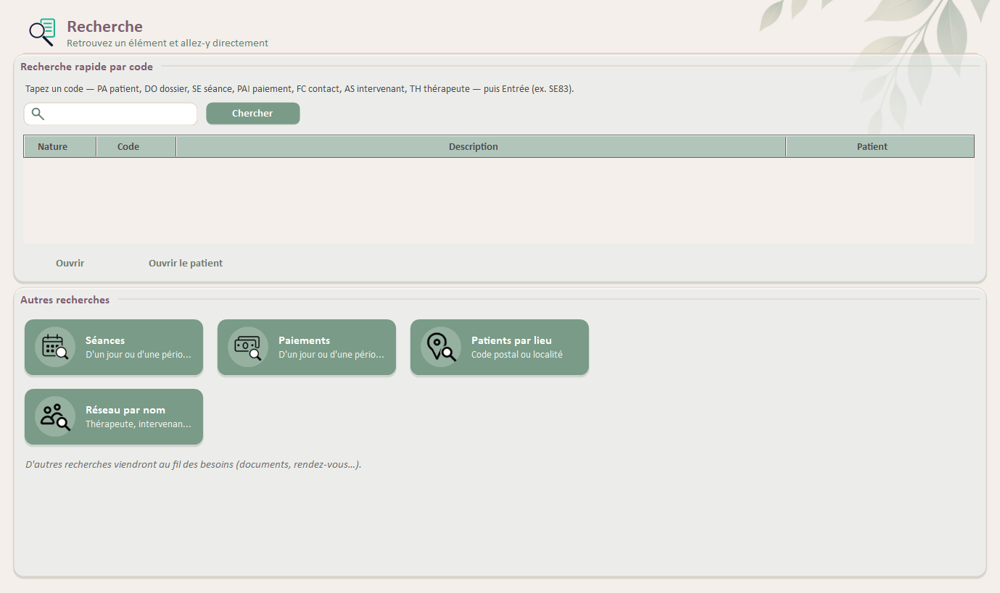
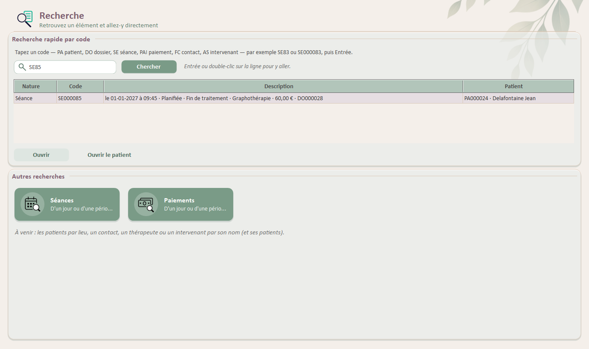
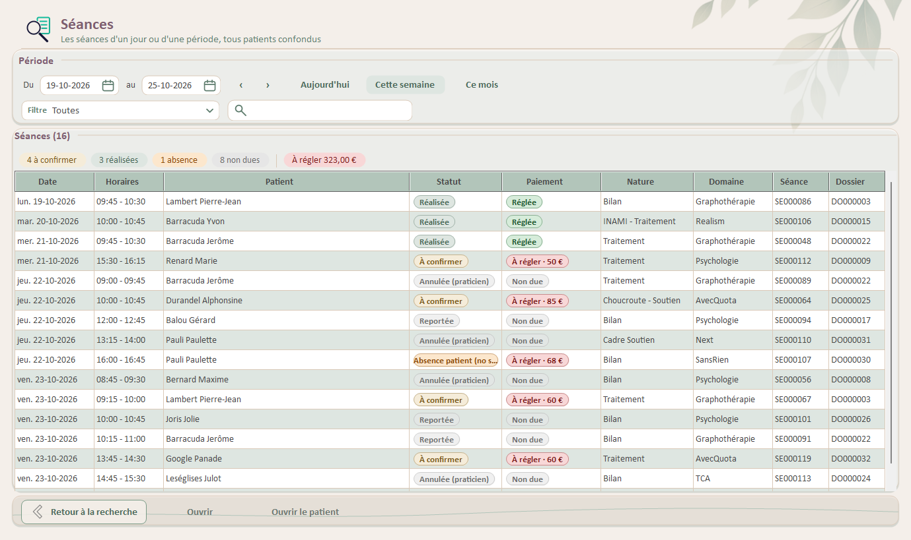
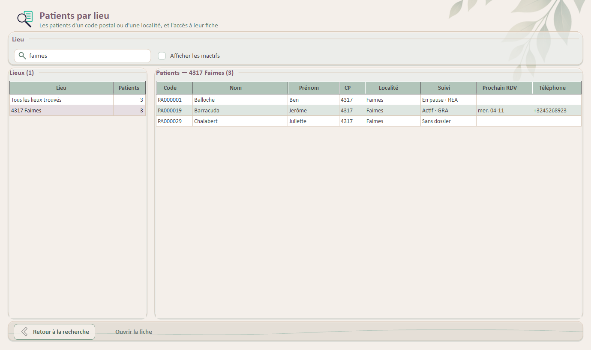
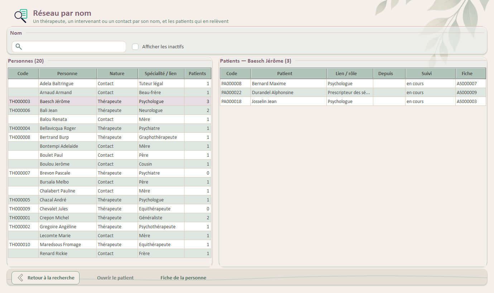

# Guide utilisateur — Recherche

> Dernière mise à jour : 25/10/2026 (illustrations du hub, des lieux et du réseau) ; 24/10/2026 (R5 réseau par nom, R4 patients par lieu ; illustrations ; R1 recherche par code, R2 séances et R3 paiements d'un jour ou d'une période le 23/10/2026).
> Public : toute utilisatrice d'Althéa (les droits sont ceux des écrans ouverts depuis la recherche). Référence technique : ADR-52, processus 24 ; tests : `Docs/Tests/PLAN_TESTS_RECHERCHE.md`.

La recherche sert à retrouver un élément — un patient, un dossier, une séance, un paiement, un contact, un intervenant — **sans passer par son patient**, à savoir ce que c'est et de quel patient il s'agit, puis à y aller d'un double-clic.

## 1. Ouvrir la recherche

Menu de gauche › **Recherche** (juste sous Patients). Le hub s'ouvre : en haut, la **recherche rapide par code** ; dessous, une **tuile par recherche** (Séances, Paiements, Patients par lieu, Réseau par nom ; d'autres viendront).

## 2. Recherche rapide par code

Chaque élément porte un code, généré par Althéa :

| Préfixe | Élément | Exemple |
|---|---|---|
| PA | Patient | PA000005 |
| DO | Dossier | DO000012 |
| SE | Séance | SE000083 |
| PAI | Paiement | PAI000123 |
| FC | Contact (famille / contacts) | FC000004 |
| AS | Intervenant | AS000007 |
| TH | Thérapeute (référentiel) | TH000003 |

- Tapez le code puis **Entrée**. La saisie est tolérante : majuscules ou minuscules, espaces et zéros de tête libres (« se83 » = SE000083).
- La ligne trouvée dit **ce que c'est** (date, statut, domaine, montant, dossier…) et **de quel patient**.
- **Entrée** ou **double-clic** sur la ligne (ou « Ouvrir ») : on y va. « **Ouvrir le patient** » ouvre la fiche du patient.
- Où l'on arrive : un patient → sa fiche ; un contact → la fiche, onglet Famille / Contacts ; un intervenant → la fiche, onglet Intervenants ; un dossier → le dossier ; une séance → le dossier, onglet **Séances**, la séance sélectionnée ; un paiement → le dossier, onglet **Paiements**, le paiement sélectionné ; un thérapeute → le **réseau par nom** sur ce thérapeute et ses patients (section 6).

Le code d'un contact (FC…) ou d'un intervenant (AS…) se lit dans la colonne « Code » des onglets Famille / Contacts et Intervenants de la fiche patient, celui d'un thérapeute (TH…) dans le référentiel Thérapeutes, et au titre de leur fenêtre. Le code d'un paiement se lit dans la colonne « Code » de l'onglet Paiements du dossier et dans le détail des paiements d'une séance ; Althéa l'annonce aussi après un encaissement.

## 3. Les séances d'un jour ou d'une période

Tuile **Séances**. L'écran s'ouvre sur les séances **d'aujourd'hui**, tous patients confondus, dans l'ordre des heures.

- **Période** : dates « du … au … » (une date qui dépasse l'autre l'entraîne : la période n'est jamais inversée) ; boutons **Aujourd'hui**, **Cette semaine** (lundi à dimanche), **Ce mois** ; **‹ ›** pour la période précédente ou suivante (un mois entier passe au mois voisin entier, une autre période glisse de sa durée).
- **Colonnes** : date (avec le jour), horaires, patient, **statut** et **paiement** en pastilles — les mêmes que dans l'onglet Séances du dossier (« À confirmer », « À régler · 60 € »…) —, nature, domaine, codes de la séance et du dossier.
- **Affiner** :
  - le **résumé** au-dessus de la liste (à venir, à confirmer, réalisées, absences, non dues ; à régler, prévu, avoir) — un clic sur une pastille filtre, un second clic rend tout
  - la liste **Filtre** (mêmes choix que dans le dossier)
  - la zone de texte (patient, code, nature, domaine).
  - Exemple : « Exigibles » sur le mois = les impayés du mois, tous patients.

## 4. Les paiements d'un jour ou d'une période

Tuile **Paiements**. La liste est le **relevé de l'onglet Paiements du dossier**, pour tous les patients : les encaissements à leur date, les paiements attendus à la date de leur séance (colonne Date « — »), les annulations (montant barré). Le plus récent est en haut.

- **Période** : comme pour les séances.
- **Colonnes** : date, patient, mouvement, pour (la séance), mode, montant, **état** en pastille (comme dans le dossier, infobulle comprise), codes du paiement et du dossier.
- **Affiner** : le **résumé** (Encaissé, En attente), la liste **Filtre** (mêmes choix que dans le dossier), la liste **Mode** (tous les modes, ou un mode : espèces, virement…), la zone de texte (patient, code, séance, mode, référence).
- « **En attente** » réunit tout ce qui n'est pas encore encaissé : la pastille distingue ce qui est **prévu** (séance à venir) de ce qui est **à régler** (séance passée). Pour ne voir que les retards : filtre « À régler ».
- **Totaux** sous la liste : « Encaissé par mode : Espèces … € · Virement … € — total … € », sur la période et le mode choisi. Un règlement par avoir n'est pas de l'argent reçu : il est indiqué à part, hors total.

## 5. Les patients d'un lieu

Tuile **Patients par lieu**. Une zone « Code postal ou localité », et deux listes : à gauche les **lieux**, à droite les **patients** du lieu choisi.

- **Chercher** : un nombre est le **début du code postal** (« 4317 » ; « 43 » donne aussi 4300 Waremme, 4350 Remicourt…), un mot est une **partie de la localité** (« liège », « waleffes ») ; accents et majuscules n'ont pas d'importance ; les deux se combinent (« 4317 aineffe »). La liste suit chaque frappe.
- **Les lieux** : « 4317 Faimes — 3 », par code postal ; en tête **Tous les lieux trouvés** (les patients de tous les lieux listés) ; zone vide : tous les lieux, et **Sans adresse** en dernier. Une même localité écrite de deux façons (« Faimes », « faimes ») ne fait qu'un lieu. Une adresse à l'étranger porte son pays : « 75001 Paris (FR) ».
- **Les patients** : code, nom, prénom, code postal, localité, suivi, prochain rendez-vous, téléphone ; un clic sur un en-tête trie.
- **Inactifs** : masqués sauf la case « Afficher les inactifs » (lignes grisées) ; la barre d'état dit combien sont masqués.

## 6. Un thérapeute, un intervenant ou un contact par son nom

Tuile **Réseau par nom**. Une zone « Nom », et deux listes : à gauche les **personnes**, à droite les **patients** qui en relèvent.

- **Chercher** : chaque mot tapé est le **début** d'un mot du nom ou du prénom (« dup » → Dupont ; « dupont ma » → Dupont Marie) ; accents et majuscules n'ont pas d'importance. La liste suit chaque frappe.
- **Les personnes** : une ligne par personne, avec sa nature — **Thérapeute** (du référentiel, même sans patient ; « inactif » s'il est désactivé), **Intervenant** (saisi à la main dans une fiche), **Contact** (famille, entourage) —, sa spécialité ou son lien (« Mère »), et son nombre de patients. Une même personne saisie chez plusieurs patients (la mère de deux enfants suivis, un logopède noté à la main deux fois) ne fait qu'une ligne ; un intervenant choisi dans le référentiel compte sous son thérapeute.
- **Les patients** : code, patient, lien ou rôle, depuis, suivi (« en cours », « jusqu'au … », « terminé le … » en gris) et la fiche (FC… pour un contact, AS… pour un suivi).
- **Inactifs** : case « Afficher les inactifs ».
- **Fiche de la personne** (ou double-clic sur la personne) : le contact ou l'intervenant s'ouvre **en consultation** (celui du patient sélectionné à droite), le thérapeute dans sa fenêtre habituelle. Après un enregistrement, la liste est relue.

## 7. Aller à l'élément et revenir

Depuis une liste de séances ou de paiements : **double-clic**, **Entrée** ou « Ouvrir » → le dossier, sur le bon onglet, la ligne sélectionnée ; « Ouvrir le patient » → sa fiche.

Depuis la liste des patients d'un lieu : **double-clic**, **Entrée** ou « Ouvrir la fiche » → la fiche du patient. Depuis le réseau par nom : **double-clic**, **Entrée** ou « Ouvrir le patient » → sa fiche, onglet **Famille / Contacts** (contact) ou **Intervenants** (suivi).

**Retour** (dans le dossier ou la fiche) ramène à la liste **telle qu'elle était** : même période, même filtre, même mode, même texte (même lieu, même personne, même case pour les patients d'un lieu et le réseau), la ligne resélectionnée. « **Retour à la recherche** » ramène au hub. Un clic sur un bouton du menu repart de zéro.

## 8. Confidentialité et limites

- Rien de ce qui est cherché (code, dates, nom, lieu, nom d'une personne) n'est écrit dans le journal : seulement le type de recherche et le nombre de résultats.
- Les critères ne sont gardés que le temps de la session.
- Les listes sont **plafonnées à 1000 lignes** : au-delà, Althéa demande de réduire la période.
- Ce que l'on peut faire de l'élément ouvert dépend des droits habituels (dossier clôturé ou archivé en lecture seule, etc.).

## 9. À venir

Au fil des besoins : documents et rendez-vous quand ces modules existeront.
