# Althéa - Charte graphique

> Dernière mise à jour : 23/10/26

<!-- TOC-->
  - [Répertoires d'assets](#répertoires-dassets)
  - [Charte Couleurs](#charte-couleurs)
  - [Images](#images)
    - [Splash image](#splash-image)
    - [Fonds](#fonds)
      - [pnlForm](#pnlform)
      - [Home (shell) - fond fixe 2560x1440](#home-shell---fond-fixe-2560x1440)
      - [pnlHeader (Home)](#pnlheader-home)
  - [Boutons](#boutons)
      - [Modèle Standard](#modèle-standard)
      - [Modèle Standard spécial](#modèle-standard-spécial)
        - [Supprimer](#supprimer)
        - [Enregistrer](#enregistrer)
      - [Modèle Tuile (large)](#modèle-tuile-large)
      - [Modèle Home](#modèle-home)
      - [Panel Actions](#panel-actions)
      - [Panel Menu (Home)](#panel-menu-home)
      - [Icones .png pour les différents boutons](#icones-png-pour-les-différents-boutons)
  - [Icônes Application et Forms](#icônes-application-et-forms)
  - [Icônes/Images Techniques](#icônesimages-techniques)
    - [Icônes d'état (DataGridView, listes)](#icônes-détat-datagridview-listes)
    - [Icônes d'état (DialogChoix et notes) — dessinées par le code](#icônes-détat-dialogchoix-et-notes--dessinées-par-le-code)
    - [Icônes divers](#icônes-divers)
    - [Boutons : Home, Standards et Tuiles](#boutons--home-standards-et-tuiles)
        - [Variantes d'état](#variantes-détat)
    - [Icônes des zones de suivi clinique](#icônes-des-zones-de-suivi-clinique)
    - [Icones RichTextEditor](#icones-richtexteditor)
    - [Icônes de titre](#icônes-de-titre)
- [Contact](#contact)
<!-- TOC -->

## Répertoires d'assets

| Répertoire | Usage principal | Composants concernés |
| --- | --- | --- |
| `Assets/Appli_Ico/` | Icônes de l'application. | Application et Forms. |
| `Assets/Boutons_Home/` | Icônes des boutons du menu : `_normal` (repos, survol et inactif, seules les couleurs changent), `_selected` (section active), `_disabled` (famille complète). | `Home`. |
| `Assets/Boutons_ico_32/` | Icônes des boutons d'action standards. | Forms, fiches et grilles. |
| `Assets/Boutons_ico_48/` | Icônes des tuiles (`_normal`, `_hover`, `_disabled`). | Accueil, Administration, Référentiels et Recherche. |
| `Assets/Boutons_Suivi/` | Icônes des sept zones du suivi clinique. | `UC_DossierFiche`. |
| `Assets/Editor_Ico/` | Icônes de la barre de l'éditeur de texte (20 px, refonte du 19/10/2026). | `UC_RichTextEditor`. |
| `Assets/Fond/` | Fond et feuillage de `Home`. | `Home`. |
| `Assets/Ico_divers/` | Icônes secondaires : recherche, ajout, réinitialisation, liens, cadenas. | Forms et UserControls. |
| `Assets/Splash/` | Écran de démarrage et bandeau de `Home`. | Démarrage et `Home`. |
| `Assets/Titre_Ico/` | Icônes de titre (`enTete.Icone`) des Forms et UserControls. | Tous les écrans. |

> Les images et icônes sont chargées selon le contexte par `UITheme`, `UtilsButtons` et `UtilsIcons`. Toute nouvelle ressource doit être ajoutée dans ce document avec son usage.
>
> **Fichiers sources (audit UI-8, 17/10/2026)** : trois chemins coexistent.
>
> - Les icônes de boutons et de zones sont lues sur le disque par leur nom (`Tag`, enum `ZoneDossier`)
> - quelques images passent par `My.Resources`
> - toutes les autres sont **intégrées par le Designer** dans le `.resx` de l'écran (`enTete.Icone`, images des boutons, barre RTF, logo de `Home`).
>
> Les PNG de `Titre_Ico`, `Editor_Ico`, `Splash` et `Appli_Ico` restent les sources de ces images intégrées : ne pas les supprimer parce que le code ne les cite pas.
>
> **Décisions du 18/10/2026** :
>
> - une icône de bouton initialisé par `UtilsButtons` existe deux fois — le fichier lu à l'exécution et la copie intégrée par le Designer, qui sert d'aperçu dans Visual Studio : on garde les deux.
> - Une famille d'icônes reste complète (`_normal`, `_hover`, `_disabled`) même si aucun bouton ne charge encore ses variantes : elle est prête le jour où un bouton l'utilise.

## Charte Couleurs

> **Règle Designer d’abord (06/10/2026)** : couleurs, polices, fonds, styles des Label / GroupBox / TextBox / ComboBox / TabPage, titres et icônes sont définis **dans le Designer** pour rester modifiables visuellement.
>
> Le code ne réapplique pas de thème sur ces contrôles ; seuls le style des `DataGridView` (`UtilsDataGrid`) et les états fonctionnels dynamiques (actif/inactif, erreur, survol) restent gérés au runtime.
>
> Référence : `UC_Cabinet`.

|   Hex    |      RGB      |                            Sample                            |        Nom        | UITheme             |
| :------: | :-----------: | :----------------------------------------------------------: | :---------------: | ------------------- |
| \#7a9b87 | 122; 155; 135 |  |       Sauge       | ColorSauge          |
| \#5f7d6e | 95; 125; 110  |  |    Sauge foncé    | ColorSaugeFonce     |
| #b2c5ba  | 178; 197; 186 |  |    Sauge clair    | ColorSaugeClair     |
| #4b695a  |  75; 105;90  |  | Sauge très foncé  | ColorSaugeTresFonce |
| \#7e5f70 |  126; 95; 112  |  | Mauve foncé | ColorMauveFonce |
| #e6dee2  | 230; 222; 226 |  | Mauve très clair  | ColorMauveTresClair |
| \#f4efea | 244; 239; 234 |  |    Beige clair    | ColorBeigeClair     |
| \#ebe2d9 | 235; 226; 217 |  |       Beige       | ColorBeige          |
| \#dac9b8 | 218; 201; 184 |  |    Beige foncé    | ColorBeigeFonce     |
| \#D8B4A0 | 216; 180; 160 |  |    Beige rosé     | ColorRoseBeige      |
| #f1ece6 | 241; 236; 230 |  | Champ en lecture seule | ColorChampLectureSeule |
| \#4A4A4A |  74; 74; 74   |  |    Gris foncé     | ColorGrisFonce      |
| \#323232 |  50; 50; 50   |  |  Gris très foncé  | ColorGrisTresFonce  |
| #a0a0a0  | 160; 160, 160 |  | Gris moyen foncé  | ColorGrisMoyenFonce |
| #767676  | 118; 118; 118 |  |   Gris discret    | ColorGrisDiscret (texte secondaire lisible, ajouté le 11/10/2026) |
| #d2d2d2  | 210, 210, 210 |  |    Gris Moyen     | ColorGrisMoyen      |
| #ececec  | 236, 236, 236 |  |    Gris clair     | ColorGrisClair      |
| #fafafa  | 250, 250; 250 |  |  Gris très clair  | ColorGrisTresClair  |
| \#dee6e1 | 222; 230; 225 |  |  Gris Vert Clair  | ColorGrisVertClair  |
| \#ffffff | 255; 255; 255 |  |       Blanc       | ColorBlanc          |
| #a8786e | 168; 120; 110 |  | Rouge moyen clair | ColorRougeMoyenClair |
| #782828  |  120; 40, 40  |  | Rouge moyen foncé | ColorRougeMoyenFonce |
| #c26a76  | 194, 106; 118 |  |    Rose foncé     | ColorRoseFonce      |
| #c8a05a | 200; 160; 90 |  | Jaune modéré | ColorJauneModere |
| #c18445 | 193; 132; 69 |  | Orange moyen foncé | ColorOrangeMoyenFonce |
| #4582c1 | 69; 130; 193 |  | Bleu moyen | ColorBleuMoyen |

- Sous forme de Properties dans le module UITheme.vb
- **Champ en lecture seule** (14/10/2026) : fond d'un champ consulté ; le texte garde sa couleur normale (Rules, « Consultation lisible »). Un champ modifiable a un fond blanc.
- `ColorMauveFonce` conserve ici son nom historique dans le code, bien que la teinte documentée corresponde visuellement à un bleu pétrole foncé.
- Répertoire : Utils/

------

## Images

### Splash image

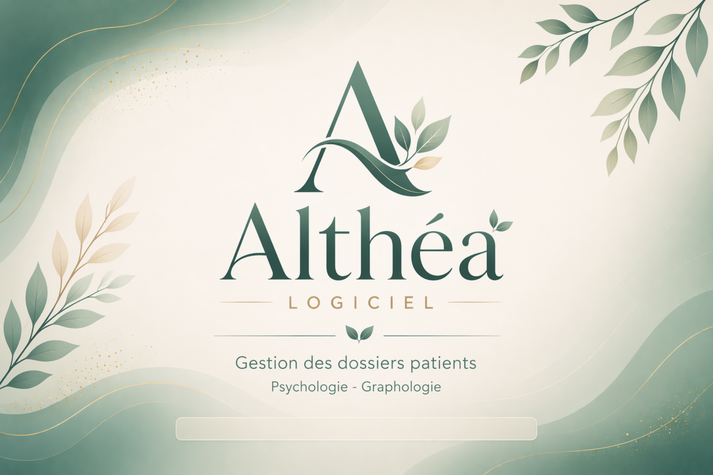

- Nom : Splash_Althea_Main_from_image.png
- Format : .png
- Répertoire : /Assets/Splash/

------

### Fonds

#### Fenêtres — `AltheaFondFenetre` (décision du 14/10/2026)

- **Règle du 15/10/2026** : dans toutes les fenêtres, les champs sont regroupés dans des `AltheaCarte` titrées, posées sur ce fond (même schéma que les fiches — Rules § 15).
- **Barre de titre Windows** (décision du 15/10/2026, `AltheaBarreTitre`) :
  - fond **Beige clair** (comme la fenêtre), titre **Sauge très foncé**, bordure **Sauge clair**, au lieu de la couleur d'accentuation de Windows (souvent bleue).
  - Windows 11 et plus ; la barre reste celle de Windows (déplacement, ancrage, boutons).
  - Posée par `AltheaFondFenetre.Appliquer(Me)`, et directement sur la Home, la connexion et les fenêtres pas encore reprises.

- Fond **Beige clair** uni (`UITheme.ColorBeigeClair`) et **petite feuille dessinée** dans le coin haut droit (sauge translucide, nervures Sauge foncé), visible derrière l'en-tête transparent ; aucune image, taille proportionnelle à la mise à l'échelle Windows.
- Une ligne dans le constructeur, après `InitializeComponent` : `AltheaFondFenetre.Appliquer(Me)` — ou `Appliquer(pnlForm)` quand un panneau racine recouvre la fenêtre ; le `BackgroundImage` du Designer est supprimé.
- Posé au fil d'UI-7 : `ContactEdition`, `IntervenantEdition`, `TherapeuteEdition`, `UtilisateurEdition` (14/10/2026). L'ancien fond étiré `Fond_1000x800_Feuille4`, plus utilisé par aucune fenêtre, a été supprimé au lot UI-8 (17/10/2026).

#### Home (shell) - fond fixe 2560x1440


> **Principe (09/10/2026)** : la Home n'étire plus aucune image. Le fond est plus grand que l'écran et simplement rogné ; le feuillage et le logo sont des images séparées, affichées à leur taille réelle.

| Fichier | Taille | Où | Réglage |
| --- | --- | --- | --- |
| `Assets/Fond/Home_Fond_2560x1440.png` | 2560x1440 | `pnlForm.BackgroundImage` | `BackgroundImageLayout = None` (ancré en haut à gauche, jamais étiré). Fond Beige clair (244; 239; 234) + vague fine qui passe sous le bandeau et remonte vers le coin haut droit. Sous y = 100 px : beige uni. |
| `Assets/Fond/Home_Feuillage_CoinHautDroit.png` | 344x310 (transparent, déjà atténué) | dessiné dans `pnlForm.Paint`, collé au bord droit | Taille réelle, aucune mise à l'échelle (voir code ci-dessous). |
| `Assets/Splash/Home_Logo_Althea_253x70.png` | 253x70 (transparent) | `picTitre` | Médaillon « A » + mot Althéa. `BackgroundImageLayout = Center`, `Size = 253; 70`, `Location = 14; 12`, `BackColor = Transparent`. |
| `Assets/Splash/Home_Logo_Althea_506x140_x2.png` | 506x140 | `picTitre` (écrans 150 % et plus) | Même logo en double résolution, à utiliser avec `BackgroundImageLayout = Zoom`. |
| `Assets/Splash/Home_Titre_Althea_179x48.png` | 179x48 | `picTitre` (variante mot seul) | Bon ratio du mot Althéa (l'ancien 191x48 le déformait). `Layout = Center`. |

Feuillage (dessin à droite, sans étirement) :

```vb
Private ReadOnly _feuillage As Image = My.Resources.Resources.Home_Feuillage_CoinHautDroit

Private Sub pnlForm_Paint(sender As Object, e As PaintEventArgs) Handles pnlForm.Paint
    e.Graphics.DrawImage(_feuillage, pnlForm.ClientSize.Width - _feuillage.Width, 0, _feuillage.Width, _feuillage.Height)
End Sub

Private Sub pnlForm_Resize(sender As Object, e As EventArgs) Handles pnlForm.Resize
    pnlForm.Invalidate(True)
End Sub
```

- `pnlHeader` et `pnlContent` restent `BackColor = Transparent` : le feuillage dessiné sur `pnlForm` apparaît derrière eux.
- **Feuille coupée (UserControls hébergés)** : chaque UserControl chargé dans `pnlContent` recouvre le bas du feuillage.
  - La Home dessine alors elle-même, sur le `pnlForm` du UserControl (ou sur le UserControl s'il n'a pas de `pnlForm`), la portion de feuillage qu'il cache, exactement alignée (`AttacherFeuillageCoupe` / `SurfaceUC_Paint` dans `Home.vb`).
  - Le motif paraît continu, sans image « coupée » à fabriquer ni étirement.
- Conséquence : un UserControl hébergé ne porte **aucune image de fond** ; l'ancien `Fond_1000x770_FeuilleCoupee1` a été retiré des Designers et supprimé (UI-8, 18/10/2026).
  - Le `BackColor` Beige clair (244; 239; 234) doit rester.
  - Hors de la Home (fenêtre d'ajout « en passant » `ReferentielModalHost`), la vue reçoit le fond du kit (`AltheaFondFenetre`), comme toutes les fenêtres.
- Aucun élément du fond ne doit être aligné sur un contrôle : avec la mise à l'échelle DPI, les contrôles bougent, le fond non. C'est pourquoi le médaillon « A » fait partie du logo et non du fond.

#### pnlHeader (Home)


- Contenu dans picTitre
- Image : BackgroundImage
- Background Layout : Stretch
- BackColor : Transparent
- Size : 191; 48

------

## Kit d'interface Althéa (contrôles dessinés)

> **Préparé le 09/10/2026, posé progressivement depuis le 10/10/2026** (voir « Écrans habillés »). Maquettes de référence : artifact « Althéa – Kit d'interface » (kit, hubs, liste, dialogue, Domaines, Cabinet).
> Objectif : remplacer les images de fond étirées (`ui-backgrounds`) par des contrôles dessinés par le code, réglés dans le Designer. Une couleur ou un arrondi se change à un seul endroit et tous les écrans suivent.

| Contrôle | Hérite de | Usage | Réglages Designer (catégorie « Althéa ») |
| --- | --- | --- | --- |
| `AltheaBouton` | `Button` | Boutons d'action (pnlActions, filtres, dialogues). | `Variante` : Sauge (courant), Ocre (Enregistrer), Terre (Supprimer), Clair (secondaire : Annuler, Réinitialiser, Fermer). `Rayon` (8). Icône : `Image` ; `Tag` inchangé. **Icône seule** (texte vide, variante Outil, 30 × 30) pour les petits boutons posés à côté d'un champ ([+], loupe, copie d'adresse, cadenas) — 14/10/2026 ; icône du Designer, **sans** `UtilsButtons` (ses icônes de survol, claires, disparaissent sur le survol vert pâle du kit) — 15/10/2026. **Désactivé** (20/10/2026) : fond Gris-vert très pâle, texte (108, 120, 113) lisible, icône à 55 % ; raison au survol (`RaisonInactif`). |
| `AltheaTuile` | `AltheaBouton` | Tuiles des hubs (Référentiels, Administration…). | `Text` sur deux lignes = titre + sous-titre (`"Domaines" & vbCrLf & "Prises en charge"`). Icône 48 px dans une pastille (`Image`). `Rayon` (12). |
| `AltheaCarte` | `Panel` | Panneaux (pnlCenter, détail, groupes). | `Titre` (titre de section dessiné en haut, les enfants se placent dessous), `CouleurFond` + `OpaciteFond` (blanc 140 = translucide), `CouleurBordure`, `Ombre`, `Rayon` (14). |
| `AltheaBarreActions` | `AltheaCarte` | Barre d'actions du bas (remplace `Althea_Bandeau_Haut_Trans.png`). | Fond Beige translucide + vague sauge clair dessinée (`Vague`). |
| `AltheaTitreSection` | `Label` | Titres de groupe (« Cabinet », « Identité du domaine »…), remplace les GroupBox. | `Text`, `ForeColor` (Mauve foncé), `CouleurTrait` (Beige foncé). |
| `AltheaEnTete` | `Panel` | En-tête de **tous** les écrans (UC et Forms), y compris les dialogues. | `Text` = titre (Mauve foncé, 18 gras), `SousTitre` (Sauge foncé, 11, **sous** le titre), `Icone` (48 px, `.resx`), trait fin Beige foncé. Hauteur 58. Fond transparent. |
| `AltheaBarreOutils` | `Panel` | **Barre locale** d'une liste (ADR-34), en haut d'une `AltheaCarte` qui contient la grille. | `Titre` facultatif (Mauve foncé, gras 11), trait fin Beige. Boutons `AltheaBouton` en variantes **Outil** (sans cadre, texte Sauge très foncé, fond Gris-vert clair au survol), **OutilPrincipal** (fond Gris-vert clair), **OutilDanger** (texte terre, en dernier), hauteur 30. |
| `AltheaRenduBarre` | `ToolStripProfessionalRenderer` | Rendu du kit pour une `ToolStrip`, ses menus et un `ContextMenuStrip` (barre de l'éditeur de texte, ADR-42). | Fond de la barre, trait fin Beige dessous ; boutons comme la variante **Outil** (survol Gris-vert clair, coché ou enfoncé Sauge clair, coins de 6 px) ; image désactivée à 40 % ; menus blancs bordés Beige foncé ; libellé à fond fixé dessiné en pastille. |
| `AltheaRecherche` | `UserControl` | Champ de recherche des bandeaux (ADR-33). | Champ blanc arrondi (9), loupe Sauge foncé, `TexteAide`, contour Beige foncé / Sauge clair au survol / **Sauge 2 px au focus**. Relaie `Text`, `TextChanged`, `KeyDown`, `Clear()`. |
| `AltheaZoneTexte` | `RichTextBox` | Notes courtes en texte simple : commentaire d'un paiement, motif d'une annulation (20/10/2026). | Champ comme une `TextBox` (Calibri 11, Gris foncé, fond blanc) ; mots inconnus soulignés en rouge par le correcteur de Windows ; clic droit au rendu du kit (`AltheaRenduBarre`) : suggestions en gras, « Ajouter au dictionnaire », Couper / Copier / Coller (icônes de l'éditeur), Tout sélectionner. |
| `AltheaListe` | `ComboBox` | Listes déroulantes de filtre (ADR-33). | Même champ arrondi ; `Etiquette` intégrée (Sauge foncé, gras 9,75) avant la valeur ; flèche Sauge foncé ; élément pointé Gris-vert clair. `DessinItemsPersonnalise` : l'écran dessine ses éléments (icônes). **Désactivée** (V1.1.0) : fond Champ en lecture seule, valeur en texte normal. |
| `AltheaCase` | `CheckBox` | Cases à cocher (ADR-33). | Case arrondie 18 px : vide à bord Sauge clair, **cochée Sauge foncé** à coche blanche, survol Sauge. Dans un bandeau : `AutoSize = False`, largeur fixe. **Désactivée** (V1.1.0) : case sur fond Champ en lecture seule, texte normal, toujours lisible. |
| `AltheaOnglets` | `TabControl` | Tous les onglets (ADR-32). Les `TabPage` et leur contenu ne changent pas. | `CouleurFond` (Beige clair ; **`Transparent`** sur fond beige : laisse voir le parent et le feuillage), `CouleurTrait` (Beige foncé), `CouleurSoulignement` (Sauge), `EpaisseurSoulignement` (3). Onglet actif : gras Sauge très foncé souligné ; au repos : fond Beige arrondi, texte Gris foncé ; survol : fond Gris-vert clair. Police héritée du parent (non imposée). `MasquerOnglets` (V1.2.0) : bande masquée à l'exécution (pages pilotées par un autre contrôle, ex. `AltheaEtapes`), visible dans le Designer. |
| `AltheaEtapes` | `Control` | Étapes numérotées d'un parcours (écran Domaines, UI-6). | `Etapes` (libellés), `IndexCourant` ; état par étape en code (`DefinirEtat` : AFaire, **Fait** pastille Sauge cochée, **À compléter** pastille blanche à bord Jaune modéré et « ! », détail ocre, **Non nécessaire** cercle Beige rosé en pointillés, gris discret). Étape courante entourée d'un anneau Sauge très foncé ; flèches gauche / droite ; événement `EtapeChoisie`. |
| `AltheaJauge` | `Control` | Jauge de consommation (quota du récapitulatif patient). | `Valeur`, `Maximum` (0 = jauge vide), `SeuilAlerte` (0 = pas d'alerte). Piste Beige ; remplissage **Sauge**, puis **Jaune modéré** au seuil, **Rouge moyen clair** au plafond. Hauteur 8. |
| `AltheaLigne` | `Button` | Ligne cliquable d'une liste courte (zones du Suivi clinique) : icône en pastille Sauge, titre, aperçu sur une ligne, action « Ouvrir ». | `Image` (icône blanche 24 px), `Text` (titre), `Description` (aperçu), `TexteVide` (« Vide », gris discret italique), `TexteAction`, `LargeurTitre` (180), `Separateur` (filet Beige sous la ligne). Survol : fond Gris-vert clair, pastille Sauge foncé, action sur fond blanc. Hauteur 54–56. |
| `AltheaBoutonMenu` | `Button` | Boutons du menu principal de la Home. | Pastille arrondie (`Rayon` 12) : rien au repos, Gris-vert clair au survol, **Sauge foncé + texte blanc** pour l'écran actif (couleurs `UITheme.ButtonHome*`, états gérés par `UtilsButtons`). `TailleIcone` (32 ; icônes 48 px réduites). |
| `AltheaFilAriane` | `Label` | Fil d'Ariane du bandeau de la Home. | Segments séparés par « › » gris, dernier en gras Gris foncé, précisions « (…) » / « […] » en Gris moyen foncé, repli « … » ; `Pastille` facultative Gris-vert clair (domaine du dossier). |
| `AltheaPuceUtilisateur` | `Control` | Utilisateur connecté, à droite du bandeau. | Pastille blanche translucide à bord Beige foncé ; initiales dans un rond Mauve foncé, ou `Photo` du compte découpée dans le même rond (bord Beige) ; `Nom`, `Precision`, `Role` (pastille Beige, texte Mauve), `Eleve` (pastille terre « Élévation »). |
| `AltheaPastille` | `Label` | Libellé court sur fond arrondi : code, organisme, nature de séance, statut. | `CouleurFond` (Gris-vert clair), `CouleurBordure` (aucune), `Padding` = marge intérieure (8; 2; 8; 2), texte Sauge très foncé. Taille automatique. |
| `AltheaIconeEtat` | `Control` | Icône d'état (Information, Avertissement, Erreur, Question, Succès, Attente) : `DialogChoix`, encadrés d'attention. | `Etat` ; rond à fond pâle, contour et signe dans la couleur du type (voir « Icônes d'état ») ; l'Attente tourne. `Teintes(etat)` donne base, pâle et foncée. |
| `AltheaDate` | `UserControl` (composé) | Champs de date (remplace le `DateTimePicker`, UI-7). | Champ arrondi comme `AltheaRecherche` (9 px, contour Beige foncé / Sauge clair au survol / **Sauge 2 px au focus**, **rose** si la date est impossible) ; icône calendrier Sauge foncé ; `Facultative` : vide = pas de date, croix grise pour effacer ; `LectureSeule` (et désactivé) : fond Champ en lecture seule, texte normal, sans bouton. |
| `AltheaHeure` | `UserControl` (composé) | Champs d'heure (remplace les listes saisissables et le `DateTimePicker` en mode heure, UI-7, 16/10/2026). | Même champ qu'`AltheaDate` ; icône horloge Sauge foncé ; format hh:mm ; liste déroulante des heures proposées entièrement dessinée (heure choisie en Sauge, survol en vert de gris clair, durée en gris à droite pour une heure de fin, ascenseur fin arrondi Beige / Sauge clair, glissable) ; croix facultative (`AfficherCroix`) ; lecture seule et désactivé lisibles. |
| `AltheaCalendrier` | `Control` | Calendrier de `AltheaDate` (fenêtre déroulante) ou seul. | Mois en tête (Sauge très foncé gras), année cliquable (pastille Gris-vert clair, grille de 12 années) ; lundi → dimanche, week-end Gris discret, jours hors mois pâles ; aujourd'hui : anneau Sauge clair ; survol : Gris-vert clair ; date choisie : pastille **Sauge**, texte blanc gras ; « Aujourd'hui » en bas. Cases arrondies (7 px). |

### Écrans habillés

| Écran | Date | Contenu |
| --- | --- | --- |
| `UC_ReferentielHome` | 10/10/2026 | 15 tuiles, 4 titres de section, 2 cartes. Quadrillage du `TableLayoutPanel` supprimé, images de fond retirées du Designer et du `.resx` (91 → 38 Ko). |
| `UC_AdminHome` | 10/10/2026 | 7 tuiles réparties en 2 sections (« Cabinet et accès », « Technique »), grille 4 colonnes identique à l'autre hub, tuiles 214x90. Titre redondant supprimé. `.resx` 65 → 27 Ko. |
| En-tête (31 écrans) | 10/10/2026 | `AltheaEnTete` sur tous les UC et Forms à en-tête (+ les 15 référentiels via `UC_ReferentielBase`). Rétabli sur `DialogComptePraticien`. Sans en-tête, volontairement : `Home` (logo), `ReferentielModalHost` (l'UC hébergé porte le sien), composants intégrés (liaisons, synthèse, pagination, éditeurs). |
| Récapitulatif patient (fiche Dossier) | 11/10/2026 | Maquette « Récapitulatif A, blocs groupés » : carte à quatre blocs séparés par un filet — Patient (photo ou initiales, naissance et âge, alerte), Dossier (domaine, statut, dates, Changer le statut…), Finances (montant dû mis en évidence), Quotas (titre avec l'organisme, compteurs, `AltheaJauge`). |
| Home (bandeau et menu) | 11/10/2026 | Maquette « Home A » : logo Althéa, cabinet (logo, nom) et praticien, fil d'Ariane dessiné avec pastille du domaine, pastille de l'utilisateur ; menu en pastilles arrondies, Outils / Admin et mot de passe sous un filet. Cadres en relief supprimés ; boutons de test déplacés dans l'Accueil (Debug seulement). Survol du menu : Gris-vert clair (au lieu de Sauge clair). |
| Cabinet, Paramètres | 11/10/2026 | Cabinet : cartes Logo / Photo / Signature / Compte (ex-`GroupBox`), boutons Outil, carte autour de la grille de l'onglet Cabinet (ex-image étirée) ; texte des pages en normal (Cabinet et Domaines). Paramètres : case du kit. |
| Fiche Patient | 11/10/2026 | Maquette « Fiche patient » : bandeau identité en carte (photo, nom, pastilles code et statut, naissance, Photo… / Désactiver en Outil, bloc Alerte à droite) ; onglet Identité en cartes (les 4 `GroupBox` remplacés) ; bandeaux de recherche Famille / Intervenants au modèle UI-4. |
| Fiche Dossier — autres onglets | 11/10/2026 | Suivi clinique (maquette A : `AltheaLigne` par zone dans une carte), Documents (carte), bandeaux de recherche et filtres Séances / Paiements au modèle UI-4 (dates habillées en UI-7). |
| Onglet Fiche dossier | 11/10/2026 | Maquette « Fiche dossier B » : carte « Paramètres du dossier » (champs en ligne, libellés au-dessus) et carte « Convention du domaine » ; `UC_SyntheseDomaine` V2 en blocs du kit (trois colonnes si la largeur le permet, empilés sinon — aussi dans l'onglet Synthèse des Domaines). |
| Barres locales (7 listes) | 11/10/2026 | Fiche Patient (Anamnèse, Famille, Intervenants, Dossiers), fiche Dossier (Séances, Paiements), Cabinet (Cachet) : carte + `AltheaBarreOutils` + boutons Outil. Domaines (Tarifs, Natures, Règles de quota) au lot UI-6 (14/10/2026). |
| Domaines (UI-6) | 14/10/2026 | Maquette « Domaines — A » : `AltheaEtapes` à la place de la bande d'onglets, Général en deux cartes, Tarifs et Natures en carte avec barre locale et formulaire au pied de la carte, Catégories & quotas en deux cartes (catégories puis règles), Synthèse en carte « Convention du domaine », pastille d'état du domaine ; consultation en lecture seule lisible. |
| `DialogChoix` (UI-7) | 14/10/2026, revu le 16/10/2026 | V2.0 (maquette B) : icônes `AltheaIconeEtat`, parties facultatives (détails, complément, attention, remarque, question finale), boutons du kit qui disent l'action, taille selon le texte ; plus de fond image ni de GIF. **V2.1 (maquette C, 16/10)** : petite fenêtre du kit comme les autres — barre de titre et fond beige à la feuille, `AltheaEnTete` (le type se lit sur l'icône, titre mauve), message en carte, `AltheaBarreActions`, boutons dans l'ordre habituel (action à gauche, Annuler à droite). Démonstration : `TestDialogChoix`. |
| Fiche patient — onglet Identité (UI-7) | 14/10/2026 | 7 listes en `AltheaListe` (hauteur 26 px, alignées sur les zones de texte), date de naissance en `AltheaDate` facultative ; consultation lisible des trois cartes (fond teinté, texte normal ; zones de texte blanches en saisie). |
| Fiche dossier (UI-7) | 14/10/2026 | Domaine en `AltheaListe` (26 px), date d'ouverture en `AltheaDate` ; consultation lisible de la carte « Paramètres du dossier » ; filtres « Du … au … » des onglets Séances et Paiements en `AltheaDate` (libellés « Du » et « au » en gris foncé, comme les cases du kit). |
| Fenêtres Contact, Intervenant, Thérapeute (UI-7) | 14/10/2026 | `GroupBox` remplacés par des `AltheaCarte` (titre dessiné), listes `AltheaListe`, dates `AltheaDate` facultatives, case `AltheaCase` ; libellés et champs aux tailles des fiches ; consultation lisible. Fond `AltheaFondFenetre` (beige clair, petite feuille dessinée) ; boutons [+], loupe et copie d'adresse en `AltheaBouton` Outil, icône seule (aussi les deux de la fiche Patient). |
| Fiche utilisateur (UI-7) | 14/10/2026 | Fond `AltheaFondFenetre` ; rôles en `AltheaListe`, trois cases `AltheaCase` ; libellés en gras 10,5, champs en 11 ; zones en lecture seule sur fond teinté, texte gris foncé. Cartes déjà posées le 12/10. |
| Fenêtre Séance (UI-7) | 15/10/2026 | Maquette « Dialogue Séance », complétée de deux cartes « Prestation » et « Rendez-vous » (comme les fiches) : fond `AltheaFondFenetre` ; Tarif, Nature, Statut en `AltheaListe`, date `AltheaDate` ; [+] et cadenas du tarif en Outil icône seule (cadenas fermé / ouvert dessinés, `Ico_divers`) ; « Voir planning du jour » en Clair ; consultation lisible. Listes d'heures encore Windows. |
| Fenêtre Paiement (UI-7) | 15/10/2026 | Cartes « Encaissement » (séance, date, montant, mode [+], référence) et « Commentaire » ; fond `AltheaFondFenetre` ; listes et date du kit ; consultation lisible. |
| Statut du dossier, report de séance (UI-7) | 15/10/2026 | `DossierStatutEditor` : carte « Statut du dossier » (liste et date du kit, date bornée à aujourd'hui) ; `DialogReportSeance` : carte « Nouvelle date de la séance » (date et case du kit ; heures encore Windows) ; fond `AltheaFondFenetre`. |
| Dialogues du dossier (UI-7) | 15/10/2026 | Motif d'annulation, réaffectation de paiement, détail des paiements d'une séance, planning du jour : chacun une carte (titrée par la séance pour le détail des paiements) sur le fond `AltheaFondFenetre` ; listes et date du kit ; erreur du motif aux couleurs de la charte. |
| Fenêtres de connexion (UI-7) | 15/10/2026 | `Login` (« Veuillez vous connecter »), `ChangePassword` (« Mot de passe »), `ElevationAcces` (« Accès protégé requis », rôle en `AltheaListe`), `ConfigurationConnexion` (« Paramètres MariaDB » et « Test de connexion ») : une carte par zone sur le fond `AltheaFondFenetre` ; panneaux racines et images de fond supprimés ; boutons « œil » en Outil icône seule ; libellés en gras 10,5, champs en 11 sur fond blanc. |
| Catégories de quota (UI-7) | 15/10/2026 | `CategoriesQuotaEditor` : carte de la liste avec barre locale « Catégories » (Désactiver en Outil, Supprimer en OutilDanger), aide et grille, comme les cartes de l'écran Domaines ; carte « Nouvelle catégorie » ; fond `AltheaFondFenetre`. Le dernier `GroupBox` des fenêtres disparaît. |
| Zone clinique (UI-7) | 15/10/2026 | `DossierZoneEditor` : l'éditeur riche dans une carte ancrée, titrée par le nom de la zone (« (consultation) » en lecture seule) ; en-tête « Zone clinique — dossier *code* » ; fond `AltheaFondFenetre`. |
| Restauration (UI-7) | 15/10/2026 | `DialogRestauration` : quatre cartes — « Archive à restaurer » (liste du kit, Parcourir…, case du kit, mot de passe et œil), « Compte d'administration MariaDB », « Vérification » (bouton, verdict à sa droite, résumé, avertissement, jauge), « Dernières restaurations » (grille) ; fond `AltheaFondFenetre`. |
| Compte praticien (UI-7) | 15/10/2026 | `DialogComptePraticien` : carte « Compte de travail » (explication, login et nom d'affichage en création, liste du kit des comptes en liaison) ; erreur aux couleurs de la charte ; fond `AltheaFondFenetre`. Dernière fenêtre reprise : toutes les fenêtres suivent le schéma des fiches. |
| Référentiels — panneau « Détail » (UI-7) | 16/10/2026 | `UC_ReferentielBase` : carte « Détail » à la règle des fenêtres (libellé à gauche, champ à x = 112, lignes de 34 px), État en `AltheaCase` toujours en dernier, consultation lisible ; les 7 référentiels à champs propres (Civilités, Modes de paiement, Organismes, Périodicités, Tarifs, Situations juridiques, Statuts de séance) posent leurs champs par `AjouterLigneDetail`, en `AltheaListe` / `AltheaCase` — plus de couleur ni de position écrite dans le code. |
| Paramètres — page unique (UI-7) | 16/10/2026 | Maquette « Paramètres — A » : une `AltheaCarte` par groupe (titre et ordre en base, `tec_groupes_parametres`), une ligne par paramètre — libellé gras sauge, valeur (zone de texte, nombre, case du kit), bornes en gris, pastilles « Admin » (mauve) et « Désactivé » (gris), description en italique gris **sous la valeur** ; petit bouton Outil dossier (Parcourir) à droite d'un chemin, en modification seulement ; consultation lisible de toute la page, un seul Modifier / Enregistrer / Annuler. Nouvelle icône Outil `dossier_24_normal` (même trait que les autres). |
| Grille des séances — pastilles d'état | 17/10/2026 | Maquette « Grille des séances » : statut et paiement en **pastilles** (Calibri 9,5 gras, hauteur 20, arrondi complet) — bleu à venir / prévue (`StatutPrevisionnel`), vert-de-gris réalisée (`ColorGrisVertClair` / `ColorSaugeTresFonce`), orange absence non excusée (`StatutNoShow`), gris non due (`StatutAnnule`), vert réglée (`StatutRegle`), rose à régler (`StatutDu`), mauve avoir (`ColorMauveTresClair` / `ColorMauveFonce`) ; lignes non dues en gris ; ligne « Aujourd'hui » : trait sauge 2 px et texte Sauge foncé gras ; résumé : `AltheaPastille` cliquables, cerclées quand leur filtre est actif. Couleurs centralisées dans `UtilsPastilles`. |
| Grille des paiements — relevé chronologique | 17/10/2026 | Maquette « Paiements — A » : un paiement par ligne, pastille « État » aux couleurs de la pastille Paiement des séances — vert soldée / payée d'avance, rose à régler / reste dû, bleu en attente, mauve avoir (reste disponible), gris annulé ou avoir utilisé (atténuée, précision grise à droite) ; ligne neutralisée en gris, montant barré si annulé ; « — » en Gris moyen foncé pour un paiement attendu ; résumé cliquable Encaissé / En attente / Avoir disponible / Reste à régler. |
| Statut du dossier — pastille et bandeau | 17/10/2026 | Pastille « Statut » du bandeau d'un dossier : vert-de-gris actif (`ColorGrisVertClair` / `ColorSaugeTresFonce`), ocre en pause (`StatutPause`, distinct de l'orange des absences depuis le 17/10/2026), **gris foncé texte blanc** clôturé ou archivé (`ColorGrisFonce` / `ColorBlanc`, seul cas inversé : un suivi terminé doit se voir d'emblée) — `UtilsPastilles.TeinteStatutDossier`. Dossier clôturé ou archivé : bandeau d'information sous l'en-tête (Calibri 10 gras, teinte Information de `AltheaIconeEtat`, pâle / foncée) qui dit ce qui reste possible. |
| Grille Patients — hub de la journée | 17/10/2026 | Maquette « Patients — proposition » : pastilles Suivi (sauge actif, ocre `StatutPause` en pause, gris pâle `StatutAnnule` clôturé / archivé — dans une liste, ce qui est terminé s'efface), Prochain RDV (`StatutAujourdhui` bleu plein texte blanc pour aujourd'hui, `StatutPrevisionnel` bleu pâle à venir, séance du jour passée atténuée, « Aucun RDV » **au trait** ocre pointillé), Paiements (rose à régler, mauve avoir, « À jour » en texte sauge), absences orange ; ligne d'un patient attendu aujourd'hui sur `LigneAujourdhuiBack` ; patient inactif grisé ; marges titrées entre groupes (même trait sauge que la ligne « Aujourd'hui » des séances). Nouveaux jetons `UITheme` : `StatutPauseBack/Fore`, `StatutAujourdhuiBack/Fore`, `LigneAujourdhuiBack`. |
| Grilles — états lisibles (UI-9) | 18/10/2026 | Maquette « Grilles — états lisibles » : six **tons sémantiques** (`TonEtat`, `UtilsPastilles.Teinte(ton)`) pris dans les teintes existantes — OK sauge, À surveiller ocre (`StatutPause`), Problème rose (`StatutDu`), Inactif gris (`StatutAnnule`), Information bleu (`StatutPrevisionnel`), Rôle mauve ; une ligne normale ne porte rien ; sections et créneaux libres en repères entre les lignes. Toute pastille pleine porte un fin contour dans sa teinte (texte et fond mélangés) : nette sur tous les fonds de ligne, de façon régulière. Dates et heures centrées, montants à droite. Détail : `Reference_UI.md`. |
| Cabinet — onglets Identifiants et Cachet (UI-7) | 16/10/2026 | Onglet Identifiants : deux cartes titrées « Identifiants professionnels » et « Diplômes et qualifications », consigne en italique Sauge foncé au-dessus de chaque grille (plus de `SplitContainer`). Onglet Cachet : consigne dans la carte, sous la barre d'outils ; icônes `cachet_24_normal` (nouvelle, tampon) et `importer_24_normal`. |
| Cabinet — onglets Cabinet et Praticien (UI-7) | 15/10/2026 | Onglet Cabinet : cartes « Cabinet » (nom, situation juridique), « Adresse », « Coordonnées », « Facturation » (BCE, BIC, TVA, IBAN) et « Logo du cabinet ». Onglet Praticien : trois cartes « Identité », « Coordonnées », « Adresse professionnelle (vide = celle du cabinet) » au-dessus des cartes Photo, Signature, Compte de travail ; Civilité, Pays et Situation juridique en `AltheaListe` ; consultation lisible. Icônes des boutons Outil redessinées (24 px, trait sombre, même famille que l'œil et le cadenas) : `importer_24_normal`, `compte_24_normal`, `lier_24_normal`, `delier_24_normal` (`Assets/Ico_divers`). |
| Barres d'actions (28 écrans) | 10/10/2026 | `AltheaBarreActions` (vague) et `AltheaBouton` sur tous les écrans à barre d'actions : listes, fiches et fenêtres. Couleur selon le rôle : **Enregistrer Ocre**, **Supprimer Terre**, **Annuler / Actualiser / Fermer Clair**, autres Sauge. Largeur de chaque bouton ajustée à son texte ; deux boutons qui s'affichent tour à tour (Modifier / Enregistrer) partagent la même place. `DialogChoix` utilise aussi `AltheaBouton` depuis sa V2 (UI-7, 14/10/2026). |
| Panneau « Détail » des référentiels | 10/10/2026 | `AltheaCarte` avec le titre dessiné dans la carte (« Détail », « Nouvel élément », « Modification ») ; les champs seront habillés au lot UI-7. |
| Bandeau de recherche | 10/10/2026 | Modèle commun (maquette « Althéa – Bandeaux ») dans une `AltheaCarte` : Patients et Thérapeutes (« Moyen »), Utilisateurs (« Complet », ligne « Affiner »), référentiels via `UC_ReferentielBase` et liste des Domaines (« Simple »). Les anciens labels au-dessus des champs deviennent le texte d'aide. |
| Onglets (7 zones) | 10/10/2026 | `AltheaOnglets` sur `SeanceEditor` (fond Beige clair), `UC_DossierFiche`, `UC_PatientFiche`, `UC_Cabinet`, `UC_Parametres`, `UC_DomainesHome` et la zone « données liées » de `UC_ReferentielBase` (fond transparent). Le reste de ces écrans sera habillé aux lots suivants. |

> **Scintillement** : les contrôles translucides se superposent au fond et au feuillage ; sans précaution, chaque contrôle fait repeindre son parent et l'écran se reconstruit visiblement.
>
> Trois mesures prises le 10/10/2026 :
>
> - composition de la fenêtre (`WS_EX_COMPOSITED` sur `Home`),
> - chargement de la vue masquée dans `NavigationManager`,
> - et dessin du feuillage limité à la zone réellement concernée.
>
> **Tout nouvel écran habillé en bénéficie sans rien faire.**
>
> Exception : un contrôle **natif** qui laisse voir le feuillage le repeint directement à l'écran (cas de la bande d'onglets Windows dans l'onglet Séances de `UC_DossierFiche`) ; le remède est de le remplacer par un contrôle du kit.


- Répertoire : `UI/Controls/Theme/` (+ `AltheaDessin.vb` : outils de dessin partagés).
- `BackColor` de ces contrôles est forcé à `Transparent` : la couleur vient de la `Variante` (boutons) ou de `CouleurFond` (cartes). Un `BackColor` posé par `UtilsButtons` est sans effet.
- États : survol Sauge foncé, enfoncé Sauge très foncé (Ocre / Terre : même teinte assombrie), désactivé gris-vert pâle (233; 236; 232) avec texte (154; 170; 160), icône estompée.
- Démonstration : la **vitrine du kit** `UI/Forms/Test/TestKitAlthea` (V2.0.0, 16/10/2026 ; bouton « Vitrine du kit » de l'accueil, Debug) montre tous les contrôles dans leurs états ; ses captures illustrent `Reference_UI.md`.
- Suite du chantier : bandeaux (recherche, récapitulatif patient), puis écrans de liste, fiches, Domaines et dialogues (plan : `../Todo/Plan_Refonte_UI_Althea.md`).

------

## Boutons

#### Modèle Standard


- Height min : 40
- Icone png 32x32 (Assets/Boutons_ico_32/)
- Image : System.Drawing.Bitmap au format .png
- ImageAlign : MiddleLeft
- BackColor : ColorSauge (122;155;135)
- ForeColor : White
- FlatStyle : Flat
- Font : Calibri 10 pt
- Tag : nom_normal
- TextAlign : MiddleLeft
- TextImageRelation : ImageBeforeText
- UseVisualStyleBackColor : False

#### Modèle Standard spécial

##### 	Supprimer

BackColor : ColorRougeMoyenClair (168;120;110 )

##### 	Enregistrer

BackColor : ColorJauneModere (200;160;90)

​	Divers spécial

BackColor : ColorJauneModere (200;160;90)

#### Modèle Tuile (large)

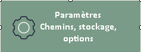

- Height min : 90
- Icone png 48x48 (Assets/Boutons_ico_48/)
- Image : System.Drawing.Bitmap au format .png
- ImageAlign : MiddleCenter
- BackColor : ColorSauge (122;155;135)
- ForeColor : White
- FlatStyle : Flat
- Font : Calibri 12 pt - Bold
- Tag : nom_normal
- TextAlign : MiddleCenter
- TextImageRelation : ImageBeforeText
- UseVisualStyleBackColor : False

#### Modèle Home

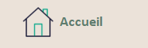

- Height min : 60
- Icone png 48x48 (Assets/Boutons_ico_48/)
- Image : System.Drawing.Bitmap au format .png
- ImageAlign : MiddleLeft
- BackColor : ColorBeige (235; 226; 217)
- ForeColor : ColorSaugeFonce (95; 125; 110)
- FlatStyle : Flat
- Font : Calibri 13 pt - Bold
- Tag : nom
- TextAlign : MiddleLeft
- Padding : 10; 0; 0; 0
- TextImageRelation : ImageBeforeText
- UseVisualStyleBackColor : False

#### Panel Actions

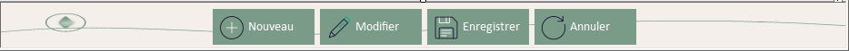

#### Panel Menu (Home)

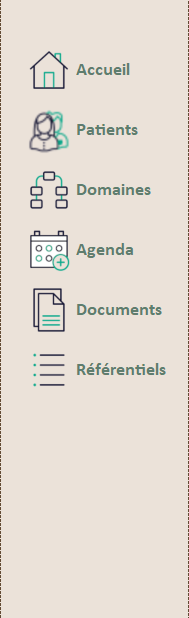

#### Icones .png pour les différents boutons

- Catalogue détaillé en [annexe - bibliothèque d'icônes](#annexe-icones).
- Répertoires :
  - Home : `/Assets/Boutons_Home/`
  - Standard : `/Assets/Boutons_ico_32/`
  - Tuile : `/Assets/Boutons_ico_48/`

------

## Icônes Application et Forms


- Nom : Althea_A _96x96.ico
- Format : .ico
- Variantes disponibles : `Althea_A_32x32.ico`, `Althea_A_48x48.ico`, `Althea_A _96x96.ico`, `Althea_A 128x128.ico`, `Althea_A_256x256.ico`
- Répertoire : /Assets/Appli_Ico/

------

## Icônes/Images Techniques

### États dans les grilles et les listes

Plus aucune icône PNG d'état : depuis UI-9 (18/10/2026), un état se lit en **pastille** dessinée par le code (`UtilsPastilles`, `UtilsDataGrid.DessinerPastilleCellule`), dans un ton sémantique pris dans les teintes de `UITheme` — tableau des tons et conventions dans `Reference_UI.md`.

Les icônes `Assets/Tech_Ico` (OK, NO, OFF, Lock en 16, 20, 26 et 32 px) ont été supprimées le 18/10/2026 (UI-9.4), avec le cadenas des lignes système des référentiels, devenu la pastille « Système ».


**Icônes de statut de dossier — dessinées par le code** (17/10/2026, maquette « Icônes d'état ») : `UtilsIcons.IconStatutDossierDominant(code, taille)` et `IconPatientSansDossier(taille)` dessinent, dans le style d'`AltheaIconeEtat` (rond à fond pâle, contour et signe dans la couleur de l'état), les icônes de la liste « Dossier » de l'écran Patients :

- ▶ vert-de-gris (Actif : `ColorGrisVertClair` / `ColorSauge` / `ColorSaugeTresFonce`),
- ‖ ocre (En pause : `StatutPause` / `ColorJauneModere`),
- coche gris foncé (Clôturé) et boîte d'archive gris foncé (Archivé) sur `ColorGrisClair` / `ColorGrisMoyenFonce` / `ColorGrisFonce`,
- cercle pointillé et tiret gris (Sans dossier).

Elles remplacent d'anciens PNG (`actif_20x20`, `pause_20x20`…), supprimés au lot UI-8 (17/10/2026).

- Gestion centralisée via `Utils/UtilsIcons.vb`
- **Règle de priorité** : Verrouillé > Actif > Inactif

### Icônes d'état (DialogChoix et notes) — dessinées par le code

Depuis le 14/10/2026 (UI-7, maquette « DialogChoix — icônes », style 2 retenu), les icônes d'état ne sont plus des GIF : elles sont dessinées par le contrôle du kit `AltheaIconeEtat` (rond à fond pâle, contour et signe dans la couleur du type), nettes à toutes les tailles.

| Type (`EtatIcone`) | Signe | Couleur de base (`UITheme`) | Usage |
|------|-------|----------|--------|
| Information | i | Bleu moyen (`ColorBleuMoyen`) | Message informatif — le bleu le distingue du succès |
| Avertissement | ! | Jaune modéré (`ColorJauneModere`) | Avertissement, encadré d'attention |
| Erreur | × | Rose foncé assombri (`ColorRoseFonce`) | Erreur |
| Question | ? | Mauve foncé (`ColorMauveFonce`) | Question, confirmation |
| Succès | ✓ | Sauge foncé (`ColorSaugeFonce`) | Succès |
| Attente | arc qui tourne | Sauge clair (`ColorSaugeClair`) | Opération en cours |

- Fond = couleur de base mélangée à 85 % de blanc ; signe et titre = couleur de base assombrie de 30 % (`AltheaIconeEtat.Teintes`). Aucune couleur propre.
- Taille : 40 px dans l'en-tête de `DialogChoix` (depuis la V2.1, la couleur du type n'apparaît que sur l'icône), 20 px dans l'encadré d'attention.
- Les anciens GIF (`/Assets/Gif_Animated/`, ressources `*_64`) ont été supprimés au lot UI-8 (17/10/2026).

------

### Icônes divers

| Nom                                         | Image                                                        | Fonction                | Tag                     |
| ------------------------------------------- | ------------------------------------------------------------ | ----------------------- | ----------------------- |
| flechebas_24_normal (+disabled & Hover)     |  |                         | flechebas_24_normal     |
| Plus_22x22                                  |         | Image du Designer : `PaiementEditor.btnAjouterModePaiement` |                         |
| plus_24_normal (+disabled & Hover)          |  |                         | plus_24_normal          |
| recherche_24_normal (+disabled & Hover)     | 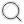 |                         | recherche_24_normal     |
| reinitialiser_24_normal (+disabled & Hover) |  |                         | reinitialiser_24_normal |
| status_dossier_20x20                        |  | Image du Designer : `UC_DossierFiche.btnChangerStatut` | |

- Répertoire : /Assets/Ico_divers/
- Format : .png
- Tailles recommandées : 24x24, 20x20, 22x22
- Usage : surtout à l'intérieur des UC/Forms, hors pnlAction : ex Recherche, DialogChoix
- Affichage dynamique selon le `TypeDialogue`

<a id="annexe-icones"></a>

### Boutons : Home, Standards et Tuiles

##### Variantes d'état

Une seule illustration est présentée par bouton : la variante `_normal`. Les fichiers `_hover` et
`_disabled`, lorsqu'ils existent, appartiennent à la même famille et ne sont pas répétés dans ce catalogue.
Les boutons Home possèdent en plus une variante `_selected` (bouton de la section active du menu).

| Type     | png _normal                                                  | Tag                          |
| -------- | ------------------------------------------------------------ | ---------------------------- |
| Home     |  | accueil                      |
| Home     |  | agenda                       |
| Home     |  | documents                    |
| Home     |  | domaines                     |
| Home     |  | outils_admin                 |
| Home     |  | patients                     |
| Home     |  | referentiels                 |
| Home     |  | recherche (23/10/2026, provisoire) |
| Home     |  | forcer_password              |
| Standard |  | annuler_normal               |
| Standard | 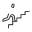 | eleverAcces_normal           |
| Standard |  | enregistrer_normal           |
| Standard |  | fermer_normal                |
| Standard |  | login_normal                 |
| Standard |  | modifier_normal              |
| Standard |  | modifierPW_normal            |
| Standard |  | nouveau_normal               |
| Standard |  | retourRole_normal            |
| Standard |  | testerConnexion_normal       |
| Standard |  | valider_normal               |
| Standard |  | voir_normal                  |
| Standard | 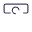 | verrouiller_normal           |
| Standard | 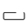 | reset_password_normal        |
| Standard |  | activer_normal               |
| Standard | 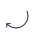 | actualiser_normal            |
| Standard | 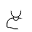 | ajouter_normal               |
| Standard |   | open_normal                  |
| Standard |  | supprimer_normal             |
| Standard |  | deverouiller_normal          |
| Standard |  | ouvrir_dossier_normal        |
| Standard | 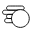 | paiement_normal              |
| Standard | 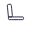 | seance_normal                |
| Standard |  | encaisser_seance_normal      |
| Standard | 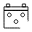 | reporterSeance_normal        |
| Standard |  | cloturer_normal              |
| Standard |  | rattacher_normal             |
| Standard |  | retirer_normal               |
| Standard |  | importer_normal |
| Standard |  | generer_normal |
| Tuile    |  | configurationDatabase_normal |
| Tuile    |  | etatSystem_normal            |
| Tuile    |  | journaux_normal              |
| Tuile    |  | parametres_normal            |
| Tuile    | 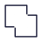 | sauvegarde_normal            |
| Tuile    | 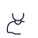 | utilisateurs_normal          |
| Tuile    |  | domaines_normal              |
| Tuile    | 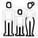 | liensPatient_normal          |
| Tuile    |  | roleIntervenant_normal       |
| Tuile    |  | situationsFamiliales_normal  |
| Tuile    |  | statutDossier_normal         |
| Tuile    |  | statutSeance_normal          |
| Tuile    | 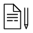 | typeDocument_normal          |
| Tuile    |  | texteType_normal (19/10/2026) |
| Tuile    |  | usageTexte_normal (19/10/2026) |
| Tuile    |  | typeRendezvous_normal        |
| Tuile    | 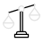 | rolesLegaux_normal           |
| Tuile    |  | therapeutes_normal           |
| Tuile    |  | modesPaiement_normal         |
| Tuile    | 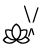 | natureSeance_normal          |
| Tuile    |  | tarifSeance_normal           |
| Tuile    | 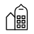 | cabinet_normal (UC_AdminHome) |
| Tuile    |  | situationJuridique_normal (UC_AdminHome) |
| Tuile    |  | typeIdentifiant_normal (UC_AdminHome, 20/10/2026) |
| Tuile    |  | lateralite_normal (UC_ReferentielHome, 20/10/2026) |
| Tuile    |  | rechercheSeances_normal (UC_RechercheHome, 23/10/2026, provisoire) |
| Tuile    |  | recherchePaiements_normal (UC_RechercheHome, 23/10/2026, provisoire) |

- Répertoires
  - Home : /Assets/Boutons_Home/
  - Standard : /Assets/Boutons_ico_32/
  - Tuile : /Assets/Boutons_ico_48/

- Format : .png
- Tailles recommandées : Home et Tuile 48x48, Standard 32x32
- Home : Fond clair - Standard et Tuiles : Fond foncé
- Usage :
  - Home : Dans la page Home
  - Standard : pnlActions généralement
  - Tuile : UC_xxxxHome

### Icônes des zones de suivi clinique

| Zone | Image |
| --- | --- |
| Antécédents |  |
| Diagnostic |  |
| Historique |  |
| Historique archivé |  |
| Motif du suivi |  |
| Objectifs du suivi |  |
| Traitements en cours |  |

- Répertoire : /Assets/Boutons_Suivi/
- Format : .png
- Usage : zones cliniques de `UC_DossierFiche`
- Taille : 24x24

### Icones RichTextEditor

Jeu redessiné pour la refonte de l'éditeur (19/10/2026, ADR-42) : un seul style — trait arrondi de 1,8 px, Sauge très foncé, 20 × 20 px —, source SVG unique exportée en PNG.

Pas de variantes `_hover` / `_disabled` : le survol est un fond (`AltheaRenduBarre`), l'état désactivé une opacité de 40 %.

Les lettres G / I / S restent des lettres (gras = **G**, interface en français).

Couleurs fixes : barre ocre de « Couleur du texte », jaune pâle du surligneur, badges PDF (terre) et Word (bleu).

| Nom | Image | Rôle |
| --- | --- | --- |
| annuler_20_normal |  | Annuler |
| retablir_20_normal |  | Rétablir |
| gras_20_normal |  | Gras (G) |
| italique_20_normal |  | Italique |
| souligne_20_normal |  | Souligné |
| barre_20_normal |  | Barré |
| couleur_20_normal |  | Couleur du texte |
| surligneur_20_normal |  | Surligneur |
| effacer_20_normal |  | Effacer la mise en forme |
| puces_20_normal |  | Liste à puces |
| numeros_20_normal |  | Liste numérotée |
| retraitMoins_20_normal |  | Diminuer le retrait |
| retraitPlus_20_normal |  | Augmenter le retrait |
| alignGauche_20_normal |  | Aligner à gauche |
| alignCentre_20_normal |  | Centrer |
| alignDroite_20_normal |  | Aligner à droite |
| justifier_20_normal |  | Justifier |
| date_20_normal |  | Insérer la date |
| rechercher_20_normal |  | Rechercher |
| occPrecedente_20_normal |  | Occurrence précédente |
| occSuivante_20_normal |  | Occurrence suivante |
| fermer_20_normal |  | Fermer la recherche |
| apercu_20_normal |  | Aperçu avant impression |
| imprimer_20_normal |  | Imprimer |
| exporter_20_normal |  | Exporter |
| pdf_20_normal |  | Exporter en PDF |
| word_20_normal |  | Exporter en Word |
| miseEnPage_20_normal |  | Mise en page |
| copier_20_normal |  | Copier |
| couper_20_normal | 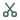 | Couper |
| coller_20_normal |  | Coller |
| collerTexte_20_normal |  | Coller sans mise en forme |
| verrou_20_normal |  | Lecture seule (repère de consultation) |
| agrandir_20_normal |  | Ouvrir en grand (profil Compact, temps 2, 19/10/2026) |
| texteType_20_normal |  | Insérer un texte type (temps 2, 19/10/2026) |

- Répertoire : `/Assets/Editor_Ico/`
- Format : .png, 20 × 20 px, fond transparent
- Utilisées par : `UC_RichTextEditor` (images intégrées par le Designer dans son `.resx`)

### Icônes de titre

Icône affichée en haut à gauche de chaque Form et UserControl, dans l'en-tête `AltheaEnTete` (propriété `Icone`, 48 px). Elle est soit intégrée par le Designer dans le `.resx` de l'écran (clé `enTete.Icone`), soit fournie par `My.Resources.Titre_*` pour les référentiels (surcharge `IconeTitre` de `UC_ReferentielBase`).

| Nom | Image | Ressource | Utilisée par | Taille |
| --- | --- | --- | --- | --- |
| accueil |  | — (Designer) | `UC_Accueil` | 128x128 |
| cabinet |  | — (Designer) | `UC_Cabinet` | 48x48 |
| situationJuridique |  | `Titre_situationJuridique` | `UC_SituationsJuridiques` | 48x48 |
| civilites |  | `Titre_civilites` | `UC_Civilites` | 48x48 |
| configurationDatabase |  | — (Designer) | `ConfigurationConnexion` | 430x430 |
| contacts |  | — (Designer) | `ContactEdition` | 128x128 |
| contact_48 |  | — | Non utilisée actuellement (variante 48 px de contacts) | 48x48 |
| domaines |  | `Titre_domaines` | `UC_DomainesHome` | 48x48 |
| dossier |  | — (Designer) | `UC_DossierFiche`, `DossierStatutEditor`, `DossierZoneEditor` | 430x430 |
| etatSystem |  | `Titre_etatSystem` | `UC_EtatSysteme` | 48x48 |
| forcer_password |  | — (Designer) | `ChangePassword` | 48x48 |
| intervenant |  | — (Designer) | `IntervenantEdition` | 48x48 |
| journaux |  | `Titre_journaux` | `UC_Journaux` | 48x48 |
| liensPatient |  | `Titre_liensPatient` | `UC_LiensPatient` | 48x48 |
| modesPaiement |  | `Titre_modesPaiement` | `UC_ModesPaiement` | 48x48 |
| naturesSeances |  | `Titre_naturesSeances` | `UC_NaturesSeance` | 48x48 |
| organismes |  | `Titre_organismes` | `UC_Organismes` | 48x48 |
| outils_admin |  | — (Designer) | `UC_AdminHome` | 128x128 |
| paiement |  | — (Designer) | `PaiementEditor`, `DialogPaiementsSeance`, `DialogUtilisationAvoir`, `DialogMotifAnnulation` | 128x128 |
| parametres |  | — (Designer) | `UC_Parametres` | 430x430 |
| patients |  | — (Designer) | `UC_PatientHome`, `UC_PatientFiche` | 128x128 |
| pays |  | `Titre_pays` | `UC_Pays` | 48x48 |
| periodicite |  | `Titre_periodicite` | `UC_Periodicites` | 48x48 |
| quota |  | — (Designer) | `CategoriesQuotaEditor` | 48x48 |
| referentiels |  | — (Designer) | `UC_ReferentielHome`, `UC_ReferentielBase` (icône par défaut) | 128x128 |
| rolesIntervenant |  | `Titre_rolesIntervenant` | `UC_RolesIntervenant` | 48x48 |
| rolesLegaux |  | `Titre_rolesLegaux` | `UC_RoleLegal` | 48x48 |
| sauvegarde | 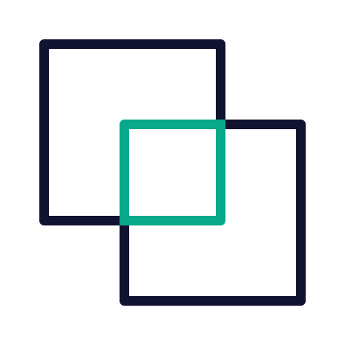 | — (Designer) | `UC_Sauvegardes` | 48x48 |
| seance_48 | 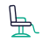 | — (Designer) | `SeanceEditor`, `DialogReportSeance`, `PlanningJourViewer` | 48x48 |
| situationsFamiliales |  | `Titre_situationsFamiliales` | `UC_SituationsFamiliales` | 48x48 |
| statutsDossiers |  | `Titre_statutsDossiers` | `UC_StatutsDossier` | 48x48 |
| statutsSeance |  | `Titre_statutsSeance` | `UC_StatutsSeance` | 48x48 |
| tarifsSeance | 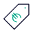 | `Titre_tarifsSeance` | `UC_PrixSeance` | 48x48 |
| therapeute |  | — (Designer) | `UC_Therapeutes`, `TherapeuteEdition` | 48x48 |
| textesTypes |  | `Titre_textesTypes` | `UC_TextesTypes` (19/10/2026) | 48x48 |
| usagesTextes |  | `Titre_usagesTextes` | `UC_UsagesTextesTypes` (19/10/2026) | 48x48 |
| typesDocuments |  | `Titre_typesDocuments` | `UC_TypesDocuments` | 48x48 |
| typesIdentifiant |  | `Titre_typesIdentifiant` | `UC_TypesIdentifiantPro` (20/10/2026) | 48x48 |
| lateralites |  | `Titre_lateralites` | `UC_Lateralites` (20/10/2026) | 48x48 |
| typesRendezVous |  | `Titre_typesRendezVous` | `UC_TypesRendezVous` | 48x48 |
| utilisateurs |  | — (Designer) | `UC_Utilisateurs`, `UtilisateurEdition`, `Login`, `ElevationAcces` | 430x430 |

- Répertoire : /Assets/Titre_Ico/
- Format : .png (fond transparent)
- **Couleurs** : les icônes de titre sont **noir et vert**, car l'en-tête est sur fond clair. Les icônes de tuiles et de boutons (`Boutons_ico_48`, `Boutons_ico_32`) sont noir et blanc, prévues pour un fond foncé : ne pas les réutiliser comme icône de titre (décision du 12/10/2026, en attendant la refonte des icônes).
- **Affectation** : dans le Designer (propriété `Icone` de `enTete`, image intégrée au `.resx`), jamais chargée par le code — sinon le Designer ne la montre pas et le code écrase le choix fait dans le Designer. Exception : les référentiels, par `IconeTitre` / `My.Resources.Titre_*`.
- Taille recommandée : 48x48 (affichage 48x48 dans `AltheaEnTete`) ; les sources 128x128 et 430x430 sont réduites par le zoom.
- Les images des tableaux sont mises à l'échelle d'affichage équivalente à 48 px.
- Nouvel écran : choisir une icône existante de ce répertoire ou en ajouter une, puis compléter ce tableau.


# Contact

> ***Joëlle De Poorter - Les Artefacts de Manou***
>
> Projet réalisé pour soutenir une pratique de psychologie et de graphologie dans la gestion fiable et évolutive des patients et documents.
>
> - Site web Auteur/Les Artefacts de Manou/Joëlle De Poorter : https://lesartefactsdemanou.be
>
> - Site web Psychologue & Graphologue:  https://pearlnguyenduy.be/
> - mailto: Privé et Les Artefacts de Manou
>
> - GitHub privé: Althea    https://github.com/AngeljoNG/Althea
> - GitHub public : https://github.com/Les-Artefacts-de-Manou/Althea
>
> ---


