# 📐 Althéa — Référence UI : construire un écran

> *Dernière mise à jour : 24/10/2026 — le code toujours visible, § 5.6 ; liste ouverte à la largeur de son plus long élément, `AltheaListe`*

<details>
<summary>Historique des mises à jour</summary>

- 24/10/2026 — le code toujours visible : fenêtres, grilles, listes de choix, annonces, § 5.6 ; `AltheaListe` : liste ouverte à la largeur de son plus long élément
- 23/10/2026 — relevé des paiements partagé : `FiltresPaiements`, `PaiementListeItem.InfobulleLigne` ; période des recherches : `SelecteurPeriode`
- 23/10/2026 — période « du … au … » : `AltheaDate.CorrigerBornes`, § 7.10 ; filtre et résumé des séances partagés : `FiltresSeances`
- 20/10/2026 — bouton inactif : dire pourquoi, § 5.4 et § 7.1 ; barre d'état ou message, § 5.4 ; zone de texte simple avec correcteur d'orthographe, `AltheaZoneTexte`, § 7.24
- 19/10/2026
  - « Modifier » seulement sur l'onglet ou l'étape de la fiche, § 5.7
  - modifications non enregistrées, § 5.8
  - barre de pagination, § 7.22
  - éditeur de texte refondu, profils Complet / Compact et `AltheaRenduBarre`, « Ouvrir en grand », en-tête et pied de page des documents, textes types, correcteur d'orthographe, § 7.23
- 18/10/2026 — référentiels et Domaines en pastilles, PNG `Tech_Ico` retirés ; grilles d'administration : `DesactiverTri`, repère sélectionnable, teintes des états d'administration ; grilles — états lisibles : tons sémantiques `TonEtat`, conventions d'alignement, maquette UI-9
- 17/10/2026
  - pastille de statut du dossier, `UtilsPastilles.TeinteStatutDossier`
  - fenêtre sur un élément existant : nommer par le code, § 5.6
  - refus de saisie affiché dans la fenêtre
  - grilles des séances et des paiements : pastilles d'état, ligne « Aujourd'hui », résumés cliquables, relevé chronologique
- 16/10/2026 — champ d'heure `AltheaHeure` ; page de réglages : écran Paramètres ; `DialogChoix` V2.1, maquette C ; captures de la vitrine du kit) — remplace `Reference_UI_Guide_Utilisation.md` et `Reference_UI_Proprietes.md` (fusionnés

</details>

Ce document explique **comment construire un écran d'Althéa** : une fenêtre, un UserControl, une liste, une fiche, un champ. Il sert de maquette écrite : un développeur qui reprend le projet doit pouvoir créer une nouvelle fenêtre conforme en le suivant, sans deviner ni copier au hasard un écran existant.

| Document | Ce qu'il dit |
| --- | --- |
| **Ce document** | *Comment on construit* : structure des écrans, contrôles à utiliser, propriétés, couleurs, tailles, code à écrire. |
| [`Charte_Graphique.md`](./Charte_Graphique.md) | *À quoi ressemble* Althéa : palette, icônes, inventaire des assets, historique des écrans habillés. |
| [`Rules.md`](./Rules.md) (§ 15 et 16) | Les *règles* d'interface, en bref (fenêtres en cartes, consultation lisible, DialogChoix…). |
| [`../Architecture/Documentation_technique_UI_Althea.md`](../Architecture/Documentation_technique_UI_Althea.md) | Chaque écran *tel qu'il est* : ses contrôles, ses méthodes, ses règles (sommaire, puis une partie par domaine dans `UI/`). |
| [`../Todo/Plan_Refonte_UI_Althea.md`](../Todo/Plan_Refonte_UI_Althea.md) | L'histoire de la refonte (lots UI-0 à UI-8) et les décisions prises en chemin. |

> **Illustrations.** Les contrôles du kit sont illustrés par des **captures de l'application** : la **vitrine du kit** (`TestKitAlthea`, bouton « Vitrine du kit » de la carte « Outils de test » de l'accueil, Debug), qui montre chaque contrôle dans ses états (16/10/2026).
>
> Les écrans complets (Home, listes, fiches, Domaines, fenêtre type, `DialogChoix`) sont encore illustrés par les maquettes validées pendant la refonte (09/10 → 16/10/2026), rendues en image : elles seront remplacées par des captures des écrans réels à la fin de la refonte.
>
> Après toute modification du kit, rouvrir la vitrine et refaire les captures concernées.

---

## Table des matières

**Partie 1 — Construire un écran**

1. [Les fondamentaux](#1-les-fondamentaux) — palette, polices, espacements, icônes
2. [Les familles d'écrans](#2-les-familles-décrans) — Home, hub, liste, fiche, écran à étapes, fenêtre, boîte de message
3. [Recette : créer une nouvelle fenêtre](#3-recette--créer-une-nouvelle-fenêtre)
4. [Recette : créer un nouveau UserControl](#4-recette--créer-un-nouveau-usercontrol)
5. [Comportements communs](#5-comportements-communs) — modifications non enregistrées (§ 5.8), consultation lisible, DialogResult, erreurs, mots de passe, infobulles
6. [Ce qu'on ne fait plus](#6-ce-quon-ne-fait-plus)

**Partie 2 — Catalogue des contrôles**

7. [Contrôles du kit Althéa](#7-contrôles-du-kit-althéa) — une fiche par contrôle
8. [Contrôles Windows encore utilisés](#8-contrôles-windows-encore-utilisés)
9. [Utilitaires d'interface](#9-utilitaires-dinterface)
10. [Nommage](#10-nommage)
11. [Assets](#11-assets)

---

# Partie 1 — Construire un écran

## 1. Les fondamentaux

### 1.1 Palette (`UITheme`)

Toujours passer par `UITheme` : **aucune couleur écrite en dur** dans le code (dans le Designer, la valeur RVB apparaît forcément, mais elle doit être celle d'une couleur de `UITheme`).

| Nom `UITheme` | RVB | Usage principal |
| --- | --- | --- |
| `ColorSauge` | 122; 155; 135 | Boutons courants, tuiles, soulignement d'onglet, survol |
| `ColorSaugeFonce` | 95; 125; 110 | **Libellés de champs**, sous-titres, texte des boutons Outil |
| `ColorSaugeTresFonce` | 75; 105; 90 | Titre de la barre de titre Windows, textes forts sur fond pâle |
| `ColorSaugeClair` | 178; 197; 186 | Vague de la barre d'actions, bordure de la barre de titre |
| `ColorGrisVertClair` | 222; 230; 225 | Survol des boutons Outil, pastilles, en-têtes de grilles |
| `ColorBeigeClair` | 244; 239; 234 | **Fond des fenêtres et des écrans** |
| `ColorBeige` | 235; 226; 217 | Menu de la Home, fond de la barre d'actions |
| `ColorBeigeFonce` | 218; 201; 184 | Bordures de cartes, traits fins, barre d'état |
| `ColorChampLectureSeule` | 241; 236; 230 | **Fond d'un champ en consultation** |
| `ColorMauveFonce` | 126; 95; 112 | **Titres** : en-tête d'écran, titres de cartes, sections |
| `ColorGrisFonce` | 74; 74; 74 | **Texte des champs**, texte courant |
| `ColorGrisTresFonce` | 50; 50; 50 | Texte très contrasté (rare) |
| `ColorGrisDiscret` | 118; 118; 118 | Textes secondaires, aides, segments du fil d'Ariane |
| `ColorJauneModere` / `ColorBoutonEnregistrer` | 200; 160; 90 | Bouton **Enregistrer** (Ocre), alertes de jauge |
| `ColorRougeMoyenClair` / `ColorBoutonSupprimer` | 168; 120; 110 | Bouton **Supprimer** (Terre), actions destructrices |
| `ColorRoseFonce` | 194; 106; 118 | Messages d'erreur dans une fenêtre (`lblMessage`, `lblErreur`) |
| `ColorBleuMoyen` | 69; 130; 193 | Icône d'état « Information » uniquement |

Couleurs d'état des grilles (`StatutRegle*`, `StatutDu*`, `StatutPrevisionnel*`, `StatutAnnule*`, `StatutNoShow*`) et des grilles (`DataGrid*`, `DataGridSecondaire*`) : également dans `UITheme`, appliquées par `UtilsDataGrid` et les écrans concernés.

L'onglet « Palette et polices » de la vitrine affiche **toutes** les couleurs de `UITheme`, lues dans le code (une couleur ajoutée y apparaît d'elle-même), avec leur nom et leurs valeurs RVB :

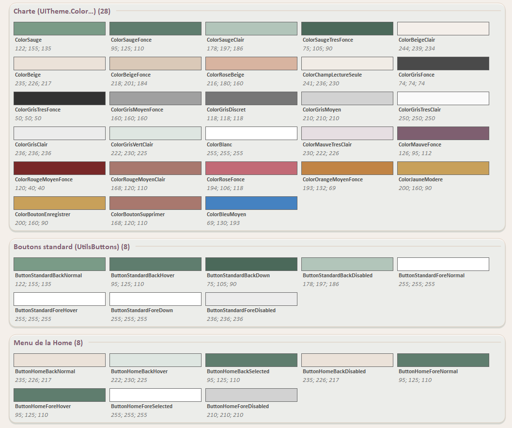

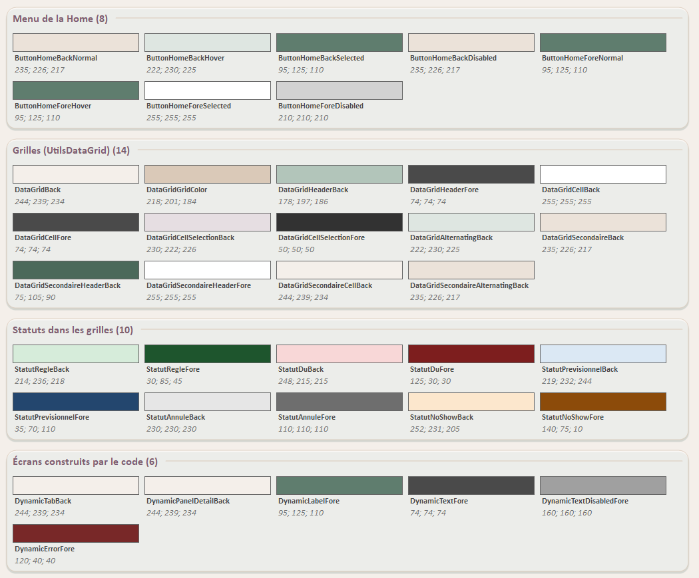

Les teintes d'un état (erreur, avertissement…) se demandent à `AltheaIconeEtat.Teintes(EtatIcone.X)` : `.Base`, `.Pale`, `.Foncee` (ex. rose d'erreur d'un champ refusé).

### 1.2 Polices

Une seule famille : **Calibri**.

| Élément | Taille | Style | Couleur |
| --- | --- | --- | --- |
| Titre d'écran (`AltheaEnTete`) | 18 | gras | Mauve foncé |
| Sous-titre d'écran | 11 | normal | Sauge foncé |
| Titre de carte (`AltheaCarte.Titre`) | 12 | gras | Mauve foncé |
| **Libellé de champ** | **10,5** | **gras** | **Sauge foncé** |
| **Champ** (texte, liste, date, case) | **11** | normal | Gris foncé |
| Bouton d'action (`AltheaBouton`) | 11 | gras | selon la variante |
| Consigne / aide dans une carte | 10 | italique | Sauge foncé |
| Message d'erreur dans une fenêtre | 11 | gras | Rose foncé |
| Police de la fenêtre / du UC (`Font`) | 9 (ou 10) | normal | — |

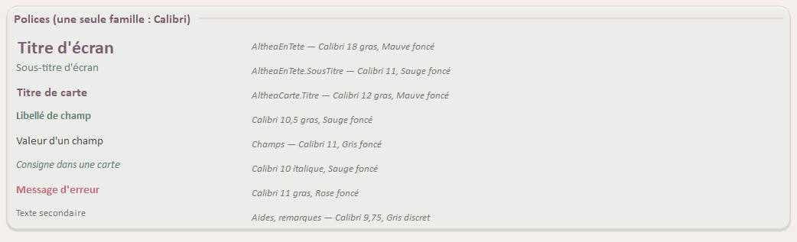

> **Piège** : ne changez jamais la police d'une fenêtre ou d'un UC existant. `AutoScaleDimensions` (6; 14 pour Calibri 9) suit cette police : la modifier redimensionne toute la fenêtre. Les tailles ci-dessus se posent **sur chaque contrôle**.

### 1.3 Espacements et grille

Valeurs d'usage dans les fenêtres (en pixels, à 100 %) :

| Élément | Valeur |
| --- | --- |
| En-tête (`AltheaEnTete`) | Dock Top, hauteur **62** |
| Marge autour des cartes | **12** à gauche et à droite ; première carte à **y = 70** (sous l'en-tête) |
| Écart entre deux cartes | **8** |
| `Padding` d'une carte de fenêtre | **12; 8; 12; 10** |
| Première ligne de champs dans une carte titrée | champ à **y = 40**, libellé à **y = 44** (le titre occupe ~37 px) |
| Pas entre deux lignes | **32** (fiches denses) à **34** |
| Colonne des libellés | **x = 14** |
| Colonne des champs | x = 14 + libellé le plus long + ~16 (souvent 110, 130, 160, 190 ou 200) |
| Hauteurs | zone de texte 25 · liste 26 · date 26 à 32 · petit bouton 30 × 30 · bouton d'action 36 à 40 |
| Barre d'actions | Dock Bottom, hauteur **47 à 57** |

Pour mesurer la largeur d'un libellé avant de placer la colonne des champs : Calibri 10,5 gras ≈ 7,5 px par caractère en moyenne (« Titre professionnel » ≈ 125 px, « Situation juridique » ≈ 121 px).

### 1.4 Icônes

| Usage | Dossier | Taille | Chargement |
| --- | --- | --- | --- |
| Boutons d'action (texte + icône) | `Assets/Boutons_ico_32/` | 32 | `UtilsButtons.InitStandardButton(btn)` d'après le `Tag` (`enregistrer_normal`…), états `_normal` / `_hover` / `_disabled` |
| **Petits boutons Outil, icône seule** | `Assets/Ico_divers/` (`*_24_normal.png`) | 24 | **Image posée dans le Designer** (ressource du `.resx`), sans `UtilsButtons` |
| Tuiles des hubs | `Assets/Boutons_ico_48/` | 48 | `UtilsButtons.InitLargeIconButton` |
| Menu de la Home | `Assets/Boutons_Home/` | 48 | `UtilsButtons.InitHomeMenuButton` (`_normal`, `_selected`, `_disabled`) |
| En-tête d'écran | `Assets/Titre_Ico/` | 48 | Propriété `Icone` d'`AltheaEnTete` (Designer) |
| Icônes d'état (information, erreur…) | — | — | **Dessinées** par `AltheaIconeEtat` (plus de GIF) |

Icônes du kit dessinées pour les boutons Outil (15/10/2026) : `oeil`, `cadenas`, `cadenas_ouvert`, `importer`, `compte`, `lier`, `delier` — trait sombre de 2 px sur 24 px, lisibles sur fond blanc comme sur le survol vert pâle. Une nouvelle icône Outil suit ce modèle.

---

## 2. Les familles d'écrans

Sept familles ; un nouvel écran appartient forcément à l'une d'elles.

### 2.1 La Home (coquille)

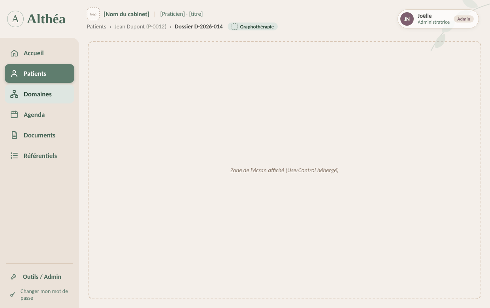

*Maquette « Home A » (11/10/2026, retenue).*

- Fond fixe 2560 × 1440 rogné (pas étiré), feuillage et logo en images séparées.
- Bandeau : logo, cabinet et praticien, `AltheaFilAriane` (chemin + pastille du domaine), `AltheaPuceUtilisateur`.
- Menu : `AltheaBoutonMenu` en pastilles arrondies ; Outils / Admin et mot de passe sous un filet.
- `pnlContent` reçoit les UserControls (997 × 771) via `NavigationManager` ; la barre d'état de la Home sert à tous les UC (`_context.SetStatus`).
- Barre de titre : `AltheaBarreTitre.Appliquer(Me)`.

### 2.2 Le hub (tuiles)

Écrans `UC_ReferentielHome`, `UC_AdminHome` : un en-tête, une carte par section (`AltheaTitreSection` ou `AltheaCarte.Titre`), des `AltheaTuile` 214 × 90 dans un `TableLayoutPanel` de 4 colonnes (le seul usage restant de `TableLayoutPanel` : une grille de tuiles). Voir la section « Tuile » de l'image du § 1.

### 2.3 L'écran de liste

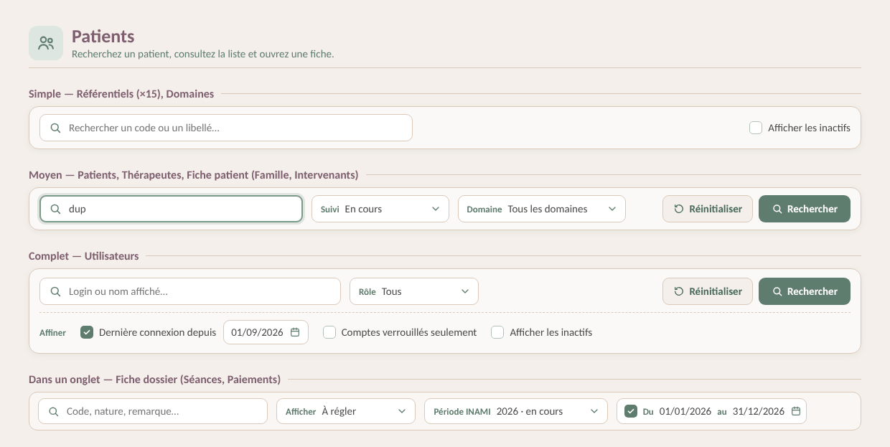

*Maquette « Bandeau de recherche » (10/10/2026, validée).*

Structure, de haut en bas :

1. `AltheaEnTete`.
2. **Bandeau de recherche** dans une `AltheaCarte` :
   - `AltheaRecherche` (texte d'aide), `AltheaListe` avec `Etiquette` (« Suivi », « Rôle »…), `AltheaCase`
   - à droite Réinitialiser (Clair) et Rechercher.
   - Quatre densités : *Simple* (référentiels, Domaines), *Moyen* (Patients, Thérapeutes), *Complet* (Utilisateurs, ligne « Affiner »), *dans un onglet* (Séances, Paiements d'un dossier).
3. Grille (`UtilsDataGrid.InitDataGridBasique`), `UC_Pagination` si la liste peut dépasser un écran (§ 7.22).
4. `AltheaBarreActions` : Nouveau, Modifier… (boutons de l'écran).

Référentiels : tout est fourni par `UC_ReferentielBase` (grille à gauche, carte « Détail » à droite, données liées en onglets) ; un nouveau référentiel hérite de cette classe.

La carte « Détail » suit la règle des fenêtres (libellé à gauche, champ à x = 112, une ligne tous les 34 px) : Code, Libellé, Ordre, puis les champs propres au référentiel, et État en dernier.

Un champ propre se crée et se pose en deux lignes, sans position ni couleur à calculer :

```vb
Protected Overrides Sub ConfigurerChampSupplementaire()
    _cboPorteur = CreerListeDetail("cboPorteurBce", 160)      ' aussi CreerZoneTexteDetail, CreerCaseDetail, CreerNombreDetail
    AjouterLigneDetail("Porteur BCE", _cboPorteur)            ' libellé court (colonne de 100 px)
End Sub
```

La bascule consultation / saisie de tout le panneau est faite par la base ; `ActiverChampSupplementaire` ne traite que les exceptions (ex. un champ verrouillé sur une ligne système).

### 2.4 La fiche (UserControl à onglets)

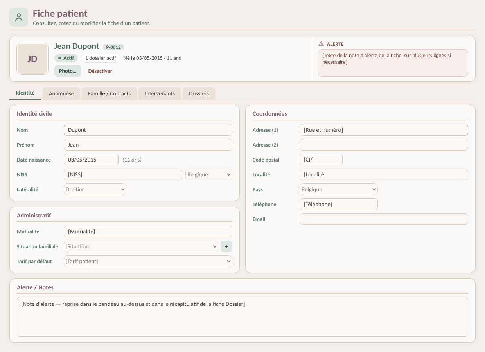

*Maquette « Fiche patient » (11/10/2026, retenue).*

- En-tête, puis éventuellement un **bandeau récapitulatif** en carte (identité, pastilles, alerte).
- `AltheaOnglets` (`CouleurFond = Transparent`), chaque onglet découpé en **cartes thématiques** (Identité civile, Coordonnées, Administratif…).
- Barre d'actions de l'écran : Modifier / Enregistrer / Annuler pour les **champs de la fiche**.
- **Listes rattachées** (contacts, séances, paiements) : dans une carte avec **barre locale** au-dessus de la grille, actions immédiates (ADR-34) :

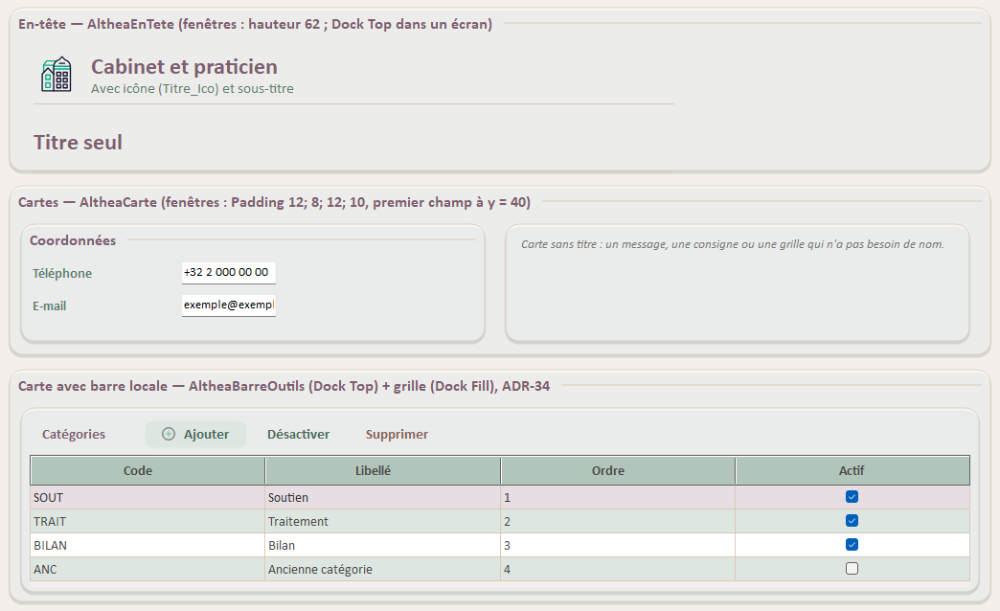

*Vitrine du kit, onglet Structure (barre locale : maquette « Barres locales », version B retenue le 11/10/2026).*

Autres modèles de fiche validés :

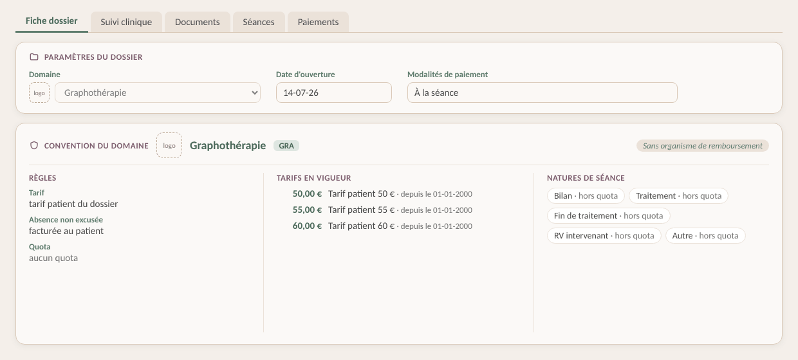

*Fiche dossier B (11/10/2026, retenue) — libellés au-dessus des champs quand les champs sont alignés sur une ligne.*

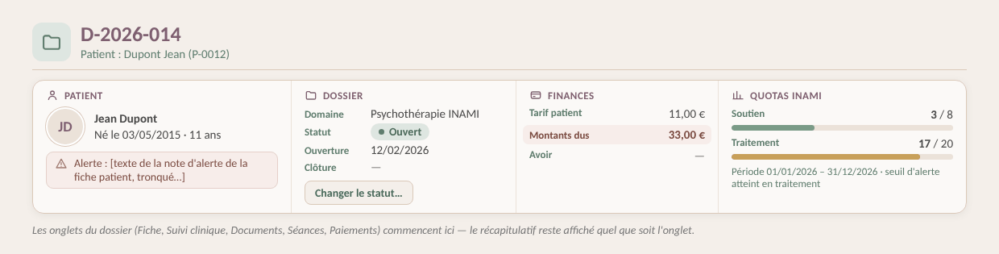

*Récapitulatif A (10/10/2026, retenu) — carte à blocs séparés par un filet.*

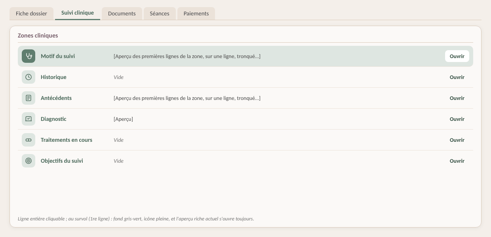

*Suivi clinique A (11/10/2026, retenu) — `AltheaLigne` dans une carte.*

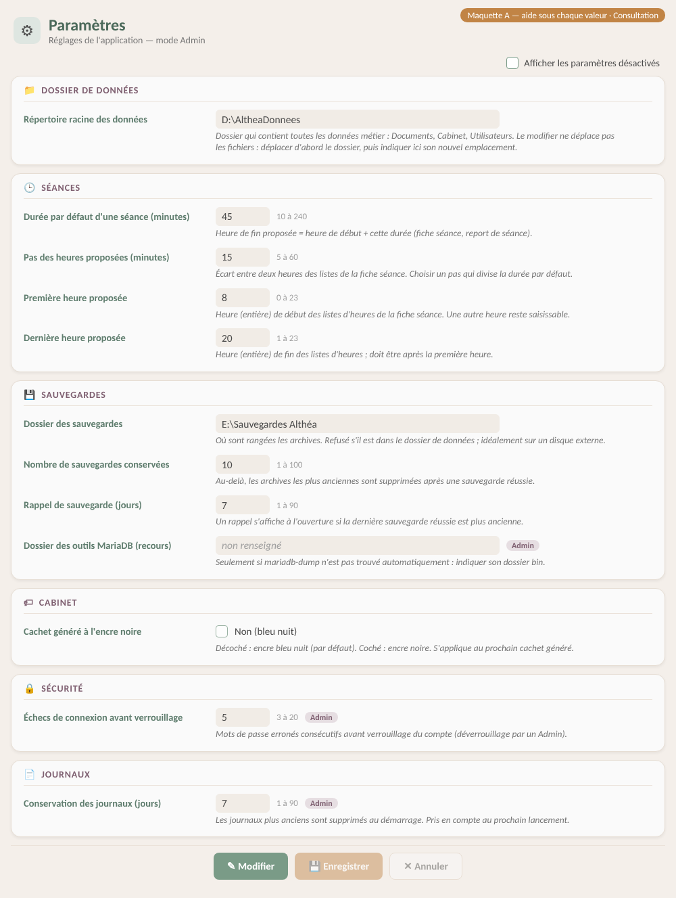

*Paramètres A (16/10/2026, retenu) — **page de réglages** : quand les champs sont des réglages indépendants, peu nombreux mais chacun à expliquer, une seule page qui défile, une carte par groupe, l'aide sous chaque valeur, et un seul Modifier / Enregistrer pour la page (enregistrement en une transaction).*

*Construite par le code quand les champs viennent de la base (`UC_Parametres`).*


*Grille des séances (17/10/2026, retenue) — **liste à états** : l'état se lit en **pastilles** colorées par famille (dessinées dans la cellule, `UtilsDataGrid.DessinerPastilleCellule`), les lignes sans enjeu sont atténuées, un repère titré sépare l'avenir du passé, et un **résumé cliquable** au-dessus de la grille donne les totaux et sert de filtre rapide (il choisit l'entrée du filtre existant).*

*Les couleurs viennent d'une **famille** calculée par la couche métier, jamais d'une liste de codes.*

*Toute liste de séances (onglet Séances du dossier, recherche des séances d'une période) prend ses axes de filtre, son filtrage et son résumé dans `FiltresSeances` (23/10/2026) : mêmes axes, mêmes couleurs, même définition.*


*Grille des paiements (17/10/2026, retenue) — **relevé chronologique** : un mouvement par ligne, le plus récent en haut, une colonne qui dit à quoi il se rapporte (« Pour ») et une pastille qui dit ce qu'il est devenu, avec les **mêmes familles et couleurs** que la liste à laquelle il se rattache (ici la pastille Paiement des séances).*

*Pas de lignes de regroupement : la grille reste triable. Même résumé cliquable, construit par la même classe (`ResumeFiltre`).*

*Toute liste de paiements (onglet Paiements du dossier, recherche des paiements d'une période) prend ses lignes, ses axes, son filtrage, son résumé et son infobulle dans `FiltresPaiements` et `PaiementListeItem.InfobulleLigne` (23/10/2026).*

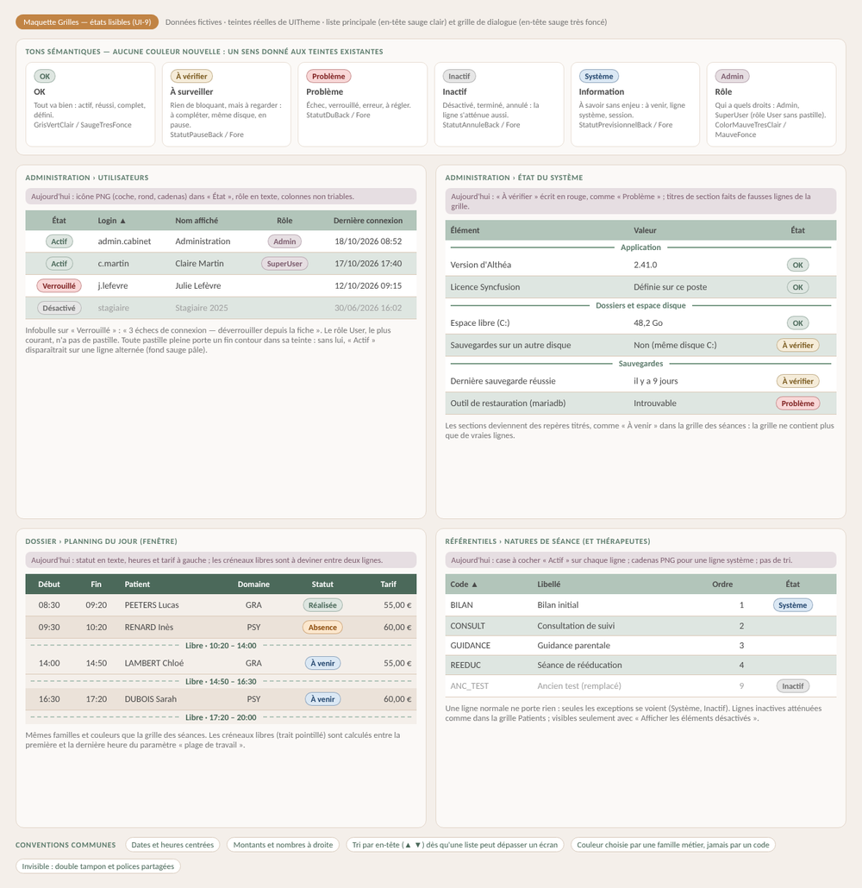

*Grilles — états lisibles (18/10/2026, retenue, lot UI-9) — **la même lecture partout** : un état se lit en pastille, dans un **ton sémantique** pris dans les teintes existantes (aucune couleur nouvelle) ; une ligne normale ne porte rien, seules les exceptions se voient ; ce qui est inactif ou terminé s'atténue.*

*Les titres de section et les créneaux libres d'un planning sont des **repères** entre les lignes, jamais de fausses lignes.*

*Validé par Joëlle : créneaux libres du planning, « Système » en bleu, rôle User sans pastille, fin contour sur toutes les pastilles pleines.*

| Ton (`TonEtat`) | Pastille | Teintes (`UITheme`) | Pour |
| --- | --- | --- | --- |
| `Ok` | sauge | `ColorGrisVertClair` / `ColorSaugeTresFonce` | actif, réussi, complet, défini |
| `ASurveiller` | ocre | `StatutPauseBack` / `StatutPauseFore` | à compléter, à vérifier, en pause |
| `Probleme` | rose | `StatutDuBack` / `StatutDuFore` | échec, verrouillé, erreur, à régler |
| `Inactif` | gris | `StatutAnnuleBack` / `StatutAnnuleFore` | désactivé, terminé, annulé (ligne atténuée aussi) |
| `Information` | bleu | `StatutPrevisionnelBack` / `StatutPrevisionnelFore` | à venir, ligne système, session |
| `Role` | mauve | `ColorMauveTresClair` / `ColorMauveFonce` | Admin, SuperUser (rôle User sans pastille) |

**Conventions des grilles** (UI-9) :

- dates et heures **centrées**, montants et nombres **à droite** (`UtilsDataGrid.AlignerCentre` / `AlignerDroite`), texte à gauche
- tri par en-tête dès qu'une liste peut dépasser un écran
- la couleur vient d'une **famille fournie par le métier**, convertie en ton par l'écran — jamais d'une liste de codes ni d'une couleur posée à la main.

### 2.5 L'écran à étapes

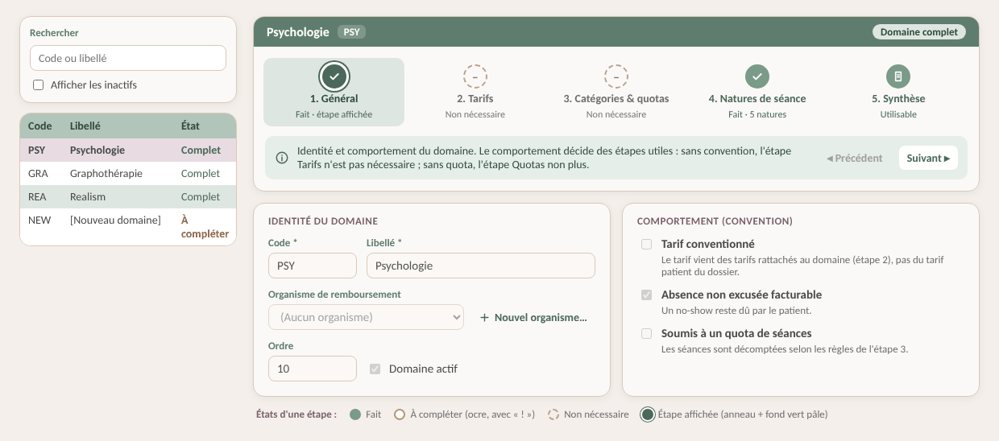

*Domaines A (14/10/2026, retenu).*

Quand une saisie se fait dans un ordre (convention d'un domaine), `AltheaEtapes` remplace la bande d'onglets (`AltheaOnglets.MasquerOnglets = True`) et montre l'état de chaque étape (fait, à compléter, non nécessaire). Chaque étape est une page en cartes ; les listes y ont leur barre locale et leur formulaire au pied de la carte :

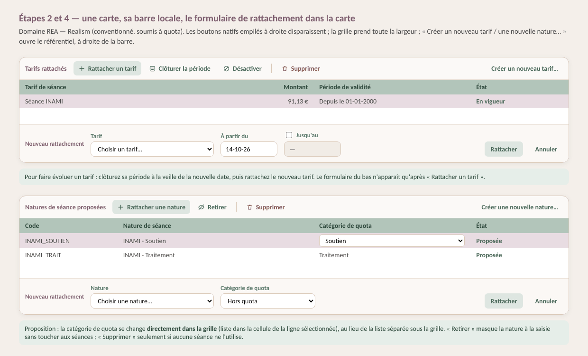

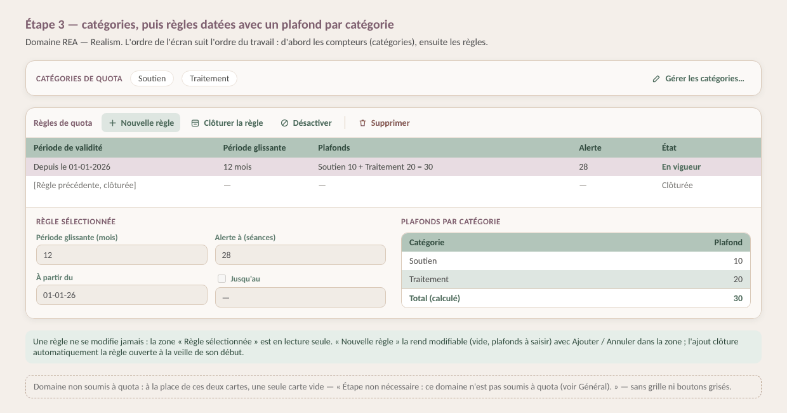

### 2.6 La fenêtre (Form)

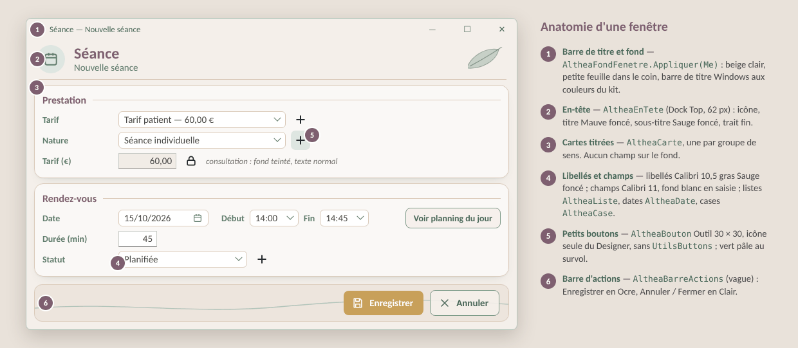

*Fenêtre type (dessinée pour ce document d'après `SeanceEditor`, règle du 15/10/2026).*

**Toute fenêtre de saisie suit le schéma des fiches** (Rules § 15) :

1. Fond et barre de titre du kit : `AltheaFondFenetre.Appliquer(Me)`.
2. `AltheaEnTete` en haut.
3. Les champs **dans des cartes titrées**, une par groupe de sens ; aucun champ posé sur le fond. Une fenêtre qui gère une liste reprend le modèle « carte + barre locale » (ex. `CategoriesQuotaEditor`).
4. Libellés 10,5 gras Sauge foncé, champs 11 ; listes, dates et cases **du kit**.
5. Petits boutons à côté d'un champ : `AltheaBouton` Outil 30 × 30, icône seule.
6. `AltheaBarreActions` en bas : Enregistrer (Ocre), Annuler / Fermer (Clair), Supprimer (Terre).

Fenêtres de référence : `SeanceEditor` (deux cartes), `ConfigurationConnexion` (cartes + résultat), `DialogRestauration` (quatre cartes dont une grille), `CategoriesQuotaEditor` (carte + barre locale), `DossierZoneEditor` (une carte ancrée qui contient l'éditeur riche).

| Taille | ClientSize | Exemples | Bordure |
| --- | --- | --- | --- |
| Petite | ~ 464 × 340 | `Login`, `ChangePassword`, `ElevationAcces` | redimensionnable, `MinimumSize` |
| Moyenne | ~ 500–770 × 360–620 | `SeanceEditor`, `CategoriesQuotaEditor`, `DialogComptePraticien` | `FixedDialog` ou redimensionnable |
| Grande | ~ 744–1061 × 500–860 | `ConfigurationConnexion`, `DialogRestauration`, `DossierZoneEditor` | selon le contenu |

Une fenêtre redimensionnable ancre ses cartes (`Anchor` Top, Bottom, Left, Right pour la carte principale ; Top, Left, Right pour les champs qui doivent s'allonger ; Top, Right pour un bouton collé à droite d'un champ).

### 2.7 La boîte de message (`DialogChoix`)

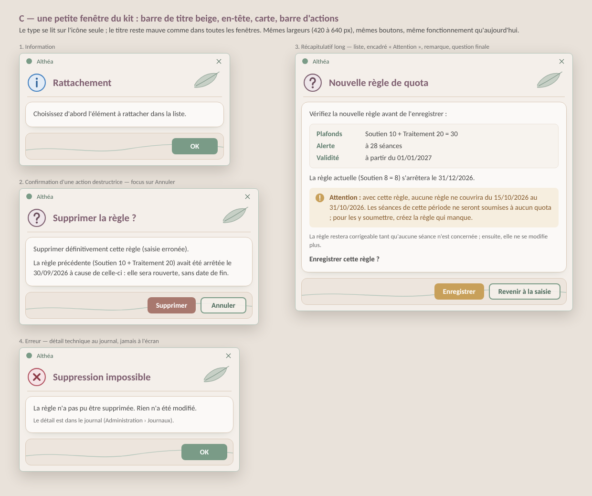

*Maquette « DialogChoix — C » (16/10/2026, retenue). Dans l'application, la barre de titre affiche le titre du dialogue. Icônes du style 2 :*

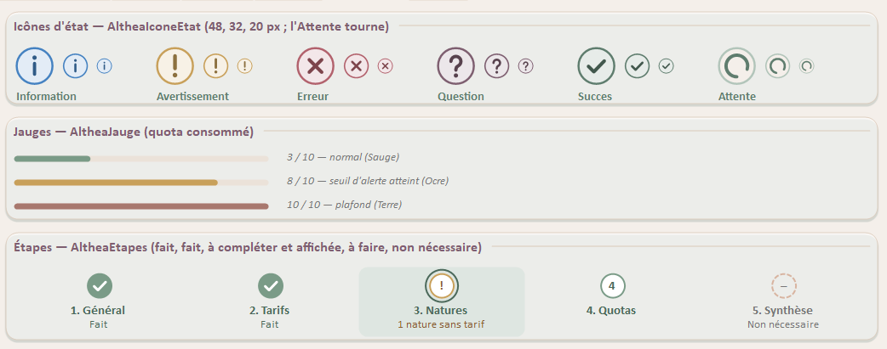

**Jamais de `MessageBox`.** Toujours `DialogChoix` (détail au § 7.21) : une petite fenêtre du kit comme les autres (barre de titre, en-tête, carte, barre d'actions) ; le type se lit sur l'icône.

Les boutons disent l'action (« Supprimer », « Enregistrer », « Revenir à la saisie »), pas « Oui / Non », et suivent l'ordre habituel : l'action à gauche, Annuler à droite.

---

## 3. Recette : créer une nouvelle fenêtre

### 3.1 Dans le Designer

1. **Fenêtre** : `Font` Calibri 9, `AutoScaleMode = Font`, `BackColor` = Beige clair (244; 239; 234), `StartPosition = CenterParent`, `Icon` de l'application, `FormBorderStyle` selon le § 2.6. Pas d'image de fond, pas de panneau racine `pnlForm`.
2. **En-tête** : un `AltheaEnTete` (`enTete`), Dock Top, hauteur 62, `Text` = titre, `SousTitre`, `Icone` (Titre_Ico).
3. **Barre d'actions** : un `AltheaBarreActions` (`pnlActions`), Dock Bottom, avec les `AltheaBouton` alignés à droite (Ocre pour Enregistrer, Clair pour Annuler / Fermer). Donner un `Tag` (`enregistrer_normal`, `annuler_normal`…) et l'icône 32 px.
4. **Cartes** : une `AltheaCarte` par groupe (`carteXxx`), `Titre`, `Padding` 12; 8; 12; 10, posée à (12; 70) puis empilées avec 8 px d'écart. Ordre d'ajout dans `Controls` : les cartes d'abord, puis `pnlActions`, puis `enTete` (le docking se calcule à l'envers de l'ordre d'ajout).
5. **Champs** dans chaque carte, selon la grille du § 1.3 : `Label` (10,5 gras Sauge foncé, `AutoSize`), `TextBox` (11, blanc, Gris foncé), `AltheaListe`, `AltheaDate`, `AltheaCase`, `NumericUpDown` en dernier recours.
6. **Petits boutons** : `AltheaBouton`, `Variante = Outil`, 30 × 30, `Text` vide, `Image` = icône 24 px de `Ico_divers` (à importer dans les ressources du formulaire).
7. **Boutons par défaut** : `AcceptButton` = le bouton principal, `CancelButton` = Annuler / Fermer ; `btnAnnuler.DialogResult = Cancel`.
8. Ordre de tabulation : cartes 0, 1, 2… puis la barre d'actions ; dans chaque carte, de haut en bas et de gauche à droite.

### 3.2 Dans le code

```vb
' -------------------------------------------------------------------------------------------------
' Formulaire  : ExempleEdition
' Projet      : Althéa
' Version     : V1.0.0
' Date        : jj/mm/aaaa
' Auteur      : Joëlle (Manou) / Projet Althéa
' (en-tête complet : voir Standards-Commentaires.md)
' -------------------------------------------------------------------------------------------------
Public Class ExempleEdition

    Private ReadOnly _ouvrirEnConsultation As Boolean

    Public Sub New(Optional ouvrirEnConsultation As Boolean = False)
        InitializeComponent()
        _ouvrirEnConsultation = ouvrirEnConsultation
    End Sub

    Private Sub ExempleEdition_Load(sender As Object, e As EventArgs) Handles MyBase.Load

        ' Fond beige à la feuille et barre de titre aux couleurs du kit.
        AltheaFondFenetre.Appliquer(Me)

        ' Boutons d'action avec texte : icônes par état d'après le Tag.
        ' Les petits boutons Outil à icône seule gardent l'image du Designer (pas de UtilsButtons).
        UtilsButtons.InitStandardButton(btnEnregistrer)
        UtilsButtons.InitStandardButton(btnAnnuler)

        InitializeToolTips()
        Charger()
        AppliquerMode(_ouvrirEnConsultation)

    End Sub

    ' Un seul endroit pour l'état de saisie (consultation lisible).
    Private Sub AppliquerMode(consultation As Boolean)
        For Each carte As AltheaCarte In {carteIdentite, carteCoordonnees}
            UtilsControls.DefinirLectureSeule(carte, consultation)
        Next
        btnModifier.Visible = consultation
        btnEnregistrer.Visible = Not consultation
    End Sub

    Private Sub btnEnregistrer_Click(sender As Object, e As EventArgs) Handles btnEnregistrer.Click
        If Not Valider() Then Return
        ' … appel à la couche métier (Gestion*) …
        DialogResult = DialogResult.OK      ' ferme la fenêtre et prévient l'appelant
    End Sub

End Class
```

Points à ne pas oublier :

- **`DialogResult`** : un bouton qui ferme la fenêtre avec un résultat garde son `DialogResult` (Cancel dans le Designer, OK posé dans le code après un enregistrement réussi). En remplaçant un bouton, on le reporte (régression du 10/10/2026 : « Reporter » ne faisait plus rien).
- Les messages passent par `DialogChoix`, les journaux par `GestionLog` (identifiants seulement, jamais de données de patient, ADR-39).
- Aucun accès base dans la fenêtre : la couche `Gestion*` s'en charge.
- En-têtes de fichier et de procédures : [`Standards-Commentaires.md`](./Standards-Commentaires.md).

---

## 4. Recette : créer un nouveau UserControl

1. **Classe** : hérite de `UserControl`, implémente `IContextAwareUserControl`, `Size` 997 × 771, `BackColor = Transparent`, `Font` Calibri 9. La feuille coupée et le fond viennent de la Home.

```vb
Public Class UC_Exemple
    Implements IContextAwareUserControl

    Private _context As UserControlContext

    Public Sub SetContext(context As UserControlContext) _
        Implements IContextAwareUserControl.SetContext
        _context = context
    End Sub

    Private Sub UC_Exemple_Load(sender As Object, e As EventArgs) Handles MyBase.Load
        _context?.SetHeader("Section > Écran")
        ' boutons, grilles, infobulles, chargement, AppliquerMode…
    End Sub

End Class
```

2. **Contenu** : `AltheaEnTete` (Dock Top), puis selon la famille (§ 2) : bandeau + grille (liste), `AltheaOnglets` + cartes (fiche), `AltheaEtapes` (écran à étapes), tuiles (hub).
3. **Barre d'actions** : `AltheaBarreActions` (Dock Bottom) contenant un `FlowLayoutPanel` aligné à droite (`pnlBas`) avec les `AltheaBouton`.
4. **Contexte** : le UC n'a ni barre d'état, ni infobulle, ni fournisseur d'erreurs à lui ; il passe par le contexte :

| Appel | Effet |
| --- | --- |
| `_context.SetStatus(message)` | Barre d'état de la Home |
| `_context.SetHeader(texte[, pastille])` | Fil d'Ariane (et pastille de domaine) |
| `_context.SetToolTip(controle, texte)` | Infobulle |
| `_context.SetError(controle, message)` / `ClearError` / `ClearAllErrors` | Erreur de saisie |
| `_context.AuthenticatedUser`, `_context.HomeForm` | Utilisateur connecté, Home |

5. **Enregistrement dans la navigation** : `NavigationManager` (voir la documentation technique UI, partie socle : [`UI/UI_Socle.md`](../Architecture/UI/UI_Socle.md), Home et NavigationManager).

---

## 5. Comportements communs

### 5.1 Consultation lisible

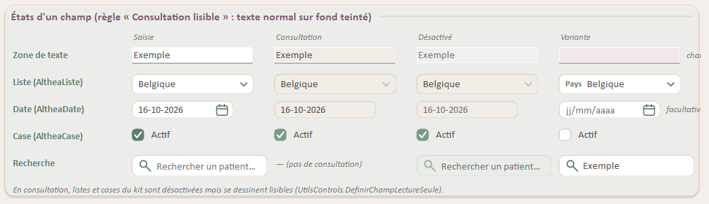

*Vitrine du kit, onglet Champs. La colonne « Désactivé » montre ce qu'on ne fait plus pour une consultation : la zone de texte grisée devient illisible ; les listes et cases du kit, elles, restent lisibles même désactivées.*

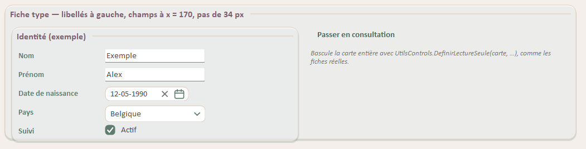

*La fiche type de la vitrine, basculée en consultation par `UtilsControls.DefinirLectureSeule` (règle du 14/10/2026).*

- En consultation, **seul le fond se teinte** (`ColorChampLectureSeule`) ; le texte garde sa couleur. En saisie, fond blanc.
- **Jamais** `Enabled = False` sur une carte, un panneau ou un onglet entier : Windows grise alors libellés et valeurs.
- Une seule bascule : `UtilsControls.DefinirLectureSeule(zone, lectureSeule)` pour une carte, `DefinirChampLectureSeule(champ, lectureSeule)` pour un champ seul. Elle traite zones de texte (`ReadOnly` + fond), nombres (sans flèches), listes, dates, cases et boutons ; elle ne touche ni aux libellés, ni aux grilles, ni aux UserControls imbriqués.
- Ouvrir un élément existant **en consultation** (bouton Modifier pour passer en saisie) ; une création s'ouvre en saisie.

### 5.2 Champs de date

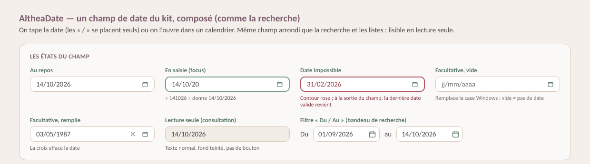

- Toujours `AltheaDate` ; date facultative = `Facultative = True` (vide = pas de date), jamais la case à cocher Windows.
- Bornes avec `DateMin` / `DateMax` (ex. date de clôture ≤ aujourd'hui).
- **Heures** (16/10/2026) : toujours `AltheaHeure` (§ 7.10), format hh:mm ; heures proposées = `GestionSeances.CreneauxProposes` pour les séances, avec le pas réel de la grille ; pour une heure de fin, `HeureReference` = heure de début (la liste rappelle la durée).

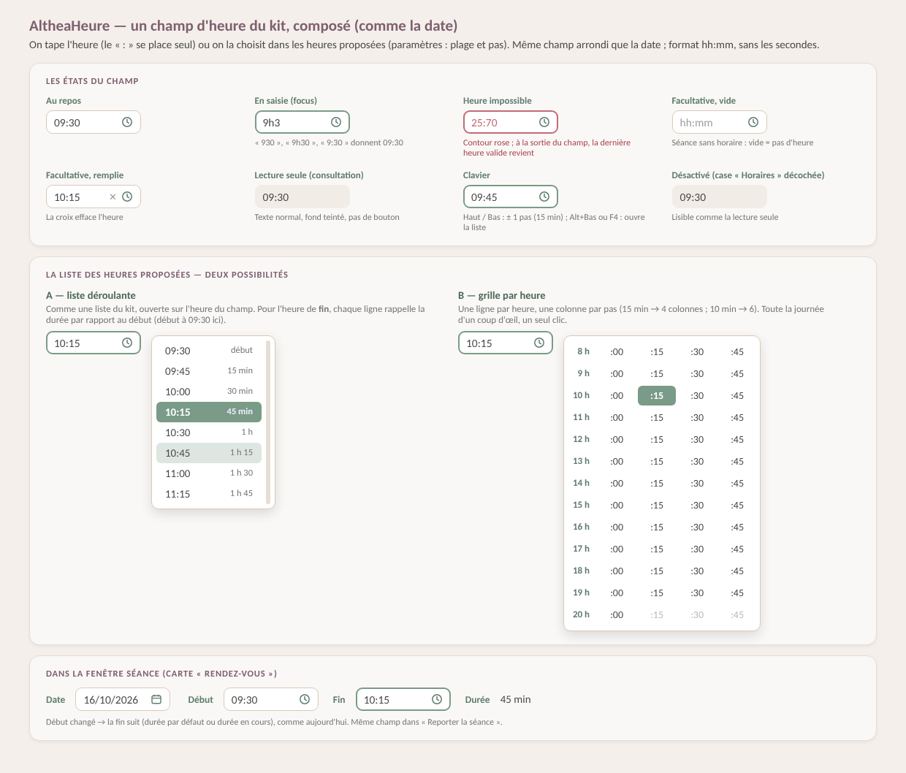

*Maquette « AltheaHeure » (16/10/2026) : la liste **A** (déroulante, durée rappelée pour la fin) est retenue ; la grille B n'a pas été réalisée.*

### 5.3 Mots de passe

- `TextBox` avec `UseSystemPasswordChar = True`.
- Bouton « œil » : `AltheaBouton` Outil 30 × 30, icône `oeil_24_normal`, ancré à droite du champ ; le mot de passe n'est visible **que pendant l'appui** :

```vb
Private Sub btnVoirPassword_MouseDown(sender As Object, e As MouseEventArgs) Handles btnVoirPassword.MouseDown
    txtPassword.UseSystemPasswordChar = False
End Sub
Private Sub btnVoirPassword_Relache(sender As Object, e As EventArgs) _
    Handles btnVoirPassword.MouseUp, btnVoirPassword.MouseLeave
    txtPassword.UseSystemPasswordChar = True
End Sub
```

- Jamais de mot de passe journalisé, jamais conservé en clair, effacé des zones dès qu'il ne sert plus.

### 5.4 Erreurs et messages

- **Erreur de saisie** : `errProvider.SetError(champ, message)` (fenêtre) ou `_context.SetError` (UC), message clair dans `lblMessage` / `lblErreur` en Rose foncé gras 11. Dans une fenêtre modale, le motif d'un refus s'affiche **dans la fenêtre** (la barre d'état de la Home est peu visible) — ex. `PaiementEditor.SignalerErreur`.
- **Champ refusé** : fond `AltheaIconeEtat.Teintes(EtatIcone.Erreur).Pale`.
- **Erreur inattendue** : message général à l'utilisateur (« L'opération n'a pas pu être effectuée. Le détail a été noté dans le journal. »), exception complète dans `GestionLog` — jamais le texte technique de l'exception à l'écran.
- **Confirmation** : `DialogChoix.Confirmer(…)`, `ConfirmerSuppression(…)` pour une suppression.
- **Bouton inactif** (20/10/2026) : dire pourquoi au survol (`AltheaBouton.DefinirDisponibilite`, § 7.1) — la raison qui empêche l'action, dans l'ordre où l'utilisateur la lèverait (dossier figé, puis sélection, puis condition propre). Fait : barres Séances et Paiements du dossier ; les autres écrans au fil de l'audit.
- **Barre d'état ou message ?** (décision de Joëlle, 20/10/2026, qui revient sur la consigne de départ « peu de messages, plutôt la barre d'état ») : la barre d'état seule laisse croire qu'il ne s'est rien passé.
  - Un **refus**, un **échec** ou une opération **critique** (connexion, configuration, sauvegarde…) a son message `DialogChoix` qui dit **quoi faire** ; la barre d'état reste un complément discret (état courant, action anodine réussie).
  - Première application : `ConfigurationConnexion` V1.3.0 ; les autres écrans au fil de l'audit (§ 5.3).

### 5.5 Infobulles

Dans une méthode unique (`InitializeToolTips`), appelée au chargement. Dans un UC ou une fenêtre `IContextAwareForm` : `_context.SetToolTip` ; sinon `ttMain.SetToolTip`. Chaque contrôle interactif en a une.

### 5.6 Le code toujours visible

Règle : Rules § 15 (17/10/2026, étendue le 24/10/2026). Un élément codé par la base (PA, DO, SE, PAI, FC, AS, TH, USR…) montre son code partout où on le désigne. Les dates et libellés seuls ne suffisent pas à distinguer deux éléments.

**Fenêtre sur un élément existant.** Le sous-titre de l'en-tête le nomme par son code (`enTete.SousTitre`, ex. « Modifier la séance SE000074 », « Annulez l'encaissement PAI000101 »). Une fenêtre dont le titre change avec le mode peut porter le code dans le titre (« Consulter le contact — FC000004 »). Le code est passé par l'appelant (paramètre facultatif du constructeur) ou lu au chargement ; si le mode est appliqué avant le chargement, nommer après lui (`UtilisateurEdition.NommerParLeCode`).

**Grilles.** Une colonne `colCode…`, en-tête « Code », largeur 85, visible. En tête de grille pour une liste ou un référentiel (Patients, Thérapeutes, Utilisateurs) ; à sa place dans une grille ordonnée par l'heure ou la date (Planning du jour : après le domaine, comme la recherche des séances). Un objet de ligne qui enveloppe un élément expose le code sous le nom de la colonne (`LignePlanningJour.CodeSeance`).

**Rappels et listes de choix.** Le code en tête (`SeanceListeItem.LibelleChoixSeance` : « SE000074 · 12/10/2026 … »). Quand on choisit par le **nom**, le code suit le nom (`Therapeute.LibelleAffichage` : « Marie DUPONT (Logopède) · TH000003 » ; `UtilisateurLiable.ToString`) : la frappe d'une lettre saute encore au bon nom. Une entrée sentinelle (« (sélectionner…) ») n'a pas de code. `AltheaListe` ouvre sa liste à la largeur de son plus long élément : le code reste lisible même si le champ fermé est étroit.

**Annonces d'enregistrement.** Barre d'état ou message citent le code (« Contact FC000012 créé. », « Thérapeute TH000005 mis à jour. »). À la création, le code est généré par la base : le relire (`GestionRecherche.CodeElement(nature, id)`, ou la fiche relue par son identifiant).

**Exception.** Un aperçu compact (`UC_ApercuPatient`, petite grille des séances) peut ne porter le code que dans l'infobulle ; la ligne « Aujourd'hui » et la séance ouverte le montrent.

Références : `DossierZoneEditor`, fenêtres du dossier (17/10/2026) ; `ContactEdition`, `IntervenantEdition`, `TherapeuteEdition`, `UtilisateurEdition`, `PlanningJourViewer` (24/10/2026).

### 5.7 Fiche et listes rattachées

Modifier / Enregistrer / Annuler (barre d'actions) concernent **les champs de la fiche**. Les listes rattachées se modifient par leur **barre locale**, action par action, avec enregistrement immédiat, et sont indisponibles pendant « Modifier » (une consigne le dit).

- **Modifier n'apparaît que là où il agit** : sur l'onglet (ou l'étape) de la fiche — onglet Fiche Dossier de `UC_DossierFiche`, étape 1 Général de `UC_DomainesHome` (19/10/2026).
  - Sur les autres onglets ou étapes, il est masqué, et la consigne dit que l'étape « se modifie directement : chaque action est enregistrée aussitôt, sans passer par Modifier ».
  - On ne renvoie jamais en silence vers un autre onglet.

### 5.8 Modifications non enregistrées

Quitter un écran ou fermer une fenêtre après une modification **non enregistrée** propose : **Enregistrer** (par défaut, Entrée) / **Quitter sans enregistrer** / **Rester** (Échap, croix) — `DialogChoix.DemanderAvantDepart("de la séance")` (19/10/2026, ADR-43).

- **Fenêtre de saisie** : `GardeModifications.SurveillerFenetre(Me, btnEnregistrer, "du contact")` en tête du `Load`.
  - Photo des champs à l'affichage, contrôle à la fermeture (Annuler, croix, Échap)
  - rien à demander si le bouton Enregistrer est masqué ou inactif (consultation) ou après un enregistrement réussi
  - « Enregistrer » déclenche le bouton (la fenêtre reste ouverte si la saisie est refusée).
- **UserControl** (fiche) : implémenter `IUnsavedChangesAware` ; `GardeModifications` photographie les champs au passage en création / modification (`PhotographierApresChargement`), `EstModifie` dans `PeutQuitter` ; une édition locale (anamnèse) garde son propre suivi et se contrôle aussi au changement d'onglet.
- La garde couvre **tous** les champs (zones de texte, listes, cases, dates, heures, éditeur de texte)
  - les champs de recherche, les grilles et les zones en lecture seule sont ignorés
  - on exclut à la construction les onglets de listes.
  - Un état sans champ (image choisie mais pas encore enregistrée) s'ajoute par `garde.AjouterValeur(nom, lecture)` (logo d'un domaine, 20/10/2026).
- **Annuler** :
  - un Annuler qui **ferme la fenêtre** est un départ (question à trois choix ci-dessus)
  - un Annuler qui **reste sur l'écran** (fiche, détail d'un référentiel, domaine, règle de quota, anamnèse, Cabinet, Paramètres) abandonne la saisie : s'il y a des modifications, `DialogChoix.ConfirmerAbandon("de la fiche du patient")` — **Abandonner** (Terre) / **Continuer la saisie** (par défaut) ; sans modification, aucune question.
  - Avec une garde : `garde.ConfirmerAnnulation(deQuoi)`.
- **Où** (19/10/2026) :
  - fiche patient (fiche, anamnèse), fiche du dossier, Domaines (domaine, règle de quota), détail des référentiels (dans Home et dans la fenêtre hôte `ReferentielModalHost`), Cabinet, Paramètres
  - fenêtres Séance, Paiement, Contact, Intervenant, Thérapeute, Utilisateur, Zone du dossier.
  - Sauvegardes : la navigation reste bloquée pendant une opération.
- **Pas de garde** pour les dialogues d'action (motif d'annulation, report de séance, changement de statut, compte du praticien, connexion à la base) : les fermer, c'est renoncer à l'action. Ni pour les panneaux de rattachement des Domaines (tarifs, natures), dont chaque action s'enregistre aussitôt.

---

## 6. Ce qu'on ne fait plus

| À éviter | À la place |
| --- | --- |
| Image de fond étirée (`Fond_1000x800_Feuille4`, fonds de boutons `ui-backgrounds`) | `AltheaFondFenetre`, contrôles du kit dessinés |
| Panneau racine `pnlForm`, `pnlCenter`, `pnlTop` + `lblTop` | Contenu posé sur la fenêtre ; consigne dans la carte ou titre de carte |
| `TableLayoutPanel` pour une fiche ou une fenêtre de saisie | Cartes et positions fixes (§ 1.3) |
| `GroupBox` | `AltheaCarte` titrée |
| `Button` Windows, `FlatStyle` + `BackColor` | `AltheaBouton` (variante) |
| `ComboBox`, `CheckBox`, `DateTimePicker` Windows | `AltheaListe`, `AltheaCase`, `AltheaDate` ; heures : `AltheaHeure` |
| Zone entière en `Enabled = False` pour la consultation | `UtilsControls.DefinirLectureSeule` |
| `UtilsButtons` sur un petit bouton à icône seule | Icône 24 px du Designer |
| `MessageBox.Show` | `DialogChoix` |
| Couleur écrite en dur dans le code | `UITheme` |
| Libellés gris avec deux-points (« Nom : ») | Libellé 10,5 gras Sauge foncé, sans deux-points |
| Message technique d'exception affiché | Message général + `GestionLog` |

---

# Partie 2 — Catalogue des contrôles

## 7. Contrôles du kit Althéa

Contrôles dessinés par le code, dans `UI/Controls/Theme/`. Leurs réglages propres sont dans la catégorie **« Althéa »** de la fenêtre Propriétés du Designer. Les couleurs par défaut viennent de `UITheme`.

Pour chaque contrôle : son rôle, quand l'utiliser, ses propriétés (valeur par défaut du contrôle **et** valeur d'usage quand elles diffèrent), un exemple.

> Seules les propriétés qui diffèrent du contrôle WinForms d'origine sont listées.
>
> **Démonstration vivante** : la vitrine du kit `TestKitAlthea` montre tous les contrôles dans leurs états ; `TestChampDate` et `TestDialogChoix` détaillent le champ de date et la boîte de message (boutons de test de l'accueil, Debug).
>
> Le survol ne se force pas : il se montre à la souris.

### 7.1 AltheaBouton (`Button`)

**Rôle** : tous les boutons de l'application. **Quand** : toujours, à la place de `Button`.

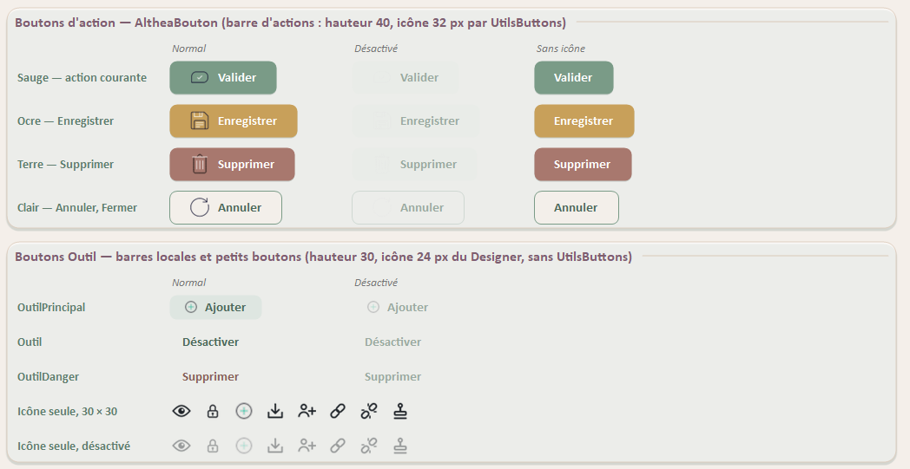

| Propriété | Défaut | Usage / remarque |
| --- | --- | --- |
| `Variante` | `Sauge` | `Sauge` (courant), `Ocre` (Enregistrer), `Terre` (Supprimer), `Clair` (Annuler, Fermer, Réinitialiser, actions secondaires) ; barre locale : `Outil`, `OutilPrincipal` (Ajouter, Nouveau : fond vert pâle), `OutilDanger` (Supprimer : texte terre). |
| `Rayon` | 8 | Arrondi des coins. |
| `Font` | Calibri 11 gras | |
| `Size` | 130 × 40 | Barre d'actions 108–150 × 36–40 ; barre locale hauteur 30 ; petit bouton 30 × 30. |
| `BackColor` | `Transparent` (forcé) | La couleur vient de `Variante`. |
| `Tag` | — | Nom de l'icône (`enregistrer_normal`) pour `UtilsButtons`. |
| `Text` vide + `Image` | — | **Icône seule centrée** (V1.2.0) : petits boutons Outil 30 × 30, image 24 px du Designer, sans `UtilsButtons` ; désactivé, le bouton atténue lui-même l'icône. |
| `DialogResult` | `None` | À conserver lors d'un remplacement (§ 3.2). |
| `RaisonInactif` / `DefinirDisponibilite(disponible, raison)` | *(vide)* | **Bouton inactif : dire pourquoi** (V1.3.0, 20/10/2026) : la raison s'affiche au survol tant que le bouton est inactif (« Sélectionnez une séance dans la liste. », « Dossier clôturé : … »). Une ligne par bouton dans l'écran : `btnX.DefinirDisponibilite(condition, "raison")` au lieu de `btnX.Enabled = condition`. Désactivé : texte gris-vert foncé lisible, icône à 55 %. |

```vb
btnSupprimer.Variante = VarianteBouton.Terre
UtilsButtons.InitStandardButton(btnSupprimer)     ' bouton avec texte : icônes par état
```

### 7.2 AltheaTuile (`AltheaBouton`)

**Rôle** : grandes tuiles de navigation des hubs.

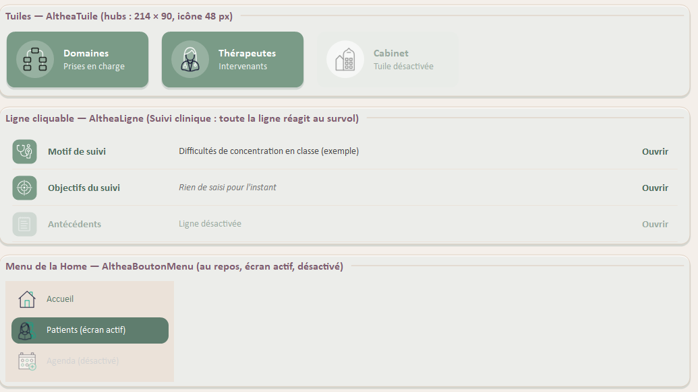

| Propriété | Défaut | Usage / remarque |
| --- | --- | --- |
| `Text` | — | Deux lignes : titre puis sous-titre (`"Domaines" & vbCrLf & "Prises en charge"`). |
| `Rayon` | 12 | |
| `Font` | Calibri 12 gras | Le sous-titre est dérivé. |
| `Size` | 214 × 84 | Hubs : 214 × 90. |
| `Image` | — | Icône 48 px dans une pastille (`InitLargeIconButton`). |

### 7.3 AltheaCarte (`Panel`)

**Rôle** : le panneau de l'application. Regroupe des champs, une grille, une image. **Quand** : chaque groupe de champs, chaque liste, chaque bandeau.

| Propriété | Défaut | Usage / remarque |
| --- | --- | --- |
| `Titre` | *(vide)* | Titre dessiné en haut, avec un trait ; les enfants se placent dessous (`DisplayRectangle`). Sans titre quand une barre locale porte le nom de la liste. |
| `Padding` | 18; 14; 18; 16 | **Fenêtres : 12; 8; 12; 10.** Carte avec barre locale : 12; 8; 12; 12. |
| `CouleurFond` / `OpaciteFond` | Blanc / 140 | Panneau translucide : le fond et la feuille restent visibles. |
| `CouleurBordure` | `ColorBeigeFonce` | |
| `Ombre` | `True` | Ombre douce dessinée. |
| `Rayon` | 14 | |
| `PoliceTitre` / `CouleurTitre` | Calibri 12 gras / `ColorMauveFonce` | |
| `TabStop` | — | `False` dans les fenêtres (la tabulation passe aux champs). |

Le titre occupe environ 37 px : la première ligne de champs se place à y = 40.

### 7.4 AltheaBarreActions (`AltheaCarte`)

**Rôle** : barre des boutons de l'écran (en bas). **Quand** : toute fenêtre et tout UC qui a des actions d'écran.

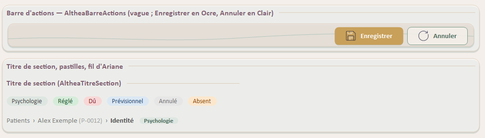

| Propriété | Défaut | Usage / remarque |
| --- | --- | --- |
| `Vague` | `True` | Vague Sauge clair à travers la barre. |
| `CouleurFond` / `OpaciteFond` | `ColorBeige` / 190 | |
| `Rayon` | 12 | |
| `Padding` | 16; 8; 16; 12 | |
| `Size` / `Dock` | 900 × 64 | `Dock = Bottom`, hauteur 47 à 57 dans les fenêtres. |

### 7.5 AltheaBarreOutils (`Panel`)

**Rôle** : barre locale d'une liste, posée en haut de sa carte (ADR-34). **Quand** : les boutons n'agissent que sur cette liste.

| Propriété | Défaut | Usage / remarque |
| --- | --- | --- |
| `Titre` | *(vide)* | Nom de la liste à gauche ; vide dans un onglet du même nom. |
| `CouleurTrait` | `ColorBeige` | Trait sous la barre ; `Transparent` = aucun. |
| `Dock` / `Size` / `Padding` | `Top` / 600 × 42 / 10; 6; 10; 6 | La grille de la carte est en `Dock = Fill` (ajouter la grille avant la barre dans `Controls`). |
| Boutons | — | `AltheaBouton` hauteur 30, variantes `Outil`, `OutilPrincipal`, `OutilDanger`, placés après le titre. |

### 7.6 AltheaEnTete (`Panel`)

**Rôle** : en-tête de tout écran et de toute fenêtre (sauf Home), `DialogChoix` compris depuis sa V2.1.

| Propriété | Défaut | Usage / remarque |
| --- | --- | --- |
| `Text` | — | Titre. |
| `SousTitre` | *(vide)* | Sous le titre ; peut être réglé par le code (ex. le code du dossier). |
| `Icone` | — | `Titre_Ico`, ressource `enTete.Icone` du `.resx`. |
| `TailleIcone` | 48 | Réduite si l'en-tête est moins haut. |
| `CouleurTitre` / `PoliceTitre` | `ColorMauveFonce` / Calibri 18 gras | |
| `CouleurSousTitre` / `PoliceSousTitre` | `ColorSaugeFonce` / Calibri 11 | |
| `CouleurTrait` | `ColorBeigeFonce` | Trait fin sous l'en-tête. |
| `Dock` / `Size` / `Padding` | `Top` / 600 × 58 / 16; 4; 16; 4 | **Fenêtres : hauteur 62.** |
| `BackColor` | `Transparent` (forcé) | Laisse voir le fond et la feuille. |

### 7.7 AltheaTitreSection (`Label`)

**Rôle** : titre de section avec trait (hubs, sections hors carte).

| Propriété | Défaut | Remarque |
| --- | --- | --- |
| `CouleurTrait` | `ColorBeigeFonce` | `Transparent` = pas de trait. |
| `ForeColor` / `Font` | `ColorMauveFonce` / Calibri 12 gras | |
| `AutoSize` / `BackColor` | `False` / `Transparent` | |

### 7.8 AltheaListe (`ComboBox`)

**Rôle** : toute liste de choix. **Quand** : toujours, à la place de `ComboBox`.

| Propriété | Défaut | Usage / remarque |
| --- | --- | --- |
| `DropDownStyle` / `FlatStyle` | `DropDownList` / `Flat` (forcés) | Pas de saisie libre. |
| `DrawMode` / `ItemHeight` | `OwnerDrawFixed` / 24 | **Fiches et fenêtres : `ItemHeight` 20, hauteur 26** (alignée sur les zones de texte). |
| `Font` / `ForeColor` | Calibri 11 / `ColorGrisFonce` | |
| `Etiquette` | *(vide)* | Mot affiché dans le champ avant la valeur (bandeaux : « Suivi », « Rôle »). |
| `DessinItemsPersonnalise` | `False` | `True` : l'événement `DrawItem` de l'écran dessine les éléments. |
| `Enabled = False` | — | Dessinée lisible : fond `ColorChampLectureSeule`, valeur dans sa couleur. |
| `DropDownWidth` | calculée à l'ouverture | La liste ouverte prend la largeur de son plus long élément, jamais moins que le champ (24/10/2026) ; pas avec `DessinItemsPersonnalise`. |

**Filtre aux couleurs des pastilles** (21/10/2026) :

- ajouter des `ElementListePastille(libellé, teinte)` (teinte prise dans `UtilsPastilles`, la même que la pastille de la grille et du résumé)
- l'élément s'affiche en pastille dans la liste ouverte et dans le champ fermé, les éléments sans teinte (« Tous ») s'alignent sur le texte des pastilles
- `contour:=True` dessine la pastille au trait (axe large, ex. « Passées »).

Exemple : filtres des séances et des paiements du dossier.

Remplissage : `DataSource` + `DisplayMember` / `ValueMember`, `Items.Add`, ou les aides de `UtilsSaisieReferentiels` (`ChargerCivilites`, `ChargerPays`…), qui ajoutent l'entrée « — » ou « (pays du cabinet) ». Le texte affiché respecte `DisplayMember` (`GetItemText`).

### 7.9 AltheaCase (`CheckBox`)

| Propriété | Défaut | Usage / remarque |
| --- | --- | --- |
| `Font` / `ForeColor` | Calibri 11 / `ColorGrisFonce` | |
| `BackColor` | `Transparent` | |
| `AutoSize` | selon le Designer | Dans un bandeau : `False` et largeur fixe. |
| `Enabled = False` | — | Case sur fond teinté, texte normal : lisible. |

### 7.10 AltheaDate (`UserControl`)

**Rôle** : toute date. **Quand** : toujours, à la place de `DateTimePicker` (les heures : `AltheaHeure`, ci-dessous).

| Propriété | Défaut | Usage / remarque |
| --- | --- | --- |
| `Valeur` | aujourd'hui | `Date?` (code). `Nothing` seulement si `Facultative`. |
| `Facultative` | `False` | Vide = pas de date ; croix pour effacer. |
| `LectureSeule` | `False` | Consultation : texte normal, fond teinté, sans bouton (aussi via `DefinirLectureSeule`). |
| `DateMin` / `DateMax` | 01/01/1900 / 31/12/2099 | Hors bornes : ramenée dans les bornes. |
| `TexteAide` | `jj/mm/aaaa` | Affiché quand le champ est vide. |
| `Size` / `Font` | 140 × 32 / Calibri 11 | |
| Évènement | `ValeurChangee` | À chaque nouvelle date valide. |
| Clavier | | Chiffres et « / » (placés seuls) ; jj/mm/aaaa, jj/mm/aa, jjmmaa, jjmmaaaa, jj/mm ; Alt+Bas ou F4 = calendrier ; Haut / Bas = ± 1 jour. |
| Période | `AltheaDate.CorrigerBornes(du, au, sender)` | Dans `ValeurChangee` des deux champs « du … au … » : la borne dépassée suit la date choisie, jamais de période inversée (onglets Séances et Paiements du dossier, recherche des séances). |

```vb
dtpCloture.Facultative = True
dtpCloture.DateMax = Date.Today
AddHandler dtpCloture.ValeurChangee, AddressOf DateCloture_Changee
```

#### AltheaHeure (`UserControl`, 16/10/2026)

**Rôle** : toute heure. **Quand** : toujours, à la place des listes d'heures saisissables et du `DateTimePicker` en mode heure. Même champ, même dessin et même comportement qu'`AltheaDate`.

| Propriété | Défaut | Usage / remarque |
| --- | --- | --- |
| `Valeur` | 09:00 | `TimeSpan?` (code), heures et minutes. `Nothing` seulement si `Facultative`. |
| `Facultative` | `False` | Vide = pas d'heure. |
| `AfficherCroix` | `True` | Croix pour effacer une heure facultative ; `False` quand la place manque (on efface en vidant le champ). |
| `LectureSeule` | `False` | Consultation : texte normal, fond teinté, sans bouton (aussi via `DefinirLectureSeule`). |
| `HeuresProposees` | *(vide)* | Liste déroulante (code) ; vide = toute la plage au pas. Une heure hors liste reste saisissable. |
| `HeureReference` | *(aucune)* | Heure de début pour un champ de fin : la liste commence à cette heure et rappelle la durée (« 45 min », « 1 h 15 »). |
| `Pas` | 15 | Minutes : flèches Haut / Bas, plage par défaut de la liste. |
| `HeureMin` / `HeureMax` | 00:00 / 23:59 | Hors bornes : ramenée dans les bornes (une fin calculée après minuit s'arrête à 23:59). |
| `TexteAide` | `hh:mm` | Affiché quand le champ est vide. |
| `Size` / `Font` | 100 × 32 / Calibri 11 | Fenêtres : 86 à 100 × 26. |
| Évènement | `ValeurChangee` | À chaque nouvelle heure valide. |
| Clavier | | Chiffres, « : » placé seul (« h » et « . » acceptés) ; 9, 930, 0930, 9:30, 9h30 ; Haut / Bas = ± 1 pas ; Alt+Bas ou F4 = liste (Entrée valide, Échap abandonne). |

```vb
Dim creneaux As List(Of TimeSpan) = GestionSeances.CreneauxProposes()
hreDebut.HeuresProposees = creneaux
hreFin.HeuresProposees = creneaux
hreFin.HeureReference = hreDebut.Valeur        ' à remettre à jour quand le début change
```

### 7.11 AltheaCalendrier (`Control`)

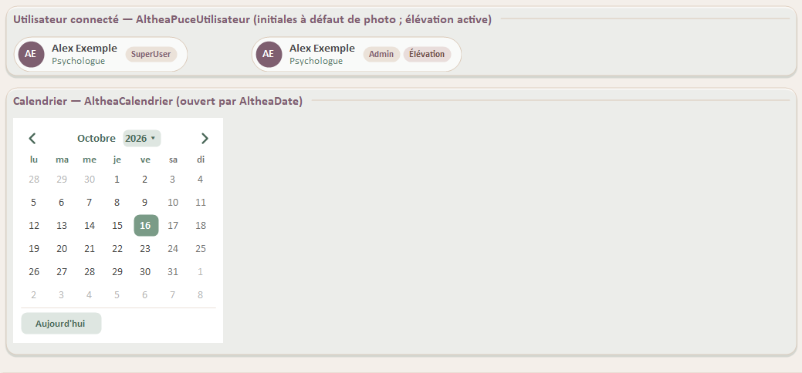

**Rôle** : calendrier dessiné, ouvert par `AltheaDate` ; utilisable seul.

| Propriété | Défaut | Remarque |
| --- | --- | --- |
| `DateChoisie` | *(aucune)* | `Date?` (code). |
| `DateMin` / `DateMax` | 01/01/1900 / 31/12/2099 | Hors bornes : grisées. |
| `Size` | 272 × 292 | `TailleConseillee()`. |
| Évènements | `DateValidee(sender, choix)`, `Abandon` | |
| Clavier | | Flèches, Page haut / bas (mois), Origine (aujourd'hui), Entrée, Échap. |

### 7.12 AltheaRecherche (`UserControl`)

**Rôle** : champ de recherche des bandeaux (loupe dessinée).

| Propriété | Défaut | Remarque |
| --- | --- | --- |
| `Text` / `TexteAide` | *(vide)* | Texte saisi / texte d'aide. |
| `MaxLength` | 32767 | |
| `Size` / `Font` | 320 × 32 / Calibri 11 | |
| Évènements | `TextChanged`, `KeyDown`, `KeyPress`, `KeyUp` | Comme une `TextBox` ; `Clear()`, `SelectAll()`. |

### 7.13 AltheaOnglets (`TabControl`)

| Propriété | Défaut | Usage / remarque |
| --- | --- | --- |
| `CouleurFond` | `ColorBeigeClair` | **`Transparent`** sur les écrans à fond beige (recopie le fond du parent, ADR-32). |
| `CouleurTrait` / `CouleurSoulignement` / `EpaisseurSoulignement` | `ColorBeigeFonce` / `ColorSauge` / 3 | |
| `Padding` / `ItemSize` | 14; 5 / 0 × 30 | |
| `Font` | héritée | Volontairement non imposée. |
| `MasquerOnglets` | `False` | `True` : bande masquée à l'exécution (navigation par `AltheaEtapes`). |

### 7.14 AltheaEtapes (`Control`)

| Propriété | Défaut | Remarque |
| --- | --- | --- |
| `Etapes` | *(vide)* | Libellés, dans l'ordre (Designer). |
| `IndexCourant` | 0 | Étape affichée ; flèches gauche / droite. |
| États | `AFaire` | `DefinirEtat(index, etat, detail)` : `Fait`, `ACompleter`, `NonNecessaire` ; `ReinitialiserEtats()`. |
| Évènement | `EtapeChoisie(sender, index)` | |
| `Size` | 600 × 84 | Pastilles de 30 px. |

### 7.15 AltheaLigne (`Button`)

**Rôle** : une ligne cliquable « icône · titre · aperçu · action » (zones du suivi clinique).

| Propriété | Défaut | Remarque |
| --- | --- | --- |
| `Text` / `Image` | — | Titre ; icône blanche 24 px sur pastille Sauge de 36 px. |
| `Description` / `TexteVide` | *(vide)* / `Vide` | Aperçu sur une ligne ; texte gris italique si vide. |
| `TexteAction` | `Ouvrir` | |
| `LargeurTitre` | 180 | Aligne les aperçus. |
| `Separateur` | `True` | `False` pour la dernière ligne. |
| `Size` / `Font` | 600 × 54 / Calibri 11,25 gras | |

### 7.16 AltheaPastille (`Label`)

| Propriété | Défaut | Remarque |
| --- | --- | --- |
| `CouleurFond` | `ColorGrisVertClair` | |
| `CouleurBordure` | `Color.Empty` | Contour facultatif. |
| `Padding` | 8; 2; 8; 2 | |
| `ForeColor` / `AutoSize` | `ColorSaugeTresFonce` / `True` | |

### 7.17 AltheaJauge (`Control`)

| Propriété | Défaut | Remarque |
| --- | --- | --- |
| `Valeur` / `Maximum` | 0 / 0 | `Maximum = 0` : jauge vide. |
| `SeuilAlerte` | 0 | Jaune modéré dès ce seuil ; Rouge moyen clair dès `Valeur ≥ Maximum`. |
| `Size` | 200 × 8 | Aussi barre de progression (restauration). |

### 7.18 AltheaIconeEtat (`Control`)

| Propriété | Défaut | Remarque |
| --- | --- | --- |
| `Etat` | `Information` | `Information`, `Avertissement`, `Erreur`, `Question`, `Succes`, `Attente` (tourne). |
| `Size` | 32 × 32 | Carré conseillé. |
| `Teintes(etat)` | *(Shared)* | `.Base`, `.Pale` (85 % de blanc), `.Foncee` (30 % de noir). |
| `Dessiner(g, zone, etat[, angle])` / `CreerImage(etat, cote)` | *(Shared)* | Dessin de l'icône sur une surface, ou image à fond transparent (à libérer) pour un contrôle qui attend une `Image` — ex. `AltheaEnTete.Icone` dans `DialogChoix`. L'arc d'attente n'y tourne pas. |

### 7.19 AltheaBoutonMenu, AltheaFilAriane, AltheaPuceUtilisateur (Home)

| Contrôle | Propriétés | Remarque |
| --- | --- | --- |
| `AltheaBoutonMenu` (`Button`) | `Rayon` 12, `TailleIcone` 32, `Tag` = nom logique | Couleurs et icônes posées par `UtilsButtons.InitHomeMenuButton` / `SetSelectedHomeMenuButton`. |
| `AltheaFilAriane` (`Label`) | `Text` (segments « > »), `Pastille`, Calibri 11 `ColorGrisDiscret` | Dernier segment en gras ; renseigné par `UserControlContext.SetHeader`. |
| `AltheaPuceUtilisateur` (`Control`) | `Nom`, `Precision`, `Role`, `Eleve`, `Photo` | Initiales ou photo ronde ; ancré à droite. |

### 7.20 Utilitaires du kit (classes partagées)

| Classe | Membre | Rôle |
| --- | --- | --- |
| `AltheaFondFenetre` | `Appliquer(surface)`, `LargeurZone` | Fond Beige clair, feuille dessinée dans le coin haut droit, retire l'image de fond ; pour une `Form`, applique aussi `AltheaBarreTitre`. `LargeurZone` (84 px à 100 %) : place de la feuille, à laisser libre à droite d'un titre dimensionné par le code. |
| `AltheaBarreTitre` | `Appliquer(fenetre)` | Barre de titre Windows : fond Beige clair, titre Sauge très foncé, bordure Sauge clair (Windows 11, sans effet avant). Pour Home et les fenêtres sans fond du kit. |
| `AltheaFondParent` | — | Recopie le fond du parent sous les contrôles qui ignorent la transparence (onglets, listes, champs composés). Interne au kit. |
| `AltheaDessin` | — | Outils de dessin : coins arrondis, ombres, couleurs dérivées, image atténuée. Interne au kit. |

### 7.21 DialogChoix (`Form`)

**Rôle** : la boîte de message de l'application (V2.0.0). Détail complet : documentation technique UI, partie socle ([`UI/UI_Socle.md`](../Architecture/UI/UI_Socle.md)).

| Élément | Valeur |
| --- | --- |
| Fenêtre | `FixedDialog`, `AltheaFondFenetre.Appliquer(Me)` (fond, feuille, barre de titre du kit), 420 à 640 px de large, 70 % de l'écran au plus, recentrée sur l'appelante |
| En-tête | `AltheaEnTete` hauteur 58, icône d'état 40 px (`AltheaIconeEtat.CreerImage`), titre Calibri 15,75 gras **mauve** |
| Message | `AltheaCarte` (marges 12, `Padding` 16; 12; 16; 18) : message, détails (« libellé : valeur »), complément, attention, remarque, question finale ; défile au-delà de la hauteur maximale |
| Boutons | `AltheaBarreActions` hauteur 54 ; hauteur 34, largeur = texte + 36 (min 96) ; de gauche à droite bouton 1 (`VarianteAction`), 2, 3 (`Clair`) |

```vb
DialogChoix.Information(message[, titre])          ' aussi Avertissement, Erreur, Succes
DialogChoix.Confirmer(message, titre, "Enregistrer", "Revenir à la saisie"[, variante[, attention]])
DialogChoix.ConfirmerSuppression(message[, titre[, attention]])   ' Supprimer (Terre), Annuler par défaut
DialogChoix.Question(message[, titre])             ' Oui / Non / Annuler
```

Résultat : bouton 1 → `Yes` (`OK` s'il est seul), bouton 2 → `No`, bouton 3 → `Cancel` ; Entrée = bouton par défaut, Échap et la croix = dernier bouton.

---

### 7.22 UC_Pagination (`UserControl`, composant commun)

Barre posée sous une grille liée à une liste en mémoire (`Dock = Bottom`, dans la même carte que la grille) : la grille ne montre que la page courante, sans ascenseur vertical. Refondue le 19/10/2026 (V1.1.0).

| Membre | Rôle |
| --- | --- |
| `Attacher(grille, "patient(s)"[, triable])` | Relie la barre à la grille ; le libellé porte la marque du pluriel (« 1 patient », « 12 patients », « Aucun patient »). `triable = False` pour une grille dont l'ordre porte le sens. À appeler **avant** les filtres dont l'initialisation affiche déjà la liste. |
| `DefinirSource(liste[, page])` | Remplace la liste complète (déjà filtrée) et affiche la page demandée (1 par défaut). |
| `PageDeIndex(index)` | Page qui contient un élément de la liste : ouvrir sur la page utile (ligne « Aujourd'hui » des séances). |
| `HauteurReservee` | Place (px) que l'écran réserve dans une page à ses repères `DividerHeight` (« Aujourd'hui », groupes de la liste Patients). |
| `PageCourante`, `NombrePages`, `TaillePage`, `PageChangee` | État et événement après chaque page affichée. |

- Taille de page calculée sur la hauteur visible de la grille (moins les repères réservés ; l'ascenseur horizontal seulement s'il est affiché) ; recalculée au redimensionnement en gardant le premier élément affiché.
- Boutons `AltheaBouton` Outil 30 × 30 (icônes `pagePremiere` / `pagePrecedente` / `pageSuivante` / `pageDerniere` 24 px, `Assets/Ico_divers`), résumé en Gris discret à droite ; quand tout tient sur une page, seul le résumé reste.
- Tri par en-tête sur la liste complète (pas seulement la page), retour en page 1.
- **Où** : Patients, Famille, Intervenants, Référentiels, Thérapeutes, Séances et Paiements d'un dossier. **Pas** pour les grilles courtes ou à repères dont l'ordre porte le sens (planning du jour, État du système, Journaux) ni les grilles remplies ligne à ligne (`Rows.Add`).

---

### 7.23 UC_RichTextEditor (`UserControl`, composant commun) et AltheaRenduBarre

Éditeur de texte riche, refondu le 19/10/2026 (V2.0.0, ADR-42, maquette « Éditeurs de texte — refonte ») : un seul contrôle, deux profils. Guide : `Docs/Guide/UC_RichTextEditor_Documentation.md`.

| Membre | Rôle |
| --- | --- |
| `Profil` | `Complet` (documents : anamnèse, zones du dossier) ou `Compact` (notes et commentaires posés dans une fiche ou une fenêtre). |
| `ChargerContenu(rtf, txt)` / `RtfContent` / `TextContent` | Chargement avec repli sur le texte brut ; enregistrement des deux formes (`_rtf` + `_txt`, Rules § 21). |
| `ReadOnlyMode` / `ShowToolbar` | Consultation (profil Complet : barre de consultation ; Compact : barre masquée) ; barre affichée. |
| `ContentChanged` / `MarquerEnregistre()` | Modification du texte **ou** de la mise en forme ; fin de l'état « Modifié » après enregistrement. |
| `TitreDocument` / `NomAuteur` / `SetContext` | Titre des impressions et de la fenêtre « Ouvrir en grand » ; auteur de l'horodatage signé (par défaut l'utilisateur du contexte). |
| `AfficherSorties` / `EstModifie` | Aperçu, impression et export affichés (profil Complet) ; contenu modifié depuis le chargement. |
| `CorrecteurOrthographe` | Correcteur de Windows (vrai par défaut, actif en saisie, réglage `EDITEUR_CORRECTEUR_ORTHOGRAPHE`) ; ne pas le couper écran par écran sans raison (ADR-45). |
| `UsageTextesTypes` | Usage de l'éditeur pour les textes types (`UsagesTexteType`), renseigné dans le `Load` de l'écran ; vide = pas de bouton. |
| `PatientDocument` | Patient de l'en-tête des documents : `EnTeteDocument.DesignerPatient(patient)` ; à renseigner par tout écran qui pose un éditeur Complet sur les données d'un patient. |
| `ExportRequested` / `ExportCompleted` | Export contextuel délégué au conteneur (ADR-21). |

- **Pose** : `Dock = Fill` dans une `AltheaCarte` ; choisir le profil dans le Designer ; transmettre le contexte (`SetContext`) depuis l'écran.
- **Barre** : `ToolStrip` blanche, trait Beige dessous, boutons Outil (survol Gris-vert clair, coché Sauge clair), icônes 20 px `Assets/Editor_Ico/*_20_normal.png`, désactivé à 40 %. Styles de paragraphe à la place de la police et de la taille ; couleurs et surligneurs de la charte uniquement ; **G** pour gras.
- **Texte** : Calibri 11 Gris foncé sur Beige clair, marge intérieure 10 px, sans cadre.
- **`AltheaRenduBarre`** (`UI/Controls/Theme`) : rendu du kit pour toute `ToolStrip` ou `ContextMenuStrip` (`Renderer = New AltheaRenduBarre()`) ; un libellé dont on fixe `BackColor` est dessiné en pastille.
- **Textes types — règle** (19/10/2026, ADR-44) : **tout éditeur de texte reçoit son usage**. Nouvel éditeur : ligne système dans `ref_usages_textes_types` (migration), constante dans `UsagesTexteType`, puis `rteXxx.UsageTextesTypes = UsagesTexteType.Xxx` dans le `Load` de l'écran.
- **Ouvrir en grand** (profil Compact, 19/10/2026) : bouton à droite de la barre ; fenêtre `EditeurTexteAgrandi` au profil Complet, sans sorties ; Valider reporte le texte dans le champ (enregistré avec sa fiche). Donner à chaque éditeur Compact un `TitreDocument` qui nomme le champ (« Notes de séance »).
- **Où** :
  - profil Complet dans l'anamnèse et la zone du dossier
  - profil Compact pour l'alerte, les notes et l'évolution de séance, les commentaires (contact, intervenant, thérapeute).
  - Une note courte enregistrée en texte simple (commentaire d'un paiement, motif d'une annulation) prend une `AltheaZoneTexte` (§ 7.24) ; passer à l'éditeur demande ses deux colonnes en base.

### 7.24 AltheaZoneTexte (`RichTextBox`)

**Rôle** : zone de texte **simple** avec le correcteur d'orthographe de Windows, pour une note courte enregistrée en texte (20/10/2026, ADR-45) : commentaire d'un paiement, motif d'une annulation.

| Propriété | Défaut | Remarque |
| --- | --- | --- |
| `Text` / `TextChanged` / `ReadOnly` | — | Comme une `TextBox` : changer le type déclaré suffit ; `DefinirLectureSeule` et `GardeModifications` la lisent comme une zone de texte. |
| `CorrecteurOrthographe` | `True` | Actif en saisie si le réglage `EDITEUR_CORRECTEUR_ORTHOGRAPHE` le permet ; même clic droit que l'éditeur (`CorrecteurTexte`). |
| `AcceptsReturn` | `False` | Comme une `TextBox` : Entrée déclenche le bouton par défaut de la fenêtre ; Maj+Entrée passe à la ligne. |
| `Multiline` / `ScrollBars` | `True` / — | `RichTextBoxScrollBars.Vertical` pour une note sur plusieurs lignes. |
| `Font` / `ForeColor` / `BackColor` | — | Comme une `TextBox` (§ 8) : Calibri 11, Gris foncé, blanc. |

- **Texte sans mise en forme** : collage en texte seul (Ctrl+V, Maj+Inser, menu) ; raccourcis de mise en forme du contrôle sans effet (Alt Gr reste libre) ; menu du clic droit du kit : Couper, Copier, Coller, Tout sélectionner.
- **Quand** : une note courte, sans mise en forme, que l'application peut compléter elle-même. Une note qu'on met en forme (notes de séance, commentaires des fiches) : `UC_RichTextEditor` Compact (§ 7.23), avec ses deux colonnes en base.

## 8. Contrôles Windows encore utilisés

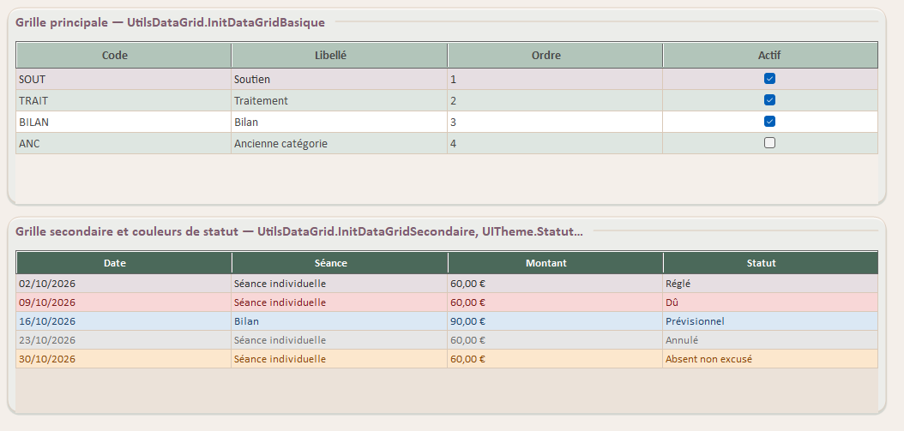

| Contrôle | Réglages | Remarque |
| --- | --- | --- |
| `TextBox` | `Font` Calibri 11, `ForeColor` Gris foncé, `BackColor` blanc ; `MaxLength` = taille de la colonne en base | Consultation : `DefinirLectureSeule`. Texte d'aide : `PlaceholderText`. |
| `NumericUpDown` | Calibri 11, `TextAlign` Right, `DecimalPlaces`, bornes | Pas encore de champ du kit ; en consultation, flèches désactivées par `DefinirLectureSeule`. |
| `DateTimePicker` (dates) | — | **Plus aucun** depuis le 20/10/2026 (les trois derniers — filtre « Dernière connexion » de `UC_Utilisateurs`, dates des règles de quota, dates des tarifs liés — sont passés à `AltheaDate`). Ne pas en réintroduire. |
| `DataGridView` | `UtilsDataGrid.InitDataGridBasique` (liste principale) ou `InitDataGridSecondaire` (grille dans une carte) ; états en **pastilles** (`DessinerPastilleCellule`, couleurs `UtilsPastilles`), repère titré entre deux lignes (`DessinerSeparateurSousLigne`) | Jamais de couleurs posées à la main : `UITheme.DataGrid*`. Colonnes nommées `colXxx`, `AutoGenerateColumns = False`. États dans un ton sémantique (`TonEtat`) ; alignements : `AlignerCentre` / `AlignerDroite`. |
| `PictureBox` | `SizeMode = Zoom`, `BorderStyle = FixedSingle` pour un cadre d'image | Images importées via `UtilsImages` / `ImagesHelper`. Logo (domaine, cabinet) : réduit dans un **cadre en longueur** (`ImagesHelper.ReduireDans`, `LogosDomaines.Miniature(id, fichier, largeur, hauteur)`), puis le contrôle prend la taille de l'image — un carré rend illisible un logo large. Cadres : liste 56 × 18, bandeau du dossier 120 × 52, convention 180 × 80, bandeau de la Home 180 × 40. Une miniature de `LogosDomaines` est partagée : ne pas la libérer (pas de `RemplacerImage`). |
| `StatusStrip` | `BackColor` Beige foncé ; `stsLabelStatus` Calibri 9,75 gras | Seulement les fenêtres ouvertes avant la Home (`Login`, `ChangePassword`). |
| `ErrorProvider` | `ContainerControl = Me` | UC : `_context.SetError`. |
| `ToolTip` | `ttMain` | UC : `_context.SetToolTip`. |
| `FlowLayoutPanel` | `pnlBas` (boutons de la barre d'actions d'un UC), `pnlImages` (cartes d'images) | |
| `TableLayoutPanel` | grille de tuiles des hubs uniquement | |
| `SplitContainer` | `UC_DomainesHome` uniquement | Plus dans `UC_Cabinet` depuis le 16/10/2026 (deux cartes). |

---

## 9. Utilitaires d'interface

| Module | Méthode | Usage |
| --- | --- | --- |
| `UtilsButtons` | `InitStandardButton(btn)` | Bouton avec texte : icône 32 px par état d'après le `Tag`. |
| | `InitLargeIconButton(btn)` | Tuile : icône 48 px. |
| | `InitDiversIconButton(btn)` | Icône 24 px de `Ico_divers` par état — **pas** pour un `AltheaBouton` Outil à icône seule. |
| | `InitHomeMenuButton(btn)` / `SetSelectedHomeMenuButton` | Menu de la Home. |
| `UtilsControls` | `DefinirLectureSeule(zone, lectureSeule)` | Consultation lisible d'une carte, d'un panneau, d'un onglet. |
| | `DefinirChampLectureSeule(champ, lectureSeule)` | Un champ seul. |
| `GardeModifications` | `SurveillerFenetre(fenêtre, btnEnregistrer, deQuoi)` ; `New`, `PhotographierApresChargement`, `EstModifie`, `Oublier` | Modifications non enregistrées (§ 5.8). |
| `UtilsAffichage` | `SuspendreDessin(zone)` / `ReprendreDessin(zone)` | Gèle l'affichage d'une zone pendant une construction en plusieurs étapes, puis la redessine en une fois (toujours reprendre dans un `Finally`). Utilisé par `NavigationManager` pour tous les écrans. |
| `UtilsDataGrid` | `InitDataGridBasique`, `InitDataGridSecondaire` | Style des grilles. |
| | `DessinerPastilleCellule(dgv, e, texte, teinte[, mention, atténuée, contour])` | Dans `CellPainting` : état en pastille arrondie (fond pâle, texte foncé), mention grise facultative ; centrée hors de la marge basse de la ligne (`DividerHeight`). ; `contour` : pastille au trait pointillé, sans fond (état à signaler sans le confondre avec un statut, ex. « Aucun RDV »). | V1.2.0 (18/10/2026) : toute pastille pleine porte un fin contour dans sa teinte (forme nette sur ligne blanche, alternée ou sélectionnée).
| | `AlignerCentre(colonnes…)`, `AlignerDroite(colonnes…)` | Convention d'alignement : dates et heures centrées, montants et nombres à droite (18/10/2026). `InitDataGridBasique` active aussi le double tampon et partage ses polices.
| | `DessinerSeparateurSousLigne(e, dgv, texte)` | Dans `RowPostPaint` : séparateur titré dans la marge `DividerHeight` d'une ligne (ex. « Aujourd'hui »). |
| | `DessinerRepereSurLigne(e, dgv, texte[, pointillé])` | Dans `RowPostPaint` : repère titré sur toute une ligne réservée, trait plein (section) ou pointillé (créneau libre) — quand le repère n'a pas de ligne au-dessus de lui ; grille en lecture seule, non triable (18/10/2026). Ligne sélectionnable (en-tête de session des journaux) : peinte dans la couleur de sélection.
| | `DesactiverTri(dgv)` | Toutes les colonnes non triables : grille dont l'ordre porte le sens (sections, sessions), qu'un tri automatique mélangerait (18/10/2026).
| | `TriUtilisateurActif`, `ReinitialiserTri` | Savoir si l'utilisateur a trié par en-tête ; revenir à l'ordre de l'écran. |
| `UtilsPastilles` | `Teinte(ton)` (`TonEtat`, 18/10/2026), `Teinte(famille)`, `TeinteStatutDossier(dossier)`, `TeinteSuiviListe(code)` | Couleurs (fond, texte) des pastilles d'état par famille (statut de séance, paiement — aussi la pastille « État » des paiements ; rendez-vous de la grille Patients), de la pastille de statut du dossier et de la pastille Suivi de la grille Patients ; administration (18/10/2026) : état d'un compte (`EtatCompteUtilisateur`), appréciation de l'état du système (`NiveauEtat`), résultat d'une sauvegarde ou d'une restauration ; référentiels (18/10/2026) : ligne de référentiel (`EtatReferentielLigne` : Système bleu, Inactif gris), rattachements nature et tarif / domaine (`EtatLiaisonNature`, `EtatLiaisonPrix`), règle de quota (`EtatRegleQuota`). Les familles s'appuient sur les tons quand leurs couleurs sont les mêmes. |
| | `ActiverEntetesMultiLignes`, `ActiverTriColonnes`, `DefinirSourceTri` | En-têtes sur deux lignes, tri par clic. |
| `UtilsSaisieReferentiels` | `ChargerCivilites`, `ChargerPays`, `IdCiviliteSaisie`, `CodePaysSaisi`… | Listes de référence et lecture des choix. |
| `UITheme` | couleurs, chemins d'assets, suffixes d'icônes | Source unique des couleurs. |

---

## 10. Nommage

| Élément | Préfixe | Exemple |
| --- | --- | --- |
| Carte | `carte` | `carteIdentite`, `carteParametres` |
| Barre locale | `barre` | `barreCategories` |
| En-tête | — | `enTete` |
| Barre d'actions | — | `pnlActions` (fenêtre), `barreActions` + `pnlBas` (UC) |
| Bouton | `btn` | `btnEnregistrer`, `btnVoirPassword` |
| Libellé | `lbl` | `lblNomCabinet` |
| Zone de texte | `txt` | `txtCabRue` |
| Liste | `cbo` | `cboCabPays` |
| Date | `dtp` | `dtpDateCloture` |
| Heure | `hre` | `hreDebut`, `hreFin` |
| Case | `chk` | `chkActif` |
| Nombre | `nud` / `num` | `nudPort` |
| Grille, colonne | `dgv`, `col` | `dgvCategories`, `colLibelle` |
| Onglets, page | `tab`, `tp` | `tabCabinet`, `tpPraticien` |
| Image | `pic` | `picLogo` |
| Infobulles, erreurs | `ttMain`, `errProvider` | |
| UserControl | `UC_` | `UC_Cabinet` |
| Fenêtre | nom métier + rôle | `SeanceEditor`, `DialogRestauration`, `ContactEdition` |

---

## 11. Assets

| Type | Dossier | Format | Usage |
| --- | --- | --- | --- |
| Icône de l'application | `Assets/Appli_Ico/` | ICO 96 | `Form.Icon` |
| Fond de la Home, logo, feuillage | `Assets/Fond/`, `Assets/Splash/` | PNG | Home uniquement |
| Boutons d'action | `Assets/Boutons_ico_32/` | PNG 32 | `_normal`, `_hover`, `_disabled` |
| Tuiles | `Assets/Boutons_ico_48/` | PNG 48 | |
| Menu Home | `Assets/Boutons_Home/` | PNG 48 | `_normal`, `_selected`, `_disabled` |
| Icônes d'en-tête | `Assets/Titre_Ico/` | PNG 48 | `AltheaEnTete.Icone` |
| Petits boutons, icônes du kit | `Assets/Ico_divers/` | PNG 24 | Image du Designer (Outil) |
| États des grilles | — | dessinés | Pastilles `UtilsPastilles` / `DessinerPastilleCellule` (PNG `Tech_Ico` supprimés le 18/10/2026) |
| Zones du suivi clinique | voir Charte | PNG | `AltheaLigne` |

Les fonds d'images (`Fond_1000x800_Feuille4`, `ui-backgrounds`) et les GIF de l'ancien `DialogChoix` ont été supprimés au lot UI-8 (17/10/2026).

Inventaire illustré de toutes les icônes : [`Charte_Graphique.md`](./Charte_Graphique.md).

---

# Contact

> ***Joëlle De Poorter - Les Artefacts de Manou***
>
> Projet réalisé pour soutenir une pratique de psychologie et de graphologie dans la gestion fiable et évolutive des patients et documents.
>
> - Site web Auteur/Les Artefacts de Manou/Joëlle De Poorter : https://lesartefactsdemanou.be
>
> - Site web Psychologue & Graphologue:  https://pearlnguyenduy.be/
> - mailto: `joelle@nguyen.eu` et `lesartefactsdemanou@gmail.com`
>
> - GitHub privé: Althea    https://github.com/AngeljoNG/Althea
> - GitHub public : https://github.com/Les-Artefacts-de-Manou/Althea
>
> ---
